<!-- cover
institution: SIMATS ENGINEERING
department: Department of Computer Science and Engineering
course: CSA06 – Design and Analysis of Algorithms
assignment: ASSESSMENT TOOL 1 – CO1
subtitle: Scalability Audit of an E-Commerce Platform (ShopSphere)
coverage: CO1: Determine algorithm efficiency using asymptotic notations and mathematical techniques including Master Theorem and substitution method
student_name: V. Vasudevan
register_number: 192425324
nature: Individual
duration: 3 Days
total_marks: 100
marks: 1 | Understanding of Problem Context | 20
marks: 2 | Application of Concepts | 30
marks: 3 | Problem-Solving Approach | 20
marks: 4 | Accuracy of Solution | 20
marks: 5 | Clarity | 10
details: CO1 Coverage | Determining algorithm efficiency with asymptotic notations (O, Ω, Θ), exact operation counts by summation, the substitution (backward-substitution) method, the Master Theorem (including the extended form) and recursion trees – applied to an IT application-based scalability audit of five back-end modules of an online shopping platform.
details: Nature of Assignment | Individual
details: Duration | 3 Days
details: Total Marks | 100
details: Submission Date |
-->

# CSA06 – Assessment Tool 1 (CO1): Scalability Audit of an E-Commerce Platform (ShopSphere)

### Problem Statement: ShopSphere – Scalability Audit of an Online Shopping Platform

> **Course:** CSA06 – Design and Analysis of Algorithms. **Assessment:** CO1 – Assessment Tool 1: IT Application-Based Problem Solving – Scalability Audit of an E-Commerce Platform.
> **CO assessed:** Determine algorithm efficiency using asymptotic notations and mathematical techniques including Master Theorem and substitution method. **Mode:** Individual.
> **Instructions:** Answer all parts. Show the basic operation, every step of each derivation and the final asymptotic result, and interpret what each result means for the platform. Assume the platform's servers execute 10⁸ basic operations per second.
> **Scenario – Scalability Audit of "ShopSphere", an Online Shopping Platform.** ShopSphere is a growing e-commerce platform whose product catalogue currently holds n = 100,000 products and is expected to reach n = 1,000,000 within a year. Before the expansion, the CTO has asked you, as the platform's algorithm engineer, to audit five back-end modules, predict how each will behave as n grows, and recommend which modules must be redesigned.

The five audited modules, as given in the question paper:

**Module M1 – Duplicate-Listing Detector.** Sellers sometimes upload the same product twice. Every night, the following routine compares every product with every later product.

```
FOR i ← 0 TO n − 2 DO
  FOR j ← i + 1 TO n − 1 DO
    IF Product[i].title = Product[j].title AND Product[i].seller = Product[j].seller THEN
      MarkDuplicate(j)
    END IF
  END FOR
END FOR
```

**Module M2 – API Rate Limiter.** The public API audits request windows of doubling size using the routine below. A team member claims that it is Θ(n log n) because the outer loop runs about log n times and the inner loop runs up to n times.

```
i ← 1
WHILE i < n DO
  FOR j ← 0 TO i − 1 DO
    Audit(Request[j])   // basic operation
  END FOR
  i ← i × 2
END WHILE
```

**Module M3 – Product Search.** Two versions exist. Version S1 scans the unsorted catalogue sequentially until the product is found. Version S2 searches a sorted product index by comparing the key with the middle entry and discarding half the index after each comparison; its comparison count satisfies T(n) = T(n/2) + 1, T(1) = 1.

**Module M4 – Recommendation Engine.** The engine splits the customer–product data into four parts of size n/2 (because of replicated partitions) and merges the partial results in linear time: T(n) = 4T(n/2) + n. A proposed redesign removes the replication, giving T(n) = 2T(n/2) + n.

**Module M5 – Sales Analytics Engine.** The analytics engine splits the sales data into halves recursively and sorts the records by revenue at every level, giving T(n) = 2T(n/2) + n log n. Separately, profiling shows that the nightly report generator performs f(n) = 3n² + 10n log₂ n + 50 operations.

#### How the seven parts are answered in this scenario

Part (a) fixes the input size and basic operation of every module. Parts (b) and (c) produce exact operation counts for the iterative modules (M1, M2) and for the binary search S2 by summation and backward substitution. Part (d) applies the Master Theorem (and, for M5, its extended form and a recursion tree) to the recursive engines. Part (e) separates best, average and worst cases of the two search versions, part (f) proves the Θ(n²) bound of the report generator from the formal definitions, and part (g) turns every result into operation counts and running times for n = 10⁶ at 10⁸ operations per second, decides which modules miss the 10-minute nightly window and recommends redesigns.

Problem types identified: M1 is an **element-uniqueness (duplicate detection)** problem solved by brute force over all pairs; M2 is a **doubling-loop iteration** whose cost is a geometric series; M3 is **searching** (sequential and binary); M4 and M5 are **divide-and-conquer** algorithms whose costs are recurrences of the form T(n) = aT(n/b) + f(n); the report generator is analysed through its **cost function** only.

**Evidence and reproducibility.** Every number in this report comes either from a derivation shown in the text or from a run of the programs in `Source_Code/` (complete listings in Appendix A and B). Each module is implemented in hand-written Python with an explicit counter for its basic operation, and every program prints the counted value next to the derived closed form:

- `m1_duplicate_detector.py` – M1 and its two redesigns (part (b), (g));
- `m2_rate_limiter.py` – M2, trace for n = 1,024 (part (b));
- `m3_product_search.py` – S1 and S2, iterative and recursive (parts (c), (e));
- `m4_m5_recurrences.py` and `m4_m5_simulation.py` – M4 and M5 recurrences and executed engines (part (d));
- `f_bound_proof_check.py` – the report generator bound (part (f));
- `scalability_estimates.py` – the estimates and the 10-minute verdicts (part (g));
- `make_graphs.py` draws the figures, `run_tests.py` runs 42 automated checks (Appendix D) and `run_all.py` runs everything in order; `audit_common.py` holds the constants of the paper.

Raw data are saved as CSV files in `Supporting_Files/` (Appendix C). Operation counts are the primary evidence; wall-clock times are secondary because other programs shared the CPU.

Table 1: Test environment

| Item | Value |
|---|---|
| Processor | 13th Gen Intel Core i5-13420H (Intel64 Family 6 Model 186), 12 logical processors |
| Memory | 15.6 GB RAM |
| Operating system | Microsoft Windows 11 Home Single Language (10.0.26200) |
| Language | Python 3.13.11 (CPython), standard library only for all algorithms |
| Libraries | matplotlib 3.10.8 (graphs only); `fractions` for exact averages |
| Random seed | 42 (plus fixed per-experiment seeds, e.g. seed = n) – every run is reproducible |
| Timer | `time.perf_counter`, one warm-up run, minimum of 3–5 repeats, garbage collector paused |
| Cost model of the paper | 10⁸ basic operations per second; nightly window 10 minutes = 600 s = 6 × 10¹⁰ operations |

## Part (a) – Understand the Problem

> **(a) Understand the Problem:** For each of the five modules, identify the input size and the basic operation that dominates the running time, explain where it occurs, and state how you expect its execution count to grow as n increases. Justify each choice briefly.

**Ans:**

### 1. How I chose the input size and the basic operation

The input size is the quantity that grows from 100,000 to 1,000,000 during the year, so for every module it is a count of catalogue items, requests or records. The basic operation is the operation inside the **innermost loop** (or inside the non-recursive part of a recursive call) – the one executed most often – so that counting it alone gives the order of growth of the whole module. Everything else (loop-index updates, function-call overhead) is executed at most a constant number of times per basic operation and only changes the constant factor.

Table 2: Input size, basic operation and expected growth of the five modules

| Module and input size n | Basic operation | Where it occurs | Expected growth |
|---|---|---|---|
| **M1 Duplicate-Listing Detector** – n = number of products in the catalogue | title comparison `Product[i].title = Product[j].title` | first test of the IF inside the inner FOR loop; executed once for every pair (i, j) with i < j | quadratic: every product is compared with every later product → ≈ n²/2 → Θ(n²) |
| **M2 API Rate Limiter** – n = number of requests in the audited log | `Audit(Request[j])` | body of the inner FOR loop | linear: windows of size 1, 2, 4, … < n form a geometric series ≈ 2n → Θ(n) |
| **M3 S1 Sequential search** – n = number of products in the unsorted catalogue | key comparison `catalogue[i] = key` | the only test inside the scanning loop | linear in the worst and average case (≤ n comparisons) → Θ(n) |
| **M3 S2 Binary search** – n = number of entries in the sorted index | three-way comparison of the key with the middle entry | once per halving step | logarithmic: the index is halved after every comparison → Θ(log n) |
| **M4 Recommendation Engine** – n = number of customer–product records | one merge step (one partial result combined) and one base-case evaluation | the linear-time merge after the recursive calls, and the size-1 calls | current: 4 calls on n/2, work quadruples when n doubles → Θ(n²); redesign: Θ(n log n) |
| **M5 Sales Analytics Engine** – n = number of sales records | key (revenue) comparison of the sort | the sort executed at every recursion level | n log n work per level × log n levels → Θ(n log² n) |
| **Report generator** – n = number of products | one operation of the profiled cost f(n) | dominated by the 3n² term (a pairwise step) | quadratic → Θ(n²) |

### 2. Justification of each choice

- **M1.** The title test is evaluated n(n − 1)/2 times whatever the data, because the loops have no early exit. The seller test is evaluated only when the titles match (short-circuit AND) and `MarkDuplicate` only for real duplicates, so both are executed at most as often as the title test – the title comparison dominates.
- **M2.** The `WHILE` test and `i ← i × 2` execute only ⌈log₂ n⌉ times, whereas `Audit` executes once per inner iteration, i.e. 1 + 2 + 4 + … times. `Audit` is therefore the dominant operation, exactly as the paper marks it.
- **M3.** In both versions every step of the loop performs one key comparison and some O(1) index arithmetic, so the comparison count is proportional to the running time. S1 depends on where (and whether) the product occurs; S2 depends only on how many halvings are needed.
- **M4.** Each call does a constant amount of splitting work and a merge that touches each of its n partial results once; the base case costs 1. Summing these over the recursion tree gives T(n) = 4T(n/2) + n (current) or 2T(n/2) + n (redesign).
- **M5.** Sorting n records costs ≈ n log n key comparisons and it is repeated on every level of the halving recursion, giving f(n) = n log n in T(n) = 2T(n/2) + n log n.
- **Report generator.** Only its cost function is known; for large n the 3n² term dominates (99.99 % of f(n) at n = 10⁶, Table 17), so its growth is quadratic.

### 3. Expected effect of the catalogue growth (prediction before any measurement)

The catalogue grows by a factor of 10. I therefore expected: the three quadratic modules (M1, M4 current, report generator) to become about **100 times** slower; the Θ(n log n) and Θ(n log² n) modules to become a little more than 10 times slower; M2 and S1 about 10 times slower; and S2 to need only about 3 more comparisons (log₂ 10 ≈ 3.3). Parts (b)–(g) confirm these predictions with exact counts (Tables 19 and 20: growth factors ×100.0 for the quadratic jobs, ×11.9 for M4 redesign, ×14.2 for M5, ×8.0 for M2, and 17 → 20 comparisons for S2).

## Part (b) – Analyse the Iterative Modules

> **(b) Analyse the Iterative Modules:** For M1, derive the exact number of comparisons as a function of n and state the time and space complexity. For M2, derive the exact number of Audit operations, decide whether the team member's Θ(n log n) claim is correct and give the tight bound. Verify your M2 result for n = 1,024.

**Ans:**

### 1. M1 – exact number of comparisons

For a fixed i the inner loop runs for j = i + 1, …, n − 1, i.e. (n − 1) − (i + 1) + 1 = n − 1 − i times, and performs one title comparison each time. Summing over the outer loop:

```
C(n) = Σ (i = 0 .. n−2)  Σ (j = i+1 .. n−1)  1
     = Σ (i = 0 .. n−2)  (n − 1 − i)
     = (n − 1) + (n − 2) + … + 2 + 1                  [i = 0 gives n − 1, i = n − 2 gives 1]
     = Σ (k = 1 .. n−1)  k                             [substitute k = n − 1 − i]
     = (n − 1)·n / 2
C(n) = n(n − 1)/2 = (n² − n)/2
```

Check: n = 4 gives the pairs (0,1), (0,2), (0,3), (1,2), (1,3), (2,3) = 6 = 4·3/2. The seller comparison is made only for pairs with equal titles, so S(n) ≤ n(n − 1)/2 (S(n) = 0 when all titles differ, S(n) = n(n − 1)/2 when all titles are equal); the total number of key comparisons is therefore between n(n − 1)/2 and n(n − 1).

### 2. M1 – time and space complexity

- **Time:** C(n) = n²/2 − n/2. Since n²/4 ≤ C(n) ≤ n²/2 for all n ≥ 2, **C(n) ∈ Θ(n²)**. The loops have no early exit, so the best, average and worst cases are all Θ(n²) – even a catalogue without a single duplicate costs the full n(n − 1)/2 comparisons.
- **Space:** the routine works in place on the catalogue and needs only the indices i, j (and the two compared fields): **Θ(1) auxiliary space**. `MarkDuplicate(j)` sets a flag on product j, which is part of the output, not working storage.
- **Meaning for ShopSphere:** at n = 10⁵ the detector needs 4,999,950,000 comparisons ≈ 50 s, but at n = 10⁶ it needs 499,999,500,000 ≈ 5,000 s ≈ 83.3 minutes – 100 times more work for 10 times more products, and far outside a 10-minute nightly window.

### 3. M1 – verification by the program

`m1_duplicate_detector.py` builds catalogues in which titles are shared by about three sellers (so the seller test is exercised) and plants exactly 2 % re-uploads. It counts every title and seller comparison, compares the duplicates found with a set-based reference, and also runs the two redesigns of part (g).

Table 3: Counted title comparisons against n(n − 1)/2, seller comparisons (equal titles only), duplicates found / planted, growth ratio and time (m1_comparisons.csv)

| Size n | Counted | n(n − 1)/2 | Seller tests | Found / planted | C(n)/C(n/2) | Time (s) |
|---:|---:|---:|---:|---:|---:|---:|
| 500 | 124,750 | 124,750 | 772 | 10 / 10 | – | 0.005 |
| 1,000 | 499,500 | 499,500 | 1,501 | 20 / 20 | 4.004 | 0.024 |
| 2,000 | 1,999,000 | 1,999,000 | 3,051 | 40 / 40 | 4.002 | 0.088 |
| 4,000 | 7,998,000 | 7,998,000 | 6,154 | 80 / 80 | 4.001 | 0.397 |

The counted title comparisons equal n(n − 1)/2 **exactly** for every n, and every planted duplicate was found with no false positives. Doubling n multiplies the count by (2n)(2n − 1)/(n(n − 1)) → 4, the signature of quadratic growth; the measured time ratios (4.74, 3.73, 4.52) scatter around 4 because of interpreter and CPU-sharing noise. The seller comparisons grow only linearly here (about 1.5 per product) because only products with the same title reach the second test – confirming that the title comparison is the right basic operation.

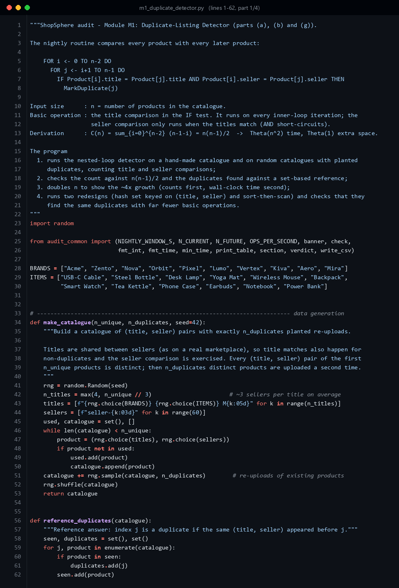

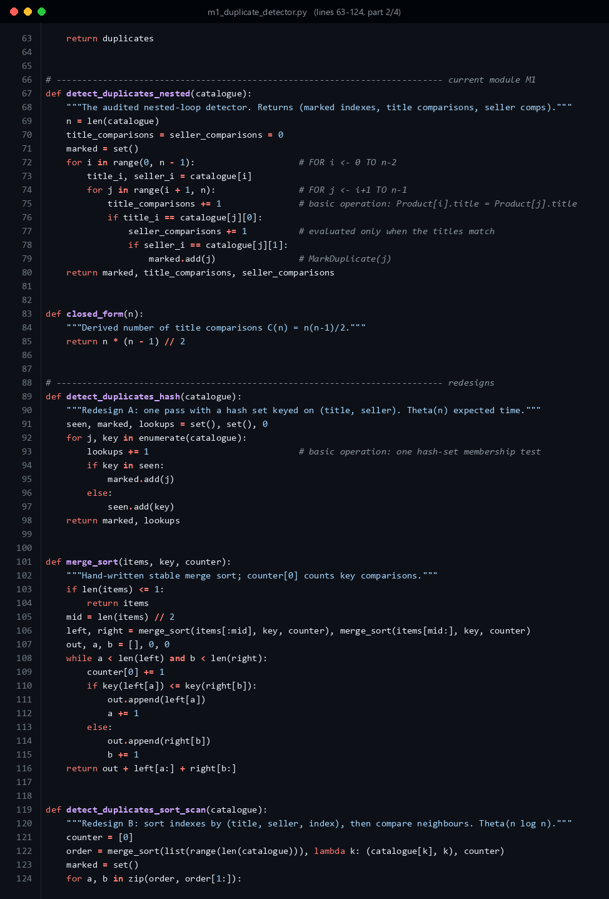

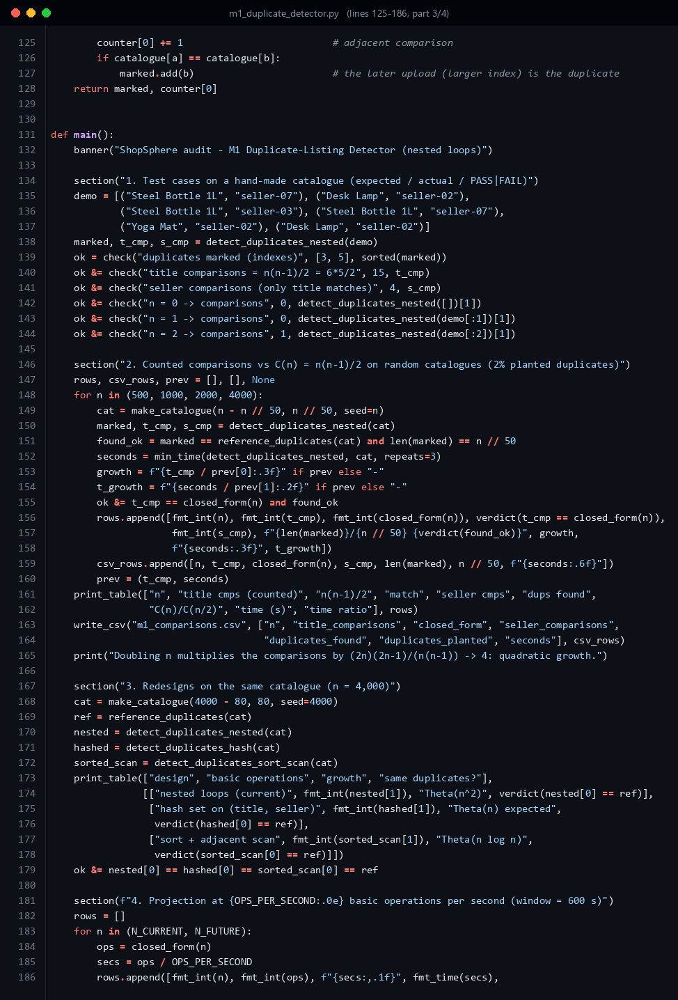

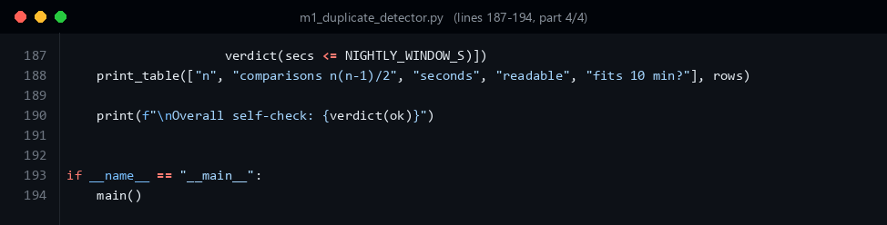

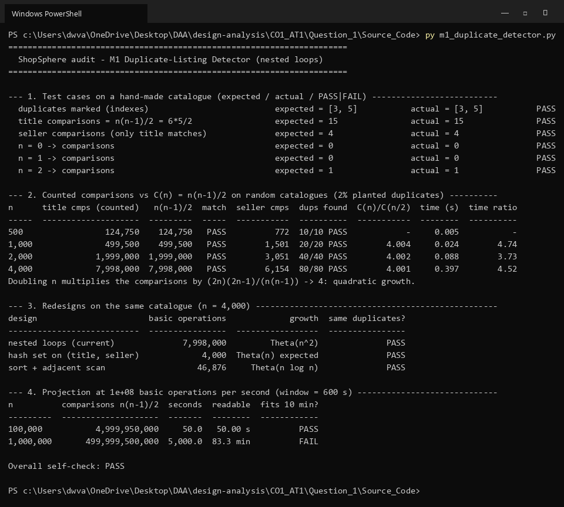

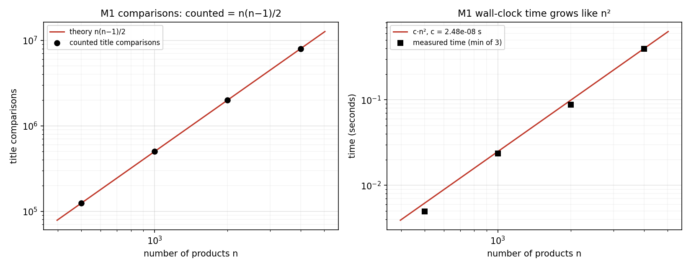

### 4. M2 – exact number of Audit operations

Let the passes of the WHILE loop be numbered k = 0, 1, 2, … . Because i starts at 1 and doubles after each pass, **pass k has i = 2ᵏ** and its inner loop runs for j = 0, …, 2ᵏ − 1, i.e. it performs exactly **2ᵏ audits**.

The loop runs while 2ᵏ < n ⇔ k < log₂ n ⇔ k ≤ ⌈log₂ n⌉ − 1. So there are m = ⌈log₂ n⌉ passes (k = 0, …, m − 1), and the total is a geometric series:

```
A(n) = Σ (k = 0 .. m−1) 2^k          with m = ⌈log₂ n⌉
     = 1 + 2 + 4 + … + 2^(m−1)
     = (2^m − 1) / (2 − 1)            [geometric series, ratio 2]
A(n) = 2^⌈log₂ n⌉ − 1
```

- If n is a power of two, n = 2ᵐ, then **A(n) = n − 1**.
- In general n ≤ 2^⌈log₂ n⌉ < 2n, hence **n − 1 ≤ A(n) ≤ 2n − 3** for every n ≥ 2 (the upper value is reached at n = 2ʳ + 1, e.g. A(1,025) = 2,047 = 2·1,025 − 3).

### 5. M2 – is the team member's Θ(n log n) claim correct?

**No.** The argument "about log n passes × up to n audits per pass" multiplies the *largest* inner-loop count by the number of passes, so it only proves the upper bound A(n) ≤ n·⌈log₂ n⌉, i.e. A(n) ∈ O(n log n). That bound is true but **not tight**: the inner loop runs i times, not n times, and i takes the values 1, 2, 4, …, so the passes form a geometric series whose sum is less than twice its last term. For Θ(n log n) the count would also have to be Ω(n log n), but A(n)/(n log₂ n) ≤ 2n/(n log₂ n) = 2/log₂ n → 0.

The tight bound follows from the inequalities of section 4: for all n ≥ 2, (1/2)·n ≤ n − 1 ≤ A(n) ≤ 2n, so with c₁ = 1/2, c₂ = 2, n₀ = 2:

**A(n) = 2^⌈log₂ n⌉ − 1 ∈ Θ(n).** The space is Θ(1) (only i and j).

### 6. M2 – verification for n = 1,024

1,024 = 2¹⁰, so there are ⌈log₂ 1,024⌉ = 10 passes with i = 1, 2, 4, …, 512, and A(1,024) = 1 + 2 + 4 + … + 512 = 2¹⁰ − 1 = **1,023 = n − 1**. After the 10th pass i becomes 1,024, the test 1,024 < 1,024 fails and the loop stops. The program reproduces this pass by pass:

Table 4: Pass-by-pass trace of M2 for n = 1,024 (m2_rate_limiter_output.txt)

| Pass k | i = 2ᵏ | Inner loop | Audits in this pass | Cumulative audits |
|---:|---:|---|---:|---:|
| 0 | 1 | j = 0..0 | 1 | 1 |
| 1 | 2 | j = 0..1 | 2 | 3 |
| 2 | 4 | j = 0..3 | 4 | 7 |
| 3 | 8 | j = 0..7 | 8 | 15 |
| 4 | 16 | j = 0..15 | 16 | 31 |
| 5 | 32 | j = 0..31 | 32 | 63 |
| 6 | 64 | j = 0..63 | 64 | 127 |
| 7 | 128 | j = 0..127 | 128 | 255 |
| 8 | 256 | j = 0..255 | 256 | 511 |
| 9 | 512 | j = 0..511 | 512 | **1,023** |

The team member's formula would predict n log₂ n = 1,024 × 10 = 10,240 audits for the same input – ten times the real count.

Table 5: Counted audits A(n) against the closed form and the claimed n log₂ n; m = ⌈log₂ n⌉ passes (m2_audit_counts.csv)

| n | Passes m | Counted A(n) | 2^⌈log₂ n⌉ − 1 | A(n) / n | n log₂ n | Claim ÷ A(n) |
|---:|---:|---:|---:|---:|---:|---:|
| 100 | 7 | 127 | 127 | 1.270 | 664 | 5.23 |
| 1,000 | 10 | 1,023 | 1,023 | 1.023 | 9,966 | 9.74 |
| 1,024 | 10 | 1,023 | 1,023 | 0.999 | 10,240 | 10.01 |
| 1,025 | 11 | 2,047 | 2,047 | 1.997 | 10,251 | 5.01 |
| 4,096 | 12 | 4,095 | 4,095 | 1.000 | 49,152 | 12.00 |
| 100,000 | 17 | 131,071 | 131,071 | 1.311 | 1,660,964 | 12.67 |
| 1,000,000 | 20 | 1,048,575 | 1,048,575 | 1.049 | 19,931,569 | 19.01 |

The counted value matched the closed form for every n tested, and in addition for **every** n from 2 to 3,000 (exhaustive run), while the bounds n − 1 ≤ A(n) ≤ 2n − 3 hold for every n up to 10⁶. Audits/n always stays between 0.5 and 2, while the claim/actual ratio grows like log₂ n (Figure 11). The wall-clock doubling test (n = 2¹⁸ … 2²¹) gave time ratios 1.94, 1.98 and 2.16 with a steady ≈ 105 ns per audit – linear behaviour.

**Meaning for ShopSphere:** at n = 10⁶ the rate limiter performs only 1,048,575 audits ≈ 0.01 s. M2 scales linearly and needs no redesign.

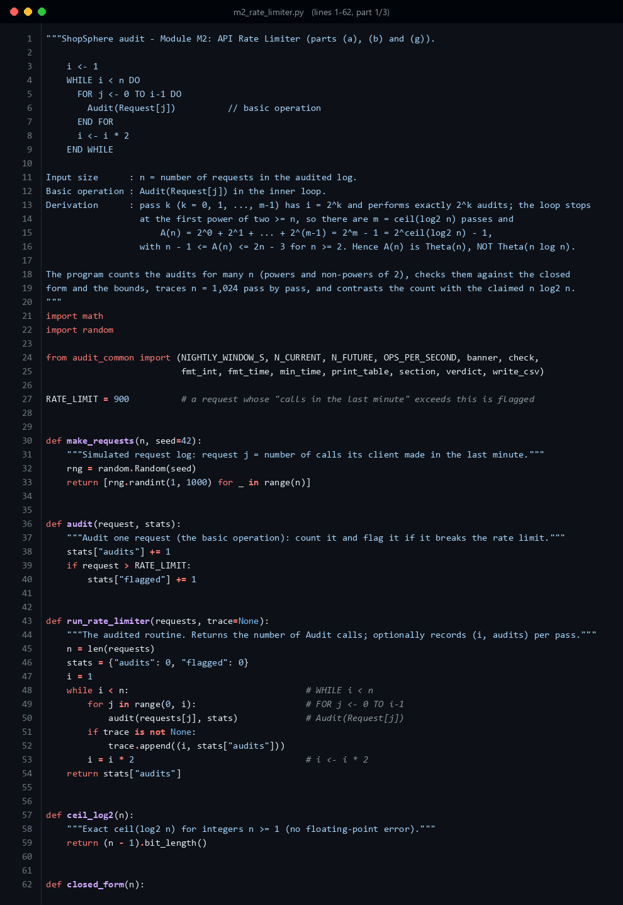

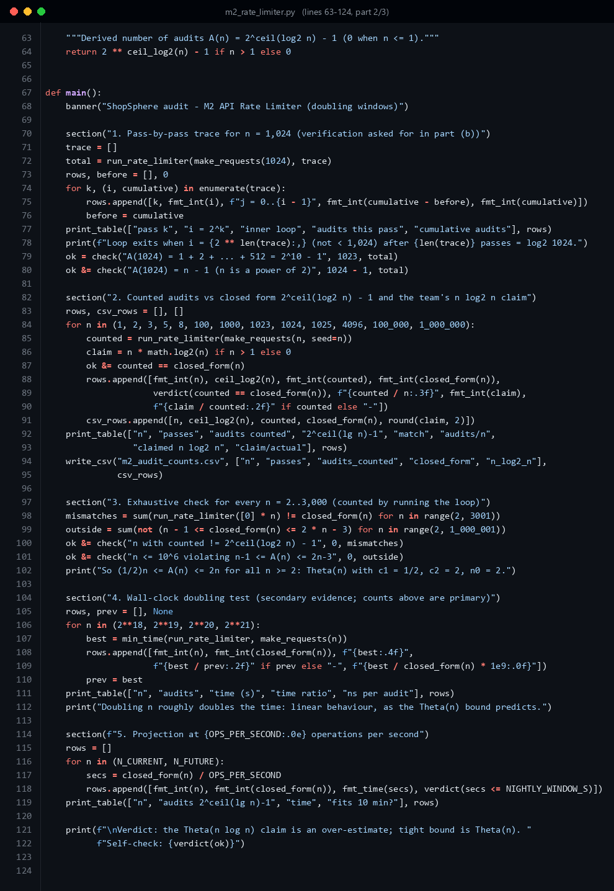

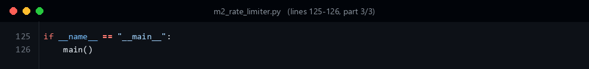

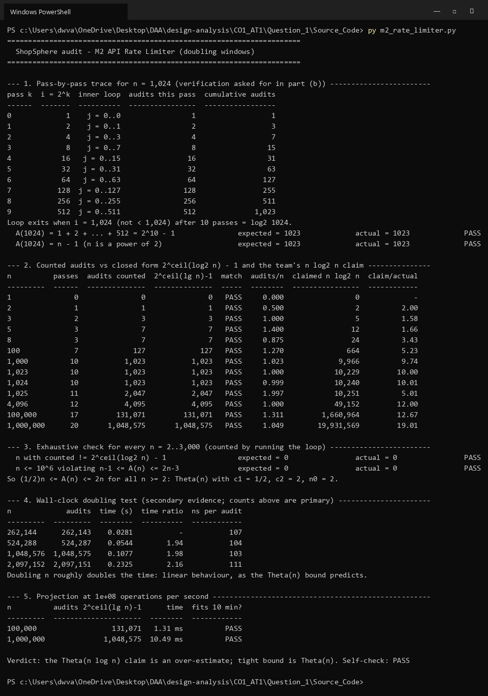

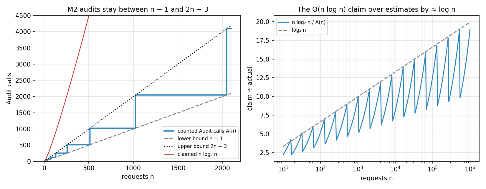

## Part (c) – Solve a Recurrence by Substitution

> **(c) Solve a Recurrence by Substitution:** Solve the recurrence for search version S2 using backward substitution, showing every intermediate step, and derive the exact closed form. State the time complexity and the space complexity of both an iterative and a recursive implementation.

**Ans:**

### 1. The recurrence

S2 compares the key with the middle entry (one comparison) and continues in one half of the index. Counting the comparisons in the worst case (the key is never hit early):

T(n) = T(n/2) + 1 for n > 1, T(1) = 1.

To make every halving exact I first take n = 2ᵏ (k = log₂ n), then extend the result to every n.

### 2. Backward substitution, step by step

```
T(n) = T(n/2) + 1                                    (the recurrence)
     = [T(n/4) + 1] + 1        = T(n/2²) + 2         (substitute T(n/2) = T(n/4) + 1)
     = [T(n/8) + 1] + 2        = T(n/2³) + 3         (substitute T(n/4) = T(n/8) + 1)
     = [T(n/16) + 1] + 3       = T(n/2⁴) + 4         (substitute T(n/8) = T(n/16) + 1)
     …
     = T(n/2^i) + i            (general pattern after i substitutions)

The substitution stops at the initial condition: n/2^i = 1  ⇔  2^i = n  ⇔  i = log₂ n = k
T(n) = T(1) + log₂ n = 1 + log₂ n
```

**Closed form: T(n) = log₂ n + 1** for n = 2ᵏ. For example T(1,024) = 11 and T(2²⁰ = 1,048,576) = 21.

**Check by the substitution (induction) method.** Base: T(1) = log₂ 1 + 1 = 1 ✓. Step: if T(n/2) = log₂(n/2) + 1 = log₂ n, then T(n) = T(n/2) + 1 = log₂ n + 1 ✓.

**Any n.** With integer halves the recurrence is T(n) = T(⌊n/2⌋) + 1, and the same unfolding stops after ⌊log₂ n⌋ halvings, giving **T(n) = ⌊log₂ n⌋ + 1** (= the number of binary digits of n). For the future catalogue, T(1,000,000) = ⌊19.93⌋ + 1 = **20 comparisons**; for today's catalogue T(100,000) = 17.

### 3. Time complexity

T(n) = ⌊log₂ n⌋ + 1 ∈ **Θ(log n)** in the worst case (best case 1 comparison, part (e)). A tenfold larger catalogue costs only log₂ 10 ≈ 3.3 more comparisons.

### 4. Space complexity of the iterative and the recursive implementation

```
Algorithm BinarySearchIterative(A, n, key)          Algorithm BinarySearchRecursive(A, lo, hi, key)
1. lo = 0;  hi = n - 1                              1. if lo > hi then return -1
2. while lo <= hi do                                2. mid = (lo + hi) div 2
3.     mid = (lo + hi) div 2                        3. if key = A[mid] then return mid       // 1 comparison
4.     if key = A[mid] then return mid  // 1 comp.  4. if key < A[mid] then
5.     if key < A[mid] then hi = mid - 1            5.     return BinarySearchRecursive(A, lo, mid - 1, key)
6.     else lo = mid + 1                            6. else return BinarySearchRecursive(A, mid + 1, hi, key)
7. return -1
```

Table 6: Time and space of the two implementations of S2

| Implementation | Comparisons (worst) | Extra space | Reason |
|---|---|---|---|
| Iterative (one loop) | ⌊log₂ n⌋ + 1 → Θ(log n) | **Θ(1)** | only the three integers lo, hi, mid, reused in every step |
| Recursive (one call per halving) | ⌊log₂ n⌋ + 1 → Θ(log n) | **Θ(log n)** | every halving opens a new stack frame (lo, hi, mid, return address) that stays alive until the deepest call returns; depth = number of calls ≈ log₂ n |

Both versions make exactly the same comparisons (the program checks this for all keys); they differ only in memory. The recursive version is not tail-call optimised in Python (or in Java), so its stack grows with the depth; at n = 10⁶ that is at most 21 frames – harmless – but the iterative version is preferred for a production search service.

### 5. Verification by the program

`m3_product_search.py` unfolds the recurrence, runs the iterative and recursive binary search on **every** key and every gap between keys, and records the worst comparison count and the deepest stack depth.

Table 7: Backward-substitution result against measured binary search (m3_product_search_output.txt)

| k | n = 2ᵏ | T(n) unfolded | log₂ n + 1 | Worst counted | Max stack depth |
|---:|---:|---:|---:|---:|---:|
| 0 | 1 | 1 | 1 | 1 | 2 |
| 4 | 16 | 5 | 5 | 5 | 6 |
| 8 | 256 | 9 | 9 | 9 | 10 |
| 12 | 4,096 | 13 | 13 | 13 | 14 |
| 16 | 65,536 | 17 | 17 | 17 | 18 |

The closed form, the unfolded recurrence and the measured worst case agree for every k, and T(n) = ⌊log₂ n⌋ + 1 holds for every n from 1 to 10⁶. The measured maximum stack depth is log₂ n + 2: one frame per comparison plus one final call that finds an empty range (lo > hi) during an unsuccessful search – still Θ(log n).

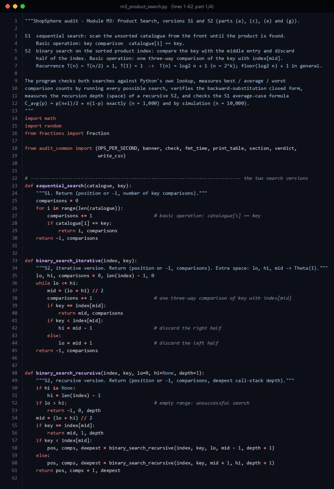

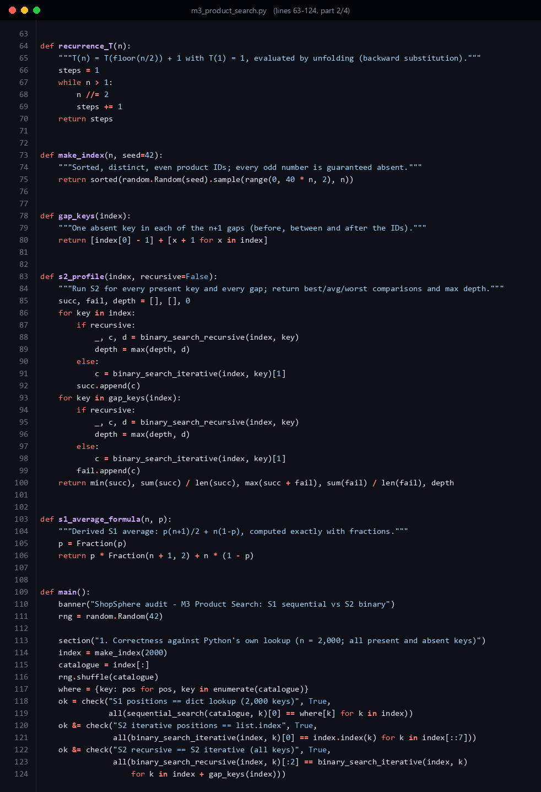

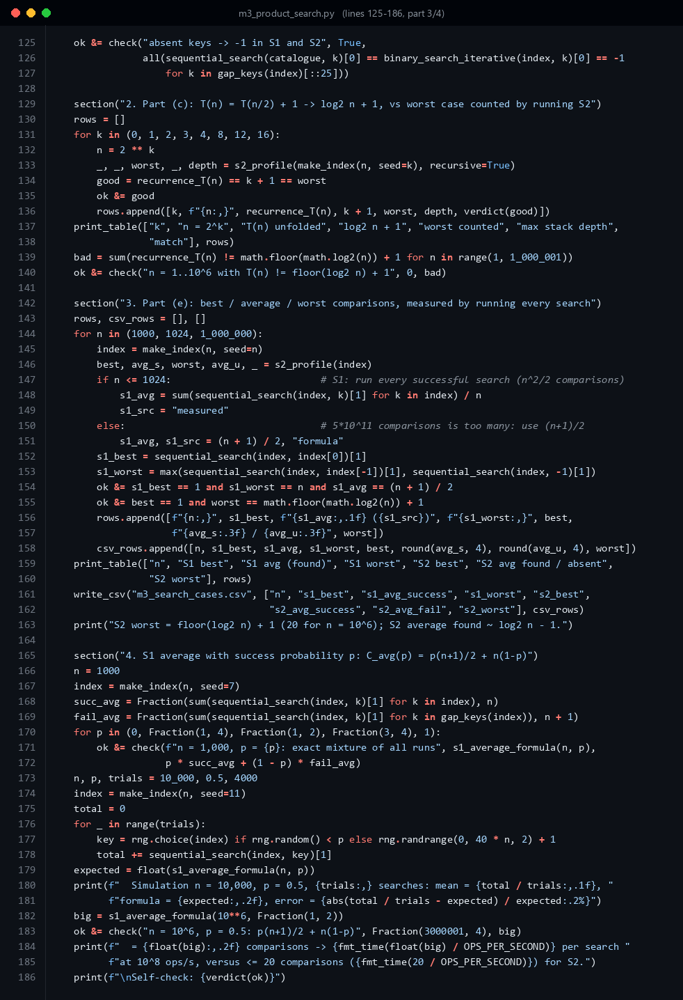

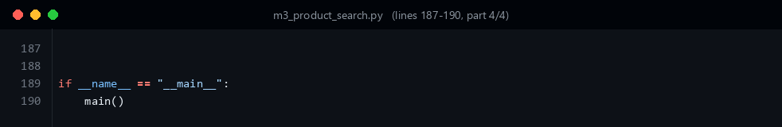

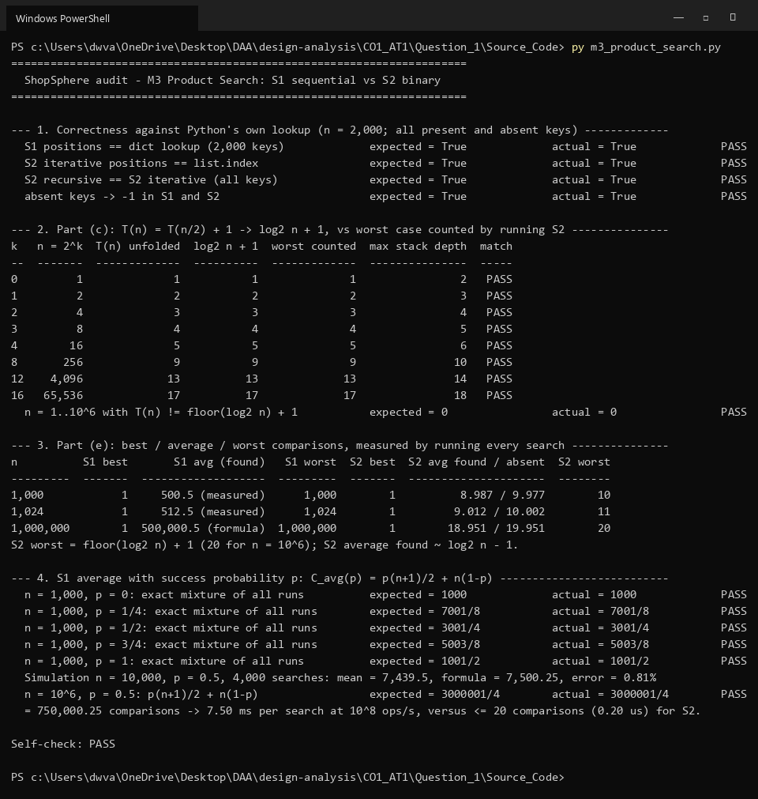

**Meaning for ShopSphere:** a product lookup in the sorted index needs at most 17 comparisons today and 20 after the expansion (0.2 µs at 10⁸ operations per second). S2 is already scalable.

## Part (d) – Apply the Master Theorem

> **(d) Apply the Master Theorem:** For M4, apply the Master Theorem to both the current design and the proposed redesign, clearly identifying a, b, f(n), n^(log<sub>b</sub> a) and the case used, and explain what happens to the running time when the data doubles. For M5, determine whether any of the three standard cases applies to T(n) = 2T(n/2) + n log n; if not, derive the complexity using the extended Master Theorem or a recursion tree.

**Ans:**

### 1. The Master Theorem used

For T(n) = aT(n/b) + f(n) with a ≥ 1, b > 1, compare f(n) with the **watershed function** n^(log<sub>b</sub> a) (the total cost of the leaves of the recursion tree):

- **Case 1:** f(n) = O(n^(log<sub>b</sub> a − ε)) for some ε > 0 → T(n) = Θ(n^(log<sub>b</sub> a)) (leaves dominate).
- **Case 2:** f(n) = Θ(n^(log<sub>b</sub> a)) → T(n) = Θ(n^(log<sub>b</sub> a) log n) (every level costs the same).
- **Case 3:** f(n) = Ω(n^(log<sub>b</sub> a + ε)) for some ε > 0 **and** the regularity condition a·f(n/b) ≤ c·f(n) for some c < 1 → T(n) = Θ(f(n)) (root dominates).
- **Extended Case 2** (Cormen et al., 4th ed.): f(n) = Θ(n^(log<sub>b</sub> a) logᵏ n) with k ≥ 0 → T(n) = Θ(n^(log<sub>b</sub> a) logᵏ⁺¹ n).

(Levitin's simplified form, f(n) ∈ Θ(nᵈ), compares a with bᵈ: a > bᵈ → Θ(n^(log<sub>b</sub> a)), a = bᵈ → Θ(nᵈ log n), a < bᵈ → Θ(nᵈ). It gives the same answers for M4.)

### 2. M4 current design: T(n) = 4T(n/2) + n

- **a = 4** (four recursive calls, because each half is replicated), **b = 2** (each call gets n/2 records), **f(n) = n** (linear merge).
- **n^(log<sub>b</sub> a) = n^(log₂ 4) = n²**.
- f(n) = n = O(n^(2 − ε)) with ε = 1, i.e. the merge is polynomially smaller than the leaves → **Case 1** (no regularity check is needed in Case 1). In Levitin's form: d = 1, a = 4 > bᵈ = 2.
- **T(n) = Θ(n²).**

Exact value with T(1) = 1 by backward substitution (n = 2ᵏ):

```
T(n) = 4T(n/2) + n
     = 4[4T(n/4) + n/2] + n        = 4²T(n/2²) + 2n + n
     = 4²[4T(n/8) + n/4] + 3n      = 4³T(n/2³) + 4n + 2n + n
     = 4^i T(n/2^i) + n(1 + 2 + … + 2^(i−1)) = 4^i T(n/2^i) + n(2^i − 1)
i = k = log₂ n:  4^k = n²,  2^k = n   →   T(n) = n²·T(1) + n(n − 1) = 2n² − n
```

**When the data doubles:** T(2n)/T(n) = (8n² − 2n)/(2n² − n) = 2(4n − 1)/(2n − 1) → **4**. Doubling the customer–product data **quadruples** the running time (measured: 4.0010 at n = 2¹⁰ → 2¹¹ and 4.0000 at 2¹⁹ → 2²⁰).

### 3. M4 proposed redesign: T(n) = 2T(n/2) + n

- **a = 2, b = 2, f(n) = n**, **n^(log<sub>b</sub> a) = n^(log₂ 2) = n¹ = n**.
- f(n) = Θ(n) = Θ(n^(log<sub>b</sub> a)) → **Case 2** (Levitin: a = 2 = bᵈ = 2¹).
- **T(n) = Θ(n log n).**

Exact value: T(n) = 2ⁱT(n/2ⁱ) + i·n (every level costs n), so with i = log₂ n: **T(n) = n log₂ n + n**.

**When the data doubles:** T(2n)/T(n) = 2n(log₂ n + 2) / (n(log₂ n + 1)) = 2·(1 + 1/(log₂ n + 1)), i.e. **slightly more than 2** (2.10 at n = 2¹⁹; 2.096 at n = 10⁶). The time roughly doubles instead of quadrupling.

### 4. Recursion trees of the two M4 designs (n = 1,024)

Table 8: Level costs of the recursion trees for n = 1,024 – M4 current level cost 4ⁱ·(n/2ⁱ) = 2ⁱ·n, M4 redesign 2ⁱ·(n/2ⁱ) = n, M5 2ⁱ·(n/2ⁱ)·log₂(n/2ⁱ) = n(log₂ n − i) (m4_m5_recurrences_output.txt)

| Level i (depth) | Nodes (a = 4) | Nodes (a = 2) | Size n/2ⁱ | M4 current 2ⁱ·n | M4 redesign n | M5 n(log₂ n − i) |
|---:|---:|---:|---:|---:|---:|---:|
| 0 | 1 | 1 | 1,024 | 1,024 | 1,024 | 10,240 |
| 1 | 4 | 2 | 512 | 2,048 | 1,024 | 9,216 |
| 2 | 16 | 4 | 256 | 4,096 | 1,024 | 8,192 |
| 5 | 1,024 | 32 | 32 | 32,768 | 1,024 | 5,120 |
| 9 | 262,144 | 512 | 2 | 524,288 | 1,024 | 1,024 |
| leaves | 1,048,576 | 1,024 | 1 | 1,048,576 | 1,024 | 1,024 |
| **total** | | | | **2,096,128** | **11,264** | **57,344** |

(Levels 3, 4, 6, 7, 8 are in Figure 20.) In the current design the level costs **double** from level to level, so the 4¹⁰ = n² leaves alone cost half of the total – exactly the Case 1 picture; the totals equal 2n² − n = 2,096,128. In the redesign every level costs n, and there are log₂ n + 1 levels: 11 × 1,024 = 11,264 = n log₂ n + n.

### 5. M5: T(n) = 2T(n/2) + n log n – do the standard cases apply?

a = 2, b = 2, **n^(log<sub>b</sub> a) = n**, **f(n) = n log n**. Compare f(n) with n: f(n)/n = log n.

- **Case 1** needs f(n) = O(n^(1 − ε)): impossible, f(n) grows faster than n.
- **Case 2** needs f(n) = Θ(n): impossible, f(n)/n = log n → ∞.
- **Case 3** needs f(n) = Ω(n^(1 + ε)) for some ε > 0, i.e. f(n)/n^(1+ε) = log n / n^ε bounded below by a positive constant. But for every ε > 0, lim log n / n^ε = lim (1/(n ln 2)) / (ε n^(ε − 1)) = lim 1/(ε ln 2 · n^ε) = 0 (L'Hôpital). The program shows log₂ n / n^0.1 = 9.8 × 10⁻² at n = 2¹⁰⁰ and 7.9 × 10⁻²⁸ at n = 2¹⁰⁰⁰ (Figure 21). So n log n is **larger than n, but not polynomially larger**. (The regularity condition fails too: 2·f(n/2) = n(log₂ n − 1) ≤ c·n log₂ n needs c ≥ 1 − 1/log₂ n → 1.)

**None of the three standard cases applies** – f(n) falls in the gap between Case 2 and Case 3.

**Extended Master Theorem:** f(n) = n log n = Θ(n^(log<sub>b</sub> a) log¹ n), so k = 1 and **T(n) = Θ(n log² n)**.

**Recursion tree (confirms it and gives the exact value).** On level i there are 2ⁱ sub-problems of size n/2ⁱ; each costs (n/2ⁱ) log₂(n/2ⁱ) = (n/2ⁱ)(log₂ n − i), so the whole level costs **n(log₂ n − i)**, for i = 0, …, k − 1 with k = log₂ n; the n leaves cost n·T(1) = n.

```
T(n) = Σ (i = 0 .. k−1) n(k − i)  +  n
     = n[k + (k − 1) + … + 1]  +  n           [the level costs fall by n per level]
     = n·k(k + 1)/2  +  n
T(n) = (n log₂ n (log₂ n + 1))/2 + n  =  ½ n log₂² n + ½ n log₂ n + n   ∈  Θ(n log² n)
```

Check for n = 1,024 (k = 10): 1,024 × 10 × 11/2 + 1,024 = 57,344 – the M5 column of Table 8. When the data doubles, T(2n)/T(n) ≈ 2(1 + 2/log₂ n): 2.21 at n = 2¹⁹ (Table 10).

### 6. Verification: exact recurrences, executed engines and doubling ratios

`m4_m5_recurrences.py` evaluates each recurrence exactly for n = 2⁰ … 2²⁰ and compares it with the closed forms; `m4_m5_simulation.py` actually **runs** recursive engines with operation counters (M4 with 4 replicated or 2 parts and a linear merge; M5 with a hand-written merge sort at every level whose key comparisons are counted).

Table 9: Exact T(2ᵏ) from the recurrences; each value equals its closed form – M4 current 2n² − n, M4 redesign n log₂ n + n, M5 n log₂ n(log₂ n + 1)/2 + n (m4_m5_recurrences.csv)

| k | n | M4 current | M4 redesign | M5 | Matches |
|---:|---:|---:|---:|---:|:---:|
| 1 | 2 | 6 | 4 | 4 | PASS |
| 4 | 16 | 496 | 80 | 176 | PASS |
| 10 | 1,024 | 2,096,128 | 11,264 | 57,344 | PASS |
| 15 | 32,768 | 2,147,450,880 | 524,288 | 3,964,928 | PASS |
| 20 | 1,048,576 | 2,199,022,206,976 | 22,020,096 | 221,249,536 | PASS |

Table 10: What happens when the data doubles – T(2n)/T(n) from the exact recurrences

| n → 2n | M4 current | M4 redesign | M5 |
|---|---:|---:|---:|
| 2⁵ → 2⁶ | 4.0317 | 2.3333 | 2.7500 |
| 2¹⁰ → 2¹¹ | 4.0010 | 2.1818 | 2.3929 |
| 2¹⁵ → 2¹⁶ | 4.0000 | 2.1250 | 2.2645 |
| 2¹⁹ → 2²⁰ | 4.0000 | 2.1000 | 2.2094 |

Table 11: Executed engines – counted operations (current = 2n² − n, redesign = n log₂ n + n), measured time and time ratio to the previous n (m4_simulation.csv)

| n | M4 current ops | Time (s) | Ratio | M4 redesign ops | Time (s) | Ratio |
|---:|---:|---:|---:|---:|---:|---:|
| 128 | 32,640 | 0.0081 | 4.25 | 1,024 | 0.0001 | 2.15 |
| 256 | 130,816 | 0.0327 | 4.02 | 2,304 | 0.0002 | 2.17 |
| 512 | 523,776 | 0.1280 | 3.91 | 5,120 | 0.0004 | 2.04 |
| 1,024 | 2,096,128 | 0.6075 | 4.75 | 11,264 | 0.0009 | 2.19 |

Both engines' counters equal the closed forms exactly for every size run (current: n = 16 … 1,024; redesign: n = 16 … 65,536). The measured times confirm the doubling answer: the current engine's time grows ≈ 4× per doubling, the redesign's ≈ 2.1×. At n = 1,024 the redesign is already 2,096,128 / 11,264 ≈ **186 times** less work.

Table 12: M5 executed with a real merge sort at every level – counted comparisons, the model T(n) = n log₂ n(log₂ n + 1)/2 + n, and the counted value divided by the model, by n log₂² n and by n log₂ n (m5_simulation.csv)

| n | Counted | Model T(n) | Real ÷ model | ÷ n log₂² n | ÷ n log₂ n | T(2n) / T(n) |
|---:|---:|---:|---:|---:|---:|---:|
| 64 | 1,037 | 1,408 | 0.737 | 0.4501 | 2.70 | – |
| 256 | 7,346 | 9,472 | 0.776 | 0.4484 | 3.59 | 2.63 |
| 1,024 | 46,207 | 57,344 | 0.806 | 0.4512 | 4.51 | 2.49 |
| 4,096 | 268,375 | 323,584 | 0.829 | 0.4550 | 5.46 | 2.39 |
| 16,384 | 1,474,312 | 1,736,704 | 0.849 | 0.4591 | 6.43 | 2.33 |

The real comparison count divided by n log₂² n stays almost constant (0.445–0.459) while the ratio to n log₂ n keeps growing (2.70 → 6.43): the engine is Θ(n log² n), not Θ(n log n). The real count is a little below the model because merge sort needs slightly fewer than n log₂ n comparisons per level; every level was checked against Python's `sorted()`.

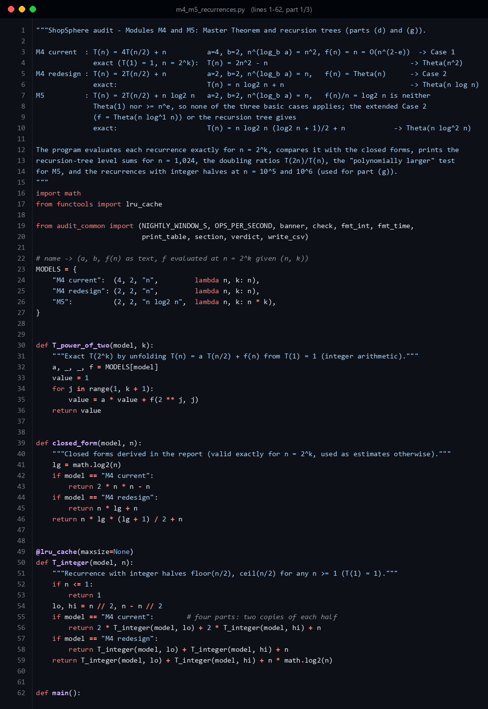

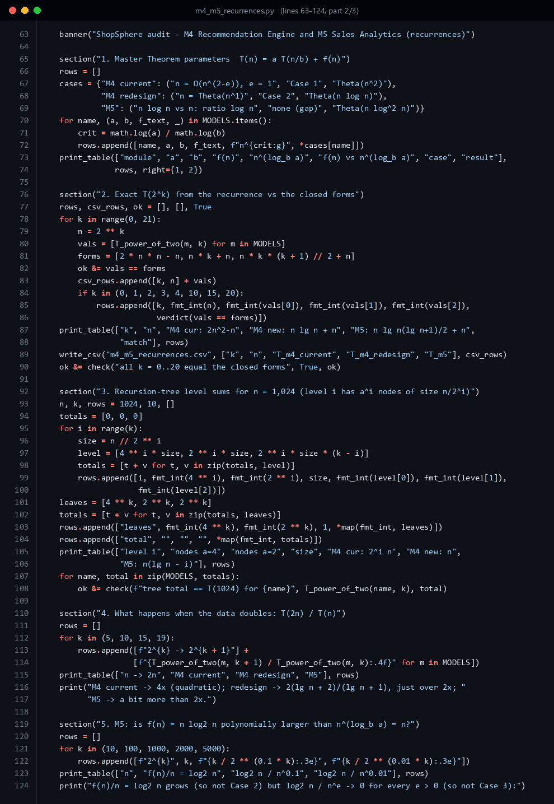

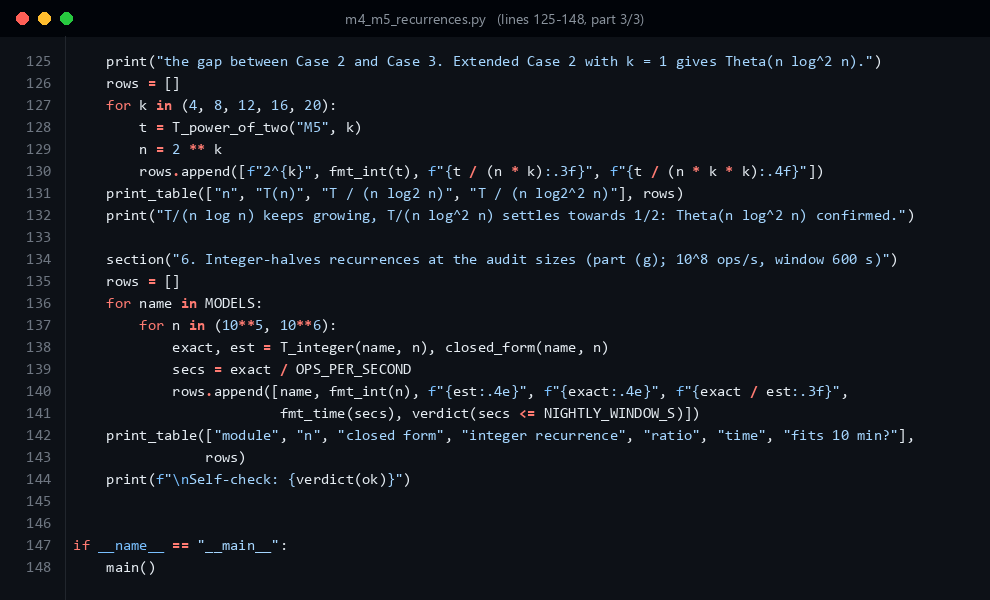

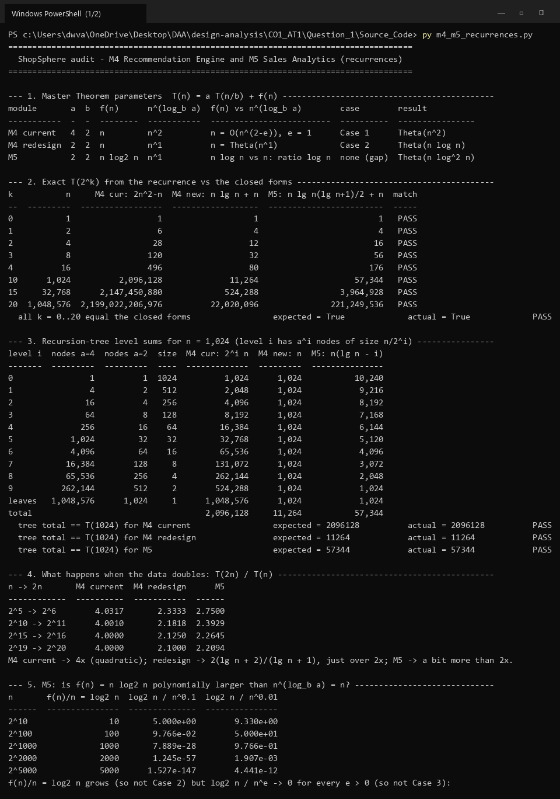

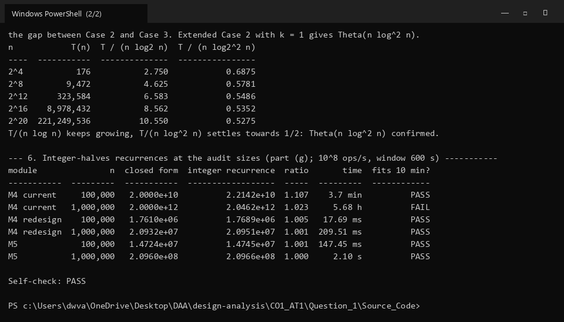

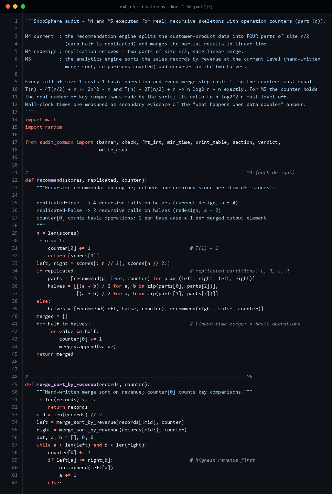

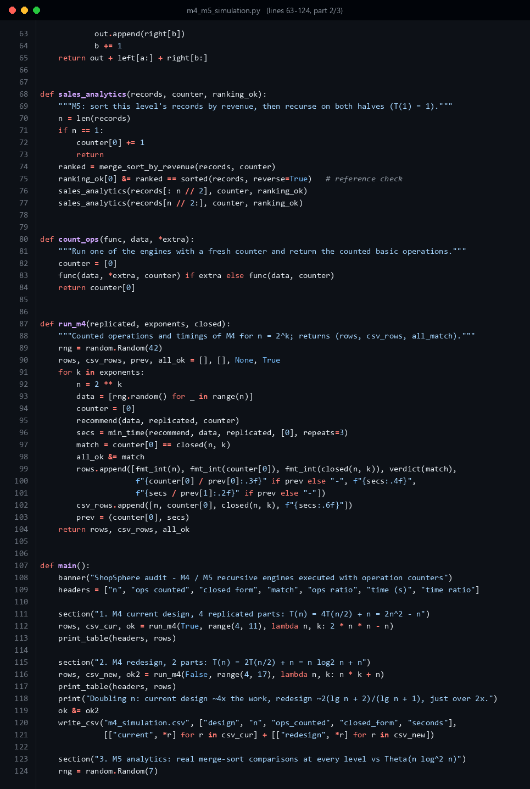

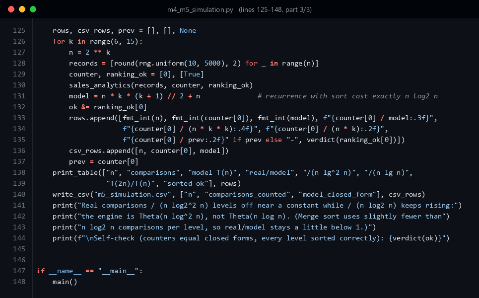

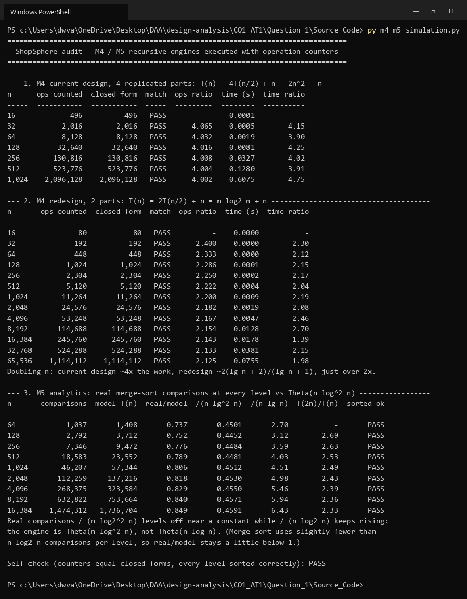

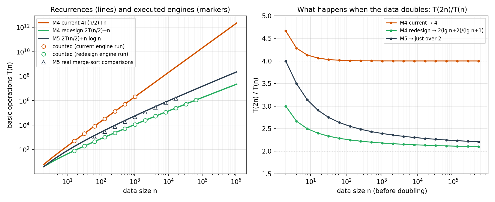

### 7. Meaning for ShopSphere

Table 13: Master Theorem summary for the recursive engines

| Module | a and b | f(n) | n^(log<sub>b</sub> a) | Case | Result | Data doubles → time × |
|---|---|---|---|---|---|---:|
| M4 current | 4, 2 | n | n² | Case 1 (ε = 1) | Θ(n²) | 4 |
| M4 redesign | 2, 2 | n | n | Case 2 | Θ(n log n) | ≈ 2.1 |
| M5 | 2, 2 | n log n | n | none (gap); extended Case 2, k = 1 | Θ(n log² n) | ≈ 2.2 |

Replicating the partitions changes a from 2 to 4 and moves M4 from Case 2 to Case 1: the work is no longer spread evenly over the levels but explodes at the leaves. At n = 10⁶ the current engine needs ≈ 2 × 10¹² operations (≈ 5.6 hours) against ≈ 2.1 × 10⁷ (≈ 0.21 s) for the redesign – the redesign must be adopted. M5 is only a log factor above n log n: ≈ 2.1 × 10⁸ operations, about 2.1 s at n = 10⁶, comfortably inside the nightly window.

## Part (e) – Analyse Best, Average and Worst Cases

> **(e) Analyse Best, Average and Worst Cases:** For search versions S1 and S2, identify the input condition that produces the best, average and worst case and give the number of comparisons in each. For S1, derive the average number of comparisons when the probability that the searched product exists is p, and evaluate it for n = 1,000,000 and p = 0.5.

**Ans:**

### 1. Input conditions and comparison counts

Table 14: Best, average and worst cases of S1 and S2 (n entries)

| Version | Case | Input condition | Key comparisons |
|---|---|---|---|
| S1 sequential search | Best | the product is the **first** entry of the catalogue | 1 |
| S1 sequential search | Average (found) | the product is present, every position equally likely (1/n) | (n + 1)/2 |
| S1 sequential search | Average (p) | present with probability p (uniform position), absent with 1 − p | p(n + 1)/2 + n(1 − p) |
| S1 sequential search | Worst | the product is the **last** entry, or it is **not** in the catalogue | n |
| S2 binary search | Best | the key equals the **middle** entry of the index | 1 |
| S2 binary search | Average | key equally likely to be any entry (found) / any gap (not found) | ≈ log₂ n − 1 (found), ≈ log₂(n + 1) (not found) |
| S2 binary search | Worst | key **absent**, or found only on the last halving (a deepest leaf of the search tree) | ⌊log₂ n⌋ + 1 |

For n = 10⁶: S1 needs 1 / 500,000.5 / 1,000,000 comparisons (best / average found / worst); S2 needs 1 / ≈ 18.95 / 20.

### 2. Derivation of the S1 average with success probability p

Let the searched product be present with probability p, and when present be at each position i (1 ≤ i ≤ n) with the same probability p/n; it is absent with probability 1 − p. Finding it at position i costs i comparisons; an unsuccessful search costs n comparisons (the whole catalogue is scanned).

```
C_avg(n) = [1·(p/n) + 2·(p/n) + … + n·(p/n)]  +  n·(1 − p)
         = (p/n)·(1 + 2 + … + n)               +  n(1 − p)
         = (p/n)·n(n + 1)/2                    +  n(1 − p)
C_avg(n) = p(n + 1)/2 + n(1 − p)
```

Special cases: p = 1 (always found) gives (n + 1)/2; p = 0 (never found) gives n.

### 3. Evaluation for n = 1,000,000 and p = 0.5

```
C_avg = 0.5 × (1,000,000 + 1)/2  +  1,000,000 × (1 − 0.5)
      = 0.5 × 500,000.5          +  500,000
      = 250,000.25               +  500,000
      = 750,000.25 comparisons
```

At 10⁸ comparisons per second this is **7.5 ms per search**, i.e. only about 133 searches per second per server, whereas S2 needs at most 20 comparisons (0.2 µs) – about 5,000,000 searches per second, 37,500 times more (Figure 36).

### 4. Measured confirmation

Table 15: Best / average / worst comparisons measured by running every possible search (m3_search_cases.csv)

| n | S1 best | S1 average (found) | S1 worst | S2 best | S2 avg found / absent | S2 worst |
|---:|---:|---:|---:|---:|---:|---:|
| 1,000 | 1 | 500.5 (measured) | 1,000 | 1 | 8.987 / 9.977 | 10 |
| 1,024 | 1 | 512.5 (measured) | 1,024 | 1 | 9.012 / 10.002 | 11 |
| 1,000,000 | 1 | 500,000.5 (formula) | 1,000,000 | 1 | 18.951 / 19.951 | 20 |

For S2 the program ran all 10⁶ successful searches and all 1,000,001 unsuccessful ones: the averages 18.951 and 19.951 match log₂ n − 1 ≈ 18.93 and log₂(n + 1) ≈ 19.93. (For S1 at n = 10⁶ the exhaustive run would need 5 × 10¹¹ comparisons, so the derived (n + 1)/2 is used; it was measured exactly for n = 1,000 and 1,024.)

Table 16: S1 average with presence probability p for n = 1,000 – formula p(n + 1)/2 + n(1 − p) against the exact mixture of all 1,000 successful and 1,001 unsuccessful measured searches

| Probability p | Formula | Measured | Result |
|---:|---:|---:|:---:|
| 0 | 1,000 | 1,000 | PASS |
| 1/4 | 7001/8 = 875.125 | 875.125 | PASS |
| 1/2 | 3001/4 = 750.25 | 750.25 | PASS |
| 3/4 | 5003/8 = 625.375 | 625.375 | PASS |
| 1 | 1001/2 = 500.5 | 500.5 | PASS |

A Monte-Carlo run with n = 10,000, p = 0.5 and 4,000 random searches gave a mean of 7,439.5 comparisons against the formula's 7,500.25 (0.81 % sampling error). The formula evaluated with exact fractions for n = 10⁶, p = 0.5 gives 3000001/4 = **750,000.25** (Figure 16, section 4).

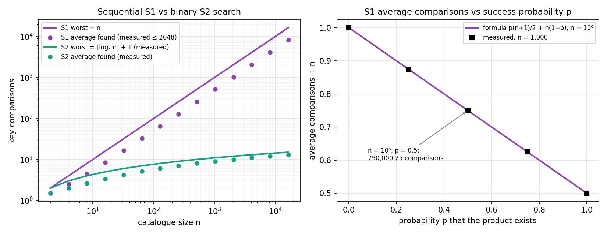

**Meaning for ShopSphere:** with S1, one in two searches for a product that does not exist scans the whole catalogue; the cost of a search grows tenfold with the catalogue. Customer-facing search must use S2 (sorted index, Θ(log n)) or a hash index on the product key (Θ(1) expected).

## Part (f) – Prove an Asymptotic Bound

> **(f) Prove an Asymptotic Bound:** Using the formal definitions, prove that the report generator's cost f(n) = 3n² + 10n log₂ n + 50 is Θ(n²) by finding constants c₁, c₂ and n₀, and show that f(n) is not O(n).

**Ans:**

### 1. Formal definitions

- f(n) ∈ O(g(n)) if there are constants c > 0 and n₀ ≥ 1 such that f(n) ≤ c·g(n) for all n ≥ n₀.
- f(n) ∈ Ω(g(n)) if there are constants c > 0 and n₀ ≥ 1 such that f(n) ≥ c·g(n) for all n ≥ n₀.
- f(n) ∈ Θ(g(n)) if there are constants c₁, c₂ > 0 and n₀ ≥ 1 such that **c₁·g(n) ≤ f(n) ≤ c₂·g(n) for all n ≥ n₀**.

### 2. Lower bound: f(n) ≥ 3n² for all n ≥ 1

For n ≥ 1, log₂ n ≥ 0, so 10n log₂ n ≥ 0, and 50 > 0. Therefore f(n) = 3n² + 10n log₂ n + 50 ≥ 3n². So **c₁ = 3** works for every n ≥ 1, and f(n) ∈ Ω(n²).

### 3. Upper bound: f(n) ≤ 63n² for all n ≥ 1

For n ≥ 1: (i) log₂ n ≤ n (because n < 2ⁿ), hence 10n log₂ n ≤ 10n·n = 10n²; (ii) 1 ≤ n², hence 50 ≤ 50n². Adding:

f(n) = 3n² + 10n log₂ n + 50 ≤ 3n² + 10n² + 50n² = 63n². So **c₂ = 63** works for every n ≥ 1, and f(n) ∈ O(n²).

### 4. Conclusion: f(n) ∈ Θ(n²)

With **c₁ = 3, c₂ = 63, n₀ = 1**: 3n² ≤ f(n) ≤ 63n² for all n ≥ 1, hence **f(n) ∈ Θ(n²)**.

**A tighter pair.** If a larger n₀ is allowed, c₂ can be brought down to 4: f(n) ≤ 4n² ⇔ g(n) = n² − 10n log₂ n − 50 ≥ 0. The program finds g(59) = −39.76 < 0 and g(60) = 5.87 > 0, and g keeps increasing for n ≥ 60 because g′(n) = 2n − 10 log₂ n − 10/ln 2 > 0 there (g′(60) ≈ 46.5 and g″(n) = 2 − 10/(n ln 2) > 0 for n ≥ 8). So **c₁ = 3, c₂ = 4, n₀ = 60** also works, and n₀ = 60 is the smallest possible n₀ for c₂ = 4. (Limit check: f(n)/n² = 3 + 10 log₂ n / n + 50/n² → 3, a positive constant, which also gives Θ(n²).)

### 5. f(n) is not O(n) – proof by contradiction

Suppose f(n) ∈ O(n). Then there are c > 0 and n₀ with f(n) ≤ c·n for all n ≥ n₀. Since f(n) ≥ 3n² (section 2), this gives 3n² ≤ f(n) ≤ c·n, i.e. **n ≤ c/3 for every n ≥ n₀** – which is false for any n > max(n₀, c/3). This contradiction shows **f(n) ∉ O(n)**. (Equivalently, f(n)/n ≥ 3n → ∞, so no constant can bound it.)

### 6. Numerical check

`f_bound_proof_check.py` evaluates f for **every** integer n up to 10⁶: the pair (3, 63, n₀ = 1) and the pair (3, 4, n₀ = 60) have **zero** violations, and n = 59 indeed breaks c₂ = 4.

Table 17: The ratios behind the proof (f_bound_check.csv)

| n | f(n) | f(n)/n² | f(n)/n | Share of the 3n² term |
|---:|---:|---:|---:|---:|
| 1 | 53 | 53.000000 | 53.0 | 5.66 % |
| 60 | 14,394 | 3.998371 | 239.9 | 75.03 % |
| 1,000 | 3,099,708 | 3.099708 | 3,099.7 | 96.78 % |
| 100,000 | 30,016,609,690 | 3.001661 | 300,166.1 | 99.94 % |
| 1,000,000 | 3,000,199,315,736 | 3.000199 | 3,000,199.3 | 99.99 % |

Table 18: Any proposed O(n) constant c is beaten at n = ⌊c/3⌋ + 1

| Proposed c | Witness n | f(n) | c·n | f(n) − c·n | f(n) > c·n? |
|---:|---:|---:|---:|---:|:---:|
| 10 | 4 | 1.7800 × 10² | 4.0000 × 10¹ | 1.3800 × 10² | PASS |
| 1,000 | 334 | 3.6272 × 10⁵ | 3.3400 × 10⁵ | 2.8720 × 10⁴ | PASS |
| 1,000,000 | 333,334 | 3.3340 × 10¹¹ | 3.3333 × 10¹¹ | 6.1822 × 10⁷ | PASS |
| 1,000,000,000 | 333,333,334 | 3.3333 × 10¹⁷ | 3.3333 × 10¹⁷ | 9.5041 × 10¹⁰ | PASS |

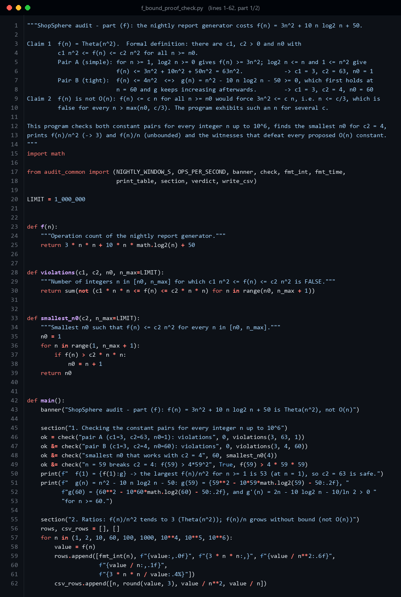

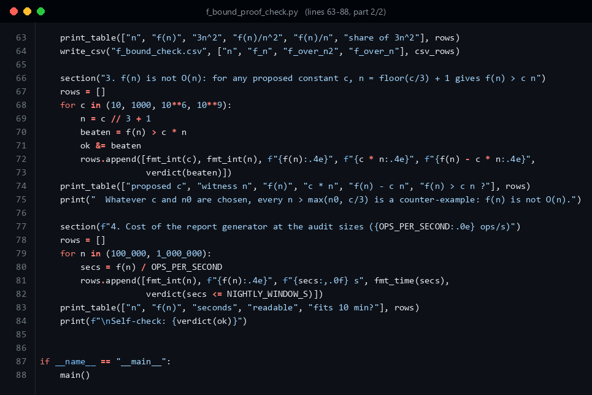

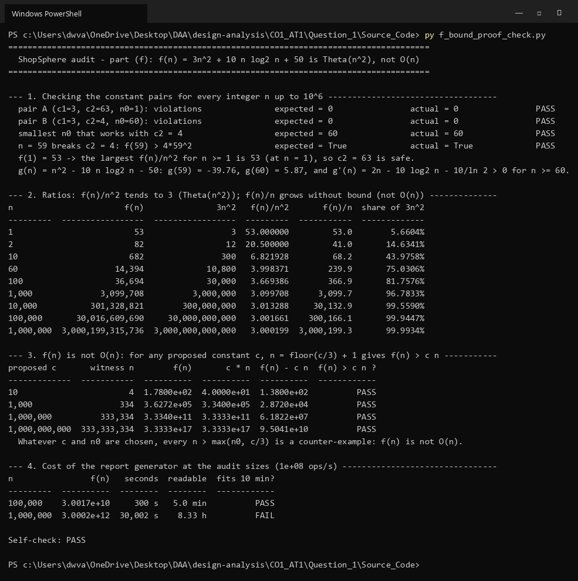

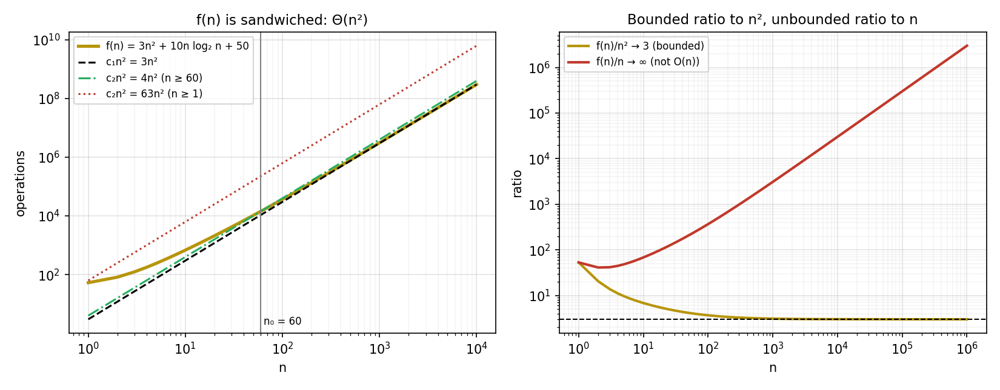

**Meaning for ShopSphere:** the lower-order terms 10n log₂ n + 50 are irrelevant at scale (0.007 % at n = 10⁶); the report generator behaves like 3n². Because it is not O(n), no amount of tuning of the constant will make it linear – it costs 300 s today (n = 10⁵) and 30,002 s ≈ 8.3 hours at n = 10⁶.

## Part (g) – Scalability Decision

> **(g) Scalability Decision:** Estimate the number of basic operations and the running time of M1, M2, S2, M4 (both designs) and M5 for n = 1,000,000. Identify the modules that will fail to meet a nightly processing window of 10 minutes, and recommend, with justification, which modules must be redesigned and how.

**Ans:**

### 1. Method

For every module I evaluated the exact cost function derived in parts (b)–(f) at n = 10⁵ (today) and n = 10⁶ (in a year) and divided by 10⁸ operations per second. The nightly window is 10 min = 600 s, i.e. a budget of 6 × 10¹⁰ basic operations. The constants of the paper live in `audit_common.py` (Figures 32–33) and the estimates are produced by `scalability_estimates.py` (Figures 34–36). As a cross-check, `m4_m5_recurrences.py` also evaluated the recurrences with integer halves ⌊n/2⌋, ⌈n/2⌉ at n = 10⁶: M4 current 2.0462 × 10¹² (5.68 h), M4 redesign 2.0951 × 10⁷ (0.21 s), M5 2.0966 × 10⁸ (2.10 s) – within 2.3 % of the closed forms, with the same verdicts.

### 2. Estimates for n = 1,000,000

Table 19: Basic operations and running time at 10⁸ operations per second (rounded; exact values in scalability_estimates.csv)

| Module | Cost function | Operations at n = 10⁵ | Time at n = 10⁵ | Operations at n = 10⁶ | Time at n = 10⁶ | Window (600 s) |
|---|---|---:|---:|---:|---:|:---:|
| M1 Duplicate detector | n(n − 1)/2 | ≈ 5.0 × 10⁹ | 50.0 s | ≈ 5.0 × 10¹¹ | 5,000 s ≈ 83.3 min | **FAIL** |
| M2 Rate limiter | 2^⌈log₂ n⌉ − 1 | 131,071 | 1.31 ms | 1,048,575 | 0.0105 s | PASS |
| S2 one search | ⌊log₂ n⌋ + 1 | 17 | 0.17 µs | 20 | 0.20 µs | PASS (per query) |
| S1 one search (p = 0.5) | p(n + 1)/2 + n(1 − p) | 75,000.25 | 0.75 ms | 750,000.25 | 7.5 ms | per query |
| M4 current (4 parts) | 2n² − n | ≈ 2.0 × 10¹⁰ | 200 s ≈ 3.3 min | ≈ 2.0 × 10¹² | 20,000 s ≈ 5.56 h | **FAIL** |
| M4 redesign (2 parts) | n log₂ n + n | 1.761 × 10⁶ | 17.6 ms | 2.093 × 10⁷ | 0.209 s | PASS |
| M5 Sales analytics | n log₂ n(log₂ n + 1)/2 + n | 1.472 × 10⁷ | 0.147 s | 2.096 × 10⁸ | 2.10 s | PASS |
| Report generator | 3n² + 10n log₂ n + 50 | 3.0017 × 10¹⁰ | 300 s = 5.0 min | 3.0002 × 10¹² | 30,002 s ≈ 8.33 h | **FAIL** |

Table 20: Growth of the work from n = 10⁵ to n = 10⁶ and the largest catalogue that fits the window (scalability_window_limits.csv)

| Module | Class | Work × (10⁵ → 10⁶) | Largest n processed in 600 s | Enough for n = 10⁶? |
|---|---|---:|---:|:---:|
| M1 Duplicate detector | Θ(n²) | 100.0 | 346,410 | **No** |
| M2 Rate limiter | Θ(n) | 8.0 | 34,359,738,368 | Yes |
| M4 current | Θ(n²) | 100.0 | 173,205 | **No** |
| M4 redesign | Θ(n log n) | 11.9 | 1,886,038,512 | Yes |
| M5 Sales analytics | Θ(n log² n) | 14.2 | 155,862,394 | Yes |
| Report generator | Θ(n²) | 100.0 | 141,392 | **No** |
| M1 redesign (hash set) | Θ(n) expected | 10.0 | 60,000,000,000 | Yes |
| M1 redesign (sort + scan) | Θ(n log n) | 11.9 | 1,886,038,512 | Yes |

(M2's factor is 8.0 rather than 10 because of its power-of-two staircase: 2¹⁷ − 1 → 2²⁰ − 1.)

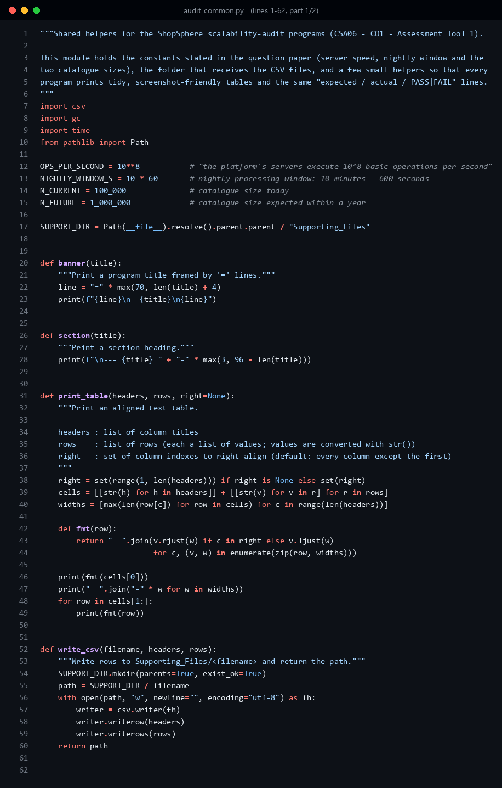

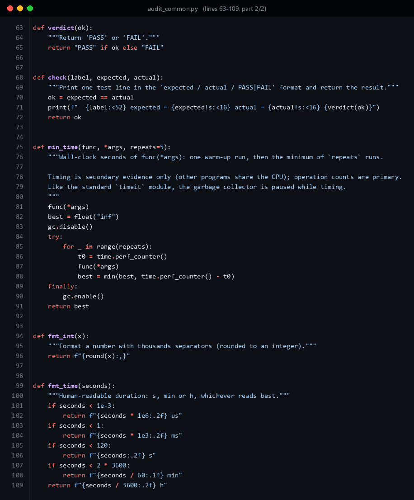

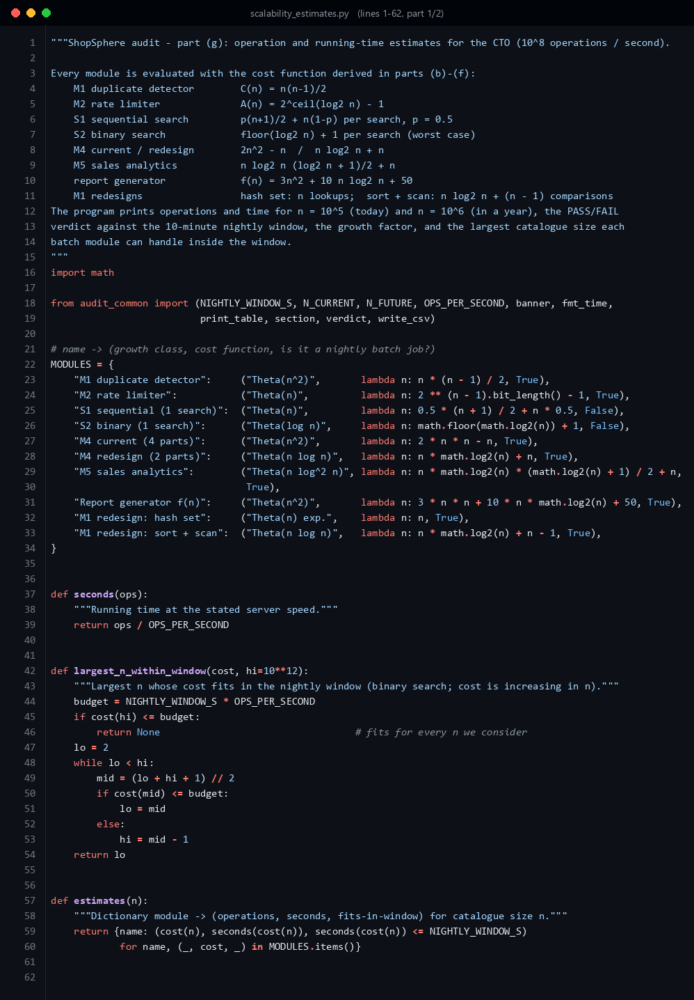

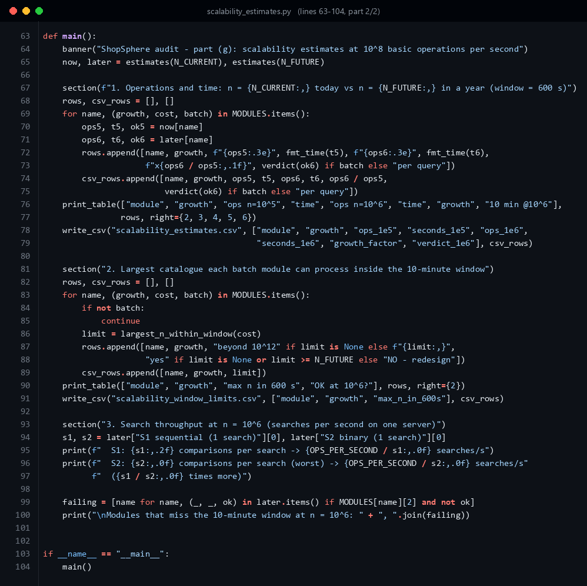

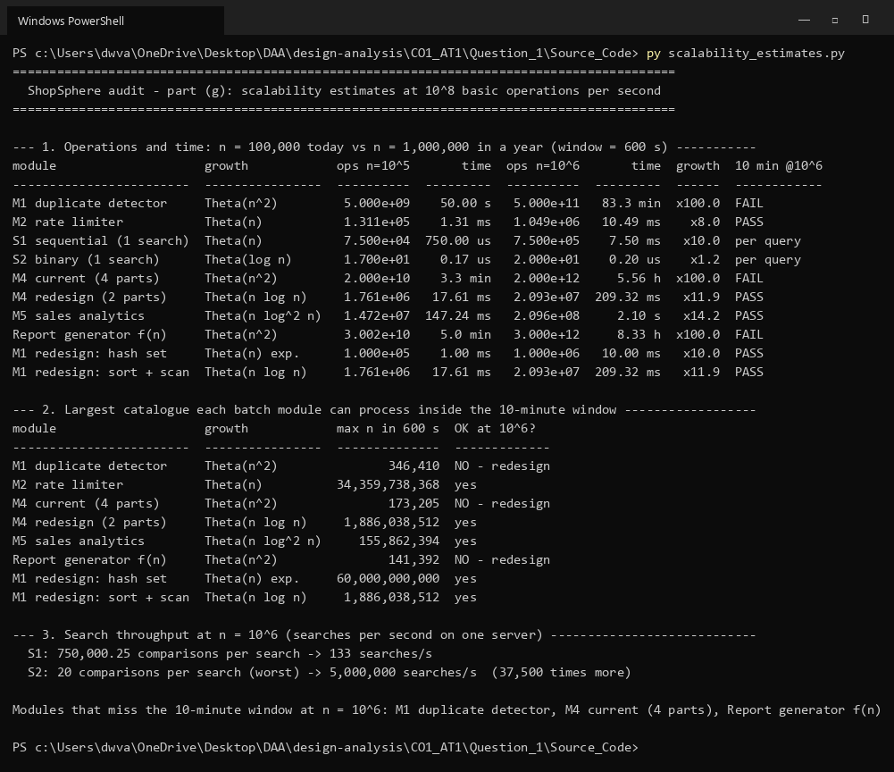

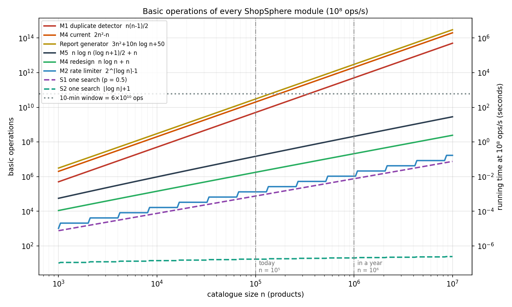

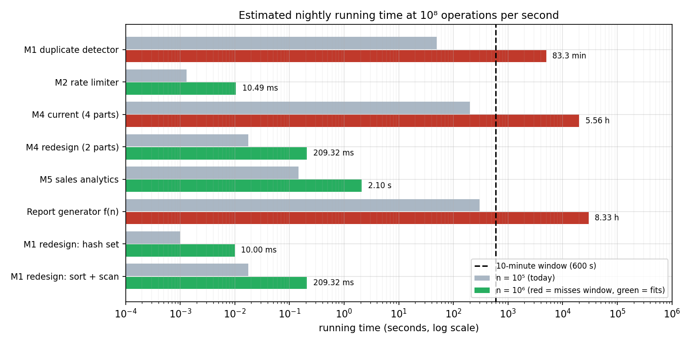

### 3. Modules that fail the 10-minute nightly window

At n = 10⁶ three batch jobs miss the window: **M1** (≈ 83 min, 8.3 × the window), **M4 current** (≈ 5.6 h, 33 ×) and the **report generator** (≈ 8.3 h, 50 ×). All three are **quadratic**: every tenfold growth of the catalogue multiplies their work by 100. They all still pass today, which hides the problem – but Table 20 shows they break **long before** the catalogue reaches one million products: the report generator at about 141,000 products, M4 at about 173,000 and M1 at about 346,000. M2 (0.01 s), M4 redesign (0.21 s) and M5 (2.1 s) are far inside the window, and S2 needs only 20 comparisons per search.

The conclusion does not depend on the machine: on my laptop the Python implementation of M1 made one comparison per ≈ 50 ns (7,998,000 comparisons in 0.397 s, Table 3), slower than the paper's 10⁸ operations per second, so it would need even longer.

### 4. Recommendations and redesigns

**R1 – Redesign M1 (must).** Duplicate detection does not need all pairs: two listings are duplicates exactly when their (title, seller) keys are equal, so one pass over the catalogue with a hash set keyed on (title, seller) finds every duplicate.

```
Algorithm DetectDuplicatesHash(Product, n)
1. seen = empty hash set of (title, seller) keys
2. for j = 0 to n-1 do
3.     key = (Product[j].title, Product[j].seller)
4.     if key is in seen then MarkDuplicate(j)        // one expected-O(1) hash lookup
5.     else insert key into seen
```

Time Θ(n) expected (n hash operations: 10⁶ → 0.01 s), extra space Θ(n) for the set. If a deterministic worst case is required (no reliance on hashing), sort and scan neighbours instead – Θ(n log n) time (2.1 × 10⁷ operations → 0.21 s):

```
Algorithm DetectDuplicatesSortScan(Product, n)
1. order = the indexes 0..n-1 sorted by (title, seller, index)     // merge sort: Θ(n log n)
2. for r = 1 to n-1 do
3.     if Product[order[r]] has the same (title, seller) as Product[order[r-1]] then
4.         MarkDuplicate(order[r])                                  // the later upload
```

Both redesigns were implemented and found exactly the same duplicates as the original on the n = 4,000 catalogue, with 4,000 and 46,876 basic operations instead of 7,998,000 (Figure 5, section 3).

**R2 – Adopt the M4 redesign (must).** Removing the replicated partitions changes a = 4 to a = 2 and the class from Θ(n²) to Θ(n log n): 2 × 10¹² → 2.1 × 10⁷ operations, i.e. 5.6 hours → 0.21 s at n = 10⁶ (≈ 95,500 times less work). If replication is needed for fault tolerance, it should be done for storage only, not by re-computing the same half twice.

```
Algorithm Recommend(D, n)                 // replication removed: a = 2
1. if n = 1 then return Score(D[0])
2. L = Recommend(D[0 .. n/2 - 1], n/2)
3. R = Recommend(D[n/2 .. n - 1], n/2)
4. return Merge(L, R)                     // linear merge: n steps
```

**R3 – Redesign the report generator (must).** Its 3n² term means that it combines every product with every other product (about three passes over all pairs). Nightly reports are aggregations (totals per category, seller or product, top-k lists), which can be computed in one pass with a hash map and one sort of the k groups – Θ(n + k log k) ≤ Θ(n log n):

```
Algorithm NightlyReport(Sales, n)
1. totals = empty hash map                          // key = category / seller / product
2. for each record r in Sales do
3.     totals[r.key] = totals[r.key] + r.value       // one pass: Θ(n) expected
4. rows = the k entries of totals sorted by value    // Θ(k log k), k ≤ n
5. write rows to the report
```

In addition, the job can be made **incremental** – keep yesterday's totals and process only the products changed since the last run. Spreading the quadratic version over more servers is not a real fix: about 50 servers would be needed just to meet the window at n = 10⁶ (30,002 s / 600 s), and the next tenfold growth would multiply the work by 100 again.

**R4 – Search (recommended).** Serve customer searches with S2 on a sorted index (or a hash index on the product ID): 20 comparisons instead of 750,000 on average, 37,500 times higher throughput.

**R5 – No change needed:** M2 is Θ(n) (the Θ(n log n) claim was an over-estimate) and costs 0.01 s. M5 at 2.1 s is acceptable; if needed, it can be lowered to Θ(n log n) by sorting once and merging the already-sorted halves on the way up (T(n) = 2T(n/2) + n).

Table 21: Redesign decision for each module

| Module | Current class | Time at n = 10⁶ | Decision | After redesign | Time at n = 10⁶ after |
|---|---|---:|---|---|---:|
| M1 Duplicate detector | Θ(n²) | 83.3 min | **Redesign**: hash set on (title, seller) (or sort + scan) | Θ(n) expected (Θ(n log n)) | 0.01 s (0.21 s) |
| M2 Rate limiter | Θ(n) | 0.0105 s | Keep | – | 0.0105 s |
| M3 Search | S1 Θ(n) / S2 Θ(log n) | 7.5 ms / 0.2 µs per search | Use S2 (or hash index) for all searches | Θ(log n) | 0.2 µs per search |
| M4 engine | Θ(n²) | 5.56 h | **Redesign**: adopt the 2-part version | Θ(n log n) | 0.21 s |
| M5 Sales analytics | Θ(n log² n) | 2.10 s | Keep (optional: merge sorted halves) | Θ(n log n) | 0.21 s |
| Report generator | Θ(n²) | 8.33 h | **Redesign**: one-pass hash aggregation, incremental | Θ(n) – Θ(n log n) | ≤ 0.21 s |

### 5. Supporting programs: graph script, test suite and run-all driver

`make_graphs.py` (Figures 39–44) produces every graph from the CSV files; `run_tests.py` (Figures 45–48) runs 42 automated checks and ends with `RESULT: 42/42 tests passed` (Appendix D); `run_all.py` (Figures 49–50) runs all nine programs, each finishing with exit code 0.

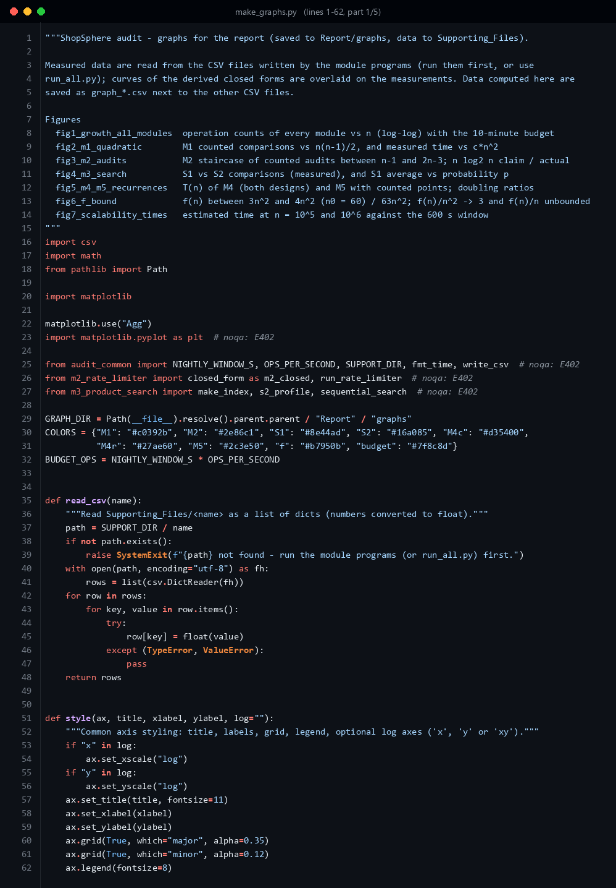

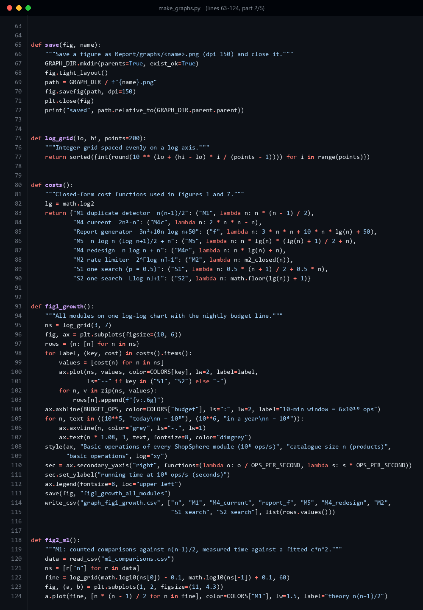

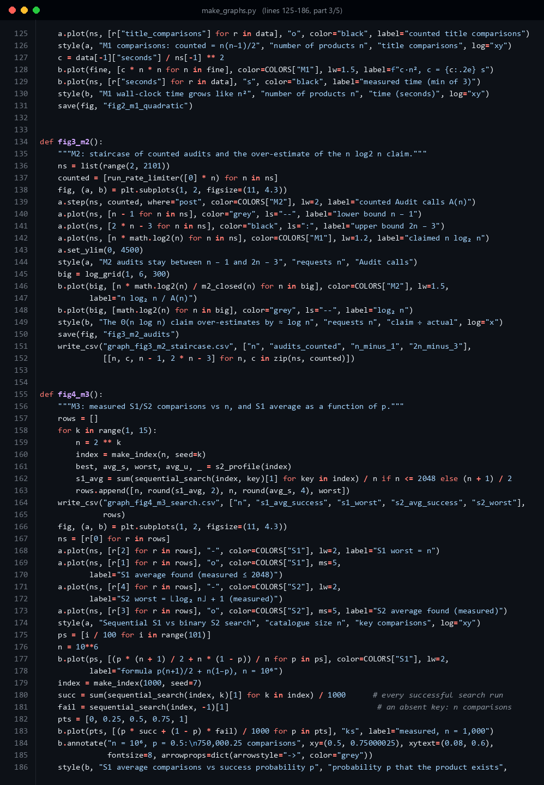

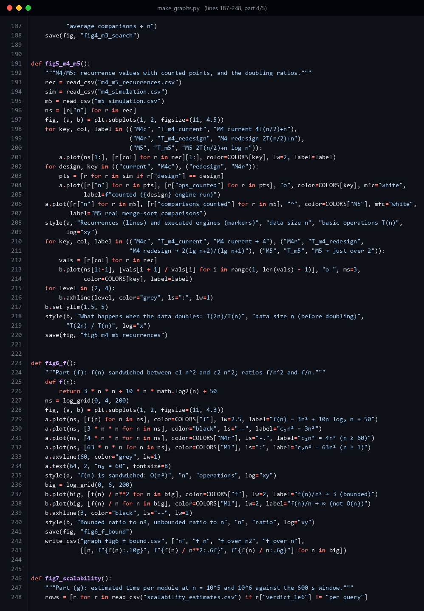

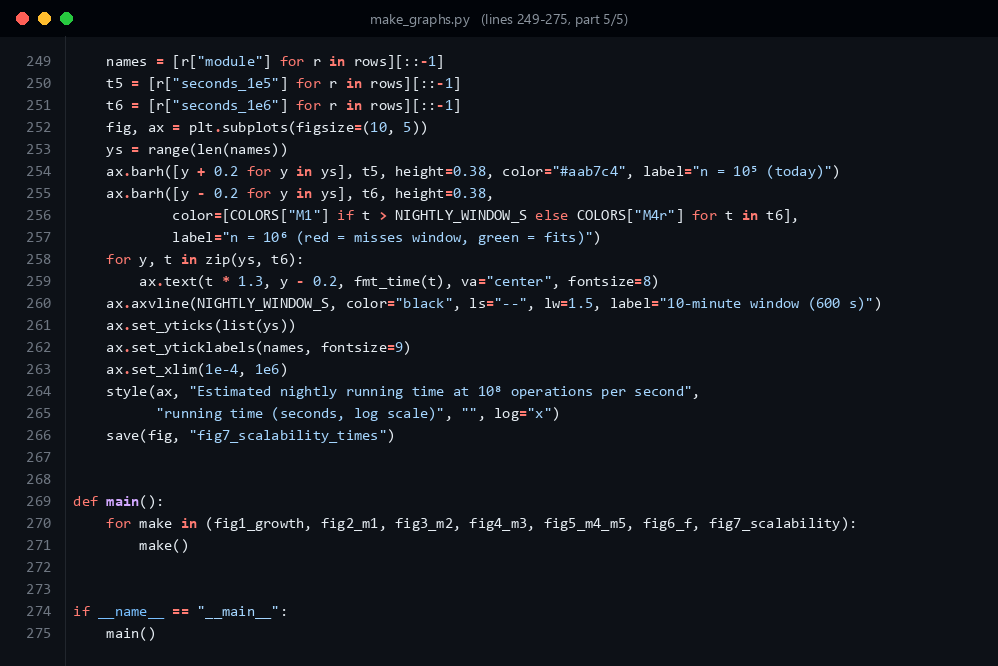

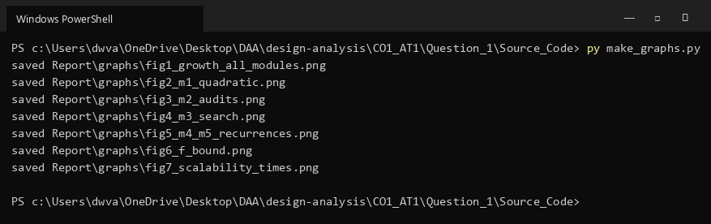

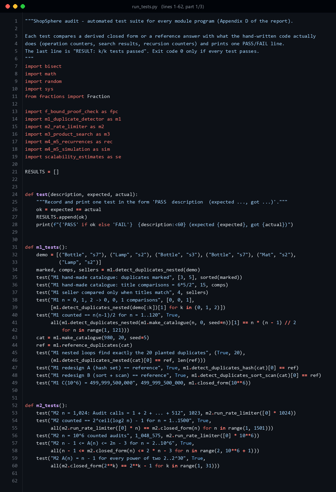

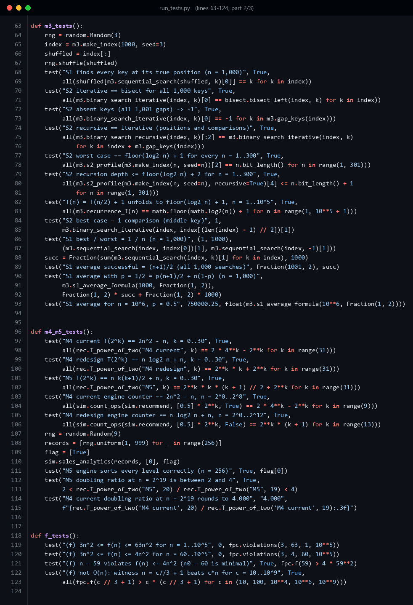

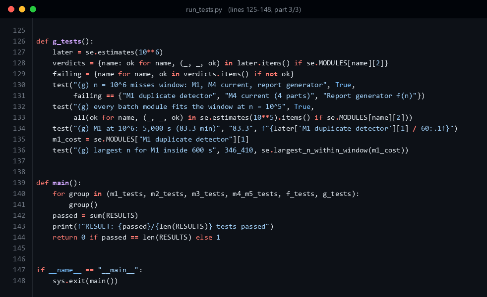

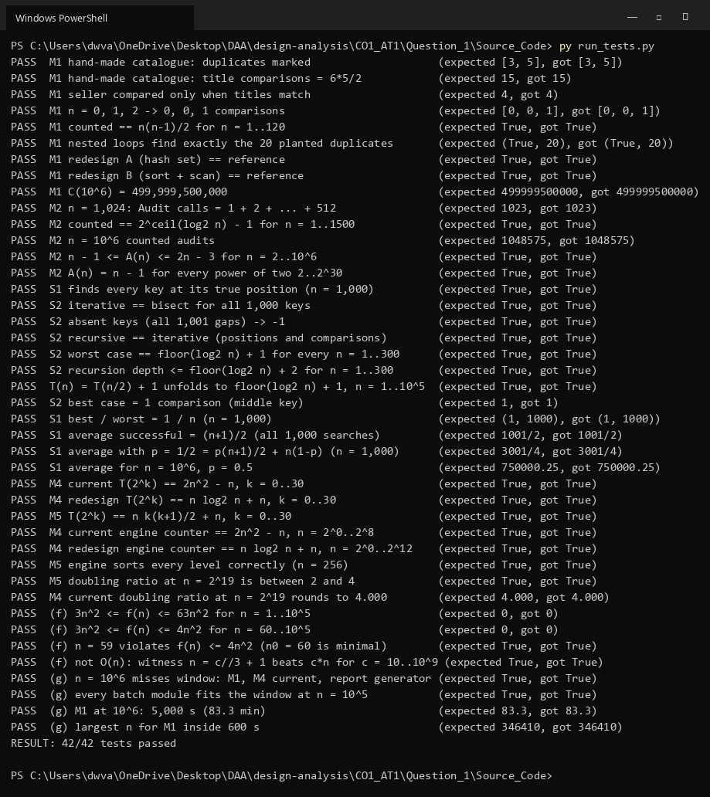

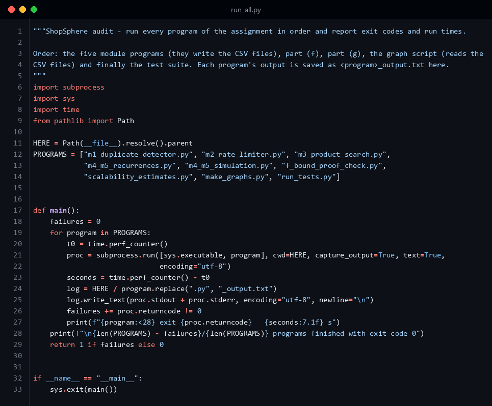

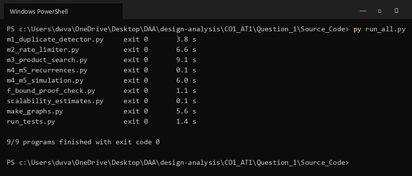

### Summary of Findings

Table 22: Summary of the scalability audit (n = 1,000,000, 10⁸ operations per second)

| Module | Basic operation | Exact count | Class | Time at n = 10⁶ | Verdict |
|---|---|---|---|---:|---|
| M1 Duplicate detector | title comparison | n(n − 1)/2 | Θ(n²), space Θ(1) | 83.3 min | **FAIL** – redesign (hash set) |
| M2 Rate limiter | Audit call | 2^⌈log₂ n⌉ − 1 | Θ(n), not Θ(n log n) | 0.0105 s | PASS – keep |
| S1 Sequential search | key comparison | p(n + 1)/2 + n(1 − p) | Θ(n) | 7.5 ms per search | replace by S2 |
| S2 Binary search | key vs middle entry | ⌊log₂ n⌋ + 1 | Θ(log n) | 0.2 µs per search | PASS |
| M4 current | merge step | 2n² − n | Θ(n²), Case 1 | 5.56 h | **FAIL** – adopt redesign |
| M4 redesign | merge step | n log₂ n + n | Θ(n log n), Case 2 | 0.21 s | PASS |
| M5 Sales analytics | revenue comparison | n log₂ n(log₂ n + 1)/2 + n | Θ(n log² n) | 2.10 s | PASS – keep |
| Report generator | profiled operation | 3n² + 10n log₂ n + 50 | Θ(n²), not O(n) | 8.33 h | **FAIL** – redesign |

**Conclusion.** The audit shows that ShopSphere's risk is concentrated in the three quadratic jobs. They look harmless today (50 s, 3.3 min and 5 min) but each tenfold growth of the catalogue multiplies their work by 100, so they will exceed the 10-minute window at roughly 141,000–346,000 products – well before the expected one million. Replacing all-pairs work by hashing or sorting (M1, report generator) and removing the replicated recursion (M4) brings every nightly job below 3 seconds at n = 10⁶. Every closed form in this report was confirmed by counting the basic operation in executed code (42/42 automated tests passed).

<!-- pagebreak -->

### Appendix A – Complete Source Code: ShopSphere audit programs (Source_Code/)

Every program below was run for the results in this report (`py -3 run_all.py` runs them all). `audit_common.py` holds the constants of the paper and the shared printing helpers.

#### audit_common.py

```
"""Shared helpers for the ShopSphere scalability-audit programs (CSA06 - CO1 - Assessment Tool 1).

This module holds the constants stated in the question paper (server speed, nightly window and the
two catalogue sizes), the folder that receives the CSV files, and a few small helpers so that every
program prints tidy, screenshot-friendly tables and the same "expected / actual / PASS|FAIL" lines.
"""
import csv
import gc
import time
from pathlib import Path

OPS_PER_SECOND = 10**8           # "the platform's servers execute 10^8 basic operations per second"
NIGHTLY_WINDOW_S = 10 * 60       # nightly processing window: 10 minutes = 600 seconds
N_CURRENT = 100_000              # catalogue size today
N_FUTURE = 1_000_000             # catalogue size expected within a year

SUPPORT_DIR = Path(__file__).resolve().parent.parent / "Supporting_Files"


def banner(title):
    """Print a program title framed by '=' lines."""
    line = "=" * max(70, len(title) + 4)
    print(f"{line}\n  {title}\n{line}")


def section(title):
    """Print a section heading."""
    print(f"\n--- {title} " + "-" * max(3, 96 - len(title)))


def print_table(headers, rows, right=None):
    """Print an aligned text table.

    headers : list of column titles
    rows    : list of rows (each a list of values; values are converted with str())
    right   : set of column indexes to right-align (default: every column except the first)
    """
    right = set(range(1, len(headers))) if right is None else set(right)
    cells = [[str(h) for h in headers]] + [[str(v) for v in r] for r in rows]
    widths = [max(len(row[c]) for row in cells) for c in range(len(headers))]

    def fmt(row):
        return "  ".join(v.rjust(w) if c in right else v.ljust(w)
                         for c, (v, w) in enumerate(zip(row, widths)))

    print(fmt(cells[0]))
    print("  ".join("-" * w for w in widths))
    for row in cells[1:]:
        print(fmt(row))


def write_csv(filename, headers, rows):
    """Write rows to Supporting_Files/<filename> and return the path."""
    SUPPORT_DIR.mkdir(parents=True, exist_ok=True)
    path = SUPPORT_DIR / filename
    with open(path, "w", newline="", encoding="utf-8") as fh:
        writer = csv.writer(fh)
        writer.writerow(headers)
        writer.writerows(rows)
    return path


def verdict(ok):
    """Return 'PASS' or 'FAIL'."""
    return "PASS" if ok else "FAIL"


def check(label, expected, actual):
    """Print one test line in the 'expected / actual / PASS|FAIL' format and return the result."""
    ok = expected == actual
    print(f"  {label:<52} expected = {expected!s:<16} actual = {actual!s:<16} {verdict(ok)}")
    return ok


def min_time(func, *args, repeats=5):
    """Wall-clock seconds of func(*args): one warm-up run, then the minimum of `repeats` runs.

    Timing is secondary evidence only (other programs share the CPU); operation counts are primary.
    Like the standard `timeit` module, the garbage collector is paused while timing.
    """
    func(*args)
    best = float("inf")
    gc.disable()
    try:
        for _ in range(repeats):
            t0 = time.perf_counter()
            func(*args)
            best = min(best, time.perf_counter() - t0)
    finally:
        gc.enable()
    return best


def fmt_int(x):
    """Format a number with thousands separators (rounded to an integer)."""
    return f"{round(x):,}"


def fmt_time(seconds):
    """Human-readable duration: s, min or h, whichever reads best."""
    if seconds < 1e-3:
        return f"{seconds * 1e6:.2f} us"
    if seconds < 1:
        return f"{seconds * 1e3:.2f} ms"
    if seconds < 120:
        return f"{seconds:.2f} s"
    if seconds < 2 * 3600:
        return f"{seconds / 60:.1f} min"
    return f"{seconds / 3600:.2f} h"
```

#### m1_duplicate_detector.py

```
"""ShopSphere audit - Module M1: Duplicate-Listing Detector (parts (a), (b) and (g)).

The nightly routine compares every product with every later product:

    FOR i <- 0 TO n-2 DO
      FOR j <- i+1 TO n-1 DO
        IF Product[i].title = Product[j].title AND Product[i].seller = Product[j].seller THEN
          MarkDuplicate(j)

Input size      : n = number of products in the catalogue.
Basic operation : the title comparison in the IF test. It runs on every inner-loop iteration; the
                  seller comparison only runs when the titles match (AND short-circuits).
Derivation      : C(n) = sum_{i=0}^{n-2} (n-1-i) = n(n-1)/2  ->  Theta(n^2) time, Theta(1) extra space.

The program
  1. runs the nested-loop detector on a hand-made catalogue and on random catalogues with planted
     duplicates, counting title and seller comparisons;
  2. checks the count against n(n-1)/2 and the duplicates found against a set-based reference;
  3. doubles n to show the ~4x growth (counts first, wall-clock time second);
  4. runs two redesigns (hash set keyed on (title, seller) and sort-then-scan) and checks that they
     find the same duplicates with far fewer basic operations.
"""
import random

from audit_common import (NIGHTLY_WINDOW_S, N_CURRENT, N_FUTURE, OPS_PER_SECOND, banner, check,
                          fmt_int, fmt_time, min_time, print_table, section, verdict, write_csv)

BRANDS = ["Acme", "Zento", "Nova", "Orbit", "Pixel", "Lumo", "Vertex", "Kiva", "Aero", "Mira"]
ITEMS = ["USB-C Cable", "Steel Bottle", "Desk Lamp", "Yoga Mat", "Wireless Mouse", "Backpack",
         "Smart Watch", "Tea Kettle", "Phone Case", "Earbuds", "Notebook", "Power Bank"]


# --------------------------------------------------------------------------- data generation
def make_catalogue(n_unique, n_duplicates, seed=42):
    """Build a catalogue of (title, seller) pairs with exactly n_duplicates planted re-uploads.

    Titles are shared between sellers (as on a real marketplace), so title matches also happen for
    non-duplicates and the seller comparison is exercised. Every (title, seller) pair of the first
    n_unique products is distinct; then n_duplicates distinct products are uploaded a second time.
    """
    rng = random.Random(seed)
    n_titles = max(4, n_unique // 3)                       # ~3 sellers per title on average
    titles = [f"{rng.choice(BRANDS)} {rng.choice(ITEMS)} M{k:05d}" for k in range(n_titles)]
    sellers = [f"seller-{k:03d}" for k in range(60)]
    used, catalogue = set(), []
    while len(catalogue) < n_unique:
        product = (rng.choice(titles), rng.choice(sellers))
        if product not in used:
            used.add(product)
            catalogue.append(product)
    catalogue += rng.sample(catalogue, n_duplicates)        # re-uploads of existing products
    rng.shuffle(catalogue)
    return catalogue


def reference_duplicates(catalogue):
    """Reference answer: index j is a duplicate if the same (title, seller) appeared before j."""
    seen, duplicates = set(), set()
    for j, product in enumerate(catalogue):
        if product in seen:
            duplicates.add(j)
        seen.add(product)
    return duplicates


# --------------------------------------------------------------------------- current module M1
def detect_duplicates_nested(catalogue):
    """The audited nested-loop detector. Returns (marked indexes, title comparisons, seller comps)."""
    n = len(catalogue)
    title_comparisons = seller_comparisons = 0
    marked = set()
    for i in range(0, n - 1):                    # FOR i <- 0 TO n-2
        title_i, seller_i = catalogue[i]
        for j in range(i + 1, n):                # FOR j <- i+1 TO n-1
            title_comparisons += 1               # basic operation: Product[i].title = Product[j].title
            if title_i == catalogue[j][0]:
                seller_comparisons += 1          # evaluated only when the titles match
                if seller_i == catalogue[j][1]:
                    marked.add(j)                # MarkDuplicate(j)
    return marked, title_comparisons, seller_comparisons


def closed_form(n):
    """Derived number of title comparisons C(n) = n(n-1)/2."""
    return n * (n - 1) // 2


# --------------------------------------------------------------------------- redesigns
def detect_duplicates_hash(catalogue):
    """Redesign A: one pass with a hash set keyed on (title, seller). Theta(n) expected time."""
    seen, marked, lookups = set(), set(), 0
    for j, key in enumerate(catalogue):
        lookups += 1                             # basic operation: one hash-set membership test
        if key in seen:
            marked.add(j)
        else:
            seen.add(key)
    return marked, lookups


def merge_sort(items, key, counter):
    """Hand-written stable merge sort; counter[0] counts key comparisons."""
    if len(items) <= 1:
        return items
    mid = len(items) // 2
    left, right = merge_sort(items[:mid], key, counter), merge_sort(items[mid:], key, counter)
    out, a, b = [], 0, 0
    while a < len(left) and b < len(right):
        counter[0] += 1
        if key(left[a]) <= key(right[b]):
            out.append(left[a])
            a += 1
        else:
            out.append(right[b])
            b += 1
    return out + left[a:] + right[b:]


def detect_duplicates_sort_scan(catalogue):
    """Redesign B: sort indexes by (title, seller, index), then compare neighbours. Theta(n log n)."""
    counter = [0]
    order = merge_sort(list(range(len(catalogue))), lambda k: (catalogue[k], k), counter)
    marked = set()
    for a, b in zip(order, order[1:]):
        counter[0] += 1                          # adjacent comparison
        if catalogue[a] == catalogue[b]:
            marked.add(b)                        # the later upload (larger index) is the duplicate
    return marked, counter[0]


def main():
    banner("ShopSphere audit - M1 Duplicate-Listing Detector (nested loops)")

    section("1. Test cases on a hand-made catalogue (expected / actual / PASS|FAIL)")
    demo = [("Steel Bottle 1L", "seller-07"), ("Desk Lamp", "seller-02"),
            ("Steel Bottle 1L", "seller-03"), ("Steel Bottle 1L", "seller-07"),
            ("Yoga Mat", "seller-02"), ("Desk Lamp", "seller-02")]
    marked, t_cmp, s_cmp = detect_duplicates_nested(demo)
    ok = check("duplicates marked (indexes)", [3, 5], sorted(marked))
    ok &= check("title comparisons = n(n-1)/2 = 6*5/2", 15, t_cmp)
    ok &= check("seller comparisons (only title matches)", 4, s_cmp)
    ok &= check("n = 0 -> comparisons", 0, detect_duplicates_nested([])[1])
    ok &= check("n = 1 -> comparisons", 0, detect_duplicates_nested(demo[:1])[1])
    ok &= check("n = 2 -> comparisons", 1, detect_duplicates_nested(demo[:2])[1])

    section("2. Counted comparisons vs C(n) = n(n-1)/2 on random catalogues (2% planted duplicates)")
    rows, csv_rows, prev = [], [], None
    for n in (500, 1000, 2000, 4000):
        cat = make_catalogue(n - n // 50, n // 50, seed=n)
        marked, t_cmp, s_cmp = detect_duplicates_nested(cat)
        found_ok = marked == reference_duplicates(cat) and len(marked) == n // 50
        seconds = min_time(detect_duplicates_nested, cat, repeats=3)
        growth = f"{t_cmp / prev[0]:.3f}" if prev else "-"
        t_growth = f"{seconds / prev[1]:.2f}" if prev else "-"
        ok &= t_cmp == closed_form(n) and found_ok
        rows.append([fmt_int(n), fmt_int(t_cmp), fmt_int(closed_form(n)), verdict(t_cmp == closed_form(n)),
                     fmt_int(s_cmp), f"{len(marked)}/{n // 50} {verdict(found_ok)}", growth,
                     f"{seconds:.3f}", t_growth])
        csv_rows.append([n, t_cmp, closed_form(n), s_cmp, len(marked), n // 50, f"{seconds:.6f}"])
        prev = (t_cmp, seconds)
    print_table(["n", "title cmps (counted)", "n(n-1)/2", "match", "seller cmps", "dups found",
                 "C(n)/C(n/2)", "time (s)", "time ratio"], rows)
    write_csv("m1_comparisons.csv", ["n", "title_comparisons", "closed_form", "seller_comparisons",
                                     "duplicates_found", "duplicates_planted", "seconds"], csv_rows)
    print("Doubling n multiplies the comparisons by (2n)(2n-1)/(n(n-1)) -> 4: quadratic growth.")

    section("3. Redesigns on the same catalogue (n = 4,000)")
    cat = make_catalogue(4000 - 80, 80, seed=4000)
    ref = reference_duplicates(cat)
    nested = detect_duplicates_nested(cat)
    hashed = detect_duplicates_hash(cat)
    sorted_scan = detect_duplicates_sort_scan(cat)
    print_table(["design", "basic operations", "growth", "same duplicates?"],
                [["nested loops (current)", fmt_int(nested[1]), "Theta(n^2)", verdict(nested[0] == ref)],
                 ["hash set on (title, seller)", fmt_int(hashed[1]), "Theta(n) expected",
                  verdict(hashed[0] == ref)],
                 ["sort + adjacent scan", fmt_int(sorted_scan[1]), "Theta(n log n)",
                  verdict(sorted_scan[0] == ref)]])
    ok &= nested[0] == hashed[0] == sorted_scan[0] == ref

    section(f"4. Projection at {OPS_PER_SECOND:.0e} basic operations per second (window = 600 s)")
    rows = []
    for n in (N_CURRENT, N_FUTURE):
        ops = closed_form(n)
        secs = ops / OPS_PER_SECOND
        rows.append([fmt_int(n), fmt_int(ops), f"{secs:,.1f}", fmt_time(secs),
                     verdict(secs <= NIGHTLY_WINDOW_S)])
    print_table(["n", "comparisons n(n-1)/2", "seconds", "readable", "fits 10 min?"], rows)

    print(f"\nOverall self-check: {verdict(ok)}")


if __name__ == "__main__":
    main()
```

#### m2_rate_limiter.py

```
"""ShopSphere audit - Module M2: API Rate Limiter (parts (a), (b) and (g)).

    i <- 1
    WHILE i < n DO
      FOR j <- 0 TO i-1 DO
        Audit(Request[j])          // basic operation
      END FOR
      i <- i * 2
    END WHILE

Input size      : n = number of requests in the audited log.
Basic operation : Audit(Request[j]) in the inner loop.
Derivation      : pass k (k = 0, 1, ..., m-1) has i = 2^k and performs exactly 2^k audits; the loop stops
                  at the first power of two >= n, so there are m = ceil(log2 n) passes and
                      A(n) = 2^0 + 2^1 + ... + 2^(m-1) = 2^m - 1 = 2^ceil(log2 n) - 1,
                  with n - 1 <= A(n) <= 2n - 3 for n >= 2. Hence A(n) is Theta(n), NOT Theta(n log n).

The program counts the audits for many n (powers and non-powers of 2), checks them against the closed
form and the bounds, traces n = 1,024 pass by pass, and contrasts the count with the claimed n log2 n.
"""
import math
import random

from audit_common import (NIGHTLY_WINDOW_S, N_CURRENT, N_FUTURE, OPS_PER_SECOND, banner, check,
                          fmt_int, fmt_time, min_time, print_table, section, verdict, write_csv)

RATE_LIMIT = 900          # a request whose "calls in the last minute" exceeds this is flagged


def make_requests(n, seed=42):
    """Simulated request log: request j = number of calls its client made in the last minute."""
    rng = random.Random(seed)
    return [rng.randint(1, 1000) for _ in range(n)]


def audit(request, stats):
    """Audit one request (the basic operation): count it and flag it if it breaks the rate limit."""
    stats["audits"] += 1
    if request > RATE_LIMIT:
        stats["flagged"] += 1


def run_rate_limiter(requests, trace=None):
    """The audited routine. Returns the number of Audit calls; optionally records (i, audits) per pass."""
    n = len(requests)
    stats = {"audits": 0, "flagged": 0}
    i = 1
    while i < n:                                  # WHILE i < n
        for j in range(0, i):                     # FOR j <- 0 TO i-1
            audit(requests[j], stats)             # Audit(Request[j])
        if trace is not None:
            trace.append((i, stats["audits"]))
        i = i * 2                                 # i <- i * 2
    return stats["audits"]


def ceil_log2(n):
    """Exact ceil(log2 n) for integers n >= 1 (no floating-point error)."""
    return (n - 1).bit_length()


def closed_form(n):
    """Derived number of audits A(n) = 2^ceil(log2 n) - 1 (0 when n <= 1)."""
    return 2 ** ceil_log2(n) - 1 if n > 1 else 0


def main():
    banner("ShopSphere audit - M2 API Rate Limiter (doubling windows)")

    section("1. Pass-by-pass trace for n = 1,024 (verification asked for in part (b))")
    trace = []
    total = run_rate_limiter(make_requests(1024), trace)
    rows, before = [], 0
    for k, (i, cumulative) in enumerate(trace):
        rows.append([k, fmt_int(i), f"j = 0..{i - 1}", fmt_int(cumulative - before), fmt_int(cumulative)])
        before = cumulative
    print_table(["pass k", "i = 2^k", "inner loop", "audits this pass", "cumulative audits"], rows)
    print(f"Loop exits when i = {2 ** len(trace):,} (not < 1,024) after {len(trace)} passes = log2 1024.")
    ok = check("A(1024) = 1 + 2 + ... + 512 = 2^10 - 1", 1023, total)
    ok &= check("A(1024) = n - 1 (n is a power of 2)", 1024 - 1, total)

    section("2. Counted audits vs closed form 2^ceil(log2 n) - 1 and the team's n log2 n claim")
    rows, csv_rows = [], []
    for n in (1, 2, 3, 5, 8, 100, 1000, 1023, 1024, 1025, 4096, 100_000, 1_000_000):
        counted = run_rate_limiter(make_requests(n, seed=n))
        claim = n * math.log2(n) if n > 1 else 0
        ok &= counted == closed_form(n)
        rows.append([fmt_int(n), ceil_log2(n), fmt_int(counted), fmt_int(closed_form(n)),
                     verdict(counted == closed_form(n)), f"{counted / n:.3f}", fmt_int(claim),
                     f"{claim / counted:.2f}" if counted else "-"])
        csv_rows.append([n, ceil_log2(n), counted, closed_form(n), round(claim, 2)])
    print_table(["n", "passes", "audits counted", "2^ceil(lg n)-1", "match", "audits/n",
                 "claimed n log2 n", "claim/actual"], rows)
    write_csv("m2_audit_counts.csv", ["n", "passes", "audits_counted", "closed_form", "n_log2_n"],
              csv_rows)

    section("3. Exhaustive check for every n = 2..3,000 (counted by running the loop)")
    mismatches = sum(run_rate_limiter([0] * n) != closed_form(n) for n in range(2, 3001))
    outside = sum(not (n - 1 <= closed_form(n) <= 2 * n - 3) for n in range(2, 1_000_001))
    ok &= check("n with counted != 2^ceil(log2 n) - 1", 0, mismatches)
    ok &= check("n <= 10^6 violating n-1 <= A(n) <= 2n-3", 0, outside)
    print("So (1/2)n <= A(n) <= 2n for all n >= 2: Theta(n) with c1 = 1/2, c2 = 2, n0 = 2.")

    section("4. Wall-clock doubling test (secondary evidence; counts above are primary)")
    rows, prev = [], None
    for n in (2**18, 2**19, 2**20, 2**21):
        best = min_time(run_rate_limiter, make_requests(n))
        rows.append([fmt_int(n), fmt_int(closed_form(n)), f"{best:.4f}",
                     f"{best / prev:.2f}" if prev else "-", f"{best / closed_form(n) * 1e9:.0f}"])
        prev = best
    print_table(["n", "audits", "time (s)", "time ratio", "ns per audit"], rows)
    print("Doubling n roughly doubles the time: linear behaviour, as the Theta(n) bound predicts.")

    section(f"5. Projection at {OPS_PER_SECOND:.0e} operations per second")
    rows = []
    for n in (N_CURRENT, N_FUTURE):
        secs = closed_form(n) / OPS_PER_SECOND
        rows.append([fmt_int(n), fmt_int(closed_form(n)), fmt_time(secs), verdict(secs <= NIGHTLY_WINDOW_S)])
    print_table(["n", "audits 2^ceil(lg n)-1", "time", "fits 10 min?"], rows)

    print(f"\nVerdict: the Theta(n log n) claim is an over-estimate; tight bound is Theta(n). "
          f"Self-check: {verdict(ok)}")


if __name__ == "__main__":
    main()
```

#### m3_product_search.py

```
"""ShopSphere audit - Module M3: Product Search, versions S1 and S2 (parts (a), (c), (e) and (g)).

S1  sequential search: scan the unsorted catalogue from the front until the product is found.
    Basic operation: key comparison  catalogue[i] == key.
S2  binary search on the sorted product index: compare the key with the middle entry and discard
    half of the index. Basic operation: one three-way comparison of the key with index[mid].
    Recurrence T(n) = T(n/2) + 1, T(1) = 1  ->  T(n) = log2 n + 1 (n = 2^k); floor(log2 n) + 1 in general.

The program checks both searches against Python's own lookup, measures best / average / worst
comparison counts by running every possible search, verifies the backward-substitution closed form,
measures the recursion depth (space) of a recursive S2, and checks the S1 average-case formula
C_avg(p) = p(n+1)/2 + n(1-p) exactly (n = 1,000) and by simulation (n = 10,000).
"""
import math
import random
from fractions import Fraction

from audit_common import (OPS_PER_SECOND, banner, check, fmt_time, print_table, section, verdict,
                          write_csv)


# --------------------------------------------------------------------------- the two search versions
def sequential_search(catalogue, key):
    """S1. Return (position or -1, number of key comparisons)."""
    comparisons = 0
    for i in range(len(catalogue)):
        comparisons += 1                      # basic operation: catalogue[i] == key
        if catalogue[i] == key:
            return i, comparisons
    return -1, comparisons


def binary_search_iterative(index, key):
    """S2, iterative version. Return (position or -1, comparisons). Extra space: lo, hi, mid -> Theta(1)."""
    lo, hi, comparisons = 0, len(index) - 1, 0
    while lo <= hi:
        mid = (lo + hi) // 2
        comparisons += 1                      # one three-way comparison of key with index[mid]
        if key == index[mid]:
            return mid, comparisons
        if key < index[mid]:
            hi = mid - 1                      # discard the right half
        else:
            lo = mid + 1                      # discard the left half
    return -1, comparisons


def binary_search_recursive(index, key, lo=0, hi=None, depth=1):
    """S2, recursive version. Return (position or -1, comparisons, deepest call-stack depth)."""
    if hi is None:
        hi = len(index) - 1
    if lo > hi:                               # empty range: unsuccessful search
        return -1, 0, depth
    mid = (lo + hi) // 2
    if key == index[mid]:
        return mid, 1, depth
    if key < index[mid]:
        pos, comps, deepest = binary_search_recursive(index, key, lo, mid - 1, depth + 1)
    else:
        pos, comps, deepest = binary_search_recursive(index, key, mid + 1, hi, depth + 1)
    return pos, comps + 1, deepest


def recurrence_T(n):
    """T(n) = T(floor(n/2)) + 1 with T(1) = 1, evaluated by unfolding (backward substitution)."""
    steps = 1
    while n > 1:
        n //= 2
        steps += 1
    return steps


def make_index(n, seed=42):
    """Sorted, distinct, even product IDs; every odd number is guaranteed absent."""
    return sorted(random.Random(seed).sample(range(0, 40 * n, 2), n))


def gap_keys(index):
    """One absent key in each of the n+1 gaps (before, between and after the IDs)."""
    return [index[0] - 1] + [x + 1 for x in index]


def s2_profile(index, recursive=False):
    """Run S2 for every present key and every gap; return best/avg/worst comparisons and max depth."""
    succ, fail, depth = [], [], 0
    for key in index:
        if recursive:
            _, c, d = binary_search_recursive(index, key)
            depth = max(depth, d)
        else:
            c = binary_search_iterative(index, key)[1]
        succ.append(c)
    for key in gap_keys(index):
        if recursive:
            _, c, d = binary_search_recursive(index, key)
            depth = max(depth, d)
        else:
            c = binary_search_iterative(index, key)[1]
        fail.append(c)
    return min(succ), sum(succ) / len(succ), max(succ + fail), sum(fail) / len(fail), depth


def s1_average_formula(n, p):
    """Derived S1 average: p(n+1)/2 + n(1-p), computed exactly with fractions."""
    p = Fraction(p)
    return p * Fraction(n + 1, 2) + n * (1 - p)


def main():
    banner("ShopSphere audit - M3 Product Search: S1 sequential vs S2 binary")
    rng = random.Random(42)

    section("1. Correctness against Python's own lookup (n = 2,000; all present and absent keys)")
    index = make_index(2000)
    catalogue = index[:]
    rng.shuffle(catalogue)
    where = {key: pos for pos, key in enumerate(catalogue)}
    ok = check("S1 positions == dict lookup (2,000 keys)", True,
               all(sequential_search(catalogue, k)[0] == where[k] for k in index))
    ok &= check("S2 iterative positions == list.index", True,
                all(binary_search_iterative(index, k)[0] == index.index(k) for k in index[::7]))
    ok &= check("S2 recursive == S2 iterative (all keys)", True,
                all(binary_search_recursive(index, k)[:2] == binary_search_iterative(index, k)
                    for k in index + gap_keys(index)))
    ok &= check("absent keys -> -1 in S1 and S2", True,
                all(sequential_search(catalogue, k)[0] == binary_search_iterative(index, k)[0] == -1
                    for k in gap_keys(index)[::25]))

    section("2. Part (c): T(n) = T(n/2) + 1 -> log2 n + 1, vs worst case counted by running S2")
    rows = []
    for k in (0, 1, 2, 3, 4, 8, 12, 16):
        n = 2 ** k
        _, _, worst, _, depth = s2_profile(make_index(n, seed=k), recursive=True)
        good = recurrence_T(n) == k + 1 == worst
        ok &= good
        rows.append([k, f"{n:,}", recurrence_T(n), k + 1, worst, depth, verdict(good)])
    print_table(["k", "n = 2^k", "T(n) unfolded", "log2 n + 1", "worst counted", "max stack depth",
                 "match"], rows)
    bad = sum(recurrence_T(n) != math.floor(math.log2(n)) + 1 for n in range(1, 1_000_001))
    ok &= check("n = 1..10^6 with T(n) != floor(log2 n) + 1", 0, bad)

    section("3. Part (e): best / average / worst comparisons, measured by running every search")
    rows, csv_rows = [], []
    for n in (1000, 1024, 1_000_000):
        index = make_index(n, seed=n)
        best, avg_s, worst, avg_u, _ = s2_profile(index)
        if n <= 1024:                          # S1: run every successful search (n^2/2 comparisons)
            s1_avg = sum(sequential_search(index, k)[1] for k in index) / n
            s1_src = "measured"
        else:                                  # 5*10^11 comparisons is too many: use (n+1)/2
            s1_avg, s1_src = (n + 1) / 2, "formula"
        s1_best = sequential_search(index, index[0])[1]
        s1_worst = max(sequential_search(index, index[-1])[1], sequential_search(index, -1)[1])
        ok &= s1_best == 1 and s1_worst == n and s1_avg == (n + 1) / 2
        ok &= best == 1 and worst == math.floor(math.log2(n)) + 1
        rows.append([f"{n:,}", s1_best, f"{s1_avg:,.1f} ({s1_src})", f"{s1_worst:,}", best,
                     f"{avg_s:.3f} / {avg_u:.3f}", worst])
        csv_rows.append([n, s1_best, s1_avg, s1_worst, best, round(avg_s, 4), round(avg_u, 4), worst])
    print_table(["n", "S1 best", "S1 avg (found)", "S1 worst", "S2 best", "S2 avg found / absent",
                 "S2 worst"], rows)
    write_csv("m3_search_cases.csv", ["n", "s1_best", "s1_avg_success", "s1_worst", "s2_best",
                                      "s2_avg_success", "s2_avg_fail", "s2_worst"], csv_rows)
    print("S2 worst = floor(log2 n) + 1 (20 for n = 10^6); S2 average found ~ log2 n - 1.")

    section("4. S1 average with success probability p: C_avg(p) = p(n+1)/2 + n(1-p)")
    n = 1000
    index = make_index(n, seed=7)
    succ_avg = Fraction(sum(sequential_search(index, k)[1] for k in index), n)
    fail_avg = Fraction(sum(sequential_search(index, k)[1] for k in gap_keys(index)), n + 1)
    for p in (0, Fraction(1, 4), Fraction(1, 2), Fraction(3, 4), 1):
        ok &= check(f"n = 1,000, p = {p}: exact mixture of all runs", s1_average_formula(n, p),
                    p * succ_avg + (1 - p) * fail_avg)
    n, p, trials = 10_000, 0.5, 4000
    index = make_index(n, seed=11)
    total = 0
    for _ in range(trials):
        key = rng.choice(index) if rng.random() < p else rng.randrange(0, 40 * n, 2) + 1
        total += sequential_search(index, key)[1]
    expected = float(s1_average_formula(n, p))
    print(f"  Simulation n = 10,000, p = 0.5, {trials:,} searches: mean = {total / trials:,.1f}, "
          f"formula = {expected:,.2f}, error = {abs(total / trials - expected) / expected:.2%}")
    big = s1_average_formula(10**6, Fraction(1, 2))
    ok &= check("n = 10^6, p = 0.5: p(n+1)/2 + n(1-p)", Fraction(3000001, 4), big)
    print(f"  = {float(big):,.2f} comparisons -> {fmt_time(float(big) / OPS_PER_SECOND)} per search "
          f"at 10^8 ops/s, versus <= 20 comparisons ({fmt_time(20 / OPS_PER_SECOND)}) for S2.")
    print(f"\nSelf-check: {verdict(ok)}")


if __name__ == "__main__":
    main()
```

#### m4_m5_recurrences.py

```
"""ShopSphere audit - Modules M4 and M5: Master Theorem and recursion trees (parts (d) and (g)).

M4 current  : T(n) = 4T(n/2) + n          a=4, b=2, n^(log_b a) = n^2, f(n) = n = O(n^(2-e))  -> Case 1
              exact (T(1) = 1, n = 2^k):  T(n) = 2n^2 - n                                   -> Theta(n^2)
M4 redesign : T(n) = 2T(n/2) + n          a=2, b=2, n^(log_b a) = n,   f(n) = Theta(n)      -> Case 2
              exact:                      T(n) = n log2 n + n                               -> Theta(n log n)
M5          : T(n) = 2T(n/2) + n log2 n   a=2, b=2, n^(log_b a) = n,   f(n)/n = log2 n is neither
              Theta(1) nor >= n^e, so none of the three basic cases applies; the extended Case 2
              (f = Theta(n log^1 n)) or the recursion tree gives
              exact:                      T(n) = n log2 n (log2 n + 1)/2 + n            -> Theta(n log^2 n)

The program evaluates each recurrence exactly for n = 2^k, compares it with the closed forms, prints the
recursion-tree level sums for n = 1,024, the doubling ratios T(2n)/T(n), the "polynomially larger" test
for M5, and the recurrences with integer halves at n = 10^5 and 10^6 (used for part (g)).
"""
import math
from functools import lru_cache

from audit_common import (NIGHTLY_WINDOW_S, OPS_PER_SECOND, banner, check, fmt_int, fmt_time,
                          print_table, section, verdict, write_csv)

# name -> (a, b, f(n) as text, f evaluated at n = 2^k given (n, k))
MODELS = {
    "M4 current":  (4, 2, "n",         lambda n, k: n),
    "M4 redesign": (2, 2, "n",         lambda n, k: n),
    "M5":          (2, 2, "n log2 n",  lambda n, k: n * k),
}


def T_power_of_two(model, k):
    """Exact T(2^k) by unfolding T(n) = a T(n/2) + f(n) from T(1) = 1 (integer arithmetic)."""
    a, _, _, f = MODELS[model]
    value = 1
    for j in range(1, k + 1):
        value = a * value + f(2 ** j, j)
    return value


def closed_form(model, n):
    """Closed forms derived in the report (valid exactly for n = 2^k, used as estimates otherwise)."""
    lg = math.log2(n)
    if model == "M4 current":
        return 2 * n * n - n
    if model == "M4 redesign":
        return n * lg + n
    return n * lg * (lg + 1) / 2 + n


@lru_cache(maxsize=None)
def T_integer(model, n):
    """Recurrence with integer halves floor(n/2), ceil(n/2) for any n >= 1 (T(1) = 1)."""
    if n <= 1:
        return 1
    lo, hi = n // 2, n - n // 2
    if model == "M4 current":        # four parts: two copies of each half
        return 2 * T_integer(model, lo) + 2 * T_integer(model, hi) + n
    if model == "M4 redesign":
        return T_integer(model, lo) + T_integer(model, hi) + n
    return T_integer(model, lo) + T_integer(model, hi) + n * math.log2(n)


def main():
    banner("ShopSphere audit - M4 Recommendation Engine and M5 Sales Analytics (recurrences)")

    section("1. Master Theorem parameters  T(n) = a T(n/b) + f(n)")
    rows = []
    cases = {"M4 current": ("n = O(n^(2-e)), e = 1", "Case 1", "Theta(n^2)"),
             "M4 redesign": ("n = Theta(n^1)", "Case 2", "Theta(n log n)"),
             "M5": ("n log n vs n: ratio log n", "none (gap)", "Theta(n log^2 n)")}
    for name, (a, b, f_text, _) in MODELS.items():
        crit = math.log(a) / math.log(b)
        rows.append([name, a, b, f_text, f"n^{crit:g}", *cases[name]])
    print_table(["module", "a", "b", "f(n)", "n^(log_b a)", "f(n) vs n^(log_b a)", "case", "result"],
                rows, right={1, 2})

    section("2. Exact T(2^k) from the recurrence vs the closed forms")
    rows, csv_rows, ok = [], [], True
    for k in range(0, 21):
        n = 2 ** k
        vals = [T_power_of_two(m, k) for m in MODELS]
        forms = [2 * n * n - n, n * k + n, n * k * (k + 1) // 2 + n]
        ok &= vals == forms
        csv_rows.append([k, n] + vals)
        if k in (0, 1, 2, 3, 4, 10, 15, 20):
            rows.append([k, fmt_int(n), fmt_int(vals[0]), fmt_int(vals[1]), fmt_int(vals[2]),
                         verdict(vals == forms)])
    print_table(["k", "n", "M4 cur: 2n^2-n", "M4 new: n lg n + n", "M5: n lg n(lg n+1)/2 + n",
                 "match"], rows)
    write_csv("m4_m5_recurrences.csv", ["k", "n", "T_m4_current", "T_m4_redesign", "T_m5"], csv_rows)
    ok &= check("all k = 0..20 equal the closed forms", True, ok)

    section("3. Recursion-tree level sums for n = 1,024 (level i has a^i nodes of size n/2^i)")
    n, k, rows = 1024, 10, []
    totals = [0, 0, 0]
    for i in range(k):
        size = n // 2 ** i
        level = [4 ** i * size, 2 ** i * size, 2 ** i * size * (k - i)]
        totals = [t + v for t, v in zip(totals, level)]
        rows.append([i, fmt_int(4 ** i), fmt_int(2 ** i), size, fmt_int(level[0]), fmt_int(level[1]),
                     fmt_int(level[2])])
    leaves = [4 ** k, 2 ** k, 2 ** k]
    totals = [t + v for t, v in zip(totals, leaves)]
    rows.append(["leaves", fmt_int(4 ** k), fmt_int(2 ** k), 1, *map(fmt_int, leaves)])
    rows.append(["total", "", "", "", *map(fmt_int, totals)])
    print_table(["level i", "nodes a=4", "nodes a=2", "size", "M4 cur: 2^i n", "M4 new: n",
                 "M5: n(lg n - i)"], rows)
    for name, total in zip(MODELS, totals):
        ok &= check(f"tree total == T(1024) for {name}", T_power_of_two(name, k), total)

    section("4. What happens when the data doubles: T(2n) / T(n)")
    rows = []
    for k in (5, 10, 15, 19):
        rows.append([f"2^{k} -> 2^{k + 1}"] +
                    [f"{T_power_of_two(m, k + 1) / T_power_of_two(m, k):.4f}" for m in MODELS])
    print_table(["n -> 2n", "M4 current", "M4 redesign", "M5"], rows)
    print("M4 current -> 4x (quadratic); redesign -> 2(lg n + 2)/(lg n + 1), just over 2x; "
          "M5 -> a bit more than 2x.")

    section("5. M5: is f(n) = n log2 n polynomially larger than n^(log_b a) = n?")
    rows = []
    for k in (10, 100, 1000, 2000, 5000):
        rows.append([f"2^{k}", k, f"{k / 2 ** (0.1 * k):.3e}", f"{k / 2 ** (0.01 * k):.3e}"])
    print_table(["n", "f(n)/n = log2 n", "log2 n / n^0.1", "log2 n / n^0.01"], rows)
    print("f(n)/n = log2 n grows (so not Case 2) but log2 n / n^e -> 0 for every e > 0 (so not Case 3):")
    print("the gap between Case 2 and Case 3. Extended Case 2 with k = 1 gives Theta(n log^2 n).")
    rows = []
    for k in (4, 8, 12, 16, 20):
        t = T_power_of_two("M5", k)
        n = 2 ** k
        rows.append([f"2^{k}", fmt_int(t), f"{t / (n * k):.3f}", f"{t / (n * k * k):.4f}"])
    print_table(["n", "T(n)", "T / (n log2 n)", "T / (n log2^2 n)"], rows)
    print("T/(n log n) keeps growing, T/(n log^2 n) settles towards 1/2: Theta(n log^2 n) confirmed.")

    section("6. Integer-halves recurrences at the audit sizes (part (g); 10^8 ops/s, window 600 s)")
    rows = []
    for name in MODELS:
        for n in (10**5, 10**6):
            exact, est = T_integer(name, n), closed_form(name, n)
            secs = exact / OPS_PER_SECOND
            rows.append([name, fmt_int(n), f"{est:.4e}", f"{exact:.4e}", f"{exact / est:.3f}",
                         fmt_time(secs), verdict(secs <= NIGHTLY_WINDOW_S)])
    print_table(["module", "n", "closed form", "integer recurrence", "ratio", "time", "fits 10 min?"],
                rows)
    print(f"\nSelf-check: {verdict(ok)}")


if __name__ == "__main__":
    main()
```

#### m4_m5_simulation.py

```
"""ShopSphere audit - M4 and M5 executed for real: recursive skeletons with operation counters (part (d)).

M4 current  : the recommendation engine splits the customer-product data into FOUR parts of size n/2
              (each half is replicated) and merges the partial results in linear time.
M4 redesign : replication removed - two parts of size n/2, same linear merge.
M5          : the analytics engine sorts the sales records by revenue at the current level (hand-written
              merge sort, comparisons counted) and recurses on the two halves.

Every call of size 1 costs 1 basic operation and every merge step costs 1, so the counters must equal
T(n) = 4T(n/2) + n -> 2n^2 - n and T(n) = 2T(n/2) + n -> n log2 n + n exactly. For M5 the counter holds
the real number of key comparisons made by the sorts; its ratio to n log2^2 n must level off.
Wall-clock times are measured as secondary evidence of the "what happens when data doubles" answer.
"""
import math
import random

from audit_common import (banner, check, fmt_int, min_time, print_table, section, verdict,
                          write_csv)


# --------------------------------------------------------------------------- M4 (both designs)
def recommend(scores, replicated, counter):
    """Recursive recommendation engine; returns one combined score per item of `scores`.

    replicated=True  -> 4 recursive calls on halves (current design, a = 4)
    replicated=False -> 2 recursive calls on halves (redesign, a = 2)
    counter[0] counts basic operations: 1 per base case + 1 per merged output element.
    """
    n = len(scores)
    if n == 1:
        counter[0] += 1                                   # T(1) = 1
        return [scores[0]]
    left, right = scores[: n // 2], scores[n // 2:]
    if replicated:                                        # replicated partitions: L, R, L, R
        parts = [recommend(p, True, counter) for p in (left, right, left, right)]
        halves = [[(a + b) / 2 for a, b in zip(parts[0], parts[2])],
                  [(a + b) / 2 for a, b in zip(parts[1], parts[3])]]
    else:
        halves = [recommend(left, False, counter), recommend(right, False, counter)]
    merged = []
    for half in halves:                                   # linear-time merge: n basic operations
        for value in half:
            counter[0] += 1
            merged.append(value)
    return merged


# --------------------------------------------------------------------------- M5
def merge_sort_by_revenue(records, counter):
    """Hand-written merge sort on revenue; counter[0] counts key comparisons."""
    if len(records) <= 1:
        return records
    mid = len(records) // 2
    left = merge_sort_by_revenue(records[:mid], counter)
    right = merge_sort_by_revenue(records[mid:], counter)
    out, a, b = [], 0, 0
    while a < len(left) and b < len(right):
        counter[0] += 1
        if left[a] >= right[b]:                           # highest revenue first
            out.append(left[a])
            a += 1
        else:
            out.append(right[b])
            b += 1
    return out + left[a:] + right[b:]


def sales_analytics(records, counter, ranking_ok):
    """M5: sort this level's records by revenue, then recurse on both halves (T(1) = 1)."""
    n = len(records)
    if n == 1:
        counter[0] += 1
        return
    ranked = merge_sort_by_revenue(records, counter)
    ranking_ok[0] &= ranked == sorted(records, reverse=True)   # reference check
    sales_analytics(records[: n // 2], counter, ranking_ok)
    sales_analytics(records[n // 2:], counter, ranking_ok)


def count_ops(func, data, *extra):
    """Run one of the engines with a fresh counter and return the counted basic operations."""
    counter = [0]
    func(data, *extra, counter) if extra else func(data, counter)
    return counter[0]


def run_m4(replicated, exponents, closed):
    """Counted operations and timings of M4 for n = 2^k; returns (rows, csv_rows, all_match)."""
    rng = random.Random(42)
    rows, csv_rows, prev, all_ok = [], [], None, True
    for k in exponents:
        n = 2 ** k
        data = [rng.random() for _ in range(n)]
        counter = [0]
        recommend(data, replicated, counter)
        secs = min_time(recommend, data, replicated, [0], repeats=3)
        match = counter[0] == closed(n, k)
        all_ok &= match
        rows.append([fmt_int(n), fmt_int(counter[0]), fmt_int(closed(n, k)), verdict(match),
                     f"{counter[0] / prev[0]:.3f}" if prev else "-", f"{secs:.4f}",
                     f"{secs / prev[1]:.2f}" if prev else "-"])
        csv_rows.append([n, counter[0], closed(n, k), f"{secs:.6f}"])
        prev = (counter[0], secs)
    return rows, csv_rows, all_ok


def main():
    banner("ShopSphere audit - M4 / M5 recursive engines executed with operation counters")
    headers = ["n", "ops counted", "closed form", "match", "ops ratio", "time (s)", "time ratio"]

    section("1. M4 current design, 4 replicated parts: T(n) = 4T(n/2) + n = 2n^2 - n")
    rows, csv_cur, ok = run_m4(True, range(4, 11), lambda n, k: 2 * n * n - n)
    print_table(headers, rows)

    section("2. M4 redesign, 2 parts: T(n) = 2T(n/2) + n = n log2 n + n")
    rows, csv_new, ok2 = run_m4(False, range(4, 17), lambda n, k: n * k + n)
    print_table(headers, rows)
    print("Doubling n: current design ~4x the work, redesign ~2(lg n + 2)/(lg n + 1), just over 2x.")
    ok &= ok2
    write_csv("m4_simulation.csv", ["design", "n", "ops_counted", "closed_form", "seconds"],
              [["current", *r] for r in csv_cur] + [["redesign", *r] for r in csv_new])

    section("3. M5 analytics: real merge-sort comparisons at every level vs Theta(n log^2 n)")
    rng = random.Random(7)
    rows, csv_rows, prev = [], [], None
    for k in range(6, 15):
        n = 2 ** k
        records = [round(rng.uniform(10, 5000), 2) for _ in range(n)]
        counter, ranking_ok = [0], [True]
        sales_analytics(records, counter, ranking_ok)
        model = n * k * (k + 1) // 2 + n              # recurrence with sort cost exactly n log2 n
        ok &= ranking_ok[0]
        rows.append([fmt_int(n), fmt_int(counter[0]), fmt_int(model), f"{counter[0] / model:.3f}",
                     f"{counter[0] / (n * k * k):.4f}", f"{counter[0] / (n * k):.2f}",
                     f"{counter[0] / prev:.2f}" if prev else "-", verdict(ranking_ok[0])])
        csv_rows.append([n, counter[0], model])
        prev = counter[0]
    print_table(["n", "comparisons", "model T(n)", "real/model", "/(n lg^2 n)", "/(n lg n)",
                 "T(2n)/T(n)", "sorted ok"], rows)
    write_csv("m5_simulation.csv", ["n", "comparisons_counted", "model_closed_form"], csv_rows)
    print("Real comparisons / (n log2^2 n) levels off near a constant while / (n log2 n) keeps rising:")
    print("the engine is Theta(n log^2 n), not Theta(n log n). (Merge sort uses slightly fewer than")
    print("n log2 n comparisons per level, so real/model stays a little below 1.)")
    print(f"\nSelf-check (counters equal closed forms, every level sorted correctly): {verdict(ok)}")


if __name__ == "__main__":
    main()
```

#### f_bound_proof_check.py

```
"""ShopSphere audit - part (f): the nightly report generator costs f(n) = 3n^2 + 10 n log2 n + 50.

Claim 1  f(n) = Theta(n^2).  Formal definition: there are c1, c2 > 0 and n0 with
         c1 n^2 <= f(n) <= c2 n^2 for all n >= n0.
         Pair A (simple): for n >= 1, log2 n >= 0 gives f(n) >= 3n^2; log2 n <= n and 1 <= n^2 give
                          f(n) <= 3n^2 + 10n^2 + 50n^2 = 63n^2.            -> c1 = 3, c2 = 63, n0 = 1
         Pair B (tight):  f(n) <= 4n^2  <=>  g(n) = n^2 - 10 n log2 n - 50 >= 0, which first holds at
                          n = 60 and g keeps increasing afterwards.        -> c1 = 3, c2 = 4, n0 = 60
Claim 2  f(n) is not O(n): f(n) <= c n for all n >= n0 would force 3n^2 <= c n, i.e. n <= c/3, which is
         false for every n > max(n0, c/3). The program exhibits such an n for several c.

This program checks both constant pairs for every integer n up to 10^6, finds the smallest n0 for c2 = 4,
prints f(n)/n^2 (-> 3) and f(n)/n (unbounded) and the witnesses that defeat every proposed O(n) constant.
"""
import math

from audit_common import (NIGHTLY_WINDOW_S, OPS_PER_SECOND, banner, check, fmt_int, fmt_time,
                          print_table, section, verdict, write_csv)

LIMIT = 1_000_000


def f(n):
    """Operation count of the nightly report generator."""
    return 3 * n * n + 10 * n * math.log2(n) + 50


def violations(c1, c2, n0, n_max=LIMIT):
    """Number of integers n in [n0, n_max] for which c1 n^2 <= f(n) <= c2 n^2 is FALSE."""
    return sum(not (c1 * n * n <= f(n) <= c2 * n * n) for n in range(n0, n_max + 1))


def smallest_n0(c2, n_max=LIMIT):
    """Smallest n0 such that f(n) <= c2 n^2 for every n in [n0, n_max]."""
    n0 = 1
    for n in range(1, n_max + 1):
        if f(n) > c2 * n * n:
            n0 = n + 1
    return n0


def main():
    banner("ShopSphere audit - part (f): f(n) = 3n^2 + 10 n log2 n + 50 is Theta(n^2), not O(n)")

    section("1. Checking the constant pairs for every integer n up to 10^6")
    ok = check("pair A (c1=3, c2=63, n0=1): violations", 0, violations(3, 63, 1))
    ok &= check("pair B (c1=3, c2=4, n0=60): violations", 0, violations(3, 4, 60))
    ok &= check("smallest n0 that works with c2 = 4", 60, smallest_n0(4))
    ok &= check("n = 59 breaks c2 = 4: f(59) > 4*59^2", True, f(59) > 4 * 59 * 59)
    print(f"  f(1) = {f(1):g} -> the largest f(n)/n^2 for n >= 1 is 53 (at n = 1), so c2 = 63 is safe.")
    print(f"  g(n) = n^2 - 10 n log2 n - 50: g(59) = {59**2 - 10*59*math.log2(59) - 50:.2f}, "
          f"g(60) = {60**2 - 10*60*math.log2(60) - 50:.2f}, and g'(n) = 2n - 10 log2 n - 10/ln 2 > 0 "
          "for n >= 60.")

    section("2. Ratios: f(n)/n^2 tends to 3 (Theta(n^2)); f(n)/n grows without bound (not O(n))")
    rows, csv_rows = [], []
    for n in (1, 2, 10, 60, 100, 1000, 10**4, 10**5, 10**6):
        value = f(n)
        rows.append([fmt_int(n), f"{value:,.0f}", f"{3 * n * n:,}", f"{value / n**2:.6f}",
                     f"{value / n:,.1f}",
                     f"{3 * n * n / value:.4%}"])
        csv_rows.append([n, round(value, 3), value / n**2, value / n])
    print_table(["n", "f(n)", "3n^2", "f(n)/n^2", "f(n)/n", "share of 3n^2"], rows)
    write_csv("f_bound_check.csv", ["n", "f_n", "f_over_n2", "f_over_n"], csv_rows)

    section("3. f(n) is not O(n): for any proposed constant c, n = floor(c/3) + 1 gives f(n) > c n")
    rows = []
    for c in (10, 1000, 10**6, 10**9):
        n = c // 3 + 1
        beaten = f(n) > c * n
        ok &= beaten
        rows.append([fmt_int(c), fmt_int(n), f"{f(n):.4e}", f"{c * n:.4e}", f"{f(n) - c * n:.4e}",
                     verdict(beaten)])
    print_table(["proposed c", "witness n", "f(n)", "c * n", "f(n) - c n", "f(n) > c n ?"], rows)
    print("  Whatever c and n0 are chosen, every n > max(n0, c/3) is a counter-example: f(n) is not O(n).")

    section(f"4. Cost of the report generator at the audit sizes ({OPS_PER_SECOND:.0e} ops/s)")
    rows = []
    for n in (100_000, 1_000_000):
        secs = f(n) / OPS_PER_SECOND
        rows.append([fmt_int(n), f"{f(n):.4e}", f"{secs:,.0f} s", fmt_time(secs),
                     verdict(secs <= NIGHTLY_WINDOW_S)])
    print_table(["n", "f(n)", "seconds", "readable", "fits 10 min?"], rows)
    print(f"\nSelf-check: {verdict(ok)}")


if __name__ == "__main__":
    main()
```

#### scalability_estimates.py

```
"""ShopSphere audit - part (g): operation and running-time estimates for the CTO (10^8 operations / second).

Every module is evaluated with the cost function derived in parts (b)-(f):
    M1 duplicate detector        C(n) = n(n-1)/2
    M2 rate limiter              A(n) = 2^ceil(log2 n) - 1
    S1 sequential search         p(n+1)/2 + n(1-p) per search, p = 0.5
    S2 binary search             floor(log2 n) + 1 per search (worst case)
    M4 current / redesign        2n^2 - n  /  n log2 n + n
    M5 sales analytics           n log2 n (log2 n + 1)/2 + n
    report generator             f(n) = 3n^2 + 10 n log2 n + 50
    M1 redesigns                 hash set: n lookups;  sort + scan: n log2 n + (n - 1) comparisons
The program prints operations and time for n = 10^5 (today) and n = 10^6 (in a year), the PASS/FAIL
verdict against the 10-minute nightly window, the growth factor, and the largest catalogue size each
batch module can handle inside the window.
"""
import math

from audit_common import (NIGHTLY_WINDOW_S, N_CURRENT, N_FUTURE, OPS_PER_SECOND, banner, fmt_time,
                          print_table, section, verdict, write_csv)

# name -> (growth class, cost function, is it a nightly batch job?)
MODULES = {
    "M1 duplicate detector":     ("Theta(n^2)",       lambda n: n * (n - 1) / 2, True),
    "M2 rate limiter":           ("Theta(n)",         lambda n: 2 ** (n - 1).bit_length() - 1, True),
    "S1 sequential (1 search)":  ("Theta(n)",         lambda n: 0.5 * (n + 1) / 2 + n * 0.5, False),
    "S2 binary (1 search)":      ("Theta(log n)",     lambda n: math.floor(math.log2(n)) + 1, False),
    "M4 current (4 parts)":      ("Theta(n^2)",       lambda n: 2 * n * n - n, True),
    "M4 redesign (2 parts)":     ("Theta(n log n)",   lambda n: n * math.log2(n) + n, True),
    "M5 sales analytics":        ("Theta(n log^2 n)", lambda n: n * math.log2(n) * (math.log2(n) + 1) / 2 + n,
                                  True),
    "Report generator f(n)":     ("Theta(n^2)",       lambda n: 3 * n * n + 10 * n * math.log2(n) + 50, True),
    "M1 redesign: hash set":     ("Theta(n) exp.",    lambda n: n, True),
    "M1 redesign: sort + scan":  ("Theta(n log n)",   lambda n: n * math.log2(n) + n - 1, True),
}


def seconds(ops):
    """Running time at the stated server speed."""
    return ops / OPS_PER_SECOND


def largest_n_within_window(cost, hi=10**12):
    """Largest n whose cost fits in the nightly window (binary search; cost is increasing in n)."""
    budget = NIGHTLY_WINDOW_S * OPS_PER_SECOND
    if cost(hi) <= budget:
        return None                                  # fits for every n we consider
    lo = 2
    while lo < hi:
        mid = (lo + hi + 1) // 2
        if cost(mid) <= budget:
            lo = mid
        else:
            hi = mid - 1
    return lo


def estimates(n):
    """Dictionary module -> (operations, seconds, fits-in-window) for catalogue size n."""
    return {name: (cost(n), seconds(cost(n)), seconds(cost(n)) <= NIGHTLY_WINDOW_S)
            for name, (_, cost, _) in MODULES.items()}


def main():
    banner("ShopSphere audit - part (g): scalability estimates at 10^8 basic operations per second")
    now, later = estimates(N_CURRENT), estimates(N_FUTURE)

    section(f"1. Operations and time: n = {N_CURRENT:,} today vs n = {N_FUTURE:,} in a year (window = 600 s)")
    rows, csv_rows = [], []
    for name, (growth, cost, batch) in MODULES.items():
        ops5, t5, ok5 = now[name]
        ops6, t6, ok6 = later[name]
        rows.append([name, growth, f"{ops5:.3e}", fmt_time(t5), f"{ops6:.3e}", fmt_time(t6),
                     f"x{ops6 / ops5:,.1f}", verdict(ok6) if batch else "per query"])
        csv_rows.append([name, growth, ops5, t5, ops6, t6, ops6 / ops5,
                         verdict(ok6) if batch else "per query"])
    print_table(["module", "growth", "ops n=10^5", "time", "ops n=10^6", "time", "growth", "10 min @10^6"],
                rows, right={2, 3, 4, 5, 6})
    write_csv("scalability_estimates.csv", ["module", "growth", "ops_1e5", "seconds_1e5", "ops_1e6",
                                            "seconds_1e6", "growth_factor", "verdict_1e6"], csv_rows)

    section("2. Largest catalogue each batch module can process inside the 10-minute window")
    rows, csv_rows = [], []
    for name, (growth, cost, batch) in MODULES.items():
        if not batch:
            continue
        limit = largest_n_within_window(cost)
        rows.append([name, growth, "beyond 10^12" if limit is None else f"{limit:,}",
                     "yes" if limit is None or limit >= N_FUTURE else "NO - redesign"])
        csv_rows.append([name, growth, limit])
    print_table(["module", "growth", "max n in 600 s", "OK at 10^6?"], rows, right={2})
    write_csv("scalability_window_limits.csv", ["module", "growth", "max_n_in_600s"], csv_rows)

    section("3. Search throughput at n = 10^6 (searches per second on one server)")
    s1, s2 = later["S1 sequential (1 search)"][0], later["S2 binary (1 search)"][0]
    print(f"  S1: {s1:,.2f} comparisons per search -> {OPS_PER_SECOND / s1:,.0f} searches/s")
    print(f"  S2: {s2:,.0f} comparisons per search (worst) -> {OPS_PER_SECOND / s2:,.0f} searches/s"
          f"  ({s1 / s2:,.0f} times more)")

    failing = [name for name, (_, _, ok) in later.items() if MODULES[name][2] and not ok]
    print("\nModules that miss the 10-minute window at n = 10^6: " + ", ".join(failing))


if __name__ == "__main__":
    main()
```

#### run_tests.py

```
"""ShopSphere audit - automated test suite for every module program (Appendix D of the report).

Each test compares a derived closed form or a reference answer with what the hand-written code actually
does (operation counters, search results, recursion counters) and prints one PASS/FAIL line.
The last line is "RESULT: k/k tests passed". Exit code 0 only if every test passes.
"""
import bisect
import math
import random
import sys
from fractions import Fraction

import f_bound_proof_check as fpc
import m1_duplicate_detector as m1
import m2_rate_limiter as m2
import m3_product_search as m3
import m4_m5_recurrences as rec
import m4_m5_simulation as sim
import scalability_estimates as se

RESULTS = []


def test(description, expected, actual):
    """Record and print one test in the form 'PASS  description  (expected ..., got ...)'."""
    ok = expected == actual
    RESULTS.append(ok)
    print(f"{'PASS' if ok else 'FAIL'}  {description:<60} (expected {expected}, got {actual})")


def m1_tests():
    demo = [("Bottle", "s7"), ("Lamp", "s2"), ("Bottle", "s3"), ("Bottle", "s7"), ("Mat", "s2"),
            ("Lamp", "s2")]
    marked, comps, sellers = m1.detect_duplicates_nested(demo)
    test("M1 hand-made catalogue: duplicates marked", [3, 5], sorted(marked))
    test("M1 hand-made catalogue: title comparisons = 6*5/2", 15, comps)
    test("M1 seller compared only when titles match", 4, sellers)
    test("M1 n = 0, 1, 2 -> 0, 0, 1 comparisons", [0, 0, 1],
         [m1.detect_duplicates_nested(demo[:k])[1] for k in (0, 1, 2)])
    test("M1 counted == n(n-1)/2 for n = 1..120", True,
         all(m1.detect_duplicates_nested(m1.make_catalogue(n, 0, seed=n))[1] == n * (n - 1) // 2
             for n in range(1, 121)))
    cat = m1.make_catalogue(980, 20, seed=5)
    ref = m1.reference_duplicates(cat)
    test("M1 nested loops find exactly the 20 planted duplicates", (True, 20),
         (m1.detect_duplicates_nested(cat)[0] == ref, len(ref)))
    test("M1 redesign A (hash set) == reference", True, m1.detect_duplicates_hash(cat)[0] == ref)
    test("M1 redesign B (sort + scan) == reference", True, m1.detect_duplicates_sort_scan(cat)[0] == ref)
    test("M1 C(10^6) = 499,999,500,000", 499_999_500_000, m1.closed_form(10**6))


def m2_tests():
    test("M2 n = 1,024: Audit calls = 1 + 2 + ... + 512", 1023, m2.run_rate_limiter([0] * 1024))
    test("M2 counted == 2^ceil(log2 n) - 1 for n = 1..1500", True,
         all(m2.run_rate_limiter([0] * n) == m2.closed_form(n) for n in range(1, 1501)))
    test("M2 n = 10^6 counted audits", 1_048_575, m2.run_rate_limiter([0] * 10**6))
    test("M2 n - 1 <= A(n) <= 2n - 3 for n = 2..10^6", True,
         all(n - 1 <= m2.closed_form(n) <= 2 * n - 3 for n in range(2, 10**6 + 1)))
    test("M2 A(n) = n - 1 for every power of two 2..2^30", True,
         all(m2.closed_form(2**k) == 2**k - 1 for k in range(1, 31)))


def m3_tests():
    rng = random.Random(3)
    index = m3.make_index(1000, seed=3)
    shuffled = index[:]
    rng.shuffle(shuffled)
    test("S1 finds every key at its true position (n = 1,000)", True,
         all(shuffled[m3.sequential_search(shuffled, k)[0]] == k for k in index))
    test("S2 iterative == bisect for all 1,000 keys", True,
         all(m3.binary_search_iterative(index, k)[0] == bisect.bisect_left(index, k) for k in index))
    test("S2 absent keys (all 1,001 gaps) -> -1", True,
         all(m3.binary_search_iterative(index, k)[0] == -1 for k in m3.gap_keys(index)))
    test("S2 recursive == iterative (positions and comparisons)", True,
         all(m3.binary_search_recursive(index, k)[:2] == m3.binary_search_iterative(index, k)
             for k in index + m3.gap_keys(index)))
    test("S2 worst case == floor(log2 n) + 1 for every n = 1..300", True,
         all(m3.s2_profile(m3.make_index(n, seed=n))[2] == n.bit_length() for n in range(1, 301)))
    test("S2 recursion depth <= floor(log2 n) + 2 for n = 1..300", True,
         all(m3.s2_profile(m3.make_index(n, seed=n), recursive=True)[4] <= n.bit_length() + 1
             for n in range(1, 301)))
    test("T(n) = T(n/2) + 1 unfolds to floor(log2 n) + 1, n = 1..10^5", True,
         all(m3.recurrence_T(n) == math.floor(math.log2(n)) + 1 for n in range(1, 10**5 + 1)))
    test("S2 best case = 1 comparison (middle key)", 1,
         m3.binary_search_iterative(index, index[(len(index) - 1) // 2])[1])
    test("S1 best / worst = 1 / n (n = 1,000)", (1, 1000),
         (m3.sequential_search(index, index[0])[1], m3.sequential_search(index, -1)[1]))
    succ = Fraction(sum(m3.sequential_search(index, k)[1] for k in index), 1000)
    test("S1 average successful = (n+1)/2 (all 1,000 searches)", Fraction(1001, 2), succ)
    test("S1 average with p = 1/2 = p(n+1)/2 + n(1-p) (n = 1,000)",
         m3.s1_average_formula(1000, Fraction(1, 2)),
         Fraction(1, 2) * succ + Fraction(1, 2) * 1000)
    test("S1 average for n = 10^6, p = 0.5", 750000.25, float(m3.s1_average_formula(10**6, Fraction(1, 2))))


def m4_m5_tests():
    test("M4 current T(2^k) == 2n^2 - n, k = 0..30", True,
         all(rec.T_power_of_two("M4 current", k) == 2 * 4**k - 2**k for k in range(31)))
    test("M4 redesign T(2^k) == n log2 n + n, k = 0..30", True,
         all(rec.T_power_of_two("M4 redesign", k) == 2**k * k + 2**k for k in range(31)))
    test("M5 T(2^k) == n k(k+1)/2 + n, k = 0..30", True,
         all(rec.T_power_of_two("M5", k) == 2**k * k * (k + 1) // 2 + 2**k for k in range(31)))
    test("M4 current engine counter == 2n^2 - n, n = 2^0..2^8", True,
         all(sim.count_ops(sim.recommend, [0.5] * 2**k, True) == 2 * 4**k - 2**k for k in range(9)))
    test("M4 redesign engine counter == n log2 n + n, n = 2^0..2^12", True,
         all(sim.count_ops(sim.recommend, [0.5] * 2**k, False) == 2**k * (k + 1) for k in range(13)))
    rng = random.Random(9)
    records = [rng.uniform(1, 999) for _ in range(256)]
    flag = [True]
    sim.sales_analytics(records, [0], flag)
    test("M5 engine sorts every level correctly (n = 256)", True, flag[0])
    test("M5 doubling ratio at n = 2^19 is between 2 and 4", True,
         2 < rec.T_power_of_two("M5", 20) / rec.T_power_of_two("M5", 19) < 4)
    test("M4 current doubling ratio at n = 2^19 rounds to 4.000", "4.000",
         f"{rec.T_power_of_two('M4 current', 20) / rec.T_power_of_two('M4 current', 19):.3f}")


def f_tests():
    test("(f) 3n^2 <= f(n) <= 63n^2 for n = 1..10^5", 0, fpc.violations(3, 63, 1, 10**5))
    test("(f) 3n^2 <= f(n) <= 4n^2 for n = 60..10^5", 0, fpc.violations(3, 4, 60, 10**5))
    test("(f) n = 59 violates f(n) <= 4n^2 (n0 = 60 is minimal)", True, fpc.f(59) > 4 * 59**2)
    test("(f) not O(n): witness n = c//3 + 1 beats c*n for c = 10..10^9", True,
         all(fpc.f(c // 3 + 1) > c * (c // 3 + 1) for c in (10, 100, 10**4, 10**6, 10**9)))


def g_tests():
    later = se.estimates(10**6)
    verdicts = {name: ok for name, (_, _, ok) in later.items() if se.MODULES[name][2]}
    failing = {name for name, ok in verdicts.items() if not ok}
    test("(g) n = 10^6 misses window: M1, M4 current, report generator", True,
         failing == {"M1 duplicate detector", "M4 current (4 parts)", "Report generator f(n)"})
    test("(g) every batch module fits the window at n = 10^5", True,
         all(ok for name, (_, _, ok) in se.estimates(10**5).items() if se.MODULES[name][2]))
    test("(g) M1 at 10^6: 5,000 s (83.3 min)", "83.3", f"{later['M1 duplicate detector'][1] / 60:.1f}")
    m1_cost = se.MODULES["M1 duplicate detector"][1]
    test("(g) largest n for M1 inside 600 s", 346_410, se.largest_n_within_window(m1_cost))


def main():
    for group in (m1_tests, m2_tests, m3_tests, m4_m5_tests, f_tests, g_tests):
        group()
    passed = sum(RESULTS)
    print(f"RESULT: {passed}/{len(RESULTS)} tests passed")
    return 0 if passed == len(RESULTS) else 1


if __name__ == "__main__":
    sys.exit(main())
```

#### run_all.py

```
"""ShopSphere audit - run every program of the assignment in order and report exit codes and run times.

Order: the five module programs (they write the CSV files), part (f), part (g), the graph script (reads the
CSV files) and finally the test suite. Each program's output is saved as <program>_output.txt here.
"""
import subprocess
import sys
import time
from pathlib import Path

HERE = Path(__file__).resolve().parent
PROGRAMS = ["m1_duplicate_detector.py", "m2_rate_limiter.py", "m3_product_search.py",
            "m4_m5_recurrences.py", "m4_m5_simulation.py", "f_bound_proof_check.py",
            "scalability_estimates.py", "make_graphs.py", "run_tests.py"]


def main():
    failures = 0
    for program in PROGRAMS:
        t0 = time.perf_counter()
        proc = subprocess.run([sys.executable, program], cwd=HERE, capture_output=True, text=True,
                              encoding="utf-8")
        seconds = time.perf_counter() - t0
        log = HERE / program.replace(".py", "_output.txt")
        log.write_text(proc.stdout + proc.stderr, encoding="utf-8", newline="\n")
        failures += proc.returncode != 0
        print(f"{program:<28} exit {proc.returncode}   {seconds:7.1f} s")
    print(f"\n{len(PROGRAMS) - failures}/{len(PROGRAMS)} programs finished with exit code 0")
    return 1 if failures else 0


if __name__ == "__main__":
    sys.exit(main())
```

### Appendix B – Graph Script: make_graphs.py

```
"""ShopSphere audit - graphs for the report (saved to Report/graphs, data to Supporting_Files).

Measured data are read from the CSV files written by the module programs (run them first, or use
run_all.py); curves of the derived closed forms are overlaid on the measurements. Data computed here are
saved as graph_*.csv next to the other CSV files.

Figures
  fig1_growth_all_modules  operation counts of every module vs n (log-log) with the 10-minute budget
  fig2_m1_quadratic        M1 counted comparisons vs n(n-1)/2, and measured time vs c*n^2
  fig3_m2_audits           M2 staircase of counted audits between n-1 and 2n-3; n log2 n claim / actual
  fig4_m3_search           S1 vs S2 comparisons (measured), and S1 average vs probability p
  fig5_m4_m5_recurrences   T(n) of M4 (both designs) and M5 with counted points; doubling ratios
  fig6_f_bound             f(n) between 3n^2 and 4n^2 (n0 = 60) / 63n^2; f(n)/n^2 -> 3 and f(n)/n unbounded
  fig7_scalability_times   estimated time at n = 10^5 and 10^6 against the 600 s window
"""
import csv
import math
from pathlib import Path

import matplotlib

matplotlib.use("Agg")
import matplotlib.pyplot as plt  # noqa: E402

from audit_common import NIGHTLY_WINDOW_S, OPS_PER_SECOND, SUPPORT_DIR, fmt_time, write_csv  # noqa: E402
from m2_rate_limiter import closed_form as m2_closed, run_rate_limiter  # noqa: E402
from m3_product_search import make_index, s2_profile, sequential_search  # noqa: E402

GRAPH_DIR = Path(__file__).resolve().parent.parent / "Report" / "graphs"
COLORS = {"M1": "#c0392b", "M2": "#2e86c1", "S1": "#8e44ad", "S2": "#16a085", "M4c": "#d35400",
          "M4r": "#27ae60", "M5": "#2c3e50", "f": "#b7950b", "budget": "#7f8c8d"}
BUDGET_OPS = NIGHTLY_WINDOW_S * OPS_PER_SECOND


def read_csv(name):
    """Read Supporting_Files/<name> as a list of dicts (numbers converted to float)."""
    path = SUPPORT_DIR / name
    if not path.exists():
        raise SystemExit(f"{path} not found - run the module programs (or run_all.py) first.")
    with open(path, encoding="utf-8") as fh:
        rows = list(csv.DictReader(fh))
    for row in rows:
        for key, value in row.items():
            try:
                row[key] = float(value)
            except (TypeError, ValueError):
                pass
    return rows


def style(ax, title, xlabel, ylabel, log=""):
    """Common axis styling: title, labels, grid, legend, optional log axes ('x', 'y' or 'xy')."""
    if "x" in log:
        ax.set_xscale("log")
    if "y" in log:
        ax.set_yscale("log")
    ax.set_title(title, fontsize=11)
    ax.set_xlabel(xlabel)
    ax.set_ylabel(ylabel)
    ax.grid(True, which="major", alpha=0.35)
    ax.grid(True, which="minor", alpha=0.12)
    ax.legend(fontsize=8)


def save(fig, name):
    """Save a figure as Report/graphs/<name>.png (dpi 150) and close it."""
    GRAPH_DIR.mkdir(parents=True, exist_ok=True)
    fig.tight_layout()
    path = GRAPH_DIR / f"{name}.png"
    fig.savefig(path, dpi=150)
    plt.close(fig)
    print("saved", path.relative_to(GRAPH_DIR.parent.parent))


def log_grid(lo, hi, points=200):
    """Integer grid spaced evenly on a log axis."""
    return sorted({int(round(10 ** (lo + (hi - lo) * i / (points - 1)))) for i in range(points)})


def costs():
    """Closed-form cost functions used in figures 1 and 7."""
    lg = math.log2
    return {"M1 duplicate detector  n(n-1)/2": ("M1", lambda n: n * (n - 1) / 2),
            "M4 current  2n²-n": ("M4c", lambda n: 2 * n * n - n),
            "Report generator  3n²+10n log n+50": ("f", lambda n: 3 * n * n + 10 * n * lg(n) + 50),
            "M5  n log n (log n+1)/2 + n": ("M5", lambda n: n * lg(n) * (lg(n) + 1) / 2 + n),
            "M4 redesign  n log n + n": ("M4r", lambda n: n * lg(n) + n),
            "M2 rate limiter  2^⌈log n⌉-1": ("M2", lambda n: m2_closed(n)),
            "S1 one search (p = 0.5)": ("S1", lambda n: 0.5 * (n + 1) / 2 + 0.5 * n),
            "S2 one search  ⌊log n⌋+1": ("S2", lambda n: math.floor(lg(n)) + 1)}


def fig1_growth():
    """All modules on one log-log chart with the nightly budget line."""
    ns = log_grid(3, 7)
    fig, ax = plt.subplots(figsize=(10, 6))
    rows = {n: [n] for n in ns}
    for label, (key, cost) in costs().items():
        values = [cost(n) for n in ns]
        ax.plot(ns, values, color=COLORS[key], lw=2, label=label,
                ls="--" if key in ("S1", "S2") else "-")
        for n, v in zip(ns, values):
            rows[n].append(f"{v:.6g}")
    ax.axhline(BUDGET_OPS, color=COLORS["budget"], ls=":", lw=2, label="10-min window = 6×10¹⁰ ops")
    for n, text in ((10**5, "today\nn = 10⁵"), (10**6, "in a year\nn = 10⁶")):
        ax.axvline(n, color="grey", ls="-.", lw=1)
        ax.text(n * 1.08, 3, text, fontsize=8, color="dimgrey")
    style(ax, "Basic operations of every ShopSphere module (10⁸ ops/s)", "catalogue size n (products)",
          "basic operations", log="xy")
    sec = ax.secondary_yaxis("right", functions=(lambda o: o / OPS_PER_SECOND, lambda s: s * OPS_PER_SECOND))
    sec.set_ylabel("running time at 10⁸ ops/s (seconds)")
    ax.legend(fontsize=8, loc="upper left")
    save(fig, "fig1_growth_all_modules")
    write_csv("graph_fig1_growth.csv", ["n", "M1", "M4_current", "report_f", "M5", "M4_redesign", "M2",
                                        "S1_search", "S2_search"], list(rows.values()))


def fig2_m1():
    """M1: counted comparisons against n(n-1)/2, measured time against a fitted c*n^2."""
    data = read_csv("m1_comparisons.csv")
    ns = [r["n"] for r in data]
    fine = log_grid(math.log10(ns[0]) - 0.1, math.log10(ns[-1]) + 0.1, 60)
    fig, (a, b) = plt.subplots(1, 2, figsize=(11, 4.3))
    a.plot(fine, [n * (n - 1) / 2 for n in fine], color=COLORS["M1"], lw=1.5, label="theory n(n−1)/2")
    a.plot(ns, [r["title_comparisons"] for r in data], "o", color="black", label="counted title comparisons")
    style(a, "M1 comparisons: counted = n(n−1)/2", "number of products n", "title comparisons", log="xy")
    c = data[-1]["seconds"] / ns[-1] ** 2
    b.plot(fine, [c * n * n for n in fine], color=COLORS["M1"], lw=1.5, label=f"c·n², c = {c:.2e} s")
    b.plot(ns, [r["seconds"] for r in data], "s", color="black", label="measured time (min of 3)")
    style(b, "M1 wall-clock time grows like n²", "number of products n", "time (seconds)", log="xy")
    save(fig, "fig2_m1_quadratic")


def fig3_m2():
    """M2: staircase of counted audits and the over-estimate of the n log2 n claim."""
    ns = list(range(2, 2101))
    counted = [run_rate_limiter([0] * n) for n in ns]
    fig, (a, b) = plt.subplots(1, 2, figsize=(11, 4.3))
    a.step(ns, counted, where="post", color=COLORS["M2"], lw=2, label="counted Audit calls A(n)")
    a.plot(ns, [n - 1 for n in ns], color="grey", ls="--", label="lower bound n − 1")
    a.plot(ns, [2 * n - 3 for n in ns], color="black", ls=":", label="upper bound 2n − 3")
    a.plot(ns, [n * math.log2(n) for n in ns], color=COLORS["M1"], lw=1.2, label="claimed n log₂ n")
    a.set_ylim(0, 4500)
    style(a, "M2 audits stay between n − 1 and 2n − 3", "requests n", "Audit calls")
    big = log_grid(1, 6, 300)
    b.plot(big, [n * math.log2(n) / m2_closed(n) for n in big], color=COLORS["M2"], lw=1.5,
           label="n log₂ n / A(n)")
    b.plot(big, [math.log2(n) for n in big], color="grey", ls="--", label="log₂ n")
    style(b, "The Θ(n log n) claim over-estimates by ≈ log n", "requests n", "claim ÷ actual", log="x")
    save(fig, "fig3_m2_audits")
    write_csv("graph_fig3_m2_staircase.csv", ["n", "audits_counted", "n_minus_1", "2n_minus_3"],
              [[n, c, n - 1, 2 * n - 3] for n, c in zip(ns, counted)])


def fig4_m3():
    """M3: measured S1/S2 comparisons vs n, and S1 average as a function of p."""
    rows = []
    for k in range(1, 15):
        n = 2 ** k
        index = make_index(n, seed=k)
        best, avg_s, worst, avg_u, _ = s2_profile(index)
        s1_avg = sum(sequential_search(index, key)[1] for key in index) / n if n <= 2048 else (n + 1) / 2
        rows.append([n, round(s1_avg, 2), n, round(avg_s, 4), worst])
    write_csv("graph_fig4_m3_search.csv", ["n", "s1_avg_success", "s1_worst", "s2_avg_success", "s2_worst"],
              rows)
    fig, (a, b) = plt.subplots(1, 2, figsize=(11, 4.3))
    ns = [r[0] for r in rows]
    a.plot(ns, [r[2] for r in rows], "-", color=COLORS["S1"], lw=2, label="S1 worst = n")
    a.plot(ns, [r[1] for r in rows], "o", color=COLORS["S1"], ms=5,
           label="S1 average found (measured ≤ 2048)")
    a.plot(ns, [r[4] for r in rows], "-", color=COLORS["S2"], lw=2,
           label="S2 worst = ⌊log₂ n⌋ + 1 (measured)")
    a.plot(ns, [r[3] for r in rows], "o", color=COLORS["S2"], ms=5, label="S2 average found (measured)")
    style(a, "Sequential S1 vs binary S2 search", "catalogue size n", "key comparisons", log="xy")
    ps = [i / 100 for i in range(101)]
    n = 10**6
    b.plot(ps, [(p * (n + 1) / 2 + n * (1 - p)) / n for p in ps], color=COLORS["S1"], lw=2,
           label="formula p(n+1)/2 + n(1−p), n = 10⁶")
    index = make_index(1000, seed=7)
    succ = sum(sequential_search(index, k)[1] for k in index) / 1000      # every successful search run
    fail = sequential_search(index, -1)[1]                                 # an absent key: n comparisons
    pts = [0, 0.25, 0.5, 0.75, 1]
    b.plot(pts, [(p * succ + (1 - p) * fail) / 1000 for p in pts], "ks", label="measured, n = 1,000")
    b.annotate("n = 10⁶, p = 0.5:\n750,000.25 comparisons", xy=(0.5, 0.75000025), xytext=(0.08, 0.6),
               fontsize=8, arrowprops=dict(arrowstyle="->", color="grey"))
    style(b, "S1 average comparisons vs success probability p", "probability p that the product exists",
          "average comparisons ÷ n")
    save(fig, "fig4_m3_search")


def fig5_m4_m5():
    """M4/M5: recurrence values with counted points, and the doubling ratios."""
    rec = read_csv("m4_m5_recurrences.csv")
    sim = read_csv("m4_simulation.csv")
    m5 = read_csv("m5_simulation.csv")
    ns = [r["n"] for r in rec]
    fig, (a, b) = plt.subplots(1, 2, figsize=(11, 4.5))
    for key, col, label in (("M4c", "T_m4_current", "M4 current 4T(n/2)+n"),
                            ("M4r", "T_m4_redesign", "M4 redesign 2T(n/2)+n"),
                            ("M5", "T_m5", "M5 2T(n/2)+n log n")):
        a.plot(ns[1:], [r[col] for r in rec][1:], color=COLORS[key], lw=2, label=label)
    for design, key in (("current", "M4c"), ("redesign", "M4r")):
        pts = [r for r in sim if r["design"] == design]
        a.plot([r["n"] for r in pts], [r["ops_counted"] for r in pts], "o", color=COLORS[key], mfc="white",
               label=f"counted ({design} engine run)")
    a.plot([r["n"] for r in m5], [r["comparisons_counted"] for r in m5], "^", color=COLORS["M5"], mfc="white",
           label="M5 real merge-sort comparisons")
    style(a, "Recurrences (lines) and executed engines (markers)", "data size n", "basic operations T(n)",
          log="xy")
    for key, col, label in (("M4c", "T_m4_current", "M4 current → 4"), ("M4r", "T_m4_redesign",
                            "M4 redesign → 2(lg n+2)/(lg n+1)"), ("M5", "T_m5", "M5 → just over 2")):
        vals = [r[col] for r in rec]
        b.plot(ns[1:-1], [vals[i + 1] / vals[i] for i in range(1, len(vals) - 1)], "o-", ms=3,
               color=COLORS[key], label=label)
    for level in (2, 4):
        b.axhline(level, color="grey", ls=":", lw=1)
    b.set_ylim(1.5, 5)
    style(b, "What happens when the data doubles: T(2n)/T(n)", "data size n (before doubling)",
          "T(2n) / T(n)", log="x")
    save(fig, "fig5_m4_m5_recurrences")


def fig6_f():
    """Part (f): f(n) sandwiched between c1 n^2 and c2 n^2; ratios f/n^2 and f/n."""
    def f(n):
        return 3 * n * n + 10 * n * math.log2(n) + 50
    ns = log_grid(0, 4, 200)
    fig, (a, b) = plt.subplots(1, 2, figsize=(11, 4.3))
    a.plot(ns, [f(n) for n in ns], color=COLORS["f"], lw=2.5, label="f(n) = 3n² + 10n log₂ n + 50")
    a.plot(ns, [3 * n * n for n in ns], color="black", ls="--", label="c₁n² = 3n²")
    a.plot(ns, [4 * n * n for n in ns], color=COLORS["M4r"], ls="-.", label="c₂n² = 4n² (n ≥ 60)")
    a.plot(ns, [63 * n * n for n in ns], color=COLORS["M1"], ls=":", label="c₂n² = 63n² (n ≥ 1)")
    a.axvline(60, color="grey", lw=1)
    a.text(64, 2, "n₀ = 60", fontsize=8)
    style(a, "f(n) is sandwiched: Θ(n²)", "n", "operations", log="xy")
    big = log_grid(0, 6, 200)
    b.plot(big, [f(n) / n**2 for n in big], color=COLORS["f"], lw=2, label="f(n)/n² → 3 (bounded)")
    b.plot(big, [f(n) / n for n in big], color=COLORS["M1"], lw=2, label="f(n)/n → ∞ (not O(n))")
    b.axhline(3, color="black", ls="--", lw=1)
    style(b, "Bounded ratio to n², unbounded ratio to n", "n", "ratio", log="xy")
    save(fig, "fig6_f_bound")
    write_csv("graph_fig6_f_bound.csv", ["n", "f_n", "f_over_n2", "f_over_n"],
              [[n, f"{f(n):.10g}", f"{f(n) / n**2:.6f}", f"{f(n) / n:.6g}"] for n in big])


def fig7_scalability():
    """Part (g): estimated time per module at n = 10^5 and 10^6 against the 600 s window."""
    rows = [r for r in read_csv("scalability_estimates.csv") if r["verdict_1e6"] != "per query"]
    names = [r["module"] for r in rows][::-1]
    t5 = [r["seconds_1e5"] for r in rows][::-1]
    t6 = [r["seconds_1e6"] for r in rows][::-1]
    fig, ax = plt.subplots(figsize=(10, 5))
    ys = range(len(names))
    ax.barh([y + 0.2 for y in ys], t5, height=0.38, color="#aab7c4", label="n = 10⁵ (today)")
    ax.barh([y - 0.2 for y in ys], t6, height=0.38,
            color=[COLORS["M1"] if t > NIGHTLY_WINDOW_S else COLORS["M4r"] for t in t6],
            label="n = 10⁶ (red = misses window, green = fits)")
    for y, t in zip(ys, t6):
        ax.text(t * 1.3, y - 0.2, fmt_time(t), va="center", fontsize=8)
    ax.axvline(NIGHTLY_WINDOW_S, color="black", ls="--", lw=1.5, label="10-minute window (600 s)")
    ax.set_yticks(list(ys))
    ax.set_yticklabels(names, fontsize=9)
    ax.set_xlim(1e-4, 1e6)
    style(ax, "Estimated nightly running time at 10⁸ operations per second",
          "running time (seconds, log scale)", "", log="x")
    save(fig, "fig7_scalability_times")


def main():
    for make in (fig1_growth, fig2_m1, fig3_m2, fig4_m3, fig5_m4_m5, fig6_f, fig7_scalability):
        make()


if __name__ == "__main__":
    main()
```

### Appendix C – Raw Experimental Data

All files are in `Supporting_Files/`. Files longer than 40 data rows are trimmed here to their first 40 rows (the full files are in the folder).

#### Supporting_Files/m1_comparisons.csv

```
n,title_comparisons,closed_form,seller_comparisons,duplicates_found,duplicates_planted,seconds
500,124750,124750,772,10,10,0.004972
1000,499500,499500,1501,20,20,0.023544
2000,1999000,1999000,3051,40,40,0.087792
4000,7998000,7998000,6154,80,80,0.396753
```

#### Supporting_Files/m2_audit_counts.csv

```
n,passes,audits_counted,closed_form,n_log2_n
1,0,0,0,0
2,1,1,1,2.0
3,2,3,3,4.75
5,3,7,7,11.61
8,3,7,7,24.0
100,7,127,127,664.39
1000,10,1023,1023,9965.78
1023,10,1023,1023,10228.56
1024,10,1023,1023,10240.0
1025,11,2047,2047,10251.44
4096,12,4095,4095,49152.0
100000,17,131071,131071,1660964.05
1000000,20,1048575,1048575,19931568.57
```

#### Supporting_Files/m3_search_cases.csv

```
n,s1_best,s1_avg_success,s1_worst,s2_best,s2_avg_success,s2_avg_fail,s2_worst
1000,1,500.5,1000,1,8.987,9.977,10
1024,1,512.5,1024,1,9.0117,10.002,11
1000000,1,500000.5,1000000,1,18.9514,19.9514,20
```

#### Supporting_Files/m4_m5_recurrences.csv

```
k,n,T_m4_current,T_m4_redesign,T_m5
0,1,1,1,1
1,2,6,4,4
2,4,28,12,16
3,8,120,32,56
4,16,496,80,176
5,32,2016,192,512
6,64,8128,448,1408
7,128,32640,1024,3712
8,256,130816,2304,9472
9,512,523776,5120,23552
10,1024,2096128,11264,57344
11,2048,8386560,24576,137216
12,4096,33550336,53248,323584
13,8192,134209536,114688,753664
14,16384,536854528,245760,1736704
15,32768,2147450880,524288,3964928
16,65536,8589869056,1114112,8978432
17,131072,34359607296,2359296,20185088
18,262144,137438691328,4980736,45088768
19,524288,549755289600,10485760,100139008
20,1048576,2199022206976,22020096,221249536
```

#### Supporting_Files/m4_simulation.csv

```
design,n,ops_counted,closed_form,seconds
current,16,496,496,0.000119
current,32,2016,2016,0.000491
current,64,8128,8128,0.001917
current,128,32640,32640,0.008150
current,256,130816,130816,0.032723
current,512,523776,523776,0.128000
current,1024,2096128,2096128,0.607489
redesign,16,80,80,0.000009
redesign,32,192,192,0.000021
redesign,64,448,448,0.000044
redesign,128,1024,1024,0.000095
redesign,256,2304,2304,0.000207
redesign,512,5120,5120,0.000423
redesign,1024,11264,11264,0.000926
redesign,2048,24576,24576,0.001923
redesign,4096,53248,53248,0.004736
redesign,8192,114688,114688,0.012785
redesign,16384,245760,245760,0.017756
redesign,32768,524288,524288,0.038119
redesign,65536,1114112,1114112,0.075471
```

#### Supporting_Files/m5_simulation.csv

```
n,comparisons_counted,model_closed_form
64,1037,1408
128,2792,3712
256,7346,9472
512,18583,23552
1024,46207,57344
2048,112259,137216
4096,268375,323584
8192,632822,753664
16384,1474312,1736704
```

#### Supporting_Files/f_bound_check.csv

```
n,f_n,f_over_n2,f_over_n
1,53.0,53.0,53.0
2,82.0,20.5,41.0
10,682.193,6.821928094887362,68.21928094887362
60,14394.134,3.9983706548236415,239.9022392894185
100,36693.856,3.669385618977473,366.93856189774726
1000,3099707.843,3.099707842846621,3099.7078428466207
10000,301328821.238,3.0132882123795497,30132.882123795498
100000,30016609690.474,3.001660969047444,300166.0969047444
1000000,3000199315735.693,3.0001993157356934,3000199.3157356936
```

#### Supporting_Files/scalability_estimates.csv

```
module,growth,ops_1e5,seconds_1e5,ops_1e6,seconds_1e6,growth_factor,verdict_1e6
M1 duplicate detector,Theta(n^2),4999950000.0,49.9995,499999500000.0,4999.995,100.00090000900009,FAIL
M2 rate limiter,Theta(n),131071,0.00131071,1048575,0.01048575,8.000053406169176,PASS
S1 sequential (1 search),Theta(n),75000.25,0.0007500025,750000.25,0.0075000025,9.9999700001,per query
S2 binary (1 search),Theta(log n),17,1.7e-07,20,2e-07,1.1764705882352942,per query
M4 current (4 parts),Theta(n^2),19999900000,199.999,1999999000000,19999.99,100.00045000225,FAIL
M4 redesign (2 parts),Theta(n log n),1760964.0474436812,0.017609640474436812,20931568.569324173,0.20931568569324174,11.88642584708624,PASS
M5 sales analytics,Theta(n log^2 n),14724489.858224317,0.14724489858224318,209599497.10149774,2.0959949710149774,14.234754420671939,PASS
Report generator f(n),Theta(n^2),30016609690.474438,300.1660969047444,3000199315735.6934,30001.993157356934,99.95130518313618,FAIL
M1 redesign: hash set,Theta(n) exp.,100000,0.001,1000000,0.01,10.0,PASS
M1 redesign: sort + scan,Theta(n log n),1760963.0474436812,0.01760963047443681,20931567.569324173,0.20931567569324172,11.88643202917272,PASS
```

#### Supporting_Files/scalability_window_limits.csv

```
module,growth,max_n_in_600s
M1 duplicate detector,Theta(n^2),346410
M2 rate limiter,Theta(n),34359738368
M4 current (4 parts),Theta(n^2),173205
M4 redesign (2 parts),Theta(n log n),1886038512
M5 sales analytics,Theta(n log^2 n),155862394
Report generator f(n),Theta(n^2),141392
M1 redesign: hash set,Theta(n) exp.,60000000000
M1 redesign: sort + scan,Theta(n log n),1886038512
```

#### Supporting_Files/graph_fig1_growth.csv

(first 40 of 200 data rows shown)

```
n,M1,M4_current,report_f,M5,M4_redesign,M2,S1_search,S2_search
1000,499500,1.999e+06,3.09971e+06,55641.3,10965.8,1023,750.25,10
1047,547581,2.19137e+06,3.39371e+06,58984.8,11550.6,2047,785.5,11
1097,601156,2.40572e+06,3.72107e+06,62581.8,12176,2047,823,11
1149,659526,2.63925e+06,4.07746e+06,66364.5,12829.9,2047,862,11
1203,723003,2.89322e+06,4.46477e+06,70336.3,13512.6,2047,902.5,11
1260,793170,3.17394e+06,4.89262e+06,74574.9,14237,2047,945.25,11
1320,870540,3.48348e+06,5.36409e+06,79085.8,15003.5,2047,990.25,11
1383,955653,3.824e+06,5.88241e+06,83874.3,15812.6,2047,1037.5,11
1448,1.04763e+06,4.19196e+06,6.4422e+06,88868.5,16651.8,2047,1086.25,11
1517,1.14989e+06,4.60106e+06,7.06422e+06,94227.4,17547.1,2047,1138,11
1589,1.26167e+06,5.04825e+06,7.74379e+06,99879.6,18486.3,2047,1192,11
1664,1.38362e+06,5.53613e+06,8.48479e+06,105830,19469.5,2047,1248.25,11
1743,1.51815e+06,6.07436e+06,9.30187e+06,112165,20510.5,2047,1307.5,11
1825,1.6644e+06,6.65942e+06,1.01896e+07,118810,21596.5,2047,1369,11
1912,1.82692e+06,7.30958e+06,1.11757e+07,125934,22754.5,2047,1434.25,11
2002,2.003e+06,8.01401e+06,1.22436e+07,133381,23958.4,2047,1501.75,11
2097,2.19766e+06,8.79272e+06,1.34237e+07,141323,25235.5,4095,1573,12
2196,2.41011e+06,9.64264e+06,1.47111e+07,149685,26573.1,4095,1647.25,12
2300,2.64385e+06,1.05777e+07,1.61269e+07,158560,27985.1,4095,1725.25,12
2409,2.90044e+06,1.16042e+07,1.76805e+07,167958,29472.2,4095,1807,12
2524,3.18403e+06,1.27386e+07,1.9397e+07,177974,31049,4095,1893.25,12
2643,3.4914e+06,1.39683e+07,2.12569e+07,188444,32688.5,4095,1982.5,12
2768,3.82953e+06,1.53209e+07,2.3302e+07,199553,34419.1,4095,2076.25,12
2899,4.20065e+06,1.68055e+07,2.55461e+07,211311,36241.4,4095,2174.5,12
3037,4.61017e+06,1.84437e+07,2.80215e+07,223822,38170.3,4095,2278,12
3181,5.05779e+06,2.02343e+07,3.07265e+07,237008,40192.8,4095,2386,12
3331,5.54612e+06,2.21878e+07,3.36765e+07,250878,42309.5,4095,2498.5,12
3489,6.08482e+06,2.43428e+07,3.693e+07,265632,44549.6,4095,2617,12
3654,6.67403e+06,2.66998e+07,4.04877e+07,281191,46900,4095,2740.75,12
3827,7.32105e+06,2.9288e+07,4.43933e+07,297663,49375.9,4095,2870.5,12
4009,8.03404e+06,3.21402e+07,4.86961e+07,315161,51992.8,4095,3007,12
4199,8.8137e+06,3.5259e+07,5.34002e+07,333604,54737.5,8191,3149.5,13
4398,9.669e+06,3.86804e+07,5.85595e+07,353107,57625.4,8191,3298.75,13
4606,1.06053e+07,4.24259e+07,6.42063e+07,373687,60657.8,8191,3454.75,13
4824,1.16331e+07,4.65371e+07,7.04032e+07,395462,63850.5,8191,3618.25,13
5053,1.27639e+07,5.10606e+07,7.72201e+07,418552,67219.7,8191,3790,13
5292,1.4e+07,5.60052e+07,8.46704e+07,442878,70751.9,8191,3969.25,13
5543,1.53597e+07,6.14442e+07,9.28639e+07,468666,74478.2,8191,4157.5,13
5805,1.68461e+07,6.73902e+07,1.0182e+08,495834,78385.4,8191,4354,13
6080,1.84802e+07,7.39267e+07,1.11663e+08,524616,82504.7,8191,4560.25,13
```

#### Supporting_Files/graph_fig3_m2_staircase.csv

(first 40 of 2099 data rows shown)

```
n,audits_counted,n_minus_1,2n_minus_3
2,1,1,1
3,3,2,3
4,3,3,5
5,7,4,7
6,7,5,9
7,7,6,11
8,7,7,13
9,15,8,15
10,15,9,17
11,15,10,19
12,15,11,21
13,15,12,23
14,15,13,25
15,15,14,27
16,15,15,29
17,31,16,31
18,31,17,33
19,31,18,35
20,31,19,37
21,31,20,39
22,31,21,41
23,31,22,43
24,31,23,45
25,31,24,47
26,31,25,49
27,31,26,51
28,31,27,53
29,31,28,55
30,31,29,57
31,31,30,59
32,31,31,61
33,63,32,63
34,63,33,65
35,63,34,67
36,63,35,69
37,63,36,71
38,63,37,73
39,63,38,75
40,63,39,77
41,63,40,79
```

#### Supporting_Files/graph_fig4_m3_search.csv

```
n,s1_avg_success,s1_worst,s2_avg_success,s2_worst
2,1.5,2,1.5,2
4,2.5,4,2.0,3
8,4.5,8,2.625,4
16,8.5,16,3.375,5
32,16.5,32,4.2188,6
64,32.5,64,5.125,7
128,64.5,128,6.0703,8
256,128.5,256,7.0391,9
512,256.5,512,8.0215,10
1024,512.5,1024,9.0117,11
2048,1024.5,2048,10.0063,12
4096,2048.5,4096,11.0034,13
8192,4096.5,8192,12.0018,14
16384,8192.5,16384,13.001,15
```

#### Supporting_Files/graph_fig6_f_bound.csv

(first 40 of 175 data rows shown)

```
n,f_n,f_over_n2,f_over_n
1,53,53.000000,53
2,82,20.500000,41
3,124.548875,13.838764,41.5163
4,178,11.125000,44.5
5,241.0964047,9.643856,48.2193
6,313.09775,8.697160,52.183
7,393.5148445,8.030915,56.2164
8,482,7.531250,60.25
9,578.2932501,7.139423,64.2548
10,682.1928095,6.821928,68.2193
11,793.5374781,6.558161,72.1398
12,912.1955001,6.334691,76.0163
13,1038.057163,6.142350,79.8506
14,1171.029689,5.974641,83.645
15,1311.033589,5.826816,87.4022
16,1458,5.695312,91.125
17,1611.868683,5.577400,94.8158
18,1772.5865,5.470946,98.477
20,2114.385619,5.285964,105.719
21,2295.386659,5.204958,109.304
23,2677.41925,5.061284,116.41
24,2878.391,4.997207,119.933
26,3300.114327,4.881826,126.927
28,3748.059378,4.780688,133.859
30,4222.067179,4.691186,140.736
32,4722,4.611328,147.562
34,5247.737366,4.539565,154.345
37,6084.497745,4.444483,164.446
40,6978.771238,4.361732,174.469
42,7606.773318,4.312230,181.114
46,8938.8385,4.224404,194.323
49,10004.20782,4.166684,204.168
52,11126.22865,4.114730,213.966
56,12710.11876,4.052972,226.966
60,14394.13436,3.998371,239.902
64,16178,3.949707,252.781
69,18547.88188,3.895795,268.81
74,21072.99549,3.848246,284.77
79,23752.98679,3.805958,300.671
85,27172.9823,3.760966,319.682
```

### Appendix D – Test Results

Captured output of `py run_tests.py` (also shown in Figure 48):

```
PASS  M1 hand-made catalogue: duplicates marked                    (expected [3, 5], got [3, 5])
PASS  M1 hand-made catalogue: title comparisons = 6*5/2            (expected 15, got 15)
PASS  M1 seller compared only when titles match                    (expected 4, got 4)
PASS  M1 n = 0, 1, 2 -> 0, 0, 1 comparisons                        (expected [0, 0, 1], got [0, 0, 1])
PASS  M1 counted == n(n-1)/2 for n = 1..120                        (expected True, got True)
PASS  M1 nested loops find exactly the 20 planted duplicates       (expected (True, 20), got (True, 20))
PASS  M1 redesign A (hash set) == reference                        (expected True, got True)
PASS  M1 redesign B (sort + scan) == reference                     (expected True, got True)
PASS  M1 C(10^6) = 499,999,500,000                                 (expected 499999500000, got 499999500000)
PASS  M2 n = 1,024: Audit calls = 1 + 2 + ... + 512                (expected 1023, got 1023)
PASS  M2 counted == 2^ceil(log2 n) - 1 for n = 1..1500             (expected True, got True)
PASS  M2 n = 10^6 counted audits                                   (expected 1048575, got 1048575)
PASS  M2 n - 1 <= A(n) <= 2n - 3 for n = 2..10^6                   (expected True, got True)
PASS  M2 A(n) = n - 1 for every power of two 2..2^30               (expected True, got True)
PASS  S1 finds every key at its true position (n = 1,000)          (expected True, got True)
PASS  S2 iterative == bisect for all 1,000 keys                    (expected True, got True)
PASS  S2 absent keys (all 1,001 gaps) -> -1                        (expected True, got True)
PASS  S2 recursive == iterative (positions and comparisons)        (expected True, got True)
PASS  S2 worst case == floor(log2 n) + 1 for every n = 1..300      (expected True, got True)
PASS  S2 recursion depth <= floor(log2 n) + 2 for n = 1..300       (expected True, got True)
PASS  T(n) = T(n/2) + 1 unfolds to floor(log2 n) + 1, n = 1..10^5  (expected True, got True)
PASS  S2 best case = 1 comparison (middle key)                     (expected 1, got 1)
PASS  S1 best / worst = 1 / n (n = 1,000)                          (expected (1, 1000), got (1, 1000))
PASS  S1 average successful = (n+1)/2 (all 1,000 searches)         (expected 1001/2, got 1001/2)
PASS  S1 average with p = 1/2 = p(n+1)/2 + n(1-p) (n = 1,000)      (expected 3001/4, got 3001/4)
PASS  S1 average for n = 10^6, p = 0.5                             (expected 750000.25, got 750000.25)
PASS  M4 current T(2^k) == 2n^2 - n, k = 0..30                     (expected True, got True)
PASS  M4 redesign T(2^k) == n log2 n + n, k = 0..30                (expected True, got True)
PASS  M5 T(2^k) == n k(k+1)/2 + n, k = 0..30                       (expected True, got True)
PASS  M4 current engine counter == 2n^2 - n, n = 2^0..2^8          (expected True, got True)
PASS  M4 redesign engine counter == n log2 n + n, n = 2^0..2^12    (expected True, got True)
PASS  M5 engine sorts every level correctly (n = 256)              (expected True, got True)
PASS  M5 doubling ratio at n = 2^19 is between 2 and 4             (expected True, got True)
PASS  M4 current doubling ratio at n = 2^19 rounds to 4.000        (expected 4.000, got 4.000)
PASS  (f) 3n^2 <= f(n) <= 63n^2 for n = 1..10^5                    (expected 0, got 0)
PASS  (f) 3n^2 <= f(n) <= 4n^2 for n = 60..10^5                    (expected 0, got 0)
PASS  (f) n = 59 violates f(n) <= 4n^2 (n0 = 60 is minimal)        (expected True, got True)
PASS  (f) not O(n): witness n = c//3 + 1 beats c*n for c = 10..10^9 (expected True, got True)
PASS  (g) n = 10^6 misses window: M1, M4 current, report generator (expected True, got True)
PASS  (g) every batch module fits the window at n = 10^5           (expected True, got True)
PASS  (g) M1 at 10^6: 5,000 s (83.3 min)                           (expected 83.3, got 83.3)
PASS  (g) largest n for M1 inside 600 s                            (expected 346410, got 346410)
RESULT: 42/42 tests passed
```

### References

1. A. Levitin, *Introduction to the Design and Analysis of Algorithms*, 3rd ed., Pearson, 2012 – Ch. 2 (analysis framework, asymptotic notations, mathematical analysis of non-recursive and recursive algorithms, backward substitution), Section 3.1–3.2 (sequential search), Section 4.4 (binary search), Ch. 5 (Master Theorem), Appendix A–B (summation formulas, recurrence relations).
2. T. H. Cormen, C. E. Leiserson, R. L. Rivest and C. Stein, *Introduction to Algorithms*, 4th ed., MIT Press, 2022 – Ch. 3 (asymptotic notation), Sections 4.3–4.5 (substitution method, recursion-tree method, master method, including the extended Case 2 f(n) = Θ(n^(log<sub>b</sub> a) logᵏ n)).
3. Python Software Foundation, *Python 3.13 Documentation* – `time.perf_counter`, `fractions`, `random`, `functools.lru_cache`.
4. The Matplotlib Development Team, *Matplotlib 3.10 Documentation*.

### Code of Conduct – Declaration

I **V. Vasudevan (Reg. No. 192425324)** certify that this submission is my original work.

Signature: <u>&nbsp;&nbsp;&nbsp;&nbsp;&nbsp;&nbsp;&nbsp;&nbsp;&nbsp;&nbsp;&nbsp;&nbsp;&nbsp;&nbsp;&nbsp;&nbsp;&nbsp;&nbsp;&nbsp;&nbsp;&nbsp;&nbsp;&nbsp;&nbsp;&nbsp;&nbsp;&nbsp;&nbsp;&nbsp;&nbsp;&nbsp;&nbsp;&nbsp;&nbsp;&nbsp;&nbsp;&nbsp;&nbsp;&nbsp;&nbsp;&nbsp;&nbsp;&nbsp;&nbsp;&nbsp;</u>

Date: 19 November 2026
