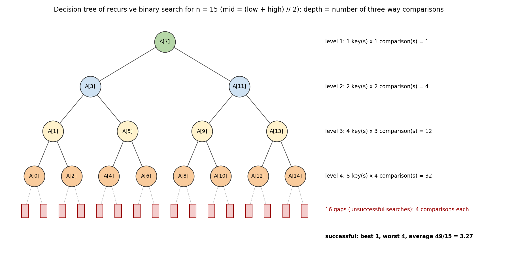
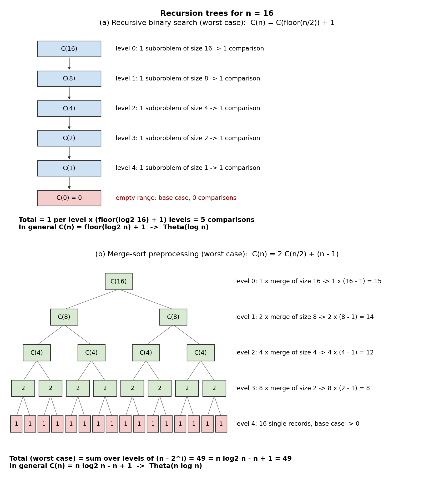

# Complexity Derivations (Tasks 3–7)

> Analysis write-up extracted from the full report [`../Documentation/CO1_Assignment_Report.md`](../Documentation/CO1_Assignment_Report.md).

## Task 3 – Derive the Time-Complexity Function Mathematically [6 Marks]

> Derive the time-complexity function for each proposed approach using mathematical analysis. Discuss:
> - the input size (n);
> - the number of times the basic operation executes;
> - how the operation count changes with n;
> - the mathematical expression representing the running time;
> - any preprocessing cost involved;
> - the overall cost when preprocessing and searching are considered together.
> You must show the mathematical reasoning leading to the complexity result. Merely stating that an algorithm is O(n), O(log n), etc., will not receive full credit.

**Ans:**

### 1. Input size and cost model

- **Input size n** = number of student records in the database (the registration numbers are fixed-size 9-digit integers, so one comparison costs constant time).
- **q** = number of searches served by one preprocessing (q = 1,200,000 per day in Task 12).
- **p** = probability that a searched registration number exists (p = ½ in Task 9 and p = 0.8 in Task 12).
- Successful searches are for a uniformly random stored student, so positions in the arrival order are uniformly distributed.
- C(n) = number of basic operations; T(n) = c·C(n) + lower-order terms, where c is the machine cost of one basic operation with its loop overhead.

### 2. Approach A – sequential search

The loop compares the key with A[0], A[1], … and stops at the first match.

**Successful search for the record at position i (0-based):** the comparisons are with A[0], …, A[i], so C(i) = i + 1.

**Unsuccessful search:** every record is compared once: C<sub>miss</sub>(n) = Σ<sub>i=0</sub><sup>n−1</sup> 1 = n.

**Average successful search** (each of the n positions with probability 1/n):

C<sub>hit</sub>(n) = Σ<sub>i=0</sub><sup>n−1</sup> (1/n)(i + 1) = (1/n) · n(n + 1)/2 = **(n + 1)/2**

**Average over hits and misses** (success probability p):

C<sub>avg</sub>(n) = p·(n + 1)/2 + (1 − p)·n

For p = ½: C<sub>avg</sub>(n) = 0.75n + 0.25; for p = 0.8: C<sub>avg</sub>(n) = 0.6n + 0.4 (600,000 comparisons per search at n = 10⁶).

**Running time:** T<sub>A</sub>(n) = c<sub>A</sub>·C(n) + c₀ = Θ(n) on average and in the worst case. I measured c<sub>A</sub> ≈ 30 ns per comparison at n = 1,000 rising to ≈ 47 ns at n = 10⁶ (Task 10 explains why).

**Preprocessing:** P<sub>A</sub>(n) = 0. **Overall cost of q searches:** T<sub>A</sub>(n, q) = q·C<sub>avg</sub>(n) = Θ(q·n).

### 3. Approach B – merge-sort preprocessing + recursive binary search

**Preprocessing (merge sort).** Merging two sorted runs of total size s takes at most s − 1 comparisons (every comparison outputs one record and the last record needs no comparison) and at least ⌊s/2⌋. Sorting n records sorts two halves of sizes ⌈n/2⌉ and ⌊n/2⌋ and merges them, so in the worst case

C<sub>sort</sub>(n) = C<sub>sort</sub>(⌈n/2⌉) + C<sub>sort</sub>(⌊n/2⌋) + (n − 1),  C<sub>sort</sub>(1) = 0.

For n = 2ᵏ this solves (Task 7, §4) to **C<sub>sort</sub>(n) = n log₂ n − n + 1**, and for general n to n⌈log₂ n⌉ − 2<sup>⌈log₂ n⌉</sup> + 1. On random input the average is ≈ n log₂ n − 1.25n (Knuth). Each merge level also moves every record about twice (copy to the buffer and back), so the moves are ≈ 2n log₂ n. Hence **P<sub>B</sub>(n) = Θ(n log n)** time and Θ(n) extra memory (sorted copy + buffer).

**Search – worst case.** Each three-way comparison either finds the key or keeps one half of the current range. A range of size s leaves at most ⌊s/2⌋ records (Task 6 proves the exact sizes). After j unsuccessful comparisons at most ⌊n/2ʲ⌋ records remain. A comparison is made only while the range is non-empty, i.e. while ⌊n/2ʲ⌋ ≥ 1 ⇔ 2ʲ ≤ n ⇔ j ≤ log₂ n. So the largest number of comparisons is

C<sub>worst</sub>(n) = ⌊log₂ n⌋ + 1.

**Search – average successful case.** Arrange the sorted keys in the binary-search decision tree (Figure 4 in Task 4): the key at depth d needs exactly d comparisons and depth d holds 2<sup>d−1</sup> keys. For n = 2ᵏ − 1 (a full tree of k levels) the total over all keys is

S(n) = Σ<sub>d=1</sub><sup>k</sup> d·2<sup>d−1</sup> = (k − 1)·2ᵏ + 1

(proof: let F = Σ d·2<sup>d−1</sup>; then 2F − F = k·2ᵏ − Σ<sub>d=0</sub><sup>k−1</sup> 2ᵈ = k·2ᵏ − (2ᵏ − 1)), so

C<sub>hit</sub>(n) = S(n)/n = ((k − 1)(n + 1) + 1)/n ≈ **log₂(n + 1) − 1**.

For general n I use the exact recurrence of the program, S(n) = n + S(⌊(n − 1)/2⌋) + S(⌈(n − 1)/2⌉), S(0) = 0 (each of the n searches makes one comparison at the root and then continues in one half). It gives 8.987, 12.363, 15.690 and 18.951 comparisons for the four sizes.

**Search – average unsuccessful case.** An unsuccessful search ends in one of the n + 1 gaps (external nodes). The external path length equals the internal path length + 2n, which gives C<sub>miss</sub>(n) = (S(n) + n)/(n + 1) = 9.977, 13.362, 16.689 and 19.951; every unsuccessful search costs ⌊log₂ n⌋ or ⌊log₂ n⌋ + 1.

**Running time:** T<sub>B</sub>(n) = c<sub>B</sub>·(⌊log₂ n⌋ + 1) + c₀ = Θ(log n). **Overall cost of q searches:**

T<sub>B</sub>(n, q) ≈ (n log₂ n − 1.25n) + q·log₂ n = **Θ(n log n + q log n)**

### 4. Approach C – hash table with separate chaining

**Preprocessing (build).** The table size is m = smallest prime ≥ n/0.75, so α = n/m ≤ 0.75. Inserting the i-th record (i = 0, …, n − 1) costs one hash computation and a duplicate check along its chain, whose expected length under uniform hashing is i/m. Total expected operations:

P<sub>C</sub>(n) = n + Σ<sub>i=0</sub><sup>n−1</sup> i/m = n + n(n − 1)/(2m) ≈ n(1 + α/2) ≤ **1.375n**,

plus Θ(m) = Θ(n/0.75) to allocate the buckets. So the build is **Θ(n)** expected time and Θ(n + m) memory.

**Unsuccessful search.** One hash computation, then the key is compared with every record of chain h(key); with simple uniform hashing the expected chain length is n/m:

C<sub>miss</sub>(n) = **α** (≤ 0.75) comparisons + 1 hash.

**Successful search.** New records are appended at the end of a chain, so searching for the j-th inserted record compares the key with that record and with the records inserted earlier into the same chain. Each of the j − 1 earlier records is in the same chain with probability 1/m:

C<sub>hit</sub>(n) = (1/n) Σ<sub>j=1</sub><sup>n</sup> (1 + (j − 1)/m) = 1 + (n − 1)/(2m) = **1 + α/2 − α/(2n)** ≤ 1.375.

**Refinement for this key universe.** The registration numbers are drawn *without replacement* from only U = 10⁷ values. Bucket j can only ever receive the c<sub>j</sub> numbers with k mod m = j (at n = 10⁶, U/m ≈ 7.5, so c<sub>j</sub> is 7 or 8). The chain lengths are then hypergeometric instead of Poisson, and the same derivation gives C<sub>hit</sub> = 1 + (n − 1)·Σ c<sub>j</sub>(c<sub>j</sub> − 1) / (2U(U − 1)) = 1.3267 and C<sub>miss</sub> = n·Σ c<sub>j</sub>(c<sub>j</sub> − 1)/(U(U − 1)) = 0.6533 at n = 10⁶. For small n (U/m large) this equals the textbook value (1.3670 at n = 1,000). Task 10 shows that the measurements agree with the refined value.

**Running time:** T<sub>C</sub>(n) = c<sub>h</sub> + c<sub>C</sub>·(1 + α/2) = Θ(1) expected. **Overall cost of q searches:**

T<sub>C</sub>(n, q) ≈ n(1 + α/2) + q(1 + 1 + α/2) = **Θ(n + q)** expected

### 5. Preprocessing and searching together

Table 5: Derived operation counts at the four required sizes (A hit = (n + 1)/2, A miss = n, B hit = S(n)/n, B worst = ⌊log₂ n⌋ + 1, C hit = 1 + (n − 1)/2m with the m actually built, B sort ≈ n log₂ n)

| Records (n) | A hit | A miss | B hit | B worst | C hit | B sort n log₂ n |
|---|---|---|---|---|---|---|
| 1,000 | 500.5 | 1,000 | 8.987 | 10 | 1.367 | 9,966 |
| 10,000 | 5,000.5 | 10,000 | 12.363 | 14 | 1.375 | 132,877 |
| 100,000 | 50,000.5 | 100,000 | 15.690 | 17 | 1.375 | 1,660,964 |
| 1,000,000 | 500,000.5 | 1,000,000 | 18.951 | 20 | 1.375 | 19,931,569 |

With preprocessing included, the total cost of q searches (50/50 hit/miss mix) is A: q·0.75n, B: n log₂ n + q·log₂ n, C: 1.375n + 2q. Preprocessing pays off after the **break-even number of searches** q* at which the totals are equal:

- A → B: q* = (n log₂ n − 1.25n)/(0.75n − log₂ n) ≈ (log₂ n − 1.25)/0.75 = 24.9 at n = 10⁶ (measured 25.2, Table 24).
- A → C: q* ≈ 1.375n/(0.75n − 2) ≈ 1.8 for every n (measured 1.79–1.85).
- C needs fewer operations than B for **every** q ≥ 0 (smaller preprocessing *and* cheaper searches), so B can only win on criteria other than lookup cost (ordering, worst-case guarantee, memory).

Measured in basic operations, both preprocessing strategies are worth their cost after a few dozen searches, and hashing after about two.

## Task 4 – Analyse Best, Average and Worst-Case Behaviour [4 Marks]

> Discuss, wherever applicable:
> - what input condition produces the best case;
> - the average case;
> - the worst case;
> - how the number of operations changes in each case;
> - why these differences occur.
> Do not simply provide a table containing complexity values. Explain the conditions that lead to each case, supported by mathematical reasoning.

**Ans:**

### 1. Approach A – sequential search

**Best case.** The searched student is the *first record stored* (position 0). The loop stops after **one** comparison: C<sub>best</sub>(n) = 1, independent of n. Test TC05 confirms it: the first stored record (196394267) was found with 1 comparison.

**Worst case.** Two input conditions: the student is the *last record stored*, or the registration number *does not exist*. In both, every record must be compared: C<sub>worst</sub>(n) = n. Tests TC06 (last record, 15 comparisons for n = 15) and TC11–TC13 (absent keys below the minimum, above the maximum and in a gap, 15 comparisons each) confirm it; in the experiments every unsuccessful search cost exactly n (1,000; 10,000; 100,000; 1,000,000).

**Average case.** For a uniformly random stored student, C<sub>hit</sub>(n) = (n + 1)/2 (Task 3, §2); with success probability p, C<sub>avg</sub> = p(n + 1)/2 + (1 − p)n. Measured averages: 496.25, 4,966.63, 51,226.36 and 480,558.07 (theory 500.5, 5,000.5, 50,000.5, 500,000.5).

**Why.** The records are in arrival order, which has no relation to the registration numbers, so a comparison with A[i] gives no information about where else the key could be. The algorithm can only rule out one record per comparison; the position of the key alone decides the cost, and an absent key can only be confirmed after looking at everything.

### 2. Approach B – recursive binary search

**Best case.** The key is the record at the **first middle position** `A[⌊(n − 1)/2⌋]`; it is found by the first three-way comparison: C<sub>best</sub>(n) = 1 (test TC07: the middle of the sorted 15 records, 1 comparison).

**Worst case.** The key is stored at a **deepest node** of the decision tree, or it is **absent** (any gap). Every comparison discards half and the search continues until one record (or none) is left: C<sub>worst</sub>(n) = ⌊log₂ n⌋ + 1 (4 for n = 15: tests TC08, TC09, TC11–TC13; 10, 14, 17 and 20 for the four experimental sizes, Table 10).

**Average case.** Figure 4 shows why the average is close to the worst case: level d of the decision tree contains 2<sup>d−1</sup> keys, so about half of all keys sit on the deepest level. For n = 15: (1·1 + 2·2 + 3·4 + 4·8)/15 = 49/15 = 3.27 comparisons, against a worst case of 4. In general C<sub>hit</sub>(n) ≈ log₂ n − 1 and every unsuccessful search costs ⌊log₂ n⌋ or ⌊log₂ n⌋ + 1 (all 16 gaps of the n = 15 tree cost 4).



**Why.** The cost depends only on the *position of the key in sorted order*, never on the values themselves, and the halving bounds the depth of the tree by log₂ n. Best and worst differ by a factor of only about log₂ n, not n.

**Preprocessing (merge sort).** The input order only changes the constant: the best case is input that is already sorted (each merge stops after the left run, ≈ (n/2) log₂ n comparisons), the worst case is when every merge alternates between the runs (n log₂ n − n + 1), and random input averages ≈ n log₂ n − 1.25n. All three are Θ(n log n), because merge sort always splits into halves regardless of the data. My random datasets needed 8,744 / 120,491 / 1,536,197 / 18,674,803 comparisons, within 0.4% of n log₂ n − 1.25n and below the worst-case bound (Table 15).

### 3. Approach C – hash table

**Best case.** The key's bucket h(key) is empty (unsuccessful search: 1 hash, **0 comparisons**, test TC11 and TC13) or the key is the first record of its chain (successful: 1 hash + **1 comparison**, tests TC02–TC10).

**Average case.** Under uniform hashing a successful search costs 1 + α/2 − α/(2n) comparisons and an unsuccessful one α (Task 3, §4). Because the table is resized to keep α ≤ 0.75, both are **constants**: ≤ 1.375 and ≤ 0.75. Measured: 1.32–1.39 (hit) and 0.62–0.76 (miss) at all four sizes.

**Worst case.** All n keys fall into the **same bucket**, e.g. keys that are all congruent modulo m. The table degenerates into one linked list and a search costs n comparisons, Θ(n), exactly like sequential search; building such a table costs Θ(n²) because of the duplicate checks (0 + 1 + … + (n − 1)). Property test P5 builds this case on purpose with the 1,000 keys k = 190,000,000 + i·m: the chain length was 1,000 and both a hit on the last key and a miss cost 1,000 comparisons.

**Why the worst case does not occur here.** Registration numbers are assigned by the university, not chosen by an adversary, and the division method with a prime m spreads them evenly. The longest chain I observed was 5, 7, 8 and 6 records at the four sizes (Table 18), consistent with the expected maximum chain length Θ(log n / log log n). If adversarial keys were a concern, a randomly chosen (universal) hash function would make the expected cost Θ(1) for *every* key set.

### 4. Summary of the cases

Table 6: Operation counts in the three cases (search only; n records, α = n/m ≤ 0.75)

| Approach | Best case: condition → count | Average case | Worst case: condition → count |
|---|---|---|---|
| A sequential search | key at position 0 → 1 | hit (n + 1)/2; miss n | key last or absent → n |
| B binary search | key at first mid → 1 | hit ≈ log₂ n − 1; miss ≈ log₂ n | deepest or absent → ⌊log₂ n⌋+1 |
| C hash search | empty chain → 0; key first → 1 | hit 1 + α/2; miss α | one chain holds all → n |
| B merge sort | sorted input → ≈ (n/2) log₂ n | ≈ n log₂ n − 1.25n | n log₂ n − n + 1 |
| C table build | no collisions → n hashes | n(1 + α/2) | all collide → n + n(n−1)/2 |

The differences have one common cause: **how much each comparison can eliminate.** A comparison in A eliminates one record, so the cost depends linearly on the key's position. A comparison in B eliminates half of the remaining records, so the cost depends only on the depth of the key in a balanced tree. In C the hash computation eliminates all records except one chain; the remaining cost depends on how evenly the keys are spread, which is a property of the hash function and the key set, not of n.

## Task 5 – Perform Asymptotic Analysis [3 Marks]

> Express and compare the growth behaviour using appropriate asymptotic notation. Discuss:
> - appropriate use of O, Ω and/or Θ;
> - how each algorithm behaves as n becomes very large;
> - how the growth rates differ;
> - what the growth behaviour means when the dataset increases from 1,000 to 1,000,000+ records.
> Interpret in the context of the application.

**Ans:**

### 1. The notations I use

- t(n) ∈ **O**(g(n)) if there are constants c > 0 and n₀ with t(n) ≤ c·g(n) for all n ≥ n₀ (upper bound, used for "never worse than").
- t(n) ∈ **Ω**(g(n)) if t(n) ≥ c·g(n) for all n ≥ n₀ (lower bound, "never better than").
- t(n) ∈ **Θ**(g(n)) if both hold (tight bound, the exact growth class).

I use Θ for each *case* (best, average, worst) because each case is a single function of n, and O/Ω for statements about the algorithm over *all* inputs.

### 2. Asymptotic classes, with the constants

**A – sequential search.** Worst case C(n) = n ∈ Θ(n). Average (n + 1)/2 ∈ Θ(n): for all n ≥ 1, ½·n ≤ (n + 1)/2 ≤ 1·n (c₁ = ½, c₂ = 1, n₀ = 1). Best case 1 ∈ Θ(1). Over all inputs sequential search is therefore **O(n) and Ω(1)**; it is *not* Θ(n) for every input, only for the worst and average cases.

**B – binary search.** Worst case ⌊log₂ n⌋ + 1 ∈ Θ(log n): for n ≥ 2, log₂ n < ⌊log₂ n⌋ + 1 ≤ log₂ n + 1 ≤ 2 log₂ n (c₁ = 1, c₂ = 2, n₀ = 2). Average ≈ log₂ n − 1 ∈ Θ(log n). Best case Θ(1). Over all inputs: **O(log n) and Ω(1)**. Preprocessing n log₂ n − n + 1 ∈ Θ(n log n): it is ≤ n log₂ n, and for n ≥ 4 it is ≥ ½ n log₂ n because ½ n log₂ n ≥ n − 1 when log₂ n ≥ 2.

**C – hash table.** Expected search 1 + α/2 ≤ 1.375 and α ≤ 0.75, so both are **Θ(1) expected**; the worst case over adversarial key sets is Θ(n), so over all inputs the search is **O(n)** and only Θ(1) *in expectation*. Build: Θ(n) expected (n hash computations + ≤ 0.375n comparisons), O(n²) worst case.

Table 7: Asymptotic summary (search cost per query, plus preprocessing)

| Approach | Best case | Average case | Worst case | Preprocessing cost | Extra space |
|---|---|---|---|---|---|
| A sequential | Θ(1) | Θ(n) | Θ(n) | none | Θ(1) |
| B binary (recursive) | Θ(1) | Θ(log n) | Θ(log n) | Θ(n log n) | Θ(n) + Θ(log n) stack |
| C hash table | Θ(1) | Θ(1) expected | Θ(n) | Θ(n) expected | Θ(n + m) = Θ(n) |

### 3. How the growth rates differ as n becomes very large

The limits of the ratios order the three classes strictly:

- lim<sub>n→∞</sub> log₂ n / n = lim (1/(n ln 2)) / 1 = 0 (L'Hôpital), so log n ∈ o(n): binary search grows **strictly slower** than sequential search.
- lim<sub>n→∞</sub> 1 / log₂ n = 0, so Θ(1) ⊂ o(log n): hashing grows strictly slower than binary search.
- For preprocessing, lim n / (n log n) = lim 1/log n = 0: building a hash table grows strictly slower than sorting.

The practical meaning: **doubling the database** doubles the work of A, adds exactly **one** comparison to B, and changes nothing for C.

### 4. From 1,000 to 1,000,000 records (×1,000)

Table 8: Growth from n = 1,000 to n = 1,000,000 (theory from Task 3, measurements from Task 9)

| Quantity | n = 1,000 | n = 1,000,000 | Change for ×1,000 records | Asymptotic prediction |
|---|---|---|---|---|
| A comparisons per hit (theory / measured) | 500.5 / 496.25 | 500,000.5 / 480,558 | ×999 / ×968 | ×1,000 (Θ(n)) |
| B comparisons per hit (theory / measured) | 8.99 / 8.98 | 18.95 / 18.87 | +9.96 / +9.89 | + log₂ 1000 = +9.97 (Θ(log n)) |
| C comparisons per hit (theory / measured) | 1.367 / 1.344 | 1.327 / 1.327 | unchanged | ×1 (Θ(1)) |
| A time per hit (µs, measured) | 15.05 | 22,536.82 | ×1,497 | ×1,000 |
| B time per hit (µs, measured) | 1.52 | 6.24 | ×4.1 | ×2.0 |
| C time per hit (µs, measured) | 0.26 | 0.88 | ×3.4 | ×1 |

**Interpretation for the university.** With 1,000 students all three designs answer instantly (15 µs at most). At 1,000,000 students one sequential search takes 23 ms for an existing student and 51 ms for a mistyped number, and the cost keeps growing with every admitted batch; at the 50,000 searches per hour of Task 12 that becomes a substantial, permanently growing CPU load. Binary search stays at about 20 comparisons and hashing at about one comparison, so both remain effectively instantaneous for a database 1,000 times larger. (The times grew somewhat more than the counts for B and C; Task 10 explains this with memory caching.)

## Task 6 – Formulate the Recurrence Relation [3 Marks]

> For the recursive approach, formulate a recurrence relation directly from the behaviour of the algorithm. Clearly identify:
> - the input size of the original problem;
> - the size of the recursive subproblem;
> - the number of recursive calls;
> - the work performed outside the recursive call;
> - the base case;
> - how these components lead to the recurrence relation.
> The recurrence must be derived from your algorithm, rather than simply writing a known recurrence formula.

**Ans:**

### 1. The algorithm the recurrence is derived from

The recursive approach is `binary_search_recursive(sorted_records, key, low, high, counter)` in `search_algorithms.py` (pseudocode `BinSearch`, Task 1). One activation does the following:

```
1. counter.calls += 1
2. if low > high: return None                          # base case: empty range
3. mid = (low + high) // 2
4. mid_key = sorted_records[mid].reg_no
5. counter.comparisons += 1                            # ONE three-way comparison key : A[mid]
6. if key == mid_key: return sorted_records[mid]       # found: no further call
7. if key < mid_key: return binary_search_recursive(..., low, mid - 1, ...)
8. return binary_search_recursive(..., mid + 1, high, ...)
```

### 2. The components, read from the code

**Input size of the original problem.** The problem is described by the range A[low..high]; its size is **n = high − low + 1**. The first call has low = 0, high = n − 1, i.e. the whole database.

**Size of the recursive subproblem.** With mid = ⌊(low + high)/2⌋:

- left half A[low..mid − 1] has size mid − low = ⌊(low + high)/2⌋ − low = ⌊(high − low)/2⌋ = **⌊(n − 1)/2⌋**;
- right half A[mid + 1..high] has size high − mid = (n − 1) − ⌊(n − 1)/2⌋ = ⌈(n − 1)/2⌉ = **⌊n/2⌋**.

The larger subproblem therefore has size ⌊n/2⌋ (for n = 1,000,000 the halves are 499,999 and 500,000).

**Number of recursive calls.** Lines 7 and 8 are alternatives (`if … return`), so an activation makes **at most one** recursive call, and none when the key is found on line 6. This is the decisive difference from merge sort, which makes two calls.

**Work outside the recursive call.** Lines 1–6: computing mid, reading A[mid] and **one** three-way comparison, i.e. f(n) = 1 basic operation (Θ(1) time), independent of n.

**Base case.** n = 0 (low > high): the function returns NOT FOUND after **0** comparisons, so C(0) = 0. (A size-1 range is not a base case in my code: it makes one comparison and, if unsuccessful, one call on an empty range; this gives C(1) = C(0) + 1 = 1.)

### 3. The recurrences

Combining "comparisons of this activation (1)" + "comparisons of the one recursive call on the larger half (worst case)":

**C<sub>worst</sub>(n) = C<sub>worst</sub>(⌊n/2⌋) + 1 for n ≥ 1,  C<sub>worst</sub>(0) = 0**

Table 9: Components of the recurrence, taken from the code

| Component | Value in `binary_search_recursive` | Contribution to the recurrence |
|---|---|---|
| Input size | n = high − low + 1 | C(n) |
| Subproblem size | ⌊(n − 1)/2⌋ (left) or ⌊n/2⌋ (right) | worst case uses ⌊n/2⌋ |
| Number of recursive calls | at most 1 (left **or** right) | coefficient a = 1 |
| Work outside the call | one three-way comparison + Θ(1) arithmetic | + 1 |
| Base case | n = 0 (low > high): 0 comparisons | C(0) = 0 |

Related recurrences from the same reasoning:

- **Best case:** the key is A[mid] in the first activation: C<sub>best</sub>(n) = 1 for n ≥ 1 (no recursive call).
- **Running time:** T(n) = T(⌊n/2⌋) + c for n ≥ 1, T(0) = d, where c is the constant cost of lines 1–6.
- **Recursion depth / stack space:** D(n) = D(⌊n/2⌋) + 1, D(0) = 1 frame — the same form as C(n).
- **Total over all n successful searches** (used for the exact average in Task 3): every search makes the root comparison, then ⌊(n − 1)/2⌋ of them continue left and ⌈(n − 1)/2⌉ continue right, so S(n) = n + S(⌊(n − 1)/2⌋) + S(⌈(n − 1)/2⌉), S(0) = 0.

### 4. Recurrence of the recursive preprocessing (merge sort)

`_merge_sort(a, aux, low, high)` sorts A[low..mid] (size ⌈n/2⌉) and A[mid + 1..high] (size ⌊n/2⌋) with **two** recursive calls and then merges them with at most n − 1 comparisons; a range of 0 or 1 record is the base case with 0 comparisons:

**C<sub>sort</sub>(n) = C<sub>sort</sub>(⌈n/2⌉) + C<sub>sort</sub>(⌊n/2⌋) + (n − 1) for n ≥ 2,  C<sub>sort</sub>(1) = 0,** which for n = 2ᵏ is C<sub>sort</sub>(n) = 2C<sub>sort</sub>(n/2) + n − 1.

## Task 7 – Solve the Recurrence Relation [4 Marks]

> Solve it using an appropriate method (substitution, iteration, Master Theorem, or another technique). Discuss:
> - why the selected method is applicable;
> - the steps;
> - the resulting complexity;
> - what the result indicates about the behaviour of the recursive algorithm as n increases.
> Show the analytical process. (Showing two methods, e.g. backward substitution AND Master Theorem, is a plus.)

**Ans:**

I solve C(n) = C(⌊n/2⌋) + 1, C(0) = 0 (so C(1) = 1) with three methods: backward substitution (exact closed form for powers of two), the Master Theorem (growth class), and the substitution method by induction (exact closed form for **every** n). Then I solve the merge-sort recurrence and check all closed forms against the counted comparisons.

### 1. Method 1 – Backward substitution (iteration)

**Why it applies.** The recurrence has a single recursive term whose argument halves, so repeatedly substituting the recurrence into itself produces a simple pattern. For n = 2ᵏ the floors disappear (⌊2ᵏ/2⌋ = 2<sup>k−1</sup>).

**Steps.** Let n = 2ᵏ:

C(2ᵏ) = C(2<sup>k−1</sup>) + 1

= [C(2<sup>k−2</sup>) + 1] + 1 = C(2<sup>k−2</sup>) + 2

= [C(2<sup>k−3</sup>) + 1] + 2 = C(2<sup>k−3</sup>) + 3

= …

= C(2<sup>k−i</sup>) + i  (general pattern after i substitutions)

Choose i = k to reach the known value C(2⁰) = C(1) = 1:

C(2ᵏ) = C(1) + k = 1 + k, and since k = log₂ n: **C(n) = log₂ n + 1** for n = 2ᵏ.

By the smoothness rule (log n is a smooth function and C is non-decreasing), the result extends to all n: C(n) ∈ Θ(log n).

### 2. Method 2 – Master Theorem

**Why it applies.** The recurrence has the form T(n) = a·T(n/b) + f(n) with a = 1 ≥ 1 recursive call, b = 2 > 1, and f(n) = 1 asymptotically positive; floors in the argument do not change the result.

**Steps.**

- a = 1, b = 2, f(n) = 1 = Θ(n⁰), so d = 0.
- n<sup>log<sub>b</sub> a</sup> = n<sup>log₂ 1</sup> = n⁰ = 1.
- Compare f(n) with n<sup>log<sub>b</sub> a</sup>: f(n) = Θ(1) = Θ(n<sup>log<sub>b</sub> a</sup>), i.e. a = b<sup>d</sup> (1 = 2⁰). This is **Case 2**.
- Case 2 gives T(n) = Θ(n<sup>log<sub>b</sub> a</sup> · log n) = Θ(n⁰ log n) = **Θ(log n)**.
- The regularity condition a·f(n/b) ≤ c·f(n) is only required in Case 3, so no check is needed here.

### 3. Method 3 – Substitution method (proof by induction for every n)

**Claim:** C(n) = ⌊log₂ n⌋ + 1 for all n ≥ 1.

**Basis:** n = 1: C(1) = C(0) + 1 = 1 = ⌊log₂ 1⌋ + 1. ✓

**Inductive step:** let n ≥ 2 and assume the claim for all 1 ≤ m < n. Choose j with 2ʲ ≤ n < 2<sup>j+1</sup>, so ⌊log₂ n⌋ = j ≥ 1. Then 2<sup>j−1</sup> ≤ ⌊n/2⌋ < 2ʲ, so ⌊log₂ ⌊n/2⌋⌋ = j − 1. Because 1 ≤ ⌊n/2⌋ < n the hypothesis applies:

C(n) = C(⌊n/2⌋) + 1 = (⌊log₂ ⌊n/2⌋⌋ + 1) + 1 = (j − 1) + 2 = j + 1 = **⌊log₂ n⌋ + 1**. ✓

This is the exact worst-case number of three-way comparisons for every database size, and it agrees with the backward substitution for n = 2ᵏ.

### 4. Recursion tree, and the merge-sort recurrence

**Binary search.** The recursion tree is a single path (one recursive call per level): sizes n, ⌊n/2⌋, ⌊n/4⌋, …, 1, with cost 1 on each of the ⌊log₂ n⌋ + 1 levels and 0 at the empty base case. Summing the levels gives ⌊log₂ n⌋ + 1 again (Figure 5a, n = 16: 5 levels → 5 comparisons).

**Merge sort, backward substitution** (n = 2ᵏ, C(n) = 2C(n/2) + n − 1, C(1) = 0):

C(2ᵏ) = 2C(2<sup>k−1</sup>) + 2ᵏ − 1

= 2[2C(2<sup>k−2</sup>) + 2<sup>k−1</sup> − 1] + 2ᵏ − 1 = 4C(2<sup>k−2</sup>) + 2·2ᵏ − (1 + 2)

= 8C(2<sup>k−3</sup>) + 3·2ᵏ − (1 + 2 + 4)

= …

= 2ⁱ C(2<sup>k−i</sup>) + i·2ᵏ − (2ⁱ − 1)

With i = k: C(2ᵏ) = 2ᵏ·C(1) + k·2ᵏ − 2ᵏ + 1 = **n log₂ n − n + 1**.

**Merge sort, Master Theorem:** a = 2, b = 2, f(n) = n − 1 = Θ(n¹), n<sup>log₂ 2</sup> = n¹ → f(n) = Θ(n<sup>log<sub>b</sub> a</sup>), Case 2 → **Θ(n log n)**.

**Merge sort, recursion tree:** level i has 2ⁱ merges of size n/2ⁱ, each costing n/2ⁱ − 1, so the level costs n − 2ⁱ; summing over the log₂ n merging levels gives n log₂ n − (2<sup>log₂ n</sup> − 1) = n log₂ n − n + 1 (Figure 5b, n = 16: 15 + 14 + 12 + 8 = 49 = 16·4 − 16 + 1).



### 5. Verification against the counted comparisons

I checked the solutions against the counters in the real code. Test P3 searched every key and every gap for each n from 1 to 200: the maximum count equalled ⌊log₂ n⌋ + 1 for all 200 sizes, and the total over all successful searches equalled the recurrence S(n) exactly (P3b). Test P4 confirmed that merge sort never exceeded n⌈log₂ n⌉ − 2<sup>⌈log₂ n⌉</sup> + 1. For the four experimental sizes I searched **every stored key once**:

Table 10: Closed forms against the counted comparisons (exhaustive search of every stored key; exhaustive_verification.csv)

| Number of records (n) | Max counted | ⌊log₂ n⌋ + 1 | Average counted | S(n)/n (recurrence) | Merge sort counted | Merge sort worst bound |
|---|---|---|---|---|---|---|
| 1,000 | 10 | 10 | 8.9870 | 8.9870 | 8,744 | 8,977 |
| 10,000 | 14 | 14 | 12.3631 | 12.3631 | 120,491 | 123,617 |
| 100,000 | 17 | 17 | 15.6895 | 15.6895 | 1,536,197 | 1,568,929 |
| 1,000,000 | 20 | 20 | 18.9514 | 18.9514 | 18,674,803 | 18,951,425 |

The agreement is exact for binary search, as it must be for a deterministic algorithm.

### 6. What the result means

C(n) = ⌊log₂ n⌋ + 1 = Θ(log n) means that **each doubling of the database adds exactly one comparison** and one stack frame. Going from 1,000 to 1,000,000 students (×1,000 ≈ 2¹⁰) adds only 10 comparisons (10 → 20). The recursion is also safe in Python: at n = 10⁶ the depth is at most 21 frames, far below the default limit of 1,000 frames, which would only be reached for n ≈ 2⁹⁹⁹. The merge-sort result Θ(n log n) says the preprocessing grows slightly faster than linearly; it is paid once and then shared by all later searches (Task 10, §5).
