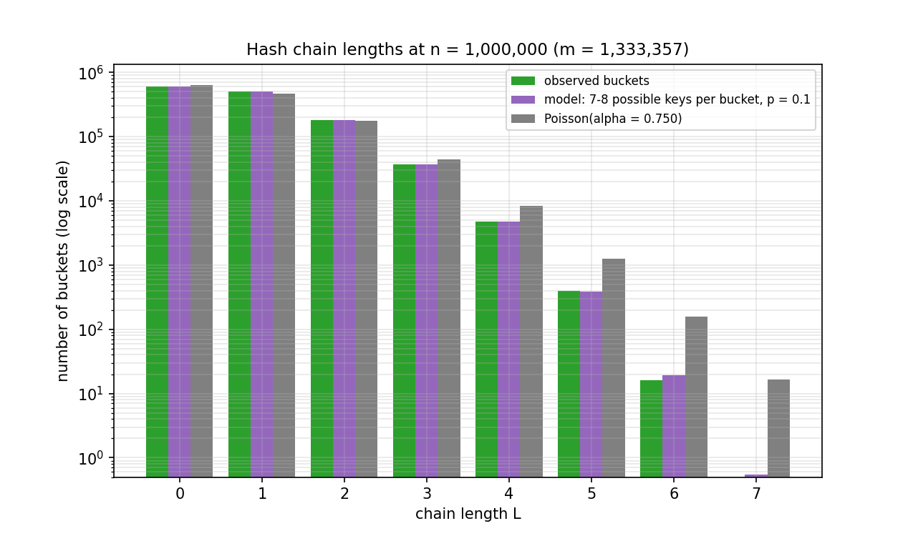
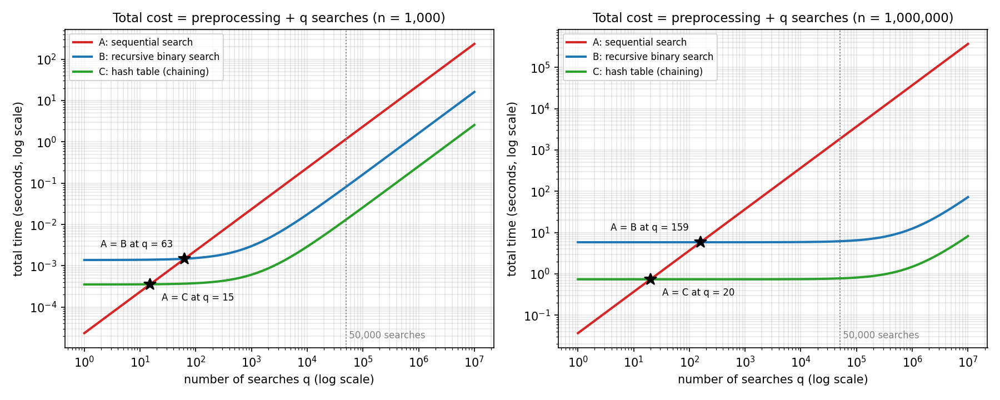

# Task 10 – Compare Theory with Experimental Behaviour [4 Marks]

> Part of **CSA06 Assignment 1 (CO1)** – V. Vasudevan (192425324). Full report: [`Report/Documentation/CO1_Assignment_Report.md`](../Report/Documentation/CO1_Assignment_Report.md) · [project README](../README.md)

> Discuss:
> - whether observed growth agrees with theoretical complexity;
> - which algorithm scales better as n increases;
> - differences between prediction and actual execution;
> - possible reasons.
> Interpret, don't just reproduce tables/graphs.

**Ans:**

## 1. The operation counts agree with the theory

Table 20: Measured ÷ predicted average comparisons (theory_vs_measured.csv; C predicted with the finite-key-space model of Task 3)

| n | A hit | A miss | B hit | B miss | C hit | C miss |
|---|---|---|---|---|---|---|
| 1,000 | 0.992 | 1.000 | 0.999 | 1.000 | 0.982 | 1.037 |
| 10,000 | 0.993 | 1.000 | 0.996 | 0.998 | 1.013 | 0.929 |
| 100,000 | 1.025 | 1.000 | 0.997 | 1.003 | 0.974 | 0.900 |
| 1,000,000 | 0.961 | 1.000 | 0.996 | 1.000 | 0.996 | 1.044 |

- **A:** unsuccessful searches cost *exactly* n, as derived. Successful averages scatter by a few per cent around (n + 1)/2 only because they are averages over a random sample of positions: with 100 searches at n = 10⁶ the standard error of the mean position is n/√(12·100) ≈ 28,900, and the observed difference (−19,442) is −0.67 standard errors. Every single successful search cost exactly position + 1 (Table 14).
- **B:** within 0.4% for the batches and **exact** for the exhaustive check (Table 10); the maximum was ⌊log₂ n⌋ + 1 at every size.
- **C:** the batches agree within about two standard errors of a 500-search sample (a chain-length standard deviation of about 0.87 gives ±0.04 per average). The exhaustive check is decisive. At n = 10⁶ the textbook formula 1 + (n − 1)/2m predicts 1.3750, but I measured **1.3268**. The refined model that accounts for the limited key universe (U = 10⁷ numbers, only 7–8 possible keys per bucket) predicts **1.3267**, a difference of 0.01%:

Table 21: Hash search – exhaustive average over all stored keys against both models (exhaustive_verification.csv)

| Number of records (n) | Measured average | Finite-universe model | Textbook 1 + (n − 1)/2m | Longest chain | Load factor α |
|---|---|---|---|---|---|
| 1,000 | 1.3440 | 1.3670 | 1.3670 | 5 | 0.735 |
| 10,000 | 1.3868 | 1.3744 | 1.3749 | 7 | 0.750 |
| 100,000 | 1.3730 | 1.3700 | 1.3750 | 8 | 0.750 |
| 1,000,000 | 1.3268 | 1.3267 | 1.3750 | 6 | 0.750 |

Figure 29 shows the same effect on the whole chain-length distribution at n = 10⁶: the observed numbers of buckets (605,954 empty, 502,931 with one record, …, 16 with six, none with seven) follow the finite-universe model (605,862; 503,105; …; 19.3; 0.55) and **not** the Poisson model of the textbook analysis (629,842; 472,373; …; 155.7; 16.7). Sampling 10% of all possible numbers spreads the keys *more evenly* than independent random hashing would, so the table performs slightly better than the standard prediction. At small n the two models coincide and the measurements scatter around both.

**Preprocessing.** Merge sort used 0.877–0.937 × n log₂ n comparisons; the ratio rises towards 1 because the lower-order term −1.25n matters less as n grows. Against n log₂ n − 1.25n the counts agree within 0.4% (8,744 vs 8,716; 18,674,803 vs 18,681,569), always below the worst case n⌈log₂ n⌉ − 2⌈log₂ n⌉ + 1. The hash build made exactly n hash computations, and its comparisons (326,797 at 10⁶) were below the uniform-hashing estimate n(n − 1)/2m = 374,993, again because the keys are spread more evenly than at random.

## 2. Which algorithm scales better

Table 22: Measured growth factor when n grows ten-fold (cmp = key comparisons; 50/50 mix; growth_factors.csv)

| n step | A cmp ratio | A time ratio | B cmp ratio | B time ratio | C cmp ratio | C time ratio |
|---|---|---|---|---|---|---|
| 1,000 → 10,000 | ×10.00 | ×11.21 | ×1.35 | ×1.58 | ×0.99 | ×1.69 |
| 10,000 → 100,000 | ×10.10 | ×12.35 | ×1.26 | ×1.70 | ×0.96 | ×1.29 |
| 100,000 → 1,000,000 | ×9.79 | ×11.35 | ×1.20 | ×1.53 | ×1.00 | ×1.33 |
| theory | ×10 | ×10 | ×1.33 / ×1.25 / ×1.20 | | ×1 | ×1 |

Fitting a straight line to log(time) against log(n) gives slopes of **1.068 (A), 0.207 (B) and 0.151 (C)**; the theoretical slopes are 1, about 0.10 (log₂ n over this range) and 0. The ranking predicted by the asymptotic analysis is exactly what I observed: **C scales best, then B, and A worst by orders of magnitude.** At n = 10⁶ a successful sequential search (22,537 µs) is 3,600 times slower than binary search (6.24 µs) and 25,600 times slower than hashing (0.88 µs). In operations: 480,558 vs 18.87 vs 1.32 comparisons.

## 3. Differences between prediction and actual execution

The counts follow the theory almost perfectly, but the times show three systematic differences:

1. **Time grows faster than the count at large n for all three approaches.** A's time per comparison rose from 30 ns (n = 1,000) to 34, 41 and 47 ns; B's time grew ×4.1 for ×2.1 more comparisons; C's time grew ×3.4 although its comparisons did not change.
2. **The constant per basic operation differs greatly between the approaches.** One sequential comparison costs 30–47 ns, one binary-search level ≈ 330 ns (6.24 µs / 18.87 comparisons), one hash search ≈ 0.25–0.9 µs, and one merge-sort comparison ≈ 313 ns (5,846.8 ms / 18.7 million, including the moves and calls).
3. **Some single timings are irregular**, e.g. merge sort at n = 10,000 took 35.3 ms, 25 times the 1,000-record time instead of the expected 13.3 times, while the comparison count grew by exactly the predicted factor.

## 4. Reasons

- **Memory hierarchy (difference 1).** At n = 1,000 the records (0.1 MB) and the table (0.07 MB) fit in the processor's caches; at n = 10⁶ the records alone take 100 MB, far more than the 12 MB L3 cache. Every comparison with a record in a random place (B touches about 20 such records per search, C about three objects: bucket array, chain list, record) becomes a main-memory access of the order of 100 ns. The RAM model behind the Θ-analysis charges the same cost for every access, so it cannot show this effect. A scans the records in their stored order, which is also roughly their allocation order, so it suffers least (+57% per comparison).
- **Interpreter constants (difference 2).** In CPython a recursive call, a method call or an attribute lookup costs tens to hundreds of nanoseconds, much more than a comparison inside a tight `for` loop. This is why the *time-based* break-even points are larger than the operation-based ones (Table 24). Table 23 shows the same algorithms implemented in C inside CPython: Timsort (`sorted()`, a merge-sort hybrid) is 9.6–23 times faster than my merge sort, `dict` (a hash table) builds 3.6–6.4 times faster than my table, `bisect` is 4.7–7.5 times faster than my recursive binary search and `dict.get` is 2.6–2.8 times faster than my hash search. Their growth with n is the same; only the constant differs. Asymptotic analysis predicts the growth, not the absolute time.
- **Measurement noise (difference 3).** Other experiment programs were running on the same machine at the same time. I reduced the effect by switching the garbage collector off while timing and keeping the minimum of repeated runs, but single timings can still be disturbed. This is why the operation counts are my primary evidence; they are identical in every run.
- **Counter overhead.** The counters add a constant per basic operation to all three approaches equally, so they change the constants but not the growth.

Table 23: My implementations against CPython's C implementations of the same ideas (builtin_reference.csv)

| Number of records (n) | Merge sort / sorted() (ms) | Hash build / dict (ms) | Binary search / bisect (µs) | Hash search / dict.get (µs) |
|---|---|---|---|---|
| 1,000 | 1.4 / 0.1 | 0.4 / 0.1 | 1.52 / 0.203 | 0.26 / 0.096 |
| 10,000 | 35.3 / 1.5 | 3.3 / 0.5 | 2.38 / 0.329 | 0.50 / 0.178 |
| 100,000 | 262.2 / 27.2 | 63.4 / 12.4 | 4.12 / 0.751 | 0.66 / 0.258 |
| 1,000,000 | 5,846.8 / 417.1 | 742.1 / 206.6 | 6.24 / 1.341 | 0.88 / 0.318 |

## 5. Is the preprocessing worth it? (amortised cost)

Table 24: Break-even number of searches q* after which preprocessing beats sequential search (break_even.csv)

| Records (n) | A → B (operations) | A → B (time) | A → C (operations) | A → C (time) |
|---|---|---|---|---|
| 1,000 | 11.84 | 63.23 | 1.80 | 15.24 |
| 10,000 | 16.13 | 135.63 | 1.85 | 12.71 |
| 100,000 | 20.32 | 80.75 | 1.82 | 19.51 |
| 1,000,000 | 25.23 | 158.53 | 1.79 | 20.12 |

The operation-based values match the formulas of Task 3 (≈ (log₂ n − 1.25)/0.75 for B, ≈ 1.8 for C). In time, preprocessing pays for itself after at most about 160 searches for merge sort + binary search and about 20 searches for hashing, even at one million records. Figure 30 shows the total cost of preprocessing + q searches: for 50,000 searches at n = 10⁶ (one hour of Task 12) the totals are 1,844 s for A, 6.18 s for B (5.85 s of it the sort) and 0.78 s for C (amortised_cost.csv). Only when the database is searched fewer than about 13–20 times between two rebuilds is sequential search the cheapest choice.

**Conclusion of the comparison.** The mathematical analysis predicted the *growth* of every count correctly: linear for A, logarithmic for B and constant for C, with exact agreement where the algorithm is deterministic. The experiments add what the analysis abstracts away: the constants of the Python interpreter, the cache effects at a million records, and a property of this key set (a small universe) that makes hashing slightly better than the textbook model.
