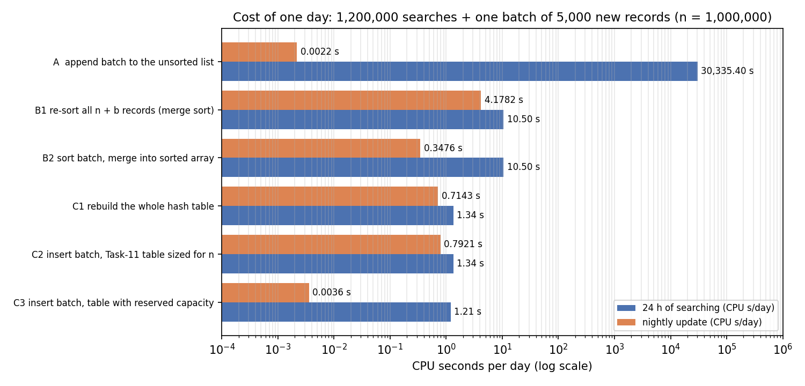
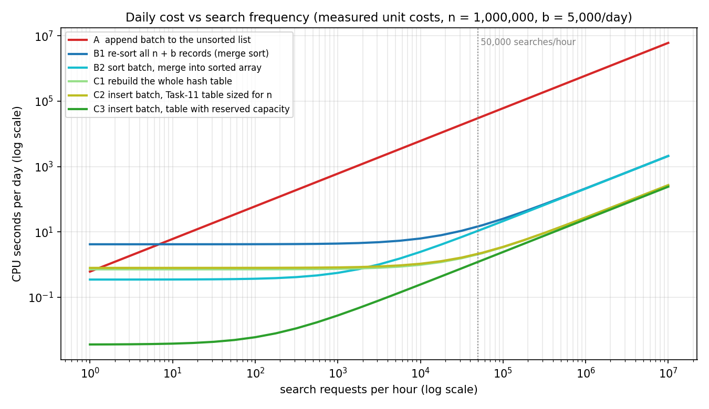
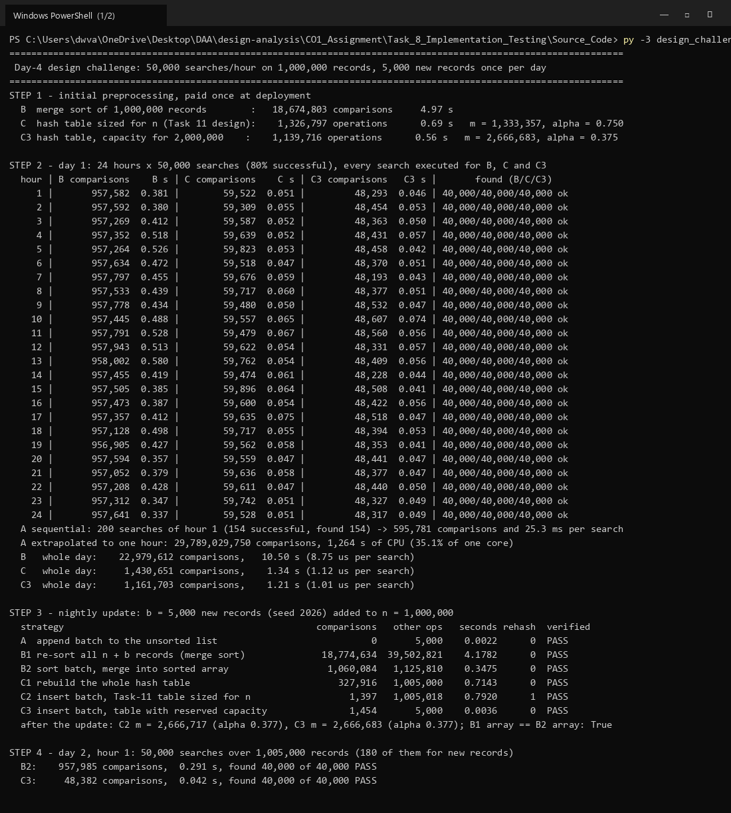
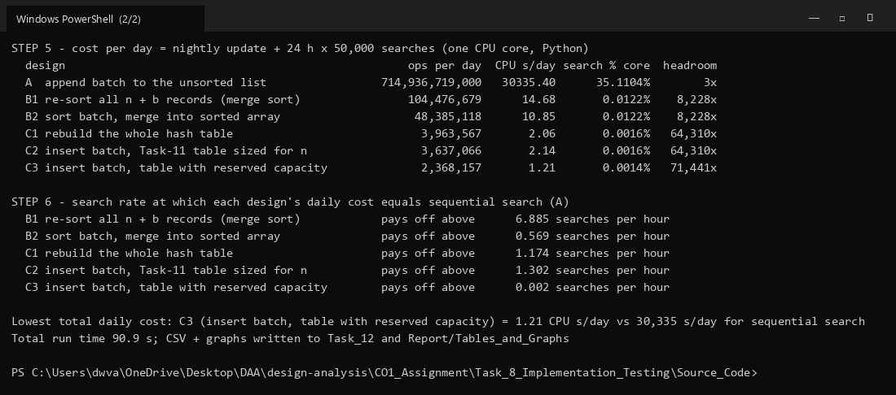

# Task 12 – Re-evaluate and Adapt the Design [8 Marks]

> Part of **CSA06 Assignment 1 (CO1)** – V. Vasudevan (192425324). Full report: [`Report/Documentation/CO1_Assignment_Report.md`](../Report/Documentation/CO1_Assignment_Report.md) · [project README](../README.md)

> **Day-4 Design Challenge.** The university now needs to process **50,000 search requests per hour** on a database containing **1,000,000 student records**. New student records are added **only once per day**. Re-evaluate your original design and determine whether it should be retained, modified or redesigned.
> You may RETAIN → MODIFY → or REDESIGN.

**Ans:**

The original design is the one recommended in Task 11: a hash table built once for the n records (m = smallest prime ≥ n/0.75 = 1,333,357 at n = 10⁶). To answer with evidence, I wrote `design_challenge_simulation.py`, which runs the new workload on the real 1,000,000-record dataset: one full day of 24 × 50,000 searches (80% for existing students, 20% for mistyped or non-existent numbers, seeded per hour) on every design, followed by a nightly batch of **b = 5,000** new records absorbed by six different update strategies, and a day-2 hour that also searches for the new records. The batch size and the 80/20 mix are my assumptions; the analysis shows that the decision does not depend on them.

## A. Impact Analysis [2 Marks]

> Explain what has changed in the problem, which original assumptions are affected, why search frequency is now important and why the low update frequency may influence the design.

**Ans:**

Table 26: The new requirement expressed in numbers

| Quantity | Value | Derivation |
|---|---|---|
| Search rate | 50,000 per hour | given |
| Average arrival rate | 13.9 searches per second | 50,000 / 3,600 |
| Searches per day | 1,200,000 | 24 × 50,000 |
| Searches between two updates | 1,200,000 | one batch per day |
| Database size | 1,000,000 records, growing by b per day | given; b = 5,000 assumed |
| Average time available per search | 72 ms | 3,600 s / 50,000 |

**What has changed.** (1) The workload is now *quantified and continuous*: the number of searches q, which in Tasks 3–11 was an unknown parameter, is now 1.2 million per day. (2) The database is now *dynamic*: records arrive in a daily batch, so the design must say how new records become searchable. (3) The size is fixed at the large end (10⁶) and keeps growing.

**Which original assumptions are affected.**

- *Static data.* Task 11 built the table once for exactly n records. With daily additions the table sized for n reaches α > 0.75 after only **18** new records (0.75 × 1,333,357 = 1,000,017.75), which triggers a full rehash; and the design did not say whether new records are inserted or the table is rebuilt.
- *Preprocessing amortised over "many" searches.* The break-even analysis (Table 24) assumed an unknown q; now q is known and enormous, so per-search cost dominates and preprocessing is amortised almost completely.
- *Occasional single searches.* The original analysis looked at the latency of one search. Now throughput, CPU utilisation and headroom for peak hours matter, because the cost of every search is multiplied by 1.2 million per day.

**Why search frequency is now important.** The cost of one day is D = U(n, b) + Q·S(n) with Q = 1,200,000. Any per-search cost is multiplied by 1.2 million: a difference of 1 µs per search is 1.2 s per day, and a Θ(n) search becomes 1.2 M × 600,000 = 7.2 × 10¹¹ comparisons per day. At the same time the one-time preprocessing is divided by 1.2 million: merge sort costs 18,674,803 / 1,200,000 = 15.6 comparisons per search of one day, and the hash build 1,326,797 / 1,200,000 = 1.1 operations per search. Frequent searching therefore favours whatever makes **each search cheapest**, even at a higher preprocessing cost.

**Why the low update frequency may influence the design.** Because records arrive once per day, the search structure is **read-only for 24 hours**: it can be optimised for reading, it needs no locking during the day, and expensive maintenance (sorting a batch, merging, rehashing) happens at most once per day in a quiet night-time window, where it is amortised over 1.2 million searches. It also means that a structure with expensive single insertions (the sorted array, Θ(n) per insertion) becomes acceptable if insertions are *batched*. If records arrived continuously, both the sorted array and a table that rehashes at unplanned moments would be much less attractive.

## B. Evaluation of the Original Design [2 Marks]

> Evaluate how your original design would behave under 50,000 searches per hour, whether its preprocessing cost is acceptable under the new conditions, and whether another approach could provide better overall performance.

**Ans:**

Table 27: Measured search load of one simulated day (design_challenge_hourly.csv, design_challenge_daily_cost.csv)

| Design | Comparisons per hour | CPU seconds per hour | Time per search | Share of one CPU core | Load headroom factor |
|---|---|---|---|---|---|
| A sequential (extrapolated) | 29,789,029,750 | 1,264 | 25,280 µs | 35.11% | 2.8× |
| B binary search | 957,484 | 0.438 | 8.75 µs | 0.0122% | 8,228× |
| C original, m = 1,333,357 | 59,610 (+ 50,000 hashes) | 0.056 | 1.12 µs | 0.0016% | 64,310× |
| C3 modified, m = 2,666,683 | 48,404 (+ 50,000 hashes) | 0.050 | 1.01 µs | 0.0014% | 71,441× |

**Behaviour of the original design under 50,000 searches per hour.** The prediction from Task 3 was 50,000 × (0.8 × 1.3267 + 0.2 × 0.6533) = 59,600 comparisons plus 50,000 hash computations per hour. The simulation measured between 59,309 and 59,896 comparisons in each of the 24 hours (59,610 on average), every one of the 40,000 existing students per hour was found and every absent number was rejected. The whole hour of searching took 0.047–0.075 s of CPU time, i.e. **0.0016% of one core**; one search takes about 1.1 µs against the 72 ms available on average. The original design easily meets the new requirement and could absorb about 64,000 times the load before one core is busy.

**Is its preprocessing cost acceptable?** The initial build (1,326,797 operations, 0.69 s in this run) is paid once at deployment and is negligible. The *daily* cost is where the original design is weak, because it was designed for a static database:

- **C1 – rebuild the table every night:** 1,332,916 operations and 0.714 s to add 5,000 records, Θ(n + b) work for Θ(b) new data, and the old and new tables (about 140 MB) must coexist during the rebuild.
- **C2 – insert into the table as built:** the 18th new record pushes α over 0.75 and the table rehashes all 1,000,018 records at that moment (1,005,018 hash computations, 0.792 s, m grows to 2,666,717). If records were inserted during service hours, all searches would stall for about 0.8 s at an unpredictable time.

Both are under one second per night, so the cost is *affordable*, but it is about **200 times more work than necessary** (1,332,916 vs 6,454 operations) and its timing is not controlled. That is a design flaw worth fixing, not a reason to abandon hashing.

**Could another approach give better overall performance?** No (Table 29). Binary search needs 16 times more comparisons per search (19.15 vs 1.19) and 7.8 times more CPU time, and its sorted array must be maintained by a full re-sort (4.18 s per night) or a batch merge (0.35 s); its total cost is 10.85–14.68 CPU-seconds per day against 2.06–2.14 s for the original hash design. Sequential search would need 30,335 CPU-seconds per day (8.4 hours), 35% of a core permanently, with a mean response time of about 39 ms by the M/M/1 formula R = S/(1 − ρ) = 25.3 ms / (1 − 0.351), and it would saturate the core if the load rose 2.8 times or, at the current load, once the database grows to about 2.85 million records (after about 369 days of 5,000 new records). The best approach remains hashing; what needs to change is the way it is sized and maintained.

## C. Adaptation or Redesign [2 Marks]

> Decide whether to retain, modify or redesign. If modified or redesigned, describe the revised strategy, what changed and its effect on the computational complexity; if retained, justify the decision technically.

**Ans:**

**Decision: MODIFY.** I retain the hash-table search (Approach C), because no other strategy is faster per search, and I modify how the table is sized and how the daily batch is absorbed.

**Revised strategy (design C3).**

1. **Capacity planning at deployment.** Create the table with m = smallest prime ≥ Nplan/0.75 for a planned capacity Nplan = 2,000,000 records (200 busy days of 5,000 new students, or several years at normal admission rates): m = 2,666,683, α = 0.375 at the start and 0.75 only when the planned capacity is reached. Initial build: 1,139,716 operations, 0.56 s.
2. **Nightly incremental batch insertion.** Once per day, in a maintenance window, insert only the b new records: b hash computations plus the duplicate checks (measured 5,000 + 1,454 operations, **0.0036 s**, no rehash). The simulation verified that all 5,000 new records, a sample of 1,000 old records and 1,000 absent numbers give the correct answers afterwards, and the day-2 hour found all 40,000 existing students including 180 searches for new ones.
3. **Read-only during the day.** Searches never run concurrently with an update, so no locking is needed. If the service must run 24 × 7, the batch can be inserted into a copy and the reference swapped; with incremental insertion this takes milliseconds.
4. **Planned growth and monitoring.** Each night the program records α and the longest chain. When the next batch would push α above 0.75, the table is rehashed to the next prime ≥ 2m in the maintenance window (about 0.8 s, measured as C2). Doubling keeps the total rehash work below two moves per inserted record (amortised O(1)).
5. **Optional secondary index.** Only if ordered or range queries are required, keep the sorted array of Approach B and merge the sorted daily batch into it (B2, Θ(n + b log b), 0.35 s per night). It is not needed for the stated requirement.

Table 28: The original design against the modified design (measurements from design_challenge_simulation.py)

| Aspect | Original (Task 11) | Modified (C3) |
|---|---|---|
| Table size m | 1,333,357, sized for n (α = 0.750) | 2,666,683, planned for 2,000,000 (α = 0.375 → 0.75) |
| How a daily batch is absorbed | rebuild Θ(n + b) or unplanned rehash Θ(n) | incremental insertion Θ(b) |
| Nightly update (operations / time) | 1,332,916 / 0.714 s (rebuild) | 6,454 / 0.0036 s |
| Comparisons per search (80/20 mix) | 1.19 | 0.97 |
| When a rehash can happen | after the 18th new record, at any time | only in a planned nightly window, after about 200 busy days |
| Bucket-array memory | 10.7 MB | 21.3 MB |
| CPU per day (update + 1.2 M searches) | 2.06 s | 1.21 s |

**Effect on the computational complexity.**

- **Search:** unchanged class, Θ(1) expected; the constant improves because 1 + α/2 is smaller while α < 0.75 (measured 0.97 instead of 1.19 comparisons per search, 19% fewer).
- **Daily maintenance:** from Θ(n + b) (rebuild) or an unplanned Θ(n) rehash to **Θ(b) expected**, 206 times fewer operations and about 200 times less time per night.
- **Cost of one day:** from Θ(n + b + Q) to Θ(b + Q) with Q = 1.2 M searches, i.e. it no longer depends on the size of the database at all.
- **Space:** still Θ(n + m) = Θ(n), but with a larger constant (the bucket array grows from 10.7 MB to 21.3 MB). This is the trade-off I accept for predictable, cheap updates.

## D. Evidence-Based Defence [2 Marks]

> Defend your decision using mathematical complexity analysis, experimental results, search frequency, preprocessing cost, dataset size and computational trade-offs. The decision must follow logically from the analysis.

**Ans:**

Table 29: Cost of one day for every design and update strategy (design_challenge_daily_cost.csv; n = 1,000,000, b = 5,000, 1,200,000 searches)

| Design | Nightly update (s) | Searching (s/day) | Total CPU (s/day) | Basic operations per day | Share of one core |
|---|---|---|---|---|---|
| A append to unsorted list | 0.0022 | 30,335.40 | 30,335.40 | 714,936,719,000 | 35.11% |
| B1 re-sort nightly | 4.1782 | 10.50 | 14.68 | 104,476,679 | 0.0122% |
| B2 sort batch + merge | 0.3476 | 10.50 | 10.85 | 48,385,118 | 0.0122% |
| C1 rebuild nightly | 0.7143 | 1.34 | 2.06 | 3,963,567 | 0.0016% |
| C2 insert, sized for n | 0.7921 | 1.34 | 2.14 | 3,637,066 | 0.0016% |
| **C3 reserved + batch insert** | **0.0036** | **1.21** | **1.21** | **2,368,157** | **0.0014%** |

**1. Mathematical complexity.** With D = U + Q·S and Q = 1.2 × 10⁶, the predicted daily operations are: A: Q × 0.6n = 7.2 × 10¹¹; B: U + Q × 19.15 = U + 2.3 × 10⁷ with U = 1.9 × 10⁷ (re-sort) or 1.1 × 10⁶ (merge); C: U + Q × (1 + 1.19) = U + 2.6 × 10⁶ with U = 1.3 × 10⁶ (rebuild) or 6.5 × 10³ (C3). The search term Q·S is the largest term of every design (for B1 and C1 the update term is of the same order), so the per-search class decides the ranking (Θ(1) < Θ(log n) < Θ(n)), and between variants with the same search cost the Θ(b) update beats the Θ(n) or Θ(n log n) one. The measured counts (Table 29) agree with each prediction: 7.1 × 10¹¹, 1.04 × 10⁸, 4.8 × 10⁷, 4.0 × 10⁶ and 2.4 × 10⁶.

**2. Experimental results.** One full simulated day on 1,000,000 records: C3 used 1.21 CPU-seconds, 9 times less than the best binary-search variant (10.85 s) and 25,000 times less than sequential search (30,335 s). Every one of the 960,000 successful searches of the day was answered correctly by B, C and C3, and all strategies passed the post-update verification.

**3. Search frequency.** Figure 32 varies the search rate using the measured unit costs. Every preprocessing design beats sequential search above 0.6–7 searches per hour (STEP 6 of the output); the merged sorted array B2 would be cheaper than the rebuilt hash table below about 2,000 searches per hour, because its nightly update is cheaper. At 50,000 searches per hour the search term decides, and C3 is the cheapest design at every rate above 0.002 searches per hour, because its update costs almost as little as A's append. The decision is therefore robust: it would hold for any rate above a few searches per hour.

**4. Preprocessing cost.** Of C3's daily 1.21 s, 99.7% is searching and only 0.0036 s is the nightly update; the initial build (0.56 s) is paid once. A full nightly re-sort (B1, 4.18 s) would cost more than three times C3's entire day, and a rebuild (C1, 0.71 s) about 200 times C3's update, which is why incremental maintenance is the right modification when updates are rare and batched.

**5. Dataset size and growth.** At 5,000 new records per day the database doubles in 200 days. A's daily cost grows linearly with n and would saturate one core after about 369 days; B gains one comparison per search when n doubles; C3's cost per search stays constant, its update stays Θ(b), and its first rehash is planned for when the database reaches 2,000,000 records.

**6. Computational trade-offs.** C3 spends 10.7 MB more on its bucket array than the original table (21.3 MB instead of 10.7 MB), a hash table needs roughly 9 times the memory of B's sorted array (Table 19), and it gives up ordered queries. In return it has the lowest per-search cost, the cheapest and most predictable updates, and a load headroom of about 71,000×, so even a 100-fold peak in requests would use only about 0.14% of one core. The theoretical Θ(n) worst case is controlled by the prime table size, monitored longest chain (6 at 10⁶) and, if needed, a universal hash function.

**Conclusion.** Because searching dominates the daily cost, the approach with the cheapest search (hashing) must be **retained**; because updates are rare and batched, its static, sized-for-n preprocessing must be **modified** into planned capacity plus nightly incremental insertion. The decision MODIFY follows directly from D = U + Q·S with Q = 1.2 × 10⁶ and b ≪ n.

## Files in this folder

- `simulation_output.txt` – captured output of `design_challenge_simulation.py`
- `design_challenge_hourly.csv`, `design_challenge_updates.csv`, `design_challenge_daily_cost.csv`, `design_challenge_sensitivity.csv` – raw simulation data
- Full calculations: `../Report/Analysis/design_challenge_analysis.md`
