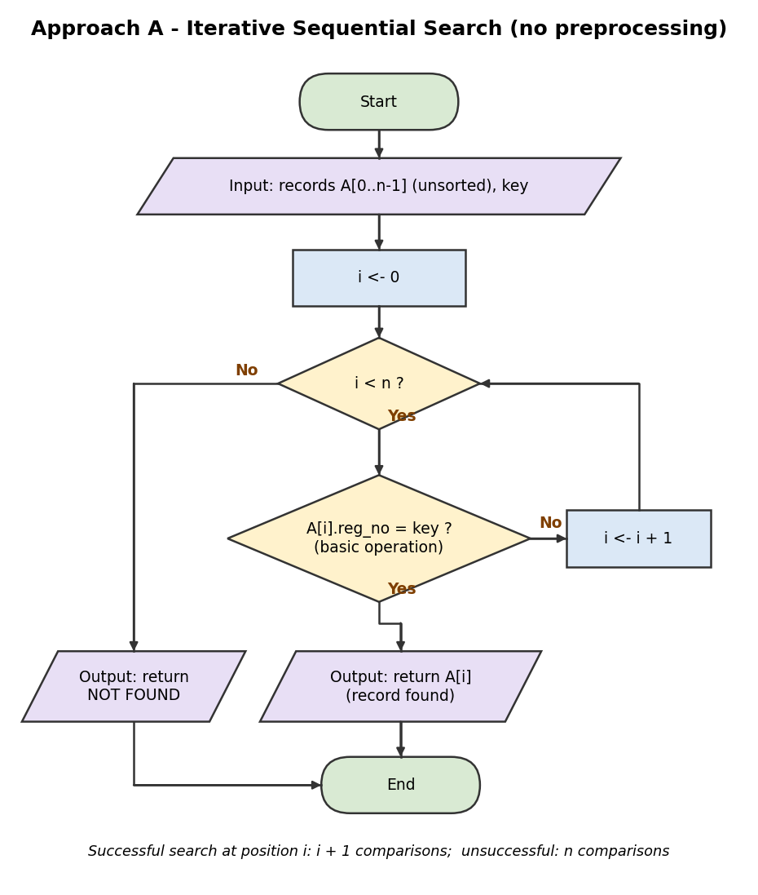
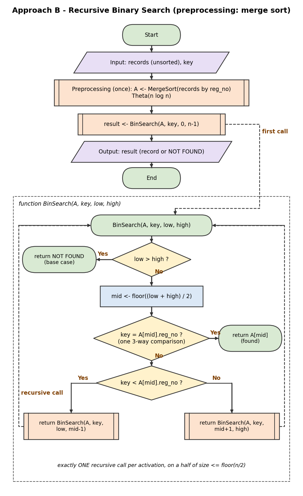
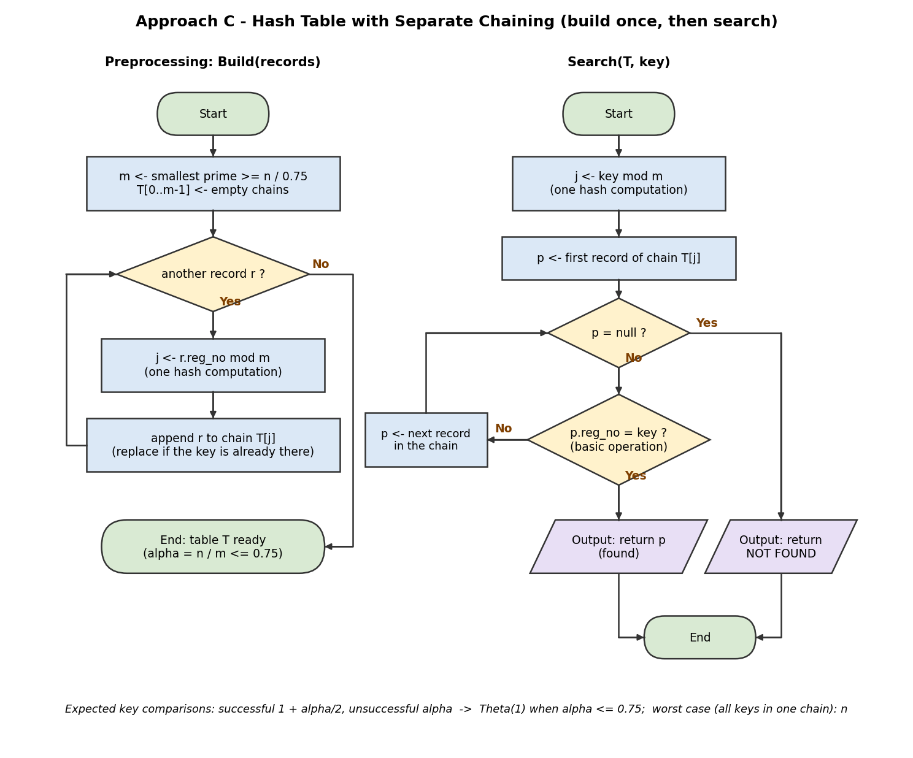

# Task 1 – Design the Algorithm [5 Marks]

> Part of **CSA06 Assignment 1 (CO1)** – V. Vasudevan (192425324). Full report: [`Report/Documentation/CO1_Assignment_Report.md`](../Report/Documentation/CO1_Assignment_Report.md) · [project README](../README.md)

> Design and propose at least three meaningfully different algorithmic strategies for locating a given registration number. The three approaches must represent distinct algorithmic strategies. Iterative and recursive implementations of the same underlying algorithm will not be considered as two different approaches.
> Your proposed approaches must include:
> - at least one iterative approach;
> - at least one recursive approach;
> - a clear explanation of the basic idea behind each approach;
> - pseudocode or an appropriate flowchart for each approach;
> - a brief justification for selecting each approach for investigation;
> - any preprocessing required by the approach, such as sorting or restructuring the data.
> You are expected to design and select the approaches independently. The appropriateness and diversity of the selected algorithmic strategies form part of the assessment.

**Evidence Expected**

> Three meaningfully different algorithmic strategies, supported by pseudocode/flowcharts, identification of the design strategy, preprocessing requirements, and justification for selecting each approach.

**Ans:**

## 1. The three strategies at a glance

I chose three strategies that use **increasing amounts of knowledge about the keys**: Approach A uses none (it only tests equality), Approach B uses the **order** of the keys, and Approach C uses the **arithmetic value** of the key to compute where the record is.

Table 2: The three proposed approaches

| | A – Sequential search | B – Binary search | C – Hash table |
|---|---|---|---|
| Design strategy | Brute force | Divide and conquer (decrease-by-half) | Space–time trade-off (transform and conquer) |
| Control structure | Iterative | Recursive | Iterative (hash, then one chain) |
| Structure searched | Unsorted array (as stored) | Sorted array of records | m chains, h(k) = k mod m |
| One-time setup | None | Own merge sort by `reg_no` | Insert every record once |
| Basic operation | `A[i].reg_no = key` | 3-way `key : A[mid].reg_no` | Chain comparison (+1 hash) |
| Expected search cost | (n + 1)/2 hit, n miss | ≈ log₂ n | ≈ 1 + α/2 hit, α miss (α ≤ 0.75) |

## 2. Approach A – Iterative sequential search (brute force)

**Basic idea.** Compare the key with the registration number of every record in the stored order, `A[0]`, `A[1]`, …, and stop at the first match. If the end of the list is reached, the student does not exist.

```
Algorithm SequentialSearch(A, n, key)
// A[0..n-1]: records in arrival order (unsorted); returns the record or NOT FOUND
1. for i = 0 to n-1 do
2.     if A[i].reg_no = key then             // basic operation: one key comparison
3.         return A[i]                       // successful search
4. return NOT FOUND                          // all n records compared
```



**Preprocessing:** none. The records are searched exactly as they arrive, so a new record is usable immediately (append in Θ(1)).

**Justification.** Sequential search is the baseline every other design must beat: it works on any list, needs no extra memory and no preprocessing, and it is the correct choice when the list is tiny or when only a handful of searches will ever be made. Investigating it tells me *how many searches* are needed before preprocessing pays for itself (Task 10).

## 3. Approach B – Recursive binary search on a sorted array (divide and conquer)

**Basic idea.** If the records are sorted by registration number, one comparison with the middle record `A[mid]` tells me which half can still contain the key; the other half is discarded. The function calls itself on the remaining half until the key is found or the range is empty. The work is **one** subproblem of half the size per call (Levitin calls this *decrease-by-a-constant-factor*, a special case of divide and conquer).

**Preprocessing:** the arrival-order records must be sorted once by `reg_no`. I implemented my own **merge sort** (also divide and conquer: sort both halves recursively, then merge them) with a comparison counter, so the preprocessing cost is measured, not assumed. It costs Θ(n log n) comparisons and a Θ(n) buffer.

```
Algorithm MergeSort(A, low, high)            // preprocessing for B: sort by reg_no
1. if low >= high then return                // 0 or 1 record: already sorted
2. mid = floor((low + high) / 2)
3. MergeSort(A, low, mid)
4. MergeSort(A, mid+1, high)
5. Merge(A, low, mid, high)

Algorithm Merge(A, low, mid, high)
1. copy A[low..high] into buffer B[low..high]
2. i = low;  j = mid + 1;  k = low
3. while i <= mid and j <= high do
4.     if B[i].reg_no <= B[j].reg_no then    // basic operation of the preprocessing
5.         A[k] = B[i];  i = i + 1
6.     else A[k] = B[j];  j = j + 1
7.     k = k + 1
8. copy the rest of B[i..mid] to A[k..]      // the rest of the right run is already in place
```

```
Algorithm BinSearch(A, key, low, high)       // A[low..high] sorted by reg_no
1. if low > high then return NOT FOUND       // base case: empty range
2. mid = floor((low + high) / 2)
3. if key = A[mid].reg_no then return A[mid] // one three-way comparison key : A[mid]
4. else if key < A[mid].reg_no then
5.     return BinSearch(A, key, low, mid-1)  // recurse on the left half only
6. else
7.     return BinSearch(A, key, mid+1, high) // recurse on the right half only
// first call: BinSearch(A, key, 0, n-1)
```



**Justification.** Binary search is the classical way to exploit order, it is naturally recursive (the required recursive approach, analysed with recurrences in Tasks 6–7), and its guaranteed worst case of ⌊log₂ n⌋ + 1 comparisons is the strongest *worst-case* guarantee of the three. A sorted array also supports ordered reports (all students in a range of numbers), which the other two designs do not. Its weakness, the Θ(n log n) sorting cost, is exactly what the assignment asks me to include in the analysis.

## 4. Approach C – Hash table with separate chaining (space–time trade-off)

**Basic idea.** Instead of searching *for* the record, compute *where* it is: h(k) = k mod m maps a registration number to one of m buckets (m prime). Each bucket holds a short chain (list) of the records whose keys hash there. A search computes h(key) once and compares the key only with the records of that one chain. Choosing m ≥ n/0.75 keeps the **load factor** α = n/m ≤ 0.75, so a chain holds less than one record on average.

**Preprocessing:** build the table once: allocate m empty chains and insert every record (one hash computation each, plus a duplicate check along its chain). This costs Θ(n) expected time and Θ(n + m) extra memory. The table grows to the next prime ≥ 2m if more records arrive than it was sized for.

```
Algorithm BuildHashTable(R, n)               // preprocessing for C
1. m = smallest prime >= n / 0.75            // keeps alpha = n/m <= 0.75
2. T[0..m-1] = empty chains
3. for each record r in R do
4.     j = r.reg_no mod m                    // one hash computation
5.     if no record of chain T[j] has key r.reg_no then append r to T[j]
6. return T

Algorithm HashSearch(T, m, key)
1. j = key mod m                             // one hash computation
2. for each record p in chain T[j] do
3.     if p.reg_no = key then return p       // basic operation: one key comparison
4. return NOT FOUND
```



**Justification.** Exact-match lookup by a unique numeric key is the textbook use of hashing; it is the only strategy whose expected cost does **not** grow with n. It also represents a different design philosophy (spend memory and a one-time build to buy speed), which lets me study a real trade-off. I wrote the table myself (division method with a prime m, separate chaining, resize when α > 0.75) instead of using Python's `dict`, so that every probe can be counted.

## 5. Why the three approaches are meaningfully different

Table 3: Diversity of the three strategies

| Question | A | B | C |
|---|---|---|---|
| What property of the key is used? | equality only | total order | arithmetic value (k mod m) |
| How much of the data is examined per search? | up to all n records | one path of ≈ log₂ n records | one chain of ≈ 1 record |
| Iterative or recursive | iterative loop | recursive (one call per level) | iterative |
| One-time preprocessing | none | Θ(n log n) merge sort | Θ(n) table build |
| Extra memory | none | sorted copy Θ(n) (+ Θ(n) buffer while sorting) | Θ(n + m) bucket array + chains |
| Supports ordered/range queries | no (needs a full scan) | yes | no |

They are not variants of one algorithm: A is brute force, B is divide and conquer on an ordered structure, and C replaces searching by address calculation. The pair "iterative vs recursive binary search" would not count as two approaches, so my only recursive approach (B) is matched with two *different* iterative strategies.

## Files in this folder

- `flowchart_A_sequential_search.png`, `flowchart_B_recursive_binary_search.png`, `flowchart_C_hash_table.png` – the flowcharts above
- `draw_flowcharts.py` – the script that draws them (`py -3 draw_flowcharts.py`)
