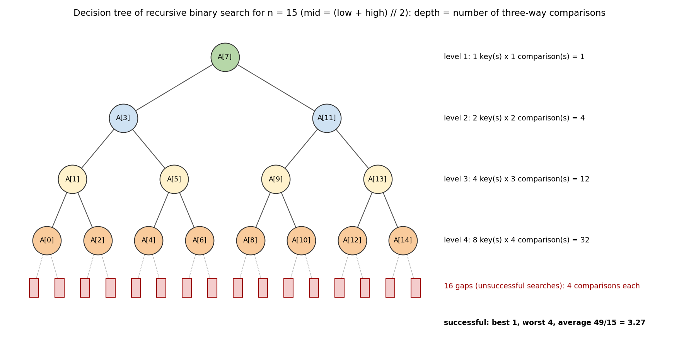

# Task 4 – Analyse Best, Average and Worst-Case Behaviour [4 Marks]

> Part of **CSA06 Assignment 1 (CO1)** – K DHEEPAK (192411108). Full report: [`Report/Documentation/CO1_Assignment_Report.md`](../Report/Documentation/CO1_Assignment_Report.md) · [project README](../README.md)

> Discuss, wherever applicable:
> - what input condition produces the best case;
> - the average case;
> - the worst case;
> - how the number of operations changes in each case;
> - why these differences occur.
> Do not simply provide a table containing complexity values. Explain the conditions that lead to each case, supported by mathematical reasoning.

**Ans:**

## 1. Approach A – sequential search

**Best case.** The searched student is the *first record stored* (position 0). The loop stops after **one** comparison: Cbest(n) = 1, independent of n. Test TC05 confirms it: the first stored record (196394267) was found with 1 comparison.

**Worst case.** Two input conditions: the student is the *last record stored*, or the registration number *does not exist*. In both, every record must be compared: Cworst(n) = n. Tests TC06 (last record, 15 comparisons for n = 15) and TC11–TC13 (absent keys below the minimum, above the maximum and in a gap, 15 comparisons each) confirm it; in the experiments every unsuccessful search cost exactly n (1,000; 10,000; 100,000; 1,000,000).

**Average case.** For a uniformly random stored student, Chit(n) = (n + 1)/2 (Task 3, §2); with success probability p, Cavg = p(n + 1)/2 + (1 − p)n. Measured averages: 496.25, 4,966.63, 51,226.36 and 480,558.07 (theory 500.5, 5,000.5, 50,000.5, 500,000.5).

**Why.** The records are in arrival order, which has no relation to the registration numbers, so a comparison with A[i] gives no information about where else the key could be. The algorithm can only rule out one record per comparison; the position of the key alone decides the cost, and an absent key can only be confirmed after looking at everything.

## 2. Approach B – recursive binary search

**Best case.** The key is the record at the **first middle position** `A[⌊(n − 1)/2⌋]`; it is found by the first three-way comparison: Cbest(n) = 1 (test TC07: the middle of the sorted 15 records, 1 comparison).

**Worst case.** The key is stored at a **deepest node** of the decision tree, or it is **absent** (any gap). Every comparison discards half and the search continues until one record (or none) is left: Cworst(n) = ⌊log₂ n⌋ + 1 (4 for n = 15: tests TC08, TC09, TC11–TC13; 10, 14, 17 and 20 for the four experimental sizes, Table 10).

**Average case.** Figure 4 shows why the average is close to the worst case: level d of the decision tree contains 2d−1 keys, so about half of all keys sit on the deepest level. For n = 15: (1·1 + 2·2 + 3·4 + 4·8)/15 = 49/15 = 3.27 comparisons, against a worst case of 4. In general Chit(n) ≈ log₂ n − 1 and every unsuccessful search costs ⌊log₂ n⌋ or ⌊log₂ n⌋ + 1 (all 16 gaps of the n = 15 tree cost 4).

**Why.** The cost depends only on the *position of the key in sorted order*, never on the values themselves, and the halving bounds the depth of the tree by logâ‚‚ n. Best and worst differ by a factor of only about logâ‚‚ n, not n.

**Preprocessing (merge sort).** The input order only changes the constant: the best case is input that is already sorted (each merge stops after the left run, ≈ (n/2) log₂ n comparisons), the worst case is when every merge alternates between the runs (n log₂ n − n + 1), and random input averages ≈ n log₂ n − 1.25n. All three are Θ(n log n), because merge sort always splits into halves regardless of the data. My random datasets needed 8,744 / 120,491 / 1,536,197 / 18,674,803 comparisons, within 0.4% of n log₂ n − 1.25n and below the worst-case bound (Table 15).

## 3. Approach C – hash table

**Best case.** The key's bucket h(key) is empty (unsuccessful search: 1 hash, **0 comparisons**, test TC11 and TC13) or the key is the first record of its chain (successful: 1 hash + **1 comparison**, tests TC02–TC10).

**Average case.** Under uniform hashing a successful search costs 1 + α/2 − α/(2n) comparisons and an unsuccessful one α (Task 3, §4). Because the table is resized to keep α ≤ 0.75, both are **constants**: ≤ 1.375 and ≤ 0.75. Measured: 1.32–1.39 (hit) and 0.62–0.76 (miss) at all four sizes.

**Worst case.** All n keys fall into the **same bucket**, e.g. keys that are all congruent modulo m. The table degenerates into one linked list and a search costs n comparisons, Θ(n), exactly like sequential search; building such a table costs Θ(n²) because of the duplicate checks (0 + 1 + … + (n − 1)). Property test P5 builds this case on purpose with the 1,000 keys k = 190,000,000 + i·m: the chain length was 1,000 and both a hit on the last key and a miss cost 1,000 comparisons.

**Why the worst case does not occur here.** Registration numbers are assigned by the university, not chosen by an adversary, and the division method with a prime m spreads them evenly. The longest chain I observed was 5, 7, 8 and 6 records at the four sizes (Table 18), consistent with the expected maximum chain length Θ(log n / log log n). If adversarial keys were a concern, a randomly chosen (universal) hash function would make the expected cost Θ(1) for *every* key set.

## 4. Summary of the cases

Table 6: Operation counts in the three cases (search only; n records, α = n/m ≤ 0.75)

| Approach | Best case: condition → count | Average case | Worst case: condition → count |
|---|---|---|---|
| A sequential search | key at position 0 → 1 | hit (n + 1)/2; miss n | key last or absent → n |
| B binary search | key at first mid → 1 | hit ≈ log₂ n − 1; miss ≈ log₂ n | deepest or absent → ⌊log₂ n⌋+1 |
| C hash search | empty chain → 0; key first → 1 | hit 1 + α/2; miss α | one chain holds all → n |
| B merge sort | sorted input → ≈ (n/2) log₂ n | ≈ n log₂ n − 1.25n | n log₂ n − n + 1 |
| C table build | no collisions → n hashes | n(1 + α/2) | all collide → n + n(n−1)/2 |

The differences have one common cause: **how much each comparison can eliminate.** A comparison in A eliminates one record, so the cost depends linearly on the key's position. A comparison in B eliminates half of the remaining records, so the cost depends only on the depth of the key in a balanced tree. In C the hash computation eliminates all records except one chain; the remaining cost depends on how evenly the keys are spread, which is a property of the hash function and the key set, not of n.

## Files in this folder

- `binary_search_decision_tree.png` – Figure 4
- `draw_decision_tree.py` – draws it with the same `mid = (low + high) // 2` rule as the implementation

