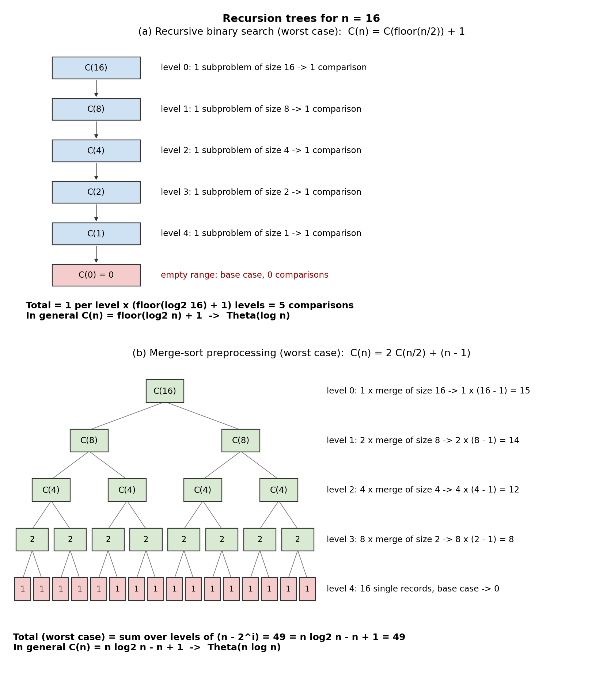

# Task 7 – Solve the Recurrence Relation [4 Marks]

> Part of **CSA06 Assignment 1 (CO1)** – V. Vasudevan (192425324). Full report: [`Report/Documentation/CO1_Assignment_Report.md`](../Report/Documentation/CO1_Assignment_Report.md) · [project README](../README.md)

> Solve it using an appropriate method (substitution, iteration, Master Theorem, or another technique). Discuss:
> - why the selected method is applicable;
> - the steps;
> - the resulting complexity;
> - what the result indicates about the behaviour of the recursive algorithm as n increases.
> Show the analytical process. (Showing two methods, e.g. backward substitution AND Master Theorem, is a plus.)

**Ans:**

I solve C(n) = C(⌊n/2⌋) + 1, C(0) = 0 (so C(1) = 1) with three methods: backward substitution (exact closed form for powers of two), the Master Theorem (growth class), and the substitution method by induction (exact closed form for **every** n). Then I solve the merge-sort recurrence and check all closed forms against the counted comparisons.

## 1. Method 1 – Backward substitution (iteration)

**Why it applies.** The recurrence has a single recursive term whose argument halves, so repeatedly substituting the recurrence into itself produces a simple pattern. For n = 2ᵏ the floors disappear (⌊2ᵏ/2⌋ = 2k−1).

**Steps.** Let n = 2ᵏ:

C(2ᵏ) = C(2k−1) + 1

= [C(2k−2) + 1] + 1 = C(2k−2) + 2

= [C(2k−3) + 1] + 2 = C(2k−3) + 3

= …

= C(2k−i) + i  (general pattern after i substitutions)

Choose i = k to reach the known value C(2⁰) = C(1) = 1:

C(2ᵏ) = C(1) + k = 1 + k, and since k = log₂ n: **C(n) = log₂ n + 1** for n = 2ᵏ.

By the smoothness rule (log n is a smooth function and C is non-decreasing), the result extends to all n: C(n) ∈ Θ(log n).

## 2. Method 2 – Master Theorem

**Why it applies.** The recurrence has the form T(n) = a·T(n/b) + f(n) with a = 1 ≥ 1 recursive call, b = 2 > 1, and f(n) = 1 asymptotically positive; floors in the argument do not change the result.

**Steps.**

- a = 1, b = 2, f(n) = 1 = Θ(n⁰), so d = 0.
- nlogb a = nlog₂ 1 = n⁰ = 1.
- Compare f(n) with nlogb a: f(n) = Θ(1) = Θ(nlogb a), i.e. a = bd (1 = 2⁰). This is **Case 2**.
- Case 2 gives T(n) = Θ(nlogb a · log n) = Θ(n⁰ log n) = **Θ(log n)**.
- The regularity condition a·f(n/b) ≤ c·f(n) is only required in Case 3, so no check is needed here.

## 3. Method 3 – Substitution method (proof by induction for every n)

**Claim:** C(n) = ⌊log₂ n⌋ + 1 for all n ≥ 1.

**Basis:** n = 1: C(1) = C(0) + 1 = 1 = ⌊log₂ 1⌋ + 1. ✓

**Inductive step:** let n ≥ 2 and assume the claim for all 1 ≤ m < n. Choose j with 2ʲ ≤ n < 2j+1, so ⌊log₂ n⌋ = j ≥ 1. Then 2j−1 ≤ ⌊n/2⌋ < 2ʲ, so ⌊log₂ ⌊n/2⌋⌋ = j − 1. Because 1 ≤ ⌊n/2⌋ < n the hypothesis applies:

C(n) = C(⌊n/2⌋) + 1 = (⌊log₂ ⌊n/2⌋⌋ + 1) + 1 = (j − 1) + 2 = j + 1 = **⌊log₂ n⌋ + 1**. ✓

This is the exact worst-case number of three-way comparisons for every database size, and it agrees with the backward substitution for n = 2ᵏ.

## 4. Recursion tree, and the merge-sort recurrence

**Binary search.** The recursion tree is a single path (one recursive call per level): sizes n, ⌊n/2⌋, ⌊n/4⌋, …, 1, with cost 1 on each of the ⌊log₂ n⌋ + 1 levels and 0 at the empty base case. Summing the levels gives ⌊log₂ n⌋ + 1 again (Figure 5a, n = 16: 5 levels → 5 comparisons).

**Merge sort, backward substitution** (n = 2ᵏ, C(n) = 2C(n/2) + n − 1, C(1) = 0):

C(2ᵏ) = 2C(2k−1) + 2ᵏ − 1

= 2[2C(2k−2) + 2k−1 − 1] + 2ᵏ − 1 = 4C(2k−2) + 2·2ᵏ − (1 + 2)

= 8C(2k−3) + 3·2ᵏ − (1 + 2 + 4)

= …

= 2ⁱ C(2k−i) + i·2ᵏ − (2ⁱ − 1)

With i = k: C(2ᵏ) = 2ᵏ·C(1) + k·2ᵏ − 2ᵏ + 1 = **n log₂ n − n + 1**.

**Merge sort, Master Theorem:** a = 2, b = 2, f(n) = n − 1 = Θ(n¹), nlog₂ 2 = n¹ → f(n) = Θ(nlogb a), Case 2 → **Θ(n log n)**.

**Merge sort, recursion tree:** level i has 2ⁱ merges of size n/2ⁱ, each costing n/2ⁱ − 1, so the level costs n − 2ⁱ; summing over the log₂ n merging levels gives n log₂ n − (2log₂ n − 1) = n log₂ n − n + 1 (Figure 5b, n = 16: 15 + 14 + 12 + 8 = 49 = 16·4 − 16 + 1).

## 5. Verification against the counted comparisons

I checked the solutions against the counters in the real code. Test P3 searched every key and every gap for each n from 1 to 200: the maximum count equalled ⌊log₂ n⌋ + 1 for all 200 sizes, and the total over all successful searches equalled the recurrence S(n) exactly (P3b). Test P4 confirmed that merge sort never exceeded n⌈log₂ n⌉ − 2⌈log₂ n⌉ + 1. For the four experimental sizes I searched **every stored key once**:

Table 10: Closed forms against the counted comparisons (exhaustive search of every stored key; exhaustive_verification.csv)

| Number of records (n) | Max counted | ⌊log₂ n⌋ + 1 | Average counted | S(n)/n (recurrence) | Merge sort counted | Merge sort worst bound |
|---|---|---|---|---|---|---|
| 1,000 | 10 | 10 | 8.9870 | 8.9870 | 8,744 | 8,977 |
| 10,000 | 14 | 14 | 12.3631 | 12.3631 | 120,491 | 123,617 |
| 100,000 | 17 | 17 | 15.6895 | 15.6895 | 1,536,197 | 1,568,929 |
| 1,000,000 | 20 | 20 | 18.9514 | 18.9514 | 18,674,803 | 18,951,425 |

The agreement is exact for binary search, as it must be for a deterministic algorithm.

## 6. What the result means

C(n) = ⌊log₂ n⌋ + 1 = Θ(log n) means that **each doubling of the database adds exactly one comparison** and one stack frame. Going from 1,000 to 1,000,000 students (×1,000 ≈ 2¹⁰) adds only 10 comparisons (10 → 20). The recursion is also safe in Python: at n = 10⁶ the depth is at most 21 frames, far below the default limit of 1,000 frames, which would only be reached for n ≈ 2⁹⁹⁹. The merge-sort result Θ(n log n) says the preprocessing grows slightly faster than linearly; it is paid once and then shared by all later searches (Task 10, §5).

## Files in this folder

- `recursion_trees.png` – Figure 5
- `draw_recursion_trees.py` – draws it and prints the level sums for n = 16
