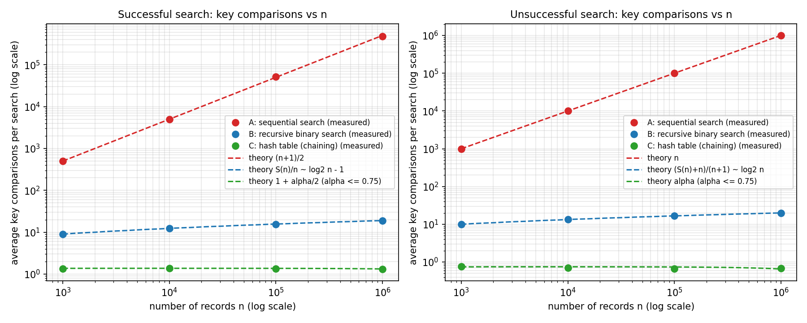
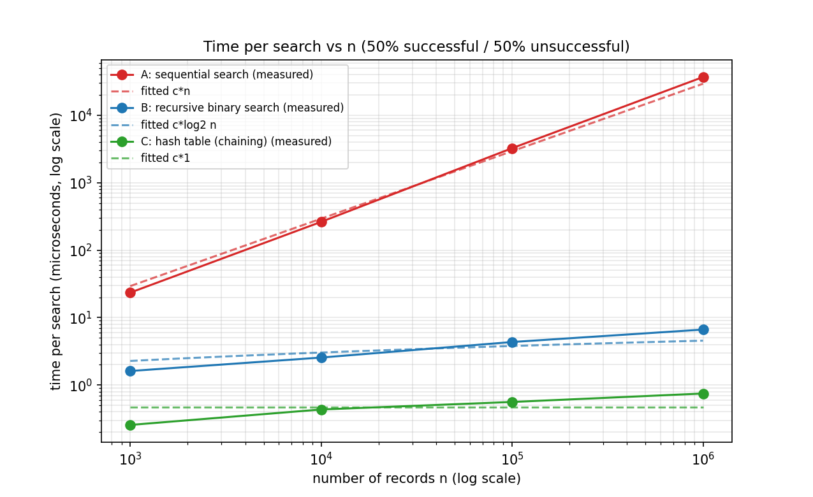
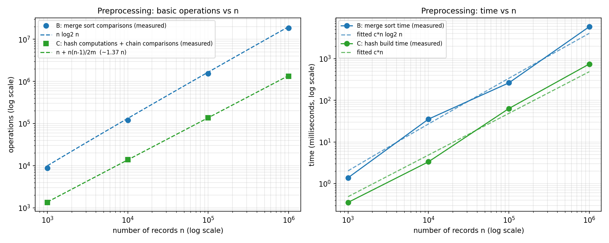
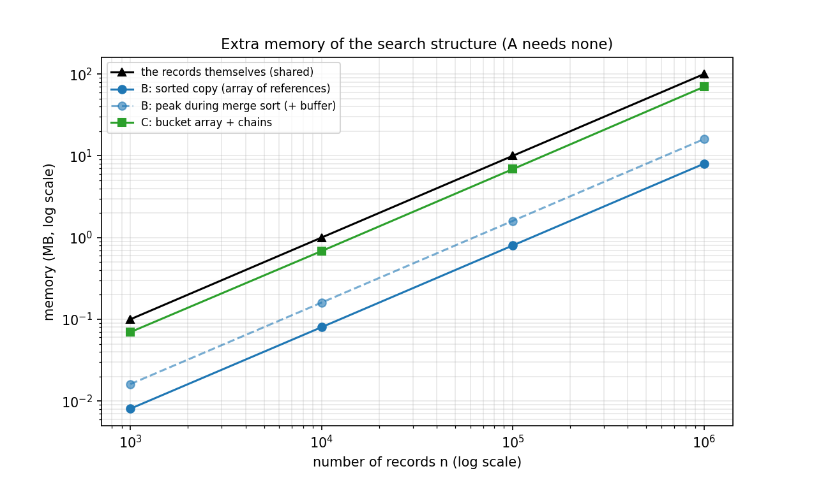
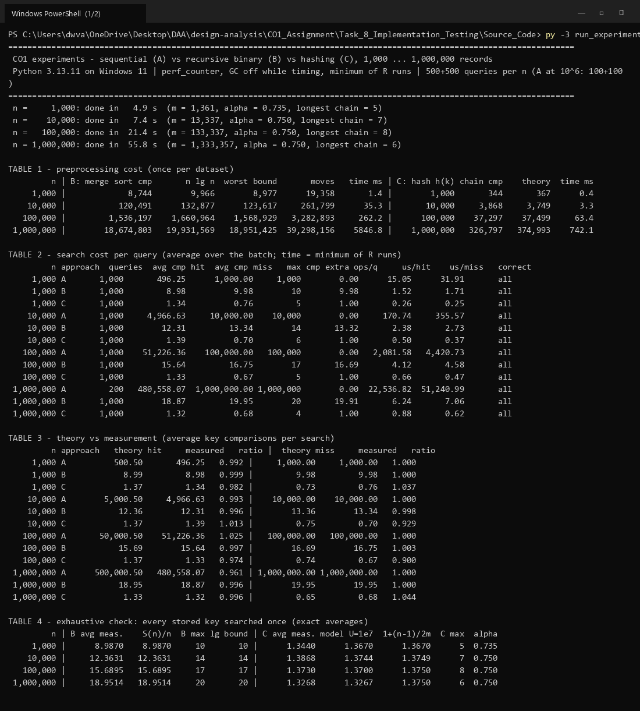
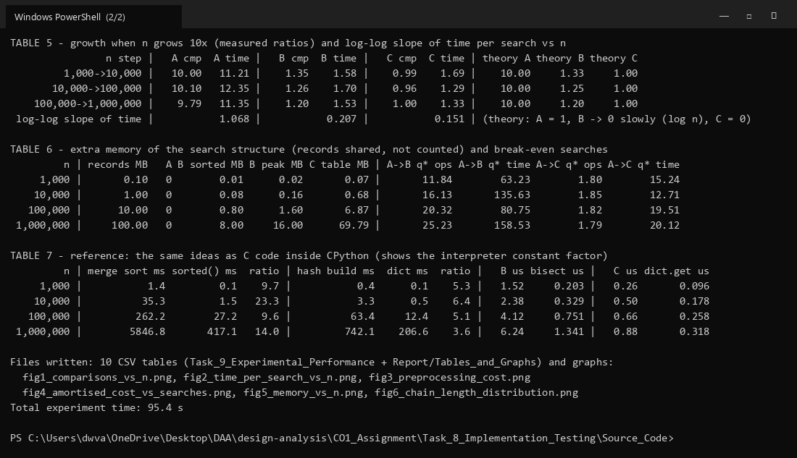

# Task 9 – Record Experimental Performance [3 Marks]

> Part of **CSA06 Assignment 1 (CO1)** – K DHEEPAK (192411108). Full report: [`Report/Documentation/CO1_Assignment_Report.md`](../Report/Documentation/CO1_Assignment_Report.md) · [project README](../README.md)

> Collect and present data for each algorithm across the input sizes:
> - execution time;
> - number of comparisons;
> - number of key operations;
> - input size;
> - other relevant measures where justified (e.g. preprocessing time, memory).
> Present with tables, graphs, performance plots so approaches are easily compared.

**Ans:**

## 1. What I measured

`run_experiments.py` ran once for all four sizes (95.4 s in total). For every n and approach it records: the preprocessing comparisons, moves / hash computations and time; the average and maximum key comparisons of successful and unsuccessful searches; the other key operations per search (recursive calls for B, hash computations for C); the time per search; and the memory of the search structure. Times are the minimum of 2–7 runs with the garbage collector off; the raw numbers are in Appendix C.

## 2. Preprocessing cost

Table 15: One-time preprocessing (preprocessing_cost.csv)

| Number of records (n) | B: merge sort comparisons | Reference value n logâ‚‚ n | B: sort time (ms) | C: build hash computations | C: build chain comparisons | C: build time (ms) |
|---|---|---|---|---|---|
| 1,000 | 8,744 | 9,966 | 1.4 | 1,000 | 344 | 0.4 |
| 10,000 | 120,491 | 132,877 | 35.3 | 10,000 | 3,868 | 3.3 |
| 100,000 | 1,536,197 | 1,660,964 | 262.2 | 100,000 | 37,297 | 63.4 |
| 1,000,000 | 18,674,803 | 19,931,569 | 5,846.8 | 1,000,000 | 326,797 | 742.1 |

Sequential search needs no preprocessing (0 operations, 0 ms). Merge sort also moved 19,358 / 261,799 / 3,282,893 / 39,298,156 records. The hash build performed exactly n hash computations and no rehash (the table is sized for n in advance).

## 3. Key comparisons per search

Table 16: Average key comparisons per search (search_performance.csv; A at 10⁶: 100 + 100 queries, otherwise 500 + 500)

| n | A hit | A miss | B hit | B miss | C hit | C miss |
|---|---|---|---|---|---|---|
| 1,000 | 496.25 | 1,000 | 8.98 | 9.98 | 1.34 | 0.76 |
| 10,000 | 4,966.63 | 10,000 | 12.31 | 13.34 | 1.39 | 0.70 |
| 100,000 | 51,226.36 | 100,000 | 15.64 | 16.75 | 1.33 | 0.67 |
| 1,000,000 | 480,558.07 | 1,000,000 | 18.87 | 19.95 | 1.32 | 0.68 |

## 4. Execution time per search

Table 17: Time per search in microseconds (minimum of R runs; search_performance.csv)

| n | A hit | A miss | B hit | B miss | C hit | C miss |
|---|---|---|---|---|---|---|
| 1,000 | 15.05 | 31.91 | 1.52 | 1.71 | 0.26 | 0.25 |
| 10,000 | 170.74 | 355.57 | 2.38 | 2.73 | 0.50 | 0.37 |
| 100,000 | 2,081.58 | 4,420.73 | 4.12 | 4.58 | 0.66 | 0.47 |
| 1,000,000 | 22,536.82 | 51,240.99 | 6.24 | 7.06 | 0.88 | 0.62 |

## 5. Other key operations and the maximum cost per search

Table 18: Maximum key comparisons and other key operations per search

| Number of records (n) | A maximum per search | B maximum per search | B calls per search | C maximum (all keys) | C hashes per search |
|---|---|---|---|---|---|
| 1,000 | 1,000 | 10 | 9.98 | 5 | 1.00 |
| 10,000 | 10,000 | 14 | 13.32 | 7 | 1.00 |
| 100,000 | 100,000 | 17 | 16.69 | 8 | 1.00 |
| 1,000,000 | 1,000,000 | 20 | 19.91 | 6 | 1.00 |

For B the calls exceed the comparisons by one in an unsuccessful search (the final call on an empty range); for C every search computes exactly one hash. C's maximum equals the longest chain in the table.

## 6. Memory

Table 19: Extra memory of the search structure (memory_usage.csv; the records themselves are shared by all three)

| Records (n) | Records (MB) | A extra | B sorted copy (MB) | B peak (MB) | C table (MB) | C size m (α) |
|---|---|---|---|---|---|---|
| 1,000 | 0.10 | 0 | 0.01 | 0.02 | 0.07 | 1,361 (0.735) |
| 10,000 | 1.00 | 0 | 0.08 | 0.16 | 0.68 | 13,337 (0.750) |
| 100,000 | 10.00 | 0 | 0.80 | 1.60 | 6.87 | 133,337 (0.750) |
| 1,000,000 | 100.00 | 0 | 8.00 | 16.00 | 69.79 | 1,333,357 (0.750) |

All three grow linearly. The sorted copy is an array of n references (8 bytes each); the hash table needs about 70 bytes per record (10.7 MB bucket array + about 59 MB of chain lists at n = 10⁶), roughly 9 times the sorted array but still less than the records themselves.

## 7. Graphs

## 8. Experiment output

## Files in this folder

- `experiment_output.txt` – captured output of `run_experiments.py`
- `preprocessing_cost.csv`, `search_performance.csv`, `theory_vs_measured.csv`, `exhaustive_verification.csv`, `growth_factors.csv`, `memory_usage.csv`, `break_even.csv`, `builtin_reference.csv`, `amortised_cost.csv`, `chain_length_distribution.csv` – raw data behind every table and graph (graphs in `../Report/Tables_and_Graphs/`)

