<!-- cover
institution: SIMATS ENGINEERING
department: Department of Computer Science and Engineering
course: CSA06 – Design and Analysis of Algorithms
assignment: ASSIGNMENT 2 – CO2
subtitle: Brute-Force and Exhaustive-Search Engineering
coverage: CO2: Selection, Bubble and Insertion Sort, Sequential Search, Brute-Force String Matching, Closest Pair, Convex Hull and Exhaustive Search
student_name: V. Vasudevan
register_number: 192425324
nature: Individual
duration: 1 Week
total_marks: 50
marks: Q1 | Sorting Under Different Data Conditions – Selection, Bubble & Insertion Sort | 6
marks: Q2 | When Is Sequential Search an Appropriate Engineering Choice? | 4
marks: Q3 | Engineer the Behaviour of Brute-Force String Matching | 6
marks: Q4 | Closest Pair and the Cost of Examining Every Possibility | 6
marks: Q5 | Derive a Convex Hull Algorithm from a Geometric Principle | 7
marks: Q6 | Exhaustive Search and Combinatorial Growth | 8
marks: Q7 | Day-4 Design Challenge – Diagnose, Redesign & Validate (A 2, B 2, C 4, D 1, E 2, F 2) | 13
details: CO2 Coverage | Brute-Force and Exhaustive-Search techniques – Selection Sort, Bubble Sort, Insertion Sort, Sequential Search, Brute-Force String Matching, Closest Pair, Convex Hull and Exhaustive Search.
details: Nature of Assignment | Individual
details: Duration | 1 Week
details: Total Marks | 50
details: Submission Date |
-->

# CSA06 – Assignment 2 (CO2): Brute-Force and Exhaustive-Search Engineering

### Problem Statement: Brute-Force Engineering across Seven Application Contexts

The CO2 assignment asks for brute-force and exhaustive-search solutions to seven engineering problems, each set in
its own application context: e-commerce order dispatch, aircraft-maintenance tool tracking, cybersecurity log
screening, drone collision-risk monitoring, wildlife-reserve boundary monitoring and humanitarian airlift planning.
For every problem I identify the problem type, design a brute-force (or exhaustive-search) algorithm, analyse its
efficiency with basic efficiency classes and asymptotic notation, **predict** its behaviour before running anything,
and then **measure** it with explicit operation counters. Q7 (the Day-4 Design Challenge) takes the solution with the
most serious limitation, diagnoses it from my own evidence, redesigns it and validates the redesign on the same data.

Table 1: The seven CO2 questions, their techniques and application contexts

| Question and technique | Application context | Problem type | Basic operation counted |
|---|---|---|---|
| Q1 – Selection, Bubble, Insertion Sort | E-commerce order dispatch by priority score | sorting | key comparisons, swaps / shifts, array writes |
| Q2 – Sequential Search | "Who currently has Tool T-184?" in an issued-tool list | searching | key comparisons |
| Q3 – Brute-force string matching | Signature screening of security logs | string matching | character comparisons |
| Q4 – Brute-force closest pair | Drone collision-risk monitoring | computational geometry (closest pair) | pairs examined, distance calculations |
| Q5 – Brute-force convex hull | Outer boundary of reserve monitoring stations | computational geometry (convex hull) | orientation (cross-product) tests |
| Q6 – Exhaustive search | Helicopter payload selection (0/1 knapsack) | combinatorial optimisation | candidate subsets, bit checks |
| Q7 – Redesign of Q4 | Drone monitoring at scale | algorithm redesign | distance calculations, pairs examined, sort comparisons |

**How each question is answered.** Each answer follows the cycle *Predict → Design → Implement → Measure → Analyse →
Evaluate*. The prediction and the pseudocode of every question were written first, in the `Pseudocode/` folder of
that question, and are reproduced here before the corresponding results. Predictions are then compared explicitly
with the observed counts.

**Evidence and reproducibility.** Every number in this report was produced by the programs in the
`Implementation_Code/` folder of each question (complete listings in Appendices A and B). Each program writes its raw
measurements to CSV files in `Implementation_Code/results/` (Appendix C), the datasets used to
`results/datasets/`, and its real console output to `results/*_log.txt`; the execution screenshots in this report are
renderings of those real runs. Operation counts are the **primary evidence** and are exactly reproducible because
every random generator is seeded; times are **supporting evidence** only, because other programs were running on the
same computer (I observed ±30 % variation of the same run), so all times are medians of repeated runs where
affordable.

Table 2: Test environment

| Item | Value |
|---|---|
| Processor | 13th Gen Intel Core i5-13420H (8 cores, 12 logical processors) |
| Memory | 16 GB RAM (15.6 GB usable) |
| Operating system | Windows 11 Home Single Language (10.0.26200) |
| Language | Python 3.13.11 (CPython); algorithm cores hand-written in pure Python with explicit counters |
| Libraries | standard library (`random`, `time`, `csv`, `math`, `statistics`, `itertools`); matplotlib 3.10.8 for graphs only |
| Random seeds | fixed per experiment (e.g. `random.Random(42 + n)`), documented in each program |
| Timer | `time.perf_counter()`; median of 3–5 repeats for small inputs, single run for the largest inputs |


## Q1 – Sorting Under Different Data Conditions [6 Marks]

> **Problem Context – E-Commerce Order Processing.** An e-commerce fulfilment centre arranges customer orders according to a dispatch priority score.
> The development team is considering: **Selection Sort | Bubble Sort | Insertion Sort**
> However, the incoming data may be randomly ordered, nearly sorted, already sorted or significantly disordered.
> **Your Challenge:** Investigate whether one of the three algorithms should always be preferred or whether the appropriate choice depends on the characteristics of the input data.
> Before implementation:
> - Predict how the three algorithms will behave under different input arrangements.
> - Explain the algorithmic reason for your prediction.
> Design two deliberately contrasting datasets and one additional edge-case dataset of your own that will expose meaningful behavioural differences among the algorithms.
> Implement the three algorithms and record appropriate measures such as:
> - Number of comparisons
> - Number of swaps/movements
> - Execution time, where useful
> Compare your prediction with the observed behaviour.
> **Design Decision:** The fulfilment centre reports that approximately 95% of existing orders are already in the correct priority order, with only small batches of new orders added periodically. Determine which of the three algorithms you would recommend and defend your decision.

**Evidence Expected**

> Reasoned prediction, three deliberately designed input conditions, implementation of the three sorting algorithms, operation counts, comparison of predicted and observed behaviour, and an evidence-based recommendation.

**Ans:**

### 1. Prediction before implementation

An order record is `(priority_score, order_id)`; orders are dispatched in ascending score. The key quantity for
predicting the work is the number of **inversions** I: pairs of orders that are in the wrong order (i < j but
score[i] > score[j]). A sorted list has I = 0, a reversed list of distinct scores has I = n(n − 1)/2, and a random
permutation has on average n(n − 1)/4 (each pair is inverted with probability ½). These predictions were written in
`Q1_Sorting_Algorithms/Pseudocode/Q1_Sorting_Pseudocode.md` before any code existed.

Table 3: Predicted behaviour of the three sorts (n orders, I inversions)

| Input arrangement | Selection Sort | Bubble Sort (early-exit flag) | Insertion Sort |
|---|---|---|---|
| Already sorted | n(n−1)/2 comparisons, 0 swaps | 1 pass, n − 1 comparisons, 0 swaps | n − 1 comparisons, 0 shifts |
| Random | n(n−1)/2 comparisons, ≈ n swaps | ≈ n²/2 comparisons, I ≈ n²/4 swaps | ≈ n²/4 comparisons and shifts |
| Reverse sorted | n(n−1)/2 comparisons, ⌊n/2⌋ swaps | n(n−1)/2 comparisons **and** swaps | n(n−1)/2 comparisons and shifts |
| 95 % sorted + 5 % new batch at end | n(n−1)/2 comparisons | still ≈ n²/2 comparisons, few swaps | ≈ I + n comparisons (I small) |
| One urgent order appended at end | n(n−1)/2 comparisons | n − 1 passes → n(n−1)/2 comparisons | ≈ 2(n − 1) comparisons, n − 1 shifts |
| Few distinct scores (many ties) | n(n−1)/2 comparisons | quadratic, slightly fewer passes | ≈ I + n comparisons |

Reasons:

- **Selection Sort is not adaptive.** To find the minimum of the unsorted part it must look at every element of that
  part, whatever their order, so it always makes Σ<sub>i=0</sub><sup>n−2</sup>(n − 1 − i) = n(n − 1)/2 comparisons. Its
  strength is data movement: at most one swap per pass (≤ n − 1 swaps).
- **Bubble Sort is adaptive only to how far orders must travel to the left.** One pass carries a large score all the
  way to the right, but moves every out-of-place small score only **one** position to the left. Hence the number of
  passes is 1 + L, where L is the largest number of bigger scores in front of any order. A single high-priority
  order at the end of the list (a "turtle") forces n − 1 passes, so the early-exit flag saves almost nothing. Each
  swap removes exactly one inversion, so swaps = I.
- **Insertion Sort does work proportional to the disorder.** Each shift removes exactly one inversion, so
  shifts = I and comparisons = I + (n − 1) − F, where F is the number of orders that become a new strict minimum (they
  reach position 0 without a final failing comparison). With few inversions it is almost linear.
- **Prediction for the fulfilment centre:** Insertion Sort will win clearly; Bubble Sort will look good on swaps but
  **not** on comparisons, because the new orders sit at the end and must travel left; Selection Sort will cost the
  same n(n − 1)/2 comparisons as on random data.

### 2. Pseudocode and complexity analysis

```
Algorithm SelectionSort(A, n)              Algorithm BubbleSort(A, n)
1. for i = 0 to n-2 do                     1. for p = 0 to n-2 do
2.     m = i                               2.     swapped = false
3.     for j = i+1 to n-1 do               3.     for j = 0 to n-2-p do
4.         if A[j].score < A[m].score      4.         if A[j].score > A[j+1].score then
5.             then m = j                  5.             swap A[j], A[j+1];  swapped = true
6.     if m != i then swap A[i], A[m]      6.     if not swapped then return      // early exit

Algorithm InsertionSort(A, n)
1. for i = 1 to n-1 do
2.     cur = A[i];  j = i - 1
3.     while j >= 0 and A[j].score > cur.score do    // strict '>' keeps equal scores in order (stable)
4.         A[j+1] = A[j];  j = j - 1                  // one shift
5.     A[j+1] = cur
```

The programs (`selection_sort`, `bubble_sort`, `insertion_sort` in `sorting_algorithms.py`, Appendix A) count every
key comparison, every swap or shift, every array write (a swap writes 2 slots, a shift 1 slot, placing the saved
order 1 slot if it moved) and every pass.

**Derivations.** Selection Sort: C(n) = Σ<sub>i=0</sub><sup>n−2</sup> Σ<sub>j=i+1</sub><sup>n−1</sup> 1 =
Σ<sub>i=0</sub><sup>n−2</sup>(n − 1 − i) = (n − 1) + (n − 2) + … + 1 = n(n − 1)/2 for every input ⇒ Θ(n²) in the best,
average and worst case. Bubble Sort: the worst case runs all n − 1 passes, C<sub>worst</sub>(n) =
Σ<sub>p=0</sub><sup>n−2</sup>(n − 1 − p) = n(n − 1)/2 ∈ Θ(n²); the best case (sorted) stops after one pass,
C<sub>best</sub>(n) = n − 1 ∈ Θ(n); with P passes C = P(n − 1) − P(P − 1)/2. Insertion Sort: the worst case (reversed)
compares A[i] with all i earlier orders, C<sub>worst</sub>(n) = Σ<sub>i=1</sub><sup>n−1</sup> i = n(n − 1)/2 ∈ Θ(n²);
the best case makes one comparison per order, C<sub>best</sub>(n) = n − 1 ∈ Θ(n); on average an order passes half of
the earlier ones, C<sub>avg</sub>(n) ≈ Σ<sub>i=1</sub><sup>n−1</sup> i/2 ≈ n²/4 ∈ Θ(n²). In general
C<sub>insertion</sub> = I + (n − 1) − F ∈ Θ(n + I): the cost is governed by the disorder, not only by n.

### 3. Designed datasets

All datasets are generated with fixed seeds and saved in `results/datasets/q1_<name>_n<size>.csv` (sizes n = 100,
1 000 and 5 000). The scores are distinct except in E2, so only the *order* differs between D1, D2, D3, R and S.

Table 4: The three designed input conditions (D1–D3) and the three reference conditions

| Dataset | Construction | Why it exposes a difference |
|---|---|---|
| D1 – **Contrast A – reverse sorted** ("significantly disordered") | highest score first | maximum I = n(n−1)/2: worst case for Bubble and Insertion, no effect on Selection |
| D2 – **Contrast B – 95 % sorted + 5 % new batch** | 95 % of the orders sorted, then 5 % new orders with random scores appended | the real operating condition: little disorder, but it sits at the end of the list |
| D3 – **Edge case – single urgent order at the end** | n − 1 sorted orders, then one order with the smallest score | only n − 1 inversions, but one order must travel the whole list: separates Bubble from Insertion |
| R – Random (reference) | random permutation | "randomly ordered" input |
| S – Already sorted (reference) | ascending scores | best case for adaptive sorts |
| E2 – Few distinct scores (reference edge case) | scores drawn from {1, …, 5} | many ties: tests the strict ">" and stability |

### 4. Implementation and correctness

Every sorted output is compared with Python's `sorted()`, and every counter is compared with its **exact** value
predicted from the input's inversion profile (I, L, F computed by an independent Fenwick-tree routine): Selection
comparisons = n(n − 1)/2, Bubble swaps = I and passes = min(L + 1, n − 1), Insertion shifts = I and comparisons =
I + (n − 1) − F. All 21 unit tests passed (Appendix D), and the "Pred=Obs" column of every experiment row is "yes".

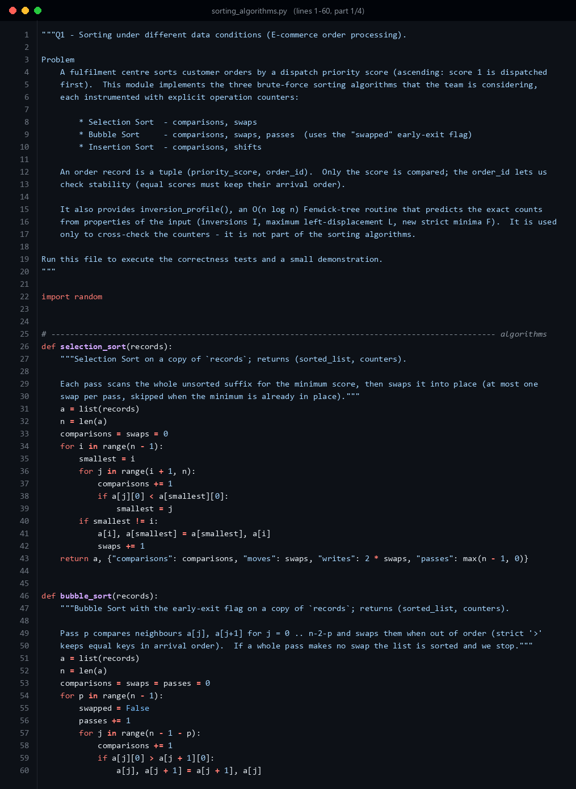

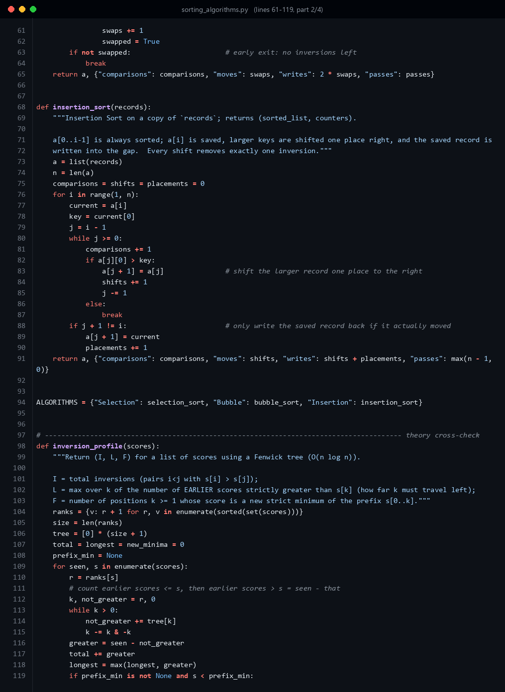

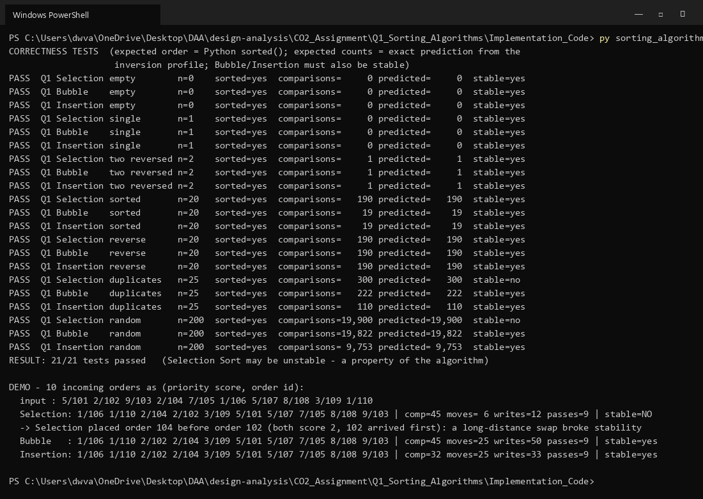

The demonstration in Figure 3 also shows a property that matters for dispatch: on the two orders with score 2,
Selection Sort placed order 104 before order 102 although order 102 arrived first – a long-distance swap broke
**stability**. Bubble and Insertion Sort are stable, so equal-priority orders keep their arrival (first-come,
first-served) order.

### 5. Results

Table 5: Measured operation counts and times for n = 5 000 orders (results/q1_results.csv)

| Dataset | Algorithm | Comparisons | Swaps/shifts | Writes | Passes | Time (ms) |
|---|---|---|---|---|---|---|
| D1 Reverse | Selection | 12,497,500 | 2,500 | 5,000 | 4,999 | 967 |
| D1 Reverse | Bubble | 12,497,500 | 12,497,500 | 24,995,000 | 4,999 | 2,138 |
| D1 Reverse | Insertion | 12,497,500 | 12,497,500 | 12,502,499 | 4,999 | 1,568 |
| D2 95 % + 5 % | Selection | 12,497,500 | 4,996 | 9,992 | 4,999 | 861 |
| D2 95 % + 5 % | Bubble | 12,495,670 | 623,290 | 1,246,580 | 4,939 | 1,334 |
| D2 95 % + 5 % | Insertion | **628,289** | 623,290 | 623,540 | 4,999 | **93** |
| D3 Urgent last | Selection | 12,497,500 | 4,999 | 9,998 | 4,999 | 1,226 |
| D3 Urgent last | Bubble | 12,497,500 | 4,999 | 9,998 | 4,999 | 1,271 |
| D3 Urgent last | Insertion | **9,997** | 4,999 | 5,000 | 4,999 | **2.0** |
| R Random | Selection | 12,497,500 | 4,989 | 9,978 | 4,999 | 687 |
| R Random | Bubble | 12,495,085 | 6,319,769 | 12,639,538 | 4,930 | 1,395 |
| R Random | Insertion | 6,324,763 | 6,319,769 | 6,324,761 | 4,999 | 665 |
| S Sorted | Selection | 12,497,500 | 0 | 0 | 4,999 | 698 |
| S Sorted | Bubble | 4,999 | 0 | 0 | 1 | 0.6 |
| S Sorted | Insertion | 4,999 | 0 | 0 | 4,999 | 1.0 |
| E2 Few unique | Selection | 12,497,500 | 3,954 | 7,908 | 4,999 | 878 |
| E2 Few unique | Bubble | 12,050,515 | 5,022,308 | 10,044,616 | 4,054 | 1,280 |
| E2 Few unique | Insertion | 5,027,305 | 5,022,308 | 5,026,264 | 4,999 | 520 |

(For Selection and Insertion Sort the "passes" column is simply their n − 1 outer iterations.)

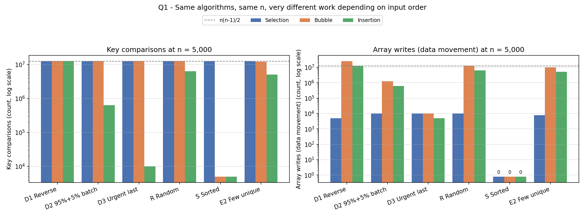

Table 6: Growth of the comparisons with n (results/q1_results.csv)

| Algorithm – dataset | n = 100 orders | n = 1,000 orders | n = 5,000 orders | ratio 5,000 / 1,000 | Class |
|---|---|---|---|---|---|
| Selection – every dataset | 4,950 | 499,500 | 12,497,500 | 25.0 | Θ(n²) |
| Bubble – D1 reverse | 4,950 | 499,500 | 12,497,500 | 25.0 | Θ(n²) |
| Bubble – D3 urgent last | 4,950 | 499,500 | 12,497,500 | 25.0 | Θ(n²) |
| Bubble – S sorted | 99 | 999 | 4,999 | 5.0 | Θ(n) |
| Insertion – R random | 2,526 | 247,617 | 6,324,763 | 25.5 | Θ(n²) |
| Insertion – D2 95 % + 5 % | 341 | 26,010 | 628,289 | 24.2 | Θ(n²), ≈ 20× fewer |
| Insertion – D3 urgent last | 197 | 1,997 | 9,997 | 5.0 | Θ(n) |

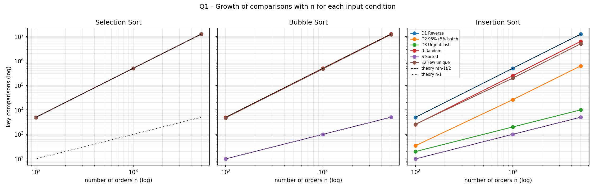

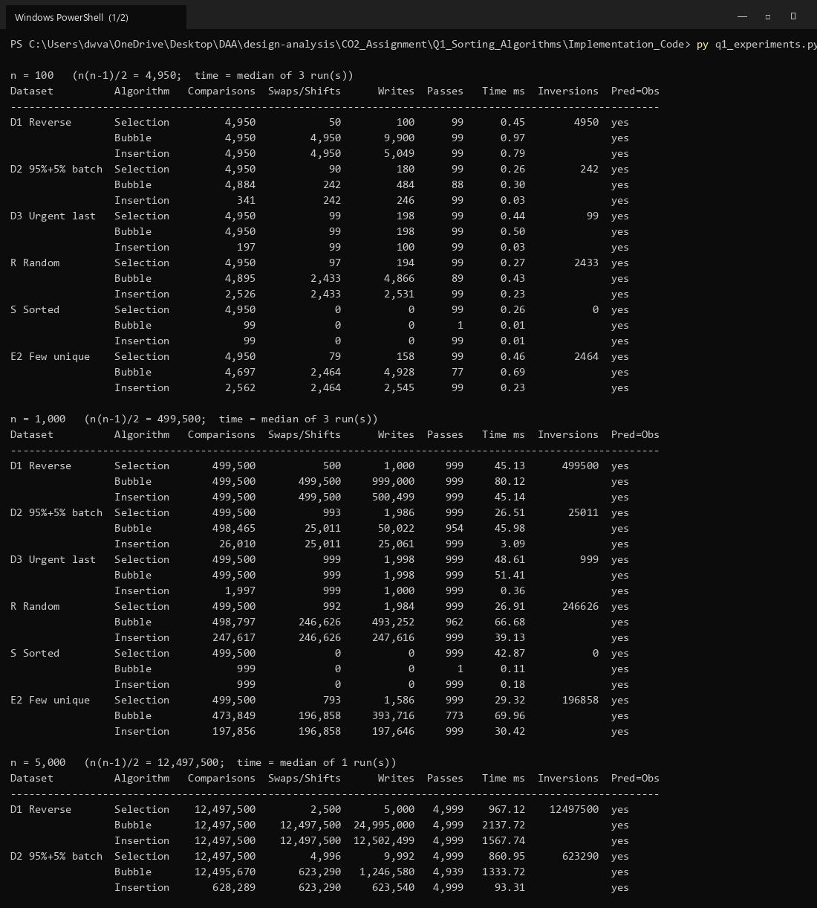

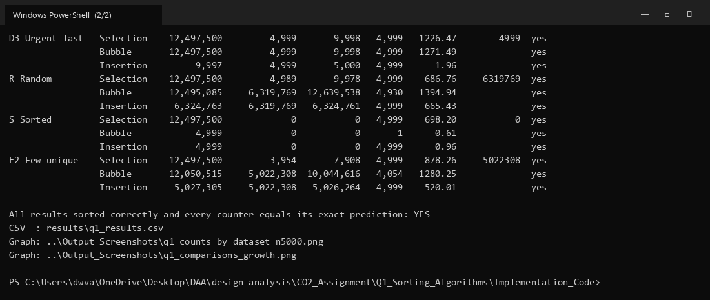

### 6. Prediction compared with observation

- **Selection Sort** made exactly n(n − 1)/2 comparisons (12,497,500 at n = 5 000) on all six datasets, as predicted:
  even the already sorted list cost the full quadratic scan. Its swaps were the fewest of all (≤ 4,999; exactly
  ⌊n/2⌋ = 2,500 on the reversed list, as predicted; 0 on the sorted list).
- **Bubble Sort:** swaps equalled the inversions exactly on every dataset (e.g. 623,290 on D2, 6,319,769 on R), and the
  early exit worked on the sorted list (1 pass, 4,999 comparisons). On the random list the observed I = 6,319,769 is
  within 1.1 % of the predicted n(n − 1)/4 = 6,248,750, and its 4,930 passes made 99.98 % of the worst-case
  comparisons, as predicted (≈ n²/2).
- **D3 (my edge case) confirmed the most important prediction:** with only 4,999 inversions, Bubble Sort still needed
  all 4,999 passes and **12,497,500 comparisons** – the same as the reversed list – because the urgent order moves
  one position per pass. Insertion Sort needed only **9,997 = 2(n − 1) − 1 comparisons** and 2 ms: 1,250× fewer
  comparisons on the same data.
- **D2:** predicted "Bubble still ≈ n²/2" – observed 12,495,670 comparisons (99.99 % of n(n − 1)/2) in 4,939 passes;
  predicted "Insertion ≈ I + n" – observed 628,289 = 623,290 + 4,999 (F = 0). For random new scores I had estimated
  I ≈ k(n − k)/2 + k²/4 = 609,375 with k = 250; the observed 623,290 is 2.3 % higher, a random-sample effect.
- **E2 (ties):** with 5 equally likely scores the expected inversions are 0.4 · C(n, 2) = 4,999,000; observed
  5,022,308. The strict ">" meant equal scores were never moved, and the ties reduced Bubble's passes to 4,054.
- **Execution times** follow the counts but not comparisons alone: Bubble Sort was the slowest on most datasets
  (2,138 ms on D1) because it also performs the most writes (24,995,000 – two per swap), while Insertion Sort writes
  once per shift (12,502,499). Times are secondary evidence (± 30 % run-to-run variation on this PC).

**Answer to the challenge question:** no algorithm should *always* be preferred. Selection Sort is insensitive to the
data (always Θ(n²) comparisons) but makes the fewest writes – useful only where writing is very expensive. Bubble Sort
is adaptive only when every order is close to its correct place *and* no small score sits far to the right. Insertion
Sort's cost is n + I, so it is the best of the three whenever the data is already nearly ordered, and in my
measurements it was never worse than Bubble Sort in comparisons or writes. The appropriate choice therefore depends on
the characteristics of the input, chiefly on the number **and position** of the inversions.

### 7. Design decision for the 95 %-ordered orders

To test the decision directly I ran `q1_scenario_95.py` on n = 5 000 orders with two interpretations of "95 % in
order": (a) a sorted list followed by a batch of k new orders with random scores (k = 1 … 500), and (b) local
disorder, where a fraction of the orders has been displaced by at most 10 positions.

Table 7: The fulfilment-centre scenario, n = 5 000 orders; k = new orders appended to a sorted list, "moved ≤ 10" = local disorder (results/q1_scenario_95.csv)

| Condition | Inversions I | Selection comp. | Bubble comp. (passes) | Insertion comp. |
|---|---|---|---|---|
| k = 1 new order | 3,413 | 12,497,500 | 11,240,595 (3,414) | 8,412 |
| k = 50 (1 %) | 110,573 | 12,497,500 | 12,496,759 (4,961) | 115,572 |
| k = 250 (5 %) | 649,805 | 12,497,500 | 12,489,499 (4,873) | 654,804 |
| k = 500 (10 %) | 1,170,805 | 12,497,500 | 12,483,472 (4,832) | 1,175,804 |
| 5 % moved ≤ 10 | 1,295 | 12,497,500 | 94,810 (19) | 6,294 |
| 10 % moved ≤ 10 | 2,462 | 12,497,500 | 89,829 (18) | 7,461 |

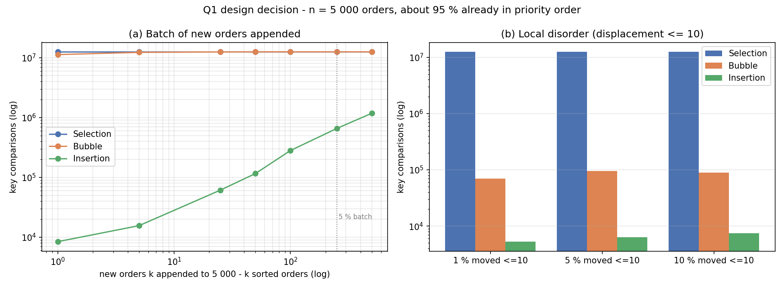

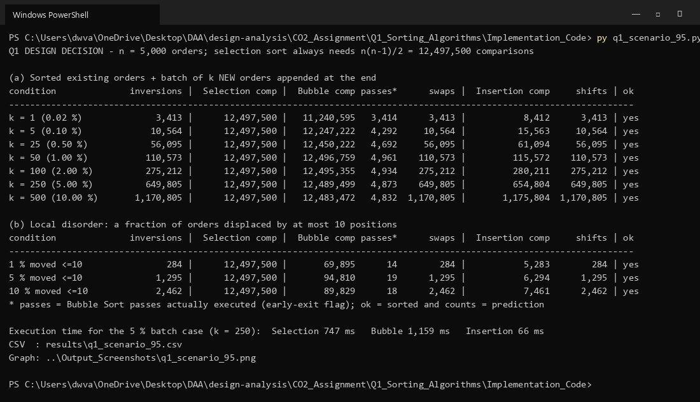

**I recommend Insertion Sort.**

- Its cost is n + I comparisons, and in the centre's data I is small. For the 5 % batch it needed 654,804 comparisons
  against 12,497,500 (Selection) and 12,489,499 (Bubble) – about **19× less work** – and 66 ms against 747 ms and
  1,159 ms.
- It handles the real pattern of the data – a sorted body plus a new batch at the end – because the sorted prefix
  costs one comparison per order and each new order is simply inserted at its place. This is exactly the situation
  in which Bubble Sort fails: a single new high-priority order already forces 3,414 passes (11.2 million comparisons)
  while Insertion Sort needs 8,412.
- It is **stable** (equal-priority orders stay first-come, first-served), sorts in place with O(1) extra memory and is
  simple to verify.
- It is also robust to the second interpretation (local disorder): 6,294 comparisons for 5 % displaced orders.
- **Limitation:** each new order costs about as many comparisons as the number of orders it must pass. If the batches
  grew large (Table 7: 1.18 million comparisons already at 10 %), or if new orders were mostly top priority, the cost
  would approach the Θ(n²) average; then the batch should be sorted separately and merged, or an n log n sort used.
  For the reported 95 % situation, Insertion Sort is the evidence-based choice.


## Q2 – When Is Sequential Search an Appropriate Engineering Choice? [4 Marks]

> **Problem Context – Aircraft Maintenance Tool Tracking.** An aircraft maintenance facility maintains a temporary list of specialised tools currently issued to technicians. Each record contains:
> **Tool ID | Technician ID | Issue Time | Work Bay**
> The list changes continuously as tools are issued and returned. When a technician asks: "Who currently has Tool T-184?" the system uses Sequential Search.
> **Your Challenge:** Design experiments to investigate Sequential Search under:
> - Successful searches at different positions
> - Unsuccessful searches
> - Different list sizes
> Record the number of comparisons required. Then answer: Under what operating conditions is Sequential Search a reasonable engineering choice, and when would you stop recommending it? Consider both dataset size and frequency of search requests.
> **Changed Condition:** The organisation expands from one hangar to 20 maintenance facilities, resulting in substantially more active records and lookup requests. Re-evaluate your original recommendation.

**Evidence Expected**

> Designed search experiments, comparison-count evidence, analysis of successful and unsuccessful searches, an evidence-based operating boundary and a justified response to the changed operating condition.

**Ans:**

### 1. Algorithm and predicted comparison counts

The issued-tool list is kept in **issue order** (records are appended when a tool is issued and removed when it is
returned), so it is not sorted by Tool ID and Sequential Search is the natural brute-force lookup. The basic operation
is one key comparison `record.tool_id = target`.

```
Algorithm SequentialSearch(L, n, target)        // L[0..n-1] = (tool, technician, time, bay)
1. for i = 0 to n-1 do
2.     if L[i].tool = target then return i       // one key comparison per record examined
3. return -1                                     // unsuccessful: all n records compared

Algorithm ReturnTool(L, n, tool)                 // a return also needs a search
1. i = SequentialSearch(L, n, tool)
2. if i >= 0 then L[i] = L[n-1];  delete L[n-1]  // O(1) swap-with-last removal
```

Predictions (from `Pseudocode/Q2_Sequential_Search_Pseudocode.md`, written before the experiments):

- a successful search for the record at position p (1-based) costs **exactly p** comparisons (1 for the first record,
  ⌈n/2⌉ for the middle one, n for the last one) – best case Θ(1);
- an unsuccessful search costs **exactly n** comparisons – absence can only be proved by looking at every record –
  worst case Θ(n);
- if the target is equally likely to be at any position, the average successful search costs
  C<sub>avg</sub>(n) = Σ<sub>p=1</sub><sup>n</sup> p · (1/n) = (1/n) · n(n + 1)/2 = **(n + 1)/2** ∈ Θ(n); with a success
  probability q the average is q(n + 1)/2 + (1 − q)n;
- all cases except "first" grow linearly with n; and the total work per second is (requests per second λ) ×
  (comparisons per request), so it grows with the **product λ · n**.

### 2. Experiment design

- **List sizes:** n = 50, 500, 5 000, 50 000, 500 000 and 1 000 000 issued-tool records (seeded generator
  `make_tool_records`; the lists up to 5 000 are saved in `results/datasets/`, the larger ones are identified by
  seed and a SHA-256 fingerprint in `results/q2_datasets_manifest.csv`).
- **Successful searches at controlled positions:** the Tool ID of the first record, of the records at 25 %, 50 %
  and 75 %, and of the last record.
- **Unsuccessful search:** Tool ID `T-0`, which is never issued.
- **Average case:** for n ≤ 5 000 every position is searched once (an exact average); for larger lists a random
  sample of 2 000, 200 and 100 targets is used.
- **Cost of one comparison:** the time of an unsuccessful scan divided by n (median of 5 runs; secondary evidence).
- **Correctness:** expected indices come from an independent dictionary index; all 10 tests passed (Appendix D).

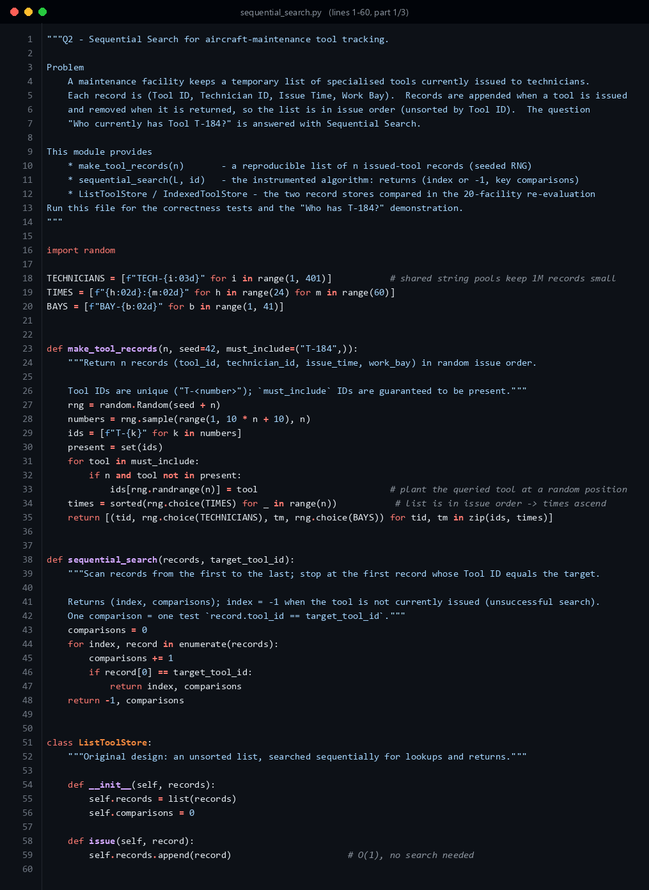

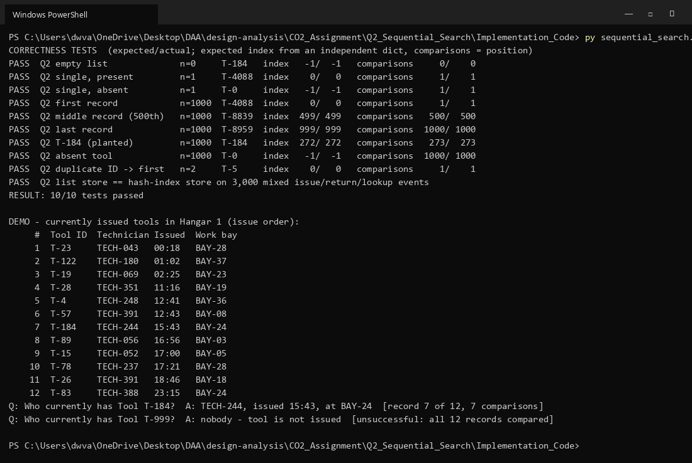

### 3. Results

Table 8: Comparisons by target position and list size (results/q2_positions.csv)

| List size n | first | 25 % | middle | 75 % | last | absent |
|---|---|---|---|---|---|---|
| 50 | 1 | 12 | 25 | 37 | 50 | 50 |
| 500 | 1 | 125 | 250 | 375 | 500 | 500 |
| 5,000 | 1 | 1,250 | 2,500 | 3,750 | 5,000 | 5,000 |
| 50,000 | 1 | 12,500 | 25,000 | 37,500 | 50,000 | 50,000 |
| 500,000 | 1 | 125,000 | 250,000 | 375,000 | 500,000 | 500,000 |
| 1,000,000 | 1 | 250,000 | 500,000 | 750,000 | 1,000,000 | 1,000,000 |

Table 9: Average successful search (Targets = positions searched: all, or a random sample; Mean = mean comparisons; Ratio = Mean ÷ (n + 1)/2), time of one unsuccessful search (Miss) and time per comparison (results/q2_average.csv, results/q2_timing.csv)

| n | Targets | Mean | (n + 1)/2 | Ratio | Miss (ms) | ns/comp. |
|---|---|---|---|---|---|---|
| 50 | all | 25.5 | 25.5 | 1.0000 | 0.002 | 46.7 |
| 500 | all | 250.5 | 250.5 | 1.0000 | 0.031 | 61.3 |
| 5,000 | all | 2,500.5 | 2,500.5 | 1.0000 | 0.445 | 89.0 |
| 50,000 | 2,000 | 25,037.1 | 25,000.5 | 1.0015 | 4.806 | 96.1 |
| 500,000 | 200 | 251,536.1 | 250,000.5 | 1.0061 | 27.185 | 54.4 |
| 1,000,000 | 100 | 438,738.6 | 500,000.5 | 0.8775 | 77.972 | 78.0 |

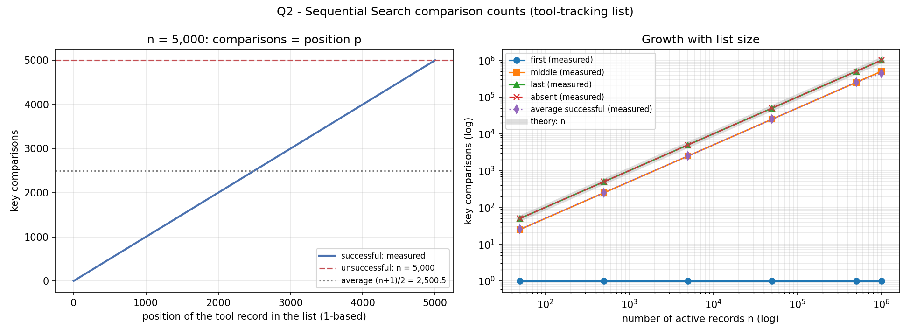

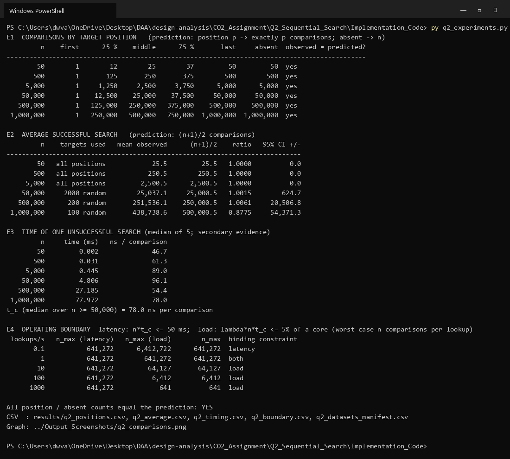

### 4. Successful and unsuccessful searches: prediction compared with observation

- **Successful searches** cost exactly the position p at every size and position (Table 8: 1, n/4, n/2, 3n/4, n),
  as predicted. The cost of a lookup therefore depends on *where* the record happens to be, not only on n: a tool
  issued early in the shift (near the front) is found quickly, a tool issued a moment ago (at the end) costs n.
- **Unsuccessful searches** cost exactly n every time (1,000,000 comparisons for the largest list): asking about a
  tool that is *not* issued is always the worst case. This matters in practice, because "is tool X still out?"
  checks before an aircraft is released are mostly answered "no".
- **Average:** the exact averages for n ≤ 5 000 equal (n + 1)/2 exactly. The sampled averages are within 0.15 % and
  0.6 % for 50 000 and 500 000; for 1 000 000 the 100-target sample gave 0.878 × (n + 1)/2. This is sampling error,
  not a contradiction: positions are uniform, so the standard error of a 100-target mean is
  0.289 n/√100 ≈ 28,900 comparisons and the observed deviation (61,262) is 2.1 standard errors.
- **Time per comparison** was 47–96 ns (median 78 ns over the large lists); the small lists are cheaper per
  comparison because they stay in the processor cache, the variation is interpreter and background-load noise.

### 5. Operating boundary

Using the measured t<sub>c</sub> = 78.0 ns per comparison, I define Sequential Search as acceptable when **both**
conditions hold (conservatively assuming the worst case, n comparisons per lookup):

1. **Latency:** one lookup must finish within 50 ms (half of a 100 ms "instant" response, leaving the rest for the
   network and the screen): n · t<sub>c</sub> ≤ 0.05 s ⇒ **n ≤ 641,000 records**.
2. **Load:** all lookups together may use at most 5 % of one processor core, because the tracking server also runs
   the maintenance information system: λ · n · t<sub>c</sub> ≤ 0.05 ⇒ **λ · n ≤ 641,000 comparisons per second**.

Table 10: Largest acceptable list size for different request rates, n<sub>max</sub>(λ) = min(0.05/t<sub>c</sub>, 0.05/(λ t<sub>c</sub>)) (results/q2_boundary.csv)

| Lookups per second λ | n<sub>max</sub> from latency | n<sub>max</sub> from load | n<sub>max</sub> (overall) | Binding constraint |
|---|---|---|---|---|
| 0.1 | 641,272 | 6,412,722 | 641,272 | latency |
| 1 | 641,272 | 641,272 | 641,272 | both |
| 10 | 641,272 | 64,127 | 64,127 | load |
| 100 | 641,272 | 6,412 | 6,412 | load |
| 1,000 | 641,272 | 641 | 641 | load |

**When is Sequential Search a reasonable engineering choice?** When the list is small or the lookups are rare –
precisely when λ · n stays below about 640,000 comparisons per second and n below about 640,000 records. It then
has real engineering advantages: the list changes continuously, an issue is a simple append, there is no index to
build, update or keep consistent, it works on any field (technician, bay) without extra structures, and it is
trivially correct. A single hangar (a few hundred active records, a few lookups per minute) is far inside this
region.

**When would I stop recommending it?** When the request rate times the list size approaches the budget (for example
more than 64,000 active records at 10 lookups per second, or 6,400 at 100 per second); when many searches are
unsuccessful (audits, release checks), because each costs the full n; and whenever a workload contains **batches of
lookups over the whole list** (for example a reconciliation that checks every issued tool), because n lookups × n
comparisons is Θ(n²) work.

### 6. Changed condition: 20 maintenance facilities

To re-evaluate with evidence rather than intuition I simulated one **peak hour** with the same seeded event stream
applied to two stores: the original list with Sequential Search, and a hash index keyed by Tool ID (a dictionary
updated on every issue and return). Workload assumptions for one hangar: 500 active records; 600 issues, 600 returns
(each return must first *find* the record) and 1,200 "who has tool X?" lookups (90 % successful); then an
end-of-shift reconciliation that checks 500 tool IDs from the shift's issue log (most already returned, so mostly
unsuccessful searches), which must finish within a 60 s window. For 20 facilities on one central list every number
is multiplied by 20.

Table 11: One hangar against 20 facilities, identical workload model (results/q2_facility_simulation.csv)

| Measure | 1 hangar | 20 facilities | Growth |
|---|---|---|---|
| active records n | 500 | 10,000 | 20× |
| searches in the peak hour (lookups + returns + reconciliation) | 2,300 | 46,000 | 20× |
| Sequential Search comparisons (total) | 710,337 | 268,702,058 | **378×** |
| – of which reconciliation | 195,201 | 77,436,303 | 397× |
| hash-index probes (total) | 2,900 | 58,000 | 20× |
| Sequential time – hour traffic / reconciliation (s) | 0.031 / 0.013 | 20.1 / 8.51 | 641× / 649× |
| Hash-index time – hour traffic / reconciliation (s) | 0.0006 / 0.0001 | 0.0185 / 0.0043 | 31× / 43× |
| worst single lookup (n · t<sub>c</sub>) | 0.039 ms | 0.78 ms | 20× |
| CPU load during the reconciliation window (measured) | 0.022 % | **14.2 %** | – |
| answers identical (list vs index) | yes | yes | – |
| hash-index memory | 26 KB | 415 KB | – |

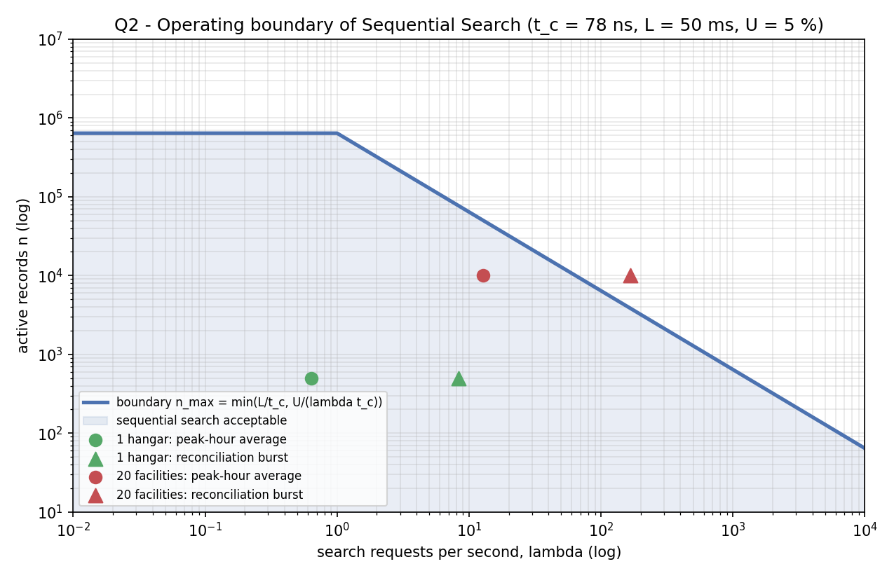

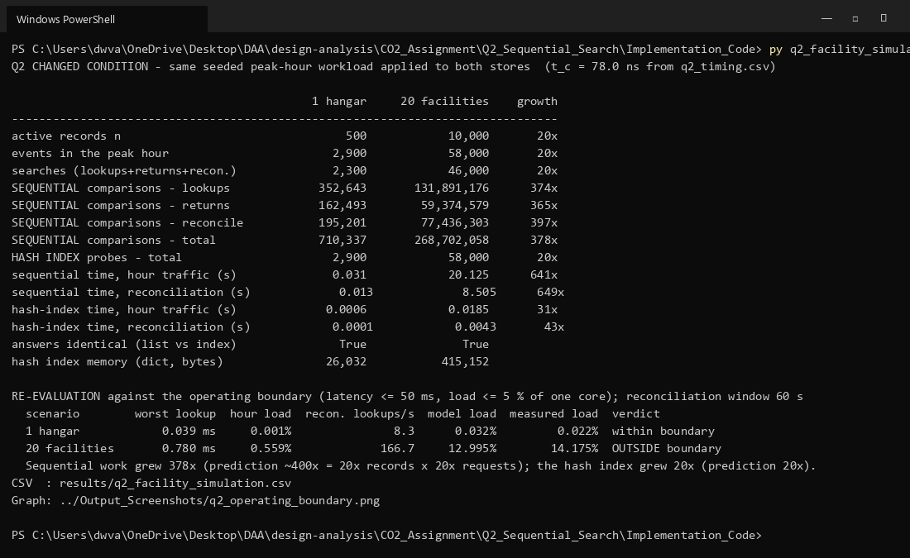

**Re-evaluation.** My prediction was that the sequential work would grow ≈ 400× (20× more records × 20× more
requests) while an index would grow only 20×; the simulation measured **378×** and **20×**. A single lookup is still
fast (0.78 ms worst case, inside the 50 ms latency limit), so a naive check of "one lookup" would wrongly conclude
that nothing has changed. The aggregate tells the real story: during the reconciliation burst the sequential store
used **14.2 % of a core** – almost three times the 5 % budget – and it took 8.5 s instead of 4 ms. In Figure 14 the
one-hangar points lie deep inside the acceptable region, while the 20-facility burst lies outside it, and any further
growth (more facilities, more automated checks) moves it further out because the work grows with n · λ.

**Revised recommendation.** For 20 facilities I would **stop using Sequential Search for Tool-ID lookups** and keep a
hash index (Tool ID → record) that is updated on every issue (insert) and return (delete): each operation costs O(1)
expected time, the index costs only about 415 KB for 10,000 active records, and every lookup in the simulation gave
exactly the same answer as the list. Sequential Search remains the right choice for a single hangar (simplest
solution, far inside the boundary) and for rare ad-hoc queries on other fields (for example "all tools issued to
TECH-042"), where building and maintaining an extra index would cost more than an occasional scan.


## Q3 – Engineer the Behaviour of Brute-Force String Matching [6 Marks]

> **Problem Context – Cybersecurity Log Screening.** A security operations centre searches large text-based system logs for known event signatures represented as character patterns. The initial system uses Brute-Force String Matching.
> **Your Challenge:** Investigate how the structure of the text and pattern influences computational effort. Design:
> 1. One text-pattern pair in which the algorithm performs relatively little work.
> 2. One text-pattern pair deliberately engineered to cause a large number of character comparisons.
> 3. One additional test condition of your own choice.
> Before executing each test: predict the expected behaviour and explain the algorithmic reason for your prediction.
> Implement the algorithm and record the number of character comparisons.
> **Inquiry:** Compare your prediction with the experimental result. Explain why one input requires substantially more work than another, which characteristics of the text and pattern create repeated comparisons, and what this reveals about evaluating an algorithm using only its input size.

**Evidence Expected**

> Correct implementation, three designed test conditions, prediction before execution, character-comparison evidence, and a reasoned explanation.

**Ans:**

### 1. Algorithm

A log screener must raise an alert for **every** occurrence of a signature, so my matcher tries all n − m + 1
alignments (shifts) of the pattern P[0..m−1] under the text T[0..n−1] and reports each complete match.

```
Algorithm BruteForceMatch(T, n, P, m)          // reports every position where P occurs in T
1. for s = 0 to n-m do                         // n - m + 1 alignments ("shifts")
2.     j = 0
3.     while j < m and T[s+j] = P[j] do        // each test T[s+j] = P[j] is one character comparison
4.         j = j + 1
5.     if j = m then report a match at s
```

At shift s the algorithm compares characters left to right and stops at the first mismatch, so the work at that
shift is ℓ<sub>s</sub> + 1 comparisons, where ℓ<sub>s</sub> is the number of leading pattern characters that match there
(or m for a complete match). The total is

  C = Σ<sub>s=0</sub><sup>n−m</sup> min(m, ℓ<sub>s</sub> + 1),  so  **n − m + 1 ≤ C ≤ m(n − m + 1)**.

The best case (every shift fails at its first character) is Θ(n); the worst case (every shift fails at the last
character, or matches) is Θ(mn). The program `brute_force_match` (Appendix A) counts every character comparison,
successful or not; its 9 tests (hand-counted comparisons, an independent `str.startswith` reference and 200 random
binary texts) all passed.

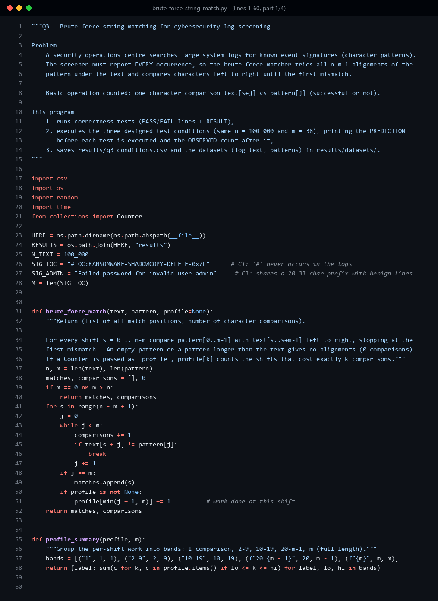

### 2. The designed tests, with predictions made before running them

All three tests use **the same input size**: a text of exactly n = 100,000 characters and a pattern of exactly
m = 38 characters (n − m + 1 = 99,963 shifts). Any difference in work is therefore caused by the content of the text
and the pattern, not by their size. The log text is a synthetic but realistic SSH/authentication log (lines such as
`Nov 19 07:42:13 gw01 sshd[2231]: Failed password for root from 203.0.113.45 port 51122 ssh2`), saved as
`results/datasets/q3_auth_log_100k.txt`. The program prints each prediction **before** it executes the test
(Figure 17).

Table 12: The three designed text–pattern pairs and their predictions (stated before execution)

| Test | Text | Pattern (m = 38) | Predicted comparisons | Algorithmic reason |
|---|---|---|---|---|
| C1 – little work | realistic auth log | `#IOC:RANSOMWARE-`<br>`SHADOWCOPY-DELETE-0x7F` | exactly n − m + 1 = **99,963** | the character `#` never occurs in the log, so every shift fails at its first comparison (ℓ<sub>s</sub> = 0) |
| C2 – engineered worst case | `AAAA…A` (a run of identical bytes, like a base64 or NOP-sled payload) | 37 × `A` followed by `B` | exactly m(n − m + 1) = **3,798,594** | every shift matches 37 characters and fails only on the last one (ℓ<sub>s</sub> = m − 1) |
| C3 – my own: signature sharing a long prefix with benign lines | realistic auth log | `Failed password for invalid user admin` | independence model: **100,563**; my own range 1.0–1.3 × (n − m + 1) | `F` is rare, so most shifts stop at once, but every benign `Failed password for …` line matches a 20–33-character prefix before failing |

The independence model for C3 assumes each text character is independent with the text's own character
frequencies f(c): E[comparisons per shift] = Σ<sub>k=0</sub><sup>m−1</sup> Π<sub>i<k</sub> f(P[i]). Because real log lines
are highly structured (the same phrases repeat), I expected the true value to be **higher** than this model, but far
below the worst case.

### 3. Results

Table 13: Character comparisons for the three tests, n = 100,000, m = 38 (results/q3_conditions.csv)

| Test | Predicted comparisons | Observed comparisons | Per shift | Obs. ÷ pred. | Matches found | Time (ms) |
|---|---|---|---|---|---|---|
| C1 little work | 99,963 | 99,963 | 1.000 | 1.000 | 0 | 14.9 |
| C2 engineered worst case | 3,798,594 | 3,798,594 | 38.000 | 1.000 | 0 | 317.9 |
| C3 shared prefix (own) | 100,563 | 111,533 | 1.116 | 1.109 | 4 | 9.9 |

The times follow the counts only roughly at this scale: C1 and C3 each take 10–15 ms (their order changes from run
to run – C1 runs first and pays the interpreter's warm-up), while C2 takes about 20–30× longer, in line with its 38×
more comparisons.

Table 14: How the work is distributed over the 99,963 shifts (number of shifts that cost k comparisons)

| Test | k = 1 | k = 2–9 | k = 10–19 | k = 20–37 | k = 38 |
|---|---|---|---|---|---|
| C1 | 99,963 | 0 | 0 | 0 | 0 |
| C2 | 0 | 0 | 0 | 0 | 99,963 |
| C3 | 99,373 | 145 | 0 | 441 | 4 (the true alerts) |

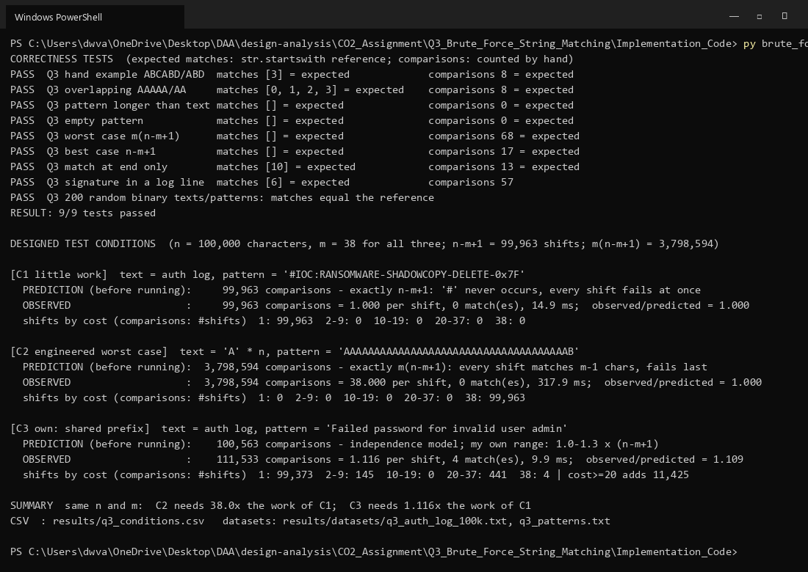

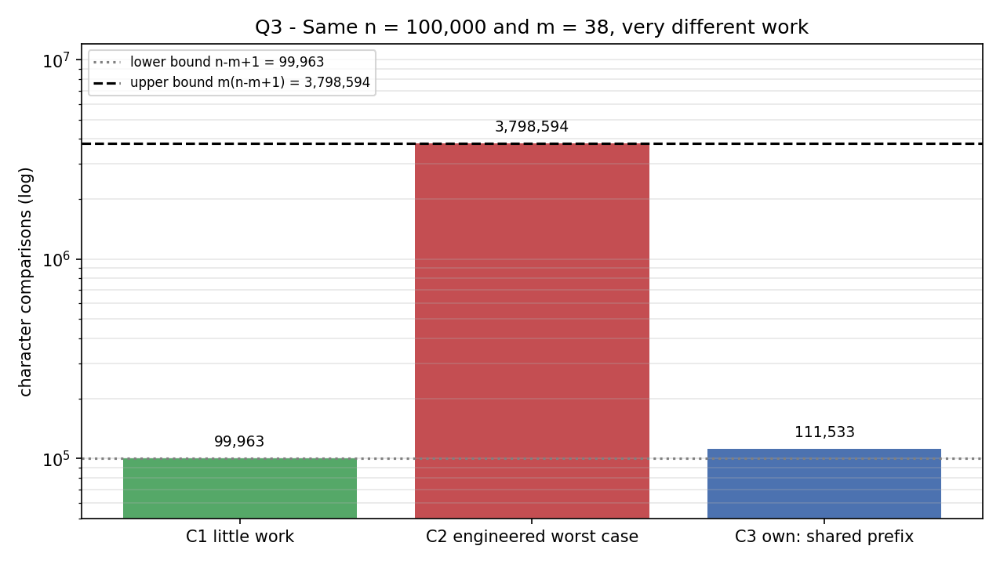

To confirm that these are properties of the inputs and not of one particular size, I repeated the tests for
n = 1,000 … 1,000,000 and varied the pattern length m at n = 100,000 (`q3_experiments.py`).

Table 15: Size sweep with m = 38 (results/q3_size_sweep.csv)

| n | C1 | C2 | C3 | C3 / (n − m + 1) | C2 / C1 |
|---|---|---|---|---|---|
| 1,000 | 963 | 36,594 | 1,124 | 1.167 | 38.0 |
| 10,000 | 9,963 | 378,594 | 11,008 | 1.105 | 38.0 |
| 100,000 | 99,963 | 3,798,594 | 111,533 | 1.116 | 38.0 |
| 1,000,000 | 999,963 | 37,998,594 | 1,113,248 | 1.113 | 38.0 |

Table 16: Pattern-length sweep with n = 100,000 (results/q3_pattern_sweep.csv)

| m | 2 | 4 | 8 | 16 | 32 | 64 | 128 |
|---|---|---|---|---|---|---|---|
| C1 (`#…` pattern) | 99,999 | 99,997 | 99,993 | 99,985 | 99,969 | 99,937 | 99,873 |
| C2 (`A…AB` in `A…A`) | 199,998 | 399,988 | 799,944 | 1,599,760 | 3,199,008 | 6,395,968 | 12,783,744 |

Every C1 and C2 value equals its formula exactly (n − m + 1 and m(n − m + 1)).

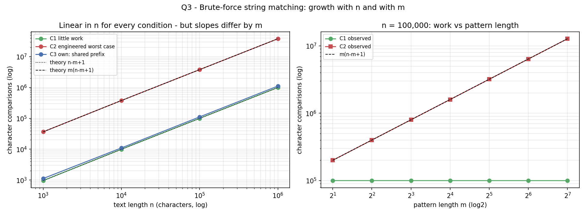

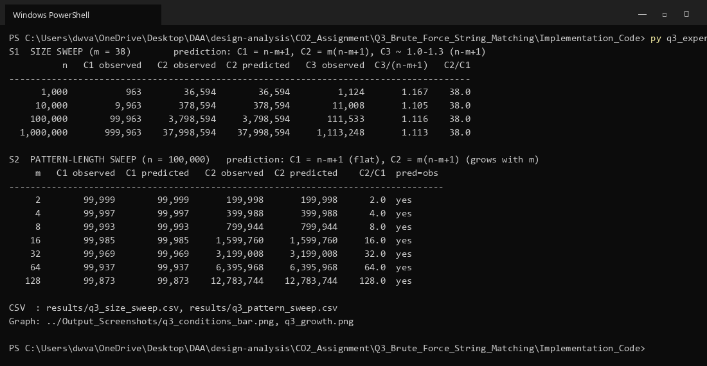

### 4. Inquiry

**Prediction compared with result.** C1 and C2 matched their predictions exactly (99,963 and 3,798,594): they are the
two bounds of the formula and the inputs were designed to sit exactly on them. For C3 the observed 111,533
comparisons fell inside my predicted range (1.0–1.3 × (n − m + 1)) but were **10.9 % above the independence model**
(100,563). The shift profile (Table 14) explains the gap: 441 shifts started at the `F` of a benign
`Failed password for root …` or `Failed password for invalid user test …` line and matched 20–33 characters before
failing; together with the 4 true matches they added 11,425 of the 11,570 extra comparisons. The independence model
under-estimates because log lines are not random characters – whole phrases repeat, so once `F` matches, `ailed
password for ` matches with probability ≈ 1, not with the product of individual letter frequencies.

**Why one input needs substantially more work than another.** With identical n and m, C2 needs **38× the work of C1**
(= m). In C1 every alignment is rejected by its first comparison; in C2 every alignment does 37 successful
comparisons before failing at the last character. The brute-force algorithm discards *everything* it learned at a
shift and starts the next shift from P[0], so in C2 it re-compares the same text characters up to 38 times each.

**Which characteristics create repeated comparisons:**

- a **small or skewed alphabet / repetitive text** (C2: one character), which makes long partial matches likely;
- a **pattern whose prefix is frequent in the text** (C3: `Failed password for ` occurs in about 45 % of the lines),
  which produces a long partial match at each occurrence even though the full signature is rare;
- a **pattern whose distinguishing character is at the end** (C2: the `B`), so every alignment runs almost to the end
  before it can fail;
- conversely, a **rare first character** (C1: `#`) lets almost every alignment be rejected immediately – the brute
  force is then nearly optimal (one comparison per shift).

**What this reveals about evaluating an algorithm by input size only.** Input size fixes only the *range* of the
work, [n − m + 1, m(n − m + 1)], not the work itself: the three tests have exactly the same n and m and differ by a
factor of 38, and the factor grows with m (128× at m = 128, Table 16). Growth with n is linear in every case (×10 per
×10 in n), but the constant in front of n is set by the structure of the data. A fair evaluation therefore needs
best, worst and *realistic* inputs: for real logs the average is close to the best case (≈ 1.1 comparisons per
shift), but an attacker who controls part of the log (for example by sending long runs of `A`) can push the
screener towards the worst case, so the worst case Θ(mn) is the figure to use for capacity planning.


## Q4 – Closest Pair and the Cost of Examining Every Possibility [6 Marks]

> **Problem Context – Drone Collision-Risk Monitoring.** Drones report their positions as Dᵢ = (xᵢ, yᵢ). The monitoring system must identify the two drones closest to one another.
> **Your Challenge:** Design a Brute-Force Closest-Pair solution. Before implementation, determine:
> - which candidate pairs must be examined;
> - how duplicate pair comparisons can be avoided;
> - how many unique pairs exist for n drones.
> Derive the number of candidate pairs mathematically.
> Implement your solution and test it using at least three meaningfully different input sizes. Record the number of pairs examined, the number of distance calculations and the execution time, where useful. Compare theoretical growth with experimental behaviour.
> **Scalability Inquiry:** Define what you consider an acceptable response time for your experimental environment. Using your evidence, determine approximately when the brute-force approach begins to become impractical. Finally, identify where the computational inefficiency originates and describe what a redesigned strategy would need to avoid or reduce.
> You are not required to implement an advanced Closest-Pair algorithm in this question.

**Evidence Expected**

> Algorithm design, mathematical pair-count derivation, implementation, experimental growth evidence, a defined acceptability criterion and a reasoned identification of the limitation.

**Ans:**

### 1. Design decisions before implementation

**Which candidate pairs must be examined?** Without any knowledge of where the drones are, any two drones could be
the closest pair, and a brute-force method uses no geometric information to rule a pair out. Therefore every
unordered pair {Dᵢ, Dⱼ} with i ≠ j is a candidate.

**How are duplicate comparisons avoided?** The distance is symmetric, d(Dᵢ, Dⱼ) = d(Dⱼ, Dᵢ), and a drone paired with
itself (distance 0) is meaningless. So I examine only index pairs with **i < j**: the inner loop starts at
j = i + 1. Each unordered pair is then examined exactly once and no drone is paired with itself.

**How many unique pairs exist?** Drone D₁ is paired with the n − 1 drones after it, D₂ with n − 2, …, Dₙ₋₁ with 1:

  P(n) = Σ<sub>i=1</sub><sup>n−1</sup> (n − i) = (n − 1) + (n − 2) + … + 2 + 1 = **n(n − 1)/2 = C(n, 2)**.

Check by a second argument: there are n · (n − 1) ordered pairs (first drone, different second drone), and each
unordered pair appears twice, so n(n − 1)/2. Hence P(n) ∈ Θ(n²), and doubling the fleet multiplies the work by
P(2n)/P(n) = 2(2n − 1)/(n − 1) → 4. For n = 100, 1 000, 5 000 and 10 000 this gives 4,950, 499,500, 12,497,500 and
49,995,000 pairs. The brute force makes exactly one distance calculation per pair, so its work is the same for
every input of size n: best, average and worst case are all Θ(n²).

**Distance without square roots.** Comparing d² = (xᵢ − xⱼ)² + (yᵢ − yⱼ)² gives the same order as comparing d, because
√ is increasing; the square root is taken once at the end. Two drones reporting the same position give d = 0, which
is (correctly) reported immediately as the closest pair – a real collision alert.

### 2. Pseudocode

```
Algorithm BruteForceClosestPair(D, n)          // D[0..n-1] = (x, y) in metres, n >= 2
1. best2 = +infinity;  pair = none
2. for i = 0 to n-2 do
3.     for j = i+1 to n-1 do                   // each unordered pair exactly once
4.         dx = D[i].x - D[j].x;  dy = D[i].y - D[j].y
5.         d2 = dx*dx + dy*dy                  // one distance calculation (pair examined)
6.         if d2 < best2 then best2 = d2;  pair = (i, j)
7. return pair, sqrt(best2)
```

The program `closest_pair_brute_force` (Appendix A) counts pairs examined, distance calculations and best-so-far
improvements. Its 8 tests (hand-checked fleets – a 3-4-5 triangle, duplicates, a vertical line, negative
coordinates – and 150 random fleets against an independent `math.dist` + `itertools.combinations` reference) all
passed, and the 6-drone demonstration lists all 15 = 6 · 5/2 pairs to show that each pair is examined once.

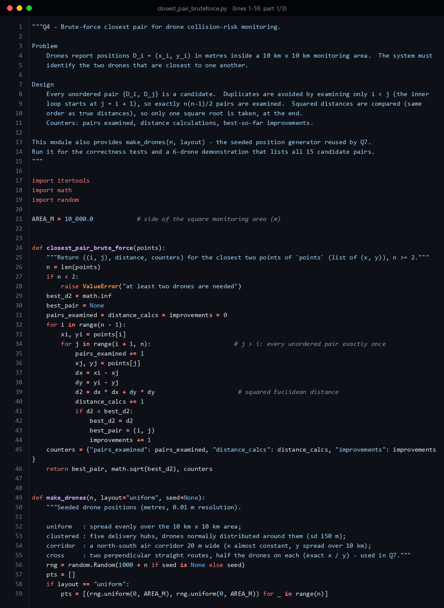

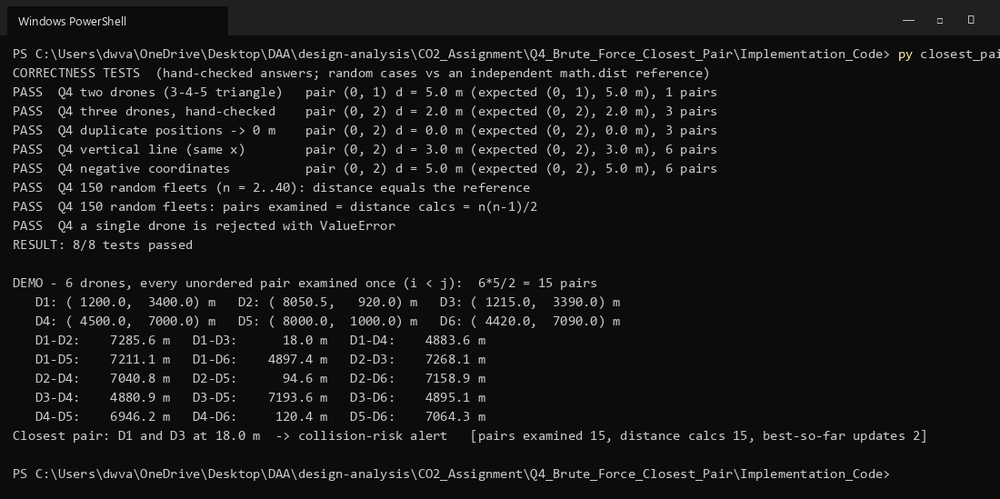

### 3. Experiment and results

Drone positions are generated uniformly over a 10 km × 10 km area with fixed seeds (n = 100, 500, 1 000, 2 000,
5 000 and 10 000; files `results/datasets/q4_drones_uniform_n*.csv`), plus a clustered layout (five delivery hubs,
n = 2 000) to check whether the layout changes the work. Times are medians of 5 runs (n ≤ 1 000), 3 runs (2 000) or
single runs.

Table 17: Brute-force closest pair – counts and times (results/q4_growth.csv)

| Fleet | Pairs examined | n(n − 1)/2 | Dist. calcs | Closest (m) | Time (s) | ns/pair |
|---|---|---|---|---|---|---|
| 100 uniform | 4,950 | 4,950 | 4,950 | 105.46 | 0.0008 | 168.6 |
| 500 uniform | 124,750 | 124,750 | 124,750 | 7.52 | 0.0139 | 111.2 |
| 1,000 uniform | 499,500 | 499,500 | 499,500 | 3.13 | 0.0489 | 97.9 |
| 2,000 uniform | 1,999,000 | 1,999,000 | 1,999,000 | 2.50 | 0.2473 | 123.7 |
| 5,000 uniform | 12,497,500 | 12,497,500 | 12,497,500 | 1.20 | 1.5454 | 123.7 |
| 10,000 uniform | 49,995,000 | 49,995,000 | 49,995,000 | 0.62 | 5.6068 | 112.1 |
| 2,000 clustered | 1,999,000 | 1,999,000 | 1,999,000 | 0.40 | 0.2426 | 121.4 |

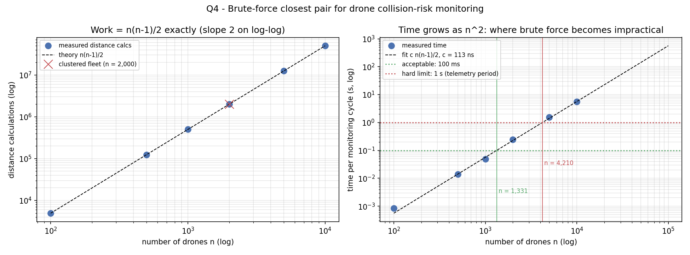

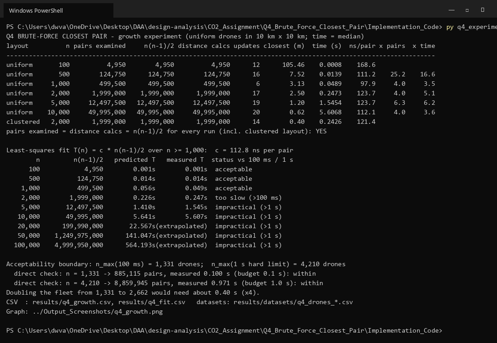

**Theoretical growth compared with experimental behaviour.** The measured number of pairs examined and of distance
calculations equals n(n − 1)/2 **exactly** at every size, and it is identical for the uniform and the clustered
fleet of 2 000 drones: the work of the brute force does not depend on where the drones are, only on how many there
are. On log–log axes the points lie on a line of slope 2 (Figure 23). Each doubling of n multiplied the pair count by
4.0 and the time by 3.5–5.1; from n = 5 000 to 10 000 the time grew 3.6× for 4.0× the pairs. The time per pair stayed
between 98 and 124 ns for n ≥ 1 000 (the 100-drone run is dominated by fixed overheads), so the time follows the
count with a constant factor, as the model T(n) = c · n(n − 1)/2 assumes; the remaining scatter is interpreter and
background-load noise (other programs were running on the same PC).

### 4. Scalability inquiry

**Acceptable response time (defined before measuring).** Drones report their positions about once per second (1 Hz
telemetry). The collision check must leave most of each cycle for alert generation, logging and communication, so I
define an **acceptable response time of 100 ms per monitoring cycle** (10 % of the telemetry period). 1 s is the hard
limit: beyond it the result is out of date before the next update arrives.

**When does brute force become impractical?** A least-squares fit of T(n) = c · n(n − 1)/2 over the runs with
n ≥ 1 000 gives **c = 112.8 ns per pair** on my PC. Solving c · n(n − 1)/2 ≤ T:

  n<sub>max</sub> = (1 + √(1 + 8T/c))/2  ⇒  **n<sub>max</sub>(100 ms) ≈ 1,331 drones** and n<sub>max</sub>(1 s) ≈ 4,210 drones.

I confirmed both limits with direct runs: 1,331 drones took 0.100 s and 4,210 drones took 0.971 s.

Table 18: Predicted and measured cycle time against the acceptability criterion (results/q4_fit.csv)

| Drones n | Pairs n(n − 1)/2 | Predicted T = c · pairs | Measured T | Status |
|---|---|---|---|---|
| 1,000 | 499,500 | 0.056 s | 0.049 s | acceptable |
| 2,000 | 1,999,000 | 0.226 s | 0.247 s | too slow for 100 ms |
| 5,000 | 12,497,500 | 1.410 s | 1.545 s | impractical (> 1 s) |
| 10,000 | 49,995,000 | 5.641 s | 5.607 s | impractical |
| 20,000 | 199,990,000 | 22.6 s | (extrapolated) | impractical |
| 100,000 | 4,999,950,000 | 564 s ≈ 9.4 min | (extrapolated) | impractical |

So in my environment the brute force is acceptable up to about **1,300 drones**, becomes too slow for the 100 ms
target above that, and is **impractical beyond about 4,200 drones**, where it cannot even keep up with 1 Hz telemetry.
Because the cost is quadratic, a faster computer does not move this boundary much: a machine 4× faster only doubles
the fleet that fits in the same time.

**Where does the inefficiency originate?** In the candidate set, not in the distance formula. The algorithm computes
the distance of every pair, including the overwhelming majority of pairs that are kilometres apart and obviously
cannot be the closest pair. At n = 10 000 only 20 of the 49,995,000 distance calculations improved the best-so-far
answer; the rest confirmed nothing new. The algorithm also ignores the information it has already gathered: once it
knows that two drones are 0.6 m apart, it still computes the distance between drones that are 5 km apart in x alone.
Finally, it uses no ordering of the data – neighbours and far-away drones are treated identically – and it is repeated
from scratch every second.

**What a redesigned strategy must avoid or reduce:**

- avoid examining pairs that are provably too far apart (use the coordinates *before* computing a distance);
- reuse the best distance found so far as a bound that shrinks the set of candidates that still need checking;
- organise the drones (for example by sorting along one axis, or bucketing them by area) so that near neighbours can
  be found without scanning the whole fleet;
- keep the answer exact – a collision-risk system must not miss the closest pair.

Q7 develops, implements and validates such a redesign.


## Q5 – Derive a Convex Hull Algorithm from a Geometric Principle [7 Marks]

> **Problem Context – Wildlife Reserve Boundary Monitoring.** A wildlife reserve is monitored by stations, each represented as Pᵢ = (xᵢ, yᵢ). The system must determine the outer boundary formed by the monitoring stations.
> You are required to develop a Brute-Force Convex Hull solution.
> **Design Starting Point:** You are given only the following geometric principle: "A line joining two candidate points may form part of the outer boundary if all remaining points lie on an appropriate single side of that line."
> **Your Challenge:** Convert this geometric property into a computational procedure. Determine:
> - how two candidate points define a line;
> - how the position of another point relative to that line can be determined;
> - how the remaining points must be examined;
> - what condition identifies a potential hull edge;
> - how the final boundary will be constructed.
> Develop your own pseudocode before implementation.
> **Test Your Design** using a point set containing both boundary and interior points, and a second point configuration deliberately designed to challenge your algorithm (for example collinear boundary points or duplicate points). Visualise the resulting boundary. Analyse how the computational work grows as the number of points increases.
> **Correctness Inquiry:** Why does your geometric test provide evidence that an accepted edge belongs to the outer boundary? Use geometric reasoning, not program output.

**Evidence Expected**

> A student-derived geometric decision rule, pseudocode, implementation, deliberately designed test configurations, computational analysis, boundary visualisation and a reasoned correctness argument.

**Ans:**

### 1. From the principle to a decision rule

**How two candidate points define a line.** Two different stations P = (x₁, y₁) and Q = (x₂, y₂) define the directed
line P → Q with direction vector (x₂ − x₁, y₂ − y₁). I deliberately do **not** use the slope form y = mx + c, because a
north–south boundary (x₁ = x₂) has an undefined slope; the direction-vector form works for every orientation.

**On which side of the line is a third station R?** I use the 2-D cross product of the vectors Q − P and R − P:

  orient(P, Q, R) = (x₂ − x₁)(y<sub>R</sub> − y₁) − (y₂ − y₁)(x<sub>R</sub> − x₁)

Its sign gives the side: **> 0** means R is to the **left** of P → Q (a counter-clockwise turn), **< 0** to the
**right**, **= 0** means R lies **on the line**. (It equals a·x<sub>R</sub> + b·y<sub>R</sub> − c for the line a·x + b·y = c
with a = y₂ − y₁, b = x₁ − x₂, c = x₁y₂ − y₁x₂, up to sign.) Station coordinates are integer metres, so the sign is
computed exactly, without rounding errors.

**How the remaining stations are examined.** For a candidate pair (P, Q), compute orient(P, Q, R) for **every** other
station R and count how many lie left, right, or on the line; for a station on the line, also test whether it lies
**between** P and Q (inside the segment's bounding box).

**Condition for a hull edge (my rule, including collinear stations).** The pair (P, Q) is accepted as a boundary edge
when

1. no station lies strictly on the left while another lies strictly on the right (all stations are on one side), and
2. every station that lies exactly on the line PQ lies **between** P and Q.

Condition 2 is needed because stations are often placed along straight fences or roads. If P, R, Q lie on one
boundary line in that order, the pairs (P, R) and (R, Q) also have all stations on one side, but they are only
pieces of the edge PQ and R is not a corner; condition 2 rejects them because Q (or P) lies on the line *outside*
the shorter segment. Only the pair of outermost collinear stations is accepted.

**How the final boundary is constructed.** Each accepted edge is stored **directed** so that all other stations are on
its left (if they were all on its right, I store Q → P instead). Then every corner has exactly one outgoing edge, and
the boundary is obtained by starting at the lowest (then left-most) corner and following `next[·]` until I return to
the start – a counter-clockwise polygon. **Pre-processing:** duplicate stations (identical coordinates) are removed
first with a hash set, because a duplicate pair would define a zero-length "line" on which every station is
collinear. Degenerate inputs (0–2 distinct stations, or all stations on one line) return the 1–2 extreme stations.

### 2. Pseudocode

```
Algorithm BruteForceHull(S)                           // S = list of station positions
1.  P = S without duplicates;  n = |P|
2.  if n <= 2 then return P
3.  for i = 0 to n-2 do
4.      for j = i+1 to n-1 do                          // C(n,2) candidate segments
5.          left = 0;  right = 0;  outside = false
6.          for k = 0 to n-1, k != i, k != j do         // n-2 orientation tests
7.              o = orient(P[i], P[j], P[k])
8.              if o > 0 then left = left + 1
9.              else if o < 0 then right = right + 1
10.             else if P[k] is not between P[i] and P[j] then outside = true
11.         if outside or (left > 0 and right > 0) then continue      // not a boundary edge
12.         if right = 0 then next[i] = j else next[j] = i            // all others on the left
13. if next is empty then return the two extreme stations           // all collinear
14. start = corner with the smallest y (then x);  hull = [start];  v = next[start]
15. while v != start do  append v to hull;  v = next[v]
16. return hull                                        // corners in counter-clockwise order
```

An optional refinement, measured separately as "early rejection", leaves the k-loop as soon as stations on both
sides (or a collinear station outside the segment) have been seen; it can only *reject* faster – an accepted edge
still needs all n − 2 tests.

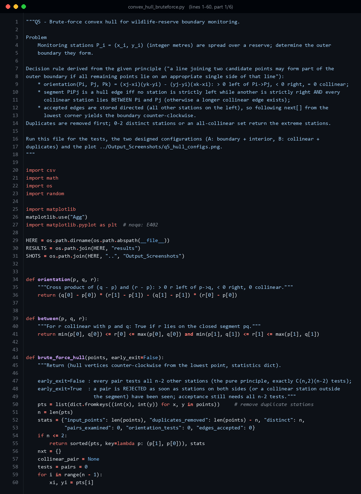

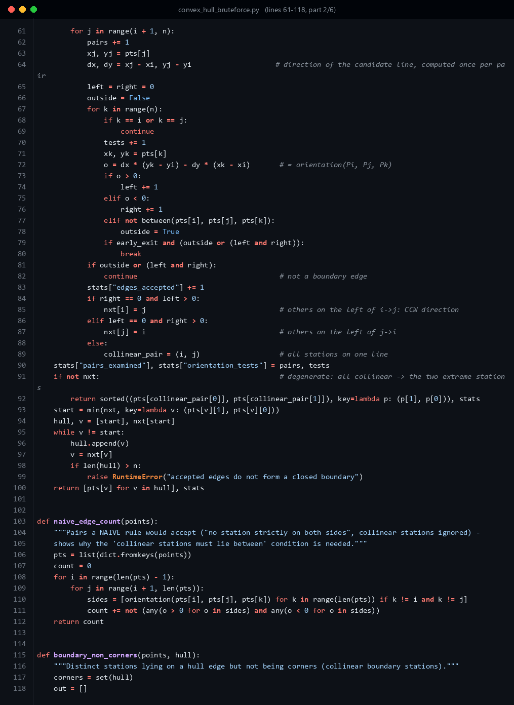

### 3. Test configurations and visualisation

**Configuration A – boundary and interior stations.** 10 stations on the reserve perimeter (random angles on an
ellipse 18 km × 10 km, so they are in convex position) and 30 interior stations well inside it (40 stations,
`results/datasets/q5_config_A.csv`). Expected boundary: exactly the 10 perimeter stations.

**Configuration B – designed to challenge the algorithm.** A rectangular 8 km × 5 km reserve with: the 4 corners;
3 extra stations on **every side** (12 collinear boundary stations, including two **vertical** sides where a slope
would be undefined); 4 interior stations **collinear with the diagonal** from (0, 0) to (8000, 5000); 3 other
interior stations; and 2 **exact duplicates** (one corner and one diagonal station reported twice) – 25 stations in
total. A naive rule "no station strictly on both sides" would accept every pair of the 5 stations on each side, i.e.
4 × C(5, 2) = 40 segments (the program counts them, Figure 28); the correct boundary is the 4 corners only.

Table 19: Hull results for the two configurations (results/q5_configs.csv)

| Measure | Configuration A | Configuration B |
|---|---|---|
| Stations (distinct after removing duplicates) | 40 (40) | 25 (23 – 2 duplicates removed) |
| Candidate pairs C(n, 2) | 780 | 253 |
| Orientation tests, full scan | 29,640 | 5,313 |
| Formula n(n − 1)(n − 2)/2 | 29,640 | 5,313 |
| Orientation tests with early rejection | 4,055 | 676 |
| Accepted edges | 10 | 4 |
| Pairs a naive one-side rule (no collinear condition) would accept | 10 | 40 |
| Corners found (counter-clockwise) | 10 – exactly the perimeter stations | 4 – (0, 0), (8000, 0), (8000, 5000), (0, 5000) |
| Stations on the boundary but not corners | 0 | 12 (the side stations) |

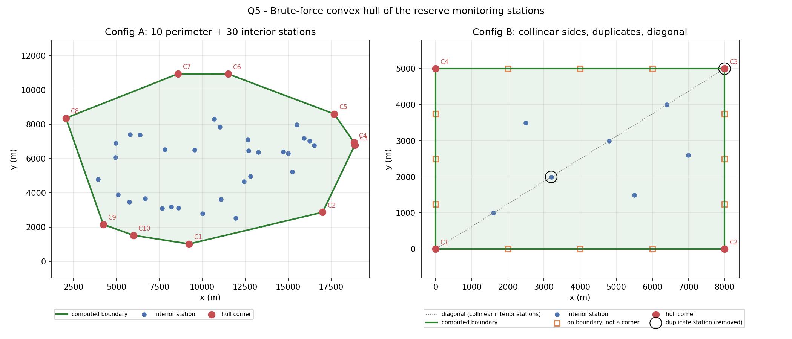

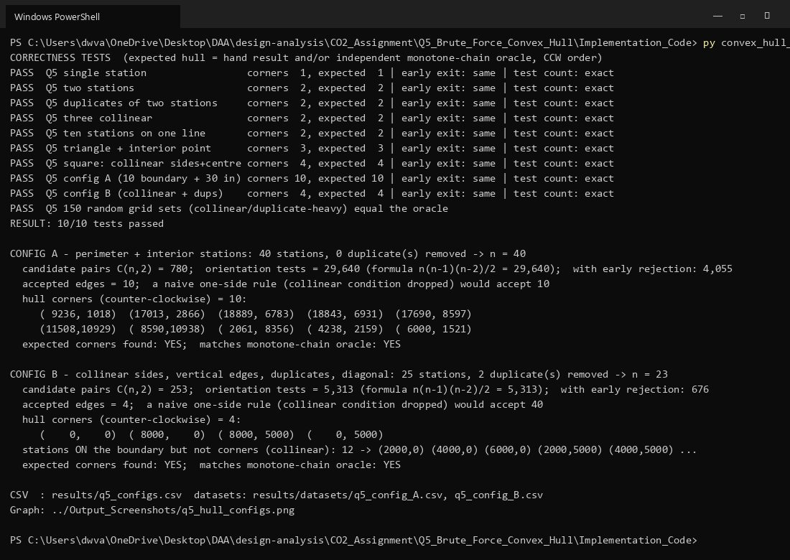

Both results are correct. In A the 10 perimeter stations are returned in counter-clockwise order and all 30 interior
stations are excluded. In B the hull is exactly the 4 corners, the 12 side stations are recognised as lying *on* the
boundary but not being corners, the 2 duplicates were removed before the search, and the diagonal stations – which
are collinear with two corners – did not create a false edge because they lie strictly inside. All 10 unit tests
passed, including single, two-station and all-collinear inputs and 150 random small-grid sets (rich in collinear
points and duplicates) checked against an independent oracle (Andrew's monotone chain, used only for testing).

### 4. Growth of the computational work

**Derivation.** There are C(n, 2) = n(n − 1)/2 candidate pairs and each pair performs one orientation test for each
of the other n − 2 stations, so the full scan performs

  W(n) = Σ<sub>i=0</sub><sup>n−2</sup> Σ<sub>j=i+1</sub><sup>n−1</sup> (n − 2) = (n − 2) · n(n − 1)/2 = **n(n − 1)(n − 2)/2 ∈ Θ(n³)**

orientation tests, each costing O(1) (two multiplications and a subtraction); duplicate removal O(n) and walking the
boundary O(h) are negligible. Doubling n multiplies W by (2n)(2n − 1)(2n − 2)/(n(n − 1)(n − 2)) → 8.

Table 20: Growth of the orientation tests – full scan on random stations, and early rejection on random, circle and boundary-ordered stations (results/q5_growth.csv)

| Stations | Full scan | n(n−1)(n−2)/2 | × per 2n | Early: random | Early: circle | Early: ordered |
|---|---|---|---|---|---|---|
| n = 20 | 3,420 | 3,420 | 9.50 | 932 | 1,029 | 1,652 |
| n = 40 | 29,640 | 29,640 | 8.67 | 4,340 | 5,561 | 12,102 |
| n = 80 | 246,480 | 246,480 | 8.32 | 14,322 | 31,338 | 91,402 |
| n = 160 | 2,009,760 | 2,009,760 | 8.15 | 55,640 | 131,395 | 707,602 |
| n = 320 | 16,230,720 | 16,230,720 | 8.08 | 214,577 | 576,209 | 5,562,402 |
| n = 640 | – | 130,458,240 | – | 1,285,459 | 2,779,402 | 44,097,602 |
| n = 1,280 | – | 1,046,119,680 | – | 3,852,696 | 11,897,175 | – |

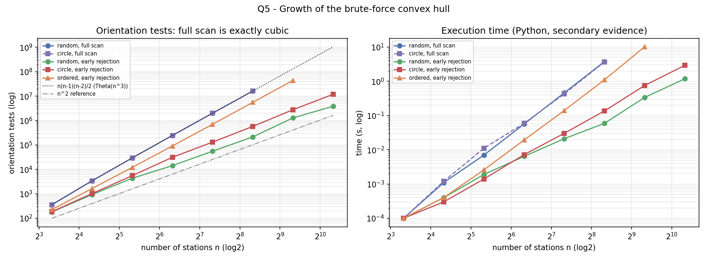

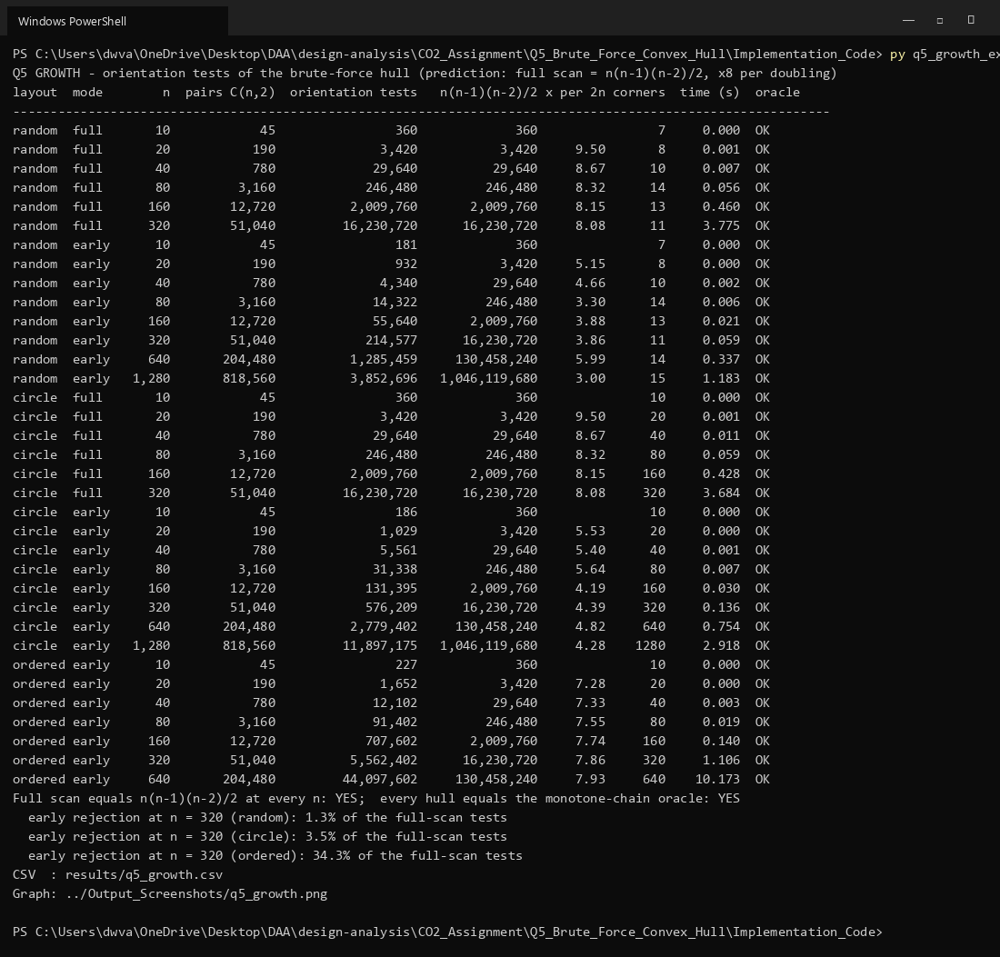

The full scan matched n(n − 1)(n − 2)/2 **exactly** at every size, and the growth factor per doubling fell towards 8
(9.50, 8.67, 8.32, 8.15, 8.08) as predicted for a cubic. The time grew the same way: 0.46 s at n = 160 and 3.8 s at
n = 320, so about 30 s would be needed at n = 640 and 4 minutes at n = 1 280.

Early rejection helps a great deal on scattered stations – at n = 320 it needed only 1.3 % (random) and 3.5 % (all
stations on a circle) of the full-scan tests, growing about 4× per doubling (≈ n²) – because most candidate lines cut
through the middle of the station set and a station on each side is found after a few tests. But it does **not**
change the worst case: when the stations are listed in boundary order (as a survey team walking the fence would
record them), every chord sees all stations on one side first, and early rejection still needed 34.3 % of the full
scan at n = 320, growing 7.9× per doubling, i.e. ≈ n³/6 + n² tests – still Θ(n³). Each accepted edge always costs
the full n − 2 tests. For a reserve with tens of stations the brute force is instant (29,640 tests for 40 stations),
but its cubic growth makes it unsuitable for thousands of points.

### 5. Correctness inquiry

Why does the test prove that an accepted edge lies on the outer boundary? Let S be the set of stations and conv(S)
its convex hull – the smallest convex region containing every station, i.e. the region enclosed by the outer
boundary. Let L be the line through the accepted pair P, Q and H the closed half-plane on the side where all stations
lie.

1. **One side means a supporting line.** A half-plane is convex, and H contains every station. Since conv(S) is the
   smallest convex set containing S, conv(S) ⊆ H: no part of the reserve's boundary region can cross L.
2. **The segment PQ is on the boundary.** P and Q are stations, so they belong to conv(S), and by convexity so does the
   whole segment PQ. Every point of PQ lies on L, the edge of H. Any small disc around such a point contains points of
   the open half-plane beyond L, which are outside H and therefore outside conv(S). So no point of PQ is an interior
   point of conv(S): the whole segment lies on its **boundary**.
3. **P and Q are corners and PQ is a complete edge.** A point of conv(S) that lies on the supporting line L is a convex
   combination of stations that all lie in H; the combination can only land on L if every station with a positive
   weight lies on L. Hence conv(S) ∩ L = conv(S ∩ L), the segment between the two outermost stations on L. Condition 2
   (every collinear station lies between P and Q) says exactly that P and Q are those outermost stations, so the
   accepted segment is the *entire* boundary edge on L and its endpoints are corners. Without condition 2 a
   sub-segment of an edge could be accepted and a non-corner station reported as a corner.
4. **Rejected pairs are not edges, and no edge is missed.** If stations lie strictly on both sides of L, then L passes
   through the interior of conv(S); a boundary point in the middle of PQ would need a supporting line through it, and
   any supporting line at an interior point of the segment PQ ⊆ conv(S) must contain the whole segment, i.e. be L
   itself – a contradiction. Conversely, every edge of the hull of a finite set lies on a supporting line whose two
   outermost stations are its endpoints; the algorithm examines **every** pair, so every edge is found.

Therefore the accepted edges are exactly the edges of the outer boundary, and following them gives the boundary
polygon. The same argument explains why the test must check *all* remaining stations before accepting: a single
unexamined station on the wrong side would invalidate step 1.


## Q6 – Exhaustive Search and Combinatorial Growth [8 Marks]

> **Problem Context – Humanitarian Airlift Planning.** A helicopter has a strict payload limit. Each package has:
> **Package ID | Weight | Humanitarian Value**
> The planner must select a combination of packages that does not exceed the payload limit and maximises the total humanitarian value.
> **Your Challenge:** Design an Exhaustive-Search strategy. Determine:
> - how candidate combinations will be represented;
> - how candidate solutions will be generated;
> - how feasibility will be checked;
> - how feasible solutions will be evaluated;
> - how the best solution will be retained.
> Do not begin from supplied pseudocode.
> **Correctness Check:** Create a small instance whose combinations can be independently verified and establish whether your algorithm finds the correct optimum.
> **Growth Investigation:** Before experimentation, derive or predict how the number of candidate combinations grows with n and what happens as packages are added. Use at least three meaningful problem sizes to validate your prediction experimentally.
> **Inquiry:** Why can adding a relatively small number of packages produce a dramatic increase in computational effort? Relate your answer to the growth of the solution space.
> **Deployment Decision:** Assume the planner must produce a loading decision within a fixed response time selected and justified by you. Using experimental evidence, estimate the largest problem size for which you would deploy exhaustive search.

**Evidence Expected**

> Student-designed enumeration, correctness verification, mathematical prediction of solution-space growth, experimental validation, explanation of combinatorial growth and an evidence-based deployment boundary.

**Ans:**

### 1. Design of the exhaustive search

I designed the enumeration from the problem itself (the design notes are in `Pseudocode/Q6_Exhaustive_Search_Pseudocode.md`).

Table 21: Design decisions of the exhaustive airlift planner

| Question | My decision | Reason |
|---|---|---|
| How is a candidate represented? | an n-bit vector stored as an integer `mask` ∈ [0, 2ⁿ − 1]; bit i = 1 ⇔ package i is loaded (e.g. n = 5, mask = 00101₂ = packages P1 and P3) | one integer per plan, constant memory, and loading decisions are exactly yes/no per package |
| How are candidates generated? | count mask = 0, 1, 2, …, 2ⁿ − 1 | binary counting is a bijection between 0..2ⁿ − 1 and the subsets: every plan exactly once, none missed, no duplicates |
| How is feasibility checked? | W(mask) = Σ wᵢ over the set bits; feasible ⇔ W(mask) ≤ payload C | the payload limit is strict |
| How is a feasible plan evaluated? | V(mask) = Σ vᵢ over the set bits | objective = total humanitarian value |
| How is the best retained? | keep (bestValue, bestWeight, bestMask); replace when V is larger, or V is equal and W is smaller | ties go to the lighter load (more safety margin); the first such plan in counting order is kept |

```
Algorithm ExhaustiveAirlift(w, v, n, C)          // w, v = weights and values of packages 0..n-1
1.  bestValue = -1;  bestWeight = 0;  bestMask = 0
2.  for mask = 0 to 2^n - 1 do                    // every candidate loading plan
3.      W = 0;  V = 0
4.      for i = 0 to n-1 do                       // decode the bit vector (one bit check each)
5.          if bit i of mask = 1 then W = W + w[i];  V = V + v[i]
6.      if W <= C then                            // feasibility
7.          if V > bestValue or (V = bestValue and W < bestWeight) then
8.              bestValue = V;  bestWeight = W;  bestMask = mask       // retention
9.  return bestMask, bestValue, bestWeight
```

The program `exhaustive_airlift` (Appendix A) counts the candidates generated, the feasible candidates, the bit
checks (n per candidate) and the best-so-far updates.

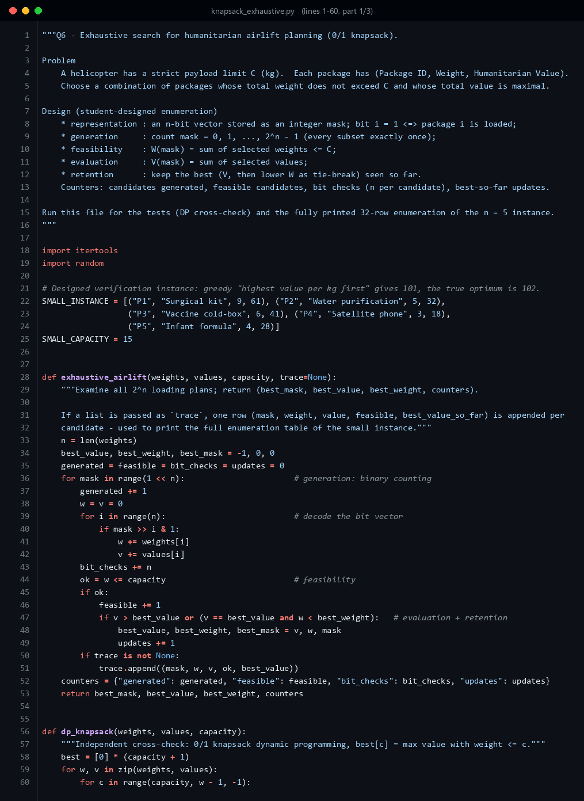

### 2. Correctness check on a small, independently verifiable instance

I designed a 5-package manifest (payload limit 15 kg) so that a plausible shortcut – loading packages in decreasing
value per kg – is **not** optimal; an exhaustive search must notice the difference.

Table 22: The verification instance (payload limit C = 15 kg)

| Package | Content | Weight (kg) | Value | Value per kg |
|---|---|---|---|---|
| P1 | Surgical kit | 9 | 61 | 6.78 |
| P2 | Water purification | 5 | 32 | 6.40 |
| P3 | Vaccine cold-box | 6 | 41 | 6.83 |
| P4 | Satellite phone | 3 | 18 | 6.00 |
| P5 | Infant formula | 4 | 28 | 7.00 |

**Hand verification.** Every plan heavier than 15 kg is infeasible. The feasible plans with three packages are
P2+P3+P4 (14 kg, 91), P2+P3+P5 (15 kg, 101), P2+P4+P5 (12 kg, 78) and P3+P4+P5 (13 kg, 87); any plan containing P1
(9 kg) can add at most 6 kg: P1+P3 (15 kg, **102**), P1+P2 (14 kg, 93), P1+P5 (13 kg, 89), P1+P4 (12 kg, 79), and P1
with two more packages always exceeds 15 kg. Four or five packages weigh at least 18 kg. So the optimum is
**P1 + P3 = 15 kg, value 102**, whereas the greedy value-per-kg rule loads P5, P3, P2 = 15 kg, value 101.

The program prints all 2⁵ = 32 candidates (Figure 32) and finds **P1 + P3, 15 kg, value 102**, with 32 candidates
generated, 20 feasible, 160 bit checks and 4 best-so-far updates; an independent 0/1-knapsack dynamic programme
also gives 102. Each row of the printed table can be checked by hand. In addition, 40 random manifests (n = 1 … 14)
gave exactly the DP optimum, and the feasible counts equalled an independent `itertools.combinations` count – all 8
tests passed (Appendix D).

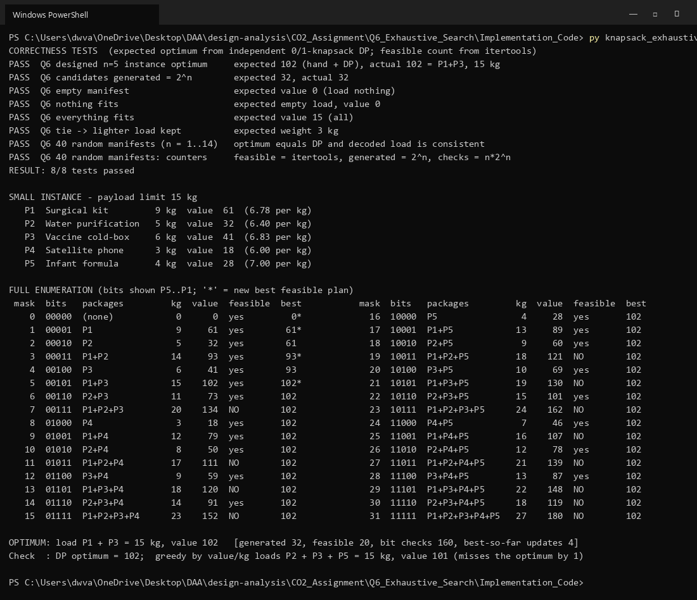

### 3. Growth investigation

**Prediction (made before running).** Each package is independently either loaded or not, so by the product rule the
number of candidate plans is 2 × 2 × … × 2 = **2ⁿ**. Adding one package doubles the candidates,
|S(n + 1)| = 2 · |S(n)|, and adding k packages multiplies them by 2ᵏ (10 more packages ⇒ 1 024× more work). Each
candidate costs n bit checks, so the basic operation count is n · 2ⁿ and T(n) ≈ c · n · 2ⁿ ∈ Θ(n · 2ⁿ); going from n to
n + 2 packages should multiply the time by 4(n + 2)/n (≈ 4.4 at n = 20). The number of feasible plans also grows
exponentially (it is a fixed fraction of 2ⁿ when the payload is a fixed fraction of the total weight), so no
reasonable instance escapes the growth.

**Experiment.** Random manifests (weights 5–60 kg, values 10–100, payload = 40 % of the total weight; seeded and
saved as `results/datasets/q6_manifest_n*.csv`) for n = 10, 12, …, 22; every optimum was cross-checked with DP.

Table 23: Exhaustive search on n = 10 … 22 packages (× vs n−2 = measured time ratio to the previous size; Predicted × = 4n/(n − 2)) (results/q6_growth.csv)

| n | Candidates 2ⁿ | Feasible | Bit checks n·2ⁿ | Time (s) | × vs n−2 | Predicted × |
|---|---|---|---|---|---|---|
| 10 | 1,024 | 309 | 10,240 | 0.001 | – | – |
| 12 | 4,096 | 1,074 | 49,152 | 0.003 | 4.54 | 4.80 |
| 14 | 16,384 | 4,127 | 229,376 | 0.016 | 4.75 | 4.67 |
| 16 | 65,536 | 15,922 | 1,048,576 | 0.075 | 4.71 | 4.57 |
| 18 | 262,144 | 61,514 | 4,718,592 | 0.375 | 4.98 | 4.50 |
| 20 | 1,048,576 | 239,010 | 20,971,520 | 1.520 | 4.06 | 4.44 |
| 22 | 4,194,304 | 840,327 | 92,274,688 | 6.231 | 4.10 | 4.40 |

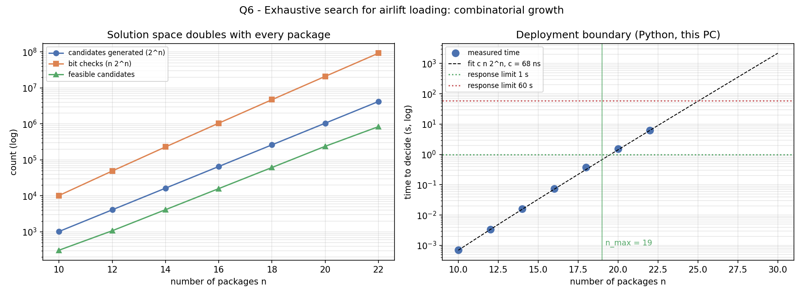

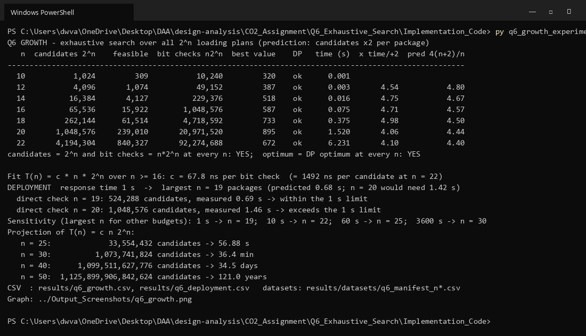

**Validation.** The counted candidates equal 2ⁿ and the bit checks equal n · 2ⁿ **exactly** at all seven sizes, and
every optimum equals the DP optimum. Every 2 extra packages multiplied the time by 4.06–4.98, close to the predicted
4.4–4.8 (the differences are timing noise and Python overhead). From 10 to 22 packages – only 12 more – the work grew
2¹² = 4 096 times in candidates and the time grew from 1 ms to 6.2 s. The feasible fraction fell slowly (30 % → 20 %)
but the feasible count itself still grew about 4× per 2 packages.

### 4. Inquiry: why a few more packages cause a dramatic increase

The solution space is the set of all subsets of the packages, and its size is 2ⁿ – it **multiplies**, it does not
add: every new package doubles the number of plans, because each existing plan now appears twice (with and without
the new package). Effort therefore grows geometrically with the *number* of packages, while the input itself grows
only linearly (one more line in the manifest). Exhaustive search is correct precisely because it examines every
member of this space, and it gains nothing from experience: the feasibility of one plan says nothing to the algorithm
about the others. In my runs, adding 2 packages cost ≈ 4.4× the time, adding 10 packages would cost about 1 024 ×
(n + 10)/n ≈ 1 500×, and the projection T(n) = c · n · 2ⁿ (c = 67.8 ns per bit check) gives 57 s for 25 packages,
36 minutes for 30, 34.5 days for 40 and **121 years** for 50 packages – for a manifest that a person can write on one
page.

### 5. Deployment decision

**Response time.** I choose **1 second**. The loading planner is used interactively on a field laptop while the
helicopter is being prepared: whenever a package is added or removed, or the payload limit changes with fuel and
weather, the coordinator re-plans, and 1 s is the usual limit for a response that keeps the user's flow of work
uninterrupted. A multi-minute wait for each re-plan would not be accepted at an airstrip.

**Largest deployable size.** Fitting T(n) = c · n · 2ⁿ to the runs with n ≥ 16 gives c = 67.8 ns per bit check
(≈ 1.5 µs per candidate at n = 22). The largest n with c · n · 2ⁿ ≤ 1 s is **n = 19 packages** (predicted 0.68 s; n = 20
would need 1.42 s). Direct runs confirm the boundary: n = 19 took **0.69 s** (within 1 s) and n = 20 took **1.46 s**
(exceeds 1 s).

Table 24: Deployment boundary and sensitivity to the response-time budget (results/q6_deployment.csv)

| Response budget | Largest n | Note |
|---|---|---|
| 1 s (chosen) | 19 | confirmed: n = 19 → 0.69 s, n = 20 → 1.46 s |
| 10 s | 22 | measured 6.2 s at n = 22 |
| 60 s | 25 | predicted 57 s |
| 1 hour | 30 | predicted 36 min |

**Decision:** I would deploy exhaustive search for manifests of **up to about 19 packages** (with a 1 s budget on this
PC in Python). Table 24 shows why the boundary hardly moves: a budget 60 times larger buys only 6 more packages, and an
hour buys 11, because each extra package doubles the work. A compiled implementation (perhaps 50–100× faster) would
add only about 5–6 packages. For larger manifests the planner needs a method that does not examine every subset
(dynamic programming over integer weights, or branch-and-bound that prunes overweight and hopeless partial loads).


## Q7 – Day-4 Design Challenge: Diagnose, Redesign and Validate [13 Marks]

> Review the evidence generated in Q1–Q6. Select **ONE** solution that demonstrates a significant computational limitation as its problem size or operating requirement increases.
> You are not permitted simply to replace the solution with a more advanced textbook algorithm and state that its complexity is better. Understand the computational problem first and then develop an appropriate redesign.

**Ans:**

**Selected solution: Q4, the brute-force closest pair for drone collision-risk monitoring.** I compared the
limitations found in Q1–Q6 before choosing:

Table 25: Limitations observed in Q1–Q6 and the choice for the design challenge

| Q | Limitation shown by my evidence | Why it was (not) chosen |
|---|---|---|
| Q1 sorting | Θ(n²) comparisons, but Insertion Sort already adapts: 654,804 instead of 12.5 million comparisons in the 95 % case | already solved by choosing the right algorithm |
| Q2 sequential search | work grows with λ · n (378× for 20 facilities) | fixed by a standard hash index; little algorithmic design |
| Q3 string matching | m(n − m + 1) only on adversarial text; real logs ≈ 1.1 comparisons per shift | limitation is rare in practice |
| **Q4 closest pair** | **exactly n(n − 1)/2 distance calculations on every input; 100 ms limit reached at 1,331 drones, 1 s at 4,210** | **chosen: real operating requirement (1 Hz), fleets of thousands are realistic, and the problem itself does not need all pairs** |
| Q5 convex hull | Θ(n³) orientation tests | reserves have tens of stations, so n stays small |
| Q6 exhaustive search | 2ⁿ candidates; deployable only up to 19 packages | the solution space of the problem itself is exponential; pruning helps but cannot remove the exponential worst case |

### A. Diagnose the Computational Bottleneck [2 Marks]

> Using your own mathematical and/or experimental evidence, identify where most computational effort is being spent, which operation grows significantly, whether work is unnecessarily repeated, and which characteristic of the original algorithm causes the limitation.

**Ans:**

I re-ran the original Q4 program on the **same** Q4 datasets and measured not only *how much* work it does but how
much of it could possibly matter (`q7_diagnosis.py`). For each fleet I counted the distance calculations that
improved the best-so-far answer, and – using the final closest distance d\* – how many pairs could already be ruled
out by their x-coordinate gap alone (|xᵢ − xⱼ| ≥ d\* implies d(i, j) ≥ d\*).

Table 26: Where the brute-force effort goes (results/q7_diagnosis.csv)

| Drones | Distance calculations | Improved the answer | Closest d\* (m) | Pairs with \|dx\| < d\* | Ruled out by \|dx\| alone |
|---|---|---|---|---|---|
| n = 1,000 | 499,500 | 6 | 3.126 | 317 | 99.9365 % |
| n = 2,000 | 1,999,000 | 17 | 2.497 | 986 | 99.9507 % |
| n = 5,000 | 12,497,500 | 19 | 1.201 | 3,006 | 99.9759 % |
| n = 10,000 | 49,995,000 | 20 | 0.621 | 6,322 | 99.9874 % |

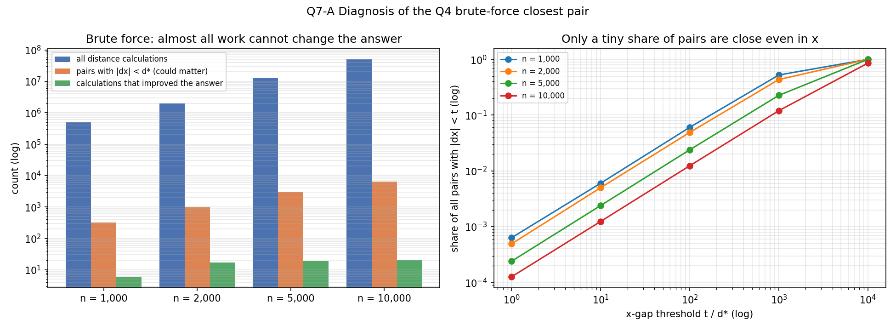

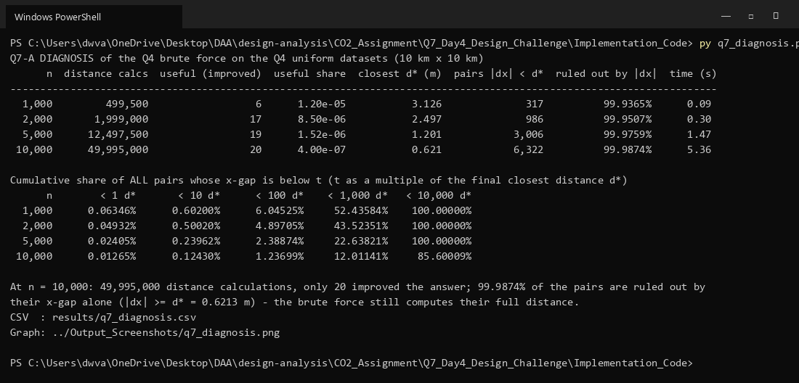

- **Where the effort is spent:** 100 % of the work is in the inner loop – one distance calculation per pair. There is
  no other significant cost (no preprocessing, no data structure).
- **Which operation grows:** the distance calculation, executed exactly n(n − 1)/2 times – Θ(n²), ×4 per doubling
  (Q4, Table 17). At n = 10,000 that is 49,995,000 calculations (5.3–5.6 s on my PC).
- **Is work unnecessarily repeated?** Yes. Only **20 of 49,995,000** calculations (4 × 10⁻⁷) improved the answer, and
  **99.987 %** of all pairs are separated by more than d\* = 0.62 m in x alone – they are drones up to 10 km apart whose
  full distance is computed although one subtraction would show they cannot be the closest pair. Even a generous
  window of 100 d\* contains only 1.24 % of the pairs (Figure 35, right). Once the algorithm has found two drones a
  few metres apart, every later comparison with a far-away drone repeats the same useless conclusion "not closer".
- **Which characteristic causes the limitation:** the candidate set is fixed in advance as *all pairs*, independent
  of the geometry of the data and of the information collected during the run. The algorithm (i) uses no ordering of
  the drones, so it cannot find the near neighbours without scanning everyone, and (ii) never uses its own best
  distance so far as a bound to stop examining candidates. Its work is therefore Θ(n²) for every fleet, even though
  the answer depends only on a tiny neighbourhood.

### B. Define the Design Objective [2 Marks]

> State clearly what your redesign must achieve, for example: reduce unnecessary comparisons, avoid examining every candidate, exploit existing ordering, reuse previously computed information, reduce candidate solutions or reduce repeated processing. Your objective should be measurable.

**Ans:**

The redesign must **avoid examining every candidate pair** by **exploiting an ordering of the drones** and **reusing the
best distance found so far** to stop examining candidates that cannot win, while returning exactly the same answer.
Measurable objectives (fixed before implementing):

1. **Exactness:** the closest distance must be identical to the brute force on every test dataset (uniform,
   clustered, corridor, cross layouts and tie-heavy grids).
2. **Work:** at n = 10,000 (uniform fleet) reduce the distance calculations by **at least 100×** (from 49,995,000 to
   below 500,000), and make the number of pairs *examined at all* grow much more slowly than n².
3. **Response time:** handle at least **5× more drones within the 100 ms response limit** defined in Q4 (the brute
   force manages about 1,300 drones, so at least ≈ 7,000).

### C. Design the Revised Computational Strategy [4 Marks]

> Explain what you changed, which property of the problem or data it exploits, which operations are avoided or reduced, whether preprocessing is introduced, whether extra memory is required and what new trade-offs arise. Provide pseudocode or a design representation. Marks are awarded for the quality of algorithmic reasoning, not for naming a known algorithm.

**Ans:**

**Key observation from the diagnosis.** If two drones are more than δ apart along one axis, they are more than δ apart
– full stop, because d² = Δx² + Δy² ≥ Δx². So the coordinate gap alone can rule a pair out, and if the drones are
**ordered** along that axis, all drones beyond the first one that is too far away are even farther away and can be
skipped *as a group*.

**What I changed – "sort once, sweep, stop when the gap is too large":**

1. **Choose the sweep axis from the data (exploits the geometry).** I sweep along the axis with the larger spread
   (max − min). A north–south air corridor, where all x values are almost equal, is then swept along y, where the
   drones are spread out.
2. **Preprocessing – sort once.** The drones are sorted along the sweep axis with a hand-written merge sort, so the
   cost of the preprocessing is counted as key comparisons (Θ(n log n)).
3. **Reuse previously computed information – a shrinking bound.** δ² (the best squared distance so far) is kept as in
   the original, but it is now *used*: drone i is compared only with the drones after it in sorted order, and as soon
   as the gap along the sweep axis satisfies gap² ≥ δ², the inner loop **stops** – every later drone is at least as far
   away, so none can be strictly closer.
4. **Cheap filter before the full distance.** For a drone inside the window, if the gap on the other axis alone
   already satisfies gap² ≥ δ², the pair cannot improve δ and the full distance calculation is skipped.

```
Algorithm SweepClosestPair(D, n)                 // D[k] = (x_k, y_k), n >= 2
1.  if spread(x) >= spread(y) then a = x, b = y else a = y, b = x      // choose the sweep axis
2.  order = MergeSortIndices(0..n-1, key = a)                         // preprocessing, Theta(n log n)
3.  best2 = +infinity;  pair = none
4.  for p = 0 to n-2 do
5.      i = order[p]
6.      for q = p+1 to n-1 do
7.          j = order[q]                                             // candidate pair examined
8.          ga = a[j] - a[i]                                         // >= 0 because of the sort
9.          if ga*ga >= best2 then break                             // all later drones are farther: stop
10.         gb = b[j] - b[i]
11.         if gb*gb >= best2 then continue                          // other-axis gap too large: skip
12.         d2 = ga*ga + gb*gb                                       // distance calculation
13.         if d2 < best2 then best2 = d2;  pair = (i, j)
14. return pair, sqrt(best2)
```

**Why the answer stays exact.** A pair is skipped only when gap² ≥ δ² on one axis, and then d² = gap<sub>a</sub>² +
gap<sub>b</sub>² ≥ δ², so it cannot be strictly closer than the current best. The `break` is safe because, in sorted
order, the sweep-axis gap of every later drone is at least as large. Hence no pair that could improve δ is ever
discarded, and the final δ equals the true minimum (the same argument covers duplicates, where δ = 0 and every later
pair is skipped immediately).

Table 27: Original and redesigned strategy compared

| Aspect | Original (Q4 brute force) | Redesign (sort + sweep) |
|---|---|---|
| Candidates examined | all n(n − 1)/2 pairs | only pairs inside the current δ-window along the sweep axis |
| Information used | coordinates only inside the distance formula | coordinates used first as cheap bounds; best distance so far reused to stop early |
| Ordering exploited | none | drones sorted along the axis of larger spread |
| Preprocessing | none | one sort: Θ(n log n) key comparisons |
| Extra memory | O(1) | O(n): sorted index list and coordinate lists |
| Distance calculations | n(n − 1)/2 always | only pairs that pass both gap tests |
| Dependence on the data | none (always Θ(n²)) | fast for spread-out fleets; degrades when many drones share one sweep coordinate |

**New trade-offs.** (i) A sort must be paid even for small fleets, and in pure Python it becomes the largest part of
the cost; (ii) O(n) extra memory; (iii) the performance now depends on the layout: if many drones share almost the
same sweep coordinate *and* the layout is spread along both axes (two perpendicular straight routes, a "cross"), the
gap test cannot prune those drones and the examined pairs remain Θ(n²) – the cheap filter still keeps the distance
calculations low, but the loop iterations remain; (iv) a correctness argument is needed (above) – the brute force is
obviously correct, the sweep has to be proved.

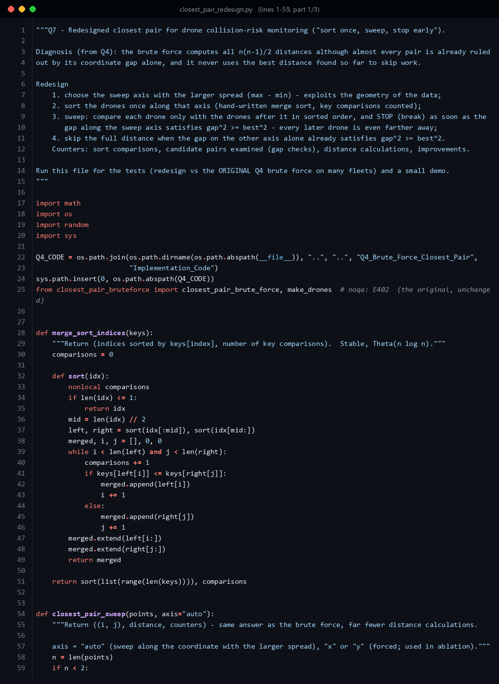

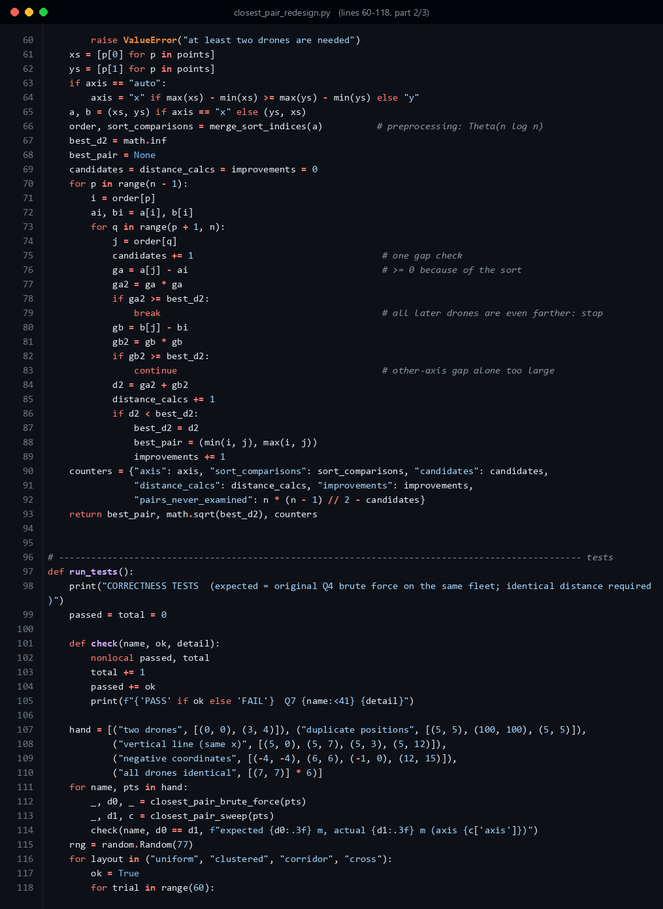

### D. Predict Before Implementing [1 Mark]

> Before implementing the redesign, predict how its behaviour should differ from the original solution and in which measure you expect improvement.

**Ans:**

Performance measures: **distance calculations** and **pairs examined** (primary), **sort comparisons** (the new cost),
and time (supporting). My predictions, written in `Pseudocode/Q7_Redesign_Pseudocode.md` before the code:

- **Uniform fleet, n = 10,000:** δ quickly falls to a few metres or less, so the window of drones within δ along the
  sweep axis holds on average less than one other drone: ≈ 1–3 pairs examined per drone (10,000–30,000 in total) and
  fewer than 2n = 20,000 distance calculations, plus ≈ n log₂ n ≈ 133,000 sort comparisons. **Distance calculations
  should fall by more than 2,000×, total key operations (sort comparisons + pairs examined) by ≈ 200–300×.**
- **Growth:** examined pairs ≈ linear in n, total work dominated by the Θ(n log n) sort.
- **Clustered fleet:** the same behaviour (δ is even smaller inside the dense hubs).
- **Corridor:** with the automatic axis choice it behaves like the uniform case; forcing the sweep along x
  (ablation) should examine many more pairs.
- **Cross (two exact perpendicular routes):** the n/2 drones on the north–south route share one x value, so the gap
  test never stops them: ≈ (n/2)²/2 = n²/8 examined pairs – only ≈ 4× fewer than the brute force – but the second
  filter should keep the distance calculations close to linear.
- **Time:** smaller than the count reduction, because the hand-written merge sort dominates: ≈ 50–100× faster at
  n = 10,000, and ≥ 10,000 drones within the 100 ms limit.

### E. Implement and Validate the Redesign [2 Marks]

> Implement a prototype of the redesigned strategy wherever feasible. Using the same or equivalent test conditions, compare the original and redesigned solutions using appropriate measures such as comparisons, key operations, candidate solutions examined, distance calculations, character comparisons and execution time.

**Ans:**

The prototype `closest_pair_sweep` (Appendix A) imports the **unchanged** original from Q4 for every comparison.
Validation uses the **identical** Q4 dataset files (uniform n = 100 … 10,000 and the clustered fleet) plus two
adversarial layouts created for Q7 (a 20 m-wide north–south corridor, and the "cross" of two exact perpendicular
routes). All 11 tests – hand cases, 60 random fleets of each layout, 60 tie-heavy integer grids with every sweep axis
– gave a distance **identical** to the original (Appendix D).

Table 28: Original against redesign on identical datasets (results/q7_validation.csv; "×" = how many times fewer)

| Fleet | Original calcs | Sort cmp | Examined / calcs | Key ops × | Time (ms) | × faster |
|---|---|---|---|---|---|---|
| uniform 100 | 4,950 | 547 | 233 / 8 | 6.3× | 0.51 → 0.22 | 2.3× |
| uniform 1,000 | 499,500 | 8,708 | 2,286 / 17 | 45× | 47.7 → 2.06 | 23× |
| uniform 2,000 | 1,999,000 | 19,412 | 4,254 / 15 | 85× | 194 → 4.06 | 48× |
| uniform 5,000 | 12,497,500 | 55,223 | 11,190 / 8 | 188× | 1,327 → 11.9 | 111× |
| uniform 10,000 | 49,995,000 | 120,398 | 22,042 / 18 | **351×** | 5,286 → 25.6 | **207×** |
| clustered 2,000 | 1,999,000 | 19,401 | 3,163 / 20 | 89× | 232 → 3.85 | 60× |
| corridor 2,000 | 1,999,000 | 19,400 | 2,044 / 4 | 93× | 216 → 3.71 | 58× |
| corridor* 2,000 | 1,999,000 | 19,400 | 38,666 / 16 | 34× | 216 → 7.45 | 29× |
| cross 2,000 | 1,999,000 | 19,442 | 501,504 / 6 | 3.8× | 194 → 56.4 | 3.4× |
| cross 5,000 | 12,497,500 | 54,962 | 3,128,760 / 12 | 3.9× | 1,225 → 371 | 3.3× |

Original calcs = distance calculations of the brute force; Sort cmp and Examined / calcs = the redesign's sort
comparisons, pairs examined and distance calculations; Key ops × = original calcs ÷ (sort cmp + examined); Time =
original → redesign in milliseconds; corridor\* = the ablation with the sweep axis forced to x. The same closest distance was
returned in every row.

Table 29: Scaling of the redesign beyond the brute-force range (results/q7_scaling.csv; \*original extrapolated as c · n(n − 1)/2 with c = 112.8 ns per pair from Q4)

| n | Sort cmp | Examined / calcs | Redesign (s) | Original (s)\* | Speed-up |
|---|---|---|---|---|---|
| 10,000 | 120,485 | 23,998 / 12 | 0.022 | 5.64 | 253× |
| 20,000 | 260,844 | 59,348 / 11 | 0.052 | 22.6 | 438× |
| 50,000 | 718,108 | 91,829 / 22 | 0.135 | 141 | 1,047× |
| 100,000 | 1,536,394 | 194,061 / 16 | 0.309 | 564 | 1,826× |
| 200,000 | 3,272,778 | 492,112 / 24 | 0.759 | 2,257 | 2,972× |

A fit T = k · n log₂ n to the redesign's times gives k = 209 ns, i.e. about **32,000 drones within 100 ms**; a direct
run with 32,002 drones took **0.083 s**. The brute force reaches 100 ms at 1,331 drones.

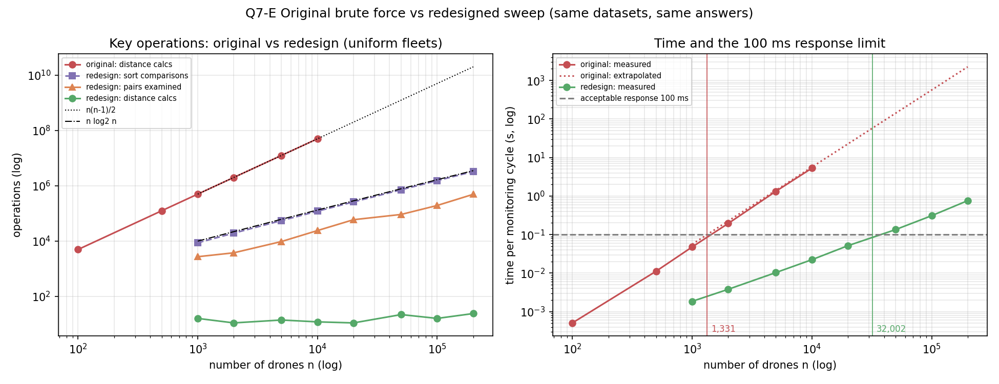

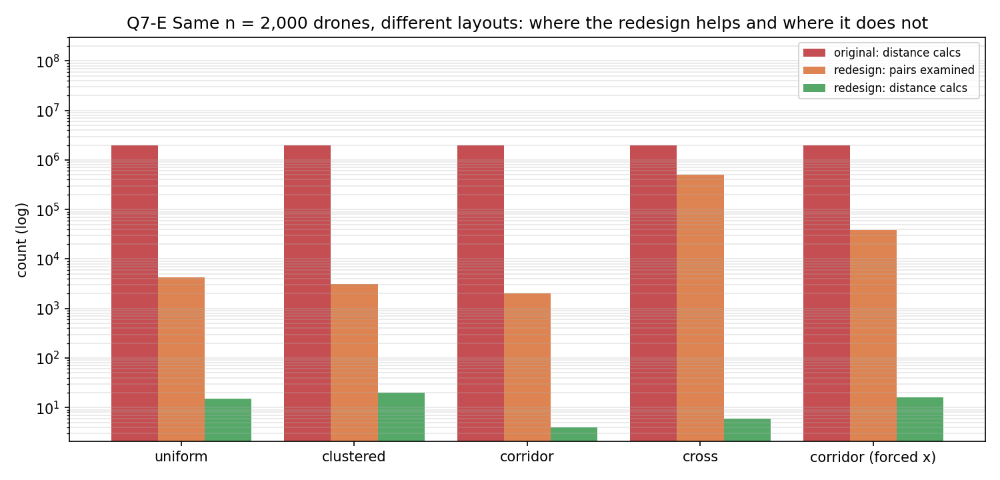

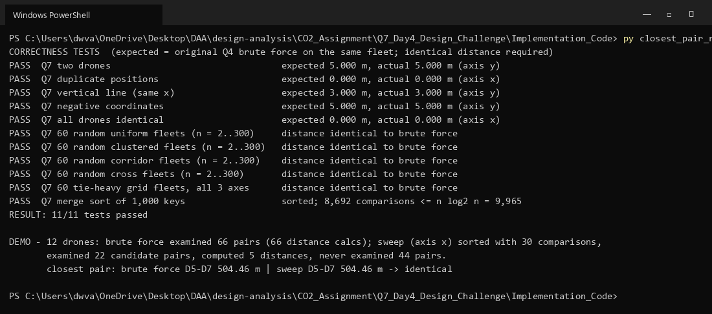

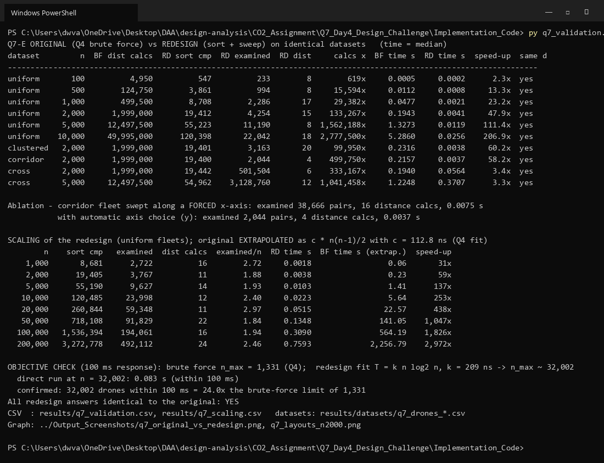

### F. Defend the Final Design [2 Marks]

> Evaluate whether the redesign achieved its intended objective. Discuss whether the prediction was supported, the magnitude of improvement, new costs or trade-offs, situations where the original solution may still be preferable, and whether the redesign sufficiently addresses the identified limitation. A redesign that does not outperform the original is not automatically unsuccessful if you correctly explain why.

**Ans:**

**Was the prediction supported?**

- **Pairs examined – yes.** Predicted 1–3 per drone; measured 22,042 at n = 10,000 (2.2 per drone) and 1.8–3.0 per drone
  up to 200,000 drones (Table 29): the examined pairs grow linearly, not quadratically.
- **Distance calculations – better than predicted.** I predicted fewer than 2n; the measured values were only 8–24 for
  every uniform fleet (18 at n = 10,000, a 2,777,500× reduction). I under-estimated the second filter: a drone inside the
  narrow x-window is almost never also within δ in y, so the full distance is computed only for genuine near
  neighbours.
- **Sort comparisons – yes.** Predicted ≈ n log₂ n = 132,877 at n = 10,000; measured 120,398. The sort is now the
  largest cost (5.5× the pairs examined), exactly the trade-off I expected.
- **Key operations and time – supported, slightly better.** Predicted ≈ 200–300× fewer key operations and 50–100×
  less time at n = 10,000; measured **351×** and **207×**. The time gain exceeds my estimate because one examined
  pair in the sweep is cheaper than I assumed relative to a brute-force iteration.
- **Clustered and corridor – yes** (3,163 and 2,044 pairs examined at n = 2,000); the forced-x ablation examined
  38,666 pairs (19× more), which confirms that choosing the sweep axis matters.
- **Cross – the predicted weakness happened.** Predicted n²/8 = 500,000 and 3,125,000 examined pairs; measured 501,504
  and 3,128,760 – the redesign examined 25 % of all pairs and was only 3.3–3.4× faster. The distance calculations
  stayed tiny (6 and 12), so the cheap filter worked, but the loop itself remained Θ(n²).

**Were the objectives met?** (1) Exactness: yes – identical closest distance on all 11 validation datasets and all 11
tests. (2) Work: yes – at n = 10,000 the distance calculations fell from 49,995,000 to 18 and the examined pairs to
22,042 (2,268× fewer), far beyond the 100× target. (3) Response time: yes – the 100 ms boundary moved from 1,331 to
about 32,000 drones (**24×**, target 5×), and 200,000 drones are processed in 0.76 s, within the 1 Hz telemetry period
that the brute force cannot meet beyond about 4,200 drones.

**New costs and trade-offs.** A Θ(n log n) sort that now dominates the run time; O(n) extra memory (about three lists
of n numbers – negligible for 200,000 drones); performance that depends on the layout; and a more delicate
correctness argument and more code to verify.

**When is the original still preferable?** For very small fleets (≤ 100 drones) both take under a millisecond, the
gain is only 2.3×, and the brute force's simplicity makes it easier to certify for a safety function. If the
application needs **all** pairwise distances (for example a complete separation matrix), every pair must be computed
anyway and the sweep has nothing to skip. And on degenerate layouts like the cross, the redesign is still correct and
still faster, but its advantage shrinks to ≈ 3.4×.

**Does the redesign sufficiently address the limitation?** Yes for the diagnosed cause: the brute force examined every
pair because it used neither ordering nor its own best distance; the redesign uses both, and for realistic fleets
(uniform, clustered, corridor) the examined work is now linear apart from one sort, lifting the practical limit from
about 1,300 to about 32,000 drones per 100 ms cycle. It does **not** guarantee sub-quadratic behaviour for every
possible layout (the cross case); a guarantee would require organising the plane in two dimensions (for example
bucketing drones into δ-sized cells, or splitting the plane recursively). A further improvement suggested by Q1 is to
exploit **temporal coherence**: drones move only a few metres between 1 Hz updates, so the previous cycle's order is
already nearly sorted and could be repaired by Insertion Sort in about n + I comparisons instead of a full sort.


### Summary of Findings

Table 30: Summary of the seven investigations

| Question and technique | Main evidence-based finding | Engineering conclusion |
|---|---|---|
| Q1 – Selection, Bubble, Insertion Sort | Selection always n(n − 1)/2 comparisons; Bubble swaps = Insertion shifts = inversions exactly; one urgent order at the end forces Bubble into 12,497,500 comparisons while Insertion needs 9,997 | no sort is always best; for the 95 %-sorted orders **Insertion Sort** (654,804 vs 12.5 million comparisons, stable, in place) |
| Q2 – Sequential Search | comparisons = position exactly, n when absent, average (n + 1)/2; one comparison ≈ 78 ns | acceptable while λ · n ≤ ≈ 640,000 comparisons/s and n ≤ ≈ 640,000; for 20 facilities the work grew 378× and the reconciliation burst used 14.2 % of a core → **hash index by Tool ID** |
| Q3 – Brute-force string matching | same n = 100,000 and m = 38: 99,963 vs 3,798,594 vs 111,533 comparisons; every formula value matched exactly | input size fixes only the range [n − m + 1, m(n − m + 1)]; structure (repeated prefixes, small alphabets) decides the work |
| Q4 – Brute-force closest pair | pairs examined = distance calculations = n(n − 1)/2 exactly, independent of layout; c ≈ 113 ns per pair | 100 ms response met up to ≈ 1,300 drones; impractical beyond ≈ 4,200 (1 s) |
| Q5 – Brute-force convex hull | rule "all stations on one side **and** collinear stations between the endpoints" found the exact boundary with collinear points and duplicates; tests = n(n − 1)(n − 2)/2 exactly | Θ(n³); early rejection helps on scattered stations (1.3 % of the tests) but not on boundary-ordered input (34 %) |
| Q6 – Exhaustive search (0/1 knapsack) | 2ⁿ candidates and n · 2ⁿ bit checks exactly; optimum verified by hand and DP; ×4.1–5.0 time per 2 packages | with a 1 s response, deploy for **≤ 19 packages**; 60 s buys only 25 |
| Q7 – Redesign of Q4 | sort once + sweep with a shrinking bound: same answers, 351× fewer key operations and 207× faster at n = 10,000; ≈ 32,000 drones within 100 ms | the redesign removes the diagnosed cause (all pairs examined); a cross-shaped layout remains Θ(n²) – the documented limit of the design |

Across all seven questions the operation counts behaved exactly as the derivations predicted (every closed form was
matched by the counters), while the times followed the counts with a constant factor and ±30 % noise. The main
lesson is that the asymptotic class tells only part of the story: the arrangement of the data (Q1, Q3), the request
rate (Q2), the order in which candidates are examined (Q5) and the information an algorithm chooses to ignore (Q4,
Q7) decide whether a brute-force method is a sound engineering choice.

<!-- pagebreak -->


### Appendix A – Complete Source Code: algorithm programs

The seven programs below contain the algorithms with their operation counters, the correctness tests (Appendix D) and the demonstrations. Each lives in `<question folder>/Implementation_Code/`. Python 3.10 or newer; standard library only.

#### Q1 – sorting_algorithms.py

```
"""Q1 - Sorting under different data conditions (E-commerce order processing).

Problem
    A fulfilment centre sorts customer orders by a dispatch priority score (ascending: score 1 is dispatched
    first).  This module implements the three brute-force sorting algorithms that the team is considering,
    each instrumented with explicit operation counters:

        * Selection Sort  - comparisons, swaps
        * Bubble Sort     - comparisons, swaps, passes  (uses the "swapped" early-exit flag)
        * Insertion Sort  - comparisons, shifts

    An order record is a tuple (priority_score, order_id).  Only the score is compared; the order_id lets us
    check stability (equal scores must keep their arrival order).

    It also provides inversion_profile(), an O(n log n) Fenwick-tree routine that predicts the exact counts
    from properties of the input (inversions I, maximum left-displacement L, new strict minima F).  It is used
    only to cross-check the counters - it is not part of the sorting algorithms.

Run this file to execute the correctness tests and a small demonstration.
"""

import random


# ----------------------------------------------------------------------------------------------- algorithms
def selection_sort(records):
    """Selection Sort on a copy of `records`; returns (sorted_list, counters).

    Each pass scans the whole unsorted suffix for the minimum score, then swaps it into place (at most one
    swap per pass, skipped when the minimum is already in place)."""
    a = list(records)
    n = len(a)
    comparisons = swaps = 0
    for i in range(n - 1):
        smallest = i
        for j in range(i + 1, n):
            comparisons += 1
            if a[j][0] < a[smallest][0]:
                smallest = j
        if smallest != i:
            a[i], a[smallest] = a[smallest], a[i]
            swaps += 1
    return a, {"comparisons": comparisons, "moves": swaps, "writes": 2 * swaps, "passes": max(n - 1, 0)}


def bubble_sort(records):
    """Bubble Sort with the early-exit flag on a copy of `records`; returns (sorted_list, counters).

    Pass p compares neighbours a[j], a[j+1] for j = 0 .. n-2-p and swaps them when out of order (strict '>'
    keeps equal keys in arrival order).  If a whole pass makes no swap the list is sorted and we stop."""
    a = list(records)
    n = len(a)
    comparisons = swaps = passes = 0
    for p in range(n - 1):
        swapped = False
        passes += 1
        for j in range(n - 1 - p):
            comparisons += 1
            if a[j][0] > a[j + 1][0]:
                a[j], a[j + 1] = a[j + 1], a[j]
                swaps += 1
                swapped = True
        if not swapped:                       # early exit: no inversions left
            break
    return a, {"comparisons": comparisons, "moves": swaps, "writes": 2 * swaps, "passes": passes}


def insertion_sort(records):
    """Insertion Sort on a copy of `records`; returns (sorted_list, counters).

    a[0..i-1] is always sorted; a[i] is saved, larger keys are shifted one place right, and the saved record is
    written into the gap.  Every shift removes exactly one inversion."""
    a = list(records)
    n = len(a)
    comparisons = shifts = placements = 0
    for i in range(1, n):
        current = a[i]
        key = current[0]
        j = i - 1
        while j >= 0:
            comparisons += 1
            if a[j][0] > key:
                a[j + 1] = a[j]               # shift the larger record one place to the right
                shifts += 1
                j -= 1
            else:
                break
        if j + 1 != i:                        # only write the saved record back if it actually moved
            a[j + 1] = current
            placements += 1
    return a, {"comparisons": comparisons, "moves": shifts, "writes": shifts + placements, "passes": max(n - 1, 0)}


ALGORITHMS = {"Selection": selection_sort, "Bubble": bubble_sort, "Insertion": insertion_sort}


# --------------------------------------------------------------------------------------- theory cross-check
def inversion_profile(scores):
    """Return (I, L, F) for a list of scores using a Fenwick tree (O(n log n)).

    I = total inversions (pairs i<j with s[i] > s[j]);
    L = max over k of the number of EARLIER scores strictly greater than s[k] (how far k must travel left);
    F = number of positions k >= 1 whose score is a new strict minimum of the prefix s[0..k]."""
    ranks = {v: r + 1 for r, v in enumerate(sorted(set(scores)))}
    size = len(ranks)
    tree = [0] * (size + 1)
    total = longest = new_minima = 0
    prefix_min = None
    for seen, s in enumerate(scores):
        r = ranks[s]
        # count earlier scores <= s, then earlier scores > s = seen - that
        k, not_greater = r, 0
        while k > 0:
            not_greater += tree[k]
            k -= k & -k
        greater = seen - not_greater
        total += greater
        longest = max(longest, greater)
        if prefix_min is not None and s < prefix_min:
            new_minima += 1
        prefix_min = s if prefix_min is None else min(prefix_min, s)
        k = r
        while k <= size:
            tree[k] += 1
            k += k & -k
    return total, longest, new_minima


def predicted_counts(scores):
    """Exact counter values predicted from the input's inversion profile (see Pseudocode section 4.4)."""
    n = len(scores)
    inv, max_left, new_min = inversion_profile(scores)
    passes = min(max_left + 1, n - 1) if n > 1 else 0
    return {
        "Selection": {"comparisons": n * (n - 1) // 2},
        "Bubble": {"comparisons": passes * (n - 1) - passes * (passes - 1) // 2, "moves": inv, "passes": passes},
        "Insertion": {"comparisons": inv + (n - 1) - new_min if n > 1 else 0, "moves": inv},
        "inversions": inv,
    }


def is_stable(sorted_records):
    """True if records with equal scores appear in increasing order_id (= arrival) order."""
    return all(not (a[0] == b[0] and a[1] > b[1]) for a, b in zip(sorted_records, sorted_records[1:]))


# ------------------------------------------------------------------------------------------------- tests
def run_tests():
    """Correctness tests: every algorithm vs Python's sorted(), plus predicted vs counted operations."""
    rng = random.Random(42)
    cases = {
        "empty": [],
        "single": [(7, 0)],
        "two reversed": [(9, 0), (3, 1)],
        "sorted": [(s, i) for i, s in enumerate(range(1, 21))],
        "reverse": [(s, i) for i, s in enumerate(range(20, 0, -1))],
        "duplicates": [(rng.randint(1, 3), i) for i in range(25)],
        "random": [(rng.randint(1, 1000), i) for i in range(200)],
    }
    print("CORRECTNESS TESTS  (expected order = Python sorted(); expected counts = exact prediction from the")
    print("                    inversion profile; Bubble/Insertion must also be stable)")
    passed = total = 0
    for name, recs in cases.items():
        expected = sorted(recs, key=lambda r: r[0])          # Python's sort is stable
        pred = predicted_counts([r[0] for r in recs])
        for alg, fn in ALGORITHMS.items():
            out, cnt = fn(recs)
            order_ok = [r[0] for r in out] == [r[0] for r in expected]
            counts_ok = all(cnt[k] == v for k, v in pred[alg].items())
            stable = is_stable(out)
            ok = order_ok and counts_ok and (stable or alg == "Selection")
            total += 1
            passed += ok
            print(f"{'PASS' if ok else 'FAIL'}  Q1 {alg:<9} {name:<12} n={len(recs):<4}"
                  f" sorted={'yes' if order_ok else 'NO '}  comparisons={cnt['comparisons']:>6,}"
                  f" predicted={pred[alg]['comparisons']:>6,}  stable={'yes' if stable else 'no'}")
    print(f"RESULT: {passed}/{total} tests passed   (Selection Sort may be unstable - a property of the algorithm)")
    return passed == total


def demo():
    """Sort ten sample orders with each algorithm and show the counters side by side."""
    orders = [(5, 101), (2, 102), (9, 103), (2, 104), (7, 105), (1, 106), (5, 107), (8, 108), (3, 109), (1, 110)]
    print("\nDEMO - 10 incoming orders as (priority score, order id):")
    print("  input :", " ".join(f"{s}/{o}" for s, o in orders))
    for alg, fn in ALGORITHMS.items():
        out, c = fn(orders)
        print(f"  {alg:<9}:", " ".join(f"{s}/{o}" for s, o in out),
              f"| comp={c['comparisons']:>2} moves={c['moves']:>2} writes={c['writes']:>2} passes={c['passes']}"
              f" | stable={'yes' if is_stable(out) else 'NO'}")
        for a, b in zip(out, out[1:]):                     # explain the first stability violation found
            if a[0] == b[0] and a[1] > b[1]:
                print(f"  -> {alg} placed order {a[1]} before order {b[1]} (both score {a[0]}, {b[1]} arrived first):"
                      " a long-distance swap broke stability")
                break


def main():
    ok = run_tests()
    demo()
    raise SystemExit(0 if ok else 1)


if __name__ == "__main__":
    main()
```

#### Q2 – sequential_search.py

```
"""Q2 - Sequential Search for aircraft-maintenance tool tracking.

Problem
    A maintenance facility keeps a temporary list of specialised tools currently issued to technicians.
    Each record is (Tool ID, Technician ID, Issue Time, Work Bay).  Records are appended when a tool is issued
    and removed when it is returned, so the list is in issue order (unsorted by Tool ID).  The question
    "Who currently has Tool T-184?" is answered with Sequential Search.

This module provides
    * make_tool_records(n)       - a reproducible list of n issued-tool records (seeded RNG)
    * sequential_search(L, id)   - the instrumented algorithm: returns (index or -1, key comparisons)
    * ListToolStore / IndexedToolStore - the two record stores compared in the 20-facility re-evaluation
Run this file for the correctness tests and the "Who has T-184?" demonstration.
"""

import random

TECHNICIANS = [f"TECH-{i:03d}" for i in range(1, 401)]           # shared string pools keep 1M records small
TIMES = [f"{h:02d}:{m:02d}" for h in range(24) for m in range(60)]
BAYS = [f"BAY-{b:02d}" for b in range(1, 41)]


def make_tool_records(n, seed=42, must_include=("T-184",)):
    """Return n records (tool_id, technician_id, issue_time, work_bay) in random issue order.

    Tool IDs are unique ("T-<number>"); `must_include` IDs are guaranteed to be present."""
    rng = random.Random(seed + n)
    numbers = rng.sample(range(1, 10 * n + 10), n)
    ids = [f"T-{k}" for k in numbers]
    present = set(ids)
    for tool in must_include:
        if n and tool not in present:
            ids[rng.randrange(n)] = tool                         # plant the queried tool at a random position
    times = sorted(rng.choice(TIMES) for _ in range(n))           # list is in issue order -> times ascend
    return [(tid, rng.choice(TECHNICIANS), tm, rng.choice(BAYS)) for tid, tm in zip(ids, times)]


def sequential_search(records, target_tool_id):
    """Scan records from the first to the last; stop at the first record whose Tool ID equals the target.

    Returns (index, comparisons); index = -1 when the tool is not currently issued (unsuccessful search).
    One comparison = one test `record.tool_id == target_tool_id`."""
    comparisons = 0
    for index, record in enumerate(records):
        comparisons += 1
        if record[0] == target_tool_id:
            return index, comparisons
    return -1, comparisons


class ListToolStore:
    """Original design: an unsorted list, searched sequentially for lookups and returns."""

    def __init__(self, records):
        self.records = list(records)
        self.comparisons = 0

    def issue(self, record):
        self.records.append(record)                      # O(1), no search needed

    def lookup(self, tool_id):
        idx, c = sequential_search(self.records, tool_id)
        self.comparisons += c
        return self.records[idx] if idx >= 0 else None

    def return_tool(self, tool_id):
        idx, c = sequential_search(self.records, tool_id)  # O(n) search to find the record ...
        self.comparisons += c
        if idx >= 0:                                       # ... then O(1) swap-with-last removal
            self.records[idx] = self.records[-1]
            self.records.pop()


class IndexedToolStore:
    """Redesigned store for many facilities: hash map Tool ID -> record, updated on every issue/return."""

    def __init__(self, records):
        self.index = {r[0]: r for r in records}
        self.probes = 0                                   # one hash-table access per operation

    def issue(self, record):
        self.index[record[0]] = record
        self.probes += 1

    def lookup(self, tool_id):
        self.probes += 1
        return self.index.get(tool_id)

    def return_tool(self, tool_id):
        self.probes += 1
        self.index.pop(tool_id, None)


# ------------------------------------------------------------------------------------------------- tests
def run_tests():
    """Expected index comes from an independent dictionary built over the list (first occurrence)."""
    recs = make_tool_records(1000)
    reference = {}
    for i, r in enumerate(recs):
        reference.setdefault(r[0], i)
    first, middle, last = recs[0][0], recs[499][0], recs[-1][0]
    cases = [
        ("empty list", [], "T-184", -1, 0),
        ("single, present", recs[:1], first, 0, 1),
        ("single, absent", recs[:1], "T-0", -1, 1),
        ("first record", recs, first, reference[first], 1),
        ("middle record (500th)", recs, middle, reference[middle], 500),
        ("last record", recs, last, reference[last], 1000),
        ("T-184 (planted)", recs, "T-184", reference["T-184"], reference["T-184"] + 1),
        ("absent tool", recs, "T-0", -1, 1000),
        ("duplicate ID -> first", [("T-5", "A", "", ""), ("T-5", "B", "", "")], "T-5", 0, 1),
    ]
    print("CORRECTNESS TESTS  (expected/actual; expected index from an independent dict, comparisons = position)")
    passed = 0
    for name, lst, target, exp_i, exp_c in cases:
        i, c = sequential_search(lst, target)
        ok = (i, c) == (exp_i, exp_c)
        passed += ok
        print(f"{'PASS' if ok else 'FAIL'}  Q2 {name:<23} n={len(lst):<5} {target:<7} index {exp_i:>4}/{i:>4}"
              f"   comparisons {exp_c:>5}/{c:>5}")
    # the two stores used in the 20-facility study must give identical answers on the same event sequence
    rng = random.Random(5)
    lst_store, idx_store = ListToolStore(recs), IndexedToolStore(recs)
    agree = True
    for step in range(3000):
        tool = rng.choice(recs)[0] if rng.random() < 0.8 else f"T-{rng.randint(1, 20000)}"
        op = step % 3
        if op == 0:
            agree &= lst_store.lookup(tool) == idx_store.lookup(tool)
        elif op == 1:
            lst_store.return_tool(tool)
            idx_store.return_tool(tool)
        else:
            rec = (tool, "TECH-001", "08:00", "BAY-01")
            if idx_store.lookup(tool) is None:
                lst_store.issue(rec)
                idx_store.issue(rec)
    agree &= sorted(lst_store.records) == sorted(idx_store.index.values())
    passed += agree
    print(f"{'PASS' if agree else 'FAIL'}  Q2 list store == hash-index store on 3,000 mixed issue/return/lookup events")
    total = len(cases) + 1
    print(f"RESULT: {passed}/{total} tests passed")
    return passed == total


def demo():
    """Answer the technician's question on a small hangar list."""
    recs = make_tool_records(12, seed=2026)
    print("\nDEMO - currently issued tools in Hangar 1 (issue order):")
    print(f"   {'#':>3}  {'Tool ID':<9}{'Technician':<11}{'Issued':<8}Work bay")
    for i, (t, tech, tm, bay) in enumerate(recs, start=1):
        print(f"   {i:>3}  {t:<9}{tech:<11}{tm:<8}{bay}")
    for query in ("T-184", "T-999"):
        idx, comp = sequential_search(recs, query)
        if idx >= 0:
            t, tech, tm, bay = recs[idx]
            print(f"Q: Who currently has Tool {query}?  A: {tech}, issued {tm}, at {bay}"
                  f"  [record {idx + 1} of {len(recs)}, {comp} comparisons]")
        else:
            print(f"Q: Who currently has Tool {query}?  A: nobody - tool is not issued"
                  f"  [unsuccessful: all {comp} records compared]")


def main():
    ok = run_tests()
    demo()
    raise SystemExit(0 if ok else 1)


if __name__ == "__main__":
    main()
```

#### Q3 – brute_force_string_match.py

```
"""Q3 - Brute-force string matching for cybersecurity log screening.

Problem
    A security operations centre searches large system logs for known event signatures (character patterns).
    The screener must report EVERY occurrence, so the brute-force matcher tries all n-m+1 alignments of the
    pattern under the text and compares characters left to right until the first mismatch.

    Basic operation counted: one character comparison text[s+j] vs pattern[j] (successful or not).

This program
    1. runs correctness tests (PASS/FAIL lines + RESULT),
    2. executes the three designed test conditions (same n = 100 000 and m = 38), printing the PREDICTION
       before each test is executed and the OBSERVED count after it,
    3. saves results/q3_conditions.csv and the datasets (log text, patterns) in results/datasets/.
"""

import csv
import os
import random
import time
from collections import Counter

HERE = os.path.dirname(os.path.abspath(__file__))
RESULTS = os.path.join(HERE, "results")
N_TEXT = 100_000
SIG_IOC = "#IOC:RANSOMWARE-SHADOWCOPY-DELETE-0x7F"      # C1: '#' never occurs in the logs
SIG_ADMIN = "Failed password for invalid user admin"     # C3: shares a 20-33 char prefix with benign lines
M = len(SIG_IOC)


def brute_force_match(text, pattern, profile=None):
    """Return (list of all match positions, number of character comparisons).

    For every shift s = 0 .. n-m compare pattern[0..m-1] with text[s..s+m-1] left to right, stopping at the
    first mismatch.  An empty pattern or a pattern longer than the text gives no alignments (0 comparisons).
    If a Counter is passed as `profile`, profile[k] counts the shifts that cost exactly k comparisons."""
    n, m = len(text), len(pattern)
    matches, comparisons = [], 0
    if m == 0 or m > n:
        return matches, comparisons
    for s in range(n - m + 1):
        j = 0
        while j < m:
            comparisons += 1
            if text[s + j] != pattern[j]:
                break
            j += 1
        if j == m:
            matches.append(s)
        if profile is not None:
            profile[min(j + 1, m)] += 1          # work done at this shift
    return matches, comparisons


def profile_summary(profile, m):
    """Group the per-shift work into bands: 1 comparison, 2-9, 10-19, 20-m-1, m (full length)."""
    bands = [("1", 1, 1), ("2-9", 2, 9), ("10-19", 10, 19), (f"20-{m - 1}", 20, m - 1), (f"{m}", m, m)]
    return {label: sum(c for k, c in profile.items() if lo <= k <= hi) for label, lo, hi in bands}


def make_auth_log(n_chars, seed=42):
    """Synthetic but realistic SSH/auth log (exactly n_chars characters, contains no '#')."""
    rng = random.Random(seed)
    users = ["test", "oracle", "guest", "ubuntu", "pi", "support", "postgres", "admin"]
    lines, size, sec = [], 0, 0
    while size < n_chars:
        sec += rng.randint(0, 3)
        stamp = f"Nov 19 {7 + sec // 3600 % 12:02d}:{sec // 60 % 60:02d}:{sec % 60:02d} gw01"
        ip = f"{rng.choice((203, 198, 192, 45))}.{rng.randint(0, 255)}.{rng.randint(0, 255)}.{rng.randint(1, 254)}"
        pid, port, r = rng.randint(1000, 9999), rng.randint(1024, 65535), rng.random()
        if r < 0.25:
            msg = f"sshd[{pid}]: Failed password for root from {ip} port {port} ssh2"
        elif r < 0.45:
            user = users[-1] if rng.random() < 0.03 else rng.choice(users[:-1])   # 'admin' is rare: real hits
            msg = f"sshd[{pid}]: Failed password for invalid user {user} from {ip} port {port} ssh2"
        elif r < 0.60:
            msg = f"sshd[{pid}]: Accepted publickey for deploy from {ip} port {port} ssh2"
        elif r < 0.75:
            msg = f"CRON[{pid}]: pam_unix(cron:session): session opened for user root(uid=0) by (uid=0)"
        elif r < 0.90:
            msg = f"kernel: [UFW BLOCK] IN=eth0 OUT= SRC={ip} DST=10.0.0.5 PROTO=TCP SPT={port} DPT=23"
        else:
            msg = "sudo:    alice : TTY=pts/0 ; PWD=/home/alice ; USER=root ; COMMAND=/usr/bin/apt update"
        line = f"{stamp} {msg}\n"
        lines.append(line)
        size += len(line)
    return "".join(lines)[:n_chars]


def independence_estimate(text, pattern):
    """Predicted comparisons if text characters were independent with the text's own character frequencies:
    (n-m+1) * sum_{k=0}^{m-1} prod_{i<k} f(pattern[i])."""
    freq = Counter(text)
    n, total, prob = len(text), 0.0, 1.0
    for ch in pattern:
        total += prob
        prob *= freq[ch] / n
    return (n - len(pattern) + 1) * total


def conditions(n=N_TEXT, m=M):
    """The three designed text-pattern pairs, with a prediction function evaluated BEFORE each run."""
    log = make_auth_log(n)
    return [
        ("C1 little work", "auth log", log, SIG_IOC[:m],
         lambda t, p: (len(t) - len(p) + 1, "exactly n-m+1: '#' never occurs, every shift fails at once")),
        ("C2 engineered worst case", "'A' * n", "A" * n, "A" * (m - 1) + "B",
         lambda t, p: (len(p) * (len(t) - len(p) + 1), "exactly m(n-m+1): every shift matches m-1 chars, fails last")),
        ("C3 own: shared prefix", "auth log", log, SIG_ADMIN,
         lambda t, p: (round(independence_estimate(t, p)),
                       "independence model; my own range: 1.0-1.3 x (n-m+1)")),
    ]


# ------------------------------------------------------------------------------------------------- tests
def run_tests():
    def reference(t, p):                                   # independent reference: str.startswith at every shift
        return [i for i in range(len(t) - len(p) + 1) if p and t.startswith(p, i)]

    cases = [
        ("hand example ABCABD/ABD", "ABCABD", "ABD", [3], 8),
        ("overlapping AAAAA/AA", "AAAAA", "AA", [0, 1, 2, 3], 8),
        ("pattern longer than text", "AB", "ABC", [], 0),
        ("empty pattern", "ABC", "", [], 0),
        ("worst case m(n-m+1)", "A" * 20, "AAAB", [], 4 * 17),
        ("best case n-m+1", "B" * 20, "AXYZ", [], 17),
        ("match at end only", "xxxxxxxxxxSIG", "SIG", [10], 13),
        ("signature in a log line", "sshd: Failed password for invalid user admin from 1.2.3.4", SIG_ADMIN, [6], None),
    ]
    print("CORRECTNESS TESTS  (expected matches: str.startswith reference; comparisons: counted by hand)")
    passed = 0
    for name, t, p, exp_matches, exp_comp in cases:
        got, comp = brute_force_match(t, p)
        ok = got == exp_matches == reference(t, p) and (exp_comp is None or comp == exp_comp)
        passed += ok
        mt = f"matches {got} " + ("= expected" if got == exp_matches else f"!= expected {exp_matches}")
        ct = f"comparisons {comp}" + ("" if exp_comp is None else
                                      " = expected" if comp == exp_comp else f" != expected {exp_comp}")
        print(f"{'PASS' if ok else 'FAIL'}  Q3 {name:<24} {mt:<34} {ct}")
    rng = random.Random(3)
    rand_ok = True
    for _ in range(200):                                    # random small-alphabet texts: many partial matches
        t = "".join(rng.choice("ab") for _ in range(rng.randint(0, 60)))
        p = "".join(rng.choice("ab") for _ in range(rng.randint(1, 5)))
        rand_ok &= brute_force_match(t, p)[0] == reference(t, p)
    passed += rand_ok
    print(f"{'PASS' if rand_ok else 'FAIL'}  Q3 200 random binary texts/patterns: matches equal the reference")
    total = len(cases) + 1
    print(f"RESULT: {passed}/{total} tests passed")
    return passed == total


def run_conditions():
    os.makedirs(os.path.join(RESULTS, "datasets"), exist_ok=True)
    rows = []
    print(f"\nDESIGNED TEST CONDITIONS  (n = {N_TEXT:,} characters, m = {M} for all three; n-m+1 = {N_TEXT - M + 1:,}"
          f" shifts; m(n-m+1) = {M * (N_TEXT - M + 1):,})")
    for name, text_kind, text, pattern, predict in conditions():
        pred, reason = predict(text, pattern)
        print(f"\n[{name}]  text = {text_kind}, pattern = '{pattern}'")
        print(f"  PREDICTION (before running): {pred:>10,} comparisons - {reason}")
        t0 = time.perf_counter()
        matches, comp = brute_force_match(text, pattern)
        ms = (time.perf_counter() - t0) * 1000
        shifts = len(text) - len(pattern) + 1
        print(f"  OBSERVED                   : {comp:>10,} comparisons = {comp / shifts:.3f} per shift,"
              f" {len(matches)} match(es), {ms:.1f} ms;  observed/predicted = {comp / pred:.3f}")
        prof = Counter()
        brute_force_match(text, pattern, prof)            # second (untimed) run that records work per shift
        bands = profile_summary(prof, len(pattern))
        extra = sum((k - 1) * c for k, c in prof.items() if k >= 20)
        print("  shifts by cost (comparisons: #shifts)  " + "  ".join(f"{b}: {c:,}" for b, c in bands.items())
              + (f" | cost>=20 adds {extra:,}" if extra and pattern != "A" * (M - 1) + "B"
                 else ""))
        rows.append({"condition": name, "text": text_kind, "pattern": pattern, "n": len(text), "m": len(pattern),
                     "shifts": shifts, "predicted": pred, "observed": comp, "per_shift": round(comp / shifts, 4),
                     "observed_over_predicted": round(comp / pred, 4), "matches": len(matches),
                     "first_match": matches[0] if matches else -1, "time_ms": round(ms, 2),
                     **{f"shifts_cost_{b}": c for b, c in bands.items()}})
    with open(os.path.join(RESULTS, "q3_conditions.csv"), "w", newline="") as fh:
        w = csv.DictWriter(fh, fieldnames=list(rows[0].keys()))
        w.writeheader()
        w.writerows(rows)
    with open(os.path.join(RESULTS, "datasets", "q3_auth_log_100k.txt"), "w", newline="\n") as fh:
        fh.write(make_auth_log(N_TEXT))
    with open(os.path.join(RESULTS, "datasets", "q3_patterns.txt"), "w") as fh:
        fh.write(f"C1\t{SIG_IOC}\nC2\t{'A' * (M - 1) + 'B'}\t(text: 'A' * {N_TEXT})\nC3\t{SIG_ADMIN}\n")

    c1, c2, c3 = (r["observed"] for r in rows)
    print(f"\nSUMMARY  same n and m:  C2 needs {c2 / c1:.1f}x the work of C1;  C3 needs {c3 / c1:.3f}x the work of C1")
    print("CSV  : results/q3_conditions.csv   datasets: results/datasets/q3_auth_log_100k.txt, q3_patterns.txt")


def main():
    ok = run_tests()
    run_conditions()
    raise SystemExit(0 if ok else 1)


if __name__ == "__main__":
    main()
```

#### Q4 – closest_pair_bruteforce.py

```
"""Q4 - Brute-force closest pair for drone collision-risk monitoring.

Problem
    Drones report positions D_i = (x_i, y_i) in metres inside a 10 km x 10 km monitoring area.  The system must
    identify the two drones that are closest to one another.

Design
    Every unordered pair {D_i, D_j} is a candidate.  Duplicates are avoided by examining only i < j (the inner
    loop starts at j = i + 1), so exactly n(n-1)/2 pairs are examined.  Squared distances are compared (same
    order as true distances), so only one square root is taken, at the end.
    Counters: pairs examined, distance calculations, best-so-far improvements.

This module also provides make_drones(n, layout) - the seeded position generator reused by Q7.
Run it for the correctness tests and a 6-drone demonstration that lists all 15 candidate pairs.
"""

import itertools
import math
import random

AREA_M = 10_000.0            # side of the square monitoring area (m)


def closest_pair_brute_force(points):
    """Return ((i, j), distance, counters) for the closest two points of `points` (list of (x, y)), n >= 2."""
    n = len(points)
    if n < 2:
        raise ValueError("at least two drones are needed")
    best_d2 = math.inf
    best_pair = None
    pairs_examined = distance_calcs = improvements = 0
    for i in range(n - 1):
        xi, yi = points[i]
        for j in range(i + 1, n):                       # j > i: every unordered pair exactly once
            pairs_examined += 1
            xj, yj = points[j]
            dx = xi - xj
            dy = yi - yj
            d2 = dx * dx + dy * dy                       # squared Euclidean distance
            distance_calcs += 1
            if d2 < best_d2:
                best_d2 = d2
                best_pair = (i, j)
                improvements += 1
    counters = {"pairs_examined": pairs_examined, "distance_calcs": distance_calcs, "improvements": improvements}
    return best_pair, math.sqrt(best_d2), counters


def make_drones(n, layout="uniform", seed=None):
    """Seeded drone positions (metres, 0.01 m resolution).

    uniform   : spread evenly over the 10 km x 10 km area;
    clustered : five delivery hubs, drones normally distributed around them (sd 150 m);
    corridor  : a north-south air corridor 20 m wide (x almost constant, y spread over 10 km);
    cross     : two perpendicular straight routes, half the drones on each (exact x / y) - used in Q7."""
    rng = random.Random(1000 + n if seed is None else seed)
    pts = []
    if layout == "uniform":
        pts = [(rng.uniform(0, AREA_M), rng.uniform(0, AREA_M)) for _ in range(n)]
    elif layout == "clustered":
        hubs = [(rng.uniform(1000, 9000), rng.uniform(1000, 9000)) for _ in range(5)]
        for _ in range(n):
            hx, hy = rng.choice(hubs)
            pts.append((min(max(rng.gauss(hx, 150), 0), AREA_M), min(max(rng.gauss(hy, 150), 0), AREA_M)))
    elif layout == "corridor":
        pts = [(5000 + rng.uniform(-10, 10), rng.uniform(0, AREA_M)) for _ in range(n)]
    elif layout == "cross":                    # drones locked to two straight routes (exactly x = 5000 / y = 5000)
        cm = [k for k in rng.sample(range(1_000_001), n + 1) if k != 500_000][:n]   # distinct cm positions
        for k, pos in enumerate(cm):
            pts.append((5000.0, pos / 100) if k % 2 == 0 else (pos / 100, 5000.0))
    else:
        raise ValueError(layout)
    return [(round(x, 2), round(y, 2)) for x, y in pts]


def reference_closest_distance(points):
    """Independent reference: math.dist over itertools.combinations (no shared code with the algorithm)."""
    return min(math.dist(p, q) for p, q in itertools.combinations(points, 2))


# ------------------------------------------------------------------------------------------------- tests
def run_tests():
    cases = [
        ("two drones (3-4-5 triangle)", [(0, 0), (3, 4)], (0, 1), 5.0),
        ("three drones, hand-checked", [(0, 0), (10, 0), (0, 2)], (0, 2), 2.0),
        ("duplicate positions -> 0 m", [(5, 5), (100, 100), (5, 5)], (0, 2), 0.0),
        ("vertical line (same x)", [(5, 0), (5, 7), (5, 3), (5, 12)], (0, 2), 3.0),
        ("negative coordinates", [(-4, -4), (6, 6), (-1, 0), (12, 15)], (0, 2), 5.0),
    ]
    print("CORRECTNESS TESTS  (hand-checked answers; random cases vs an independent math.dist reference)")
    passed = 0
    for name, pts, exp_pair, exp_d in cases:
        pair, d, c = closest_pair_brute_force(pts)
        ok = pair == exp_pair and abs(d - exp_d) < 1e-12 and c["pairs_examined"] == len(pts) * (len(pts) - 1) // 2
        passed += ok
        print(f"{'PASS' if ok else 'FAIL'}  Q4 {name:<29} pair {pair} d = {d:.1f} m (expected {exp_pair},"
              f" {exp_d:.1f} m), {c['pairs_examined']} pairs")
    rng = random.Random(9)
    ok_rand = ok_count = True
    for _ in range(150):
        n = rng.randint(2, 40)
        pts = [(rng.uniform(-50, 50), rng.uniform(-50, 50)) for _ in range(n)]
        _, d, c = closest_pair_brute_force(pts)
        ok_rand &= abs(d - reference_closest_distance(pts)) < 1e-9
        ok_count &= c["pairs_examined"] == c["distance_calcs"] == n * (n - 1) // 2
    passed += ok_rand + ok_count
    print(f"{'PASS' if ok_rand else 'FAIL'}  Q4 150 random fleets (n = 2..40): distance equals the reference")
    print(f"{'PASS' if ok_count else 'FAIL'}  Q4 150 random fleets: pairs examined = distance calcs = n(n-1)/2")
    try:
        closest_pair_brute_force([(1, 1)])
        ok_err = False
    except ValueError:
        ok_err = True
    passed += ok_err
    print(f"{'PASS' if ok_err else 'FAIL'}  Q4 a single drone is rejected with ValueError")
    total = len(cases) + 3
    print(f"RESULT: {passed}/{total} tests passed")
    return passed == total


def demo():
    """Six drones: list every candidate pair (i < j) to show that each pair is examined exactly once."""
    drones = [(1200.0, 3400.0), (8050.5, 920.0), (1215.0, 3390.0), (4500.0, 7000.0), (8000.0, 1000.0),
              (4420.0, 7090.0)]
    print("\nDEMO - 6 drones, every unordered pair examined once (i < j):  6*5/2 = 15 pairs")
    for k, (x, y) in enumerate(drones, start=1):
        print(f"   D{k}: ({x:7.1f}, {y:7.1f}) m", end="" if k % 3 else "\n")
    pairs = [(i, j, math.dist(drones[i], drones[j])) for i in range(6) for j in range(i + 1, 6)]
    for row in range(5):
        print("   " + "   ".join(f"D{i + 1}-D{j + 1}: {d:9.1f} m" for i, j, d in pairs[row * 3:row * 3 + 3]))
    (i, j), d, c = closest_pair_brute_force(drones)
    print(f"Closest pair: D{i + 1} and D{j + 1} at {d:.1f} m  -> collision-risk alert"
          f"   [pairs examined {c['pairs_examined']}, distance calcs {c['distance_calcs']},"
          f" best-so-far updates {c['improvements']}]")


def main():
    ok = run_tests()
    demo()
    raise SystemExit(0 if ok else 1)


if __name__ == "__main__":
    main()
```

#### Q5 – convex_hull_bruteforce.py

```
"""Q5 - Brute-force convex hull for wildlife-reserve boundary monitoring.

Problem
    Monitoring stations P_i = (x_i, y_i) (integer metres) are spread over a reserve; determine the outer
    boundary they form.

Decision rule derived from the given principle ("a line joining two candidate points may form part of the
outer boundary if all remaining points lie on an appropriate single side of that line"):
    * orientation(Pi, Pj, Pk) = (xj-xi)(yk-yi) - (yj-yi)(xk-xi): > 0 left of Pi->Pj, < 0 right, = 0 collinear;
    * segment PiPj is a hull edge iff no station is strictly left while another is strictly right AND every
      collinear station lies BETWEEN Pi and Pj (otherwise a longer collinear edge exists);
    * accepted edges are stored directed (all other stations on the left), so following next[] from the
      lowest corner yields the boundary counter-clockwise.
Duplicates are removed first; 0-2 distinct stations or an all-collinear set return the extreme stations.

Run this file for the tests, the two designed configurations (A: boundary + interior, B: collinear +
duplicates) and the plot ../Output_Screenshots/q5_hull_configs.png.
"""

import csv
import math
import os
import random

import matplotlib
matplotlib.use("Agg")
import matplotlib.pyplot as plt  # noqa: E402

HERE = os.path.dirname(os.path.abspath(__file__))
RESULTS = os.path.join(HERE, "results")
SHOTS = os.path.join(HERE, "..", "Output_Screenshots")


def orientation(p, q, r):
    """Cross product of (q - p) and (r - p): > 0 r left of p->q, < 0 right, 0 collinear."""
    return (q[0] - p[0]) * (r[1] - p[1]) - (q[1] - p[1]) * (r[0] - p[0])


def between(p, q, r):
    """For r collinear with p and q: True if r lies on the closed segment pq."""
    return min(p[0], q[0]) <= r[0] <= max(p[0], q[0]) and min(p[1], q[1]) <= r[1] <= max(p[1], q[1])


def brute_force_hull(points, early_exit=False):
    """Return (hull vertices counter-clockwise from the lowest point, statistics dict).

    early_exit=False : every pair tests all n-2 other stations (the pure principle, exactly C(n,2)(n-2) tests);
    early_exit=True  : a pair is REJECTED as soon as stations on both sides (or a collinear station outside
                       the segment) have been seen; acceptance still needs all n-2 tests."""
    pts = list(dict.fromkeys((int(x), int(y)) for x, y in points))     # remove duplicate stations
    n = len(pts)
    stats = {"input_points": len(points), "duplicates_removed": len(points) - n, "distinct": n,
             "pairs_examined": 0, "orientation_tests": 0, "edges_accepted": 0}
    if n <= 2:
        return sorted(pts, key=lambda p: (p[1], p[0])), stats
    nxt = {}
    collinear_pair = None
    tests = pairs = 0
    for i in range(n - 1):
        xi, yi = pts[i]
        for j in range(i + 1, n):
            pairs += 1
            xj, yj = pts[j]
            dx, dy = xj - xi, yj - yi                    # direction of the candidate line, computed once per pair
            left = right = 0
            outside = False
            for k in range(n):
                if k == i or k == j:
                    continue
                tests += 1
                xk, yk = pts[k]
                o = dx * (yk - yi) - dy * (xk - xi)       # = orientation(Pi, Pj, Pk)
                if o > 0:
                    left += 1
                elif o < 0:
                    right += 1
                elif not between(pts[i], pts[j], pts[k]):
                    outside = True
                if early_exit and (outside or (left and right)):
                    break
            if outside or (left and right):
                continue                                  # not a boundary edge
            stats["edges_accepted"] += 1
            if right == 0 and left > 0:
                nxt[i] = j                                # others on the left of i->j: CCW direction
            elif left == 0 and right > 0:
                nxt[j] = i                                # others on the left of j->i
            else:
                collinear_pair = (i, j)                   # all stations on one line
    stats["pairs_examined"], stats["orientation_tests"] = pairs, tests
    if not nxt:                                           # degenerate: all collinear -> the two extreme stations
        return sorted((pts[collinear_pair[0]], pts[collinear_pair[1]]), key=lambda p: (p[1], p[0])), stats
    start = min(nxt, key=lambda v: (pts[v][1], pts[v][0]))
    hull, v = [start], nxt[start]
    while v != start:
        hull.append(v)
        v = nxt[v]
        if len(hull) > n:
            raise RuntimeError("accepted edges do not form a closed boundary")
    return [pts[v] for v in hull], stats


def naive_edge_count(points):
    """Pairs a NAIVE rule would accept ("no station strictly on both sides", collinear stations ignored) -
    shows why the 'collinear stations must lie between' condition is needed."""
    pts = list(dict.fromkeys(points))
    count = 0
    for i in range(len(pts) - 1):
        for j in range(i + 1, len(pts)):
            sides = [orientation(pts[i], pts[j], pts[k]) for k in range(len(pts)) if k != i and k != j]
            count += not (any(o > 0 for o in sides) and any(o < 0 for o in sides))
    return count


def boundary_non_corners(points, hull):
    """Distinct stations lying on a hull edge but not being corners (collinear boundary stations)."""
    corners = set(hull)
    out = []
    for p in dict.fromkeys(points):
        if p in corners:
            continue
        for a, b in zip(hull, hull[1:] + hull[:1]):
            if orientation(a, b, p) == 0 and between(a, b, p):
                out.append(p)
                break
    return out


def monotone_chain(points):
    """Independent reference (test oracle only): Andrew's monotone chain, collinear points excluded."""
    pts = sorted(set(points))
    if len(pts) <= 2:
        return pts
    lower, upper = [], []
    for p in pts:
        while len(lower) >= 2 and orientation(lower[-2], lower[-1], p) <= 0:
            lower.pop()
        lower.append(p)
    for p in reversed(pts):
        while len(upper) >= 2 and orientation(upper[-2], upper[-1], p) <= 0:
            upper.pop()
        upper.append(p)
    return lower[:-1] + upper[:-1]


def same_cycle(a, b):
    """True if b is a rotation of a (same vertices in the same counter-clockwise order)."""
    if len(a) != len(b):
        return False
    if not a:
        return True
    k = b.index(a[0]) if a[0] in b else -1
    return k >= 0 and b[k:] + b[:k] == a


# ------------------------------------------------------------------------------------- configurations
def config_a():
    """10 perimeter stations (convex position on an ellipse) + 30 interior stations; integer metres."""
    rng = random.Random(42)
    cx, cy, rx, ry = 10_000, 6_000, 9_000, 5_000
    angles = sorted(rng.uniform(0, 2 * math.pi) for _ in range(10))
    boundary = [(round(cx + rx * math.cos(a)), round(cy + ry * math.sin(a))) for a in angles]
    interior = []
    while len(interior) < 30:
        x, y = rng.uniform(-1, 1), rng.uniform(-1, 1)
        if x * x + y * y < 0.55:                                     # well inside the perimeter ellipse
            interior.append((round(cx + rx * x), round(cy + ry * y)))
    return boundary + interior, boundary


def config_b():
    """Challenge: rectangle with collinear stations on every side (two vertical sides), duplicates and
    interior stations collinear with a diagonal."""
    corners = [(0, 0), (8000, 0), (8000, 5000), (0, 5000)]
    sides = ([(x, 0) for x in (2000, 4000, 6000)] + [(x, 5000) for x in (2000, 4000, 6000)]
             + [(0, y) for y in (1250, 2500, 3750)] + [(8000, y) for y in (1250, 2500, 3750)])
    diagonal = [(1600, 1000), (3200, 2000), (4800, 3000), (6400, 4000)]
    interior = [(2500, 3500), (5500, 1500), (7000, 2600)]
    duplicates = [(8000, 5000), (3200, 2000)]                          # a corner and an interior station again
    return corners + sides + diagonal + interior + duplicates, corners


# ------------------------------------------------------------------------------------------------- tests
def run_tests():
    cases = [
        ("single station", [(5, 5)], [(5, 5)]),
        ("two stations", [(0, 0), (3, 1)], [(0, 0), (3, 1)]),
        ("duplicates of two stations", [(0, 0), (3, 1), (0, 0), (3, 1)], [(0, 0), (3, 1)]),
        ("three collinear", [(0, 0), (2, 2), (1, 1)], [(0, 0), (2, 2)]),
        ("ten stations on one line", [(k, 2 * k) for k in range(10)], [(0, 0), (9, 18)]),
        ("triangle + interior point", [(0, 0), (10, 0), (5, 8), (5, 3)], [(0, 0), (10, 0), (5, 8)]),
        ("square: collinear sides+centre", [(0, 0), (4, 0), (4, 4), (0, 4), (2, 0), (4, 2), (2, 4), (0, 2), (2, 2)],
         [(0, 0), (4, 0), (4, 4), (0, 4)]),
        ("config A (10 boundary + 30 in)", config_a()[0], None),
        ("config B (collinear + dups)", config_b()[0], [(0, 0), (8000, 0), (8000, 5000), (0, 5000)]),
    ]
    print("CORRECTNESS TESTS  (expected hull = hand result and/or independent monotone-chain oracle, CCW order)")
    passed = 0
    for name, pts, expected in cases:
        expected = expected if expected is not None else monotone_chain(pts)
        hull, st = brute_force_hull(pts)
        hull_e, _ = brute_force_hull(pts, early_exit=True)
        n = st["distinct"]
        exact_tests = st["orientation_tests"] == (n * (n - 1) // 2) * (n - 2) if n > 2 else True
        ok = same_cycle(hull, expected) and same_cycle(hull_e, expected) and exact_tests \
            and same_cycle(hull, monotone_chain(pts) if len(set(pts)) > 2 and len(hull) > 2 else hull)
        passed += ok
        print(f"{'PASS' if ok else 'FAIL'}  Q5 {name:<30} corners {len(hull):>2}, expected {len(expected):>2}"
              f" | early exit: {'same' if same_cycle(hull_e, expected) else 'DIFF'}"
              f" | test count: {'exact' if exact_tests else 'WRONG'}")
    rng = random.Random(11)
    rand_ok = True
    for _ in range(150):                                  # small grid -> many collinear points and duplicates
        pts = [(rng.randint(0, 12), rng.randint(0, 12)) for _ in range(rng.randint(3, 35))]
        hull, _ = brute_force_hull(pts)
        ref = monotone_chain(pts)
        rand_ok &= same_cycle(hull, ref) if len(ref) > 2 else sorted(hull) == sorted(ref)
    passed += rand_ok
    print(f"{'PASS' if rand_ok else 'FAIL'}  Q5 150 random grid sets (collinear/duplicate-heavy) equal the oracle")
    print(f"RESULT: {passed}/{len(cases) + 1} tests passed")
    return passed == len(cases) + 1


def describe(label, pts, expected_corners):
    hull, st = brute_force_hull(pts)
    _, st_e = brute_force_hull(pts, early_exit=True)
    n = st["distinct"]
    on_edge = boundary_non_corners(pts, hull)
    print(f"\n{label}: {st['input_points']} stations, {st['duplicates_removed']} duplicate(s) removed -> n = {n}")
    print(f"  candidate pairs C(n,2) = {st['pairs_examined']:,};  orientation tests = {st['orientation_tests']:,}"
          f" (formula n(n-1)(n-2)/2 = {n * (n - 1) * (n - 2) // 2:,});  with early rejection: {st_e['orientation_tests']:,}")
    print(f"  accepted edges = {st['edges_accepted']};  a naive one-side rule (collinear condition dropped) would accept"
          f" {naive_edge_count(pts)}")
    print(f"  hull corners (counter-clockwise) = {len(hull)}:")
    for k in range(0, len(hull), 5):
        print("     " + "  ".join(f"({x:>5},{y:>5})" for x, y in hull[k:k + 5]))
    if on_edge:
        print(f"  stations ON the boundary but not corners (collinear): {len(on_edge)} -> "
              + " ".join(f"({x},{y})" for x, y in on_edge[:5]) + (" ..." if len(on_edge) > 5 else ""))
    print(f"  expected corners found: {'YES' if same_cycle(hull, expected_corners) or set(hull) == set(expected_corners) else 'NO'}"
          f";  matches monotone-chain oracle: {'YES' if same_cycle(hull, monotone_chain(pts)) else 'NO'}")
    return hull, on_edge, st, st_e


def plot(configs):
    fig, axes = plt.subplots(1, 2, figsize=(14, 6))
    for ax, (title, pts, hull, on_edge) in zip(axes, configs):
        uniq = list(dict.fromkeys(pts))
        dup = [p for p in uniq if pts.count(p) > 1]
        inner = [p for p in uniq if p not in hull and p not in on_edge]
        poly = hull + hull[:1]
        ax.fill([p[0] for p in poly], [p[1] for p in poly], color="#55A868", alpha=0.12)
        if "diagonal" in title:                          # stations collinear with a corner-to-corner diagonal
            ax.plot([0, 8000], [0, 5000], ":", color="grey", lw=1, label="diagonal (collinear interior stations)")
        ax.plot([p[0] for p in poly], [p[1] for p in poly], "-", color="#2E7D32", lw=2, label="computed boundary")
        ax.scatter([p[0] for p in inner], [p[1] for p in inner], s=25, color="#4C72B0", label="interior station")
        if on_edge:
            ax.scatter([p[0] for p in on_edge], [p[1] for p in on_edge], s=45, marker="s", facecolors="none",
                       edgecolors="#DD8452", lw=1.5, label="on boundary, not a corner")
        ax.scatter([p[0] for p in hull], [p[1] for p in hull], s=70, color="#C44E52", zorder=3, label="hull corner")
        if dup:
            ax.scatter([p[0] for p in dup], [p[1] for p in dup], s=220, facecolors="none", edgecolors="black",
                       lw=1, label="duplicate station (removed)")
        for k, (x, y) in enumerate(hull, start=1):
            ax.annotate(f"C{k}", (x, y), textcoords="offset points", xytext=(6, 6), fontsize=8, color="#C44E52")
        ax.set_title(title)
        ax.set_xlabel("x (m)")
        ax.set_ylabel("y (m)")
        ax.set_aspect("equal", adjustable="datalim")
        ax.grid(True, alpha=0.3)
        ax.legend(fontsize=7, loc="upper left", bbox_to_anchor=(0, -0.12), ncol=3)
    fig.suptitle("Q5 - Brute-force convex hull of the reserve monitoring stations")
    fig.tight_layout()
    path = os.path.join(SHOTS, "q5_hull_configs.png")
    fig.savefig(path, dpi=150)
    plt.close(fig)
    return path


def main():
    ok = run_tests()
    a_pts, a_expected = config_a()
    b_pts, b_expected = config_b()
    os.makedirs(os.path.join(RESULTS, "datasets"), exist_ok=True)
    rows = []
    for name, pts in (("A", a_pts), ("B", b_pts)):
        with open(os.path.join(RESULTS, "datasets", f"q5_config_{name}.csv"), "w", newline="") as fh:
            w = csv.writer(fh)
            w.writerow(["station", "x_m", "y_m"])
            w.writerows((f"S{k + 1}", x, y) for k, (x, y) in enumerate(pts))
    ha, ea, sa, sea = describe("CONFIG A - perimeter + interior stations", a_pts, a_expected)
    hb, eb, sb, seb = describe("CONFIG B - collinear sides, vertical edges, duplicates, diagonal", b_pts, b_expected)
    for name, hull, st, ste in (("A", ha, sa, sea), ("B", hb, sb, seb)):
        rows.append({"config": name, "input_points": st["input_points"], "duplicates_removed": st["duplicates_removed"],
                     "n_distinct": st["distinct"], "pairs_examined": st["pairs_examined"],
                     "orientation_tests_full": st["orientation_tests"],
                     "orientation_tests_early_exit": ste["orientation_tests"], "edges_accepted": st["edges_accepted"],
                     "hull_corners": len(hull), "hull_ccw": " ".join(f"({x};{y})" for x, y in hull)})
    with open(os.path.join(RESULTS, "q5_configs.csv"), "w", newline="") as fh:
        w = csv.DictWriter(fh, fieldnames=list(rows[0].keys()))
        w.writeheader()
        w.writerows(rows)
    path = plot([("Config A: 10 perimeter + 30 interior stations", a_pts, ha, ea),
                 ("Config B: collinear sides, duplicates, diagonal", b_pts, hb, eb)])
    print(f"\nCSV  : results/q5_configs.csv  datasets: results/datasets/q5_config_A.csv, q5_config_B.csv")
    print(f"Graph: ../Output_Screenshots/{os.path.basename(path)}")
    raise SystemExit(0 if ok else 1)


if __name__ == "__main__":
    main()
```

#### Q6 – knapsack_exhaustive.py

```
"""Q6 - Exhaustive search for humanitarian airlift planning (0/1 knapsack).

Problem
    A helicopter has a strict payload limit C (kg).  Each package has (Package ID, Weight, Humanitarian Value).
    Choose a combination of packages whose total weight does not exceed C and whose total value is maximal.

Design (student-designed enumeration)
    * representation : an n-bit vector stored as an integer mask; bit i = 1 <=> package i is loaded;
    * generation     : count mask = 0, 1, ..., 2^n - 1 (every subset exactly once);
    * feasibility    : W(mask) = sum of selected weights <= C;
    * evaluation     : V(mask) = sum of selected values;
    * retention      : keep the best (V, then lower W as tie-break) seen so far.
    Counters: candidates generated, feasible candidates, bit checks (n per candidate), best-so-far updates.

Run this file for the tests (DP cross-check) and the fully printed 32-row enumeration of the n = 5 instance.
"""

import itertools
import random

# Designed verification instance: greedy "highest value per kg first" gives 101, the true optimum is 102.
SMALL_INSTANCE = [("P1", "Surgical kit", 9, 61), ("P2", "Water purification", 5, 32),
                  ("P3", "Vaccine cold-box", 6, 41), ("P4", "Satellite phone", 3, 18),
                  ("P5", "Infant formula", 4, 28)]
SMALL_CAPACITY = 15


def exhaustive_airlift(weights, values, capacity, trace=None):
    """Examine all 2^n loading plans; return (best_mask, best_value, best_weight, counters).

    If a list is passed as `trace`, one row (mask, weight, value, feasible, best_value_so_far) is appended per
    candidate - used to print the full enumeration table of the small instance."""
    n = len(weights)
    best_value, best_weight, best_mask = -1, 0, 0
    generated = feasible = bit_checks = updates = 0
    for mask in range(1 << n):                       # generation: binary counting
        generated += 1
        w = v = 0
        for i in range(n):                           # decode the bit vector
            if mask >> i & 1:
                w += weights[i]
                v += values[i]
        bit_checks += n
        ok = w <= capacity                           # feasibility
        if ok:
            feasible += 1
            if v > best_value or (v == best_value and w < best_weight):   # evaluation + retention
                best_value, best_weight, best_mask = v, w, mask
                updates += 1
        if trace is not None:
            trace.append((mask, w, v, ok, best_value))
    counters = {"generated": generated, "feasible": feasible, "bit_checks": bit_checks, "updates": updates}
    return best_mask, best_value, best_weight, counters


def dp_knapsack(weights, values, capacity):
    """Independent cross-check: 0/1 knapsack dynamic programming, best[c] = max value with weight <= c."""
    best = [0] * (capacity + 1)
    for w, v in zip(weights, values):
        for c in range(capacity, w - 1, -1):
            best[c] = max(best[c], best[c - w] + v)
    return best[capacity]


def greedy_by_ratio(weights, values, capacity):
    """Heuristic used only for comparison: take packages in decreasing value/weight while they fit."""
    order = sorted(range(len(weights)), key=lambda i: values[i] / weights[i], reverse=True)
    w = v = 0
    chosen = []
    for i in order:
        if w + weights[i] <= capacity:
            w, v = w + weights[i], v + values[i]
            chosen.append(i)
    return sorted(chosen), v, w


def random_instance(n, seed):
    """Random airlift manifest: weights 5..60 kg, values 10..100, payload = 40 % of the total weight."""
    rng = random.Random(seed)
    weights = [rng.randint(5, 60) for _ in range(n)]
    values = [rng.randint(10, 100) for _ in range(n)]
    return weights, values, int(0.4 * sum(weights))


def selected(mask, n):
    return [i for i in range(n) if mask >> i & 1]


# ------------------------------------------------------------------------------------------------- tests
def run_tests():
    print("CORRECTNESS TESTS  (expected optimum from independent 0/1-knapsack DP; feasible count from itertools)")
    passed = total = 0

    def check(name, ok, detail):
        nonlocal passed, total
        total += 1
        passed += ok
        print(f"{'PASS' if ok else 'FAIL'}  Q6 {name:<33} {detail}")

    ws, vs = [p[2] for p in SMALL_INSTANCE], [p[3] for p in SMALL_INSTANCE]
    mask, val, wt, c = exhaustive_airlift(ws, vs, SMALL_CAPACITY)
    check("designed n=5 instance optimum", val == 102 == dp_knapsack(ws, vs, SMALL_CAPACITY),
          f"expected 102 (hand + DP), actual {val} = {'+'.join(SMALL_INSTANCE[i][0] for i in selected(mask, 5))},"
          f" {wt} kg")
    check("candidates generated = 2^n", c["generated"] == 32, f"expected 32, actual {c['generated']}")
    check("empty manifest", exhaustive_airlift([], [], 10)[1] == 0, "expected value 0 (load nothing)")
    check("nothing fits", exhaustive_airlift([20, 30], [5, 9], 10)[:2] == (0, 0), "expected empty load, value 0")
    check("everything fits", exhaustive_airlift([1, 2, 3], [4, 5, 6], 100)[1] == 15, "expected value 15 (all)")
    check("tie -> lighter load kept", exhaustive_airlift([4, 3], [10, 10], 5)[2] == 3, "expected weight 3 kg")
    rng = random.Random(1)
    agree = feas_ok = True
    for trial in range(40):
        n = rng.randint(1, 14)
        w, v, cap = random_instance(n, 100 + trial)
        m, best, bw, cnt = exhaustive_airlift(w, v, cap)
        agree &= best == dp_knapsack(w, v, cap) and bw <= cap and sum(w[i] for i in selected(m, n)) == bw
        feas = sum(1 for r in range(n + 1) for s in itertools.combinations(range(n), r) if sum(w[i] for i in s) <= cap)
        feas_ok &= cnt["feasible"] == feas and cnt["generated"] == 2 ** n and cnt["bit_checks"] == n * 2 ** n
    check("40 random manifests (n = 1..14)", agree, "optimum equals DP and decoded load is consistent")
    check("40 random manifests: counters", feas_ok, "feasible = itertools, generated = 2^n, checks = n*2^n")
    print(f"RESULT: {passed}/{total} tests passed")
    return passed == total


def enumeration_table():
    """Print every one of the 2^5 = 32 candidate loading plans of the designed instance."""
    ws, vs = [p[2] for p in SMALL_INSTANCE], [p[3] for p in SMALL_INSTANCE]
    print(f"\nSMALL INSTANCE - payload limit {SMALL_CAPACITY} kg")
    for pid, name, w, v in SMALL_INSTANCE:
        print(f"   {pid}  {name:<19} {w:>2} kg  value {v:>3}  ({v / w:.2f} per kg)")
    trace = []
    mask, val, wt, c = exhaustive_airlift(ws, vs, SMALL_CAPACITY, trace)
    print(f"\nFULL ENUMERATION (bits shown P5..P1; '*' = new best feasible plan)")
    head = f"{'mask':>5}  {'bits':<5}  {'packages':<15}{'kg':>4}{'value':>7}  {'feasible':<9}{'best':>5}"
    print(f"{head:<64}  {head}")
    prev_best = -1
    lines = []
    for m, w, v, ok, best in trace:
        star = "*" if ok and best != prev_best else " "
        prev_best = best
        names = "+".join(SMALL_INSTANCE[i][0] for i in selected(m, 5)) or "(none)"
        lines.append(f"{m:>5}  {m:05b}  {names:<15}{w:>4}{v:>7}  {'yes' if ok else 'NO':<9}{best:>4}{star}")
    for left, right in zip(lines[:16], lines[16:]):
        print(f"{left:<64}  {right}")
    chosen = [SMALL_INSTANCE[i][0] for i in selected(mask, 5)]
    g_sel, g_val, g_w = greedy_by_ratio(ws, vs, SMALL_CAPACITY)
    print(f"\nOPTIMUM: load {' + '.join(chosen)} = {wt} kg, value {val}   [generated {c['generated']}, feasible"
          f" {c['feasible']}, bit checks {c['bit_checks']}, best-so-far updates {c['updates']}]")
    print(f"Check  : DP optimum = {dp_knapsack(ws, vs, SMALL_CAPACITY)};  greedy by value/kg loads "
          f"{' + '.join(SMALL_INSTANCE[i][0] for i in g_sel)} = {g_w} kg, value {g_val} (misses the optimum by "
          f"{val - g_val})")


def main():
    ok = run_tests()
    enumeration_table()
    raise SystemExit(0 if ok else 1)


if __name__ == "__main__":
    main()
```

#### Q7 – closest_pair_redesign.py

```
"""Q7 - Redesigned closest pair for drone collision-risk monitoring ("sort once, sweep, stop early").

Diagnosis (from Q4): the brute force computes all n(n-1)/2 distances although almost every pair is already ruled
out by its coordinate gap alone, and it never uses the best distance found so far to skip work.

Redesign
    1. choose the sweep axis with the larger spread (max - min) - exploits the geometry of the data;
    2. sort the drones once along that axis (hand-written merge sort, key comparisons counted);
    3. sweep: compare each drone only with the drones after it in sorted order, and STOP (break) as soon as the
       gap along the sweep axis satisfies gap^2 >= best^2 - every later drone is even farther away;
    4. skip the full distance when the gap on the other axis alone already satisfies gap^2 >= best^2.
    Counters: sort comparisons, candidate pairs examined (gap checks), distance calculations, improvements.

Run this file for the tests (redesign vs the ORIGINAL Q4 brute force on many fleets) and a small demo.
"""

import math
import os
import random
import sys

Q4_CODE = os.path.join(os.path.dirname(os.path.abspath(__file__)), "..", "..", "Q4_Brute_Force_Closest_Pair",
                       "Implementation_Code")
sys.path.insert(0, os.path.abspath(Q4_CODE))
from closest_pair_bruteforce import closest_pair_brute_force, make_drones  # noqa: E402  (the original, unchanged)


def merge_sort_indices(keys):
    """Return (indices sorted by keys[index], number of key comparisons).  Stable, Theta(n log n)."""
    comparisons = 0

    def sort(idx):
        nonlocal comparisons
        if len(idx) <= 1:
            return idx
        mid = len(idx) // 2
        left, right = sort(idx[:mid]), sort(idx[mid:])
        merged, i, j = [], 0, 0
        while i < len(left) and j < len(right):
            comparisons += 1
            if keys[left[i]] <= keys[right[j]]:
                merged.append(left[i])
                i += 1
            else:
                merged.append(right[j])
                j += 1
        merged.extend(left[i:])
        merged.extend(right[j:])
        return merged

    return sort(list(range(len(keys)))), comparisons


def closest_pair_sweep(points, axis="auto"):
    """Return ((i, j), distance, counters) - same answer as the brute force, far fewer distance calculations.

    axis = "auto" (sweep along the coordinate with the larger spread), "x" or "y" (forced; used in ablation)."""
    n = len(points)
    if n < 2:
        raise ValueError("at least two drones are needed")
    xs = [p[0] for p in points]
    ys = [p[1] for p in points]
    if axis == "auto":
        axis = "x" if max(xs) - min(xs) >= max(ys) - min(ys) else "y"
    a, b = (xs, ys) if axis == "x" else (ys, xs)
    order, sort_comparisons = merge_sort_indices(a)          # preprocessing: Theta(n log n)
    best_d2 = math.inf
    best_pair = None
    candidates = distance_calcs = improvements = 0
    for p in range(n - 1):
        i = order[p]
        ai, bi = a[i], b[i]
        for q in range(p + 1, n):
            j = order[q]
            candidates += 1                                   # one gap check
            ga = a[j] - ai                                    # >= 0 because of the sort
            ga2 = ga * ga
            if ga2 >= best_d2:
                break                                         # all later drones are even farther: stop
            gb = b[j] - bi
            gb2 = gb * gb
            if gb2 >= best_d2:
                continue                                      # other-axis gap alone too large
            d2 = ga2 + gb2
            distance_calcs += 1
            if d2 < best_d2:
                best_d2 = d2
                best_pair = (min(i, j), max(i, j))
                improvements += 1
    counters = {"axis": axis, "sort_comparisons": sort_comparisons, "candidates": candidates,
                "distance_calcs": distance_calcs, "improvements": improvements,
                "pairs_never_examined": n * (n - 1) // 2 - candidates}
    return best_pair, math.sqrt(best_d2), counters


# ------------------------------------------------------------------------------------------------- tests
def run_tests():
    print("CORRECTNESS TESTS  (expected = original Q4 brute force on the same fleet; identical distance required)")
    passed = total = 0

    def check(name, ok, detail):
        nonlocal passed, total
        total += 1
        passed += ok
        print(f"{'PASS' if ok else 'FAIL'}  Q7 {name:<41} {detail}")

    hand = [("two drones", [(0, 0), (3, 4)]), ("duplicate positions", [(5, 5), (100, 100), (5, 5)]),
            ("vertical line (same x)", [(5, 0), (5, 7), (5, 3), (5, 12)]),
            ("negative coordinates", [(-4, -4), (6, 6), (-1, 0), (12, 15)]),
            ("all drones identical", [(7, 7)] * 6)]
    for name, pts in hand:
        _, d0, _ = closest_pair_brute_force(pts)
        _, d1, c = closest_pair_sweep(pts)
        check(name, d0 == d1, f"expected {d0:.3f} m, actual {d1:.3f} m (axis {c['axis']})")
    rng = random.Random(77)
    for layout in ("uniform", "clustered", "corridor", "cross"):
        ok = True
        for trial in range(60):
            pts = make_drones(rng.randint(2, 300), layout, seed=trial * 31 + len(layout))
            ok &= closest_pair_brute_force(pts)[1] == closest_pair_sweep(pts)[1]
        check(f"60 random {layout} fleets (n = 2..300)", ok, "distance identical to brute force")
    grid_ok = True
    for trial in range(60):                      # integer grid: many ties, duplicates, shared x and y values
        pts = [(rng.randint(0, 6), rng.randint(0, 6)) for _ in range(rng.randint(2, 40))]
        for ax in ("auto", "x", "y"):
            grid_ok &= closest_pair_brute_force(pts)[1] == closest_pair_sweep(pts, ax)[1]
    check("60 tie-heavy grid fleets, all 3 axes", grid_ok, "distance identical to brute force")
    keys = [rng.random() for _ in range(1000)]
    order, comps = merge_sort_indices(keys)
    check("merge sort of 1,000 keys", [keys[i] for i in order] == sorted(keys) and comps <= 1000 * 10,
          f"sorted; {comps:,} comparisons <= n log2 n = {int(1000 * math.log2(1000)):,}")
    print(f"RESULT: {passed}/{total} tests passed")
    return passed == total


def demo():
    """Show how the sweep stops early on 12 drones (compare with 66 pairs for brute force)."""
    pts = make_drones(12, "uniform", seed=2026)
    (i, j), d, c = closest_pair_sweep(pts)
    (bi, bj), bd, bc = closest_pair_brute_force(pts)
    print(f"\nDEMO - 12 drones: brute force examined {bc['pairs_examined']} pairs ({bc['distance_calcs']} distance calcs);"
          f" sweep (axis {c['axis']}) sorted with {c['sort_comparisons']} comparisons,")
    print(f"       examined {c['candidates']} candidate pairs, computed {c['distance_calcs']} distances,"
          f" never examined {c['pairs_never_examined']} pairs.")
    print(f"       closest pair: brute force D{bi + 1}-D{bj + 1} {bd:.2f} m | sweep D{i + 1}-D{j + 1} {d:.2f} m"
          f" -> {'identical' if (bi, bj, bd) == (i, j, d) else 'DIFFERENT'}")


def main():
    ok = run_tests()
    demo()
    raise SystemExit(0 if ok else 1)


if __name__ == "__main__":
    main()
```

<!-- pagebreak -->

### Appendix B – Graph Scripts: experiment programs

These programs run the experiments on the seeded datasets, write the raw data to `results/*.csv` (Appendix C) and draw every graph in this report with matplotlib (`Output_Screenshots/*.png`).

#### Q1 – q1_experiments.py

```
"""Q1 experiments - Selection vs Bubble vs Insertion Sort under six designed input conditions.

For n = 100, 1 000 and 5 000 this script
    1. builds the six datasets (seeded, reproducible) and saves them to results/datasets/*.csv,
    2. runs the three instrumented algorithms on identical copies of each dataset,
    3. checks every result against Python's sorted() and every counter against the exact prediction
       derived from the input's inversion profile (Pred=Obs column),
    4. writes results/q1_results.csv and the graphs in ../Output_Screenshots/.

Counts are the primary evidence; time (median of repeats, perf_counter) is secondary.
"""

import csv
import os
import random
import statistics
import time

import matplotlib
matplotlib.use("Agg")
import matplotlib.pyplot as plt  # noqa: E402

from sorting_algorithms import ALGORITHMS, predicted_counts  # noqa: E402

HERE = os.path.dirname(os.path.abspath(__file__))
RESULTS = os.path.join(HERE, "results")
DATASETS = os.path.join(RESULTS, "datasets")
SHOTS = os.path.join(HERE, "..", "Output_Screenshots")
SIZES = [100, 1000, 5000]
ORDER = ["D1_Reverse", "D2_Nearly95_Batch5", "D3_UrgentLast", "R_Random", "S_Sorted", "E2_FewUnique"]
LABEL = {"D1_Reverse": "D1 Reverse", "D2_Nearly95_Batch5": "D2 95%+5% batch", "D3_UrgentLast": "D3 Urgent last",
         "R_Random": "R Random", "S_Sorted": "S Sorted", "E2_FewUnique": "E2 Few unique"}


def make_datasets(n, seed=42):
    """Return {name: [(score, order_id), ...]} for the six input conditions of size n."""
    rng = random.Random(seed + n)
    base = sorted(rng.sample(range(1, 10 * n + 1), n))           # n distinct priority scores
    shuffled = base[:]
    rng.shuffle(shuffled)
    k = max(1, round(0.05 * n))                                   # 5 % new orders
    new_idx = set(rng.sample(range(n), k))
    existing = [s for i, s in enumerate(base) if i not in new_idx]  # still in priority order
    new_batch = [s for i, s in enumerate(base) if i in new_idx]
    rng.shuffle(new_batch)                                        # new orders arrive in random order
    scores = {
        "D1_Reverse": base[::-1],
        "D2_Nearly95_Batch5": existing + new_batch,
        "D3_UrgentLast": base[1:] + base[:1],                     # highest-priority order arrives last
        "R_Random": shuffled,
        "S_Sorted": base,
        "E2_FewUnique": [rng.randint(1, 5) for _ in range(n)],    # many ties
    }
    return {name: [(s, i) for i, s in enumerate(sc)] for name, sc in scores.items()}


def save_dataset(name, n, records):
    os.makedirs(DATASETS, exist_ok=True)
    with open(os.path.join(DATASETS, f"q1_{name}_n{n}.csv"), "w", newline="") as fh:
        w = csv.writer(fh)
        w.writerow(["order_id", "priority_score"])
        w.writerows((oid, s) for s, oid in records)


def timed_run(fn, records, repeats):
    """Run fn `repeats` times; return (sorted_list, counters, median_time_ms)."""
    times = []
    for _ in range(repeats):
        t0 = time.perf_counter()
        out, cnt = fn(records)
        times.append((time.perf_counter() - t0) * 1000)
    return out, cnt, statistics.median(times)


def run_experiments():
    rows = []
    for n in SIZES:
        data = make_datasets(n)
        repeats = 3 if n <= 1000 else 1
        print(f"\nn = {n:,}   (n(n-1)/2 = {n * (n - 1) // 2:,};  time = median of {repeats} run(s))")
        print(f"{'Dataset':<17}{'Algorithm':<10}{'Comparisons':>13}{'Swaps/Shifts':>14}{'Writes':>12}"
              f"{'Passes':>8}{'Time ms':>10}{'Inversions':>12}  Pred=Obs")
        print("-" * 106)
        for name in ORDER:
            recs = data[name]
            save_dataset(name, n, recs)
            pred = predicted_counts([r[0] for r in recs])
            expected = sorted(recs, key=lambda r: r[0])
            for alg, fn in ALGORITHMS.items():
                out, cnt, ms = timed_run(fn, recs, repeats)
                ok = ([r[0] for r in out] == [r[0] for r in expected]
                      and all(cnt[k] == v for k, v in pred[alg].items()))
                rows.append({"n": n, "dataset": name, "algorithm": alg, "comparisons": cnt["comparisons"],
                             "swaps_or_shifts": cnt["moves"], "writes": cnt["writes"], "passes": cnt["passes"],
                             "time_ms": round(ms, 3), "inversions": pred["inversions"],
                             "predicted_comparisons": pred[alg]["comparisons"], "pred_equals_obs": ok})
                print(f"{LABEL[name] if alg == 'Selection' else '':<17}{alg:<10}{cnt['comparisons']:>13,}"
                      f"{cnt['moves']:>14,}{cnt['writes']:>12,}{cnt['passes']:>8,}{ms:>10.2f}"
                      f"{pred['inversions'] if alg == 'Selection' else '':>12}  {'yes' if ok else 'NO'}")
    return rows


def write_csv(rows):
    path = os.path.join(RESULTS, "q1_results.csv")
    with open(path, "w", newline="") as fh:
        w = csv.DictWriter(fh, fieldnames=list(rows[0].keys()))
        w.writeheader()
        w.writerows(rows)
    return path


def plot_counts_n5000(rows):
    """Grouped bars: comparisons and array writes for every dataset at n = 5 000 (log scale)."""
    n = SIZES[-1]
    fig, axes = plt.subplots(1, 2, figsize=(14, 5.2))
    colors = {"Selection": "#4C72B0", "Bubble": "#DD8452", "Insertion": "#55A868"}
    width = 0.27
    for ax, metric, title in ((axes[0], "comparisons", "Key comparisons"),
                              (axes[1], "writes", "Array writes (data movement)")):
        for a_i, alg in enumerate(ALGORITHMS):
            vals = [next(r[metric] for r in rows if r["n"] == n and r["dataset"] == d and r["algorithm"] == alg)
                    for d in ORDER]
            xs = [i + (a_i - 1) * width for i in range(len(ORDER))]
            ax.bar(xs, [max(v, 0.8) for v in vals], width, label=alg, color=colors[alg])
            for x, v in zip(xs, vals):
                if v == 0:
                    ax.text(x, 1.0, "0", ha="center", va="bottom", fontsize=8)
        ax.set_yscale("log")
        ax.set_xticks(range(len(ORDER)))
        ax.set_xticklabels([LABEL[d] for d in ORDER], rotation=20, ha="right")
        ax.set_ylabel(f"{title} (count, log scale)")
        ax.set_title(f"{title} at n = {n:,}")
        ax.axhline(n * (n - 1) / 2, color="grey", ls="--", lw=1, label="n(n-1)/2")
        ax.grid(True, which="major", axis="y", alpha=0.4)
    handles, labels = axes[0].get_legend_handles_labels()
    fig.legend(handles, labels, loc="upper center", ncol=4, bbox_to_anchor=(0.5, 0.94), fontsize=9)
    fig.suptitle("Q1 - Same algorithms, same n, very different work depending on input order")
    fig.tight_layout(rect=(0, 0, 1, 0.88))
    path = os.path.join(SHOTS, "q1_counts_by_dataset_n5000.png")
    fig.savefig(path, dpi=150)
    plt.close(fig)
    return path


def plot_growth(rows):
    """Comparisons vs n (log-log) per algorithm, one line per dataset, with n and n^2/2 references."""
    fig, axes = plt.subplots(1, 3, figsize=(15, 4.8), sharey=True)
    for ax, alg in zip(axes, ALGORITHMS):
        for d in ORDER:
            ys = [next(r["comparisons"] for r in rows if r["n"] == n and r["dataset"] == d and r["algorithm"] == alg)
                  for n in SIZES]
            ax.plot(SIZES, ys, marker="o", label=LABEL[d])
        ax.plot(SIZES, [n * (n - 1) / 2 for n in SIZES], "k--", lw=1, label="theory n(n-1)/2")
        ax.plot(SIZES, [n - 1 for n in SIZES], "k:", lw=1, label="theory n-1")
        ax.set_xscale("log")
        ax.set_yscale("log")
        ax.set_title(f"{alg} Sort")
        ax.set_xlabel("number of orders n (log)")
        ax.grid(True, which="both", alpha=0.3)
    axes[0].set_ylabel("key comparisons (log)")
    axes[2].legend(fontsize=7, loc="upper left")
    fig.suptitle("Q1 - Growth of comparisons with n for each input condition")
    fig.tight_layout()
    path = os.path.join(SHOTS, "q1_comparisons_growth.png")
    fig.savefig(path, dpi=150)
    plt.close(fig)
    return path


def main():
    rows = run_experiments()
    print("\nAll results sorted correctly and every counter equals its exact prediction:",
          "YES" if all(r["pred_equals_obs"] for r in rows) else "NO")
    print("CSV  :", os.path.relpath(write_csv(rows), HERE))
    print("Graph:", os.path.relpath(plot_counts_n5000(rows), HERE))
    print("Graph:", os.path.relpath(plot_growth(rows), HERE))


if __name__ == "__main__":
    main()
```

#### Q1 – q1_scenario_95.py

```
"""Q1 design decision - the fulfilment-centre scenario (about 95 % of orders already in priority order).

Two interpretations of "95 % already in the correct order" are tested with n = 5 000 orders:

  (a) BATCH APPENDED  - the existing orders are sorted and a batch of k new orders (random priorities) is
                        appended at the end; k = 1, 5, 25, 50, 100, 250 (= 5 %), 500 (= 10 %).
  (b) LOCAL DISORDER  - 95 % / 90 % / 99 % of orders sit in their correct place; the rest have been displaced by
                        at most 10 positions (e.g. late scanning of an order).

The three instrumented algorithms run on identical copies; results go to results/q1_scenario_95.csv and the
graph ../Output_Screenshots/q1_scenario_95.png.
"""

import csv
import os
import random
import time

import matplotlib
matplotlib.use("Agg")
import matplotlib.pyplot as plt  # noqa: E402

from sorting_algorithms import ALGORITHMS, predicted_counts  # noqa: E402

HERE = os.path.dirname(os.path.abspath(__file__))
RESULTS = os.path.join(HERE, "results")
SHOTS = os.path.join(HERE, "..", "Output_Screenshots")
N = 5000
BATCHES = [1, 5, 25, 50, 100, 250, 500]
LOCAL_FRACTIONS = [0.01, 0.05, 0.10]


def batch_appended(k, seed=7):
    """n-k sorted existing orders followed by k new orders with random priority scores."""
    rng = random.Random(seed * 1000 + k)
    base = sorted(rng.sample(range(1, 10 * N + 1), N))
    new_idx = set(rng.sample(range(N), k))
    existing = [s for i, s in enumerate(base) if i not in new_idx]
    batch = [s for i, s in enumerate(base) if i in new_idx]
    rng.shuffle(batch)
    return [(s, i) for i, s in enumerate(existing + batch)]


def local_disorder(fraction, max_shift=10, seed=11):
    """Sorted list in which `fraction` of the orders are moved by at most `max_shift` places."""
    rng = random.Random(seed + int(fraction * 1000))
    scores = sorted(rng.sample(range(1, 10 * N + 1), N))
    for i in rng.sample(range(N), round(fraction * N)):
        j = min(N - 1, max(0, i + rng.randint(-max_shift, max_shift)))
        scores.insert(j, scores.pop(i))
    return [(s, i) for i, s in enumerate(scores)]


def measure(label, records, rows, extra):
    pred = predicted_counts([r[0] for r in records])
    cells = []
    for alg, fn in ALGORITHMS.items():
        t0 = time.perf_counter()
        out, cnt = fn(records)
        ms = (time.perf_counter() - t0) * 1000
        ok = all(a[0] <= b[0] for a, b in zip(out, out[1:])) and cnt["comparisons"] == pred[alg]["comparisons"]
        rows.append({"scenario": label, **extra, "algorithm": alg, "comparisons": cnt["comparisons"],
                     "swaps_or_shifts": cnt["moves"], "writes": cnt["writes"], "passes": cnt["passes"],
                     "time_ms": round(ms, 2), "inversions": pred["inversions"], "verified": ok})
        cells.append((cnt["comparisons"], cnt["moves"], ms, ok))
    return pred["inversions"], cells


def main():
    rows = []
    print(f"Q1 DESIGN DECISION - n = {N:,} orders; selection sort always needs n(n-1)/2 = {N * (N - 1) // 2:,}"
          " comparisons")
    head = (f"{'condition':<22}{'inversions':>11} | {'Selection comp':>15} | {'Bubble comp':>12}{'passes*':>8}"
            f"{'swaps':>11} | {'Insertion comp':>15}{'shifts':>11} | ok")
    print("\n(a) Sorted existing orders + batch of k NEW orders appended at the end")
    print(head)
    print("-" * len(head))
    for k in BATCHES:
        recs = batch_appended(k)
        inv, c = measure("batch_appended", recs, rows, {"k_new": k, "fraction_displaced": ""})
        passes = next(r["passes"] for r in rows if r["scenario"] == "batch_appended" and r["k_new"] == k
                      and r["algorithm"] == "Bubble")
        print(f"{f'k = {k} ({100 * k / N:.2f} %)':<22}{inv:>11,} | {c[0][0]:>15,} | {c[1][0]:>12,}{passes:>8,}"
              f"{c[1][1]:>11,} | {c[2][0]:>15,}{c[2][1]:>11,} | {'yes' if all(x[3] for x in c) else 'NO'}")
    print("\n(b) Local disorder: a fraction of orders displaced by at most 10 positions")
    print(head)
    print("-" * len(head))
    for f in LOCAL_FRACTIONS:
        recs = local_disorder(f)
        inv, c = measure("local_disorder", recs, rows, {"k_new": "", "fraction_displaced": f})
        passes = next(r["passes"] for r in rows if r["scenario"] == "local_disorder"
                      and r["fraction_displaced"] == f and r["algorithm"] == "Bubble")
        print(f"{f'{100 * f:.0f} % moved <=10':<22}{inv:>11,} | {c[0][0]:>15,} | {c[1][0]:>12,}{passes:>8,}"
              f"{c[1][1]:>11,} | {c[2][0]:>15,}{c[2][1]:>11,} | {'yes' if all(x[3] for x in c) else 'NO'}")
    print("* passes = Bubble Sort passes actually executed (early-exit flag); ok = sorted and counts = prediction")

    t = {(r["scenario"], r["k_new"], r["fraction_displaced"], r["algorithm"]): r["time_ms"] for r in rows}
    print("\nExecution time for the 5 % batch case (k = 250):  "
          + "   ".join(f"{a} {t[('batch_appended', 250, '', a)]:,.0f} ms" for a in ALGORITHMS))

    path = os.path.join(RESULTS, "q1_scenario_95.csv")
    with open(path, "w", newline="") as fh:
        w = csv.DictWriter(fh, fieldnames=list(rows[0].keys()))
        w.writeheader()
        w.writerows(rows)
    print("CSV  :", os.path.relpath(path, HERE))

    fig, axes = plt.subplots(1, 2, figsize=(13, 4.8))
    colors = {"Selection": "#4C72B0", "Bubble": "#DD8452", "Insertion": "#55A868"}
    for alg in ALGORITHMS:
        ys = [next(r["comparisons"] for r in rows if r["scenario"] == "batch_appended" and r["k_new"] == k
                   and r["algorithm"] == alg) for k in BATCHES]
        axes[0].plot(BATCHES, ys, marker="o", label=alg, color=colors[alg])
    axes[0].set_xscale("log")
    axes[0].set_yscale("log")
    axes[0].set_xlabel("new orders k appended to 5 000 - k sorted orders (log)")
    axes[0].set_ylabel("key comparisons (log)")
    axes[0].set_title("(a) Batch of new orders appended")
    axes[0].axvline(250, color="grey", ls=":", lw=1)
    axes[0].text(260, 2e4, "5 % batch", fontsize=8, color="grey")
    axes[0].grid(True, which="both", alpha=0.3)
    axes[0].legend()
    width = 0.27
    for a_i, alg in enumerate(ALGORITHMS):
        ys = [next(r["comparisons"] for r in rows if r["scenario"] == "local_disorder"
                   and r["fraction_displaced"] == f and r["algorithm"] == alg) for f in LOCAL_FRACTIONS]
        axes[1].bar([i + (a_i - 1) * width for i in range(len(LOCAL_FRACTIONS))], ys, width, label=alg,
                    color=colors[alg])
    axes[1].set_yscale("log")
    axes[1].set_xticks(range(len(LOCAL_FRACTIONS)))
    axes[1].set_xticklabels([f"{100 * f:.0f} % moved <=10" for f in LOCAL_FRACTIONS])
    axes[1].set_ylabel("key comparisons (log)")
    axes[1].set_title("(b) Local disorder (displacement <= 10)")
    axes[1].grid(True, axis="y", alpha=0.3)
    axes[1].legend()
    fig.suptitle("Q1 design decision - n = 5 000 orders, about 95 % already in priority order")
    fig.tight_layout()
    gpath = os.path.join(SHOTS, "q1_scenario_95.png")
    fig.savefig(gpath, dpi=150)
    plt.close(fig)
    print("Graph:", os.path.relpath(gpath, HERE))


if __name__ == "__main__":
    main()
```

#### Q2 – q2_experiments.py

```
"""Q2 experiments - Sequential Search comparisons by position, outcome and list size; operating boundary.

E1  successful searches at controlled positions (first, 25 %, middle, 75 %, last) and an unsuccessful search,
    for n = 50 ... 1 000 000 issued-tool records;
E2  average successful search: every position for n <= 5 000 (exact average), a random sample of targets above;
E3  time per comparison t_c from unsuccessful scans (median of repeats) - secondary evidence;
E4  operating boundary n_max(lambda) = min(L_max / t_c, U_max / (lambda * t_c)).
Writes results/q2_*.csv, small datasets to results/datasets/, and ../Output_Screenshots/q2_comparisons.png.
"""

import csv
import hashlib
import os
import random
import statistics
import time

import matplotlib
matplotlib.use("Agg")
import matplotlib.pyplot as plt  # noqa: E402

from sequential_search import make_tool_records, sequential_search  # noqa: E402

HERE = os.path.dirname(os.path.abspath(__file__))
RESULTS = os.path.join(HERE, "results")
SHOTS = os.path.join(HERE, "..", "Output_Screenshots")
SIZES = [50, 500, 5_000, 50_000, 500_000, 1_000_000]
SAMPLE_TARGETS = {50_000: 2000, 500_000: 200, 1_000_000: 100}   # random successful targets for large n
L_MAX = 0.050          # s   - worst-case latency allowed for one lookup (half of a 100 ms "instant" response)
U_MAX = 0.05           # CPU share of one core that lookups may use (5 %)
RATES = [0.1, 1, 10, 100, 1000]


def write_csv(name, rows):
    with open(os.path.join(RESULTS, name), "w", newline="") as fh:
        w = csv.DictWriter(fh, fieldnames=list(rows[0].keys()))
        w.writeheader()
        w.writerows(rows)


def save_dataset(records, n):
    """Small lists are saved in full; every list's Tool-ID sequence is fingerprinted in the manifest."""
    os.makedirs(os.path.join(RESULTS, "datasets"), exist_ok=True)
    if n <= 5_000:
        with open(os.path.join(RESULTS, "datasets", f"q2_tools_n{n}.csv"), "w", newline="") as fh:
            w = csv.writer(fh)
            w.writerow(["tool_id", "technician_id", "issue_time", "work_bay"])
            w.writerows(records)
    digest = hashlib.sha256("|".join(r[0] for r in records).encode()).hexdigest()[:16]
    return {"n": n, "seed": 42 + n, "sha256_tool_ids_16": digest, "first_tool": records[0][0],
            "last_tool": records[-1][0], "saved_in_full": n <= 5_000}


def time_unsuccessful(records, repeats):
    """Median time (s) of one unsuccessful search; tiny lists are timed in a batch of 2 000 calls."""
    batch = 2000 if len(records) < 50_000 else 1
    samples = []
    for _ in range(repeats):
        t0 = time.perf_counter()
        for _ in range(batch):
            sequential_search(records, "T-0")
        samples.append((time.perf_counter() - t0) / batch)
    return statistics.median(samples)


def main():
    pos_rows, avg_rows, time_rows, manifest = [], [], [], []
    per_position_5000 = []
    print("E1  COMPARISONS BY TARGET POSITION   (prediction: position p -> exactly p comparisons; absent -> n)")
    print(f"{'n':>10}{'first':>9}{'25 %':>10}{'middle':>10}{'75 %':>10}{'last':>11}{'absent':>11}  observed = predicted?")
    print("-" * 94)
    for n in SIZES:
        recs = make_tool_records(n)
        manifest.append(save_dataset(recs, n))
        positions = {"first": 1, "25 %": max(1, n // 4), "middle": (n + 1) // 2, "75 %": 3 * n // 4, "last": n}
        cells, all_ok = [], True
        for label, p in positions.items():
            idx, comp = sequential_search(recs, recs[p - 1][0])
            ok = idx == p - 1 and comp == p
            all_ok &= ok
            cells.append(comp)
            pos_rows.append({"n": n, "case": label, "position": p, "comparisons": comp, "predicted": p, "match": ok})
        idx, comp = sequential_search(recs, "T-0")
        ok = idx == -1 and comp == n
        all_ok &= ok
        pos_rows.append({"n": n, "case": "absent", "position": "", "comparisons": comp, "predicted": n, "match": ok})
        print(f"{n:>10,}" + "".join(f"{c:>{w},}" for c, w in zip(cells, (9, 10, 10, 10, 11)))
              + f"{comp:>11,}  {'yes' if all_ok else 'NO'}")

        # E2 average successful search
        if n <= 5_000:
            targets = [r[0] for r in recs]                       # every position once: exact average
            kind = "all positions"
        else:
            rng = random.Random(7 + n)
            targets = [recs[rng.randrange(n)][0] for _ in range(SAMPLE_TARGETS[n])]
            kind = f"{len(targets)} random"
        comps = [sequential_search(recs, t)[1] for t in targets]
        if n == 5_000:
            per_position_5000 = comps
        mean = statistics.fmean(comps)
        sd = statistics.stdev(comps) if len(comps) > 1 else 0.0
        avg_rows.append({"n": n, "targets": kind, "mean_comparisons": round(mean, 2),
                         "predicted_(n+1)/2": (n + 1) / 2, "ratio": round(mean / ((n + 1) / 2), 4),
                         "ci95_half_width": round(1.96 * sd / len(comps) ** 0.5, 1) if n > 5_000 else 0.0})

        # E3 timing of an unsuccessful search
        t = time_unsuccessful(recs, 5)
        time_rows.append({"n": n, "unsuccessful_search_ms": round(t * 1000, 4), "ns_per_comparison": round(t / n * 1e9, 2)})
        del recs

    print("\nE2  AVERAGE SUCCESSFUL SEARCH   (prediction: (n+1)/2 comparisons)")
    print(f"{'n':>10}{'targets used':>16}{'mean observed':>16}{'(n+1)/2':>13}{'ratio':>9}{'95% CI +/-':>13}")
    print("-" * 77)
    for r in avg_rows:
        print(f"{r['n']:>10,}{r['targets']:>16}{r['mean_comparisons']:>16,.1f}{r['predicted_(n+1)/2']:>13,.1f}"
              f"{r['ratio']:>9.4f}{r['ci95_half_width']:>13,.1f}")

    print("\nE3  TIME OF ONE UNSUCCESSFUL SEARCH (median of 5; secondary evidence)")
    print(f"{'n':>10}{'time (ms)':>14}{'ns / comparison':>18}")
    for r in time_rows:
        print(f"{r['n']:>10,}{r['unsuccessful_search_ms']:>14,.3f}{r['ns_per_comparison']:>18.1f}")
    t_c = statistics.median(r["ns_per_comparison"] for r in time_rows if r["n"] >= 50_000) * 1e-9
    print(f"t_c (median over n >= 50,000) = {t_c * 1e9:.1f} ns per comparison")

    print(f"\nE4  OPERATING BOUNDARY  latency: n*t_c <= {L_MAX * 1000:.0f} ms;  load: lambda*n*t_c <= {U_MAX:.0%} of a core"
          " (worst case n comparisons per lookup)")
    n_lat = L_MAX / t_c
    bound_rows = []
    print(f"{'lookups/s':>10}{'n_max (latency)':>18}{'n_max (load)':>15}{'n_max':>13}  binding constraint")
    for lam in RATES:
        n_load = U_MAX / (lam * t_c)
        n_max = min(n_lat, n_load)
        binding = "both" if abs(n_lat - n_load) < 1 else ("latency" if n_lat < n_load else "load")
        bound_rows.append({"lookups_per_s": lam, "n_max_latency": int(n_lat), "n_max_load": int(n_load),
                           "n_max": int(n_max), "binding": binding, "t_c_ns": round(t_c * 1e9, 2)})
        print(f"{lam:>10}{int(n_lat):>18,}{int(n_load):>15,}{int(n_max):>13,}  {binding}")

    os.makedirs(RESULTS, exist_ok=True)
    write_csv("q2_positions.csv", pos_rows)
    write_csv("q2_average.csv", avg_rows)
    write_csv("q2_timing.csv", time_rows)
    write_csv("q2_boundary.csv", bound_rows)
    write_csv("q2_datasets_manifest.csv", manifest)
    print("\nAll position / absent counts equal the prediction:", "YES" if all(r["match"] for r in pos_rows) else "NO")
    print("CSV  : results/q2_positions.csv, q2_average.csv, q2_timing.csv, q2_boundary.csv, q2_datasets_manifest.csv")

    fig, axes = plt.subplots(1, 2, figsize=(13, 4.8))
    ps = range(1, len(per_position_5000) + 1)
    axes[0].plot(ps, per_position_5000, color="#4C72B0", lw=2, label="successful: measured")
    axes[0].axhline(5000, color="#C44E52", ls="--", label="unsuccessful: n = 5,000")
    axes[0].axhline(5001 / 2, color="grey", ls=":", label="average (n+1)/2 = 2,500.5")
    axes[0].set_xlabel("position of the tool record in the list (1-based)")
    axes[0].set_ylabel("key comparisons")
    axes[0].set_title("n = 5,000: comparisons = position p")
    axes[0].grid(True, alpha=0.3)
    axes[0].legend(fontsize=8)
    for case, style in (("first", "o-"), ("middle", "s-"), ("last", "^-"), ("absent", "x--")):
        ys = [r["comparisons"] for r in pos_rows if r["case"] == case]
        axes[1].plot(SIZES, ys, style, label=f"{case} (measured)")
    axes[1].plot(SIZES, [r["mean_comparisons"] for r in avg_rows], "d:", label="average successful (measured)")
    axes[1].plot(SIZES, SIZES, color="grey", lw=6, alpha=0.25, label="theory: n")
    axes[1].set_xscale("log")
    axes[1].set_yscale("log")
    axes[1].set_xlabel("number of active records n (log)")
    axes[1].set_ylabel("key comparisons (log)")
    axes[1].set_title("Growth with list size")
    axes[1].grid(True, which="both", alpha=0.3)
    axes[1].legend(fontsize=8)
    fig.suptitle("Q2 - Sequential Search comparison counts (tool-tracking list)")
    fig.tight_layout()
    fig.savefig(os.path.join(SHOTS, "q2_comparisons.png"), dpi=150)
    plt.close(fig)
    print("Graph: ../Output_Screenshots/q2_comparisons.png")


if __name__ == "__main__":
    main()
```

#### Q2 – q2_facility_simulation.py

```
"""Q2 changed condition - one hangar vs 20 maintenance facilities (peak hour simulation).

The SAME seeded event sequence (issues, returns, "who has tool X?" lookups and an end-of-shift reconciliation)
is applied to
    (a) ListToolStore    - the original unsorted list + Sequential Search (counts key comparisons), and
    (b) IndexedToolStore - a hash map Tool ID -> record kept up to date on every issue/return (counts probes).
Every lookup answer of (a) and (b) is compared, so the redesign is verified on the same workload.

Workload assumptions (stated in the report; scaled x20 for 20 facilities):
    one hangar : 500 active records, peak hour = 600 issues, 600 returns, 1 200 lookups (90 % successful),
                 then an end-of-shift reconciliation of 500 tool IDs (80 % already returned -> unsuccessful).
Writes results/q2_facility_simulation.csv and ../Output_Screenshots/q2_operating_boundary.png.
"""

import csv
import os
import random
import statistics
import sys
import time

import matplotlib
matplotlib.use("Agg")
import matplotlib.pyplot as plt  # noqa: E402

from sequential_search import (BAYS, TECHNICIANS, TIMES, IndexedToolStore, ListToolStore,  # noqa: E402
                               make_tool_records)

HERE = os.path.dirname(os.path.abspath(__file__))
RESULTS = os.path.join(HERE, "results")
SHOTS = os.path.join(HERE, "..", "Output_Screenshots")
BASE = {"active": 500, "issues": 600, "returns": 600, "lookups": 1200, "reconcile": 500}
SCENARIOS = {"1 hangar": 1, "20 facilities": 20}
L_MAX, U_MAX, RECONCILE_WINDOW_S = 0.050, 0.05, 60.0


def build_events(scale, seed=2026):
    """Return (initial records, list of (operation, payload)) for one peak hour at the given scale."""
    rng = random.Random(seed + scale)
    initial = make_tool_records(BASE["active"] * scale, seed=seed + scale)
    active = [r[0] for r in initial]
    pos = {t: i for i, t in enumerate(active)}           # generator bookkeeping only (not measured)
    issued_this_shift = list(active)
    next_id = 10 * len(active) + 100
    ops = (["issue"] * BASE["issues"] + ["return"] * BASE["returns"] + ["lookup"] * BASE["lookups"]) * scale
    rng.shuffle(ops)
    events = []
    for op in ops:
        if op == "issue":
            tool = f"T-{next_id}"
            next_id += 1
            events.append(("issue", (tool, rng.choice(TECHNICIANS), rng.choice(TIMES), rng.choice(BAYS))))
            pos[tool] = len(active)
            active.append(tool)
            issued_this_shift.append(tool)
        elif op == "return":
            tool = active[rng.randrange(len(active))]
            events.append(("return", tool))
            i = pos.pop(tool)
            last = active.pop()
            if last != tool:
                active[i] = last
                pos[last] = i
        else:
            hit = rng.random() < 0.9
            tool = active[rng.randrange(len(active))] if hit else f"T-{rng.randint(10 ** 7, 10 ** 8)}"
            events.append(("lookup", tool))
    for tool in rng.sample(issued_this_shift, BASE["reconcile"] * scale):
        events.append(("reconcile", tool))                # "is this tool still out?" - mostly returned
    return initial, events


def run_store(store, events):
    """Apply events; return (answers of lookups, seconds per phase, comparisons/probes per phase)."""
    answers, secs, work = [], {"hour": 0.0, "reconcile": 0.0}, {"lookup": 0, "return": 0, "issue": 0, "reconcile": 0}
    counter = "comparisons" if isinstance(store, ListToolStore) else "probes"
    for op, payload in events:
        before = getattr(store, counter)
        t0 = time.perf_counter()
        if op == "issue":
            store.issue(payload)
        elif op == "return":
            store.return_tool(payload)
        else:
            answers.append(store.lookup(payload))
        secs["reconcile" if op == "reconcile" else "hour"] += time.perf_counter() - t0
        work[op] += getattr(store, counter) - before
    return answers, secs, work


def read_tc():
    with open(os.path.join(RESULTS, "q2_timing.csv")) as fh:
        rows = [r for r in csv.DictReader(fh) if int(r["n"]) >= 50_000]
    return statistics.median(float(r["ns_per_comparison"]) for r in rows) * 1e-9


def main():
    t_c = read_tc()
    print(f"Q2 CHANGED CONDITION - same seeded peak-hour workload applied to both stores  (t_c = {t_c * 1e9:.1f} ns"
          " from q2_timing.csv)")
    rows = []
    for name, scale in SCENARIOS.items():
        initial, events = build_events(scale)
        list_store, hash_store = ListToolStore(initial), IndexedToolStore(initial)
        a1, s1, w1 = run_store(list_store, events)
        a2, s2, w2 = run_store(hash_store, events)
        same = a1 == a2
        searches = sum(1 for op, _ in events if op in ("lookup", "return", "reconcile"))
        rows.append({"scenario": name, "active_records": len(initial), "events": len(events), "searches": searches,
                     "seq_comparisons": sum(w1.values()), "seq_lookup": w1["lookup"], "seq_return": w1["return"],
                     "seq_reconcile": w1["reconcile"], "hash_probes": sum(w2.values()),
                     "seq_hour_s": round(s1["hour"], 4), "seq_reconcile_s": round(s1["reconcile"], 4),
                     "hash_hour_s": round(s2["hour"], 4), "hash_reconcile_s": round(s2["reconcile"], 4),
                     "dict_bytes": sys.getsizeof(hash_store.index), "answers_identical": same})
    print(f"\n{'':<34}{'1 hangar':>18}{'20 facilities':>18}{'growth':>10}")
    print("-" * 80)
    a, b = rows

    def line(label, key, fmt="{:,}"):
        ratio = b[key] / a[key] if a[key] else float("nan")
        print(f"{label:<34}{fmt.format(a[key]):>18}{fmt.format(b[key]):>18}{ratio:>9.0f}x")
    line("active records n", "active_records")
    line("events in the peak hour", "events")
    line("searches (lookups+returns+recon.)", "searches")
    line("SEQUENTIAL comparisons - lookups", "seq_lookup")
    line("SEQUENTIAL comparisons - returns", "seq_return")
    line("SEQUENTIAL comparisons - reconcile", "seq_reconcile")
    line("SEQUENTIAL comparisons - total", "seq_comparisons")
    line("HASH INDEX probes - total", "hash_probes")
    line("sequential time, hour traffic (s)", "seq_hour_s", "{:.3f}")
    line("sequential time, reconciliation (s)", "seq_reconcile_s", "{:.3f}")
    line("hash-index time, hour traffic (s)", "hash_hour_s", "{:.4f}")
    line("hash-index time, reconciliation (s)", "hash_reconcile_s", "{:.4f}")
    print(f"{'answers identical (list vs index)':<34}{str(a['answers_identical']):>18}{str(b['answers_identical']):>18}")
    print(f"{'hash index memory (dict, bytes)':<34}{a['dict_bytes']:>18,}{b['dict_bytes']:>18,}")

    print("\nRE-EVALUATION against the operating boundary (latency <= 50 ms, load <= 5 % of one core);"
          f" reconciliation window {RECONCILE_WINDOW_S:.0f} s")
    print(f"  {'scenario':<14}{'worst lookup':>14}{'hour load':>11}{'recon. lookups/s':>18}{'model load':>12}"
          f"{'measured load':>15}  verdict")
    for r in rows:
        n = r["active_records"]
        worst = n * t_c * 1000                                     # ms, unsuccessful search of n records
        lam_burst = BASE["reconcile"] * SCENARIOS[r["scenario"]] / RECONCILE_WINDOW_S
        model_burst = lam_burst * n * t_c                          # boundary model: lambda * n * t_c
        measured_burst = r["seq_reconcile_s"] / RECONCILE_WINDOW_S  # measured CPU seconds / window
        ok = worst <= L_MAX * 1000 and measured_burst <= U_MAX
        r.update({"worst_lookup_ms": round(worst, 3), "burst_lookups_per_s": round(lam_burst, 1),
                  "burst_cpu_share_model": round(model_burst, 5), "burst_cpu_share_measured": round(measured_burst, 5),
                  "hour_cpu_share": round(r["seq_hour_s"] / 3600, 6)})
        print(f"  {r['scenario']:<14}{worst:>11.3f} ms{r['hour_cpu_share']:>11.3%}{lam_burst:>18.1f}{model_burst:>12.3%}"
              f"{measured_burst:>15.3%}  {'within boundary' if ok else 'OUTSIDE boundary'}")
    print(f"  Sequential work grew {b['seq_comparisons'] / a['seq_comparisons']:.0f}x (prediction ~400x = 20x records"
          f" x 20x requests); the hash index grew {b['hash_probes'] / a['hash_probes']:.0f}x (prediction 20x).")

    with open(os.path.join(RESULTS, "q2_facility_simulation.csv"), "w", newline="") as fh:
        w = csv.DictWriter(fh, fieldnames=list(rows[0].keys()))
        w.writeheader()
        w.writerows(rows)
    print("CSV  : results/q2_facility_simulation.csv")

    # operating-boundary graph with the two scenarios
    lams = [10 ** (k / 20) for k in range(-40, 81)]
    nmax = [min(L_MAX / t_c, U_MAX / (lam * t_c)) for lam in lams]
    fig, ax = plt.subplots(figsize=(8.5, 5.5))
    ax.plot(lams, nmax, color="#4C72B0", lw=2.5, label="boundary n_max = min(L/t_c, U/(lambda t_c))")
    ax.fill_between(lams, 1, nmax, color="#4C72B0", alpha=0.12, label="sequential search acceptable")
    for r, col in zip(rows, ("#55A868", "#C44E52")):
        lam_hour = r["searches"] / 3600
        ax.scatter([lam_hour], [r["active_records"]], s=70, color=col, marker="o", zorder=3,
                   label=f"{r['scenario']}: peak-hour average")
        ax.scatter([r["burst_lookups_per_s"]], [r["active_records"]], s=90, color=col, marker="^", zorder=3,
                   label=f"{r['scenario']}: reconciliation burst")
    ax.set_xscale("log")
    ax.set_yscale("log")
    ax.set_xlim(0.01, 1e4)
    ax.set_ylim(10, 1e7)
    ax.set_xlabel("search requests per second, lambda (log)")
    ax.set_ylabel("active records n (log)")
    ax.set_title(f"Q2 - Operating boundary of Sequential Search (t_c = {t_c * 1e9:.0f} ns, L = 50 ms, U = 5 %)")
    ax.grid(True, which="both", alpha=0.3)
    ax.legend(fontsize=8, loc="lower left")
    fig.tight_layout()
    fig.savefig(os.path.join(SHOTS, "q2_operating_boundary.png"), dpi=150)
    plt.close(fig)
    print("Graph: ../Output_Screenshots/q2_operating_boundary.png")


if __name__ == "__main__":
    main()
```

#### Q3 – q3_experiments.py

```
"""Q3 experiments - how text/pattern structure, not just input size, drives brute-force matching work.

S1  size sweep     : n = 1 000, 10 000, 100 000, 1 000 000 for the three designed conditions (m = 38);
S2  pattern sweep  : n = 100 000, m = 2, 4, 8, ..., 128 for C1 (rare first character) and C2 (A...AB in A...A).
Every observed count is printed next to its prediction.  Writes results/q3_size_sweep.csv,
results/q3_pattern_sweep.csv and the graphs ../Output_Screenshots/q3_conditions_bar.png, q3_growth.png.
"""

import csv
import os
import time

import matplotlib
matplotlib.use("Agg")
import matplotlib.pyplot as plt  # noqa: E402

from brute_force_string_match import SIG_IOC, brute_force_match, conditions  # noqa: E402

HERE = os.path.dirname(os.path.abspath(__file__))
RESULTS = os.path.join(HERE, "results")
SHOTS = os.path.join(HERE, "..", "Output_Screenshots")
SIZES = [1_000, 10_000, 100_000, 1_000_000]
PATTERN_LENGTHS = [2, 4, 8, 16, 32, 64, 128]


def write_csv(name, rows):
    with open(os.path.join(RESULTS, name), "w", newline="") as fh:
        w = csv.DictWriter(fh, fieldnames=list(rows[0].keys()))
        w.writeheader()
        w.writerows(rows)


def size_sweep():
    rows = []
    print("S1  SIZE SWEEP (m = 38)        prediction: C1 = n-m+1, C2 = m(n-m+1), C3 ~ 1.0-1.3 (n-m+1)")
    print(f"{'n':>11}{'C1 observed':>14}{'C2 observed':>14}{'C2 predicted':>14}{'C3 observed':>14}"
          f"{'C3/(n-m+1)':>12}{'C2/C1':>8}")
    print("-" * 87)
    for n in SIZES:
        obs = {}
        for name, _, text, pattern, predict in conditions(n):
            pred, _ = predict(text, pattern)
            t0 = time.perf_counter()
            matches, comp = brute_force_match(text, pattern)
            ms = (time.perf_counter() - t0) * 1000
            obs[name[:2]] = (comp, pred)
            rows.append({"n": n, "condition": name, "m": len(pattern), "predicted": pred, "observed": comp,
                         "per_shift": round(comp / (n - len(pattern) + 1), 4), "matches": len(matches),
                         "time_ms": round(ms, 2)})
        shifts = n - 38 + 1
        print(f"{n:>11,}{obs['C1'][0]:>14,}{obs['C2'][0]:>14,}{obs['C2'][1]:>14,}{obs['C3'][0]:>14,}"
              f"{obs['C3'][0] / shifts:>12.3f}{obs['C2'][0] / obs['C1'][0]:>8.1f}")
    return rows


def pattern_sweep(n=100_000):
    rows = []
    log = conditions(n)[0][2]
    print(f"\nS2  PATTERN-LENGTH SWEEP (n = {n:,})   prediction: C1 = n-m+1 (flat), C2 = m(n-m+1) (grows with m)")
    print(f"{'m':>6}{'C1 observed':>14}{'C1 predicted':>14}{'C2 observed':>14}{'C2 predicted':>14}{'C2/C1':>9}  pred=obs")
    print("-" * 82)
    for m in PATTERN_LENGTHS:
        p1 = (SIG_IOC * 4)[:m]                       # starts with '#', which never occurs in the log
        p2 = "A" * (m - 1) + "B"
        _, c1 = brute_force_match(log, p1)
        _, c2 = brute_force_match("A" * n, p2)
        e1, e2 = n - m + 1, m * (n - m + 1)
        rows.append({"n": n, "m": m, "C1_observed": c1, "C1_predicted": e1, "C2_observed": c2, "C2_predicted": e2})
        print(f"{m:>6}{c1:>14,}{e1:>14,}{c2:>14,}{e2:>14,}{c2 / c1:>9.1f}  {'yes' if (c1, c2) == (e1, e2) else 'NO'}")
    return rows


def plot(size_rows, pat_rows):
    colors = {"C1": "#55A868", "C2": "#C44E52", "C3": "#4C72B0"}
    # bar chart of the three conditions at n = 100 000
    sel = [r for r in size_rows if r["n"] == 100_000]
    fig, ax = plt.subplots(figsize=(8.5, 4.8))
    names = [r["condition"] for r in sel]
    vals = [r["observed"] for r in sel]
    bars = ax.bar(names, vals, color=[colors[nm[:2]] for nm in names])
    for b, v in zip(bars, vals):
        ax.text(b.get_x() + b.get_width() / 2, v * 1.15, f"{v:,}", ha="center", fontsize=9)
    shifts = 100_000 - 38 + 1
    ax.axhline(shifts, color="grey", ls=":", label=f"lower bound n-m+1 = {shifts:,}")
    ax.axhline(38 * shifts, color="black", ls="--", label=f"upper bound m(n-m+1) = {38 * shifts:,}")
    ax.set_yscale("log")
    ax.set_ylim(5e4, 1.2e7)
    ax.set_ylabel("character comparisons (log)")
    ax.set_title("Q3 - Same n = 100,000 and m = 38, very different work")
    ax.grid(True, axis="y", which="both", alpha=0.3)
    ax.legend(fontsize=8, loc="upper left")
    fig.tight_layout()
    fig.savefig(os.path.join(SHOTS, "q3_conditions_bar.png"), dpi=150)
    plt.close(fig)

    fig, axes = plt.subplots(1, 2, figsize=(13, 4.8))
    for key in ("C1", "C2", "C3"):
        rs = [r for r in size_rows if r["condition"].startswith(key)]
        axes[0].plot([r["n"] for r in rs], [r["observed"] for r in rs], "o-", color=colors[key],
                     label=rs[0]["condition"])
    axes[0].plot(SIZES, [n - 37 for n in SIZES], "k:", lw=1, label="theory n-m+1")
    axes[0].plot(SIZES, [38 * (n - 37) for n in SIZES], "k--", lw=1, label="theory m(n-m+1)")
    axes[0].set_xscale("log")
    axes[0].set_yscale("log")
    axes[0].set_xlabel("text length n (characters, log)")
    axes[0].set_ylabel("character comparisons (log)")
    axes[0].set_title("Linear in n for every condition - but slopes differ by m")
    axes[0].grid(True, which="both", alpha=0.3)
    axes[0].legend(fontsize=8)
    ms = [r["m"] for r in pat_rows]
    axes[1].plot(ms, [r["C1_observed"] for r in pat_rows], "o-", color=colors["C1"], label="C1 observed")
    axes[1].plot(ms, [r["C2_observed"] for r in pat_rows], "s-", color=colors["C2"], label="C2 observed")
    axes[1].plot(ms, [r["C2_predicted"] for r in pat_rows], "k--", lw=1, label="m(n-m+1)")
    axes[1].set_xscale("log", base=2)
    axes[1].set_yscale("log")
    axes[1].set_xlabel("pattern length m (log2)")
    axes[1].set_ylabel("character comparisons (log)")
    axes[1].set_title("n = 100,000: work vs pattern length")
    axes[1].grid(True, which="both", alpha=0.3)
    axes[1].legend(fontsize=8)
    fig.suptitle("Q3 - Brute-force string matching: growth with n and with m")
    fig.tight_layout()
    fig.savefig(os.path.join(SHOTS, "q3_growth.png"), dpi=150)
    plt.close(fig)


def main():
    size_rows = size_sweep()
    pat_rows = pattern_sweep()
    write_csv("q3_size_sweep.csv", size_rows)
    write_csv("q3_pattern_sweep.csv", pat_rows)
    plot(size_rows, pat_rows)
    print("\nCSV  : results/q3_size_sweep.csv, results/q3_pattern_sweep.csv")
    print("Graph: ../Output_Screenshots/q3_conditions_bar.png, q3_growth.png")


if __name__ == "__main__":
    main()
```

#### Q4 – q4_experiments.py

```
"""Q4 experiments - growth of the brute-force closest pair and the scalability boundary.

* Uniform drone fleets n = 100, 500, 1 000, 2 000, 5 000, 10 000 (seeded; saved to results/datasets/) and a
  clustered fleet (5 delivery hubs) of n = 2 000 to show that the count does not depend on the layout.
* Records pairs examined, distance calculations, best-so-far updates and time (median of repeats).
* Fits T(n) = c * n(n-1)/2, then applies the acceptability criterion defined BEFORE measuring:
  acceptable response <= 100 ms per 1 Hz monitoring cycle (hard limit 1 s).
Writes results/q4_growth.csv, results/q4_fit.csv and ../Output_Screenshots/q4_growth.png.
"""

import csv
import math
import os
import statistics
import time

import matplotlib
matplotlib.use("Agg")
import matplotlib.pyplot as plt  # noqa: E402

from closest_pair_bruteforce import closest_pair_brute_force, make_drones  # noqa: E402

HERE = os.path.dirname(os.path.abspath(__file__))
RESULTS = os.path.join(HERE, "results")
DATASETS = os.path.join(RESULTS, "datasets")
SHOTS = os.path.join(HERE, "..", "Output_Screenshots")
SIZES = [100, 500, 1_000, 2_000, 5_000, 10_000]
REPEATS = {100: 5, 500: 5, 1_000: 5, 2_000: 3, 5_000: 1, 10_000: 1}
T_ACCEPT, T_HARD = 0.100, 1.0          # seconds


def save_drones(points, name):
    os.makedirs(DATASETS, exist_ok=True)
    with open(os.path.join(DATASETS, name), "w", newline="") as fh:
        w = csv.writer(fh)
        w.writerow(["drone_id", "x_m", "y_m"])
        w.writerows((f"D{k + 1}", repr(x), repr(y)) for k, (x, y) in enumerate(points))


def measure(points, repeats):
    times = []
    for _ in range(repeats):
        t0 = time.perf_counter()
        pair, dist, cnt = closest_pair_brute_force(points)
        times.append(time.perf_counter() - t0)
    return pair, dist, cnt, statistics.median(times)


def n_max_for(budget_s, c):
    """Largest n with c * n(n-1)/2 <= budget (solve the quadratic)."""
    return int((1 + math.sqrt(1 + 8 * budget_s / c)) / 2)


def main():
    rows = []
    print("Q4 BRUTE-FORCE CLOSEST PAIR - growth experiment (uniform drones in 10 km x 10 km; time = median)")
    print(f"{'layout':<10}{'n':>7}{'pairs examined':>15}{'n(n-1)/2':>13}{'distance calcs':>15}{'updates':>8}"
          f"{'closest (m)':>12}{'time (s)':>10}{'ns/pair':>9}{'x pairs':>8}{'x time':>8}")
    print("-" * 115)
    prev = None
    for layout, n in [("uniform", n) for n in SIZES] + [("clustered", 2_000)]:
        pts = make_drones(n, layout)
        save_drones(pts, f"q4_drones_{layout}_n{n}.csv")
        pair, dist, cnt, t = measure(pts, REPEATS[n])
        theory = n * (n - 1) // 2
        ratios = ""
        if prev and layout == "uniform":                 # growth from the previous (smaller) size
            ratios = f"{theory / prev[0]:>8.1f}{t / prev[1]:>8.1f}"
        prev = (theory, t) if layout == "uniform" else prev
        rows.append({"layout": layout, "n": n, "pairs_examined": cnt["pairs_examined"], "theory_n(n-1)/2": theory,
                     "distance_calcs": cnt["distance_calcs"], "improvements": cnt["improvements"],
                     "closest_m": round(dist, 3), "pair": f"D{pair[0] + 1}-D{pair[1] + 1}", "time_s": round(t, 5),
                     "ns_per_pair": round(t / theory * 1e9, 1), "repeats": REPEATS[n]})
        print(f"{layout:<10}{n:>7,}{cnt['pairs_examined']:>15,}{theory:>13,}{cnt['distance_calcs']:>15,}"
              f"{cnt['improvements']:>8}{dist:>12.2f}{t:>10.4f}{t / theory * 1e9:>9.1f}{ratios}")
    exact = all(r["pairs_examined"] == r["distance_calcs"] == r["theory_n(n-1)/2"] for r in rows)
    print(f"pairs examined = distance calcs = n(n-1)/2 for every run (incl. clustered layout): {'YES' if exact else 'NO'}")

    fit_rows = [r for r in rows if r["layout"] == "uniform" and r["n"] >= 1_000]
    c = sum(r["time_s"] * r["theory_n(n-1)/2"] for r in fit_rows) / sum(r["theory_n(n-1)/2"] ** 2 for r in fit_rows)
    print(f"\nLeast-squares fit T(n) = c * n(n-1)/2 over n >= 1,000:  c = {c * 1e9:.1f} ns per pair")
    print(f"{'n':>9}{'n(n-1)/2':>17}{'predicted T':>14}{'measured T':>13}  status vs 100 ms / 1 s")
    fits = []
    for n in SIZES + [20_000, 50_000, 100_000]:
        p = n * (n - 1) // 2
        pred = c * p
        meas = next((r["time_s"] for r in rows if r["layout"] == "uniform" and r["n"] == n), None)
        status = "acceptable" if pred <= T_ACCEPT else ("too slow (>100 ms)" if pred <= T_HARD else "impractical (>1 s)")
        fits.append({"n": n, "pairs": p, "predicted_s": round(pred, 4), "measured_s": meas if meas else "",
                     "status": status, "c_ns_per_pair": round(c * 1e9, 2)})
        print(f"{n:>9,}{p:>17,}{pred:>13.3f}s{(f'{meas:.3f}s' if meas else '(extrapolated)'):>14}  {status}")
    n_acc, n_hard = n_max_for(T_ACCEPT, c), n_max_for(T_HARD, c)
    print(f"\nAcceptability boundary: n_max(100 ms) = {n_acc:,} drones;  n_max(1 s hard limit) = {n_hard:,} drones")
    for n_chk, budget in ((n_acc, T_ACCEPT), (n_hard, T_HARD)):     # validate the boundary by direct runs
        for _ in range(6):                     # step down 5 % while the measured time is over the budget (noise)
            _, _, cnt, t = measure(make_drones(n_chk, "uniform"), 3)
            rows.append({"layout": "uniform (boundary check)", "n": n_chk, "pairs_examined": cnt["pairs_examined"],
                         "theory_n(n-1)/2": n_chk * (n_chk - 1) // 2, "distance_calcs": cnt["distance_calcs"],
                         "improvements": cnt["improvements"], "closest_m": "", "pair": "", "time_s": round(t, 5),
                         "ns_per_pair": round(t / cnt["pairs_examined"] * 1e9, 1), "repeats": 3})
            print(f"  direct check: n = {n_chk:,} -> {cnt['pairs_examined']:,} pairs, measured {t:.3f} s"
                  f" (budget {budget:.1f} s): {'within' if t <= budget else 'over'}")
            if t <= budget:
                break
            n_chk = int(n_chk * 0.95)
    print(f"Doubling the fleet from {n_acc:,} to {2 * n_acc:,} would need about {c * (2 * n_acc) ** 2 / 2:.2f} s (x4).")

    for name, data in (("q4_growth.csv", rows), ("q4_fit.csv", fits)):
        with open(os.path.join(RESULTS, name), "w", newline="") as fh:
            w = csv.DictWriter(fh, fieldnames=list(data[0].keys()))
            w.writeheader()
            w.writerows(data)
    print("CSV  : results/q4_growth.csv, results/q4_fit.csv   datasets: results/datasets/q4_drones_*.csv")

    uni = [r for r in rows if r["layout"] == "uniform"]
    ns = [r["n"] for r in uni]
    fig, axes = plt.subplots(1, 2, figsize=(13, 4.8))
    axes[0].plot(ns, [r["distance_calcs"] for r in uni], "o", ms=8, color="#4C72B0", label="measured distance calcs")
    axes[0].plot(ns, [n * (n - 1) / 2 for n in ns], "k--", lw=1, label="theory n(n-1)/2")
    clu = next(r for r in rows if r["layout"] == "clustered")
    axes[0].plot([clu["n"]], [clu["distance_calcs"]], "x", ms=12, color="#C44E52", label="clustered fleet (n = 2,000)")
    axes[0].set_xscale("log")
    axes[0].set_yscale("log")
    axes[0].set_xlabel("number of drones n (log)")
    axes[0].set_ylabel("distance calculations (log)")
    axes[0].set_title("Work = n(n-1)/2 exactly (slope 2 on log-log)")
    axes[0].grid(True, which="both", alpha=0.3)
    axes[0].legend(fontsize=8)
    xs = [10 ** (k / 20) for k in range(40, 101)]
    axes[1].plot(ns, [r["time_s"] for r in uni], "o", ms=8, color="#4C72B0", label="measured time")
    axes[1].plot(xs, [c * x * (x - 1) / 2 for x in xs], "k--", lw=1, label=f"fit c n(n-1)/2, c = {c * 1e9:.0f} ns")
    axes[1].axhline(T_ACCEPT, color="#55A868", ls=":", label="acceptable: 100 ms")
    axes[1].axhline(T_HARD, color="#C44E52", ls=":", label="hard limit: 1 s (telemetry period)")
    axes[1].axvline(n_acc, color="#55A868", lw=0.8)
    axes[1].axvline(n_hard, color="#C44E52", lw=0.8)
    axes[1].text(n_acc * 1.05, 3e-3, f"n = {n_acc:,}", color="#55A868", fontsize=8)
    axes[1].text(n_hard * 1.05, 3e-2, f"n = {n_hard:,}", color="#C44E52", fontsize=8)
    axes[1].set_xscale("log")
    axes[1].set_yscale("log")
    axes[1].set_xlabel("number of drones n (log)")
    axes[1].set_ylabel("time per monitoring cycle (s, log)")
    axes[1].set_title("Time grows as n^2: where brute force becomes impractical")
    axes[1].grid(True, which="both", alpha=0.3)
    axes[1].legend(fontsize=8, loc="upper left")
    fig.suptitle("Q4 - Brute-force closest pair for drone collision-risk monitoring")
    fig.tight_layout()
    fig.savefig(os.path.join(SHOTS, "q4_growth.png"), dpi=150)
    plt.close(fig)
    print("Graph: ../Output_Screenshots/q4_growth.png")


if __name__ == "__main__":
    main()
```

#### Q5 – q5_growth_experiment.py

```
"""Q5 growth experiment - how the brute-force convex-hull work grows with the number of stations.

Prediction (made before running): full scan = C(n,2)(n-2) = n(n-1)(n-2)/2 orientation tests, i.e. Theta(n^3)
(x8 per doubling).  Early rejection can only shorten REJECTED pairs, so it helps on scattered stations but the
accepted edges (and near-boundary pairs) still need all n-2 tests.

Layouts: 'random' = stations uniform in a 100 km x 100 km square (integer metres);
         'circle' = all stations on the perimeter of a circle in random order (every station is a corner);
         'ordered' = the same circle stations listed in boundary order (as surveyed walking the fence) - the order
                     that defeats early rejection.
Full scan: n = 10 .. 320; early rejection: n = 10 .. 1 280 (ordered: up to 640).
Writes results/q5_growth.csv and ../Output_Screenshots/q5_growth.png.
"""

import csv
import math
import os
import random
import time

import matplotlib
matplotlib.use("Agg")
import matplotlib.pyplot as plt  # noqa: E402

from convex_hull_bruteforce import brute_force_hull, monotone_chain, same_cycle  # noqa: E402

HERE = os.path.dirname(os.path.abspath(__file__))
RESULTS = os.path.join(HERE, "results")
SHOTS = os.path.join(HERE, "..", "Output_Screenshots")
FULL_SIZES = [10, 20, 40, 80, 160, 320]
EARLY_SIZES = FULL_SIZES + [640, 1280]


def stations(n, layout, seed=5):
    rng = random.Random(seed * 100_000 + n)
    if layout == "random":
        pts = set()
        while len(pts) < n:
            pts.add((rng.randint(0, 100_000), rng.randint(0, 100_000)))
        return list(pts)
    pts = []                       # circle of radius 10^7 m, angles on a 0.1 degree grid: rounding keeps convexity
    for a in sorted(rng.sample(range(3600), n)):
        t = 2 * math.pi * a / 3600
        pts.append((round(10 ** 7 * math.cos(t)), round(10 ** 7 * math.sin(t))))
    if layout == "circle":
        rng.shuffle(pts)                                   # 'ordered' keeps the boundary (angular) order
    return pts


def main():
    rows = []
    print("Q5 GROWTH - orientation tests of the brute-force hull (prediction: full scan = n(n-1)(n-2)/2, x8 per doubling)")
    print(f"{'layout':<8}{'mode':<7}{'n':>6}{'pairs C(n,2)':>14}{'orientation tests':>19}{'n(n-1)(n-2)/2':>16}"
          f"{'x per 2n':>9}{'corners':>8}{'time (s)':>10}  oracle")
    print("-" * 109)
    plan = [("random", "full", FULL_SIZES), ("random", "early", EARLY_SIZES), ("circle", "full", FULL_SIZES),
            ("circle", "early", EARLY_SIZES), ("ordered", "early", EARLY_SIZES[:-1])]
    for layout, mode, sizes in plan:
        prev = None
        for n in sizes:
            pts = stations(n, layout)
            t0 = time.perf_counter()
            hull, st = brute_force_hull(pts, early_exit=(mode == "early"))
            t = time.perf_counter() - t0
            worst = n * (n - 1) * (n - 2) // 2
            ok = same_cycle(hull, monotone_chain(pts))
            growth = st["orientation_tests"] / prev if prev else float("nan")
            prev = st["orientation_tests"]
            rows.append({"layout": layout, "mode": mode, "n": n, "pairs": st["pairs_examined"],
                         "orientation_tests": st["orientation_tests"], "worst_case_formula": worst,
                         "fraction_of_worst": round(st["orientation_tests"] / worst, 4),
                         "growth_per_doubling": "" if math.isnan(growth) else round(growth, 2),
                         "hull_corners": len(hull), "time_s": round(t, 4), "matches_oracle": ok})
            print(f"{layout:<8}{mode:<7}{n:>6,}{st['pairs_examined']:>14,}{st['orientation_tests']:>19,}{worst:>16,}"
                  f"{'' if math.isnan(growth) else f'{growth:.2f}':>9}{len(hull):>8}{t:>10.3f}  {'OK' if ok else 'WRONG'}")
    full_exact = all(r["orientation_tests"] == r["worst_case_formula"] for r in rows if r["mode"] == "full")
    print(f"Full scan equals n(n-1)(n-2)/2 at every n: {'YES' if full_exact else 'NO'};"
          f"  every hull equals the monotone-chain oracle: {'YES' if all(r['matches_oracle'] for r in rows) else 'NO'}")
    for layout in ("random", "circle", "ordered"):
        r = next(x for x in rows if x["layout"] == layout and x["mode"] == "early" and x["n"] == 320)
        print(f"  early rejection at n = 320 ({layout}): {r['fraction_of_worst']:.1%} of the full-scan tests")

    with open(os.path.join(RESULTS, "q5_growth.csv"), "w", newline="") as fh:
        w = csv.DictWriter(fh, fieldnames=list(rows[0].keys()))
        w.writeheader()
        w.writerows(rows)
    print("CSV  : results/q5_growth.csv")

    fig, axes = plt.subplots(1, 2, figsize=(13, 4.8))
    styles = {("random", "full"): ("o-", "#4C72B0"), ("circle", "full"): ("s--", "#8172B2"),
              ("random", "early"): ("o-", "#55A868"), ("circle", "early"): ("s-", "#C44E52"),
              ("ordered", "early"): ("^-", "#DD8452")}
    for (layout, mode), (st, col) in styles.items():
        rs = [r for r in rows if r["layout"] == layout and r["mode"] == mode]
        lab = f"{layout}, {'full scan' if mode == 'full' else 'early rejection'}"
        axes[0].plot([r["n"] for r in rs], [r["orientation_tests"] for r in rs], st, color=col, label=lab)
        axes[1].plot([r["n"] for r in rs], [r["time_s"] for r in rs], st, color=col, label=lab)
    ns = EARLY_SIZES
    axes[0].plot(ns, [n * (n - 1) * (n - 2) / 2 for n in ns], "k:", lw=1, label="n(n-1)(n-2)/2 (Theta(n^3))")
    axes[0].plot(ns, [n * n for n in ns], color="grey", lw=1, ls="-.", label="n^2 reference")
    for ax, ylab in ((axes[0], "orientation tests (log)"), (axes[1], "time (s, log)")):
        ax.set_xscale("log", base=2)
        ax.set_yscale("log")
        ax.set_xlabel("number of stations n (log2)")
        ax.set_ylabel(ylab)
        ax.grid(True, which="both", alpha=0.3)
        ax.legend(fontsize=7)
    axes[0].set_title("Orientation tests: full scan is exactly cubic")
    axes[1].set_title("Execution time (Python, secondary evidence)")
    fig.suptitle("Q5 - Growth of the brute-force convex hull")
    fig.tight_layout()
    fig.savefig(os.path.join(SHOTS, "q5_growth.png"), dpi=150)
    plt.close(fig)
    print("Graph: ../Output_Screenshots/q5_growth.png")


if __name__ == "__main__":
    main()
```

#### Q6 – q6_growth_experiment.py

```
"""Q6 growth experiment - combinatorial growth of exhaustive search and the deployment boundary.

Prediction (made before running): candidates = 2^n (x2 per extra package), basic operations = n * 2^n bit checks,
so T(n) ~ c * n * 2^n and T(n+2)/T(n) ~ 4 (n+2)/n.
Sizes n = 10, 12, ..., 22 (random manifests, seeded; every optimum cross-checked with DP).
Deployment: fixed response time 1 s (interactive re-planning) -> largest n with c * n * 2^n <= 1 s, confirmed by
direct runs at n_max and n_max + 1.
Writes results/q6_growth.csv, results/q6_deployment.csv, results/datasets/q6_manifest_n*.csv and
../Output_Screenshots/q6_growth.png.
"""

import csv
import os
import statistics
import time

import matplotlib
matplotlib.use("Agg")
import matplotlib.pyplot as plt  # noqa: E402

from knapsack_exhaustive import dp_knapsack, exhaustive_airlift, random_instance  # noqa: E402

HERE = os.path.dirname(os.path.abspath(__file__))
RESULTS = os.path.join(HERE, "results")
SHOTS = os.path.join(HERE, "..", "Output_Screenshots")
SIZES = [10, 12, 14, 16, 18, 20, 22]
T_RESPONSE = 1.0                         # seconds - chosen response time for the loading planner


def run(n, repeats):
    w, v, cap = random_instance(n, seed=42 + n)
    times = []
    for _ in range(repeats):
        t0 = time.perf_counter()
        mask, best, bw, cnt = exhaustive_airlift(w, v, cap)
        times.append(time.perf_counter() - t0)
    return (w, v, cap), mask, best, bw, cnt, statistics.median(times)


def human(seconds):
    for unit, size in (("years", 365 * 86400), ("days", 86400), ("hours", 3600), ("min", 60)):
        if seconds >= size:
            return f"{seconds / size:,.1f} {unit}"
    return f"{seconds:.2f} s"


def main():
    os.makedirs(os.path.join(RESULTS, "datasets"), exist_ok=True)
    rows = []
    print("Q6 GROWTH - exhaustive search over all 2^n loading plans (prediction: candidates x2 per package)")
    print(f"{'n':>4}{'candidates 2^n':>16}{'feasible':>12}{'bit checks n2^n':>17}{'best value':>12}{'DP':>6}"
          f"{'time (s)':>11}{'x time/+2':>11}{'pred 4(n+2)/n':>15}")
    print("-" * 104)
    prev_t = None
    for n in SIZES:
        (w, v, cap), mask, best, bw, cnt, t = run(n, 3 if n <= 16 else 1)
        with open(os.path.join(RESULTS, "datasets", f"q6_manifest_n{n}.csv"), "w", newline="") as fh:
            wr = csv.writer(fh)
            wr.writerow(["package_id", "weight_kg", "value", "payload_limit_kg"])
            wr.writerows((f"P{i + 1}", w[i], v[i], cap if i == 0 else "") for i in range(n))
        dp = dp_knapsack(w, v, cap)
        ratio = t / prev_t if prev_t else None
        pred_ratio = 4 * n / (n - 2) if prev_t else None
        prev_t = t
        rows.append({"n": n, "candidates": cnt["generated"], "feasible": cnt["feasible"],
                     "bit_checks": cnt["bit_checks"], "best_value": best, "best_weight": bw, "payload": cap,
                     "dp_value": dp, "time_s": round(t, 4), "time_ratio_vs_n-2": round(ratio, 2) if ratio else "",
                     "predicted_ratio": round(pred_ratio, 2) if pred_ratio else ""})
        print(f"{n:>4}{cnt['generated']:>16,}{cnt['feasible']:>12,}{cnt['bit_checks']:>17,}{best:>12,}"
              f"{'ok' if dp == best else 'NO':>6}{t:>11.3f}{(f'{ratio:.2f}' if ratio else ''):>11}"
              f"{(f'{pred_ratio:.2f}' if pred_ratio else ''):>15}")
    exact = all(r["candidates"] == 2 ** r["n"] and r["bit_checks"] == r["n"] * 2 ** r["n"] for r in rows)
    print(f"candidates = 2^n and bit checks = n*2^n at every n: {'YES' if exact else 'NO'};"
          f"  optimum = DP optimum at every n: {'YES' if all(r['best_value'] == r['dp_value'] for r in rows) else 'NO'}")

    fit = [r for r in rows if r["n"] >= 16]
    c = sum(r["time_s"] * r["bit_checks"] for r in fit) / sum(r["bit_checks"] ** 2 for r in fit)
    print(f"\nFit T(n) = c * n * 2^n over n >= 16: c = {c * 1e9:.1f} ns per bit check"
          f"  (= {c * 22 * 1e9:.0f} ns per candidate at n = 22)")
    dep = []
    n_max = max(n for n in range(1, 64) if c * n * 2 ** n <= T_RESPONSE)
    print(f"DEPLOYMENT  response time {T_RESPONSE:.0f} s  ->  largest n = {n_max} packages"
          f" (predicted {c * n_max * 2 ** n_max:.2f} s; n = {n_max + 1} would need {c * (n_max + 1) * 2 ** (n_max + 1):.2f} s)")
    for n_chk in (n_max, n_max + 1):
        (_, _, _), _, best, _, cnt, t = run(n_chk, 1)
        verdict = "within" if t <= T_RESPONSE else "exceeds"
        print(f"  direct check n = {n_chk}: {cnt['generated']:,} candidates, measured {t:.2f} s -> {verdict} the 1 s limit")
        dep.append({"n": n_chk, "kind": "direct check", "candidates": cnt["generated"], "time_s": round(t, 3)})
    sens = []
    for budget in (1, 10, 60, 3600):
        nb = max(n for n in range(1, 64) if c * n * 2 ** n <= budget)
        dep.append({"n": nb, "kind": f"largest n for {budget} s", "candidates": 2 ** nb,
                    "time_s": round(c * nb * 2 ** nb, 3)})
        sens.append(f"{budget} s -> n = {nb}")
    print("Sensitivity (largest n for other budgets): " + ";  ".join(sens))
    print("Projection of T(n) = c n 2^n:")
    for n in (25, 30, 40, 50):
        t = c * n * 2 ** n
        dep.append({"n": n, "kind": "projection", "candidates": 2 ** n, "time_s": round(t, 1)})
        print(f"   n = {n}: {2 ** n:>22,} candidates -> {human(t)}")

    for name, data in (("q6_growth.csv", rows), ("q6_deployment.csv", dep)):
        with open(os.path.join(RESULTS, name), "w", newline="") as fh:
            wr = csv.DictWriter(fh, fieldnames=list(data[0].keys()))
            wr.writeheader()
            wr.writerows(data)
    print("CSV  : results/q6_growth.csv, results/q6_deployment.csv   datasets: results/datasets/q6_manifest_n*.csv")

    fig, axes = plt.subplots(1, 2, figsize=(13, 4.8))
    ns = [r["n"] for r in rows]
    axes[0].semilogy(ns, [r["candidates"] for r in rows], "o-", color="#4C72B0", label="candidates generated (2^n)")
    axes[0].semilogy(ns, [r["bit_checks"] for r in rows], "s-", color="#DD8452", label="bit checks (n 2^n)")
    axes[0].semilogy(ns, [r["feasible"] for r in rows], "^-", color="#55A868", label="feasible candidates")
    axes[0].set_xlabel("number of packages n")
    axes[0].set_ylabel("count (log)")
    axes[0].set_title("Solution space doubles with every package")
    axes[0].grid(True, which="both", alpha=0.3)
    axes[0].legend(fontsize=8)
    xs = list(range(10, 31))
    axes[1].semilogy(ns, [r["time_s"] for r in rows], "o", ms=8, color="#4C72B0", label="measured time")
    axes[1].semilogy(xs, [c * n * 2 ** n for n in xs], "k--", lw=1, label=f"fit c n 2^n, c = {c * 1e9:.0f} ns")
    for budget, col in ((1, "#55A868"), (60, "#C44E52")):
        axes[1].axhline(budget, color=col, ls=":", label=f"response limit {budget} s")
    axes[1].axvline(n_max, color="#55A868", lw=0.8)
    axes[1].text(n_max + 0.2, 1e-3, f"n_max = {n_max}", color="#55A868", fontsize=9)
    axes[1].set_xlabel("number of packages n")
    axes[1].set_ylabel("time to decide (s, log)")
    axes[1].set_title("Deployment boundary (Python, this PC)")
    axes[1].grid(True, which="both", alpha=0.3)
    axes[1].legend(fontsize=8, loc="upper left")
    fig.suptitle("Q6 - Exhaustive search for airlift loading: combinatorial growth")
    fig.tight_layout()
    fig.savefig(os.path.join(SHOTS, "q6_growth.png"), dpi=150)
    plt.close(fig)
    print("Graph: ../Output_Screenshots/q6_growth.png")


if __name__ == "__main__":
    main()
```

#### Q7 – q7_diagnosis.py

```
"""Q7 part A - diagnose where the brute-force closest pair (Q4) spends its effort.

On the SAME uniform drone datasets as Q4 (read from Q4's results/datasets/*.csv) this script measures
    * distance calculations performed (all n(n-1)/2 of them),
    * how many of them actually improved the best-so-far answer ("useful" work),
    * how many pairs could already be ruled out by their x-gap alone, |dx| >= final closest distance d*,
    * the cumulative share of pairs with |dx| < t for t = 1, 10, 100, 1 000, 10 000 x d*.
The |dx| counts use a sorted copy of the x coordinates and a two-pointer scan (diagnostic only).
Writes results/q7_diagnosis.csv and ../Output_Screenshots/q7_diagnosis.png.
"""

import csv
import os
import time

import matplotlib
matplotlib.use("Agg")
import matplotlib.pyplot as plt  # noqa: E402

from closest_pair_redesign import closest_pair_brute_force  # noqa: E402  (imports the Q4 original)

HERE = os.path.dirname(os.path.abspath(__file__))
RESULTS = os.path.join(HERE, "results")
SHOTS = os.path.join(HERE, "..", "Output_Screenshots")
Q4_DATA = os.path.join(HERE, "..", "..", "Q4_Brute_Force_Closest_Pair", "Implementation_Code", "results", "datasets")
SIZES = [1_000, 2_000, 5_000, 10_000]
MULTIPLES = [1, 10, 100, 1_000, 10_000]


def load(layout, n):
    with open(os.path.join(Q4_DATA, f"q4_drones_{layout}_n{n}.csv")) as fh:
        return [(float(r["x_m"]), float(r["y_m"])) for r in csv.DictReader(fh)]


def pairs_with_xgap_below(xs_sorted, t):
    """Number of pairs (i < j) with |x_i - x_j| < t, by a two-pointer scan over sorted x."""
    count, lo = 0, 0
    for hi, x in enumerate(xs_sorted):
        while x - xs_sorted[lo] >= t:
            lo += 1
        count += hi - lo
    return count


def main():
    rows = []
    print("Q7-A DIAGNOSIS of the Q4 brute force on the Q4 uniform datasets (10 km x 10 km)")
    print(f"{'n':>7}{'distance calcs':>16}{'useful (improved)':>19}{'useful share':>14}{'closest d* (m)':>16}"
          f"{'pairs |dx| < d*':>17}{'ruled out by |dx|':>19}{'time (s)':>10}")
    print("-" * 118)
    for n in SIZES:
        pts = load("uniform", n)
        t0 = time.perf_counter()
        _, d, c = closest_pair_brute_force(pts)
        t = time.perf_counter() - t0
        xs = sorted(p[0] for p in pts)
        within = {k: pairs_with_xgap_below(xs, k * d) for k in MULTIPLES}
        total = c["distance_calcs"]
        rows.append({"n": n, "distance_calcs": total, "useful_improvements": c["improvements"],
                     "useful_share": c["improvements"] / total, "closest_m": round(d, 4), "time_s": round(t, 3),
                     **{f"pairs_dx_below_{k}d": within[k] for k in MULTIPLES}})
        print(f"{n:>7,}{total:>16,}{c['improvements']:>19,}{c['improvements'] / total:>14.2e}{d:>16.3f}"
              f"{within[1]:>17,}{1 - within[1] / total:>18.4%}{t:>10.2f}")
    print("\nCumulative share of ALL pairs whose x-gap is below t (t as a multiple of the final closest distance d*)")
    print(f"{'n':>7}" + "".join(f"{f'< {k:,} d*':>14}" for k in MULTIPLES))
    for r in rows:
        print(f"{r['n']:>7,}" + "".join(f"{r[f'pairs_dx_below_{k}d'] / r['distance_calcs']:>14.5%}" for k in MULTIPLES))
    big = rows[-1]
    print(f"\nAt n = {big['n']:,}: {big['distance_calcs']:,} distance calculations, only {big['useful_improvements']} improved"
          f" the answer; {1 - big['pairs_dx_below_1d'] / big['distance_calcs']:.4%} of the pairs are ruled out by")
    print(f"their x-gap alone (|dx| >= d* = {big['closest_m']} m) - the brute force still computes their full distance.")

    with open(os.path.join(RESULTS, "q7_diagnosis.csv"), "w", newline="") as fh:
        w = csv.DictWriter(fh, fieldnames=list(rows[0].keys()))
        w.writeheader()
        w.writerows(rows)
    print("CSV  : results/q7_diagnosis.csv")

    fig, axes = plt.subplots(1, 2, figsize=(13, 4.8))
    width = 0.27
    series = [("all distance calculations", "distance_calcs", "#4C72B0"),
              ("pairs with |dx| < d* (could matter)", "pairs_dx_below_1d", "#DD8452"),
              ("calculations that improved the answer", "useful_improvements", "#55A868")]
    for k, (lab, key, col) in enumerate(series):
        axes[0].bar([i + (k - 1) * width for i in range(len(rows))], [max(r[key], 0.8) for r in rows], width,
                    label=lab, color=col)
    axes[0].set_xticks(range(len(rows)))
    axes[0].set_xticklabels([f"n = {r['n']:,}" for r in rows])
    axes[0].set_yscale("log")
    axes[0].set_ylabel("count (log)")
    axes[0].set_title("Brute force: almost all work cannot change the answer")
    axes[0].grid(True, axis="y", which="both", alpha=0.3)
    axes[0].legend(fontsize=8)
    for r in rows:
        axes[1].plot(MULTIPLES, [r[f"pairs_dx_below_{k}d"] / r["distance_calcs"] for k in MULTIPLES], "o-",
                     label=f"n = {r['n']:,}")
    axes[1].set_xscale("log")
    axes[1].set_yscale("log")
    axes[1].set_xlabel("x-gap threshold t / d* (log)")
    axes[1].set_ylabel("share of all pairs with |dx| < t (log)")
    axes[1].set_title("Only a tiny share of pairs are close even in x")
    axes[1].grid(True, which="both", alpha=0.3)
    axes[1].legend(fontsize=8)
    fig.suptitle("Q7-A Diagnosis of the Q4 brute-force closest pair")
    fig.tight_layout()
    fig.savefig(os.path.join(SHOTS, "q7_diagnosis.png"), dpi=150)
    plt.close(fig)
    print("Graph: ../Output_Screenshots/q7_diagnosis.png")


if __name__ == "__main__":
    main()
```

#### Q7 – q7_validation.py

```
"""Q7 part E - validate the redesign against the original on the SAME test conditions.

1. Identical datasets: the Q4 uniform fleets (n = 100 .. 10 000) and the Q4 clustered fleet, read from Q4's CSVs,
   plus two adversarial layouts created here (corridor, cross) - original and redesign run on the same lists.
2. Ablation: corridor fleet swept along a forced x-axis (no axis selection).
3. Scaling of the redesign alone (n = 20 000 .. 200 000); the original is EXTRAPOLATED with Q4's fitted constant.
4. Objective check: largest fleet within the 100 ms response limit, confirmed by direct runs.
Writes results/q7_validation.csv, results/q7_scaling.csv and two graphs in ../Output_Screenshots/.
"""

import csv
import math
import os
import statistics
import time

import matplotlib
matplotlib.use("Agg")
import matplotlib.pyplot as plt  # noqa: E402

from closest_pair_redesign import closest_pair_brute_force, closest_pair_sweep, make_drones  # noqa: E402

HERE = os.path.dirname(os.path.abspath(__file__))
RESULTS = os.path.join(HERE, "results")
SHOTS = os.path.join(HERE, "..", "Output_Screenshots")
Q4_RES = os.path.join(HERE, "..", "..", "Q4_Brute_Force_Closest_Pair", "Implementation_Code", "results")
T_ACCEPT = 0.100


def load_q4(layout, n):
    with open(os.path.join(Q4_RES, "datasets", f"q4_drones_{layout}_n{n}.csv")) as fh:
        return [(float(r["x_m"]), float(r["y_m"])) for r in csv.DictReader(fh)]


def save(points, name):
    os.makedirs(os.path.join(RESULTS, "datasets"), exist_ok=True)
    with open(os.path.join(RESULTS, "datasets", name), "w", newline="") as fh:
        w = csv.writer(fh)
        w.writerow(["drone_id", "x_m", "y_m"])
        w.writerows((f"D{k + 1}", repr(x), repr(y)) for k, (x, y) in enumerate(points))


def timed(fn, pts, repeats, **kw):
    ts = []
    for _ in range(repeats):
        t0 = time.perf_counter()
        out = fn(pts, **kw)
        ts.append(time.perf_counter() - t0)
    return out, statistics.median(ts)


def main():
    with open(os.path.join(Q4_RES, "q4_fit.csv")) as fh:
        c_bf = float(next(csv.DictReader(fh))["c_ns_per_pair"]) * 1e-9
    tests = [("uniform", n, load_q4("uniform", n)) for n in (100, 500, 1_000, 2_000, 5_000, 10_000)]
    tests.append(("clustered", 2_000, load_q4("clustered", 2_000)))
    for layout, n in (("corridor", 2_000), ("cross", 2_000), ("cross", 5_000)):
        pts = make_drones(n, layout, seed=72)
        save(pts, f"q7_drones_{layout}_n{n}.csv")
        tests.append((layout, n, pts))
    rows = []
    print("Q7-E ORIGINAL (Q4 brute force) vs REDESIGN (sort + sweep) on identical datasets   (time = median)")
    print(f"{'dataset':<10}{'n':>7}{'BF dist calcs':>15}{'RD sort cmp':>13}{'RD examined':>13}{'RD dist':>9}"
          f"{'calcs x':>12}{'BF time s':>11}{'RD time s':>11}{'speed-up':>10}  same d")
    print("-" * 117)
    for layout, n, pts in tests:
        reps = 3 if n <= 2_000 else 1
        (_, d0, c0), t0 = timed(closest_pair_brute_force, pts, reps)
        (_, d1, c1), t1 = timed(closest_pair_sweep, pts, 5 if n <= 2_000 else 3)
        same = d0 == d1
        red = c0["distance_calcs"] / max(c1["distance_calcs"], 1)
        rows.append({"dataset": layout, "n": n, "axis": c1["axis"], "bf_distance_calcs": c0["distance_calcs"],
                     "rd_sort_comparisons": c1["sort_comparisons"], "rd_candidates_examined": c1["candidates"],
                     "rd_distance_calcs": c1["distance_calcs"], "rd_pairs_never_examined": c1["pairs_never_examined"],
                     "calc_reduction": round(red, 1),
                     "key_op_reduction": round(c0["distance_calcs"] / (c1["sort_comparisons"] + c1["candidates"]), 1),
                     "bf_time_s": round(t0, 5), "rd_time_s": round(t1, 5), "speedup": round(t0 / t1, 1),
                     "closest_m": round(d0, 4), "same_distance": same})
        print(f"{layout:<10}{n:>7,}{c0['distance_calcs']:>15,}{c1['sort_comparisons']:>13,}{c1['candidates']:>13,}"
              f"{c1['distance_calcs']:>9,}{red:>11,.0f}x{t0:>11.4f}{t1:>11.4f}{t0 / t1:>9.1f}x  {'yes' if same else 'NO'}")
    corridor = next(p for lay, _, p in tests if lay == "corridor")
    (_, dx_, cx_), tx_ = timed(closest_pair_sweep, corridor, 3, axis="x")
    auto = next(r for r in rows if r["dataset"] == "corridor")
    print(f"\nAblation - corridor fleet swept along a FORCED x-axis: examined {cx_['candidates']:,} pairs,"
          f" {cx_['distance_calcs']:,} distance calcs, {tx_:.4f} s")
    print(f"           with automatic axis choice ({auto['axis']}): examined {auto['rd_candidates_examined']:,} pairs,"
          f" {auto['rd_distance_calcs']:,} distance calcs, {auto['rd_time_s']:.4f} s")
    rows.append({"dataset": "corridor (forced x)", "n": 2_000, "axis": "x", "bf_distance_calcs": auto["bf_distance_calcs"],
                 "rd_sort_comparisons": cx_["sort_comparisons"], "rd_candidates_examined": cx_["candidates"],
                 "rd_distance_calcs": cx_["distance_calcs"], "rd_pairs_never_examined": cx_["pairs_never_examined"],
                 "calc_reduction": round(auto["bf_distance_calcs"] / max(cx_["distance_calcs"], 1), 1),
                 "key_op_reduction": round(auto["bf_distance_calcs"] / (cx_["sort_comparisons"] + cx_["candidates"]), 1),
                 "bf_time_s": auto["bf_time_s"], "rd_time_s": round(tx_, 5),
                 "speedup": round(auto["bf_time_s"] / tx_, 1), "closest_m": round(dx_, 4),
                 "same_distance": dx_ == auto["closest_m"] or abs(dx_ - auto["closest_m"]) < 1e-4})

    print(f"\nSCALING of the redesign (uniform fleets); original EXTRAPOLATED as c * n(n-1)/2 with c = {c_bf * 1e9:.1f} ns"
          " (Q4 fit)")
    print(f"{'n':>9}{'sort cmp':>12}{'examined':>11}{'dist calcs':>12}{'examined/n':>12}{'RD time s':>11}"
          f"{'BF time s (extrap.)':>21}{'speed-up':>10}")
    scale = []
    for n in (1_000, 2_000, 5_000, 10_000, 20_000, 50_000, 100_000, 200_000):
        pts = make_drones(n, "uniform", seed=7000 + n)
        (_, d1, c1), t1 = timed(closest_pair_sweep, pts, 3 if n <= 20_000 else 1)
        bf = c_bf * n * (n - 1) / 2
        scale.append({"n": n, "sort_comparisons": c1["sort_comparisons"], "candidates": c1["candidates"],
                      "distance_calcs": c1["distance_calcs"], "candidates_per_drone": round(c1["candidates"] / n, 3),
                      "rd_time_s": round(t1, 5), "bf_time_extrapolated_s": round(bf, 3), "speedup": round(bf / t1, 1)})
        print(f"{n:>9,}{c1['sort_comparisons']:>12,}{c1['candidates']:>11,}{c1['distance_calcs']:>12,}"
              f"{c1['candidates'] / n:>12.2f}{t1:>11.4f}{bf:>21,.2f}{bf / t1:>9,.0f}x")
    k = sum(r["rd_time_s"] * r["n"] * math.log2(r["n"]) for r in scale) / sum((r["n"] * math.log2(r["n"])) ** 2 for r in scale)
    n_fit = max(n for n in range(2, 2_000_000, 50) if k * n * math.log2(n) <= T_ACCEPT)
    n_bf = int((1 + math.sqrt(1 + 8 * T_ACCEPT / c_bf)) / 2)
    print(f"\nOBJECTIVE CHECK (100 ms response): brute force n_max = {n_bf:,} (Q4);  redesign fit T = k n log2 n, "
          f"k = {k * 1e9:.0f} ns -> n_max ~ {n_fit:,}")
    n_rd = n_fit
    for _ in range(6):                         # confirm by direct runs; step down 5 % while over the limit (noise)
        (_, _, cchk), tchk = timed(closest_pair_sweep, make_drones(n_rd, "uniform", seed=99), 3)
        print(f"  direct run at n = {n_rd:,}: {tchk:.3f} s ({'within' if tchk <= T_ACCEPT else 'over'} 100 ms)")
        scale.append({"n": n_rd, "sort_comparisons": cchk["sort_comparisons"], "candidates": cchk["candidates"],
                      "distance_calcs": cchk["distance_calcs"],
                      "candidates_per_drone": round(cchk["candidates"] / n_rd, 3), "rd_time_s": round(tchk, 5),
                      "bf_time_extrapolated_s": round(c_bf * n_rd * (n_rd - 1) / 2, 3),
                      "speedup": round(c_bf * n_rd * (n_rd - 1) / 2 / tchk, 1)})
        if tchk <= T_ACCEPT:
            break
        n_rd = int(n_rd * 0.95)
    print(f"  confirmed: {n_rd:,} drones within 100 ms = {n_rd / n_bf:.1f}x the brute-force limit of {n_bf:,}")
    print(f"All redesign answers identical to the original: {'YES' if all(r['same_distance'] for r in rows) else 'NO'}")

    for name, data in (("q7_validation.csv", rows), ("q7_scaling.csv", scale)):
        with open(os.path.join(RESULTS, name), "w", newline="") as fh:
            w = csv.DictWriter(fh, fieldnames=list(data[0].keys()))
            w.writeheader()
            w.writerows(data)
    print("CSV  : results/q7_validation.csv, results/q7_scaling.csv   datasets: results/datasets/q7_drones_*.csv")

    uni = [r for r in rows if r["dataset"] == "uniform"]
    sc = scale[:8]                                   # the eight scaling sizes (boundary-check rows follow)
    fig, axes = plt.subplots(1, 2, figsize=(13, 5))
    ns = [r["n"] for r in uni]
    axes[0].plot(ns, [r["bf_distance_calcs"] for r in uni], "o-", color="#C44E52", label="original: distance calcs")
    axes[0].plot([r["n"] for r in sc], [r["sort_comparisons"] for r in sc], "s--", color="#8172B2",
                 label="redesign: sort comparisons")
    axes[0].plot([r["n"] for r in sc], [r["candidates"] for r in sc], "^-", color="#DD8452",
                 label="redesign: pairs examined")
    axes[0].plot([r["n"] for r in sc], [r["distance_calcs"] for r in sc], "o-", color="#55A868",
                 label="redesign: distance calcs")
    xs = [r["n"] for r in sc]
    axes[0].plot(xs, [n * (n - 1) / 2 for n in xs], "k:", lw=1, label="n(n-1)/2")
    axes[0].plot(xs, [n * math.log2(n) for n in xs], "k-.", lw=1, label="n log2 n")
    axes[0].set_xscale("log")
    axes[0].set_yscale("log")
    axes[0].set_xlabel("number of drones n (log)")
    axes[0].set_ylabel("operations (log)")
    axes[0].set_title("Key operations: original vs redesign (uniform fleets)")
    axes[0].grid(True, which="both", alpha=0.3)
    axes[0].legend(fontsize=7)
    axes[1].plot(ns, [r["bf_time_s"] for r in uni], "o-", color="#C44E52", label="original: measured")
    axes[1].plot(xs, [r["bf_time_extrapolated_s"] for r in sc], ":", color="#C44E52", label="original: extrapolated")
    axes[1].plot(xs, [r["rd_time_s"] for r in sc], "o-", color="#55A868", label="redesign: measured")
    axes[1].axhline(T_ACCEPT, color="grey", ls="--", label="acceptable response 100 ms")
    axes[1].axvline(n_bf, color="#C44E52", lw=0.8)
    axes[1].axvline(n_rd, color="#55A868", lw=0.8)
    axes[1].text(n_bf * 1.08, 3e-4, f"{n_bf:,}", color="#C44E52", fontsize=8)
    axes[1].text(n_rd * 1.08, 3e-4, f"{n_rd:,}", color="#55A868", fontsize=8)
    axes[1].set_xscale("log")
    axes[1].set_yscale("log")
    axes[1].set_xlabel("number of drones n (log)")
    axes[1].set_ylabel("time per monitoring cycle (s, log)")
    axes[1].set_title("Time and the 100 ms response limit")
    axes[1].grid(True, which="both", alpha=0.3)
    axes[1].legend(fontsize=7, loc="upper left")
    fig.suptitle("Q7-E Original brute force vs redesigned sweep (same datasets, same answers)")
    fig.tight_layout()
    fig.savefig(os.path.join(SHOTS, "q7_original_vs_redesign.png"), dpi=150)
    plt.close(fig)

    lay = [r for r in rows if r["n"] == 2_000]
    fig, ax = plt.subplots(figsize=(10, 4.8))
    width = 0.27
    for k2, (lab, key, col) in enumerate((("original: distance calcs", "bf_distance_calcs", "#C44E52"),
                                          ("redesign: pairs examined", "rd_candidates_examined", "#DD8452"),
                                          ("redesign: distance calcs", "rd_distance_calcs", "#55A868"))):
        ax.bar([i + (k2 - 1) * width for i in range(len(lay))], [r[key] for r in lay], width, label=lab, color=col)
    ax.set_xticks(range(len(lay)))
    ax.set_xticklabels([r["dataset"] for r in lay])
    ax.set_yscale("log")
    ax.set_ylabel("count (log)")
    ax.set_ylim(top=3e8)                                # room for the legend above the bars
    ax.set_title("Q7-E Same n = 2,000 drones, different layouts: where the redesign helps and where it does not")
    ax.grid(True, axis="y", which="both", alpha=0.3)
    ax.legend(fontsize=8)
    fig.tight_layout()
    fig.savefig(os.path.join(SHOTS, "q7_layouts_n2000.png"), dpi=150)
    plt.close(fig)
    print("Graph: ../Output_Screenshots/q7_original_vs_redesign.png, q7_layouts_n2000.png")


if __name__ == "__main__":
    main()
```

<!-- pagebreak -->

### Appendix C – Raw Experimental Data

These are the CSV files written by the experiment programs, on which every table and graph is based (files longer than 40 data rows are shortened here; the complete files are in `<question folder>/Implementation_Code/results/`). The datasets themselves are in `results/datasets/`.

#### Q1_Sorting_Algorithms/Implementation_Code/results/q1_results.csv   (first 40 of 54 rows)

```
n,dataset,algorithm,comparisons,swaps_or_shifts,writes,passes,time_ms,inversions,predicted_comparisons,pred_equals_obs
100,D1_Reverse,Selection,4950,50,100,99,0.454,4950,4950,True
100,D1_Reverse,Bubble,4950,4950,9900,99,0.965,4950,4950,True
100,D1_Reverse,Insertion,4950,4950,5049,99,0.792,4950,4950,True
100,D2_Nearly95_Batch5,Selection,4950,90,180,99,0.263,242,4950,True
100,D2_Nearly95_Batch5,Bubble,4884,242,484,88,0.304,242,4884,True
100,D2_Nearly95_Batch5,Insertion,341,242,246,99,0.031,242,341,True
100,D3_UrgentLast,Selection,4950,99,198,99,0.441,99,4950,True
100,D3_UrgentLast,Bubble,4950,99,198,99,0.499,99,4950,True
100,D3_UrgentLast,Insertion,197,99,100,99,0.028,99,197,True
100,R_Random,Selection,4950,97,194,99,0.27,2433,4950,True
100,R_Random,Bubble,4895,2433,4866,89,0.432,2433,4895,True
100,R_Random,Insertion,2526,2433,2531,99,0.228,2433,2526,True
100,S_Sorted,Selection,4950,0,0,99,0.262,0,4950,True
100,S_Sorted,Bubble,99,0,0,1,0.006,0,99,True
100,S_Sorted,Insertion,99,0,0,99,0.011,0,99,True
100,E2_FewUnique,Selection,4950,79,158,99,0.459,2464,4950,True
100,E2_FewUnique,Bubble,4697,2464,4928,77,0.687,2464,4697,True
100,E2_FewUnique,Insertion,2562,2464,2545,99,0.234,2464,2562,True
1000,D1_Reverse,Selection,499500,500,1000,999,45.133,499500,499500,True
1000,D1_Reverse,Bubble,499500,499500,999000,999,80.116,499500,499500,True
1000,D1_Reverse,Insertion,499500,499500,500499,999,45.135,499500,499500,True
1000,D2_Nearly95_Batch5,Selection,499500,993,1986,999,26.507,25011,499500,True
1000,D2_Nearly95_Batch5,Bubble,498465,25011,50022,954,45.983,25011,498465,True
1000,D2_Nearly95_Batch5,Insertion,26010,25011,25061,999,3.088,25011,26010,True
1000,D3_UrgentLast,Selection,499500,999,1998,999,48.609,999,499500,True
1000,D3_UrgentLast,Bubble,499500,999,1998,999,51.414,999,499500,True
1000,D3_UrgentLast,Insertion,1997,999,1000,999,0.36,999,1997,True
1000,R_Random,Selection,499500,992,1984,999,26.911,246626,499500,True
1000,R_Random,Bubble,498797,246626,493252,962,66.684,246626,498797,True
1000,R_Random,Insertion,247617,246626,247616,999,39.125,246626,247617,True
1000,S_Sorted,Selection,499500,0,0,999,42.867,0,499500,True
1000,S_Sorted,Bubble,999,0,0,1,0.114,0,999,True
1000,S_Sorted,Insertion,999,0,0,999,0.18,0,999,True
1000,E2_FewUnique,Selection,499500,793,1586,999,29.323,196858,499500,True
1000,E2_FewUnique,Bubble,473849,196858,393716,773,69.963,196858,473849,True
1000,E2_FewUnique,Insertion,197856,196858,197646,999,30.417,196858,197856,True
5000,D1_Reverse,Selection,12497500,2500,5000,4999,967.121,12497500,12497500,True
5000,D1_Reverse,Bubble,12497500,12497500,24995000,4999,2137.723,12497500,12497500,True
5000,D1_Reverse,Insertion,12497500,12497500,12502499,4999,1567.738,12497500,12497500,True
5000,D2_Nearly95_Batch5,Selection,12497500,4996,9992,4999,860.951,623290,12497500,True
```

#### Q1_Sorting_Algorithms/Implementation_Code/results/q1_scenario_95.csv

```
scenario,k_new,fraction_displaced,algorithm,comparisons,swaps_or_shifts,writes,passes,time_ms,inversions,verified
batch_appended,1,,Selection,12497500,3413,6826,4999,1045.33,3413,True
batch_appended,1,,Bubble,11240595,3413,6826,3414,1013.73,3413,True
batch_appended,1,,Insertion,8412,3413,3414,4999,0.92,3413,True
batch_appended,5,,Selection,12497500,4290,8580,4999,786.18,10564,True
batch_appended,5,,Bubble,12247222,10564,21128,4292,1007.13,10564,True
batch_appended,5,,Insertion,15563,10564,10569,4999,3.03,10564,True
batch_appended,25,,Selection,12497500,4709,9418,4999,785.29,56095,True
batch_appended,25,,Bubble,12450222,56095,112190,4692,1080.56,56095,True
batch_appended,25,,Insertion,61094,56095,56120,4999,8.18,56095,True
batch_appended,50,,Selection,12497500,4985,9970,4999,1010.64,110573,True
batch_appended,50,,Bubble,12496759,110573,221146,4961,1067.59,110573,True
batch_appended,50,,Insertion,115572,110573,110623,4999,20.98,110573,True
batch_appended,100,,Selection,12497500,4968,9936,4999,958.85,275212,True
batch_appended,100,,Bubble,12495355,275212,550424,4934,1035.49,275212,True
batch_appended,100,,Insertion,280211,275212,275312,4999,47.64,275212,True
batch_appended,250,,Selection,12497500,4983,9966,4999,747.14,649805,True
batch_appended,250,,Bubble,12489499,649805,1299610,4873,1158.76,649805,True
batch_appended,250,,Insertion,654804,649805,650055,4999,65.76,649805,True
batch_appended,500,,Selection,12497500,4963,9926,4999,930.5,1170805,True
batch_appended,500,,Bubble,12483472,1170805,2341610,4832,1121.64,1170805,True
batch_appended,500,,Insertion,1175804,1170805,1171305,4999,138.52,1170805,True
local_disorder,,0.01,Selection,12497500,256,512,4999,867.01,284,True
local_disorder,,0.01,Bubble,69895,284,568,14,4.41,284,True
local_disorder,,0.01,Insertion,5283,284,419,4999,0.62,284,True
local_disorder,,0.05,Selection,12497500,1135,2270,4999,920.23,1295,True
local_disorder,,0.05,Bubble,94810,1295,2590,19,6.02,1295,True
local_disorder,,0.05,Insertion,6294,1295,2041,4999,0.74,1295,True
local_disorder,,0.1,Selection,12497500,1688,3376,4999,770.53,2462,True
local_disorder,,0.1,Bubble,89829,2462,4924,18,9.94,2462,True
local_disorder,,0.1,Insertion,7461,2462,3745,4999,1.43,2462,True
```

#### Q2_Sequential_Search/Implementation_Code/results/q2_positions.csv

```
n,case,position,comparisons,predicted,match
50,first,1,1,1,True
50,25 %,12,12,12,True
50,middle,25,25,25,True
50,75 %,37,37,37,True
50,last,50,50,50,True
50,absent,,50,50,True
500,first,1,1,1,True
500,25 %,125,125,125,True
500,middle,250,250,250,True
500,75 %,375,375,375,True
500,last,500,500,500,True
500,absent,,500,500,True
5000,first,1,1,1,True
5000,25 %,1250,1250,1250,True
5000,middle,2500,2500,2500,True
5000,75 %,3750,3750,3750,True
5000,last,5000,5000,5000,True
5000,absent,,5000,5000,True
50000,first,1,1,1,True
50000,25 %,12500,12500,12500,True
50000,middle,25000,25000,25000,True
50000,75 %,37500,37500,37500,True
50000,last,50000,50000,50000,True
50000,absent,,50000,50000,True
500000,first,1,1,1,True
500000,25 %,125000,125000,125000,True
500000,middle,250000,250000,250000,True
500000,75 %,375000,375000,375000,True
500000,last,500000,500000,500000,True
500000,absent,,500000,500000,True
1000000,first,1,1,1,True
1000000,25 %,250000,250000,250000,True
1000000,middle,500000,500000,500000,True
1000000,75 %,750000,750000,750000,True
1000000,last,1000000,1000000,1000000,True
1000000,absent,,1000000,1000000,True
```

#### Q2_Sequential_Search/Implementation_Code/results/q2_average.csv

```
n,targets,mean_comparisons,predicted_(n+1)/2,ratio,ci95_half_width
50,all positions,25.5,25.5,1.0,0.0
500,all positions,250.5,250.5,1.0,0.0
5000,all positions,2500.5,2500.5,1.0,0.0
50000,2000 random,25037.06,25000.5,1.0015,624.7
500000,200 random,251536.14,250000.5,1.0061,20506.8
1000000,100 random,438738.64,500000.5,0.8775,54371.3
```

#### Q2_Sequential_Search/Implementation_Code/results/q2_timing.csv

```
n,unsuccessful_search_ms,ns_per_comparison
50,0.0023,46.69
500,0.0307,61.3
5000,0.4447,88.95
50000,4.8055,96.11
500000,27.1852,54.37
1000000,77.9719,77.97
```

#### Q2_Sequential_Search/Implementation_Code/results/q2_boundary.csv

```
lookups_per_s,n_max_latency,n_max_load,n_max,binding,t_c_ns
0.1,641272,6412722,641272,latency,77.97
1,641272,641272,641272,both,77.97
10,641272,64127,64127,load,77.97
100,641272,6412,6412,load,77.97
1000,641272,641,641,load,77.97
```

#### Q2_Sequential_Search/Implementation_Code/results/q2_facility_simulation.csv

```
scenario,active_records,events,searches,seq_comparisons,seq_lookup,seq_return,seq_reconcile,hash_probes,seq_hour_s,seq_reconcile_s,hash_hour_s,hash_reconcile_s,dict_bytes,answers_identical,worst_lookup_ms,burst_lookups_per_s,burst_cpu_share_model,burst_cpu_share_measured,hour_cpu_share
1 hangar,500,2900,2300,710337,352643,162493,195201,2900,0.0314,0.0131,0.0006,0.0001,26032,True,0.039,8.3,0.00032,0.00022,9e-06
20 facilities,10000,58000,46000,268702058,131891176,59374579,77436303,58000,20.1252,8.5052,0.0185,0.0043,415152,True,0.78,166.7,0.12995,0.14175,0.00559
```

#### Q2_Sequential_Search/Implementation_Code/results/q2_datasets_manifest.csv

```
n,seed,sha256_tool_ids_16,first_tool,last_tool,saved_in_full
50,92,7d63ac9c3627a13d,T-216,T-487,True
500,542,728277f171318944,T-3937,T-540,True
5000,5042,4d3a467489bc78e5,T-14064,T-130,True
50000,50042,baab7e308576aac0,T-387697,T-131612,False
500000,500042,6925ce486b7d29fc,T-4538882,T-736761,False
1000000,1000042,a3705ee1cd0c125c,T-5142090,T-6054939,False
```

#### Q3_Brute_Force_String_Matching/Implementation_Code/results/q3_conditions.csv

```
condition,text,pattern,n,m,shifts,predicted,observed,per_shift,observed_over_predicted,matches,first_match,time_ms,shifts_cost_1,shifts_cost_2-9,shifts_cost_10-19,shifts_cost_20-37,shifts_cost_38
C1 little work,auth log,#IOC:RANSOMWARE-SHADOWCOPY-DELETE-0x7F,100000,38,99963,99963,99963,1.0,1.0,0,-1,14.85,99963,0,0,0,0
C2 engineered worst case,'A' * n,AAAAAAAAAAAAAAAAAAAAAAAAAAAAAAAAAAAAAB,100000,38,99963,3798594,3798594,38.0,1.0,0,-1,317.89,0,0,0,0,99963
C3 own: shared prefix,auth log,Failed password for invalid user admin,100000,38,99963,100563,111533,1.1157,1.1091,4,4127,9.88,99373,145,0,441,4
```

#### Q3_Brute_Force_String_Matching/Implementation_Code/results/q3_size_sweep.csv

```
n,condition,m,predicted,observed,per_shift,matches,time_ms
1000,C1 little work,38,963,963,1.0,0,0.14
1000,C2 engineered worst case,38,36594,36594,38.0,0,4.12
1000,C3 own: shared prefix,38,971,1124,1.1672,0,0.15
10000,C1 little work,38,9963,9963,1.0,0,1.47
10000,C2 engineered worst case,38,378594,378594,38.0,0,37.85
10000,C3 own: shared prefix,38,10025,11008,1.1049,1,0.99
100000,C1 little work,38,99963,99963,1.0,0,9.02
100000,C2 engineered worst case,38,3798594,3798594,38.0,0,334.2
100000,C3 own: shared prefix,38,100563,111533,1.1157,4,14.58
1000000,C1 little work,38,999963,999963,1.0,0,107.59
1000000,C2 engineered worst case,38,37998594,37998594,38.0,0,3326.89
1000000,C3 own: shared prefix,38,1005845,1113248,1.1133,68,146.2
```

#### Q3_Brute_Force_String_Matching/Implementation_Code/results/q3_pattern_sweep.csv

```
n,m,C1_observed,C1_predicted,C2_observed,C2_predicted
100000,2,99999,99999,199998,199998
100000,4,99997,99997,399988,399988
100000,8,99993,99993,799944,799944
100000,16,99985,99985,1599760,1599760
100000,32,99969,99969,3199008,3199008
100000,64,99937,99937,6395968,6395968
100000,128,99873,99873,12783744,12783744
```

#### Q4_Brute_Force_Closest_Pair/Implementation_Code/results/q4_growth.csv

```
layout,n,pairs_examined,theory_n(n-1)/2,distance_calcs,improvements,closest_m,pair,time_s,ns_per_pair,repeats
uniform,100,4950,4950,4950,12,105.459,D47-D90,0.00083,168.6,5
uniform,500,124750,124750,124750,16,7.52,D154-D158,0.01387,111.2,5
uniform,1000,499500,499500,499500,6,3.126,D218-D396,0.04891,97.9,5
uniform,2000,1999000,1999000,1999000,17,2.497,D475-D1783,0.2473,123.7,3
uniform,5000,12497500,12497500,12497500,19,1.201,D2997-D4762,1.54537,123.7,1
uniform,10000,49995000,49995000,49995000,20,0.621,D6637-D7167,5.60684,112.1,1
clustered,2000,1999000,1999000,1999000,14,0.405,D108-D127,0.24259,121.4,3
uniform (boundary check),1331,885115,885115,885115,15,,,0.09971,112.6,3
uniform (boundary check),4210,8859945,8859945,8859945,16,,,0.97114,109.6,3
```

#### Q4_Brute_Force_Closest_Pair/Implementation_Code/results/q4_fit.csv

```
n,pairs,predicted_s,measured_s,status,c_ns_per_pair
100,4950,0.0006,0.00083,acceptable,112.84
500,124750,0.0141,0.01387,acceptable,112.84
1000,499500,0.0564,0.04891,acceptable,112.84
2000,1999000,0.2256,0.2473,too slow (>100 ms),112.84
5000,12497500,1.4102,1.54537,impractical (>1 s),112.84
10000,49995000,5.6414,5.60684,impractical (>1 s),112.84
20000,199990000,22.5668,,impractical (>1 s),112.84
50000,1249975000,141.0468,,impractical (>1 s),112.84
100000,4999950000,564.1928,,impractical (>1 s),112.84
```

#### Q5_Brute_Force_Convex_Hull/Implementation_Code/results/q5_configs.csv

```
config,input_points,duplicates_removed,n_distinct,pairs_examined,orientation_tests_full,orientation_tests_early_exit,edges_accepted,hull_corners,hull_ccw
A,40,0,40,780,29640,4055,10,10,(9236;1018) (17013;2866) (18889;6783) (18843;6931) (17690;8597) (11508;10929) (8590;10938) (2061;8356) (4238;2159) (6000;1521)
B,25,2,23,253,5313,676,4,4,(0;0) (8000;0) (8000;5000) (0;5000)
```

#### Q5_Brute_Force_Convex_Hull/Implementation_Code/results/q5_growth.csv

```
layout,mode,n,pairs,orientation_tests,worst_case_formula,fraction_of_worst,growth_per_doubling,hull_corners,time_s,matches_oracle
random,full,10,45,360,360,1.0,,7,0.0001,True
random,full,20,190,3420,3420,1.0,9.5,8,0.0011,True
random,full,40,780,29640,29640,1.0,8.67,10,0.007,True
random,full,80,3160,246480,246480,1.0,8.32,14,0.0565,True
random,full,160,12720,2009760,2009760,1.0,8.15,13,0.4597,True
random,full,320,51040,16230720,16230720,1.0,8.08,11,3.7752,True
random,early,10,45,181,360,0.5028,,7,0.0001,True
random,early,20,190,932,3420,0.2725,5.15,8,0.0004,True
random,early,40,780,4340,29640,0.1464,4.66,10,0.0019,True
random,early,80,3160,14322,246480,0.0581,3.3,14,0.0064,True
random,early,160,12720,55640,2009760,0.0277,3.88,13,0.0211,True
random,early,320,51040,214577,16230720,0.0132,3.86,11,0.0591,True
random,early,640,204480,1285459,130458240,0.0099,5.99,14,0.3374,True
random,early,1280,818560,3852696,1046119680,0.0037,3.0,15,1.1825,True
circle,full,10,45,360,360,1.0,,10,0.0001,True
circle,full,20,190,3420,3420,1.0,9.5,20,0.0012,True
circle,full,40,780,29640,29640,1.0,8.67,40,0.0111,True
circle,full,80,3160,246480,246480,1.0,8.32,80,0.059,True
circle,full,160,12720,2009760,2009760,1.0,8.15,160,0.4282,True
circle,full,320,51040,16230720,16230720,1.0,8.08,320,3.684,True
circle,early,10,45,186,360,0.5167,,10,0.0001,True
circle,early,20,190,1029,3420,0.3009,5.53,20,0.0003,True
circle,early,40,780,5561,29640,0.1876,5.4,40,0.0014,True
circle,early,80,3160,31338,246480,0.1271,5.64,80,0.0072,True
circle,early,160,12720,131395,2009760,0.0654,4.19,160,0.0303,True
circle,early,320,51040,576209,16230720,0.0355,4.39,320,0.1359,True
circle,early,640,204480,2779402,130458240,0.0213,4.82,640,0.7537,True
circle,early,1280,818560,11897175,1046119680,0.0114,4.28,1280,2.9176,True
ordered,early,10,45,227,360,0.6306,,10,0.0001,True
ordered,early,20,190,1652,3420,0.483,7.28,20,0.0004,True
ordered,early,40,780,12102,29640,0.4083,7.33,40,0.0026,True
ordered,early,80,3160,91402,246480,0.3708,7.55,80,0.0192,True
ordered,early,160,12720,707602,2009760,0.3521,7.74,160,0.1403,True
ordered,early,320,51040,5562402,16230720,0.3427,7.86,320,1.1056,True
ordered,early,640,204480,44097602,130458240,0.338,7.93,640,10.1727,True
```

#### Q6_Exhaustive_Search/Implementation_Code/results/q6_growth.csv

```
n,candidates,feasible,bit_checks,best_value,best_weight,payload,dp_value,time_s,time_ratio_vs_n-2,predicted_ratio
10,1024,309,10240,320,100,116,320,0.0007,,
12,4096,1074,49152,387,147,152,387,0.0034,4.54,4.8
14,16384,4127,229376,518,191,191,518,0.016,4.75,4.67
16,65536,15922,1048576,587,196,198,587,0.0753,4.71,4.57
18,262144,61514,4718592,733,218,224,733,0.3747,4.98,4.5
20,1048576,239010,20971520,895,201,208,895,1.5202,4.06,4.44
22,4194304,840327,92274688,672,319,322,672,6.2315,4.1,4.4
```

#### Q6_Exhaustive_Search/Implementation_Code/results/q6_deployment.csv

```
n,kind,candidates,time_s
19,direct check,524288,0.688
20,direct check,1048576,1.459
19,largest n for 1 s,524288,0.675
22,largest n for 10 s,4194304,6.257
25,largest n for 60 s,33554432,56.879
30,largest n for 3600 s,1073741824,2184.148
25,projection,33554432,56.9
30,projection,1073741824,2184.1
40,projection,1099511627776,2982089.4
50,projection,1125899906842624,3817074434.1
```

#### Q7_Day4_Design_Challenge/Implementation_Code/results/q7_diagnosis.csv

```
n,distance_calcs,useful_improvements,useful_share,closest_m,time_s,pairs_dx_below_1d,pairs_dx_below_10d,pairs_dx_below_100d,pairs_dx_below_1000d,pairs_dx_below_10000d
1000,499500,6,1.2012012012012012e-05,3.1258,0.09,317,3007,30196,261917,499500
2000,1999000,17,8.504252126063032e-06,2.4972,0.299,986,9999,97892,870035,1999000
5000,12497500,19,1.5203040608121625e-06,1.2007,1.466,3006,29946,298533,2829210,12497500
10000,49995000,20,4.0004000400040005e-07,0.6213,5.357,6322,62146,618435,6005105,42795767
```

#### Q7_Day4_Design_Challenge/Implementation_Code/results/q7_validation.csv

```
dataset,n,axis,bf_distance_calcs,rd_sort_comparisons,rd_candidates_examined,rd_distance_calcs,rd_pairs_never_examined,calc_reduction,key_op_reduction,bf_time_s,rd_time_s,speedup,closest_m,same_distance
uniform,100,x,4950,547,233,8,4717,618.8,6.3,0.00051,0.00022,2.3,105.4594,True
uniform,500,x,124750,3861,994,8,123756,15593.8,25.7,0.0112,0.00084,13.3,7.5202,True
uniform,1000,x,499500,8708,2286,17,497214,29382.4,45.4,0.0477,0.00206,23.2,3.1258,True
uniform,2000,x,1999000,19412,4254,15,1994746,133266.7,84.5,0.19428,0.00406,47.9,2.4972,True
uniform,5000,x,12497500,55223,11190,8,12486310,1562187.5,188.2,1.32732,0.01192,111.4,1.2007,True
uniform,10000,y,49995000,120398,22042,18,49972958,2777500.0,351.0,5.28595,0.02555,206.9,0.6213,True
clustered,2000,x,1999000,19401,3163,20,1995837,99950.0,88.6,0.23162,0.00385,60.2,0.4046,True
corridor,2000,y,1999000,19400,2044,4,1996956,499750.0,93.2,0.21567,0.00371,58.2,0.04,True
cross,2000,x,1999000,19442,501504,6,1497496,333166.7,3.8,0.19404,0.0564,3.4,0.01,True
cross,5000,y,12497500,54962,3128760,12,9368740,1041458.3,3.9,1.22482,0.3707,3.3,0.01,True
corridor (forced x),2000,x,1999000,19450,38666,16,1960334,124937.5,34.4,0.21567,0.00745,28.9,0.04,True
```

#### Q7_Day4_Design_Challenge/Implementation_Code/results/q7_scaling.csv

```
n,sort_comparisons,candidates,distance_calcs,candidates_per_drone,rd_time_s,bf_time_extrapolated_s,speedup
1000,8681,2722,16,2.722,0.00185,0.056,30.5
2000,19405,3767,11,1.883,0.0038,0.226,59.4
5000,55190,9627,14,1.925,0.01032,1.41,136.7
10000,120485,23998,12,2.4,0.02231,5.641,252.9
20000,260844,59348,11,2.967,0.05148,22.567,438.4
50000,718108,91829,22,1.837,0.13476,141.047,1046.7
100000,1536394,194061,16,1.941,0.30897,564.194,1826.1
200000,3272778,492112,24,2.461,0.75925,2256.789,2972.4
32002,438676,76168,16,2.38,0.08304,57.779,695.8
```

<!-- pagebreak -->

### Appendix D – Test Results

Captured output of the test section of each algorithm program (the same runs as the execution screenshots; complete logs in `results/*_log.txt`).

#### Q1 – sorting_algorithms.py

```
CORRECTNESS TESTS  (expected order = Python sorted(); expected counts = exact prediction from the
                    inversion profile; Bubble/Insertion must also be stable)
PASS  Q1 Selection empty        n=0    sorted=yes  comparisons=     0 predicted=     0  stable=yes
PASS  Q1 Bubble    empty        n=0    sorted=yes  comparisons=     0 predicted=     0  stable=yes
PASS  Q1 Insertion empty        n=0    sorted=yes  comparisons=     0 predicted=     0  stable=yes
PASS  Q1 Selection single       n=1    sorted=yes  comparisons=     0 predicted=     0  stable=yes
PASS  Q1 Bubble    single       n=1    sorted=yes  comparisons=     0 predicted=     0  stable=yes
PASS  Q1 Insertion single       n=1    sorted=yes  comparisons=     0 predicted=     0  stable=yes
PASS  Q1 Selection two reversed n=2    sorted=yes  comparisons=     1 predicted=     1  stable=yes
PASS  Q1 Bubble    two reversed n=2    sorted=yes  comparisons=     1 predicted=     1  stable=yes
PASS  Q1 Insertion two reversed n=2    sorted=yes  comparisons=     1 predicted=     1  stable=yes
PASS  Q1 Selection sorted       n=20   sorted=yes  comparisons=   190 predicted=   190  stable=yes
PASS  Q1 Bubble    sorted       n=20   sorted=yes  comparisons=    19 predicted=    19  stable=yes
PASS  Q1 Insertion sorted       n=20   sorted=yes  comparisons=    19 predicted=    19  stable=yes
PASS  Q1 Selection reverse      n=20   sorted=yes  comparisons=   190 predicted=   190  stable=yes
PASS  Q1 Bubble    reverse      n=20   sorted=yes  comparisons=   190 predicted=   190  stable=yes
PASS  Q1 Insertion reverse      n=20   sorted=yes  comparisons=   190 predicted=   190  stable=yes
PASS  Q1 Selection duplicates   n=25   sorted=yes  comparisons=   300 predicted=   300  stable=no
PASS  Q1 Bubble    duplicates   n=25   sorted=yes  comparisons=   222 predicted=   222  stable=yes
PASS  Q1 Insertion duplicates   n=25   sorted=yes  comparisons=   110 predicted=   110  stable=yes
PASS  Q1 Selection random       n=200  sorted=yes  comparisons=19,900 predicted=19,900  stable=no
PASS  Q1 Bubble    random       n=200  sorted=yes  comparisons=19,822 predicted=19,822  stable=yes
PASS  Q1 Insertion random       n=200  sorted=yes  comparisons= 9,753 predicted= 9,753  stable=yes
RESULT: 21/21 tests passed   (Selection Sort may be unstable - a property of the algorithm)
```

#### Q2 – sequential_search.py

```
CORRECTNESS TESTS  (expected/actual; expected index from an independent dict, comparisons = position)
PASS  Q2 empty list              n=0     T-184   index   -1/  -1   comparisons     0/    0
PASS  Q2 single, present         n=1     T-4088  index    0/   0   comparisons     1/    1
PASS  Q2 single, absent          n=1     T-0     index   -1/  -1   comparisons     1/    1
PASS  Q2 first record            n=1000  T-4088  index    0/   0   comparisons     1/    1
PASS  Q2 middle record (500th)   n=1000  T-8839  index  499/ 499   comparisons   500/  500
PASS  Q2 last record             n=1000  T-8959  index  999/ 999   comparisons  1000/ 1000
PASS  Q2 T-184 (planted)         n=1000  T-184   index  272/ 272   comparisons   273/  273
PASS  Q2 absent tool             n=1000  T-0     index   -1/  -1   comparisons  1000/ 1000
PASS  Q2 duplicate ID -> first   n=2     T-5     index    0/   0   comparisons     1/    1
PASS  Q2 list store == hash-index store on 3,000 mixed issue/return/lookup events
RESULT: 10/10 tests passed
```

#### Q3 – brute_force_string_match.py

```
CORRECTNESS TESTS  (expected matches: str.startswith reference; comparisons: counted by hand)
PASS  Q3 hand example ABCABD/ABD  matches [3] = expected             comparisons 8 = expected
PASS  Q3 overlapping AAAAA/AA     matches [0, 1, 2, 3] = expected    comparisons 8 = expected
PASS  Q3 pattern longer than text matches [] = expected              comparisons 0 = expected
PASS  Q3 empty pattern            matches [] = expected              comparisons 0 = expected
PASS  Q3 worst case m(n-m+1)      matches [] = expected              comparisons 68 = expected
PASS  Q3 best case n-m+1          matches [] = expected              comparisons 17 = expected
PASS  Q3 match at end only        matches [10] = expected            comparisons 13 = expected
PASS  Q3 signature in a log line  matches [6] = expected             comparisons 57
PASS  Q3 200 random binary texts/patterns: matches equal the reference
RESULT: 9/9 tests passed
```

#### Q4 – closest_pair_bruteforce.py

```
CORRECTNESS TESTS  (hand-checked answers; random cases vs an independent math.dist reference)
PASS  Q4 two drones (3-4-5 triangle)   pair (0, 1) d = 5.0 m (expected (0, 1), 5.0 m), 1 pairs
PASS  Q4 three drones, hand-checked    pair (0, 2) d = 2.0 m (expected (0, 2), 2.0 m), 3 pairs
PASS  Q4 duplicate positions -> 0 m    pair (0, 2) d = 0.0 m (expected (0, 2), 0.0 m), 3 pairs
PASS  Q4 vertical line (same x)        pair (0, 2) d = 3.0 m (expected (0, 2), 3.0 m), 6 pairs
PASS  Q4 negative coordinates          pair (0, 2) d = 5.0 m (expected (0, 2), 5.0 m), 6 pairs
PASS  Q4 150 random fleets (n = 2..40): distance equals the reference
PASS  Q4 150 random fleets: pairs examined = distance calcs = n(n-1)/2
PASS  Q4 a single drone is rejected with ValueError
RESULT: 8/8 tests passed
```

#### Q5 – convex_hull_bruteforce.py

```
CORRECTNESS TESTS  (expected hull = hand result and/or independent monotone-chain oracle, CCW order)
PASS  Q5 single station                 corners  1, expected  1 | early exit: same | test count: exact
PASS  Q5 two stations                   corners  2, expected  2 | early exit: same | test count: exact
PASS  Q5 duplicates of two stations     corners  2, expected  2 | early exit: same | test count: exact
PASS  Q5 three collinear                corners  2, expected  2 | early exit: same | test count: exact
PASS  Q5 ten stations on one line       corners  2, expected  2 | early exit: same | test count: exact
PASS  Q5 triangle + interior point      corners  3, expected  3 | early exit: same | test count: exact
PASS  Q5 square: collinear sides+centre corners  4, expected  4 | early exit: same | test count: exact
PASS  Q5 config A (10 boundary + 30 in) corners 10, expected 10 | early exit: same | test count: exact
PASS  Q5 config B (collinear + dups)    corners  4, expected  4 | early exit: same | test count: exact
PASS  Q5 150 random grid sets (collinear/duplicate-heavy) equal the oracle
RESULT: 10/10 tests passed
```

#### Q6 – knapsack_exhaustive.py

```
CORRECTNESS TESTS  (expected optimum from independent 0/1-knapsack DP; feasible count from itertools)
PASS  Q6 designed n=5 instance optimum     expected 102 (hand + DP), actual 102 = P1+P3, 15 kg
PASS  Q6 candidates generated = 2^n        expected 32, actual 32
PASS  Q6 empty manifest                    expected value 0 (load nothing)
PASS  Q6 nothing fits                      expected empty load, value 0
PASS  Q6 everything fits                   expected value 15 (all)
PASS  Q6 tie -> lighter load kept          expected weight 3 kg
PASS  Q6 40 random manifests (n = 1..14)   optimum equals DP and decoded load is consistent
PASS  Q6 40 random manifests: counters     feasible = itertools, generated = 2^n, checks = n*2^n
RESULT: 8/8 tests passed
```

#### Q7 – closest_pair_redesign.py

```
CORRECTNESS TESTS  (expected = original Q4 brute force on the same fleet; identical distance required)
PASS  Q7 two drones                                expected 5.000 m, actual 5.000 m (axis y)
PASS  Q7 duplicate positions                       expected 0.000 m, actual 0.000 m (axis x)
PASS  Q7 vertical line (same x)                    expected 3.000 m, actual 3.000 m (axis y)
PASS  Q7 negative coordinates                      expected 5.000 m, actual 5.000 m (axis y)
PASS  Q7 all drones identical                      expected 0.000 m, actual 0.000 m (axis x)
PASS  Q7 60 random uniform fleets (n = 2..300)     distance identical to brute force
PASS  Q7 60 random clustered fleets (n = 2..300)   distance identical to brute force
PASS  Q7 60 random corridor fleets (n = 2..300)    distance identical to brute force
PASS  Q7 60 random cross fleets (n = 2..300)       distance identical to brute force
PASS  Q7 60 tie-heavy grid fleets, all 3 axes      distance identical to brute force
PASS  Q7 merge sort of 1,000 keys                  sorted; 8,692 comparisons <= n log2 n = 9,965
RESULT: 11/11 tests passed
```

Over all seven programs: **77/77 tests passed**.

### References

1. A. Levitin, *Introduction to the Design and Analysis of Algorithms*, 3rd ed., Pearson, 2012 – Chapter 3 (Brute Force and Exhaustive Search: selection and bubble sort, sequential search, brute-force string matching, closest pair, convex hull, knapsack) and Chapter 4 (insertion sort).

2. T. H. Cormen, C. E. Leiserson, R. L. Rivest and C. Stein, *Introduction to Algorithms*, 4th ed., MIT Press, 2022 – Chapters 2 (insertion sort, analysis), 3 (asymptotic notation), 32 (string matching) and 33 (computational geometry: cross products, convex hull, closest pair).

3. A. M. Andrew, "Another efficient algorithm for convex hulls in two dimensions", *Information Processing Letters* 9(5), 1979 – monotone chain, used here only as an independent test oracle in Q5.

4. J. Nielsen, *Usability Engineering*, Morgan Kaufmann, 1993 – response-time limits of 0.1 s and 1 s used to justify the acceptability criteria in Q2, Q4 and Q6.

5. Python Software Foundation, *Python 3.13 documentation* – `time.perf_counter`, `random`, `csv`, `itertools`; matplotlib 3.10 documentation.
