<!-- cover
institution: SIMATS ENGINEERING
department: Department of Computer Science and Engineering
course: CSA06 – Design and Analysis of Algorithms
assignment: CO2 – DEBUGGING AND OPTIMISATION TASK
subtitle: SentinelOps SOC Alert-Triage Module
coverage: CO2: Sorting, Sequential Search, Brute-Force String Matching and Closest Pair – debugging and optimisation
student_name: V. Vasudevan
register_number: 192425324
nature: Individual
duration: 1 Week
total_marks: 100
marks: Part A | Problem Identification – defects, root causes, expected vs actual outputs | 20
marks: Parts B, C | Debugging – corrected pseudocode, systematic debugging, test verification | 25
marks: Parts B, D | Optimization – optimised pseudocode and implementation | 20
marks: Part E | Analysis – complexity analysis, experiments, tables and graphs | 20
marks: All parts | Code Quality – harness, repository organisation, documentation | 15
details: CO2 Coverage | Brute-force techniques – Sorting (bubble sort), Sequential Search, Brute-Force String Matching and Closest Pair: defect identification, systematic debugging, optimisation and complexity analysis of the SentinelOps SOC Alert-Triage Module.
details: Nature of Assignment | Individual
details: Duration | 1 Week
details: Total Marks | 100 (%)
details: Submission Date |
-->

# CSA06 – CO2 Debugging and Optimisation Task: SentinelOps SOC Alert-Triage Module

### Problem Statement: SentinelOps SOC Alert-Triage Module

SentinelOps runs a Security Operations Centre (SOC). During every shift the SIEM produces a batch of alerts; before an analyst works on them, a small Python module triages the batch with four brute-force routines: it **sorts** the alerts into a triage queue (severity 5 = critical first, equal severity oldest first), lets the analyst **look up** an alert by its id (sequential search), **scans** alert messages for threat signatures such as `mimikatz` or `/etc/shadow` (brute-force string matching, all positions), and **correlates near-duplicate alerts** by finding the two alerts whose feature points (x = normalised risk score, y = time of day) are closest (brute-force closest pair). A teammate handed over the module (`original_alert_triage.py`); it runs, but its triage output is wrong. The task is to identify every defect, prepare pseudocode, debug the program systematically without rewriting it, optimise it, and analyse the corrected and optimised versions theoretically and experimentally.

The questions are therefore all set in one realistic scenario and cover the four CO2 brute-force problem types – **sorting**, **sequential searching**, **brute-force string matching** and **closest-pair computation** – each first as a debugging problem (correctness) and then as an efficiency problem (operation counts).

**Evidence and reproducibility.** Every number in this report comes from the programs in `Source_Code/` (Appendices A and B): `original_alert_triage.py` (the given faulty program), `corrected_alert_triage.py` (debugged), `optimised_alert_triage.py` (optimised), `test_harness.py` (PASS/FAIL test cases), `debug_session.py` (systematic debugging replay with line traces) and `experiments.py` (operation counts, timings, CSV files and graphs), with seeded datasets from `alert_data.py`. Program outputs are shown as real screenshots, captured logs are in `Supporting_Files/execution_logs/`, raw measurements in `Supporting_Files/experimental_results/` (Appendix C) and the complete test run in Appendix D. Operation counts are the primary evidence; wall-clock times are secondary because the machine was shared with other jobs.

### Assumed question / scope

- **The faulty program is a reconstruction.** The faculty-issued faulty program and the task paper were not available, so I reconstructed `original_alert_triage.py` from the submission instructions as a realistic SOC module that a teammate might have written: an `Alert` record (`alert_id` such as `ALR-000123`, severity 1–5, timestamp, source IP, message, feature point (x, y)), the four brute-force functions `sort_alerts`, `find_alert`, `match_signature` and `closest_alert_pair`, and a `main()` triage demo. It contains **14 seeded defects** (3–4 per function) of the kinds a marker would set: off-by-one, boundary, initialisation, comparison, side-effect, control-flow, formula and efficiency defects.
- **The five-part breakdown is assumed** from the instructions: Part A Problem Identification, Part B Pseudocode (prepared before implementation), Part C Systematic Debugging, Part D Optimisation and Implementation, Part E Complexity Analysis and Experimental Comparison. The rubric weights are mapped as on the mark sheet: Problem Identification 20 (Part A), Debugging 25 (Parts B and C), Optimization 20 (Parts B and D), Analysis 20 (Part E) and Code Quality 15 (all parts, summarised in its own section). The task texts quoted under each part are my reconstruction from the instructions.
- **The batch-size range was blank in the brief** ("distance computations for at least three batch sizes between [ … ]"). I used **five** batch sizes: **100, 500, 1,000, 2,000 and 5,000 alerts**.
- The specification used as the test oracle is the module docstring of the given program (Table 2). If the official paper differs, the harness, the debugging replay and the experiments can be re-run unchanged on the official file.

Table 1: Test environment

| Item | Value |
|---|---|
| Processor | 13th Gen Intel(R) Core(TM) i5-13420H (Intel64 Family 6 Model 186), 12 logical CPUs |
| Memory | 15.6 GB RAM |
| Operating system | Microsoft Windows 11 Home Single Language (build 26200) |
| Language | Python 3.13.11 (CPython), run with `py -3` |
| Libraries | standard library only for the algorithms (`math`, `random`, `csv`, `difflib`, `sys.settrace`); matplotlib 3.10.8 for the graphs |
| Random seed | 42 for the batch datasets; fixed seeds 1–11 for individual randomised tests |
| Timer | `time.perf_counter`, minimum of 5 runs (fast versions), 3 runs (quadratic versions, n ≤ 1,000) or 1 run (quadratic, n ≥ 2,000) |
| Counted operations | key comparisons and swaps/moves (sort), id comparisons/hash probes (search), character comparisons (matching), distance computations (closest pair) |

## Part A – Problem Identification [20 Marks]

> **Problem Context – SentinelOps SOC Alert-Triage Module.** A teammate handed over `original_alert_triage.py`, which triages a shift's SOC alerts with four brute-force routines (sorting, sequential searching, brute-force string matching and closest-pair computation). The module runs, but the triage results are wrong.
> **Your Challenge:** Identify and explain all defects in the given Python program.
> - Identify every faulty line (line number and code) and classify the defect.
> - Explain the root cause of each defect.
> - For each defect give a test input, the expected output and the actual output of the given program.

**Evidence Expected**

> Defect identification table with faulty lines, root causes, expected and actual outputs; screenshots of the given source code and of its execution.

**Ans:**

### 1. The given program and how I examined it

The given module has 171 lines (Figures 1–3). I examined it in three passes: (1) I read every function against its specification in the module docstring (Table 2) and against the textbook brute-force algorithm it implements, noting each line where code and intent disagree; (2) I ran the program's own demo (Figure 4) and traced every wrong line of output back to a function; (3) I wrote one targeted test case per suspected defect in `test_harness.py`, chosen so that the defect shows up on its own, and ran it against the original to record the **actual** output (Figure 5, Table 5).

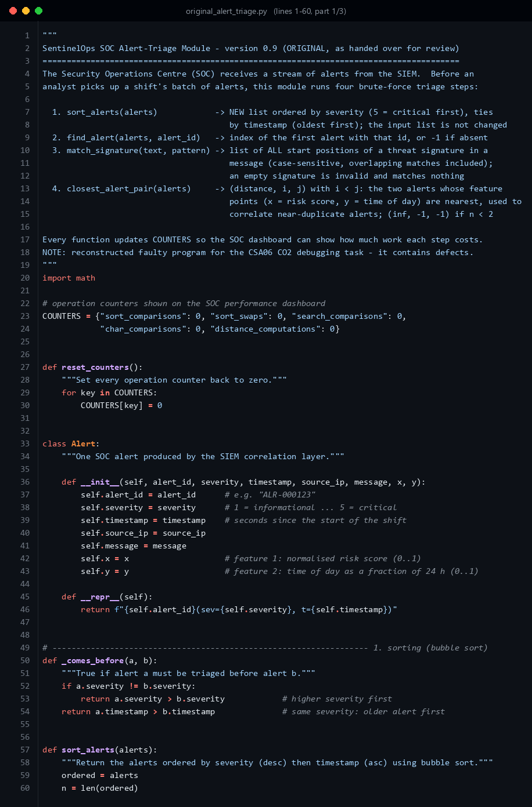

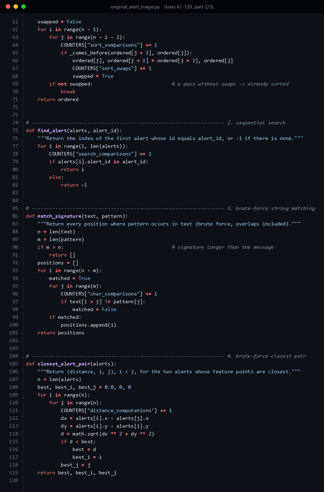

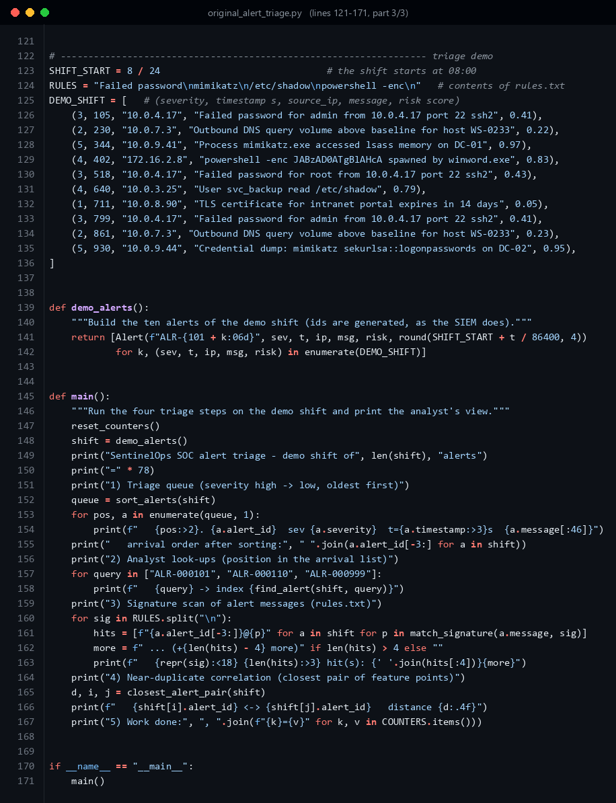

Table 2: Specification of the four functions (the test oracle, from the module docstring)

| Function – intended result | Edge cases that must work |
|---|---|
| **sort_alerts(alerts)** – a **new** list: severity 5 → 1, equal severity oldest (smallest timestamp) first; the input list is unchanged | empty batch, one alert, equal keys keep their arrival order |
| **find_alert(alerts, alert_id)** – index of the **first** alert whose id **equals** the query, otherwise −1 | empty batch, alert at index 0, duplicate ids, ids typed by an analyst |
| **match_signature(text, pattern)** – **all** start positions of the signature, overlapping ones included, case-sensitive | match at the very end, text equal to the pattern, empty signature → [ ], pattern longer than the text → [ ] |
| **closest_alert_pair(alerts)** – (distance, i, j) with i < j for the two alerts with the smallest Euclidean distance between their (x, y) points | fewer than two alerts → (∞, −1, −1), exact duplicates (distance 0) |

### 2. Symptoms in the program's own demo

Running the given program on its ten-alert demo shift (Figure 4) already shows that all four triage steps are wrong. Table 3 maps each wrong output line to the responsible defects (identified in Section 3).

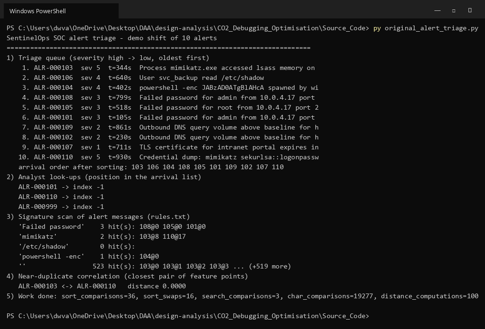

Table 3: Wrong demo outputs of the given program and the defects behind them (original_run.txt)

| Demo step | Actual output of the given program | Correct output | Defects |
|---|---|---|---|
| 1 Triage queue | critical alert ALR-000110 (sev 5) is **last** (position 10) | position 2 | D2 |
| 1 Equal severity 3 | 108, 105, 101 (newest first) | 101, 105, 108 (oldest first) | D3 |
| 1 Arrival list after sorting | 103 106 104 108 105 101 109 102 107 110 (re-ordered) | 101 102 … 110 (unchanged) | D1 |
| 2 Look-ups 101 / 110 / 999 | −1 / −1 / −1 | 0 / 9 / −1 | D5, D6, D7 |
| 3 Signature `/etc/shadow` | 0 hits | 1 hit (106@21, end of the message) | D8 |
| 3 Blank rule `''` (trailing newline of rules.txt) | 523 hits | 0 hits | D10 |
| 4 Near-duplicate pair | 103 ↔ 110, distance 0.0000 | 101 ↔ 108, distance 0.0081 | D11, D12, D13, D14 (+ D1) |
| 5 Work counters | 19,277 character comparisons, 100 distance computations | 1,748 and 45 | D9, D12 |

### 3. Defect identification and root-cause analysis

Table 4 lists the 14 defects; line numbers refer to `original_alert_triage.py` (Figures 1–3). The root cause of each defect follows the table.

Table 4: Defects of the given program – function, faulty line and defect type (diff_original_vs_corrected.csv)

| Defect number | Function and line | Faulty code | Defect type |
|---|---|---|---|
| D1 | sort_alerts, line 59 | `ordered = alerts` | Side effect (aliasing) |
| D2 | sort_alerts, line 63 | `for j in range(n - i - 2):` | Off-by-one (inner loop bound) |
| D3 | _comes_before, line 54 | `return a.timestamp > b.timestamp` | Wrong comparison (tie-break) |
| D4 | sort_alerts, line 61 | `swapped = False` (before the outer loop) | Initialisation / efficiency |
| D5 | find_alert, line 77 | `for i in range(1, len(alerts)):` | Off-by-one (start index) |
| D6 | find_alert, line 79 | `if alerts[i].alert_id is alert_id:` | Identity instead of equality |
| D7 | find_alert, lines 81–82 | `else:` / `return -1` (inside the loop) | Premature exit + missing return |
| D8 | match_signature, line 93 | `for i in range(n - m):` | Off-by-one (last alignment) |
| D9 | match_signature, line 98 | `matched = False` (no `break`) | Efficiency (redundant work) |
| D10 | match_signature, line 90 | `if m > n:` | Boundary / input validation |
| D11 | closest_alert_pair, line 108 | `best, best_i, best_j = 0.0, 0, 0` | Initialisation |
| D12 | closest_alert_pair, line 110 | `for j in range(n):` | Loop bound (self-pairs, double work) |
| D13 | closest_alert_pair, line 113 | `dy = alerts[i].y - alerts[i].y` | Wrong formula (index typo) |
| D14 | closest_alert_pair, line 118 | `best_j = j` (outside the `if`) | Indices not updated together |

Root causes:

- **D1 (side effect).** `ordered = alerts` copies the **reference**, not the list; the bubble sort then swaps the caller's list in place and destroys the arrival order that the look-ups and the correlation step use.
- **D2 (off-by-one).** Pass i must compare the pairs j = 0 … n − i − 2, i.e. `range(n − i − 1)`. With one pair too few, the pair (n − i − 2, n − i − 1) is never compared, so the last alert never moves.
- **D3 (tie-break).** For equal severity the **newer** alert is declared "before"; the comment on the same line says "older alert first", but the operator is reversed.
- **D4 (initialisation).** The early-exit flag is set once for the whole sort; after the first swap it stays `True`, so `if not swapped: break` never fires and every pass is executed even when the queue is already in order.
- **D5 (start index).** Python lists are 0-based; the loop starts at 1, so the alert at index 0 is never examined.
- **D6 (identity).** `is` tests object identity. An id typed by the analyst or built at run time is an **equal but different** string object, so the test is `False` although the ids are equal.
- **D7 (control flow).** "Not found" is decided after the **first** mismatch, so at most one alert is examined; when the loop body never runs (n ≤ 1) the function falls off its end and returns `None` instead of −1.
- **D8 (boundary).** There are n − m + 1 alignments (0 … n − m); `range(n − m)` skips the last one, so a signature at the end of a message, or a message equal to the signature, is missed.
- **D9 (efficiency).** After a mismatch the inner loop still compares the remaining m − 1 characters: every alignment costs m comparisons, Θ(nm) even on ordinary text. The result is still correct, only slower.
- **D10 (input validation).** The guard rejects over-long signatures but not the empty one; with m = 0 the inner loop is empty, `matched` stays `True` and every position is reported – a blank line in the rules file flags every alert.
- **D11 (initialisation).** A running minimum must start at +∞. No distance is smaller than 0.0, so `best` is never updated and (0.0, 0, 0) is always returned, even for fewer than two alerts.
- **D12 (loop bound).** j must start at i + 1. Starting at 0 compares every point with itself (distance 0, a false "duplicate") and every pair twice: n² instead of n(n − 1)/2 distance computations.
- **D13 (formula).** The second index must be j; `alerts[i].y - alerts[i].y` is always 0, so the time-of-day feature is ignored and the "distance" is only the x-difference.
- **D14 (logic).** Mis-indentation: `best_j = j` is executed on every iteration, not together with `best_i` inside the `if`, so it ends as the last j examined and the reported pair is not the pair whose distance is returned.

### 4. Test inputs, expected outputs and actual outputs

For every defect I designed a test whose input isolates it (for example, T05 passes the stored id object itself so that the `is` defect D6 cannot interfere, and T12 uses two points with equal y so that D13 cannot interfere). Table 5 lists the 18 defect tests with the actual output of the given program, copied from the harness run in Figure 5.

Table 5: Defect test cases – input, expected output and actual output of the given program (defect_tests.csv)

| Test (defect) | Input | Expected output | Actual output (original) |
|---|---|---|---|
| T01 (D1) | `sort_alerts`: sev [2,5,3], t [10,20,30]; inspect the input list afterwards | input order 001 002 003 | 002 001 003 (input re-ordered) |
| T02 (D2) | sev [3,2,5], t [10,20,30] | severities [5, 3, 2] | [3, 2, 5] |
| T03 (D3) | sev [4,4,4], t [20,10,30] | timestamps [10, 20, 30] | [20, 10, 30] |
| T04 (D4) | 10 alerts in triage order, items 2–3 swapped | ≤ 2n − 3 = 17 comparisons | 36 comparisons |
| T05 (D5) | 3 alerts, query = id object of alert 0 | index 0 | −1 |
| T06 (D6) | 3 alerts, query `"ALR-000001"` built at run time | index 0 | −1 |
| T07 (D7) | 3 alerts, query = id object of alert 2 | index 2 | −1 |
| T07b (D7) | empty batch | −1 | `None` |
| T08 (D8) | `'User svc_backup read /etc/shadow'`, `'/etc/shadow'` | [21] | [ ] |
| T08b (D8) | text = pattern = `'mimikatz'` | [0] | [ ] |
| T09 (D9) | text `'x'*20`, pattern `'abc'` | [ ] with ≤ n − m + 1 = 18 character comparisons | [ ] with 51 comparisons |
| T10 (D10) | `'Failed password for admin'`, pattern `''` | [ ] | [0, 1, …, 24] (25 false hits) |
| T11 (D11) | empty batch | (∞, −1, −1) | (0.0000, 0, 0) |
| T12 (D12) | points (0.20, 0.50), (0.23, 0.50) | (0.0300, 0, 1) | (0.0000, 0, 1) |
| T12b (D12) | one point (0.20, 0.50) | (∞, −1, −1) | (0.0000, 0, 0) |
| T12c (D12) | 10 random points (seed 7): distance computations | ≤ n(n − 1)/2 = 45 | 100 |
| T13 (D13) | (0.10, 0.10), (0.12, 0.90), (0.30, 0.12) | (0.2010, 0, 2) | (0.0000, 0, 2) |
| T14 (D14) | (0.10, 0.10), (0.11, 0.10), (0.80, 0.80) | (0.0100, 0, 1) | (0.0000, 0, 2) |

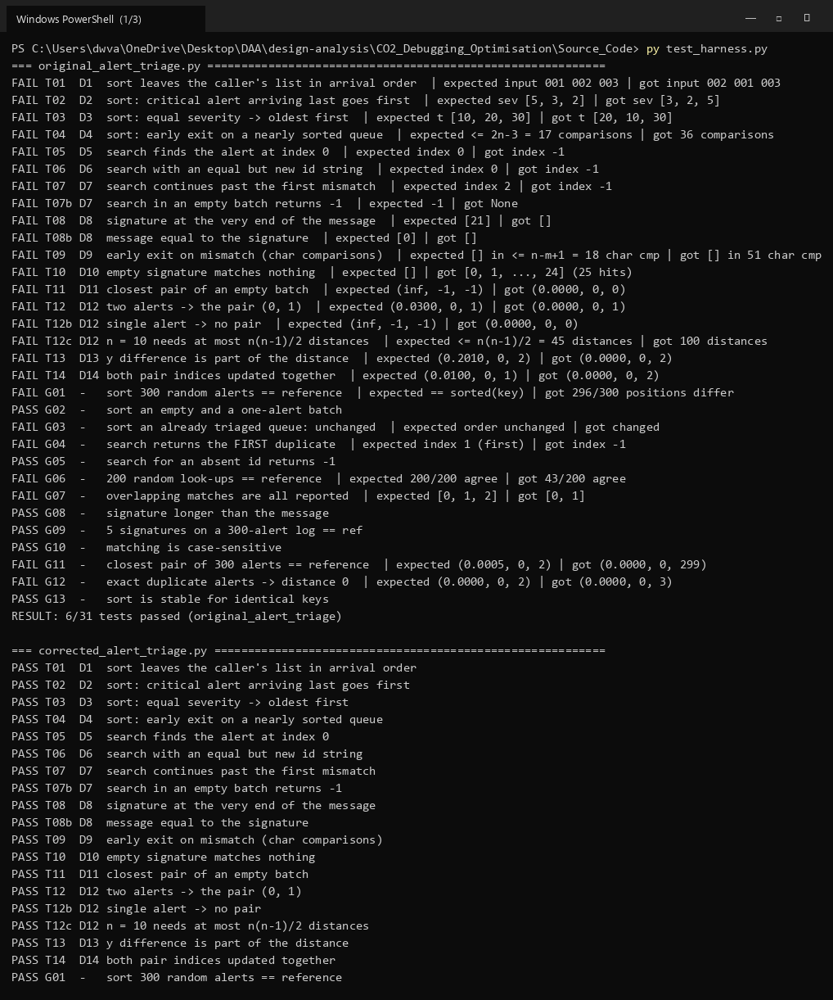

Thirteen further general tests (randomised cross-checks against `sorted()`, a reference scan with `==`, `str.startswith` and `math.dist` over all pairs, plus edge cases) also run on the given program; only 6 of them pass (empty and one-alert sort, absent id, over-long signature, case sensitivity, stability), so the given program passes **6/31** tests in total.

### 5. Classification of the defects

Table 6: Defect categories per function

| Defect category | Sorting | Searching | Matching | Closest pair |
|---|---|---|---|---|
| Off-by-one / loop bound / boundary | D2 | D5 | D8, D10 | D12 |
| Wrong comparison or operator | D3 | D6 | – | – |
| Initialisation | D4 | – | – | D11 |
| Side effect | D1 | – | – | – |
| Control flow / logic | – | D7 | – | D14 |
| Wrong formula | – | – | – | D13 |
| Efficiency (correct output, wasted work) | D4 | – | D9 | D12 |
| **Defects per function** | **4** | **3** | **3** | **4** |

Two observations guided the debugging in Part C. First, several defects **mask each other**: in `closest_alert_pair` D11 (best = 0) hides D12–D14 because no update ever happens, and in the original the aliasing defect D1 made a test of an already-sorted queue pass for the wrong reason (the result list *was* the input list). Second, three defects (D4, D9, D12) do not change the visible result on some inputs but multiply the work, so the harness also checks **operation counts**, not only outputs.

## Part B – Pseudocode for the Corrected and Optimised Algorithms

> **Your Challenge:** Prepare pseudocode for the corrected and optimised algorithms before implementation.
> - Separate pseudocode for all four corrected and optimised functions (sorting, sequential searching, brute-force string matching and closest-pair computation).

**Evidence Expected**

> Separate pseudocode for all four corrected and optimised functions (folder `Pseudocode/`).

**Ans:**

### 1. Conventions

I wrote the pseudocode before changing any code: the corrected versions fix exactly the defects of Part A (marked `// Dn`), and the optimised versions describe the new algorithms of Part D. Arrays are 0-based as in Python; A[i].x denotes a field; the basic operation of each function is stated in its file. Each algorithm is also stored as a separate file (Table 7), together with its complexity.

Table 7: Pseudocode files (folder Pseudocode/)

| Function | Corrected (brute force, debugged) | Optimised |
|---|---|---|
| Sorting (sort_alerts) | `1_sort_alerts_corrected.txt` – bubble sort with early exit (D1–D4) | `1_sort_alerts_optimised.txt` – adaptive stable merge sort |
| Searching (find_alert) | `2_find_alert_corrected.txt` – sequential search (D5–D7) | `2_find_alert_optimised.txt` – sentinel search + hash index |
| String matching (match_signature) | `3_match_signature_corrected.txt` – brute force (D8–D10) | `3_match_signature_optimised.txt` – Horspool (+ KMP) |
| Closest pair (closest_alert_pair) | `4_closest_alert_pair_corrected.txt` – brute force (D11–D14) | `4_closest_alert_pair_optimised.txt` – divide and conquer (+ x-sweep) |

### 2. sort_alerts

```
Algorithm ComesBefore(a, b)
1. if a.severity ≠ b.severity then return a.severity > b.severity
2. return a.timestamp < b.timestamp                 // D3: equal severity -> older alert first

Algorithm SortAlerts_Corrected(A, n)                // bubble sort with early exit
1. B ← copy of A[0..n-1]                            // D1: never reorder the caller's list
2. for i ← 0 to n − 2 do
3.     swapped ← false                              // D4: reset at the start of EVERY pass
4.     for j ← 0 to n − i − 2 do                    // D2: includes the last pair (n−i−2, n−i−1)
5.         if ComesBefore(B[j+1], B[j]) then
6.             exchange B[j] and B[j+1];  swapped ← true
7.     if swapped = false then break                // no exchange in a pass -> sorted
8. return B
```

```
Algorithm SortAlerts_Optimised(A, n)                // stable, adaptive merge sort
1. P ← [ (key(a), a) for every alert a in A ]       // key(a) = (−a.severity, a.timestamp), computed once
2. if n > 1 then MergeSort(P, Aux, 0, n)
3. return [ a for every (k, a) in P ]

Algorithm MergeSort(P, Aux, lo, hi)
1. if hi − lo < 2 then return
2. mid ← ⌊(lo + hi)/2⌋;  MergeSort(P, Aux, lo, mid);  MergeSort(P, Aux, mid, hi)
3. if P[mid−1].key ≤ P[mid].key then return         // halves already in order: skip the merge
4. Aux[lo..mid−1] ← P[lo..mid−1];  i ← lo;  j ← mid;  k ← lo     // copy the left half only
5. while i < mid and j < hi do
6.     if P[j].key < Aux[i].key then P[k] ← P[j]; j ← j + 1      // strict '<' keeps it stable
7.     else P[k] ← Aux[i]; i ← i + 1
8.     k ← k + 1
9. P[k .. k + mid − i − 1] ← Aux[i..mid−1]          // right leftovers are already in place
```

### 3. find_alert

```
Algorithm FindAlert_Corrected(A, n, id)             // sequential search
1. for i ← 0 to n − 1 do                            // D5: start at index 0
2.     if A[i].alert_id = id then return i          // D6: value equality, not identity
3. return −1                                        // D7: only after the whole scan (also n = 0)
```

```
Algorithm FindAlert_Sentinel(A, n, id)              // one test per element
1. A[n] ← sentinel record with alert_id = id
2. i ← 0
3. while A[i].alert_id ≠ id do i ← i + 1            // no "i < n" test needed
4. remove A[n]                                      // restore the caller's list
5. if i < n then return i else return −1

Algorithm BuildIndex(A, n)                          // for many look-ups on one shift
1. H ← empty hash table
2. for i ← 0 to n − 1 do
3.     if A[i].alert_id is not a key of H then H[A[i].alert_id] ← i     // first occurrence wins
4. return H

Algorithm IndexFind(H, id)
1. if id is a key of H then return H[id] else return −1
```

### 4. match_signature

```
Algorithm MatchSignature_Corrected(T, n, P, m)      // brute force
1. if m = 0 or m > n then return [ ]                // D10: empty signature matches nothing
2. positions ← [ ]
3. for i ← 0 to n − m do                            // D8: includes the last alignment i = n − m
4.     matched ← true
5.     for j ← 0 to m − 1 do
6.         if T[i+j] ≠ P[j] then matched ← false; break      // D9: stop at the first mismatch
7.     if matched then append i to positions
8. return positions
```

```
Algorithm MatchSignature_Horspool(T, n, P, m)
1. if m = 0 or m > n then return [ ]
2. shift[c] ← m for every character c;  for k ← 0 to m − 2 do shift[P[k]] ← m − 1 − k
3. positions ← [ ];  i ← 0
4. while i ≤ n − m do
5.     j ← m − 1
6.     while j ≥ 0 and T[i+j] = P[j] do j ← j − 1   // compare the window right to left
7.     if j < 0 then append i to positions
8.     i ← i + shift[T[i + m − 1]]                   // skip by the window's last character
9. return positions

Algorithm MatchSignature_KMP(T, n, P, m)            // alternative with a linear worst case
1. if m = 0 or m > n then return [ ]
2. f ← FailureFunction(P, m);  q ← 0;  positions ← [ ]       // f[q] = longest proper border of P[0..q]
3. for i ← 0 to n − 1 do
4.     while q > 0 and T[i] ≠ P[q] do q ← f[q − 1]
5.     if T[i] = P[q] then q ← q + 1
6.     if q = m then append i − m + 1 to positions;  q ← f[q − 1]
7. return positions
```

### 5. closest_alert_pair

```
Algorithm ClosestAlertPair_Corrected(A, n)          // brute force
1. best ← ∞;  bi ← −1;  bj ← −1                     // D11: "no pair found yet"
2. for i ← 0 to n − 1 do
3.     for j ← i + 1 to n − 1 do                    // D12: each unordered pair once, no self-pair
4.         dx ← A[i].x − A[j].x;  dy ← A[i].y − A[j].y          // D13: A[j].y, not A[i].y
5.         d ← √(dx² + dy²)
6.         if d < best then best ← d;  bi ← i;  bj ← j          // D14: both indices together
7. return (best, bi, bj)
```

```
Algorithm ClosestAlertPair_DC(A, n)                 // divide and conquer, squared distances
1. if n < 2 then return (∞, −1, −1)
2. Px ← points (A[k].x, A[k].y, k) sorted by x      // once
3. ((d², i, j), Y) ← ClosestRec(Px, 0, n);  return (√d², i, j)

Algorithm ClosestRec(Px, lo, hi)                    // best (d², i, j) of Px[lo..hi−1] and those points by y
1. if hi − lo ≤ 3 then return (brute force over the ≤ 3 pairs, points sorted by y)
2. mid ← ⌊(lo + hi)/2⌋;  xm ← Px[mid].x
3. (bl, L) ← ClosestRec(Px, lo, mid);  (br, R) ← ClosestRec(Px, mid, hi)
4. best ← min(bl, br);  Y ← merge of L and R by y
5. S ← [ p in Y with (p.x − xm)² < best.d² ]        // strip of width 2δ
6. for s ← 0 to |S| − 1 do
7.     t ← s + 1
8.     while t < |S| and (S[t].y − S[s].y)² < best.d² do   // at most 7 successors
9.         best ← min(best, (squared distance of S[s], S[t], their indices));  t ← t + 1
10. return (best, Y)

Algorithm ClosestAlertPair_Sweep(A, n)              // alternative: x-sorted sweep with pruning
1. Px ← points sorted by x;  best ← (∞, −1, −1)
2. for a ← 0 to n − 2 do
3.     for b ← a + 1 to n − 1 do
4.         dx ← Px[b].x − Px[a].x;  if dx² ≥ best.d² then break   // later points are further away
5.         best ← min(best, (dx² + dy², indices))
6. return (√best.d², best.i, best.j)
```

## Part C – Systematic Debugging [25 Marks]

> **Your Challenge:** Debug the existing code systematically without rewriting it from scratch.
> - Follow a systematic process (reproduce, isolate, fix, re-test) for every defect.
> - Document every correction with appropriate test cases and output verification (before and after the fix).
> - Provide the corrected program, a comparison of original and corrected lines, and screenshots of the source code and execution outputs.

**Evidence Expected**

> Debugging steps, screenshots of source code and execution outputs, test-case verification, corrected Python program.

**Ans:**

### 1. Debugging method

I debugged the given file in place and changed only the faulty lines. To make the process repeatable and verifiable, `debug_session.py` (Figure 6) replays it on the original source text:

1. **Reproduce** – run the 18 defect tests and 13 general tests on the untouched original (0/18 and 6/13 pass).
2. **Isolate** – run the faulty functions under `sys.settrace` (the mechanism that debuggers such as pdb use) and print the executed line numbers and the values of the loop variables, so that each failure is pinned to specific lines.
3. **Fix one defect at a time** – each entry of the `FIXES` list is a minimal line-level patch (faulty lines → replacement lines with a `# FIX Dn` comment). After every patch the module is re-loaded from the patched text and **all** tests are re-run; the defect's own test must flip from FAIL to PASS (before → after), and a regression check confirms that no test that passed before now fails.
4. **Verify** – the fully patched text must be identical to `corrected_alert_triage.py` (code after the docstring), which proves that the corrected program is the original plus 14 line-level fixes and not a rewrite.

I fixed the defects function by function (sort → search → matching → closest pair). Where defects mask each other (Part A, Section 5) the order matters: in `closest_alert_pair`, fixing D11 first makes the self-pair symptom of D12 visible, and the D12 fix then makes the wrong index of D14 testable.

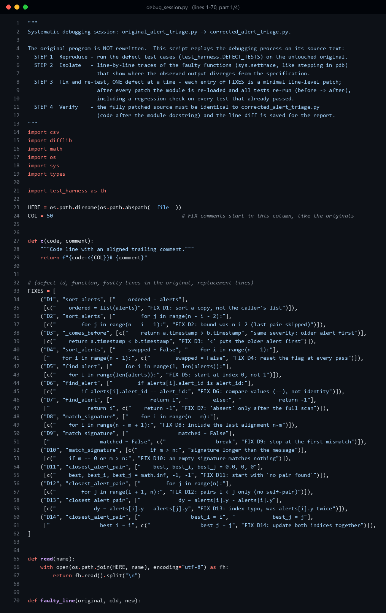

### 2. Reproduce and isolate

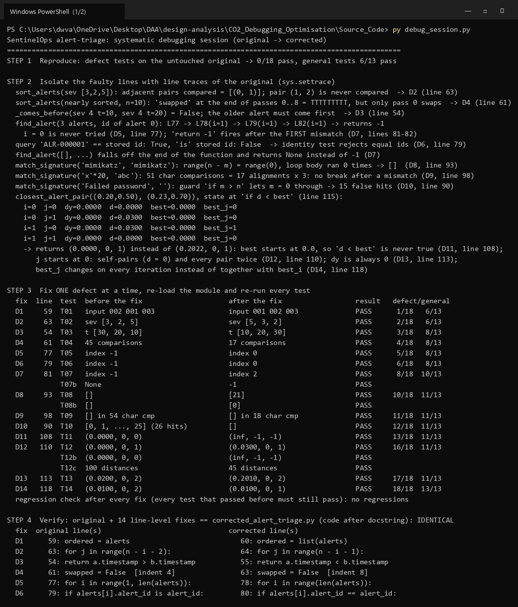

The traces in Figure 7 localise every failure:

- **sort_alerts:** for severities [3, 2, 5] only the adjacent pair (0, 1) is compared – the pair (1, 2) never is, so the critical alert cannot move (D2, line 63). On the nearly sorted 10-alert queue the flag `swapped` is `True` at the end of all 9 passes although only pass 0 swaps (D4, line 61). `_comes_before` returns `False` for (t = 10, t = 20) with equal severity, i.e. the older alert loses (D3, line 54).
- **find_alert:** the executed lines are L77 → L78 (i = 1) → L79 (i = 1) → L82: index 0 is never visited (D5) and `return -1` runs after the first mismatch (D7). The query string is `==` the stored id but not `is` it (D6, line 79). With an empty batch the function returns `None` (D7).
- **match_signature:** for text = pattern = `'mimikatz'`, `range(n − m)` = `range(0)`, so the loop body runs 0 times (D8, line 93); 20 × `'x'` against `'abc'` costs 51 = 17 × 3 comparisons because there is no `break` (D9, line 98); the empty signature passes the guard `if m > n` and yields 15 false hits on `'Failed password'` (D10, line 90).
- **closest_alert_pair:** the state at line 115 shows the pairs with i = j and d = 0, every pair visited twice (D12, line 110), dy = 0 for every pair (D13, line 113), `best` stuck at 0.0 (D11, line 108) and `best_j` changing on every iteration (D14, line 118).

### 3. Fix and re-test, one defect at a time

Table 8 is the debugging log from Figures 7–8: for every defect the output of its test before the fix, the output after the fix and the running number of passing tests.

Table 8: Debugging log – one fix at a time, before/after output of the defect's test case (debug_session_run.txt)

| Defect and line no. | Fix applied | Test case | Before the fix | After the fix | Passing (defect · general) |
|---|---|---|---|---|---|
| D1, line 59 | `ordered = list(alerts)` | T01 | input 002 001 003 | input 001 002 003 – PASS | 1/18 · 6/13 |
| D2, line 63 | `range(n - i - 1)` | T02 | sev [3, 2, 5] | sev [5, 3, 2] – PASS | 2/18 · 6/13 |
| D3, line 54 | `a.timestamp < b.timestamp` | T03 | t [30, 20, 10] | t [10, 20, 30] – PASS | 3/18 · 8/13 |
| D4, line 61 | `swapped = False` moved into the outer loop | T04 | 45 comparisons | 17 comparisons – PASS | 4/18 · 8/13 |
| D5, line 77 | `range(len(alerts))` | T05 | index −1 | index 0 – PASS | 5/18 · 8/13 |
| D6, line 79 | `==` instead of `is` | T06 | index −1 | index 0 – PASS | 6/18 · 8/13 |
| D7, line 81–82 | `else` removed, `return -1` after the loop | T07, T07b | −1; `None` | 2; −1 – PASS | 8/18 · 10/13 |
| D8, line 93 | `range(n - m + 1)` | T08, T08b | [ ]; [ ] | [21]; [0] – PASS | 10/18 · 11/13 |
| D9, line 98 | `break` added after `matched = False` | T09 | 54 character comparisons | 18 – PASS | 11/18 · 11/13 |
| D10, line 90 | `if m == 0 or m > n:` | T10 | [0, 1, …, 25] (26 hits) | [ ] – PASS | 12/18 · 11/13 |
| D11, line 108 | `best = math.inf`, indices −1 | T11 | (0.0000, 0, 0) | (∞, −1, −1) – PASS | 13/18 · 11/13 |
| D12, line 110 | `range(i + 1, n)` | T12, T12b, T12c | (0.0000, 0, 1); (0.0000, 0, 0); 100 distances | (0.0300, 0, 1); (∞, −1, −1); 45 – PASS | 16/18 · 11/13 |
| D13, line 113 | `alerts[i].y - alerts[j].y` | T13 | (0.0200, 0, 2) | (0.2010, 0, 2) – PASS | 17/18 · 11/13 |
| D14, line 118 | `best_j = j` indented into the `if` | T14 | (0.0100, 0, 2) | (0.0100, 0, 1) – PASS | 18/18 · 13/13 |

The "before" values differ slightly from the actual outputs in Table 5 because the earlier fixes are already in place – for example T03 shows t [30, 20, 10] once D1 and D2 are fixed, which is the pure effect of the reversed tie-break D3, and T10 shows 26 hits once D8 has added the last alignment. The regression check reported **no regressions** after any fix.

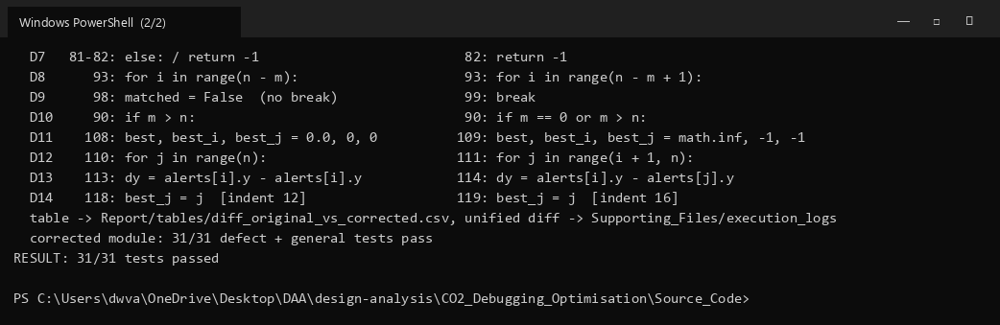

One lesson from the reproduction step concerns the **test oracle** itself: my first version of general test G03 ("sorting an already triaged queue leaves its order unchanged") compared the result with the input list *after* the call. On the original it passed – because of D1 the result *was* the input list – and it started failing after the D1 fix, until D2 and D3 were fixed. I changed the test to take a snapshot of the ids before the call, so it now fails on the original for the right reason.

### 4. Original versus corrected lines

Table 9: Line diff – original faulty line(s) and corrected line(s) (diff_original_vs_corrected.csv)

| Defect number | Original – line: code | Corrected – line: code |
|---|---|---|
| D1 | 59: `ordered = alerts` | 60: `ordered = list(alerts)` |
| D2 | 63: `for j in range(n - i - 2):` | 64: `for j in range(n - i - 1):` |
| D3 | 54: `return a.timestamp > b.timestamp` | 55: `return a.timestamp < b.timestamp` |
| D4 | 61: `swapped = False` (indent 4, before the outer loop) | 63: `swapped = False` (indent 8, first line of every pass) |
| D5 | 77: `for i in range(1, len(alerts)):` | 78: `for i in range(len(alerts)):` |
| D6 | 79: `if alerts[i].alert_id is alert_id:` | 80: `if alerts[i].alert_id == alert_id:` |
| D7 | 81–82: `else:` / `return -1` (inside the loop) | 82: `return -1` (after the loop) |
| D8 | 93: `for i in range(n - m):` | 93: `for i in range(n - m + 1):` |
| D9 | 98: `matched = False` (no break) | 99: `break` |
| D10 | 90: `if m > n:` | 90: `if m == 0 or m > n:` |
| D11 | 108: `best, best_i, best_j = 0.0, 0, 0` | 109: `best, best_i, best_j = math.inf, -1, -1` |
| D12 | 110: `for j in range(n):` | 111: `for j in range(i + 1, n):` |
| D13 | 113: `dy = alerts[i].y - alerts[i].y` | 114: `dy = alerts[i].y - alerts[j].y` |
| D14 | 118: `best_j = j` (indent 12) | 119: `best_j = j` (indent 16, inside the `if`) |

In total 13 code lines were changed or moved, 2 removed (`else:` and the separate `swapped = False`) and 1 added (`break`); the corrected line numbers are shifted by one where the corrected docstring is one line longer. The complete unified diff is saved as `Supporting_Files/execution_logs/original_vs_corrected.diff`.

### 5. The corrected program and its output

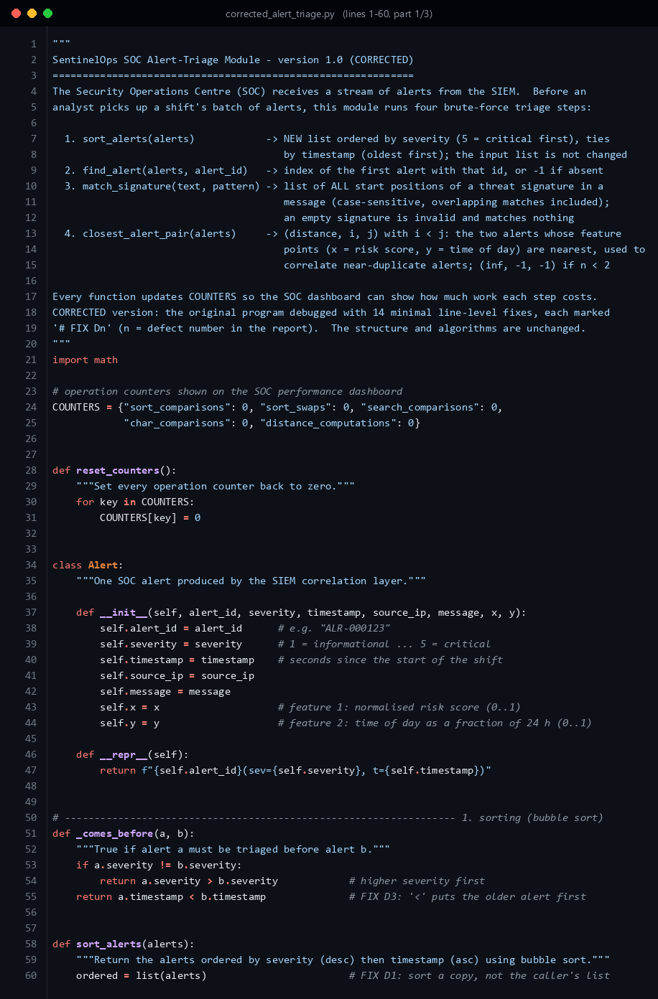

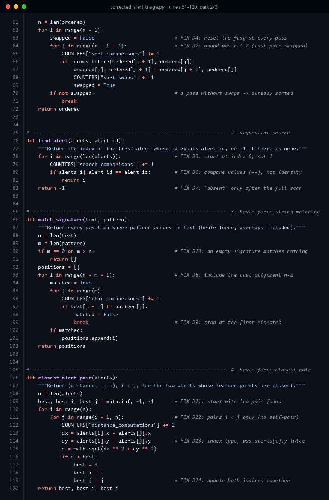

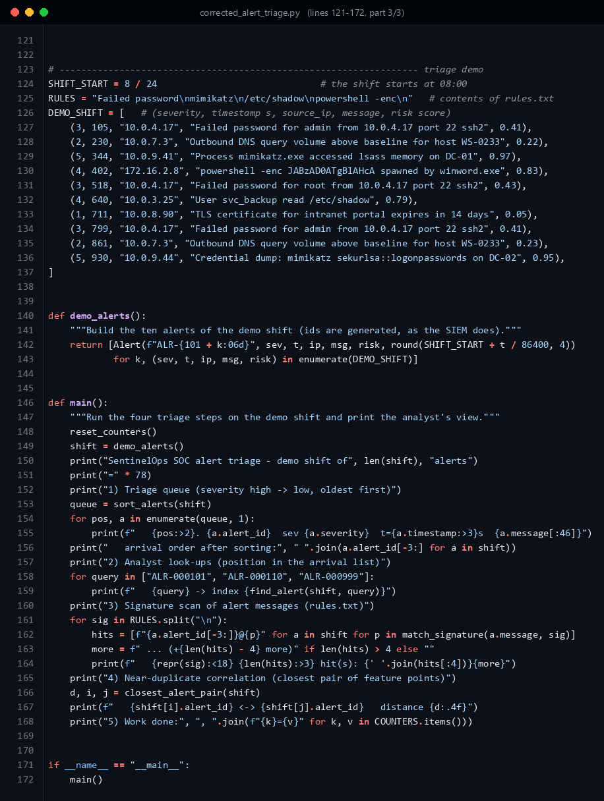

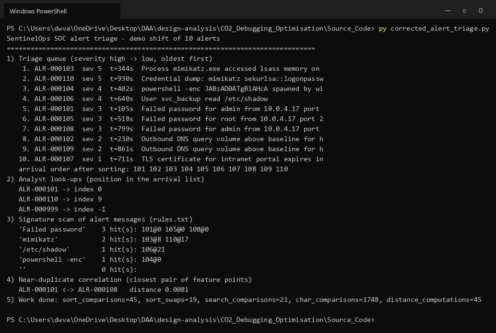

Table 10: Demo output before and after debugging (original_run.txt, corrected_run.txt)

| Demo item | Original | Corrected | Check |
|---|---|---|---|
| Triage queue | 103, 106, 104, 108, 105, 101, 109, 102, 107, **110** | 103, 110, 104, 106, 101, 105, 108, 102, 109, 107 | severities 5, 5, 4, 4, 3, 3, 3, 2, 2, 1; ties oldest first |
| Arrival list after sorting | re-ordered | 101 … 110 unchanged | D1 fixed |
| Look-ups ALR-000101 / 110 / 999 | −1 / −1 / −1 | 0 / 9 / −1 | D5–D7 fixed |
| `/etc/shadow` | 0 hits | 1 hit: 106@21 | D8 fixed |
| Blank rule `''` | 523 hits | 0 hits | D10 fixed |
| Near-duplicate pair | 103 ↔ 110, 0.0000 | 101 ↔ 108, 0.0081 (same message re-fired 694 s later) | D11–D14 fixed |
| Sort comparisons / swaps | 36 / 16 | 45 / 19 = n(n−1)/2 / inversions | D2, D4 fixed |
| Character comparisons | 19,277 | 1,748 | D9 fixed |
| Distance computations | 100 = n² | 45 = n(n−1)/2 | D12 fixed |

I checked the corrected queue by hand against the specification: the two critical alerts 103 (t = 344 s) and 110 (t = 930 s) come first in time order, then 104 (402 s) and 106 (640 s), then the three failed-password alerts 101, 105 and 108, and so on. The closest pair 101/108 is the same SSH brute-force alert re-fired: identical risk score 0.41 and a time-of-day difference of 0.0081.

### 6. Test-case verification of the corrected program

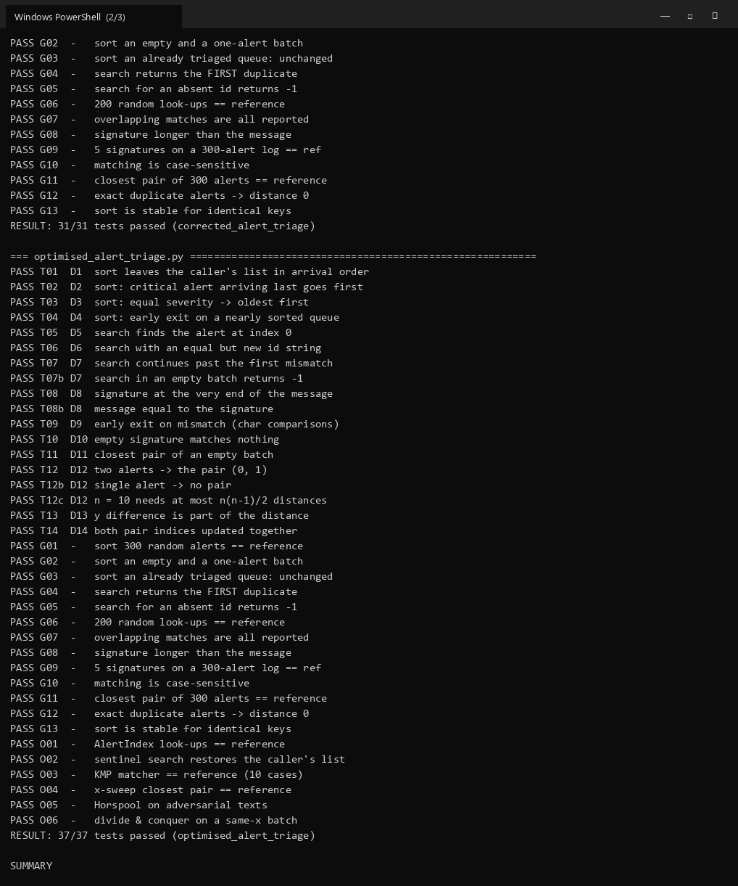

All 18 defect tests and all 13 general tests pass on the corrected module (**RESULT: 31/31 tests passed**, Figure 13 and Appendix D), including the randomised cross-checks against independent references: 300 random alerts sorted equal to `sorted(key=(−severity, timestamp))`, 200 look-ups equal to a reference scan with `==`, five signatures on a 300-alert log equal to a `str.startswith` scan, and the closest pair of 300 alerts equal to `min` over all pairs with `math.dist`.

## Part D – Optimisation and Implementation [20 Marks]

> **Your Challenge:** Implement and execute the corrected and optimised Python module, covering sorting, sequential searching, brute-force string matching and closest-pair computation.
> - Apply and justify optimisation techniques for each of the four functions.
> - Show that the optimised module produces the same results as the corrected module.

**Evidence Expected**

> Optimised Python program, optimisation techniques, execution outputs and output verification.

**Ans:**

### 1. Where the corrected brute-force module spends its work

The corrected module is correct but brute force. For a shift of n alerts its cost is dominated by the bubble sort's ≈ n(n − 1)/2 comparisons (12.46 million at n = 5,000), a sequential scan of ≈ n/2 to n comparisons **per analyst look-up**, about one character comparison per text character and signature, and, above all, **n(n − 1)/2 distance computations** for the near-duplicate correlation (12.5 million at n = 5,000, 6.4 s). Each optimisation in Table 11 attacks one of these terms while keeping the interface and the results unchanged.

Table 11: Optimisation techniques per function

| Function (corrected algorithm) | Optimisation applied | Cost: corrected → optimised |
|---|---|---|
| Sorting – sort_alerts (bubble sort with early exit) | stable top-down **merge sort** on keys (−severity, timestamp) computed once; a merge is skipped when the halves are already in order; only the left half is copied | Θ(n²) → Θ(n log n); n − 1 comparisons on an already triaged queue |
| Searching – find_alert (sequential search, 2 tests per element) | **sentinel** search (1 test per element); **AlertIndex** hash table id → first position for repeated look-ups | q look-ups: Θ(qn) → Θ(n + q) expected |
| String matching – match_signature (brute force with early exit) | **Boyer-Moore-Horspool**: right-to-left window check and bad-character shift table; **KMP** as an alternative with a linear worst case | ≈ 1.03 → ≈ 0.12 comparisons per character on log text |
| Closest pair – closest_alert_pair (all n(n − 1)/2 pairs, a square root for each) | **divide and conquer** on x-sorted points, y-merged strip with ≤ 7 neighbours, **squared distances** (one square root at the end); **x-sweep** alternative | Θ(n²) → Θ(n log n) |

Why the results stay identical:

- **Sorting:** both sorts are stable, and a stable sort of a strict weak order has exactly one possible output, so merge sort returns the same queue as the corrected bubble sort, including alerts with identical keys.
- **Searching:** the sentinel search scans in the same order and stops at the same first match; the index keeps the **first** occurrence of every id (`setdefault`), exactly what the sequential search returns.
- **String matching:** a Horspool shift never passes over a possible match – it moves the window only up to the last occurrence of the window's last character in P[0..m−2]; KMP's failure function likewise skips only alignments that cannot match. Overlapping matches are kept.
- **Closest pair:** by the strip lemma a pair closer than δ across the split lies in the 2δ strip within 7 positions in y order, so no candidate is lost; √ is monotonic, so comparing squared distances selects the same pair.

Code-level optimisations: `Alert` uses `__slots__` (faster attribute access, less memory); operation counters are accumulated in local variables and added once per call instead of a dictionary update in every inner-loop iteration; tuple keys are compared directly instead of calling a comparison function.

### 2. sort_alerts – adaptive stable merge sort

Bubble sort needs up to n − 1 passes and, as the experiments show, also on realistic "nearly sorted" queues: a fresh critical alert appended at the end of an already triaged queue moves only one position per pass (a "turtle"), so the early exit does not help. Merge sort halves the problem, T(n) = 2T(n/2) + Θ(n), which gives Θ(n log n) in every case. Because the key tuple (−severity, timestamp) is computed once per alert, each comparison is a single tuple comparison. The check `P[mid−1].key ≤ P[mid].key` skips the merge of two halves that are already in order, so an already triaged queue costs only n − 1 comparisons and no moves. Stability (strict `<` when taking from the right half) guarantees the same order as the stable bubble sort, including alerts with identical keys (test G13).

### 3. find_alert – sentinel search and hash index

For a single look-up in an unsorted list Θ(n) is optimal (a miss must inspect every alert), so the sentinel search keeps the scan but removes the bounds test from the loop: the query is appended as a sentinel record, the loop `while A[i].alert_id ≠ id` needs no `i < n`, and the sentinel is removed in a `finally` block so that the caller's list is unchanged even if an exception occurs (test O02). The real gain comes from the access pattern: an analyst performs many look-ups on the same shift, so `AlertIndex` builds a dictionary from id to **first** position once in Θ(n) and answers each look-up with one hash probe, Θ(1) expected.

### 4. match_signature – Horspool (and KMP)

The corrected brute force already stops at the first mismatch (D9), so on log text it needs only about 1.03 comparisons per character and signature – it is linear in practice but can never skip text. Horspool compares the window from right to left and then shifts it by the distance from the last occurrence of the window's last text character to the end of the pattern; a character that does not occur in P[0..m−2] (most characters of a log line for a signature such as `/etc/shadow`) shifts the window by the full m. The shift table is built in Θ(m). Horspool's worst case is still Θ(nm) (text `aaa…a`, pattern `baa…a`), so I also implemented KMP, which never moves backwards in the text and needs at most 2n comparisons in the search phase.

### 5. closest_alert_pair – divide and conquer with squared distances

The points are sorted by x once. The recursion splits at the median x, solves both halves and obtains δ, the smaller of the two best distances; only a pair with one point on each side and both within δ of the dividing line can be closer, and in the y-sorted strip each point needs to be compared only with the following points whose y-difference is below δ – at most 7 by the packing argument. The y-order of each half is produced by merging the halves' y-orders (no sorting per level), so T(n) = 2T(n/2) + Θ(n) = Θ(n log n). All comparisons use squared distances, which avoids n(n − 1)/2 square roots; √ is taken once at the end. Ties are broken by the index pair (i, j), so the result is deterministic. The simpler x-sweep alternative sorts by x and stops scanning as soon as the x-gap alone is at least the best distance: it is extremely fast on spread-out data but degrades to n(n − 1)/2 when all alerts share one x value (Part E).

### 6. The optimised program and its output


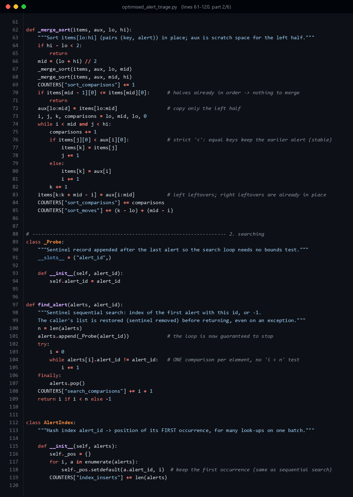

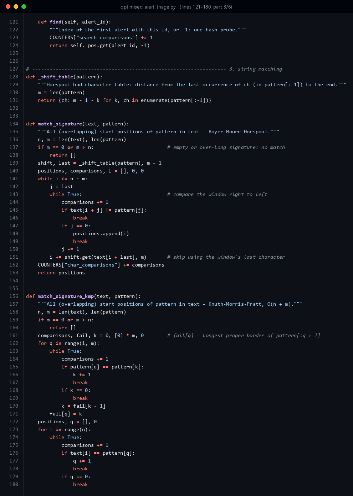

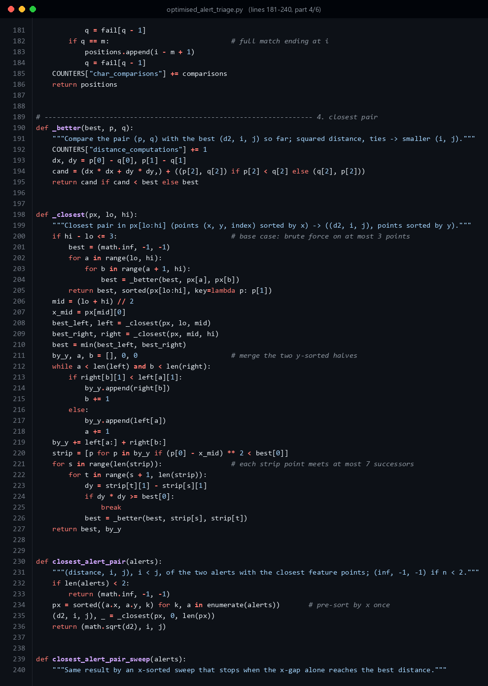

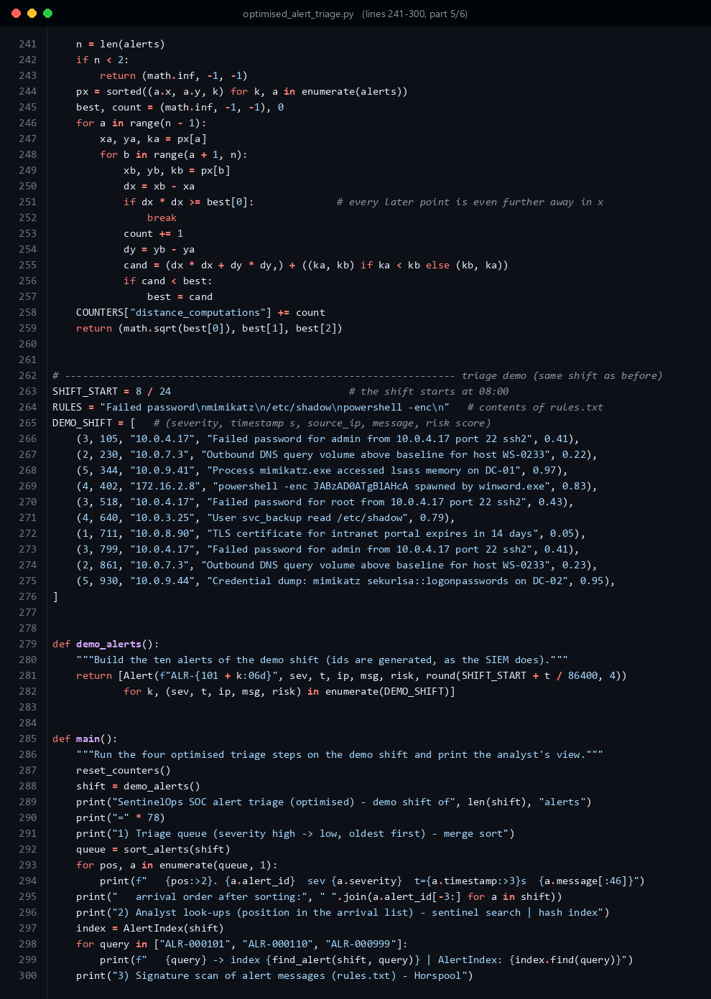

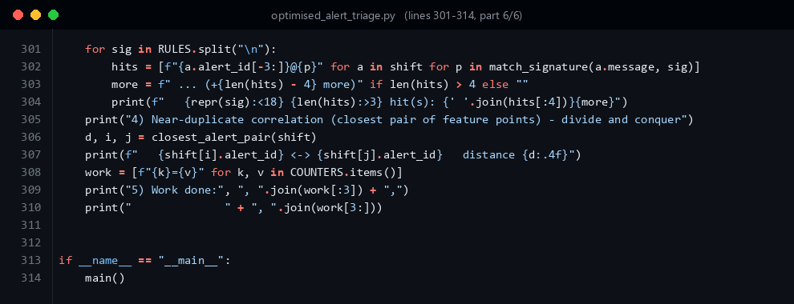

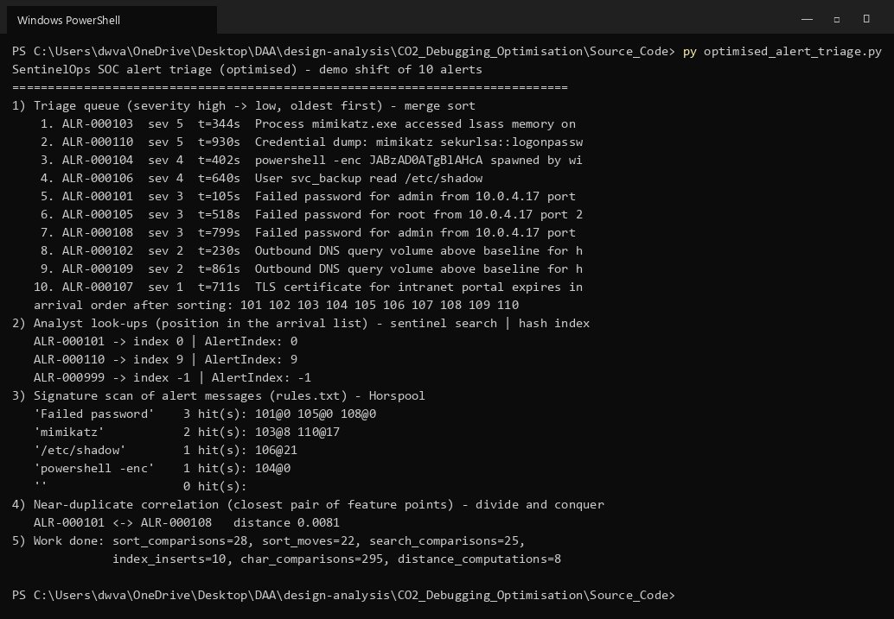

The optimised demo (Figure 20) prints exactly the same queue, look-up results (sentinel search and `AlertIndex` agree), signature hits and near-duplicate pair as the corrected demo (Figure 12). Even on these ten alerts the work drops: 28 instead of 45 sort comparisons, 295 instead of 1,748 character comparisons and 8 instead of 45 distance computations.

### 7. Verification that the results are identical

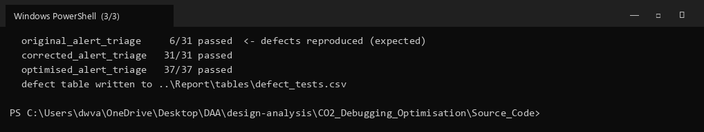

The optimised module passes the same 31 tests as the corrected module plus 6 tests for its additional routines (`AlertIndex`, the restored list after a sentinel search, KMP, the x-sweep, Horspool on adversarial texts and divide and conquer on a same-x batch): **RESULT: 37/37 tests passed** (Figure 21). In addition, every experiment in Part E compares the outputs of both versions on every batch – the sorted order, 1,000 look-up results, all match positions of five signatures and the closest pair – and reports `same = yes` in every row.

## Part E – Complexity Analysis and Experimental Comparison [20 Marks]

> **Your Challenge:** Perform complexity analysis and experimental comparisons of the corrected and optimised versions.
> - Derive the best-, average- and worst-case complexity of the corrected (brute force as intended) and optimised algorithms.
> - Compare them experimentally, including distance computations for at least three batch sizes between [ … ] (range left blank in the brief – I used 100, 500, 1,000, 2,000 and 5,000 alerts).
> - Present experimental results, comparison tables and graphs, and compare theory with experiment.

**Evidence Expected**

> Complexity analysis, experimental results, comparison tables, graphs and documentation.

**Ans:**

### 1. Experimental set-up

`alert_data.py` generates seeded shifts of n alerts in arrival order: severities 1–5 with probabilities 30 / 25 / 25 / 15 / 5 %, timestamps with random gaps of 0–20 s (a gap of 0 creates equal timestamps), 14 realistic SIEM message templates, a risk score x that grows with severity and y = time of day; 5 % of the alerts are re-fired near-duplicates of a recent alert. The batches for n = 100 … 5,000 are prefixes of the same seeded stream (as in a growing shift). For sorting I also used a **nearly sorted** queue (an already triaged queue with 1 % fresh alerts appended), for closest pair a **same-x** batch (every alert has risk 0.5, distinct sub-second times) and for matching an adversarial text of the same length. `experiments.py` counts the basic operations of one run, times the functions and checks that the results are identical (Figures 22–23).

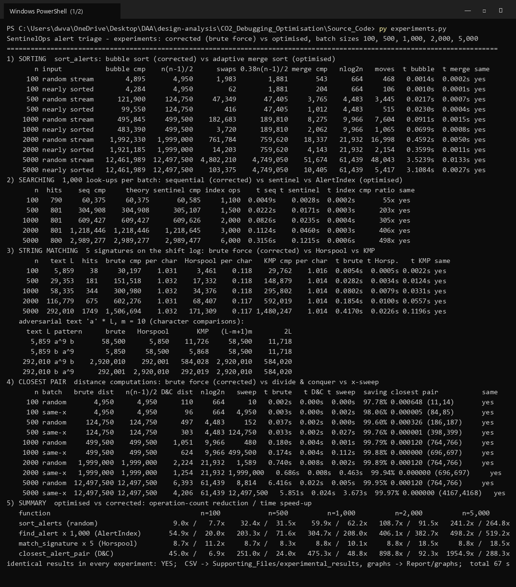


### 2. Complexity derivations

**Bubble sort (corrected).** Pass i (i = 0 … n − 2) makes n − 1 − i comparisons, so in the worst case C<sub>worst</sub>(n) = Σ<sub>i=0</sub><sup>n−2</sup> (n − 1 − i) = (n − 1) + (n − 2) + … + 1 = n(n − 1)/2 ∈ Θ(n²). Best case (already in triage order): the first pass makes no exchange and the early exit stops after n − 1 comparisons, Θ(n). Each exchange removes exactly one inversion, so the number of exchanges equals I(A), the number of inversions. For independent random severities with probabilities p<sub>k</sub>, a pair (i < j) in arrival order is an inversion when sev<sub>j</sub> > sev<sub>i</sub>, with probability (1 − Σp<sub>k</sub>²)/2 = (1 − 0.24)/2 = 0.38, so E[I] = 0.38 · n(n − 1)/2 ∈ Θ(n²) and the average case is Θ(n²).

**Merge sort (optimised).** C(n) = C(⌈n/2⌉) + C(⌊n/2⌋) + M(n) with M(n) ≤ n − 1 merge comparisons (+1 order check). Master theorem: a = 2, b = 2, f(n) = Θ(n), n<sup>log_b a</sup> = n<sup>log₂ 2</sup> = n, so f(n) = Θ(n<sup>log_b a</sup>) – case 2 – and C(n) ∈ Θ(n log n). The recursion tree has ⌈log₂ n⌉ levels, each costing at most n comparisons, which gives the bound n⌈log₂ n⌉ − 2<sup>⌈log₂ n⌉</sup> + 1 (56,809 for n = 5,000). Best case (already in order): every merge is skipped after one check, C(n) = 2C(n/2) + 1 = n − 1 ∈ Θ(n).

**Sequential search (corrected).** Best case 1 comparison (index 0), worst case n (absent or last). For a present id at a uniformly random position the average is Σ<sub>i=1</sub><sup>n</sup> i / n = (n + 1)/2; with hit probability p the expected cost per look-up is p(n + 1)/2 + (1 − p)n, and q look-ups cost Θ(qn). The for-loop also performs a bound test per element, about 2n + 1 tests in the worst case. **Sentinel search:** n + 1 key tests in the worst case and no bound tests, still Θ(n). **AlertIndex:** n insertions once plus one expected-O(1) probe per look-up: Θ(n + q).

**Brute-force string matching (corrected).** There are n − m + 1 alignments; the worst case compares all m characters at every alignment: (n − m + 1)m ∈ Θ(nm). Best case: the first character never matches, n − m + 1 ∈ Θ(n). Average case for text over an alphabet of σ equally likely characters: the expected number of comparisons per alignment is Σ<sub>k≥0</sub> σ<sup>−k</sup> ≤ σ/(σ − 1), so ≈ (n − m + 1) · σ/(σ − 1) ∈ Θ(n). **Horspool:** Θ(m + σ) preprocessing; best case Θ(n/m) when every window is rejected after one comparison and shifted by m; worst case Θ(nm). **KMP:** the failure function costs ≤ 2m comparisons; in the search q increases at most n times and every failure step decreases it, so there are at most 2n comparisons: Θ(n + m) in every case.

**Brute-force closest pair (corrected).** Every unordered pair is evaluated exactly once: D(n) = Σ<sub>i=0</sub><sup>n−1</sup> (n − 1 − i) = n(n − 1)/2 distance computations in the best, average and worst case alike – Θ(n²), independent of the data. **Divide and conquer:** T(n) = 2T(n/2) + Θ(n) (merge by y + strip scan with ≤ 7 comparisons per strip point) → Master theorem case 2 (a = 2, b = 2, f(n) = Θ(n) = Θ(n<sup>log₂ 2</sup>)) → Θ(n log n), plus the Θ(n log n) pre-sort by x. Distance computations: at most 3 per base case and at most 7 per strip point per level, so O(n log n) in the worst case; when δ becomes small the strips are nearly empty and the count approaches Θ(n). **x-sweep:** Θ(n log n) for the sort; the number of distance computations depends on the data – few when the x values are spread out, but n(n − 1)/2 when all x are equal.

Table 12: Complexity summary – corrected (brute force as intended) vs optimised

| Function and version | Best case | Average case | Worst case | Memory |
|---|---|---|---|---|
| Sorting – corrected bubble sort | Θ(n): n − 1 comparisons | Θ(n²) | Θ(n²): n(n − 1)/2 | Θ(n) copy |
| Sorting – optimised merge sort | Θ(n): n − 1 checks | Θ(n log n) | Θ(n log n) | Θ(n) |
| Searching, q look-ups – corrected sequential search | Θ(q) | Θ(qn): q(n + 1)/2 for hits | Θ(qn) | Θ(1) |
| Searching, q look-ups – optimised AlertIndex | Θ(n + q) | Θ(n + q) | Θ(qn) (hash collisions) | Θ(n) |
| String matching – corrected brute force | Θ(n) | Θ(n) on natural text | Θ(nm) | Θ(1) |
| String matching – optimised Horspool / KMP | Θ(n/m) / Θ(n) | ≈ Θ(n/m) / Θ(n) | Θ(nm) / Θ(n + m) | Θ(σ) / Θ(m) |
| Closest pair – corrected brute force | Θ(n²) | Θ(n²) | Θ(n²): n(n − 1)/2 | Θ(1) |
| Closest pair – optimised divide and conquer | Θ(n log n) | Θ(n log n) | Θ(n log n) | Θ(n) |

### 3. Sorting – comparisons and swaps

Table 13: sort_alerts – measured key comparisons against the theory (sort_results.csv)

| Batch size n | Input | Bubble sort | n(n−1)/2 | Merge sort | n log₂ n | Reduction |
|---|---|---|---|---|---|---|
| 100 | random | 4,895 | 4,950 | 543 | 664 | 9.0× |
| 100 | nearly sorted | 4,284 | 4,950 | 204 | 664 | 21.0× |
| 500 | random | 121,900 | 124,750 | 3,765 | 4,483 | 32.4× |
| 500 | nearly sorted | 99,550 | 124,750 | 1,012 | 4,483 | 98.4× |
| 1,000 | random | 495,845 | 499,500 | 8,275 | 9,966 | 59.9× |
| 1,000 | nearly sorted | 483,390 | 499,500 | 2,062 | 9,966 | 234.4× |
| 2,000 | random | 1,992,330 | 1,999,000 | 18,337 | 21,932 | 108.7× |
| 2,000 | nearly sorted | 1,921,185 | 1,999,000 | 4,143 | 21,932 | 463.7× |
| 5,000 | random | 12,461,989 | 12,497,500 | 51,674 | 61,439 | 241.2× |
| 5,000 | nearly sorted | 12,461,989 | 12,497,500 | 10,405 | 61,439 | 1,197.7× |

Table 14: sort_alerts – data movement and running time (sort_results.csv)

| Batch size n | Input | Bubble swaps | 0.38·n(n−1)/2 | Merge moves | Time bubble (s) | Time merge (s) | Time speed-up |
|---|---|---|---|---|---|---|---|
| 100 | random | 1,983 | 1,881 | 468 | 0.0014 | 0.00019 | 7.7× |
| 100 | nearly sorted | 62 | – | 106 | 0.00097 | 0.00008 | 11.8× |
| 500 | random | 47,349 | 47,405 | 3,445 | 0.0217 | 0.00069 | 31.5× |
| 500 | nearly sorted | 416 | – | 515 | 0.0230 | 0.00045 | 51.5× |
| 1,000 | random | 182,683 | 189,810 | 7,604 | 0.0911 | 0.0015 | 62.2× |
| 1,000 | nearly sorted | 3,720 | – | 1,065 | 0.0699 | 0.00076 | 92.3× |
| 2,000 | random | 761,784 | 759,620 | 16,998 | 0.4592 | 0.0050 | 91.5× |
| 2,000 | nearly sorted | 14,203 | – | 2,154 | 0.3599 | 0.0011 | 341.5× |
| 5,000 | random | 4,802,210 | 4,749,050 | 48,043 | 3.5239 | 0.0133 | 264.8× |
| 5,000 | nearly sorted | 103,375 | – | 5,417 | 3.1084 | 0.0027 | 1,130.7× |

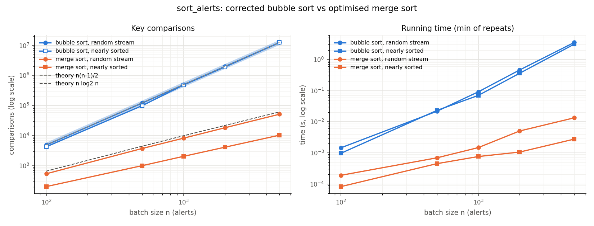

The measured bubble-sort comparisons are within 0.3 % of n(n − 1)/2 for random streams: at n = 5,000 the 12,461,989 comparisons correspond to 4,733 of the 4,999 possible passes (Σ<sub>i=0</sub><sup>4732</sup> (4,999 − i) = 12,461,989). The exchanges match the predicted inversion count 0.38 · n(n − 1)/2 to within 0.1–5 %. The nearly sorted queue needs only 103,375 swaps at n = 5,000 but exactly the **same number of comparisons** as the random stream: the number of passes is set by the alert that has to travel furthest to the left – the fresh critical alerts at the tail, which are the same in both inputs – so the early exit does not help bubble sort here. Merge sort needs 51,674 comparisons (0.84 · n log₂ n, below the bound 56,809) on random streams and only 10,405 (≈ 2.1 n) on the nearly sorted queue thanks to the skipped merges: **241× fewer comparisons and a 265× speed-up** at n = 5,000 (random), and 1,198× fewer comparisons on the nearly sorted queue.

### 4. Searching – 1,000 analyst look-ups per batch

Table 15: find_alert – comparisons and time for q = 1,000 look-ups, 80 % hits and 20 % misses (search_results.csv)

| Batch size n | Hits of 1,000 | Sequential cmp | Theory Σ positions | Sentinel cmp | AlertIndex ops (n + q) | Time seq. (s) | Time sentinel (s) | Time index (s) |
|---|---|---|---|---|---|---|---|---|
| 100 | 790 | 60,375 | 60,375 | 60,585 | 1,100 | 0.0049 | 0.0028 | 0.00025 |
| 500 | 801 | 304,908 | 304,908 | 305,107 | 1,500 | 0.0222 | 0.0171 | 0.00031 |
| 1,000 | 801 | 609,427 | 609,427 | 609,626 | 2,000 | 0.0826 | 0.0235 | 0.00040 |
| 2,000 | 801 | 1,218,446 | 1,218,446 | 1,218,645 | 3,000 | 0.1124 | 0.0460 | 0.00029 |
| 5,000 | 800 | 2,989,277 | 2,989,277 | 2,989,477 | 6,000 | 0.3156 | 0.1215 | 0.00061 |

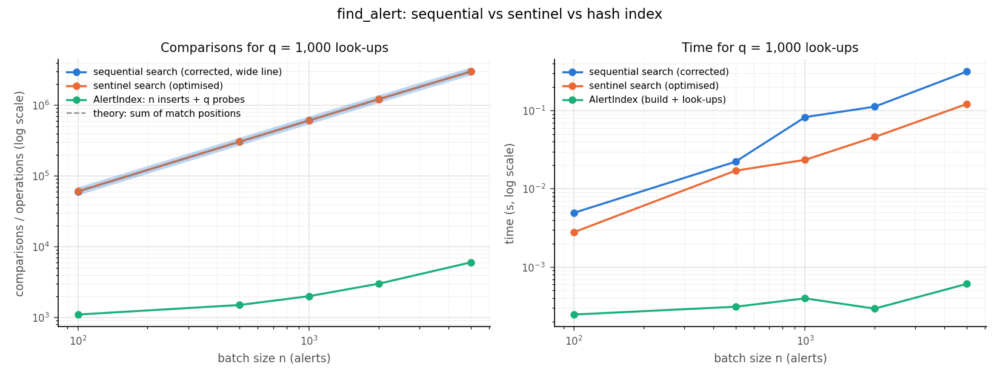

The sequential comparisons equal the theoretical sum of the match positions exactly (a hit at position t costs t comparisons, a miss n). At n = 5,000 this is 2,989 comparisons per look-up, close to the model p(n + 1)/2 + (1 − p)n = 0.8 · 2,500.5 + 0.2 · 5,000 = 3,000.4. The sentinel version makes exactly one extra key comparison per miss (the sentinel itself: 200 at n = 5,000) but no bound tests, and runs 1.3–3.5× faster. The hash index reduces 1,000 look-ups from Θ(qn) to n + q operations: **498× fewer operations and a 519× speed-up** at n = 5,000, and its time is almost flat in n.

### 5. String matching – character comparisons

Table 16: match_signature – character comparisons for 5 signatures on the shift log (matching_results.csv)

| Batch size n | Log length L | Brute force | per char | Horspool | per char | KMP | per char |
|---|---|---|---|---|---|---|---|
| 100 | 5,859 | 30,197 | 1.031 | 3,461 | 0.118 | 29,762 | 1.016 |
| 500 | 29,353 | 151,518 | 1.032 | 17,332 | 0.118 | 148,879 | 1.014 |
| 1,000 | 58,335 | 300,980 | 1.032 | 34,376 | 0.118 | 295,802 | 1.014 |
| 2,000 | 116,779 | 602,276 | 1.031 | 68,407 | 0.117 | 592,019 | 1.014 |
| 5,000 | 292,010 | 1,506,694 | 1.032 | 171,309 | 0.117 | 1,480,247 | 1.014 |

"per char" = comparisons / (5 · L), i.e. per text character and signature.

Table 17: match_signature – matches found and running time (matching_results.csv)

| Batch size n | Matches found | Time brute force (s) | Time Horspool (s) | Time KMP (s) | Speed-up Horspool |
|---|---|---|---|---|---|
| 100 | 38 | 0.0054 | 0.00048 | 0.0022 | 11.2× |
| 500 | 181 | 0.0282 | 0.0034 | 0.0124 | 8.3× |
| 1,000 | 344 | 0.0802 | 0.0079 | 0.0331 | 10.1× |
| 2,000 | 675 | 0.1854 | 0.0100 | 0.0557 | 18.5× |
| 5,000 | 1,749 | 0.4170 | 0.0226 | 0.1196 | 18.5× |

Table 18: Adversarial text 'a' × L with m = 10 – character comparisons (matching_worst_case.csv)

| Text length L | Pattern | Brute force | Horspool | KMP | (L − m + 1)·m | 2L |
|---|---|---|---|---|---|---|
| 5,859 | a⁹b | 58,500 | 5,850 | 11,726 | 58,500 | 11,718 |
| 5,859 | ba⁹ | 5,850 | 58,500 | 5,868 | 58,500 | 11,718 |
| 58,335 | a⁹b | 583,260 | 58,326 | 116,678 | 583,260 | 116,670 |
| 58,335 | ba⁹ | 58,326 | 583,260 | 58,344 | 583,260 | 116,670 |
| 292,010 | a⁹b | 2,920,010 | 292,001 | 584,028 | 2,920,010 | 584,020 |
| 292,010 | ba⁹ | 292,001 | 2,920,010 | 292,019 | 2,920,010 | 584,020 |

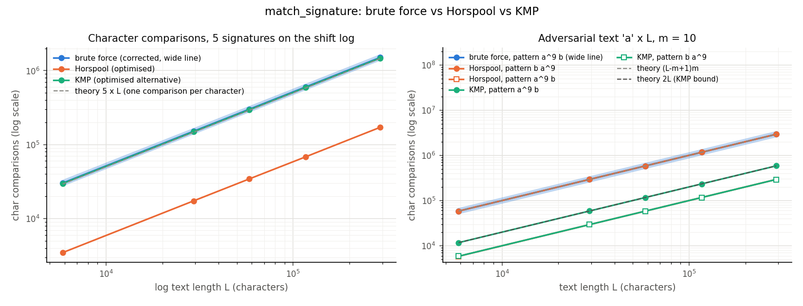

On real log text the corrected brute force is linear in practice: 1.032 comparisons per character, which by the average-case formula σ/(σ − 1) corresponds to an effective alphabet of about 32 characters. KMP gives no average gain (1.014) – its value is the guarantee. Horspool needs only 0.117–0.118 comparisons per character, **8.8× fewer** than brute force (an average shift of about 8.5 characters for signatures of 8–17 characters; shifts are shorter than m because spaces and frequent letters occur inside the signatures), and runs **18.5× faster** at n = 5,000 (also helped by the local counter). The adversarial texts confirm the worst cases exactly: brute force on a⁹b and Horspool on ba⁹ need (L − m + 1)·m comparisons, while KMP stays within 2L + 8 for every pattern.

### 6. Closest pair – distance computations

Table 19: closest_alert_pair – distance computations (closest_pair_results.csv)

| Batch size n | Dataset type | Brute force = n(n−1)/2 | Divide & conquer | D&C per n | n log₂ n bound | x-sweep distances | Saving (D&C) |
|---|---|---|---|---|---|---|---|
| 100 | random | 4,950 | 110 | 1.10 | 664 | 10 | 97.78 % |
| 100 | same-x | 4,950 | 96 | 0.96 | 664 | 4,950 | 98.06 % |
| 500 | random | 124,750 | 497 | 0.99 | 4,483 | 152 | 99.60 % |
| 500 | same-x | 124,750 | 303 | 0.61 | 4,483 | 124,750 | 99.76 % |
| 1,000 | random | 499,500 | 1,051 | 1.05 | 9,966 | 480 | 99.79 % |
| 1,000 | same-x | 499,500 | 624 | 0.62 | 9,966 | 499,500 | 99.88 % |
| 2,000 | random | 1,999,000 | 2,224 | 1.11 | 21,932 | 1,589 | 99.89 % |
| 2,000 | same-x | 1,999,000 | 1,254 | 0.63 | 21,932 | 1,999,000 | 99.94 % |
| 5,000 | random | **12,497,500** | **6,393** | 1.28 | 61,439 | 8,814 | 99.95 % |
| 5,000 | same-x | 12,497,500 | 4,206 | 0.84 | 61,439 | 12,497,500 | 99.97 % |

Table 20: closest_alert_pair – running time and closest pair found (closest_pair_results.csv)

| Batch size n | Dataset type | Time brute force (s) | Time D&C (s) | Time x-sweep (s) | Speed-up D&C | Closest pair (i, j): distance |
|---|---|---|---|---|---|---|
| 100 | random | 0.0024 | 0.00035 | 0.00005 | 6.9× | (11, 14): 0.000648 |
| 100 | same-x | 0.0029 | 0.00046 | 0.0020 | 6.2× | (84, 85): 5.08 × 10⁻⁶ |
| 500 | random | 0.0374 | 0.0016 | 0.00023 | 24.0× | (186, 187): 0.000326 |
| 500 | same-x | 0.0334 | 0.0018 | 0.0270 | 18.2× | (398, 399): 1.30 × 10⁻⁶ |
| 1,000 | random | 0.1800 | 0.0037 | 0.00057 | 48.8× | (764, 766): 0.000120 |
| 1,000 | same-x | 0.1743 | 0.0038 | 0.1121 | 45.7× | (696, 697): 6.85 × 10⁻⁸ |
| 2,000 | random | 0.7399 | 0.0080 | 0.0019 | 92.3× | (764, 766): 0.000120 |
| 2,000 | same-x | 0.6860 | 0.0082 | 0.4627 | 83.5× | (696, 697): 6.85 × 10⁻⁸ |
| 5,000 | random | 6.4163 | 0.0223 | 0.0047 | 288.3× | (764, 766): 0.000120 |
| 5,000 | same-x | 5.8515 | 0.0242 | 3.6727 | 241.6× | (4167, 4168): 1.57 × 10⁻⁹ |

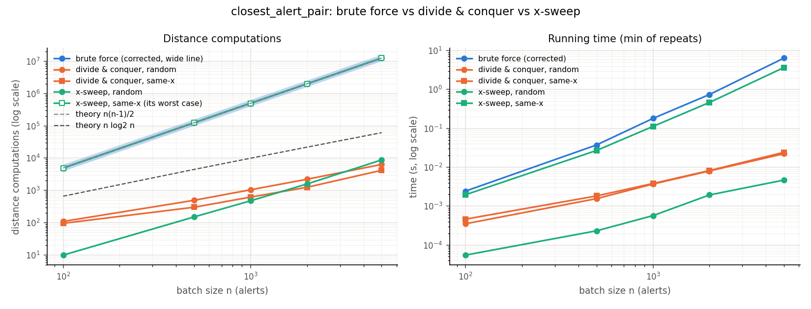

The brute force performs **exactly n(n − 1)/2 distance computations** at every batch size and on both batches (4,950; 124,750; 499,500; 1,999,000; 12,497,500), confirming that its cost does not depend on the data. Divide and conquer needs only 1.0–1.3 n distance computations on the random batches (6,393 at n = 5,000, far below the n log₂ n = 61,439 worst-case order) because once δ is small the strips are almost empty. That is a **99.95 % reduction (1,955× fewer)** and a **288× speed-up** (6.42 s → 0.022 s) at n = 5,000; both versions found the same pair (alerts 764 and 766, distance 0.000120 – the same alert re-fired). The x-sweep is the fastest on the random batch (0.0047 s) but degrades to exactly n(n − 1)/2 distance computations on the same-x batch (3.67 s at n = 5,000), while divide and conquer stays at 0.84 n there – the guaranteed Θ(n log n) bound is why I made divide and conquer the default. Because the batches are prefixes of one stream, the closest pair found at n = 1,000 (764, 766) remains the closest pair for n = 2,000 and 5,000.

### 7. Overall comparison

Table 21: Optimised vs corrected – operation-count reduction / time speed-up at every batch size (comparison_summary.csv)

| Function (basic operation) | n = 100 | n = 500 | n = 1,000 | n = 2,000 | n = 5,000 |
|---|---|---|---|---|---|
| sort_alerts, random (key comparisons) | 9.0× / 7.7× | 32.4× / 31.5× | 59.9× / 62.2× | 108.7× / 91.5× | 241.2× / 264.8× |
| find_alert × 1,000 with AlertIndex (comparisons / probes) | 54.9× / 20.0× | 203.3× / 71.6× | 304.7× / 208.0× | 406.1× / 382.7× | 498.2× / 519.2× |
| match_signature × 5 with Horspool (character comparisons) | 8.7× / 11.2× | 8.7× / 8.3× | 8.8× / 10.1× | 8.8× / 18.5× | 8.8× / 18.5× |
| closest_alert_pair with D&C (distance computations) | 45.0× / 6.9× | 251.0× / 24.0× | 475.3× / 48.8× | 898.8× / 92.3× | 1,954.9× / 288.3× |

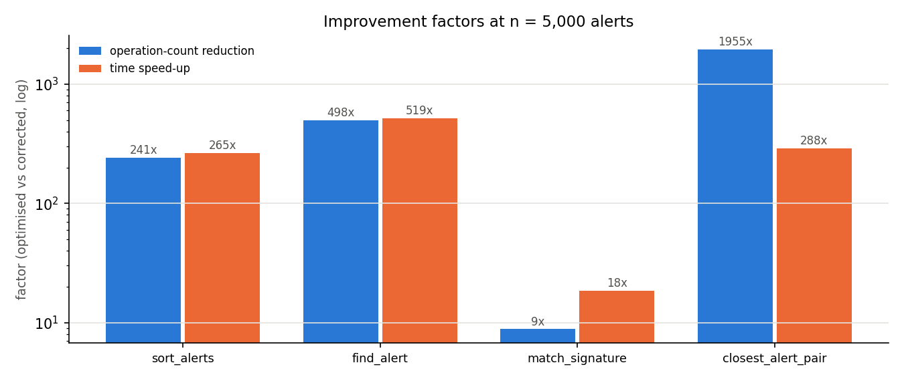

### 8. Theory versus experiment

- **Growth rates.** On the log–log plots the brute-force counts are straight lines of slope 2 (Θ(n²)), parallel to n(n − 1)/2, while merge sort and divide and conquer follow lines of slope ≈ 1 below n log₂ n. The reduction factors therefore grow roughly linearly with n for sorting and closest pair, as predicted, while Horspool's factor is constant (≈ 8.8×) because both brute force and Horspool are linear on log text – only the constant changes.
- **Exact agreement.** The brute-force closest-pair counts equal n(n − 1)/2 exactly; the sequential-search counts equal the sum of the match positions exactly; the adversarial matching counts equal (L − m + 1)·m exactly; the bubble-sort comparisons are within 0.3 % of n(n − 1)/2 and the swaps within 0.1–5 % of the predicted 0.38 · n(n − 1)/2 inversions.
- **Why time and counts differ.** For closest pair the operation count drops 1,955× but the time only 288×: each divide-and-conquer distance computation is surrounded by Θ(n log n) bookkeeping in Python (recursion, merges by y, building strips) that is not counted as a distance computation. For matching and searching the time gain is *larger* than the count reduction because the optimised loops also avoid the per-iteration dictionary counter update of the corrected code and some Python loop overhead (counter overhead is part of the measured time of both versions). The x-sweep beats divide and conquer in time on random data despite more distance computations because its loop is much simpler – constant factors matter at these sizes.
- **Noise.** Timings are minima of repeated runs on a shared machine; for example the sequential-search time at n = 1,000 (0.083 s) is out of line with n = 2,000 (0.112 s). The operation counts are deterministic, and they are the evidence I rely on.

### 9. Engineering recommendations

- Use the **merge sort** for the triage queue: it is never worse than Θ(n log n) and is near-linear on an already triaged queue with new alerts appended – exactly the case in which bubble sort stays quadratic.
- Build an **`AlertIndex` once per shift** and use it for analyst look-ups; keep the sentinel search for one-off scans of lists that are not indexed.
- Use **Horspool** for the signature scan (≈ 9× fewer comparisons on log text); switch to **KMP** for signatures over small alphabets or attacker-controlled repetitive input (for example long runs of `A` in an exploit payload), where Horspool can degrade to Θ(nm).
- Use **divide and conquer** for the near-duplicate correlation: at 5,000 alerts it replaces 12.5 million distance computations by 6,393 with a guaranteed Θ(n log n) bound; the x-sweep is faster on spread-out data but has a quadratic worst case when many alerts share a risk score.

## Code Quality – Test Harness, Repository Organisation and Documentation [15 Marks]

> **Code Quality (15 %).** Marks are awarded for the correctness of the implementation, output verification, repository organisation and documentation.

**Ans:**

Table 22: Code-quality evidence

| Criterion | Evidence |
|---|---|
| Test harness | `test_harness.py`: 18 defect-targeted tests (each fails on the original because of its defect), 13 general tests with independent references, 6 extra tests for the optimised routines; PASS/FAIL per test and `RESULT: k/n` per module; exit code 0 only if the corrected and optimised modules pass everything; writes `Report/tables/defect_tests.csv` |
| Systematic debugging tool | `debug_session.py`: reproduce → `sys.settrace` isolation → one patch at a time with regression check → proof that original + 14 patches = corrected file |
| Minimal changes | corrected file = original + 14 line-level fixes marked `# FIX Dn`; unified diff in `Supporting_Files/execution_logs/` |
| Readable, documented code | module docstrings stating the problem, function docstrings, descriptive names, `main()` under `if __name__ == "__main__":`, an operation counter for every basic operation |
| Determinism and reproducibility | all datasets seeded (`alert_data.py`, also saved as CSV), no `input()`, captured logs of every run, `experiments.py --graphs-only` redraws all figures from the saved CSV files |
| Repository organisation | `Pseudocode/` (8 files), `Source_Code/` (7 programs), `Report/` (md, docx, pdf, screenshots, graphs, tables), `Supporting_Files/` (test datasets, execution logs, experimental results), `README.md` |

### Summary of Findings

Table 23: Summary of findings

| Aspect | Finding |
|---|---|
| Defects (Part A) | 14 defects: sort_alerts 4 (aliasing, off-by-one bound, reversed tie-break, early-exit flag initialised once), find_alert 3 (start index 1, `is` instead of `==`, `return -1` inside the loop / `None`), match_signature 3 (last alignment skipped, no `break`, empty signature), closest_alert_pair 4 (best = 0, self-pairs, dy index typo, best_j not updated with best_i); the given program passes 6/31 tests |
| Pseudocode (Part B) | corrected and optimised pseudocode for all four functions, stored as 8 separate files |
| Debugging (Part C) | reproduce → isolate (line traces) → fix one defect at a time → re-test: each defect test flips FAIL → PASS, no regressions, patched original identical to the corrected file; corrected module 31/31 |
| Optimisation (Part D) | merge sort, sentinel search + hash index, Horspool (+ KMP), divide-and-conquer closest pair with squared distances (+ x-sweep); identical results in every test and experiment; optimised module 37/37 |
| Analysis (Part E) | at n = 5,000: sorting 241× fewer comparisons, look-ups 498× fewer operations, matching 8.8× fewer character comparisons, closest pair **12,497,500 → 6,393 distance computations (99.95 %)**; measured counts agree with n(n − 1)/2, Σ positions, (L − m + 1)m and 0.38 · n(n − 1)/2 |
| Recommendation | deploy the optimised module: merge sort, a per-shift AlertIndex, Horspool (KMP for repetitive input) and divide-and-conquer correlation |

<!-- APPENDICES -->

<!-- pagebreak -->

### Appendix A – Complete Source Code

All programs are in `Source_Code/`. They are listed in full in the order original → corrected → optimised → test harness → debugging replay → dataset generator.

#### Source_Code/original_alert_triage.py

```
"""
SentinelOps SOC Alert-Triage Module - version 0.9 (ORIGINAL, as handed over for review)
=======================================================================================
The Security Operations Centre (SOC) receives a stream of alerts from the SIEM.  Before an
analyst picks up a shift's batch of alerts, this module runs four brute-force triage steps:

  1. sort_alerts(alerts)            -> NEW list ordered by severity (5 = critical first), ties
                                       by timestamp (oldest first); the input list is not changed
  2. find_alert(alerts, alert_id)   -> index of the first alert with that id, or -1 if absent
  3. match_signature(text, pattern) -> list of ALL start positions of a threat signature in a
                                       message (case-sensitive, overlapping matches included);
                                       an empty signature is invalid and matches nothing
  4. closest_alert_pair(alerts)     -> (distance, i, j) with i < j: the two alerts whose feature
                                       points (x = risk score, y = time of day) are nearest, used to
                                       correlate near-duplicate alerts; (inf, -1, -1) if n < 2

Every function updates COUNTERS so the SOC dashboard can show how much work each step costs.
NOTE: reconstructed faulty program for the CSA06 CO2 debugging task - it contains defects.
"""
import math

# operation counters shown on the SOC performance dashboard
COUNTERS = {"sort_comparisons": 0, "sort_swaps": 0, "search_comparisons": 0,
            "char_comparisons": 0, "distance_computations": 0}


def reset_counters():
    """Set every operation counter back to zero."""
    for key in COUNTERS:
        COUNTERS[key] = 0


class Alert:
    """One SOC alert produced by the SIEM correlation layer."""

    def __init__(self, alert_id, severity, timestamp, source_ip, message, x, y):
        self.alert_id = alert_id      # e.g. "ALR-000123"
        self.severity = severity      # 1 = informational ... 5 = critical
        self.timestamp = timestamp    # seconds since the start of the shift
        self.source_ip = source_ip
        self.message = message
        self.x = x                    # feature 1: normalised risk score (0..1)
        self.y = y                    # feature 2: time of day as a fraction of 24 h (0..1)

    def __repr__(self):
        return f"{self.alert_id}(sev={self.severity}, t={self.timestamp})"


# ------------------------------------------------------------------ 1. sorting (bubble sort)
def _comes_before(a, b):
    """True if alert a must be triaged before alert b."""
    if a.severity != b.severity:
        return a.severity > b.severity            # higher severity first
    return a.timestamp > b.timestamp              # same severity: older alert first


def sort_alerts(alerts):
    """Return the alerts ordered by severity (desc) then timestamp (asc) using bubble sort."""
    ordered = alerts
    n = len(ordered)
    swapped = False
    for i in range(n - 1):
        for j in range(n - i - 2):
            COUNTERS["sort_comparisons"] += 1
            if _comes_before(ordered[j + 1], ordered[j]):
                ordered[j], ordered[j + 1] = ordered[j + 1], ordered[j]
                COUNTERS["sort_swaps"] += 1
                swapped = True
        if not swapped:                           # a pass without swaps -> already sorted
            break
    return ordered


# ------------------------------------------------------------------ 2. sequential search
def find_alert(alerts, alert_id):
    """Return the index of the first alert whose id equals alert_id, or -1 if there is none."""
    for i in range(1, len(alerts)):
        COUNTERS["search_comparisons"] += 1
        if alerts[i].alert_id is alert_id:
            return i
        else:
            return -1


# ------------------------------------------------------------------ 3. brute-force string matching
def match_signature(text, pattern):
    """Return every position where pattern occurs in text (brute force, overlaps included)."""
    n = len(text)
    m = len(pattern)
    if m > n:                                     # signature longer than the message
        return []
    positions = []
    for i in range(n - m):
        matched = True
        for j in range(m):
            COUNTERS["char_comparisons"] += 1
            if text[i + j] != pattern[j]:
                matched = False
        if matched:
            positions.append(i)
    return positions


# ------------------------------------------------------------------ 4. brute-force closest pair
def closest_alert_pair(alerts):
    """Return (distance, i, j), i < j, for the two alerts whose feature points are closest."""
    n = len(alerts)
    best, best_i, best_j = 0.0, 0, 0
    for i in range(n):
        for j in range(n):
            COUNTERS["distance_computations"] += 1
            dx = alerts[i].x - alerts[j].x
            dy = alerts[i].y - alerts[i].y
            d = math.sqrt(dx ** 2 + dy ** 2)
            if d < best:
                best = d
                best_i = i
            best_j = j
    return best, best_i, best_j


# ------------------------------------------------------------------ triage demo
SHIFT_START = 8 / 24                              # the shift starts at 08:00
RULES = "Failed password\nmimikatz\n/etc/shadow\npowershell -enc\n"   # contents of rules.txt
DEMO_SHIFT = [   # (severity, timestamp s, source_ip, message, risk score)
    (3, 105, "10.0.4.17", "Failed password for admin from 10.0.4.17 port 22 ssh2", 0.41),
    (2, 230, "10.0.7.3", "Outbound DNS query volume above baseline for host WS-0233", 0.22),
    (5, 344, "10.0.9.41", "Process mimikatz.exe accessed lsass memory on DC-01", 0.97),
    (4, 402, "172.16.2.8", "powershell -enc JABzAD0ATgBlAHcA spawned by winword.exe", 0.83),
    (3, 518, "10.0.4.17", "Failed password for root from 10.0.4.17 port 22 ssh2", 0.43),
    (4, 640, "10.0.3.25", "User svc_backup read /etc/shadow", 0.79),
    (1, 711, "10.0.8.90", "TLS certificate for intranet portal expires in 14 days", 0.05),
    (3, 799, "10.0.4.17", "Failed password for admin from 10.0.4.17 port 22 ssh2", 0.41),
    (2, 861, "10.0.7.3", "Outbound DNS query volume above baseline for host WS-0233", 0.23),
    (5, 930, "10.0.9.44", "Credential dump: mimikatz sekurlsa::logonpasswords on DC-02", 0.95),
]


def demo_alerts():
    """Build the ten alerts of the demo shift (ids are generated, as the SIEM does)."""
    return [Alert(f"ALR-{101 + k:06d}", sev, t, ip, msg, risk, round(SHIFT_START + t / 86400, 4))
            for k, (sev, t, ip, msg, risk) in enumerate(DEMO_SHIFT)]


def main():
    """Run the four triage steps on the demo shift and print the analyst's view."""
    reset_counters()
    shift = demo_alerts()
    print("SentinelOps SOC alert triage - demo shift of", len(shift), "alerts")
    print("=" * 78)
    print("1) Triage queue (severity high -> low, oldest first)")
    queue = sort_alerts(shift)
    for pos, a in enumerate(queue, 1):
        print(f"   {pos:>2}. {a.alert_id}  sev {a.severity}  t={a.timestamp:>3}s  {a.message[:46]}")
    print("   arrival order after sorting:", " ".join(a.alert_id[-3:] for a in shift))
    print("2) Analyst look-ups (position in the arrival list)")
    for query in ["ALR-000101", "ALR-000110", "ALR-000999"]:
        print(f"   {query} -> index {find_alert(shift, query)}")
    print("3) Signature scan of alert messages (rules.txt)")
    for sig in RULES.split("\n"):
        hits = [f"{a.alert_id[-3:]}@{p}" for a in shift for p in match_signature(a.message, sig)]
        more = f" ... (+{len(hits) - 4} more)" if len(hits) > 4 else ""
        print(f"   {repr(sig):<18} {len(hits):>3} hit(s): {' '.join(hits[:4])}{more}")
    print("4) Near-duplicate correlation (closest pair of feature points)")
    d, i, j = closest_alert_pair(shift)
    print(f"   {shift[i].alert_id} <-> {shift[j].alert_id}   distance {d:.4f}")
    print("5) Work done:", ", ".join(f"{k}={v}" for k, v in COUNTERS.items()))


if __name__ == "__main__":
    main()
```

#### Source_Code/corrected_alert_triage.py

```
"""
SentinelOps SOC Alert-Triage Module - version 1.0 (CORRECTED)
=============================================================
The Security Operations Centre (SOC) receives a stream of alerts from the SIEM.  Before an
analyst picks up a shift's batch of alerts, this module runs four brute-force triage steps:

  1. sort_alerts(alerts)            -> NEW list ordered by severity (5 = critical first), ties
                                       by timestamp (oldest first); the input list is not changed
  2. find_alert(alerts, alert_id)   -> index of the first alert with that id, or -1 if absent
  3. match_signature(text, pattern) -> list of ALL start positions of a threat signature in a
                                       message (case-sensitive, overlapping matches included);
                                       an empty signature is invalid and matches nothing
  4. closest_alert_pair(alerts)     -> (distance, i, j) with i < j: the two alerts whose feature
                                       points (x = risk score, y = time of day) are nearest, used to
                                       correlate near-duplicate alerts; (inf, -1, -1) if n < 2

Every function updates COUNTERS so the SOC dashboard can show how much work each step costs.
CORRECTED version: the original program debugged with 14 minimal line-level fixes, each marked
'# FIX Dn' (n = defect number in the report).  The structure and algorithms are unchanged.
"""
import math

# operation counters shown on the SOC performance dashboard
COUNTERS = {"sort_comparisons": 0, "sort_swaps": 0, "search_comparisons": 0,
            "char_comparisons": 0, "distance_computations": 0}


def reset_counters():
    """Set every operation counter back to zero."""
    for key in COUNTERS:
        COUNTERS[key] = 0


class Alert:
    """One SOC alert produced by the SIEM correlation layer."""

    def __init__(self, alert_id, severity, timestamp, source_ip, message, x, y):
        self.alert_id = alert_id      # e.g. "ALR-000123"
        self.severity = severity      # 1 = informational ... 5 = critical
        self.timestamp = timestamp    # seconds since the start of the shift
        self.source_ip = source_ip
        self.message = message
        self.x = x                    # feature 1: normalised risk score (0..1)
        self.y = y                    # feature 2: time of day as a fraction of 24 h (0..1)

    def __repr__(self):
        return f"{self.alert_id}(sev={self.severity}, t={self.timestamp})"


# ------------------------------------------------------------------ 1. sorting (bubble sort)
def _comes_before(a, b):
    """True if alert a must be triaged before alert b."""
    if a.severity != b.severity:
        return a.severity > b.severity            # higher severity first
    return a.timestamp < b.timestamp              # FIX D3: '<' puts the older alert first


def sort_alerts(alerts):
    """Return the alerts ordered by severity (desc) then timestamp (asc) using bubble sort."""
    ordered = list(alerts)                        # FIX D1: sort a copy, not the caller's list
    n = len(ordered)
    for i in range(n - 1):
        swapped = False                           # FIX D4: reset the flag at every pass
        for j in range(n - i - 1):                # FIX D2: bound was n-i-2 (last pair skipped)
            COUNTERS["sort_comparisons"] += 1
            if _comes_before(ordered[j + 1], ordered[j]):
                ordered[j], ordered[j + 1] = ordered[j + 1], ordered[j]
                COUNTERS["sort_swaps"] += 1
                swapped = True
        if not swapped:                           # a pass without swaps -> already sorted
            break
    return ordered


# ------------------------------------------------------------------ 2. sequential search
def find_alert(alerts, alert_id):
    """Return the index of the first alert whose id equals alert_id, or -1 if there is none."""
    for i in range(len(alerts)):                  # FIX D5: start at index 0, not 1
        COUNTERS["search_comparisons"] += 1
        if alerts[i].alert_id == alert_id:        # FIX D6: compare values (==), not identity
            return i
    return -1                                     # FIX D7: 'absent' only after the full scan


# ------------------------------------------------------------------ 3. brute-force string matching
def match_signature(text, pattern):
    """Return every position where pattern occurs in text (brute force, overlaps included)."""
    n = len(text)
    m = len(pattern)
    if m == 0 or m > n:                           # FIX D10: an empty signature matches nothing
        return []
    positions = []
    for i in range(n - m + 1):                    # FIX D8: include the last alignment n-m
        matched = True
        for j in range(m):
            COUNTERS["char_comparisons"] += 1
            if text[i + j] != pattern[j]:
                matched = False
                break                             # FIX D9: stop at the first mismatch
        if matched:
            positions.append(i)
    return positions


# ------------------------------------------------------------------ 4. brute-force closest pair
def closest_alert_pair(alerts):
    """Return (distance, i, j), i < j, for the two alerts whose feature points are closest."""
    n = len(alerts)
    best, best_i, best_j = math.inf, -1, -1       # FIX D11: start with 'no pair found'
    for i in range(n):
        for j in range(i + 1, n):                 # FIX D12: pairs i < j only (no self-pair)
            COUNTERS["distance_computations"] += 1
            dx = alerts[i].x - alerts[j].x
            dy = alerts[i].y - alerts[j].y        # FIX D13: index typo, was alerts[i].y twice
            d = math.sqrt(dx ** 2 + dy ** 2)
            if d < best:
                best = d
                best_i = i
                best_j = j                        # FIX D14: update both indices together
    return best, best_i, best_j


# ------------------------------------------------------------------ triage demo
SHIFT_START = 8 / 24                              # the shift starts at 08:00
RULES = "Failed password\nmimikatz\n/etc/shadow\npowershell -enc\n"   # contents of rules.txt
DEMO_SHIFT = [   # (severity, timestamp s, source_ip, message, risk score)
    (3, 105, "10.0.4.17", "Failed password for admin from 10.0.4.17 port 22 ssh2", 0.41),
    (2, 230, "10.0.7.3", "Outbound DNS query volume above baseline for host WS-0233", 0.22),
    (5, 344, "10.0.9.41", "Process mimikatz.exe accessed lsass memory on DC-01", 0.97),
    (4, 402, "172.16.2.8", "powershell -enc JABzAD0ATgBlAHcA spawned by winword.exe", 0.83),
    (3, 518, "10.0.4.17", "Failed password for root from 10.0.4.17 port 22 ssh2", 0.43),
    (4, 640, "10.0.3.25", "User svc_backup read /etc/shadow", 0.79),
    (1, 711, "10.0.8.90", "TLS certificate for intranet portal expires in 14 days", 0.05),
    (3, 799, "10.0.4.17", "Failed password for admin from 10.0.4.17 port 22 ssh2", 0.41),
    (2, 861, "10.0.7.3", "Outbound DNS query volume above baseline for host WS-0233", 0.23),
    (5, 930, "10.0.9.44", "Credential dump: mimikatz sekurlsa::logonpasswords on DC-02", 0.95),
]


def demo_alerts():
    """Build the ten alerts of the demo shift (ids are generated, as the SIEM does)."""
    return [Alert(f"ALR-{101 + k:06d}", sev, t, ip, msg, risk, round(SHIFT_START + t / 86400, 4))
            for k, (sev, t, ip, msg, risk) in enumerate(DEMO_SHIFT)]


def main():
    """Run the four triage steps on the demo shift and print the analyst's view."""
    reset_counters()
    shift = demo_alerts()
    print("SentinelOps SOC alert triage - demo shift of", len(shift), "alerts")
    print("=" * 78)
    print("1) Triage queue (severity high -> low, oldest first)")
    queue = sort_alerts(shift)
    for pos, a in enumerate(queue, 1):
        print(f"   {pos:>2}. {a.alert_id}  sev {a.severity}  t={a.timestamp:>3}s  {a.message[:46]}")
    print("   arrival order after sorting:", " ".join(a.alert_id[-3:] for a in shift))
    print("2) Analyst look-ups (position in the arrival list)")
    for query in ["ALR-000101", "ALR-000110", "ALR-000999"]:
        print(f"   {query} -> index {find_alert(shift, query)}")
    print("3) Signature scan of alert messages (rules.txt)")
    for sig in RULES.split("\n"):
        hits = [f"{a.alert_id[-3:]}@{p}" for a in shift for p in match_signature(a.message, sig)]
        more = f" ... (+{len(hits) - 4} more)" if len(hits) > 4 else ""
        print(f"   {repr(sig):<18} {len(hits):>3} hit(s): {' '.join(hits[:4])}{more}")
    print("4) Near-duplicate correlation (closest pair of feature points)")
    d, i, j = closest_alert_pair(shift)
    print(f"   {shift[i].alert_id} <-> {shift[j].alert_id}   distance {d:.4f}")
    print("5) Work done:", ", ".join(f"{k}={v}" for k, v in COUNTERS.items()))


if __name__ == "__main__":
    main()
```

#### Source_Code/optimised_alert_triage.py

```
"""
SentinelOps SOC Alert-Triage Module - version 2.0 (OPTIMISED)
=============================================================
Same interface and the same results as corrected_alert_triage.py (verified by test_harness.py and
experiments.py), but with faster algorithms and fewer basic operations:

  sort_alerts          stable top-down merge sort on precomputed priority keys; a merge is skipped when
                       the two halves are already in order          O(n log n) worst, n - 1 comparisons
                                                                      on an already triaged queue
  find_alert           sentinel sequential search: no bounds test inside the loop      O(n), 1 test/item
  AlertIndex           hash index alert_id -> first position for repeated look-ups:
                       O(n) to build once, O(1) expected per look-up
  match_signature      Boyer-Moore-Horspool: right-to-left window check + bad-character shift table,
                       about n/m .. n character comparisons on log text, O(nm) worst case
  match_signature_kmp  Knuth-Morris-Pratt alternative with a guaranteed O(n + m) worst case
  closest_alert_pair   divide and conquer on x-sorted points with a y-sorted strip and squared
                       distances (one sqrt at the very end)                       O(n log n) worst case
  closest_alert_pair_sweep  sort by x and stop as soon as the x-gap alone is >= the best distance
                       (very few distances on real data, O(n^2) worst case when all x are equal)

Counters are accumulated in local variables and added to COUNTERS once per call (cheaper than a
dictionary update inside the inner loops).
"""
import math

COUNTERS = {"sort_comparisons": 0, "sort_moves": 0, "search_comparisons": 0, "index_inserts": 0,
            "char_comparisons": 0, "distance_computations": 0}


def reset_counters():
    """Set every operation counter back to zero."""
    for key in COUNTERS:
        COUNTERS[key] = 0


class Alert:
    """One SOC alert (same fields as before; __slots__ makes attribute access faster and smaller)."""
    __slots__ = ("alert_id", "severity", "timestamp", "source_ip", "message", "x", "y")

    def __init__(self, alert_id, severity, timestamp, source_ip, message, x, y):
        self.alert_id = alert_id      # e.g. "ALR-000123"
        self.severity = severity      # 1 = informational ... 5 = critical
        self.timestamp = timestamp    # seconds since the start of the shift
        self.source_ip = source_ip
        self.message = message
        self.x = x                    # feature 1: normalised risk score (0..1)
        self.y = y                    # feature 2: time of day as a fraction of 24 h (0..1)

    def __repr__(self):
        return f"{self.alert_id}(sev={self.severity}, t={self.timestamp})"


# ------------------------------------------------------------------ 1. sorting: adaptive merge sort
def sort_alerts(alerts):
    """Return a NEW list ordered by severity (desc) then timestamp (asc); stable merge sort."""
    items = [((-a.severity, a.timestamp), a) for a in alerts]   # decorate once: one key per alert
    if len(items) > 1:
        _merge_sort(items, [None] * len(items), 0, len(items))
    return [a for _, a in items]


def _merge_sort(items, aux, lo, hi):
    """Sort items[lo:hi] (pairs (key, alert)) in place; aux is scratch space for the left half."""
    if hi - lo < 2:
        return
    mid = (lo + hi) // 2
    _merge_sort(items, aux, lo, mid)
    _merge_sort(items, aux, mid, hi)
    COUNTERS["sort_comparisons"] += 1
    if items[mid - 1][0] <= items[mid][0]:      # halves already in order -> nothing to merge
        return
    aux[lo:mid] = items[lo:mid]                 # copy only the left half
    i, j, k, comparisons = lo, mid, lo, 0
    while i < mid and j < hi:
        comparisons += 1
        if items[j][0] < aux[i][0]:             # strict '<': equal keys keep the earlier alert (stable)
            items[k] = items[j]
            j += 1
        else:
            items[k] = aux[i]
            i += 1
        k += 1
    items[k:k + mid - i] = aux[i:mid]           # left leftovers; right leftovers are already in place
    COUNTERS["sort_comparisons"] += comparisons
    COUNTERS["sort_moves"] += (k - lo) + (mid - i)


# ------------------------------------------------------------------ 2. searching
class _Probe:
    """Sentinel record appended after the last alert so the search loop needs no bounds test."""
    __slots__ = ("alert_id",)

    def __init__(self, alert_id):
        self.alert_id = alert_id


def find_alert(alerts, alert_id):
    """Sentinel sequential search: index of the first alert with this id, or -1.
    The caller's list is restored (sentinel removed) before returning, even on an exception."""
    n = len(alerts)
    alerts.append(_Probe(alert_id))             # the loop is now guaranteed to stop
    try:
        i = 0
        while alerts[i].alert_id != alert_id:   # ONE comparison per element, no 'i < n' test
            i += 1
    finally:
        alerts.pop()
    COUNTERS["search_comparisons"] += i + 1
    return i if i < n else -1


class AlertIndex:
    """Hash index alert_id -> position of its FIRST occurrence, for many look-ups on one batch."""

    def __init__(self, alerts):
        self._pos = {}
        for i, a in enumerate(alerts):
            self._pos.setdefault(a.alert_id, i)  # keep the first occurrence (same as sequential search)
        COUNTERS["index_inserts"] += len(alerts)

    def find(self, alert_id):
        """Index of the first alert with this id, or -1: one hash probe."""
        COUNTERS["search_comparisons"] += 1
        return self._pos.get(alert_id, -1)


# ------------------------------------------------------------------ 3. string matching
def _shift_table(pattern):
    """Horspool bad-character table: distance from the last occurrence of ch (in pattern[:-1]) to the end."""
    m = len(pattern)
    return {ch: m - 1 - k for k, ch in enumerate(pattern[:-1])}


def match_signature(text, pattern):
    """All (overlapping) start positions of pattern in text - Boyer-Moore-Horspool."""
    n, m = len(text), len(pattern)
    if m == 0 or m > n:                         # empty or over-long signature: no match
        return []
    shift, last = _shift_table(pattern), m - 1
    positions, comparisons, i = [], 0, 0
    while i <= n - m:
        j = last
        while True:                             # compare the window right to left
            comparisons += 1
            if text[i + j] != pattern[j]:
                break
            if j == 0:
                positions.append(i)
                break
            j -= 1
        i += shift.get(text[i + last], m)       # skip using the window's last character
    COUNTERS["char_comparisons"] += comparisons
    return positions


def match_signature_kmp(text, pattern):
    """All (overlapping) start positions of pattern in text - Knuth-Morris-Pratt, O(n + m)."""
    n, m = len(text), len(pattern)
    if m == 0 or m > n:
        return []
    comparisons, fail, k = 0, [0] * m, 0        # fail[q] = longest proper border of pattern[:q + 1]
    for q in range(1, m):
        while True:
            comparisons += 1
            if pattern[q] == pattern[k]:
                k += 1
                break
            if k == 0:
                break
            k = fail[k - 1]
        fail[q] = k
    positions, q = [], 0
    for i in range(n):
        while True:
            comparisons += 1
            if text[i] == pattern[q]:
                q += 1
                break
            if q == 0:
                break
            q = fail[q - 1]
        if q == m:                              # full match ending at i
            positions.append(i - m + 1)
            q = fail[q - 1]
    COUNTERS["char_comparisons"] += comparisons
    return positions


# ------------------------------------------------------------------ 4. closest pair
def _better(best, p, q):
    """Compare the pair (p, q) with the best (d2, i, j) so far; squared distance, ties -> smaller (i, j)."""
    COUNTERS["distance_computations"] += 1
    dx, dy = p[0] - q[0], p[1] - q[1]
    cand = (dx * dx + dy * dy,) + ((p[2], q[2]) if p[2] < q[2] else (q[2], p[2]))
    return cand if cand < best else best


def _closest(px, lo, hi):
    """Closest pair in px[lo:hi] (points (x, y, index) sorted by x) -> ((d2, i, j), points sorted by y)."""
    if hi - lo <= 3:                            # base case: brute force on at most 3 points
        best = (math.inf, -1, -1)
        for a in range(lo, hi):
            for b in range(a + 1, hi):
                best = _better(best, px[a], px[b])
        return best, sorted(px[lo:hi], key=lambda p: p[1])
    mid = (lo + hi) // 2
    x_mid = px[mid][0]
    best_left, left = _closest(px, lo, mid)
    best_right, right = _closest(px, mid, hi)
    best = min(best_left, best_right)
    by_y, a, b = [], 0, 0                       # merge the two y-sorted halves
    while a < len(left) and b < len(right):
        if right[b][1] < left[a][1]:
            by_y.append(right[b])
            b += 1
        else:
            by_y.append(left[a])
            a += 1
    by_y += left[a:] + right[b:]
    strip = [p for p in by_y if (p[0] - x_mid) ** 2 < best[0]]
    for s in range(len(strip)):                 # each strip point meets at most 7 successors
        for t in range(s + 1, len(strip)):
            dy = strip[t][1] - strip[s][1]
            if dy * dy >= best[0]:
                break
            best = _better(best, strip[s], strip[t])
    return best, by_y


def closest_alert_pair(alerts):
    """(distance, i, j), i < j, of the two alerts with the closest feature points; (inf, -1, -1) if n < 2."""
    if len(alerts) < 2:
        return (math.inf, -1, -1)
    px = sorted((a.x, a.y, k) for k, a in enumerate(alerts))       # pre-sort by x once
    (d2, i, j), _ = _closest(px, 0, len(px))
    return (math.sqrt(d2), i, j)


def closest_alert_pair_sweep(alerts):
    """Same result by an x-sorted sweep that stops when the x-gap alone reaches the best distance."""
    n = len(alerts)
    if n < 2:
        return (math.inf, -1, -1)
    px = sorted((a.x, a.y, k) for k, a in enumerate(alerts))
    best, count = (math.inf, -1, -1), 0
    for a in range(n - 1):
        xa, ya, ka = px[a]
        for b in range(a + 1, n):
            xb, yb, kb = px[b]
            dx = xb - xa
            if dx * dx >= best[0]:              # every later point is even further away in x
                break
            count += 1
            dy = yb - ya
            cand = (dx * dx + dy * dy,) + ((ka, kb) if ka < kb else (kb, ka))
            if cand < best:
                best = cand
    COUNTERS["distance_computations"] += count
    return (math.sqrt(best[0]), best[1], best[2])


# ------------------------------------------------------------------ triage demo (same shift as before)
SHIFT_START = 8 / 24                              # the shift starts at 08:00
RULES = "Failed password\nmimikatz\n/etc/shadow\npowershell -enc\n"   # contents of rules.txt
DEMO_SHIFT = [   # (severity, timestamp s, source_ip, message, risk score)
    (3, 105, "10.0.4.17", "Failed password for admin from 10.0.4.17 port 22 ssh2", 0.41),
    (2, 230, "10.0.7.3", "Outbound DNS query volume above baseline for host WS-0233", 0.22),
    (5, 344, "10.0.9.41", "Process mimikatz.exe accessed lsass memory on DC-01", 0.97),
    (4, 402, "172.16.2.8", "powershell -enc JABzAD0ATgBlAHcA spawned by winword.exe", 0.83),
    (3, 518, "10.0.4.17", "Failed password for root from 10.0.4.17 port 22 ssh2", 0.43),
    (4, 640, "10.0.3.25", "User svc_backup read /etc/shadow", 0.79),
    (1, 711, "10.0.8.90", "TLS certificate for intranet portal expires in 14 days", 0.05),
    (3, 799, "10.0.4.17", "Failed password for admin from 10.0.4.17 port 22 ssh2", 0.41),
    (2, 861, "10.0.7.3", "Outbound DNS query volume above baseline for host WS-0233", 0.23),
    (5, 930, "10.0.9.44", "Credential dump: mimikatz sekurlsa::logonpasswords on DC-02", 0.95),
]


def demo_alerts():
    """Build the ten alerts of the demo shift (ids are generated, as the SIEM does)."""
    return [Alert(f"ALR-{101 + k:06d}", sev, t, ip, msg, risk, round(SHIFT_START + t / 86400, 4))
            for k, (sev, t, ip, msg, risk) in enumerate(DEMO_SHIFT)]


def main():
    """Run the four optimised triage steps on the demo shift and print the analyst's view."""
    reset_counters()
    shift = demo_alerts()
    print("SentinelOps SOC alert triage (optimised) - demo shift of", len(shift), "alerts")
    print("=" * 78)
    print("1) Triage queue (severity high -> low, oldest first) - merge sort")
    queue = sort_alerts(shift)
    for pos, a in enumerate(queue, 1):
        print(f"   {pos:>2}. {a.alert_id}  sev {a.severity}  t={a.timestamp:>3}s  {a.message[:46]}")
    print("   arrival order after sorting:", " ".join(a.alert_id[-3:] for a in shift))
    print("2) Analyst look-ups (position in the arrival list) - sentinel search | hash index")
    index = AlertIndex(shift)
    for query in ["ALR-000101", "ALR-000110", "ALR-000999"]:
        print(f"   {query} -> index {find_alert(shift, query)} | AlertIndex: {index.find(query)}")
    print("3) Signature scan of alert messages (rules.txt) - Horspool")
    for sig in RULES.split("\n"):
        hits = [f"{a.alert_id[-3:]}@{p}" for a in shift for p in match_signature(a.message, sig)]
        more = f" ... (+{len(hits) - 4} more)" if len(hits) > 4 else ""
        print(f"   {repr(sig):<18} {len(hits):>3} hit(s): {' '.join(hits[:4])}{more}")
    print("4) Near-duplicate correlation (closest pair of feature points) - divide and conquer")
    d, i, j = closest_alert_pair(shift)
    print(f"   {shift[i].alert_id} <-> {shift[j].alert_id}   distance {d:.4f}")
    work = [f"{k}={v}" for k, v in COUNTERS.items()]
    print("5) Work done:", ", ".join(work[:3]) + ",")
    print("              " + ", ".join(work[3:]))


if __name__ == "__main__":
    main()
```

#### Source_Code/test_harness.py

```
"""
Test harness for the SentinelOps SOC alert-triage module (original, corrected and optimised versions).

* DEFECT_TESTS  - one or more test cases per seeded defect D1..D14.  Each is built so that it fails on
                  the original program because of that defect and passes once the defect is fixed.
* GENERAL_TESTS - edge cases and randomised cross-checks against independent reference answers
                  (sorted() with a key, list scan with ==, str.startswith, math.dist over all pairs).
* EXTRA_TESTS   - checks for the additional routines of the optimised module only.

Usage:  py -3 test_harness.py [original|corrected|optimised ...]      (default: all three)
Prints PASS/FAIL per test and "RESULT: k/n tests passed" per module.  When all three modules are run it
also writes ../Report/tables/defect_tests.csv (inputs, expected and actual outputs for the report).
Exit code 0 when the corrected and optimised modules pass every test (the original is EXPECTED to fail).
"""
import csv
import importlib
import itertools
import math
import os
import random
import sys

from alert_data import SIGNATURES, build, log_text, make_alert_rows, make_same_x_rows

MODULES = {"original": "original_alert_triage", "corrected": "corrected_alert_triage",
           "optimised": "optimised_alert_triage"}
HERE = os.path.dirname(os.path.abspath(__file__))


# ------------------------------------------------------------------ helpers and reference answers
def alerts(mod, specs):
    """Alerts from (severity, timestamp, x, y) specs; ids ALR-000001, ALR-000002 ... built at run time."""
    return [mod.Alert(f"ALR-{k + 1:06d}", sev, t, "10.0.0.1", "test alert", x, y)
            for k, (sev, t, x, y) in enumerate(specs)]


def ids(seq):
    """Short id list for messages: ALR-000003 -> '003'."""
    return [a.alert_id[-3:] for a in seq]


def ref_sort(seq):
    return sorted(seq, key=lambda a: (-a.severity, a.timestamp))          # Python's sort is stable


def ref_find(seq, alert_id):
    return next((i for i, a in enumerate(seq) if a.alert_id == alert_id), -1)


def ref_match(text, pattern):
    if not pattern:
        return []
    return [i for i in range(len(text) - len(pattern) + 1) if text.startswith(pattern, i)]


def ref_closest(seq):
    if len(seq) < 2:
        return (math.inf, -1, -1)
    return min((math.dist((seq[i].x, seq[i].y), (seq[j].x, seq[j].y)), i, j)
               for i, j in itertools.combinations(range(len(seq)), 2))


def fmt_pair(res):
    d, i, j = res
    return f"({d:.4f}, {i}, {j})" if d != math.inf else f"(inf, {i}, {j})"


def same_pair(got, exp):
    """Closest-pair results agree: same indices and (numerically) the same distance."""
    return (tuple(got[1:]) == tuple(exp[1:]) and
            (got[0] == exp[0] or math.isclose(got[0], exp[0], rel_tol=1e-9, abs_tol=1e-12)))


def runtime_id(number):
    """An id string built at run time (equal to, but NOT the same object as, the stored id)."""
    return "-".join(["ALR", f"{number:06d}"])


# ------------------------------------------------------------------ test cases: one function per test
# each returns (passed, expected, actual) as short strings
def t01(mod):
    batch = alerts(mod, [(2, 10, 0, 0), (5, 20, 0, 0), (3, 30, 0, 0)])
    mod.sort_alerts(batch)
    return ids(batch) == ["001", "002", "003"], "input 001 002 003", "input " + " ".join(ids(batch))


def t02(mod):
    got = [a.severity for a in mod.sort_alerts(alerts(mod, [(3, 10, 0, 0), (2, 20, 0, 0), (5, 30, 0, 0)]))]
    return got == [5, 3, 2], "sev [5, 3, 2]", f"sev {got}"


def t03(mod):
    got = [a.timestamp for a in mod.sort_alerts(alerts(mod, [(4, 20, 0, 0), (4, 10, 0, 0), (4, 30, 0, 0)]))]
    return got == [10, 20, 30], "t [10, 20, 30]", f"t {got}"


def t04(mod):
    keys = [(5, 1), (4, 3), (5, 2), (4, 4), (3, 5), (3, 6), (2, 7), (2, 8), (1, 9), (1, 10)]
    batch = alerts(mod, [(s, t, 0, 0) for s, t in keys])
    mod.reset_counters()
    mod.sort_alerts(batch)
    c = mod.COUNTERS["sort_comparisons"]
    return c <= 17, "<= 2n-3 = 17 comparisons", f"{c} comparisons"


def t05(mod):
    batch = alerts(mod, [(1, 1, 0, 0), (2, 2, 0, 0), (3, 3, 0, 0)])
    got = mod.find_alert(batch, batch[0].alert_id)            # the stored object itself -> D6 cannot interfere
    return got == 0, "index 0", f"index {got}"


def t06(mod):
    batch = alerts(mod, [(1, 1, 0, 0), (2, 2, 0, 0), (3, 3, 0, 0)])
    got = mod.find_alert(batch, runtime_id(1))                # equal text, different string object
    return got == 0, "index 0", f"index {got}"


def t07(mod):
    batch = alerts(mod, [(1, 1, 0, 0), (2, 2, 0, 0), (3, 3, 0, 0)])
    got = mod.find_alert(batch, batch[2].alert_id)
    return got == 2, "index 2", f"index {got}"


def t07b(mod):
    got = mod.find_alert([], runtime_id(1))
    return got == -1, "-1", repr(got)


def t08(mod):
    got = mod.match_signature("User svc_backup read /etc/shadow", "/etc/shadow")
    return got == [21], "[21]", str(got)


def t08b(mod):
    got = mod.match_signature("mimikatz", "mimikatz")
    return got == [0], "[0]", str(got)


def t09(mod):
    mod.reset_counters()
    got = mod.match_signature("x" * 20, "abc")
    c = mod.COUNTERS["char_comparisons"]
    return got == [] and c <= 18, "[] in <= n-m+1 = 18 char cmp", f"{got} in {c} char cmp"


def t10(mod):
    got = mod.match_signature("Failed password for admin", "")
    shown = str(got) if len(got) < 4 else f"[{got[0]}, {got[1]}, ..., {got[-1]}] ({len(got)} hits)"
    return got == [], "[]", shown


def t11(mod):
    got = mod.closest_alert_pair([])
    return tuple(got) == (math.inf, -1, -1), "(inf, -1, -1)", fmt_pair(got)


def t12(mod):
    batch = alerts(mod, [(1, 1, 0.20, 0.50), (1, 2, 0.23, 0.50)])
    got, exp = mod.closest_alert_pair(batch), ref_closest(batch)
    return same_pair(got, exp), fmt_pair(exp), fmt_pair(got)


def t12b(mod):
    got = mod.closest_alert_pair(alerts(mod, [(1, 1, 0.20, 0.50)]))
    return tuple(got) == (math.inf, -1, -1), "(inf, -1, -1)", fmt_pair(got)


def t12c(mod):
    rng = random.Random(7)
    batch = alerts(mod, [(1, k, rng.random(), rng.random()) for k in range(10)])
    mod.reset_counters()
    mod.closest_alert_pair(batch)                             # efficiency only; results are checked elsewhere
    c = mod.COUNTERS["distance_computations"]
    return c <= 45, "<= n(n-1)/2 = 45 distances", f"{c} distances"


def t13(mod):
    batch = alerts(mod, [(1, 1, 0.10, 0.10), (1, 2, 0.12, 0.90), (1, 3, 0.30, 0.12)])
    got, exp = mod.closest_alert_pair(batch), ref_closest(batch)
    return same_pair(got, exp), fmt_pair(exp), fmt_pair(got)


def t14(mod):
    batch = alerts(mod, [(1, 1, 0.10, 0.10), (1, 2, 0.11, 0.10), (1, 3, 0.80, 0.80)])
    got, exp = mod.closest_alert_pair(batch), ref_closest(batch)
    return same_pair(got, exp), fmt_pair(exp), fmt_pair(got)


# ---- general tests
def g01(mod):
    batch = build(mod, make_alert_rows(300, seed=1))
    got, exp = mod.sort_alerts(batch), ref_sort(batch)
    wrong = sum(a.alert_id != b.alert_id for a, b in zip(got, exp))
    return wrong == 0, "== sorted(key)", f"{wrong}/300 positions differ"


def g02(mod):
    one = alerts(mod, [(3, 1, 0, 0)])
    ok = mod.sort_alerts([]) == [] and ids(mod.sort_alerts(one)) == ["001"]
    return ok, "[] and [001]", "ok" if ok else "wrong"


def g03(mod):
    batch = ref_sort(build(mod, make_alert_rows(200, seed=2)))
    before = [a.alert_id for a in batch]                       # snapshot: the call may alias/mutate batch
    ok = [a.alert_id for a in mod.sort_alerts(batch)] == before
    return ok, "order unchanged", "unchanged" if ok else "changed"


def g04(mod):
    batch = alerts(mod, [(1, 1, 0, 0), (2, 2, 0, 0), (3, 3, 0, 0), (4, 4, 0, 0)])
    batch[3].alert_id = runtime_id(2)                          # the same alert re-fired later
    got = mod.find_alert(batch, runtime_id(2))
    return got == 1, "index 1 (first)", f"index {got}"


def g05(mod):
    got = mod.find_alert(alerts(mod, [(1, 1, 0, 0), (2, 2, 0, 0), (3, 3, 0, 0)]), runtime_id(999))
    return got == -1, "-1", repr(got)


def g06(mod):
    batch = build(mod, make_alert_rows(300, seed=3))
    rng = random.Random(3)
    queries = [runtime_id(rng.randint(1, 360)) for _ in range(200)]     # ~1/6 of them are absent
    bad = sum(mod.find_alert(batch, q) != ref_find(batch, q) for q in queries)
    return bad == 0, "200/200 agree", f"{200 - bad}/200 agree"


def g07(mod):
    got = mod.match_signature("aaaa", "aa")
    return got == [0, 1, 2], "[0, 1, 2]", str(got)


def g08(mod):
    got = mod.match_signature("mimi", "mimikatz")
    return got == [], "[]", str(got)


def g09(mod):
    text = log_text(make_alert_rows(300, seed=4))
    bad = [s for s in SIGNATURES if mod.match_signature(text, s) != ref_match(text, s)]
    return not bad, "5/5 signatures agree", f"{5 - len(bad)}/5 agree"


def g10(mod):
    got = mod.match_signature("Process MIMIKATZ.EXE started", "mimikatz")
    return got == [], "[] (case-sensitive)", str(got)


def g11(mod):
    batch = build(mod, make_alert_rows(300, seed=5))
    got, exp = mod.closest_alert_pair(batch), ref_closest(batch)
    return same_pair(got, exp), fmt_pair(exp), fmt_pair(got)


def g12(mod):
    batch = alerts(mod, [(1, 1, 0.3, 0.4), (1, 2, 0.7, 0.1), (1, 3, 0.3, 0.4), (1, 4, 0.9, 0.9)])
    got = mod.closest_alert_pair(batch)
    ok = got[0] == 0.0 and got[1] < got[2] and {got[1], got[2]} == {0, 2}
    return ok, "(0.0000, 0, 2)", fmt_pair(got)


def g13(mod):
    batch = alerts(mod, [(3, 5, 0, 0), (3, 5, 0, 0), (5, 9, 0, 0), (3, 5, 0, 0)])   # equal keys
    got = ids(mod.sort_alerts(batch))
    return got == ["003", "001", "002", "004"], "003 001 002 004 (stable)", " ".join(got)


# ---- extra tests for the optimised module only
def o01(mod):
    batch = build(mod, make_alert_rows(300, seed=6))
    batch[250].alert_id = batch[20].alert_id                   # a duplicate id: first occurrence wins
    index, rng = mod.AlertIndex(batch), random.Random(6)
    queries = [runtime_id(rng.randint(1, 360)) for _ in range(200)] + [batch[20].alert_id]
    bad = sum(index.find(q) != ref_find(batch, q) for q in queries)
    return bad == 0, "201/201 agree", f"{201 - bad}/201 agree"


def o02(mod):
    batch = build(mod, make_alert_rows(50, seed=7))
    before = list(batch)
    mod.find_alert(batch, runtime_id(999))
    mod.find_alert(batch, runtime_id(17))
    ok = len(batch) == 50 and all(a is b for a, b in zip(batch, before))
    return ok, "list restored (50 items)", f"{len(batch)} items" + ("" if ok else ", changed")


def o03(mod):
    text = log_text(make_alert_rows(300, seed=8))
    cases = [(text, s) for s in SIGNATURES] + [("aaaa", "aa"), ("a" * 200, "a" * 9 + "b"),
                                               ("abababab", "abab"), ("x", ""), ("ab", "abc")]
    bad = sum(mod.match_signature_kmp(t, p) != ref_match(t, p) for t, p in cases)
    return bad == 0, "10/10 agree", f"{10 - bad}/10 agree"


def o04(mod):
    a = build(mod, make_alert_rows(300, seed=9))
    b = build(mod, make_same_x_rows(300, seed=9))
    ok = all(same_pair(mod.closest_alert_pair_sweep(s), ref_closest(s)) for s in (a, b))
    return ok, "random + same-x agree", "agree" if ok else "differ"


def o05(mod):
    cases = [("a" * 200, "a" * 9 + "b"), ("a" * 200, "b" + "a" * 9), ("a" * 50, "aaa")]
    bad = sum(mod.match_signature(t, p) != ref_match(t, p) for t, p in cases)
    return bad == 0, "3/3 agree", f"{3 - bad}/3 agree"


def o06(mod):
    batch = build(mod, make_same_x_rows(300, seed=10))
    ok = same_pair(mod.closest_alert_pair(batch), ref_closest(batch))
    return ok, "same-x batch agrees", "agree" if ok else "differ"


# (test id, defect, short description, input shown in the report, function)
DEFECT_TESTS = [
    ("T01", "D1", "sort leaves the caller's list in arrival order", "sev [2,5,3], t [10,20,30]", t01),
    ("T02", "D2", "sort: critical alert arriving last goes first", "sev [3,2,5], t [10,20,30]", t02),
    ("T03", "D3", "sort: equal severity -> oldest first", "sev [4,4,4], t [20,10,30]", t03),
    ("T04", "D4", "sort: early exit on a nearly sorted queue", "10 sorted alerts, items 2-3 swapped", t04),
    ("T05", "D5", "search finds the alert at index 0", "3 alerts, query = id of alert 0", t05),
    ("T06", "D6", "search with an equal but new id string", "3 alerts, query built at run time", t06),
    ("T07", "D7", "search continues past the first mismatch", "3 alerts, query = id of alert 2", t07),
    ("T07b", "D7", "search in an empty batch returns -1", "[] , 'ALR-000001'", t07b),
    ("T08", "D8", "signature at the very end of the message", "'User svc_backup read /etc/shadow'", t08),
    ("T08b", "D8", "message equal to the signature", "text = pattern = 'mimikatz'", t08b),
    ("T09", "D9", "early exit on mismatch (char comparisons)", "text 'x'*20, pattern 'abc'", t09),
    ("T10", "D10", "empty signature matches nothing", "'Failed password for admin', ''", t10),
    ("T11", "D11", "closest pair of an empty batch", "[]", t11),
    ("T12", "D12", "two alerts -> the pair (0, 1)", "(0.20,0.50), (0.23,0.50)", t12),
    ("T12b", "D12", "single alert -> no pair", "(0.20,0.50)", t12b),
    ("T12c", "D12", "n = 10 needs at most n(n-1)/2 distances", "10 random points (seed 7)", t12c),
    ("T13", "D13", "y difference is part of the distance", "(.10,.10), (.12,.90), (.30,.12)", t13),
    ("T14", "D14", "both pair indices updated together", "(.10,.10), (.11,.10), (.80,.80)", t14),
]
GENERAL_TESTS = [
    ("G01", "-", "sort 300 random alerts == reference", "make_alert_rows(300, seed=1)", g01),
    ("G02", "-", "sort an empty and a one-alert batch", "[], [ALR-000001]", g02),
    ("G03", "-", "sort an already triaged queue: unchanged", "200 alerts in priority order", g03),
    ("G04", "-", "search returns the FIRST duplicate", "ids 001 002 003 002, query 002", g04),
    ("G05", "-", "search for an absent id returns -1", "3 alerts, 'ALR-000999'", g05),
    ("G06", "-", "200 random look-ups == reference", "300 alerts, 200 queries (seed 3)", g06),
    ("G07", "-", "overlapping matches are all reported", "'aaaa', 'aa'", g07),
    ("G08", "-", "signature longer than the message", "'mimi', 'mimikatz'", g08),
    ("G09", "-", "5 signatures on a 300-alert log == ref", "log of 300 alerts (seed 4)", g09),
    ("G10", "-", "matching is case-sensitive", "'... MIMIKATZ.EXE ...', 'mimikatz'", g10),
    ("G11", "-", "closest pair of 300 alerts == reference", "make_alert_rows(300, seed=5)", g11),
    ("G12", "-", "exact duplicate alerts -> distance 0", "4 points, #0 and #2 identical", g12),
    ("G13", "-", "sort is stable for identical keys", "keys (3,5) (3,5) (5,9) (3,5)", g13),
]
EXTRA_TESTS = [
    ("O01", "-", "AlertIndex look-ups == reference", "300 alerts + duplicate id", o01),
    ("O02", "-", "sentinel search restores the caller's list", "50 alerts, hit + miss", o02),
    ("O03", "-", "KMP matcher == reference (10 cases)", "logs, overlaps, adversarial", o03),
    ("O04", "-", "x-sweep closest pair == reference", "random + same-x, 300 alerts", o04),
    ("O05", "-", "Horspool on adversarial texts", "'a'*200 with 'a'*9+'b' etc.", o05),
    ("O06", "-", "divide & conquer on a same-x batch", "300 alerts, all x = 0.5", o06),
]


def run_test(mod, test):
    """Run one test; an exception counts as a failure and is reported as the actual output."""
    try:
        return test[4](mod)
    except Exception as exc:                                     # noqa: BLE001 - report any crash
        return False, "-", f"{type(exc).__name__}: {exc}"[:40]


def tests_for(name):
    return DEFECT_TESTS + GENERAL_TESTS + (EXTRA_TESTS if name == "optimised" else [])


def run_module(name, quiet=False):
    """Run every applicable test on one module; return {test id: (passed, expected, actual)}."""
    mod = importlib.import_module(MODULES[name])
    results = {}
    if not quiet:
        print(f"=== {MODULES[name]}.py " + "=" * (80 - len(MODULES[name])))
    for test in tests_for(name):
        ok, exp, got = run_test(mod, test)
        results[test[0]] = (ok, exp, got)
        if not quiet:
            detail = "" if ok else f"  | expected {exp} | got {got}"
            print(f"{'PASS' if ok else 'FAIL'} {test[0]:<4} {test[1]:<3} {test[2]}{detail}"[:125])
    passed = sum(r[0] for r in results.values())
    if not quiet:
        print(f"RESULT: {passed}/{len(results)} tests passed ({MODULES[name]})\n")
    return results


def write_csv(all_results):
    """Defect-test table for the report: input, expected, actual output of every version."""
    path = os.path.join(HERE, "..", "Report", "tables", "defect_tests.csv")
    os.makedirs(os.path.dirname(path), exist_ok=True)
    with open(path, "w", newline="", encoding="utf-8") as fh:
        w = csv.writer(fh)
        w.writerow(["test", "defect", "description", "input", "expected", "actual_original",
                    "original", "corrected", "optimised"])
        for tid, defect, desc, inp, _ in DEFECT_TESTS + GENERAL_TESTS + EXTRA_TESTS:
            row = [tid, defect, desc, inp]
            ref = all_results.get("corrected", {}).get(tid) or all_results["optimised"][tid]
            orig = all_results["original"].get(tid)
            row += [ref[1], orig[2] if orig else "n/a"]
            row += ["PASS" if all_results[m].get(tid, (None,))[0] else
                    ("n/a" if tid not in all_results[m] else "FAIL") for m in MODULES]
            w.writerow(row)
    return os.path.normpath(path)


def main():
    names = sys.argv[1:] or list(MODULES)
    all_results = {name: run_module(name) for name in names}
    print("SUMMARY")
    for name, res in all_results.items():
        note = "  <- defects reproduced (expected)" if name == "original" else ""
        print(f"  {MODULES[name]:<24} {sum(r[0] for r in res.values()):>2}/{len(res)} passed{note}")
    if set(all_results) == set(MODULES):
        print("  defect table written to", os.path.relpath(write_csv(all_results), HERE))
    good = all(all(r[0] for r in all_results[m].values()) for m in all_results if m != "original")
    return 0 if good else 1


if __name__ == "__main__":
    sys.exit(main())
```

#### Source_Code/debug_session.py

```
"""
Systematic debugging session: original_alert_triage.py -> corrected_alert_triage.py.

The original program is NOT rewritten.  This script replays the debugging process on its source text:
  STEP 1  Reproduce - run the defect test cases (test_harness.DEFECT_TESTS) on the untouched original.
  STEP 2  Isolate   - line-by-line traces of the faulty functions (sys.settrace, like stepping in pdb)
                      that show where the observed output diverges from the specification.
  STEP 3  Fix and re-test, ONE defect at a time - each entry of FIXES is a minimal line-level patch;
                      after every patch the module is re-loaded and all tests re-run (before -> after),
                      including a regression check on every test that already passed.
  STEP 4  Verify    - the fully patched source must be identical to corrected_alert_triage.py
                      (code after the module docstring) and the line diff is saved for the report.
"""
import csv
import difflib
import math
import os
import sys
import types

import test_harness as th

HERE = os.path.dirname(os.path.abspath(__file__))
COL = 50                                         # FIX comments start in this column, like the originals


def c(code, comment):
    """Code line with an aligned trailing comment."""
    return f"{code:<{COL}}# {comment}"


# (defect id, function, faulty lines in the original, replacement lines)
FIXES = [
    ("D1", "sort_alerts", ["    ordered = alerts"],
     [c("    ordered = list(alerts)", "FIX D1: sort a copy, not the caller's list")]),
    ("D2", "sort_alerts", ["        for j in range(n - i - 2):"],
     [c("        for j in range(n - i - 1):", "FIX D2: bound was n-i-2 (last pair skipped)")]),
    ("D3", "_comes_before", [c("    return a.timestamp > b.timestamp", "same severity: older alert first")],
     [c("    return a.timestamp < b.timestamp", "FIX D3: '<' puts the older alert first")]),
    ("D4", "sort_alerts", ["    swapped = False", "    for i in range(n - 1):"],
     ["    for i in range(n - 1):", c("        swapped = False", "FIX D4: reset the flag at every pass")]),
    ("D5", "find_alert", ["    for i in range(1, len(alerts)):"],
     [c("    for i in range(len(alerts)):", "FIX D5: start at index 0, not 1")]),
    ("D6", "find_alert", ["        if alerts[i].alert_id is alert_id:"],
     [c("        if alerts[i].alert_id == alert_id:", "FIX D6: compare values (==), not identity")]),
    ("D7", "find_alert", ["            return i", "        else:", "            return -1"],
     ["            return i", c("    return -1", "FIX D7: 'absent' only after the full scan")]),
    ("D8", "match_signature", ["    for i in range(n - m):"],
     [c("    for i in range(n - m + 1):", "FIX D8: include the last alignment n-m")]),
    ("D9", "match_signature", ["                matched = False"],
     ["                matched = False", c("                break", "FIX D9: stop at the first mismatch")]),
    ("D10", "match_signature", [c("    if m > n:", "signature longer than the message")],
     [c("    if m == 0 or m > n:", "FIX D10: an empty signature matches nothing")]),
    ("D11", "closest_alert_pair", ["    best, best_i, best_j = 0.0, 0, 0"],
     [c("    best, best_i, best_j = math.inf, -1, -1", "FIX D11: start with 'no pair found'")]),
    ("D12", "closest_alert_pair", ["        for j in range(n):"],
     [c("        for j in range(i + 1, n):", "FIX D12: pairs i < j only (no self-pair)")]),
    ("D13", "closest_alert_pair", ["            dy = alerts[i].y - alerts[i].y"],
     [c("            dy = alerts[i].y - alerts[j].y", "FIX D13: index typo, was alerts[i].y twice")]),
    ("D14", "closest_alert_pair", ["                best_i = i", "            best_j = j"],
     ["                best_i = i", c("                best_j = j", "FIX D14: update both indices together")]),
]


def read(name):
    with open(os.path.join(HERE, name), encoding="utf-8") as fh:
        return fh.read().split("\n")


def faulty_line(original, old, new):
    """Line number (in the original) of the first faulty line of a patch block."""
    _, start = apply_fix(original, old, old)
    k = next((k for k in range(len(old)) if k >= len(new) or old[k] != new[k]), 0)
    return start + k


def apply_fix(lines, old, new):
    """Replace the unique block `old` by `new` in a list of source lines (minimal line-level patch)."""
    starts = [k for k in range(len(lines)) if lines[k:k + len(old)] == old]
    assert len(starts) == 1, f"patch target not unique/found: {old[0]!r}"
    k = starts[0]
    return lines[:k] + new + lines[k + len(old):], k + 1


def load(lines, name="patched"):
    """Execute source lines as a fresh module object (re-load after every patch)."""
    mod = types.ModuleType(name)
    exec(compile("\n".join(lines), f"{name}.py", "exec"), mod.__dict__)
    return mod


def run_all(mod):
    return {t[0]: th.run_test(mod, t) for t in th.DEFECT_TESTS + th.GENERAL_TESTS}


def trace_call(func, args, watch):
    """Run func(*args) under sys.settrace; return (result, [(line no, {var: value})]) for its own frame."""
    events, code = [], func.__code__

    def local(frame, event, arg):
        if event == "line":
            events.append((frame.f_lineno, {v: frame.f_locals[v] for v in watch if v in frame.f_locals}))
        elif event == "return":
            events.append((frame.f_lineno, {"return": arg}))
        return local

    sys.settrace(lambda frame, event, arg: local if frame.f_code is code else None)
    try:
        result = func(*args)
    finally:
        sys.settrace(None)
    return result, events


def show(v):
    return f"{v:.4f}" if isinstance(v, float) and v != math.inf else repr(v)


def step_isolate(src):
    """Traces that localise each failure to specific lines of the original."""
    mod = load(src, "original")
    L = {d: faulty_line(src, old, new) for d, _, old, new in FIXES}
    print("STEP 2  Isolate the faulty lines with line traces of the original (sys.settrace)")
    # sort_alerts: which adjacent pairs are compared, and the swapped flag at the end of every pass
    batch = th.alerts(mod, [(3, 10, 0, 0), (2, 20, 0, 0), (5, 30, 0, 0)])
    _, ev = trace_call(mod.sort_alerts, (batch,), ["i", "j"])
    pairs = [(e["j"], e["j"] + 1) for ln, e in ev if src[ln - 1].strip().startswith("COUNTERS[")]
    print(f"  sort_alerts(sev [3,2,5]): adjacent pairs compared = {pairs}; pair (1, 2) is never compared"
          f"  -> D2 (line {L['D2']})")
    keys = [(5, 1), (4, 3), (5, 2), (4, 4), (3, 5), (3, 6), (2, 7), (2, 8), (1, 9), (1, 10)]
    _, ev = trace_call(mod.sort_alerts, (th.alerts(mod, [(s, t, 0, 0) for s, t in keys]),), ["i", "swapped"])
    flags = "".join("T" if e["swapped"] else "F" for ln, e in ev if "if not swapped" in src[ln - 1])
    print(f"  sort_alerts(nearly sorted, n=10): 'swapped' at the end of passes 0..{len(flags) - 1} = {flags},"
          f" but only pass 0 swaps  -> D4 (line {L['D4']})")
    older_first = mod._comes_before(*th.alerts(mod, [(4, 10, 0, 0), (4, 20, 0, 0)]))
    print(f"  _comes_before(sev 4 t=10, sev 4 t=20) = {older_first}; the older alert must come first"
          f"  -> D3 (line {L['D3']})")
    # find_alert: executed lines
    batch = th.alerts(mod, [(1, 1, 0, 0), (2, 2, 0, 0), (3, 3, 0, 0)])
    res, ev = trace_call(mod.find_alert, (batch, batch[0].alert_id), ["i"])
    path = " -> ".join(f"L{ln}" + (f"(i={e['i']})" if "i" in e else "") for ln, e in ev if "return" not in e)
    print(f"  find_alert(3 alerts, id of alert 0): {path} -> returns {res}")
    print(f"    i = 0 is never tried (D5, line {L['D5']}); 'return -1' fires after the FIRST mismatch"
          f" (D7, lines {L['D7']}-{L['D7'] + 1})")
    q = th.runtime_id(1)
    print(f"  query '{q}' == stored id: {q == batch[0].alert_id}, 'is' stored id: {q is batch[0].alert_id}"
          f"  -> identity test rejects equal ids (D6, line {L['D6']})")
    print(f"  find_alert([], ...) falls off the end of the function and returns {mod.find_alert([], q)!r}"
          " instead of -1 (D7)")
    # match_signature
    res, ev = trace_call(mod.match_signature, ("mimikatz", "mimikatz"), ["i"])
    body = sum(1 for ln, e in ev if "matched = True" in src[ln - 1])
    print(f"  match_signature('mimikatz', 'mimikatz'): range(n - m) = range(0), loop body ran {body} times"
          f" -> {res}  (D8, line {L['D8']})")
    mod.reset_counters()
    mod.match_signature("x" * 20, "abc")
    print(f"  match_signature('x'*20, 'abc'): {mod.COUNTERS['char_comparisons']} char comparisons = 17 alignments"
          f" x 3: no break after a mismatch (D9, line {L['D9']})")
    res = mod.match_signature("Failed password", "")
    print(f"  match_signature('Failed password', ''): guard 'if m > n' lets m = 0 through -> {len(res)} false"
          f" hits (D10, line {L['D10']})")
    # closest_alert_pair
    batch = th.alerts(mod, [(1, 1, 0.20, 0.50), (1, 2, 0.23, 0.70)])
    res, ev = trace_call(mod.closest_alert_pair, (batch,), ["i", "j", "dy", "d", "best", "best_j"])
    test_line = next(k + 1 for k, line in enumerate(src) if line.strip() == "if d < best:")
    rows = [e for ln, e in ev if ln == test_line]
    print(f"  closest_alert_pair((0.20,0.50), (0.23,0.70)), state at 'if d < best' (line {test_line}):")
    for e in rows:
        print("    " + "  ".join(f"{k}={show(e[k])}" for k in ["i", "j", "dy", "d", "best", "best_j"]))
    print(f"    -> returns {th.fmt_pair(res)} instead of {th.fmt_pair(th.ref_closest(batch))}:"
          f" best starts at 0.0, so 'd < best' is never true (D11, line {L['D11']});")
    print(f"       j starts at 0: self-pairs (d = 0) and every pair twice (D12, line {L['D12']});"
          f" dy is always 0 (D13, line {L['D13']});")
    print(f"       best_j changes on every iteration instead of together with best_i (D14, line {L['D14']})")
    print()


def diff_table(original, corrected):
    """One row per defect: faulty line(s) of the original and the fixed line(s) of the corrected file."""
    rows = []
    for defect, func, old, new in FIXES:
        _, start = apply_fix(original, old, old)
        faulty = [(start + k, line) for k, line in enumerate(old) if line not in new]
        if not faulty:                                    # D9: the defect is a MISSING line after `old`
            faulty = [(start + len(old) - 1, old[-1] + "  (no break)")]
        fixed = [(k + 1, line) for k, line in enumerate(corrected) if f"# FIX {defect}:" in line]
        code = lambda line: line.split("  #")[0].strip()  # without the trailing comment
        if len(faulty) == len(fixed) == 1 and code(faulty[0][1]) == code(fixed[0][1]):   # D4, D14: moved line
            indent = lambda line: len(line) - len(line.lstrip())
            faulty = [(faulty[0][0], f"{code(faulty[0][1])}  [indent {indent(faulty[0][1])}]")]
            fixed = [(fixed[0][0], f"{code(fixed[0][1])}  [indent {indent(fixed[0][1])}]")]
        faulty = [(n, code(c)) for n, c in faulty]
        fixed = [(n, code(c)) for n, c in fixed]
        rows.append([defect, func, "-".join(str(n) for n, _ in faulty[::max(1, len(faulty) - 1)]),
                     " / ".join(c for _, c in faulty), "-".join(str(n) for n, _ in fixed),
                     " / ".join(c for _, c in fixed)])
    return rows


def main():
    original = read("original_alert_triage.py")
    print("SentinelOps alert-triage: systematic debugging session (original -> corrected)")
    print("=" * 96)
    before = run_all(load(original, "original"))
    n_def, n_gen = len(th.DEFECT_TESTS), len(th.GENERAL_TESTS)
    passed = sum(before[t[0]][0] for t in th.DEFECT_TESTS)
    print(f"STEP 1  Reproduce: defect tests on the untouched original -> {passed}/{n_def} pass, general tests "
          f"{sum(before[t[0]][0] for t in th.GENERAL_TESTS)}/{n_gen} pass\n")
    step_isolate(original)

    print("STEP 3  Fix ONE defect at a time, re-load the module and re-run every test")
    print(f"  {'fix':<4} {'line':>4}  {'test':<5} {'before the fix':<34} {'after the fix':<30} result   defect/general")
    src, state, regressions = original, before, []
    for defect, func, old, new in FIXES:
        line_in_original = faulty_line(original, old, new)
        src, _ = apply_fix(src, old, new)
        after = run_all(load(src))
        regressions += [f"{t} after {defect}" for t in after if state[t][0] and not after[t][0]]
        mine = [t for t in th.DEFECT_TESTS if t[1] == defect]
        for k, t in enumerate(mine):
            tally = (f"{sum(after[x[0]][0] for x in th.DEFECT_TESTS):>2}/{n_def}  "
                     f"{sum(after[x[0]][0] for x in th.GENERAL_TESTS):>2}/{n_gen}") if k == 0 else ""
            head = f"{defect:<4} {line_in_original:>4}" if k == 0 else " " * 9
            print(f"  {head}  {t[0]:<5} {state[t[0]][2][:34]:<34} {after[t[0]][2][:30]:<30} "
                  f"{'PASS' if after[t[0]][0] else 'FAIL':<8} {tally}")
        state = after
    print("  regression check after every fix (every test that passed before must still pass):",
          ", ".join(regressions) if regressions else "no regressions", "\n")

    corrected = read("corrected_alert_triage.py")
    body = lambda lines: lines[lines.index("import math"):]           # code after the module docstring
    same = body(src) == body(corrected)
    print("STEP 4  Verify: original + 14 line-level fixes == corrected_alert_triage.py (code after docstring):",
          "IDENTICAL" if same else "DIFFERENT")
    rows = diff_table(original, corrected)
    print(f"  {'fix':<4} {'original line(s)':<46} corrected line(s)")
    for defect, _, ln_o, code_o, ln_c, code_c in rows:
        print(f"  {defect:<4} {ln_o:>5}: {code_o[:39]:<39} {ln_c:>5}: {code_c[:45]}")
    out = os.path.join(HERE, "..", "Report", "tables", "diff_original_vs_corrected.csv")
    with open(out, "w", newline="", encoding="utf-8") as fh:
        csv.writer(fh).writerows([["defect", "function", "original_lines", "original_code", "corrected_lines",
                                   "corrected_code"]] + rows)
    diff = difflib.unified_diff(original, corrected, "original_alert_triage.py", "corrected_alert_triage.py",
                                lineterm="")
    with open(os.path.join(HERE, "..", "Supporting_Files", "execution_logs", "original_vs_corrected.diff"), "w",
              encoding="utf-8", newline="\n") as fh:
        fh.write("\n".join(diff) + "\n")
    print("  table -> Report/tables/diff_original_vs_corrected.csv, unified diff -> Supporting_Files/execution_logs")
    final = run_all(load(corrected, "corrected"))
    print(f"  corrected module: {sum(r[0] for r in final.values())}/{len(final)} defect + general tests pass")
    print(f"RESULT: {sum(r[0] for r in final.values())}/{len(final)} tests passed")
    return 0 if same and all(r[0] for r in final.values()) else 1


if __name__ == "__main__":
    sys.exit(main())
```

#### Source_Code/alert_data.py

```
"""
Deterministic SOC alert datasets for the SentinelOps alert-triage debugging/optimisation task.

All three versions of the module (original, corrected, optimised) define their own Alert class with
the same constructor, so datasets are produced as plain tuples
    (alert_id, severity, timestamp, source_ip, message, x, y)
and turned into objects with build(module, rows).  Every generator is seeded, so a run is repeatable.

Run this file to (re)write the CSV test datasets into ../Supporting_Files/test_datasets/.
"""
import csv
import os
import random

SHIFT_START = 8 / 24                     # shifts start at 08:00 -> y = time of day as a fraction of 24 h
SIGNATURES = ["Failed password", "mimikatz", "/etc/shadow", "powershell -enc", "cmd.exe /c whoami"]
BATCH_SIZES = [100, 500, 1000, 2000, 5000]
HEADER = ["alert_id", "severity", "timestamp", "source_ip", "message", "x_risk", "y_time"]
SEVERITY_WEIGHTS = {1: 30, 2: 25, 3: 25, 4: 15, 5: 5}          # % of alerts per severity level

TEMPLATES = [
    "Failed password for {user} from {ip} port {port} ssh2",
    "Accepted publickey for {user} from {ip} port {port} ssh2",
    "Outbound DNS query volume above baseline for host {host}",
    "Process mimikatz.exe accessed lsass memory on {host}",
    "powershell -enc {b64} spawned by winword.exe on {host}",
    "User {user} read /etc/shadow on {host}",
    "TLS certificate for {host} expires in {num} days",
    "Port scan detected from {ip}: {num} ports in 60 s",
    "Firewall denied {ip} -> 10.0.0.5:{port} (policy DMZ-IN)",
    "Antivirus quarantined Trojan.GenericKD.{num} on {host}",
    "Multiple 404 responses for /wp-login.php from {ip}",
    "New local administrator {user} created on {host}",
    "cmd.exe /c whoami executed by {user} on {host}",
    "Impossible travel: {user} signed in from two countries within {num} min",
]
USERS = ["admin", "root", "svc_backup", "j.smith", "a.kumar", "guest", "deploy", "oracle"]
B64 = "JABzAD0ATgBlAHcALQBPAGIAagBlAGMAdAAgAEkATwAuAE0AZQBtAG8AcgB5AFMAdAByAGUAYQBt"


def _message(rng):
    """One realistic SIEM alert message."""
    return rng.choice(TEMPLATES).format(
        user=rng.choice(USERS), ip=f"10.{rng.randint(0, 9)}.{rng.randint(0, 255)}.{rng.randint(1, 254)}",
        port=rng.randint(1024, 65535), host=f"WS-{rng.randint(1, 9999):04d}", num=rng.randint(2, 999),
        b64=B64[:rng.randint(16, len(B64))])


def make_alert_rows(n, seed=42, dup_rate=0.05):
    """n alerts in arrival (timestamp) order; ~dup_rate of them are re-fired near-duplicates."""
    rng = random.Random(seed)
    levels, weights = list(SEVERITY_WEIGHTS), list(SEVERITY_WEIGHTS.values())
    rows, t = [], 0
    for k in range(n):
        t += rng.randint(0, 20)                       # gap 0 gives equal timestamps (tie-break test)
        alert_id = f"ALR-{k + 1:06d}"
        y = round(SHIFT_START + t / 86400, 6)
        if rows and rng.random() < dup_rate:          # the same detection fires again
            _, sev, _, ip, msg, x, _ = rng.choice(rows[-50:])
            x = round(min(1.0, max(0.0, x + rng.uniform(-0.002, 0.002))), 6)
        else:
            sev = rng.choices(levels, weights)[0]
            ip = f"10.{rng.randint(0, 9)}.{rng.randint(0, 255)}.{rng.randint(1, 254)}"
            msg = _message(rng)
            x = round(min(1.0, (sev - 1) / 5 + rng.uniform(0.0, 0.2)), 6)   # risk grows with severity
        rows.append((alert_id, sev, t, ip, msg, x, y))
    return rows


def make_nearly_sorted_rows(n, seed=42, fresh_rate=0.01):
    """An already triaged queue (priority order) with ~1 % fresh alerts appended at the end."""
    rows = make_alert_rows(n, seed)
    fresh = max(1, int(n * fresh_rate))
    queue = sorted(rows[:n - fresh], key=lambda r: (-r[1], r[2]))
    return queue + rows[n - fresh:]


def make_same_x_rows(n, seed=42):
    """Adversarial batch for the x-sweep: a mis-configured enrichment gives every alert risk x = 0.5;
    y uses sub-second arrival times, so all points are distinct and the closest pair is unique."""
    rng = random.Random(seed + 1)
    return [r[:5] + (0.5, SHIFT_START + (r[2] + rng.random()) / 86400) for r in make_alert_rows(n, seed)]


def log_text(rows):
    """The shift's log: all alert messages joined, one per line (text for signature scanning)."""
    return "\n".join(r[4] for r in rows)


def build(module, rows):
    """Turn tuples into module.Alert objects (each version has its own Alert class)."""
    return [module.Alert(*r) for r in rows]


def write_csv(rows, path):
    """Write alert tuples to a CSV file with a header row."""
    with open(path, "w", newline="", encoding="utf-8") as fh:
        writer = csv.writer(fh)
        writer.writerow(HEADER)
        writer.writerows(rows)


def main():
    """Write every dataset used by the harness and the experiments as CSV."""
    out = os.path.join(os.path.dirname(os.path.abspath(__file__)), "..", "Supporting_Files", "test_datasets")
    os.makedirs(out, exist_ok=True)
    for n in BATCH_SIZES:
        write_csv(make_alert_rows(n), os.path.join(out, f"alerts_random_{n}.csv"))
        write_csv(make_nearly_sorted_rows(n), os.path.join(out, f"alerts_nearly_sorted_{n}.csv"))
    write_csv(make_same_x_rows(1000), os.path.join(out, "alerts_same_x_1000.csv"))
    print("datasets written to", os.path.normpath(out))


if __name__ == "__main__":
    main()
```

### Appendix B – Experiment and Graph Script: experiments.py

#### Source_Code/experiments.py

```
"""
Experimental comparison of the CORRECTED (brute force as intended) and OPTIMISED alert-triage modules.

Batch sizes: 100, 500, 1,000, 2,000 and 5,000 alerts (seeded datasets from alert_data.py).
For every batch the script counts the basic operations of each algorithm (primary evidence), times it
with time.perf_counter (minimum of several repeats - secondary evidence, the machine is shared) and
checks that both versions return identical results:

  sorting          key comparisons and swaps/moves  - random arrival stream and a nearly sorted queue
  searching        key comparisons for 1,000 analyst look-ups (80 % hits, 20 % misses)
  string matching  character comparisons for 5 signatures on the shift's log (+ adversarial texts)
  closest pair     DISTANCE COMPUTATIONS - brute force vs divide & conquer vs x-sweep (+ same-x batch)

Writes CSV files to ../Supporting_Files/experimental_results/, the comparison table to
../Report/tables/comparison_summary.csv and the graphs (+ the plotted numbers as CSV) to ../Report/graphs/.
"""
import csv
import math
import os
import random
import sys
import time

import matplotlib

matplotlib.use("Agg")
import matplotlib.pyplot as plt  # noqa: E402

import corrected_alert_triage as C  # noqa: E402
import optimised_alert_triage as O  # noqa: E402
from alert_data import (BATCH_SIZES, SIGNATURES, build, log_text, make_alert_rows,  # noqa: E402
                        make_nearly_sorted_rows, make_same_x_rows)

HERE = os.path.dirname(os.path.abspath(__file__))
RESULTS = os.path.join(HERE, "..", "Supporting_Files", "experimental_results")
GRAPHS = os.path.join(HERE, "..", "Report", "graphs")
TABLES = os.path.join(HERE, "..", "Report", "tables")
QUERIES = 1000
BLUE, ORANGE, AQUA, GREY, INK = "#2a78d6", "#eb6834", "#1baf7a", "#8a8984", "#52514e"


# ------------------------------------------------------------------ measurement helpers
def counted(mod, fn, *args):
    """Run fn once with fresh counters; return (result, copy of the counters)."""
    mod.reset_counters()
    result = fn(*args)
    return result, dict(mod.COUNTERS)


def timed(fn, *args, repeats=3):
    """Minimum wall-clock time of `repeats` runs (seconds)."""
    best = math.inf
    for _ in range(repeats):
        t0 = time.perf_counter()
        fn(*args)
        best = min(best, time.perf_counter() - t0)
    return best


def reps(n, quadratic):
    """Fewer repeats for the slow quadratic runs on the large batches."""
    return 1 if quadratic and n >= 2000 else (3 if quadratic else 5)


def write_csv(path, header, rows):
    os.makedirs(os.path.dirname(path), exist_ok=True)
    with open(path, "w", newline="", encoding="utf-8") as fh:
        w = csv.writer(fh)
        w.writerow(header)
        w.writerows(rows)


# ------------------------------------------------------------------ 1. sorting
def exp_sort():
    rows = []
    print("1) SORTING  sort_alerts: bubble sort (corrected) vs adaptive merge sort (optimised)")
    print(f"   {'n':>5} {'input':<14} {'bubble cmp':>11} {'n(n-1)/2':>11} {'swaps':>10} {'0.38n(n-1)/2':>12}"
          f" {'merge cmp':>9} {'nlog2n':>8} {'moves':>7} {'t bubble':>9} {'t merge':>8} same")
    for n in BATCH_SIZES:
        for cond, maker in (("random stream", make_alert_rows), ("nearly sorted", make_nearly_sorted_rows)):
            data = maker(n)
            ac, ao = build(C, data), build(O, data)
            rc, cc = counted(C, C.sort_alerts, ac)
            ro, co = counted(O, O.sort_alerts, ao)
            same = [a.alert_id for a in rc] == [a.alert_id for a in ro]
            tc = timed(C.sort_alerts, ac, repeats=reps(n, True))
            to = timed(O.sort_alerts, ao, repeats=reps(n, False))
            pairs = n * (n - 1) // 2
            rows.append([n, cond, cc["sort_comparisons"], cc["sort_swaps"], tc, co["sort_comparisons"],
                         co["sort_moves"], to, pairs, round(n * math.log2(n)), round(0.38 * pairs), same])
            print(f"   {n:>5} {cond:<14} {cc['sort_comparisons']:>11,} {pairs:>11,} {cc['sort_swaps']:>10,}"
                  f" {round(0.38 * pairs):>12,} {co['sort_comparisons']:>9,} {round(n * math.log2(n)):>8,}"
                  f" {co['sort_moves']:>7,} {tc:>8.4f}s {to:>7.4f}s {'yes' if same else 'NO'}")
    write_csv(os.path.join(RESULTS, "sort_results.csv"),
              ["n", "input", "bubble_comparisons", "bubble_swaps", "bubble_time_s", "merge_comparisons",
               "merge_moves", "merge_time_s", "theory_n(n-1)/2", "theory_nlog2n", "theory_0.38n(n-1)/2",
               "identical_output"], rows)
    return rows


# ------------------------------------------------------------------ 2. searching
def exp_search():
    rows = []
    print("2) SEARCHING  1,000 look-ups per batch: sequential (corrected) vs sentinel vs AlertIndex (optimised)")
    print(f"   {'n':>5} {'hits':>5} {'seq cmp':>10} {'theory':>10} {'sentinel cmp':>12} {'index ops':>9}"
          f" {'t seq':>8} {'t sentinel':>10} {'t index':>8} {'cmp ratio':>9} same")
    for n in BATCH_SIZES:
        data = make_alert_rows(n)
        ac, ao = build(C, data), build(O, data)
        rng = random.Random(11)
        targets = [rng.randint(1, n) if rng.random() < 0.8 else n + rng.randint(1, n) for _ in range(QUERIES)]
        queries = ["-".join(["ALR", f"{t:06d}"]) for t in targets]      # strings built at run time
        hits = sum(t <= n for t in targets)
        theory = sum(t if t <= n else n for t in targets)               # first match at position t-1

        def seq(mod, alerts):
            return [mod.find_alert(alerts, q) for q in queries]

        def indexed(alerts):
            index = O.AlertIndex(alerts)
            return [index.find(q) for q in queries]

        rc, cc = counted(C, seq, C, ac)
        rs, cs = counted(O, seq, O, ao)
        ri, ci = counted(O, indexed, ao)
        same = rc == rs == ri
        tc = timed(seq, C, ac, repeats=reps(n, True))
        ts = timed(seq, O, ao, repeats=reps(n, True))
        ti = timed(indexed, ao, repeats=reps(n, False))
        index_ops = ci["index_inserts"] + ci["search_comparisons"]
        rows.append([n, QUERIES, hits, QUERIES - hits, cc["search_comparisons"], theory, tc,
                     cs["search_comparisons"], ts, ci["index_inserts"], ci["search_comparisons"], ti, same])
        print(f"   {n:>5} {hits:>5} {cc['search_comparisons']:>10,} {theory:>10,} {cs['search_comparisons']:>12,}"
              f" {index_ops:>9,} {tc:>7.4f}s {ts:>9.4f}s {ti:>7.4f}s {cc['search_comparisons'] / index_ops:>8.0f}x"
              f" {'yes' if same else 'NO'}")
    write_csv(os.path.join(RESULTS, "search_results.csv"),
              ["n", "queries", "hits", "misses", "sequential_comparisons", "theory_sequential", "sequential_time_s",
               "sentinel_comparisons", "sentinel_time_s", "index_inserts", "index_probes", "index_time_s",
               "identical_output"], rows)
    return rows


# ------------------------------------------------------------------ 3. string matching
def exp_matching():
    rows, worst = [], []
    print("3) STRING MATCHING  5 signatures on the shift log: brute force (corrected) vs Horspool vs KMP")
    print(f"   {'n':>5} {'text L':>8} {'hits':>5} {'brute cmp':>10} {'per char':>8} {'Horspool':>9} {'per char':>8}"
          f" {'KMP cmp':>9} {'per char':>8} {'t brute':>8} {'t Horsp.':>8} {'t KMP':>7} same")
    for n in BATCH_SIZES:
        text = log_text(make_alert_rows(n))
        L = len(text)

        def scan(fn):
            return [fn(text, s) for s in SIGNATURES]

        rb, cb = counted(C, scan, C.match_signature)
        rh, ch = counted(O, scan, O.match_signature)
        rk, ck = counted(O, scan, O.match_signature_kmp)
        same = rb == rh == rk
        hits = sum(len(r) for r in rb)
        tb = timed(scan, C.match_signature, repeats=3)
        th = timed(scan, O.match_signature, repeats=3)
        tk = timed(scan, O.match_signature_kmp, repeats=3)
        b, h, k = cb["char_comparisons"], ch["char_comparisons"], ck["char_comparisons"]
        rows.append([n, L, hits, b, tb, h, th, k, tk, same])
        print(f"   {n:>5} {L:>8,} {hits:>5} {b:>10,} {b / L / 5:>8.3f} {h:>9,} {h / L / 5:>8.3f} {k:>9,}"
              f" {k / L / 5:>8.3f} {tb:>7.4f}s {th:>7.4f}s {tk:>6.4f}s {'yes' if same else 'NO'}")
        # adversarial texts of the same length: worst cases of brute force and of Horspool
        adv = "a" * L
        for name, pat in (("a^9 b", "a" * 9 + "b"), ("b a^9", "b" + "a" * 9)):
            _, wb = counted(C, C.match_signature, adv, pat)
            _, wh = counted(O, O.match_signature, adv, pat)
            _, wk = counted(O, O.match_signature_kmp, adv, pat)
            worst.append([n, L, name, wb["char_comparisons"], wh["char_comparisons"], wk["char_comparisons"],
                          (L - 10 + 1) * 10, 2 * L])
    print("   adversarial text 'a' * L, m = 10 (character comparisons):")
    print(f"   {'text L':>8} {'pattern':<7} {'brute':>10} {'Horspool':>10} {'KMP':>9} {'(L-m+1)m':>10} {'2L':>9}")
    for n, L, name, b, h, k, bound, kb in worst:
        if n in (100, 5000):
            print(f"   {L:>8,} {name:<7} {b:>10,} {h:>10,} {k:>9,} {bound:>10,} {kb:>9,}")
    write_csv(os.path.join(RESULTS, "matching_results.csv"),
              ["n", "text_length", "matches", "brute_comparisons", "brute_time_s", "horspool_comparisons",
               "horspool_time_s", "kmp_comparisons", "kmp_time_s", "identical_output"], rows)
    write_csv(os.path.join(RESULTS, "matching_worst_case.csv"),
              ["n", "text_length", "pattern", "brute_comparisons", "horspool_comparisons", "kmp_comparisons",
               "theory_(L-m+1)m", "theory_2L"], worst)
    return rows, worst


# ------------------------------------------------------------------ 4. closest pair
def exp_closest():
    rows = []
    print("4) CLOSEST PAIR  distance computations: brute force (corrected) vs divide & conquer vs x-sweep")
    print(f"   {'n':>5} {'batch':<7} {'brute dist':>10} {'n(n-1)/2':>10} {'D&C dist':>8} {'nlog2n':>7} {'sweep':>7}"
          f" {'t brute':>8} {'t D&C':>7} {'t sweep':>7} {'saving':>7} {'closest pair':<22} same")
    for n in BATCH_SIZES:
        for batch, maker in (("random", make_alert_rows), ("same-x", make_same_x_rows)):
            data = maker(n)
            ac, ao = build(C, data), build(O, data)
            rb, cb = counted(C, C.closest_alert_pair, ac)
            rd, cd = counted(O, O.closest_alert_pair, ao)
            rs, cs = counted(O, O.closest_alert_pair_sweep, ao)
            same = rb[1:] == rd[1:] == rs[1:] and math.isclose(rb[0], rd[0]) and math.isclose(rb[0], rs[0])
            tb = timed(C.closest_alert_pair, ac, repeats=reps(n, True))
            td = timed(O.closest_alert_pair, ao, repeats=reps(n, False))
            ts = timed(O.closest_alert_pair_sweep, ao, repeats=reps(n, batch == "same-x"))
            b, d, s = cb["distance_computations"], cd["distance_computations"], cs["distance_computations"]
            pairs = n * (n - 1) // 2
            rows.append([n, batch, b, tb, d, td, s, ts, pairs, round(n * math.log2(n)), rb[0], rb[1], rb[2], same])
            pair = f"{rb[0]:.6f} ({rb[1]},{rb[2]})"
            print(f"   {n:>5} {batch:<7} {b:>10,} {pairs:>10,} {d:>8,} {round(n * math.log2(n)):>7,} {s:>7,}"
                  f" {tb:>7.3f}s {td:>6.3f}s {ts:>6.3f}s {100 * (1 - d / b):>6.2f}% {pair:<22} {'yes' if same else 'NO'}")
    write_csv(os.path.join(RESULTS, "closest_pair_results.csv"),
              ["n", "batch", "brute_distances", "brute_time_s", "dc_distances", "dc_time_s", "sweep_distances",
               "sweep_time_s", "theory_n(n-1)/2", "theory_nlog2n", "min_distance", "i", "j", "identical_output"],
              rows)
    return rows


# ------------------------------------------------------------------ graphs
def style(ax, title, ylabel, log=True):
    ax.set_title(title, fontsize=10, color="#0b0b0b")
    ax.set_xlabel("batch size n (alerts)", fontsize=9, color=INK)
    ax.set_ylabel(ylabel, fontsize=9, color=INK)
    if log:
        ax.set_xscale("log")
        ax.set_yscale("log")
    ax.grid(True, which="major", color="#e4e3df", linewidth=0.8)
    ax.grid(True, which="minor", color="#f1f0ed", linewidth=0.5)
    ax.tick_params(labelsize=8, colors=INK)
    for side in ("top", "right"):
        ax.spines[side].set_visible(False)
    ax.legend(fontsize=7.5, frameon=False)


def line(ax, x, y, label, color, marker="o", dashed=False, halo=False, hollow=False):
    """One series; halo = wide translucent underlay so a series hidden by an identical one stays visible."""
    if halo:
        ax.plot(x, y, "-", color=color, linewidth=6, alpha=0.3, solid_capstyle="round")
    ax.plot(x, y, ("--" if dashed else "-"), color=color, linewidth=1.6 if not dashed else 1.1,
            marker=None if dashed else marker, markersize=5, label=label,
            markerfacecolor="white" if hollow else color)


def graphs(sort_rows, search_rows, match_rows, worst_rows, closest_rows):
    os.makedirs(GRAPHS, exist_ok=True)
    ns = BATCH_SIZES
    nlogn = [n * math.log2(n) for n in ns]
    half_sq = [n * (n - 1) / 2 for n in ns]

    def save(fig, name, header, data):
        fig.tight_layout()
        fig.savefig(os.path.join(GRAPHS, name + ".png"), dpi=150)
        plt.close(fig)
        write_csv(os.path.join(GRAPHS, name + ".csv"), header, data)

    # sorting
    rnd = [r for r in sort_rows if r[1] == "random stream"]
    nst = [r for r in sort_rows if r[1] == "nearly sorted"]
    fig, (a1, a2) = plt.subplots(1, 2, figsize=(11, 4.2))
    line(a1, ns, [r[2] for r in rnd], "bubble sort, random stream", BLUE, halo=True)
    line(a1, ns, [r[2] for r in nst], "bubble sort, nearly sorted", BLUE, marker="s", hollow=True)
    line(a1, ns, [r[5] for r in rnd], "merge sort, random stream", ORANGE)
    line(a1, ns, [r[5] for r in nst], "merge sort, nearly sorted", ORANGE, marker="s")
    line(a1, ns, half_sq, "theory n(n-1)/2", GREY, dashed=True)
    line(a1, ns, nlogn, "theory n log2 n", INK, dashed=True)
    style(a1, "Key comparisons", "comparisons (log scale)")
    line(a2, ns, [r[4] for r in rnd], "bubble sort, random stream", BLUE)
    line(a2, ns, [r[4] for r in nst], "bubble sort, nearly sorted", BLUE, marker="s")
    line(a2, ns, [r[7] for r in rnd], "merge sort, random stream", ORANGE)
    line(a2, ns, [r[7] for r in nst], "merge sort, nearly sorted", ORANGE, marker="s")
    style(a2, "Running time (min of repeats)", "time (s, log scale)")
    fig.suptitle("sort_alerts: corrected bubble sort vs optimised merge sort", fontsize=11)
    save(fig, "fig_sort", ["n", "input", "bubble_comparisons", "merge_comparisons", "bubble_time_s", "merge_time_s"],
         [[r[0], r[1], r[2], r[5], r[4], r[7]] for r in sort_rows])

    # searching
    fig, (a1, a2) = plt.subplots(1, 2, figsize=(11, 4.2))
    line(a1, ns, [r[4] for r in search_rows], "sequential search (corrected, wide line)", BLUE, halo=True)
    line(a1, ns, [r[7] for r in search_rows], "sentinel search (optimised)", ORANGE)
    line(a1, ns, [r[9] + r[10] for r in search_rows], "AlertIndex: n inserts + q probes", AQUA)
    line(a1, ns, [r[5] for r in search_rows], "theory: sum of match positions", GREY, dashed=True)
    style(a1, f"Comparisons for q = {QUERIES:,} look-ups", "comparisons / operations (log scale)")
    line(a2, ns, [r[6] for r in search_rows], "sequential search (corrected)", BLUE)
    line(a2, ns, [r[8] for r in search_rows], "sentinel search (optimised)", ORANGE)
    line(a2, ns, [r[11] for r in search_rows], "AlertIndex (build + look-ups)", AQUA)
    style(a2, f"Time for q = {QUERIES:,} look-ups", "time (s, log scale)")
    fig.suptitle("find_alert: sequential vs sentinel vs hash index", fontsize=11)
    save(fig, "fig_search", ["n", "sequential_comparisons", "sentinel_comparisons", "index_operations",
                             "sequential_time_s", "sentinel_time_s", "index_time_s"],
         [[r[0], r[4], r[7], r[9] + r[10], r[6], r[8], r[11]] for r in search_rows])

    # string matching
    Ls = [r[1] for r in match_rows]
    fig, (a1, a2) = plt.subplots(1, 2, figsize=(11, 4.2))
    line(a1, Ls, [r[3] for r in match_rows], "brute force (corrected, wide line)", BLUE, halo=True)
    line(a1, Ls, [r[5] for r in match_rows], "Horspool (optimised)", ORANGE)
    line(a1, Ls, [r[7] for r in match_rows], "KMP (optimised alternative)", AQUA)
    line(a1, Ls, [5 * L for L in Ls], "theory 5 x L (one comparison per character)", GREY, dashed=True)
    style(a1, "Character comparisons, 5 signatures on the shift log", "char comparisons (log scale)")
    a1.set_xlabel("log text length L (characters)", fontsize=9, color=INK)
    w = [r for r in worst_rows if r[2] == "b a^9"]
    v = [r for r in worst_rows if r[2] == "a^9 b"]
    line(a2, [r[1] for r in v], [r[3] for r in v], "brute force, pattern a^9 b (wide line)", BLUE, halo=True)
    line(a2, [r[1] for r in w], [r[4] for r in w], "Horspool, pattern b a^9", ORANGE)
    line(a2, [r[1] for r in v], [r[4] for r in v], "Horspool, pattern a^9 b", ORANGE, marker="s", hollow=True)
    line(a2, [r[1] for r in v], [r[5] for r in v], "KMP, pattern a^9 b", AQUA)
    line(a2, [r[1] for r in w], [r[5] for r in w], "KMP, pattern b a^9", AQUA, marker="s", hollow=True)
    line(a2, [r[1] for r in w], [r[6] for r in w], "theory (L-m+1)m", GREY, dashed=True)
    line(a2, [r[1] for r in w], [r[7] for r in w], "theory 2L (KMP bound)", INK, dashed=True)
    style(a2, "Adversarial text 'a' x L, m = 10", "char comparisons (log scale)")
    a2.set_ylim(top=a2.get_ylim()[1] * 60)                # head-room for the legend above the lines
    a2.legend(fontsize=7, frameon=False, loc="upper left", ncol=2)
    a2.set_xlabel("text length L (characters)", fontsize=9, color=INK)
    fig.suptitle("match_signature: brute force vs Horspool vs KMP", fontsize=11)
    save(fig, "fig_matching", ["n", "text_length", "brute", "horspool", "kmp", "brute_time_s", "horspool_time_s",
                               "kmp_time_s"], [[r[0], r[1], r[3], r[5], r[7], r[4], r[6], r[8]] for r in match_rows])

    # closest pair
    rnd = [r for r in closest_rows if r[1] == "random"]
    sx = [r for r in closest_rows if r[1] == "same-x"]
    fig, (a1, a2) = plt.subplots(1, 2, figsize=(11, 4.2))
    line(a1, ns, [r[2] for r in rnd], "brute force (corrected, wide line)", BLUE, halo=True)
    line(a1, ns, [r[4] for r in rnd], "divide & conquer, random", ORANGE)
    line(a1, ns, [r[4] for r in sx], "divide & conquer, same-x", ORANGE, marker="s")
    line(a1, ns, [r[6] for r in rnd], "x-sweep, random", AQUA)
    line(a1, ns, [r[6] for r in sx], "x-sweep, same-x (its worst case)", AQUA, marker="s", hollow=True)
    line(a1, ns, half_sq, "theory n(n-1)/2", GREY, dashed=True)
    line(a1, ns, nlogn, "theory n log2 n", INK, dashed=True)
    style(a1, "Distance computations", "distance computations (log scale)")
    line(a2, ns, [r[3] for r in rnd], "brute force (corrected)", BLUE)
    line(a2, ns, [r[5] for r in rnd], "divide & conquer, random", ORANGE)
    line(a2, ns, [r[5] for r in sx], "divide & conquer, same-x", ORANGE, marker="s")
    line(a2, ns, [r[7] for r in rnd], "x-sweep, random", AQUA)
    line(a2, ns, [r[7] for r in sx], "x-sweep, same-x", AQUA, marker="s")
    style(a2, "Running time (min of repeats)", "time (s, log scale)")
    fig.suptitle("closest_alert_pair: brute force vs divide & conquer vs x-sweep", fontsize=11)
    save(fig, "fig_closest_pair", ["n", "batch", "brute_distances", "dc_distances", "sweep_distances",
                                   "brute_time_s", "dc_time_s", "sweep_time_s"],
         [[r[0], r[1], r[2], r[4], r[6], r[3], r[5], r[7]] for r in closest_rows])


def summary(sort_rows, search_rows, match_rows, closest_rows):
    """Operation-count reduction and time speed-up of the optimised version at every batch size."""
    out = []
    for n in BATCH_SIZES:
        s = next(r for r in sort_rows if r[0] == n and r[1] == "random stream")
        q = next(r for r in search_rows if r[0] == n)
        m = next(r for r in match_rows if r[0] == n)
        c = next(r for r in closest_rows if r[0] == n and r[1] == "random")
        out += [[n, "sort_alerts (random)", "key comparisons", s[2], s[5], s[2] / s[5], s[4] / s[7]],
                [n, "find_alert x 1,000 (AlertIndex)", "comparisons / probes", q[4], q[9] + q[10],
                 q[4] / (q[9] + q[10]), q[6] / q[11]],
                [n, "match_signature x 5 (Horspool)", "char comparisons", m[3], m[5], m[3] / m[5], m[4] / m[6]],
                [n, "closest_alert_pair (D&C)", "distance computations", c[2], c[4], c[2] / c[4], c[3] / c[5]]]
    write_csv(os.path.join(TABLES, "comparison_summary.csv"),
              ["n", "function", "operation", "corrected", "optimised", "op_reduction_x", "time_speedup_x"],
              [r[:5] + [round(r[5], 2), round(r[6], 2)] for r in out])
    print("5) SUMMARY  optimised vs corrected: operation-count reduction / time speed-up")
    print(f"   {'function':<34}" + "".join(f"{f'n={n:,}':>17}" for n in BATCH_SIZES))
    for k in range(4):
        cells = out[k::4]                                  # row k of every batch size
        print(f"   {cells[0][1]:<34}" + "".join(f"{r[5]:>8.1f}x /{r[6]:>6.1f}x" for r in cells))
    # speed-up bar chart at the largest batch
    big = [r for r in out if r[0] == BATCH_SIZES[-1]]
    fig, ax = plt.subplots(figsize=(9, 3.8))
    labels = ["sort_alerts\n(merge sort)", "find_alert x 1,000\n(AlertIndex)", "match_signature x 5\n(Horspool)",
              "closest_alert_pair\n(divide & conquer)"]
    xs = range(len(big))
    ax.bar([x - 0.2 for x in xs], [r[5] for r in big], width=0.38, color=BLUE, label="operation-count reduction")
    ax.bar([x + 0.2 for x in xs], [r[6] for r in big], width=0.38, color=ORANGE, label="time speed-up")
    for x, r in zip(xs, big):
        ax.text(x - 0.2, r[5] * 1.08, f"{r[5]:.0f}x", ha="center", fontsize=8, color=INK)
        ax.text(x + 0.2, r[6] * 1.08, f"{r[6]:.0f}x", ha="center", fontsize=8, color=INK)
    ax.set_xticks(list(xs), labels, fontsize=8.5)
    ax.set_yscale("log")
    ax.set_ylim(1, max(max(r[5], r[6]) for r in big) * 2.5)
    ax.set_ylabel("factor: corrected / optimised (log)", fontsize=9, color=INK)
    ax.set_title(f"Improvement factors at n = {BATCH_SIZES[-1]:,} alerts", fontsize=11)
    ax.grid(True, axis="y", color="#e4e3df", linewidth=0.8)
    for side in ("top", "right"):
        ax.spines[side].set_visible(False)
    ax.legend(fontsize=8, frameon=False)
    fig.tight_layout()
    fig.savefig(os.path.join(GRAPHS, "fig_speedup.png"), dpi=150)
    plt.close(fig)
    write_csv(os.path.join(GRAPHS, "fig_speedup.csv"), ["function", "op_reduction_x", "time_speedup_x"],
              [[r[1], round(r[5], 2), round(r[6], 2)] for r in big])


def load(name):
    """Read a results CSV back (numbers and booleans converted) - used by --graphs-only."""
    def conv(v):
        if v in ("True", "False"):
            return v == "True"
        for f in (int, float):
            try:
                return f(v)
            except ValueError:
                pass
        return v
    with open(os.path.join(RESULTS, name), encoding="utf-8") as fh:
        return [[conv(v) for v in row] for row in list(csv.reader(fh))[1:]]


def main():
    if "--graphs-only" in sys.argv:                 # redraw the figures from the saved CSV files
        rows = [load(f) for f in ("sort_results.csv", "search_results.csv", "matching_results.csv",
                                  "matching_worst_case.csv", "closest_pair_results.csv")]
        graphs(*rows)
        print("graphs redrawn from Supporting_Files/experimental_results/*.csv")
        return
    t0 = time.perf_counter()
    print("SentinelOps alert triage - experiments: corrected (brute force) vs optimised, batch sizes",
          ", ".join(f"{n:,}" for n in BATCH_SIZES))
    print("=" * 124)
    sort_rows = exp_sort()
    search_rows = exp_search()
    match_rows, worst_rows = exp_matching()
    closest_rows = exp_closest()
    summary(sort_rows, search_rows, match_rows, closest_rows)
    graphs(sort_rows, search_rows, match_rows, worst_rows, closest_rows)
    ok = all(r[-1] for r in sort_rows + search_rows + match_rows + closest_rows)
    print(f"identical results in every experiment: {'YES' if ok else 'NO'};  CSV -> Supporting_Files/"
          f"experimental_results, graphs -> Report/graphs;  total {time.perf_counter() - t0:.0f} s")


if __name__ == "__main__":
    main()
```

### Appendix C – Raw Experimental Data

Times are in seconds (minimum of the repeats); all other columns are operation counts.

#### Supporting_Files/experimental_results/sort_results.csv

```
n,input,bubble_comparisons,bubble_swaps,bubble_time_s,merge_comparisons,merge_moves,merge_time_s,theory_n(n-1)/2,theory_nlog2n,theory_0.38n(n-1)/2,identical_output
100,random stream,4895,1983,0.0014480999998340849,543,468,0.0001889000004666741,4950,664,1881,True
100,nearly sorted,4284,62,0.0009675000001152512,204,106,8.189999971364159e-05,4950,664,1881,True
500,random stream,121900,47349,0.0216736000002129,3765,3445,0.0006887999998070882,124750,4483,47405,True
500,nearly sorted,99550,416,0.023004900000159978,1012,515,0.0004468000006454531,124750,4483,47405,True
1000,random stream,495845,182683,0.09112869999989925,8275,7604,0.001466200000322715,499500,9966,189810,True
1000,nearly sorted,483390,3720,0.06986140000026353,2062,1065,0.000756800000090152,499500,9966,189810,True
2000,random stream,1992330,761784,0.4591565000000628,18337,16998,0.005017800000132411,1999000,21932,759620,True
2000,nearly sorted,1921185,14203,0.359883300000547,4143,2154,0.0010538999995333143,1999000,21932,759620,True
5000,random stream,12461989,4802210,3.5238719999997556,51674,48043,0.01330820000021049,12497500,61439,4749050,True
5000,nearly sorted,12461989,103375,3.1084333999997398,10405,5417,0.002749099999164173,12497500,61439,4749050,True
```

#### Supporting_Files/experimental_results/search_results.csv

```
n,queries,hits,misses,sequential_comparisons,theory_sequential,sequential_time_s,sentinel_comparisons,sentinel_time_s,index_inserts,index_probes,index_time_s,identical_output
100,1000,790,210,60375,60375,0.004929400000037276,60585,0.002786599999126338,100,1000,0.00024670000038895523,True
500,1000,801,199,304908,304908,0.02222749999964435,305107,0.01706740000008722,500,1000,0.0003102999999100575,True
1000,1000,801,199,609427,609427,0.08261829999992187,609626,0.023450300000149582,1000,1000,0.0003971999994973885,True
2000,1000,801,199,1218446,1218446,0.11235920000035549,1218645,0.04602650000015274,2000,1000,0.0002936000000772765,True
5000,1000,800,200,2989277,2989277,0.315568500000154,2989477,0.12147360000017215,5000,1000,0.0006078000005800277,True
```

#### Supporting_Files/experimental_results/matching_results.csv

```
n,text_length,matches,brute_comparisons,brute_time_s,horspool_comparisons,horspool_time_s,kmp_comparisons,kmp_time_s,identical_output
100,5859,38,30197,0.005392099999880884,3461,0.00048349999997299165,29762,0.0021526999998968677,True
500,29353,181,151518,0.028154900000117777,17332,0.00339330000042537,148879,0.012374199999612756,True
1000,58335,344,300980,0.08020900000065012,34376,0.00792860000001383,295802,0.03309910000007221,True
2000,116779,675,602276,0.1854350000003251,68407,0.010026799999650393,592019,0.05570069999976113,True
5000,292010,1749,1506694,0.4169902000003276,171309,0.022556199999598903,1480247,0.11955399999988003,True
```

#### Supporting_Files/experimental_results/matching_worst_case.csv

```
n,text_length,pattern,brute_comparisons,horspool_comparisons,kmp_comparisons,theory_(L-m+1)m,theory_2L
100,5859,a^9 b,58500,5850,11726,58500,11718
100,5859,b a^9,5850,58500,5868,58500,11718
500,29353,a^9 b,293440,29344,58714,293440,58706
500,29353,b a^9,29344,293440,29362,293440,58706
1000,58335,a^9 b,583260,58326,116678,583260,116670
1000,58335,b a^9,58326,583260,58344,583260,116670
2000,116779,a^9 b,1167700,116770,233566,1167700,233558
2000,116779,b a^9,116770,1167700,116788,1167700,233558
5000,292010,a^9 b,2920010,292001,584028,2920010,584020
5000,292010,b a^9,292001,2920010,292019,2920010,584020
```

#### Supporting_Files/experimental_results/closest_pair_results.csv

```
n,batch,brute_distances,brute_time_s,dc_distances,dc_time_s,sweep_distances,sweep_time_s,theory_n(n-1)/2,theory_nlog2n,min_distance,i,j,identical_output
100,random,4950,0.0024340999998457846,110,0.00035170000046491623,10,5.4999999520077836e-05,4950,664,0.0006484597134749381,11,14,True
100,same-x,4950,0.002863200000319921,96,0.0004625000001396984,4950,0.001963900000191643,4950,664,5.083713567999304e-06,84,85,True
500,random,124750,0.03739839999980177,497,0.001557699999466422,152,0.00023189999956230167,124750,4483,0.00032603220699802167,186,187,True
500,same-x,124750,0.033369499999935215,303,0.0018288000001120963,124750,0.02700829999957932,124750,4483,1.3042358034121015e-06,398,399,True
1000,random,499500,0.18002789999991364,1051,0.003687500000523869,480,0.0005693000002793269,499500,9966,0.00012007081243998442,764,766,True
1000,same-x,499500,0.17433660000006057,624,0.003814300000158255,499500,0.11207290000038483,499500,9966,6.847294820033767e-08,696,697,True
2000,random,1999000,0.7399445999999443,2224,0.008013300000129675,1589,0.0019354000005478156,1999000,21932,0.00012007081243998442,764,766,True
2000,same-x,1999000,0.685967299999902,1254,0.008216199999878881,1999000,0.4626972999994905,1999000,21932,6.847294820033767e-08,696,697,True
5000,random,12497500,6.416271600000073,6393,0.022256900000684254,8814,0.004679700000451703,12497500,61439,0.00012007081243998442,764,766,True
5000,same-x,12497500,5.851458500000263,4206,0.02421550000053685,12497500,3.6726693000000523,12497500,61439,1.5692864785421534e-09,4167,4168,True
```

#### Report/tables/comparison_summary.csv

```
n,function,operation,corrected,optimised,op_reduction_x,time_speedup_x
100,sort_alerts (random),key comparisons,4895,543,9.01,7.67
100,"find_alert x 1,000 (AlertIndex)",comparisons / probes,60375,1100,54.89,19.98
100,match_signature x 5 (Horspool),char comparisons,30197,3461,8.72,11.15
100,closest_alert_pair (D&C),distance computations,4950,110,45.0,6.92
500,sort_alerts (random),key comparisons,121900,3765,32.38,31.47
500,"find_alert x 1,000 (AlertIndex)",comparisons / probes,304908,1500,203.27,71.63
500,match_signature x 5 (Horspool),char comparisons,151518,17332,8.74,8.3
500,closest_alert_pair (D&C),distance computations,124750,497,251.01,24.01
1000,sort_alerts (random),key comparisons,495845,8275,59.92,62.15
1000,"find_alert x 1,000 (AlertIndex)",comparisons / probes,609427,2000,304.71,208.0
1000,match_signature x 5 (Horspool),char comparisons,300980,34376,8.76,10.12
1000,closest_alert_pair (D&C),distance computations,499500,1051,475.26,48.82
2000,sort_alerts (random),key comparisons,1992330,18337,108.65,91.51
2000,"find_alert x 1,000 (AlertIndex)",comparisons / probes,1218446,3000,406.15,382.69
2000,match_signature x 5 (Horspool),char comparisons,602276,68407,8.8,18.49
2000,closest_alert_pair (D&C),distance computations,1999000,2224,898.83,92.34
5000,sort_alerts (random),key comparisons,12461989,51674,241.17,264.79
5000,"find_alert x 1,000 (AlertIndex)",comparisons / probes,2989277,6000,498.21,519.2
5000,match_signature x 5 (Horspool),char comparisons,1506694,171309,8.8,18.49
5000,closest_alert_pair (D&C),distance computations,12497500,6393,1954.87,288.28
```

#### Report/tables/diff_original_vs_corrected.csv

```
defect,function,original_lines,original_code,corrected_lines,corrected_code
D1,sort_alerts,59,ordered = alerts,60,ordered = list(alerts)
D2,sort_alerts,63,for j in range(n - i - 2):,64,for j in range(n - i - 1):
D3,_comes_before,54,return a.timestamp > b.timestamp,55,return a.timestamp < b.timestamp
D4,sort_alerts,61,swapped = False  [indent 4],63,swapped = False  [indent 8]
D5,find_alert,77,"for i in range(1, len(alerts)):",78,for i in range(len(alerts)):
D6,find_alert,79,if alerts[i].alert_id is alert_id:,80,if alerts[i].alert_id == alert_id:
D7,find_alert,81-82,else: / return -1,82,return -1
D8,match_signature,93,for i in range(n - m):,93,for i in range(n - m + 1):
D9,match_signature,98,matched = False  (no break),99,break
D10,match_signature,90,if m > n:,90,if m == 0 or m > n:
D11,closest_alert_pair,108,"best, best_i, best_j = 0.0, 0, 0",109,"best, best_i, best_j = math.inf, -1, -1"
D12,closest_alert_pair,110,for j in range(n):,111,"for j in range(i + 1, n):"
D13,closest_alert_pair,113,dy = alerts[i].y - alerts[i].y,114,dy = alerts[i].y - alerts[j].y
D14,closest_alert_pair,118,best_j = j  [indent 12],119,best_j = j  [indent 16]
```

### Appendix D – Test Results

#### Supporting_Files/execution_logs/debug_session_run.txt (py debug_session.py)

```
SentinelOps alert-triage: systematic debugging session (original -> corrected)
================================================================================================
STEP 1  Reproduce: defect tests on the untouched original -> 0/18 pass, general tests 6/13 pass

STEP 2  Isolate the faulty lines with line traces of the original (sys.settrace)
  sort_alerts(sev [3,2,5]): adjacent pairs compared = [(0, 1)]; pair (1, 2) is never compared  -> D2 (line 63)
  sort_alerts(nearly sorted, n=10): 'swapped' at the end of passes 0..8 = TTTTTTTTT, but only pass 0 swaps  -> D4 (line 61)
  _comes_before(sev 4 t=10, sev 4 t=20) = False; the older alert must come first  -> D3 (line 54)
  find_alert(3 alerts, id of alert 0): L77 -> L78(i=1) -> L79(i=1) -> L82(i=1) -> returns -1
    i = 0 is never tried (D5, line 77); 'return -1' fires after the FIRST mismatch (D7, lines 81-82)
  query 'ALR-000001' == stored id: True, 'is' stored id: False  -> identity test rejects equal ids (D6, line 79)
  find_alert([], ...) falls off the end of the function and returns None instead of -1 (D7)
  match_signature('mimikatz', 'mimikatz'): range(n - m) = range(0), loop body ran 0 times -> []  (D8, line 93)
  match_signature('x'*20, 'abc'): 51 char comparisons = 17 alignments x 3: no break after a mismatch (D9, line 98)
  match_signature('Failed password', ''): guard 'if m > n' lets m = 0 through -> 15 false hits (D10, line 90)
  closest_alert_pair((0.20,0.50), (0.23,0.70)), state at 'if d < best' (line 115):
    i=0  j=0  dy=0.0000  d=0.0000  best=0.0000  best_j=0
    i=0  j=1  dy=0.0000  d=0.0300  best=0.0000  best_j=0
    i=1  j=0  dy=0.0000  d=0.0300  best=0.0000  best_j=1
    i=1  j=1  dy=0.0000  d=0.0000  best=0.0000  best_j=0
    -> returns (0.0000, 0, 1) instead of (0.2022, 0, 1): best starts at 0.0, so 'd < best' is never true (D11, line 108);
       j starts at 0: self-pairs (d = 0) and every pair twice (D12, line 110); dy is always 0 (D13, line 113);
       best_j changes on every iteration instead of together with best_i (D14, line 118)

STEP 3  Fix ONE defect at a time, re-load the module and re-run every test
  fix  line  test  before the fix                     after the fix                  result   defect/general
  D1     59  T01   input 002 001 003                  input 001 002 003              PASS      1/18   6/13
  D2     63  T02   sev [3, 2, 5]                      sev [5, 3, 2]                  PASS      2/18   6/13
  D3     54  T03   t [30, 20, 10]                     t [10, 20, 30]                 PASS      3/18   8/13
  D4     61  T04   45 comparisons                     17 comparisons                 PASS      4/18   8/13
  D5     77  T05   index -1                           index 0                        PASS      5/18   8/13
  D6     79  T06   index -1                           index 0                        PASS      6/18   8/13
  D7     81  T07   index -1                           index 2                        PASS      8/18  10/13
             T07b  None                               -1                             PASS     
  D8     93  T08   []                                 [21]                           PASS     10/18  11/13
             T08b  []                                 [0]                            PASS     
  D9     98  T09   [] in 54 char cmp                  [] in 18 char cmp              PASS     11/18  11/13
  D10    90  T10   [0, 1, ..., 25] (26 hits)          []                             PASS     12/18  11/13
  D11   108  T11   (0.0000, 0, 0)                     (inf, -1, -1)                  PASS     13/18  11/13
  D12   110  T12   (0.0000, 0, 1)                     (0.0300, 0, 1)                 PASS     16/18  11/13
             T12b  (0.0000, 0, 0)                     (inf, -1, -1)                  PASS     
             T12c  100 distances                      45 distances                   PASS     
  D13   113  T13   (0.0200, 0, 2)                     (0.2010, 0, 2)                 PASS     17/18  11/13
  D14   118  T14   (0.0100, 0, 2)                     (0.0100, 0, 1)                 PASS     18/18  13/13
  regression check after every fix (every test that passed before must still pass): no regressions 

STEP 4  Verify: original + 14 line-level fixes == corrected_alert_triage.py (code after docstring): IDENTICAL
  fix  original line(s)                               corrected line(s)
  D1      59: ordered = alerts                           60: ordered = list(alerts)
  D2      63: for j in range(n - i - 2):                 64: for j in range(n - i - 1):
  D3      54: return a.timestamp > b.timestamp           55: return a.timestamp < b.timestamp
  D4      61: swapped = False  [indent 4]                63: swapped = False  [indent 8]
  D5      77: for i in range(1, len(alerts)):            78: for i in range(len(alerts)):
  D6      79: if alerts[i].alert_id is alert_id:         80: if alerts[i].alert_id == alert_id:
  D7   81-82: else: / return -1                          82: return -1
  D8      93: for i in range(n - m):                     93: for i in range(n - m + 1):
  D9      98: matched = False  (no break)                99: break
  D10     90: if m > n:                                  90: if m == 0 or m > n:
  D11    108: best, best_i, best_j = 0.0, 0, 0          109: best, best_i, best_j = math.inf, -1, -1
  D12    110: for j in range(n):                        111: for j in range(i + 1, n):
  D13    113: dy = alerts[i].y - alerts[i].y            114: dy = alerts[i].y - alerts[j].y
  D14    118: best_j = j  [indent 12]                   119: best_j = j  [indent 16]
  table -> Report/tables/diff_original_vs_corrected.csv, unified diff -> Supporting_Files/execution_logs
  corrected module: 31/31 defect + general tests pass
RESULT: 31/31 tests passed
```

#### Supporting_Files/execution_logs/test_harness_run.txt (py test_harness.py)

```
=== original_alert_triage.py ===========================================================
FAIL T01  D1  sort leaves the caller's list in arrival order  | expected input 001 002 003 | got input 002 001 003
FAIL T02  D2  sort: critical alert arriving last goes first  | expected sev [5, 3, 2] | got sev [3, 2, 5]
FAIL T03  D3  sort: equal severity -> oldest first  | expected t [10, 20, 30] | got t [20, 10, 30]
FAIL T04  D4  sort: early exit on a nearly sorted queue  | expected <= 2n-3 = 17 comparisons | got 36 comparisons
FAIL T05  D5  search finds the alert at index 0  | expected index 0 | got index -1
FAIL T06  D6  search with an equal but new id string  | expected index 0 | got index -1
FAIL T07  D7  search continues past the first mismatch  | expected index 2 | got index -1
FAIL T07b D7  search in an empty batch returns -1  | expected -1 | got None
FAIL T08  D8  signature at the very end of the message  | expected [21] | got []
FAIL T08b D8  message equal to the signature  | expected [0] | got []
FAIL T09  D9  early exit on mismatch (char comparisons)  | expected [] in <= n-m+1 = 18 char cmp | got [] in 51 char cmp
FAIL T10  D10 empty signature matches nothing  | expected [] | got [0, 1, ..., 24] (25 hits)
FAIL T11  D11 closest pair of an empty batch  | expected (inf, -1, -1) | got (0.0000, 0, 0)
FAIL T12  D12 two alerts -> the pair (0, 1)  | expected (0.0300, 0, 1) | got (0.0000, 0, 1)
FAIL T12b D12 single alert -> no pair  | expected (inf, -1, -1) | got (0.0000, 0, 0)
FAIL T12c D12 n = 10 needs at most n(n-1)/2 distances  | expected <= n(n-1)/2 = 45 distances | got 100 distances
FAIL T13  D13 y difference is part of the distance  | expected (0.2010, 0, 2) | got (0.0000, 0, 2)
FAIL T14  D14 both pair indices updated together  | expected (0.0100, 0, 1) | got (0.0000, 0, 2)
FAIL G01  -   sort 300 random alerts == reference  | expected == sorted(key) | got 296/300 positions differ
PASS G02  -   sort an empty and a one-alert batch
FAIL G03  -   sort an already triaged queue: unchanged  | expected order unchanged | got changed
FAIL G04  -   search returns the FIRST duplicate  | expected index 1 (first) | got index -1
PASS G05  -   search for an absent id returns -1
FAIL G06  -   200 random look-ups == reference  | expected 200/200 agree | got 43/200 agree
FAIL G07  -   overlapping matches are all reported  | expected [0, 1, 2] | got [0, 1]
PASS G08  -   signature longer than the message
PASS G09  -   5 signatures on a 300-alert log == ref
PASS G10  -   matching is case-sensitive
FAIL G11  -   closest pair of 300 alerts == reference  | expected (0.0005, 0, 2) | got (0.0000, 0, 299)
FAIL G12  -   exact duplicate alerts -> distance 0  | expected (0.0000, 0, 2) | got (0.0000, 0, 3)
PASS G13  -   sort is stable for identical keys
RESULT: 6/31 tests passed (original_alert_triage)

=== corrected_alert_triage.py ==========================================================
PASS T01  D1  sort leaves the caller's list in arrival order
PASS T02  D2  sort: critical alert arriving last goes first
PASS T03  D3  sort: equal severity -> oldest first
PASS T04  D4  sort: early exit on a nearly sorted queue
PASS T05  D5  search finds the alert at index 0
PASS T06  D6  search with an equal but new id string
PASS T07  D7  search continues past the first mismatch
PASS T07b D7  search in an empty batch returns -1
PASS T08  D8  signature at the very end of the message
PASS T08b D8  message equal to the signature
PASS T09  D9  early exit on mismatch (char comparisons)
PASS T10  D10 empty signature matches nothing
PASS T11  D11 closest pair of an empty batch
PASS T12  D12 two alerts -> the pair (0, 1)
PASS T12b D12 single alert -> no pair
PASS T12c D12 n = 10 needs at most n(n-1)/2 distances
PASS T13  D13 y difference is part of the distance
PASS T14  D14 both pair indices updated together
PASS G01  -   sort 300 random alerts == reference
PASS G02  -   sort an empty and a one-alert batch
PASS G03  -   sort an already triaged queue: unchanged
PASS G04  -   search returns the FIRST duplicate
PASS G05  -   search for an absent id returns -1
PASS G06  -   200 random look-ups == reference
PASS G07  -   overlapping matches are all reported
PASS G08  -   signature longer than the message
PASS G09  -   5 signatures on a 300-alert log == ref
PASS G10  -   matching is case-sensitive
PASS G11  -   closest pair of 300 alerts == reference
PASS G12  -   exact duplicate alerts -> distance 0
PASS G13  -   sort is stable for identical keys
RESULT: 31/31 tests passed (corrected_alert_triage)

=== optimised_alert_triage.py ==========================================================
PASS T01  D1  sort leaves the caller's list in arrival order
PASS T02  D2  sort: critical alert arriving last goes first
PASS T03  D3  sort: equal severity -> oldest first
PASS T04  D4  sort: early exit on a nearly sorted queue
PASS T05  D5  search finds the alert at index 0
PASS T06  D6  search with an equal but new id string
PASS T07  D7  search continues past the first mismatch
PASS T07b D7  search in an empty batch returns -1
PASS T08  D8  signature at the very end of the message
PASS T08b D8  message equal to the signature
PASS T09  D9  early exit on mismatch (char comparisons)
PASS T10  D10 empty signature matches nothing
PASS T11  D11 closest pair of an empty batch
PASS T12  D12 two alerts -> the pair (0, 1)
PASS T12b D12 single alert -> no pair
PASS T12c D12 n = 10 needs at most n(n-1)/2 distances
PASS T13  D13 y difference is part of the distance
PASS T14  D14 both pair indices updated together
PASS G01  -   sort 300 random alerts == reference
PASS G02  -   sort an empty and a one-alert batch
PASS G03  -   sort an already triaged queue: unchanged
PASS G04  -   search returns the FIRST duplicate
PASS G05  -   search for an absent id returns -1
PASS G06  -   200 random look-ups == reference
PASS G07  -   overlapping matches are all reported
PASS G08  -   signature longer than the message
PASS G09  -   5 signatures on a 300-alert log == ref
PASS G10  -   matching is case-sensitive
PASS G11  -   closest pair of 300 alerts == reference
PASS G12  -   exact duplicate alerts -> distance 0
PASS G13  -   sort is stable for identical keys
PASS O01  -   AlertIndex look-ups == reference
PASS O02  -   sentinel search restores the caller's list
PASS O03  -   KMP matcher == reference (10 cases)
PASS O04  -   x-sweep closest pair == reference
PASS O05  -   Horspool on adversarial texts
PASS O06  -   divide & conquer on a same-x batch
RESULT: 37/37 tests passed (optimised_alert_triage)

SUMMARY
  original_alert_triage     6/31 passed  <- defects reproduced (expected)
  corrected_alert_triage   31/31 passed
  optimised_alert_triage   37/37 passed
  defect table written to ..\Report\tables\defect_tests.csv
```

### References

1. A. Levitin, *Introduction to the Design and Analysis of Algorithms*, 3rd ed., Pearson, 2012 – Ch. 3 (brute force: bubble sort, sequential search, brute-force string matching, closest pair), Ch. 5 (merge sort, divide-and-conquer closest pair), Ch. 7 (Horspool's algorithm).
2. T. H. Cormen, C. E. Leiserson, R. L. Rivest and C. Stein, *Introduction to Algorithms*, 4th ed., MIT Press, 2022 – merge sort and the Master theorem (Ch. 2, 4), string matching and Knuth-Morris-Pratt (Ch. 32), finding the closest pair of points (Ch. 33).
3. R. N. Horspool, "Practical fast searching in strings", *Software: Practice and Experience*, 10(6), pp. 501–506, 1980.
4. D. E. Knuth, J. H. Morris and V. R. Pratt, "Fast pattern matching in strings", *SIAM Journal on Computing*, 6(2), pp. 323–350, 1977.
5. M. I. Shamos and D. Hoey, "Closest-point problems", *Proc. 16th IEEE Symposium on Foundations of Computer Science*, pp. 151–162, 1975.
6. D. E. Knuth, *The Art of Computer Programming, Vol. 3: Sorting and Searching*, 2nd ed., Addison-Wesley, 1998 – Section 6.1, sequential search with a sentinel.
7. A. Zeller, *Why Programs Fail: A Guide to Systematic Debugging*, 2nd ed., Morgan Kaufmann, 2009.
8. Python Software Foundation, *The Python Language Reference* (6.10 Comparisons: identity vs equality) and *The Python Standard Library* (`sys.settrace`, `difflib`), Python 3.13 documentation, https://docs.python.org/3.13/.
