<!-- cover
institution: SIMATS ENGINEERING
department: Department of Computer Science and Engineering
course: CSA06 – Design and Analysis of Algorithms
assignment: ASSESSMENT TOOL 3 – CO3
subtitle: Divide-and-Conquer Case Study: SwiftLogix – National Logistics and Delivery Analytics Platform
coverage: CO3: Merge Sort, Quick Sort, Binary Search and Strassen's Matrix Multiplication
student_name: V. Vasudevan
register_number: 192425324
nature: Individual
duration: 1 Week
total_marks: 70
marks: P1 | Part 1 – Case Analysis – platform, modules, inputs and requirements | 10
marks: P2 | Part 2 – Algorithm Design and Pseudocode | 10
marks: P3 | Part 3 – Implementation and Execution Traces | 15
marks: P4 | Part 4 – Recurrence Relations, Complexity and Production Workloads | 15
marks: P5 | Part 5 – Comparative Performance, Limitations and Improvements | 10
marks: P6 | Part 6 – Final Algorithmic Design and Recommendations | 10
details: CO3 Coverage | Divide-and-conquer technique – Merge Sort, Quick Sort, Binary Search and Strassen's Matrix Multiplication applied to the four back-end modules of one logistics platform.
details: Nature of Assignment | Individual
details: Duration | 1 Week
details: Total Marks | 70
details: Submission Date |
-->

# CSA06 – Assessment Tool 3 (CO3): Divide-and-Conquer Case Study – SwiftLogix

### Problem Statement: SwiftLogix – National Logistics and Delivery Analytics Platform

SwiftLogix is a national parcel-logistics operator. Its analytics platform ingests every scan event of every parcel, ranks open orders for the dispatch teams, answers tracking queries from customers, couriers and partner APIs, and forecasts the cost of moving the next day's demand through its hub network. Four back-end modules sit on the critical path of the platform, and each of them is built around one **divide-and-conquer** algorithm of CO3:

- **Module 1 – Nightly shipment-event sort (Merge Sort).** Every night all scan events of the day are ordered by the composite key (delivery date, event time). Events with identical keys (bulk scans at a hub) must keep their arrival order, so the sort must be *stable*.
- **Module 2 – Dispatch-queue ranking (Quick Sort).** Every dispatch cycle the open orders are ranked in memory by an integer priority score 0–100. The data are duplicate-heavy and are often already almost in order.
- **Module 3 – Tracking-ID lookup (Binary Search).** The sorted shipment index (rebuilt nightly by Module 1) answers point lookups by tracking ID at a high query rate.
- **Module 4 – Network forecasting (Strassen's Matrix Multiplication).** The forecast cost matrix is the product F = D × C of the route-demand matrix D (origin zone × hub corridor) and the cost matrix C (hub corridor × destination zone).

The case study is set in six parts: (1) analyse the case and the four modules, (2) design the algorithms and write their pseudocode before implementing them, (3) implement and execute them on the given sample datasets with divide / conquer / combine traces and verified outputs, (4) formulate and solve the recurrences, derive time and space complexities and compute the production-workload figures, (5) compare performance experimentally, discuss limitations and trade-offs and justify measured improvements, and (6) present the final algorithmic design with complexity, memory requirements and recommendations.

Table 1: The four modules, their given sample datasets and production workloads

| Module and algorithm | Platform function | Given sample dataset (Supporting_Files/datasets) | Production workload |
|---|---|---|---|
| M1 – Merge Sort | Nightly stable sort of shipment events | `m1_shipment_events_sample.csv` – 12 events, 2 pairs of equal keys | 5,000,000 events per night, 64-byte records, 64 hub feeds |
| M2 – Quick Sort | Dispatch-queue ranking | `m2_priority_scores_sample.csv` – 12 orders, scores with duplicates | 2,000,000 orders per dispatch cycle, scores 0–100 |
| M3 – Binary Search | Tracking-ID lookup | `m3_tracking_index_sample.csv` (16 IDs) + `m3_lookup_queries_sample.csv` (8 queries: 5 present, 3 absent) | 20,000,000 lookups per day on 10,000,000 IDs |
| M4 – Strassen | Network cost forecast F = D × C | `m4_route_matrices_sample.json` – two 4 × 4 matrices | 1,024 × 1,024 matrices, 96 forecasts per day |

**Evidence and reproducibility.** Every number in this report was produced by the programs in the repository and is copied from their logs or CSV files. The programs are `merge_sort.py`, `quick_sort.py`, `binary_search.py` and `strassen.py` (one per module, in `Module_N_…/Source_Code/`: algorithms with operation counters + trace demo on the sample), the four `*_experiments.py` scripts (experiments, CSVs, graphs), and in `Supporting_Files/`: `generate_datasets.py` (larger datasets and test cases), `run_all_tests.py` (PASS/FAIL harness) and `production_workload.py` (Part 4/6 production calculations and the cross-module graphs). Source code is in Appendices A and B, raw data in Appendix C and the test run in Appendix D. Operation counts are the primary evidence; wall-clock times are secondary because other jobs were running on the same machine during the measurements.

Table 2: Test environment

| Item | Value |
|---|---|
| Processor | 13th Gen Intel Core i5-13420H (`platform.processor()`: Intel64 Family 6 Model 186 Stepping 2, GenuineIntel) |
| Memory | 16 GB (16,802,910,208 bytes) |
| Operating system | Windows 11 Home Single Language, build 10.0.26200, 64-bit |
| Language | Python 3.13.11 (CPython, 64-bit); algorithm cores are hand-written pure Python with explicit operation counters |
| Libraries | matplotlib 3.10.8 (graphs only); numpy 2.4.4 (only to verify matrix products and in the test harness) |
| Random seeds | 42 for the datasets and test cases; fixed per-experiment seeds (e.g. `random.Random(42 + n)`) |
| Timer | `time.perf_counter`; median of 3 runs (sorting), best of 3 (search, Strassen up to n = 128), 1 run for the slowest cases |
| Machine model for Part 4 | 10⁸ basic operations per second; 1 MB = 10⁶ bytes |

### Assumed question / scope

The original case-study paper (its scenario, the wording of the six parts, the "given sample datasets" and the production workloads) was not available, so it was **reconstructed**. The assumptions are listed here so that the work can be adapted if the official paper differs:

- **Scenario:** one platform (SwiftLogix) whose four back-end modules are the four CO3 algorithms, as described above. The question text quoted at the start of each part is the reconstructed wording.
- **Six parts and marks (assumed):** Part 1 Case Analysis (10), Part 2 Algorithm Design and Pseudocode (10), Part 3 Implementation and Execution Traces (15), Part 4 Recurrences, Complexity and Production Workloads (15), Part 5 Comparative Performance, Limitations and Improvements (10), Part 6 Final Design (10); total 70. Duration 1 week (assumed). The module reports apply the same six-part rubric to one module each.
- **Given sample datasets (invented):** the five small files of Table 1. Larger datasets for testing (5,000 events, 5,000 scores, 20,000-ID index with 2,000 queries, two 64 × 64 matrices) are generated with seed 42 by `generate_datasets.py`; the experiment scripts regenerate their inputs deterministically.
- **Production workloads (assumed):** 5,000,000 events per night (64-byte records, delivered as 64 time-ordered hub feeds); 2,000,000 orders per dispatch cycle with integer scores 0–100; an index of 10,000,000 tracking IDs (16 bytes per entry) serving 20,000,000 lookups per day with a peak of 2,000 lookups per second; 1,024 × 1,024 matrices of 8-byte reals, 96 forecasts per day; a server that executes 10⁸ basic operations per second.
- **Basic operations:** key comparisons for the sorts and the searches (a three-way comparison counts as one), scalar multiplications and additions for matrix multiplication. If the official paper uses other numbers, only the constants at the top of `production_workload.py` and the sample files need to change; all tables and graphs are regenerated by re-running the programs.

## Part 1 – Case Analysis [10 Marks]

> **Problem Context – SwiftLogix analytics back end.** SwiftLogix processes millions of shipment events, dispatch decisions, tracking queries and network forecasts every day. Four back-end modules have been identified as candidates for divide-and-conquer algorithms: **Module 1 – Merge Sort | Module 2 – Quick Sort | Module 3 – Binary Search | Module 4 – Strassen's Matrix Multiplication**.
> **Your Challenge:** Analyse the case and each module before designing any algorithm.
> - Describe the input of each module, its size in the given sample and in production, and the basic operation that dominates its running time.
> - Explain why the divide-and-conquer technique suits each module.
> - Identify the requirements (stability, in-place operation, latency, memory) that the chosen algorithm must satisfy.

**Evidence Expected**

> Module-wise analysis of input, input size, basic operation, suitability of divide and conquer and requirements.

**Ans:**

### 1. The platform and the common divide-and-conquer pattern

All four modules work on data that can be **split into independent parts of the same kind**: a list of events into two half-lists, a set of orders into "lower" and "higher" priority groups, an index interval into two halves, a matrix into four blocks. Each part is solved by the same procedure (recursively) and the partial answers are combined. The general recurrence of the technique is T(n) = a·T(n/b) + f(n), where a is the number of sub-problems solved, n/b their size and f(n) the cost of dividing and combining; Part 4 solves it for each module. The modules are linked: Module 1 also builds the sorted tracking index every night that Module 3 searches during the day.

### 2. Module 1 – Nightly shipment-event sort (Merge Sort)

- **Input:** an array of n shipment-event records (event ID, tracking ID, delivery date, event time, hub, status), about 64 bytes each. The sort key is the pair (delivery_date, event_time), compared lexicographically (ISO dates and times compare correctly as strings).
- **Size:** the given sample has n = 12 records containing two pairs of equal keys (E04/E09 at 2026-11-18 09:30:00 and E06/E11 at 2026-11-17 16:45:00). In production n = 5,000,000 events per night, delivered as 64 hub feeds, each already in time order.
- **Basic operation:** the key comparison inside the merge step; record moves (copying to and from the work buffer) are the secondary cost.
- **Why divide and conquer suits it:** a large batch splits naturally into halves that are sorted independently and then merged by one sequential pass. The merge reads both runs strictly left to right, so it also works on files on disk (external sorting) and on the pre-sorted hub feeds, and it guarantees Θ(n log n) comparisons for every input order.
- **Requirements:** (1) **stability** – events with equal keys must keep their arrival order, because downstream reconciliation reads the status sequence of bulk scans in that order; (2) a guaranteed worst case, so the nightly batch window is never missed; (3) memory: an extra buffer is acceptable on the batch server but should be kept small; (4) deterministic output (the nightly report must be reproducible).

### 3. Module 2 – Dispatch-queue ranking (Quick Sort)

- **Input:** an array of n open orders, each represented by its priority score (integer 0–100) and its order index – 8 bytes per entry. Only k = 101 distinct key values exist, so the data are **duplicate-heavy**.
- **Size:** the given sample has n = 12 orders whose scores include three 50s and two 91s. In production n = 2,000,000 orders are re-ranked in every dispatch cycle; the queue is often already almost in order because most scores do not change between cycles.
- **Basic operation:** the comparison of an element with the pivot inside the partition step.
- **Why divide and conquer suits it:** one partition pass places the pivot at its final rank and splits the orders into "≤ pivot" and "> pivot" groups that are sorted independently; no combine step and no second array are needed, and the sequential scans are cache-friendly, which makes quick sort the fastest in-memory comparison sort on average.
- **Requirements:** (1) **in place** (the ranking runs inside the dispatch service's memory); (2) **low latency** – a cycle must finish within 1 second (assumed); (3) robustness to already-sorted input and to many equal keys; (4) bounded recursion depth (stack); (5) stability is **not** required – ties are broken by the order's creation time when the queue is read.

### 4. Module 3 – Tracking-ID lookup (Binary Search)

- **Input:** the sorted index K[0..n−1] of tracking IDs (10-digit numbers after the "SLX" prefix, strictly increasing) with the record offset of each shipment, and a query ID t.
- **Size:** the given sample index has n = 16 IDs and 8 queries (5 present including the first and last ID, 3 absent: below the minimum, above the maximum and between two IDs). In production the index holds 10,000,000 IDs (16 bytes per entry) and serves 20,000,000 lookups per day with a peak of 2,000 lookups per second.
- **Basic operation:** the three-way comparison of t with the middle element K[mid].
- **Why divide and conquer suits it:** because K is sorted, one comparison with the middle element tells which half can contain t, so the problem shrinks to **one** sub-problem of half the size (decrease-by-half). The index is rebuilt once per night by Module 1, so it is read-only during the day and needs no balancing or insertion logic.
- **Requirements:** (1) low and predictable latency per lookup (worst case, not only average); (2) correct "not found" answers for absent IDs (with the insertion point, useful for range queries over ID blocks); (3) compact memory (a plain sorted array); (4) support for ordered/range queries, which a hash table cannot provide.

### 5. Module 4 – Network forecasting (Strassen's Matrix Multiplication)

- **Input:** two n × n matrices – the route-demand matrix D (D[i][k] = forecast parcels, in hundreds per day, from origin zone i through hub corridor k) and the cost matrix C (C[k][j] = cost in ₹ thousand per hundred parcels from corridor k to destination zone j). The output F = D × C gives F[i][j] = Σ<sub>k</sub> D[i][k]·C[k][j], the forecast network cost of moving zone i's demand to zone j.
- **Size:** the given sample is a pair of 4 × 4 matrices. In production n = 1,024 zones (8-byte reals) and the product is recomputed 96 times per day (every 15 minutes).
- **Basic operation:** the scalar multiplication (the definition-based method needs n³ of them); scalar additions/subtractions are counted as well because Strassen trades multiplications for additions.
- **Why divide and conquer suits it:** splitting both matrices into four (n/2) × (n/2) blocks turns one product into block products; Strassen's identities need only **7** block products instead of 8, which lowers the exponent from 3 to log₂ 7 ≈ 2.807. The seven products are independent and can run in parallel, and blocks match cache-friendly tiling.
- **Requirements:** (1) throughput – each forecast must finish well inside its 15-minute slot; (2) numerical accuracy for real-valued costs; (3) memory for the temporary blocks; (4) arbitrary n (zone counts are not powers of two), so padding must be handled.

### 6. Summary of the case analysis

Table 3: Module-wise case analysis

| Module | Input | n (sample → production) | Basic operation | Why divide and conquer | Critical requirements |
|---|---|---|---|---|---|
| M1 Merge Sort | event records, key (date, time) | 12 → 5,000,000 | key comparison in merge | halves sorted independently, linear sequential merge, guaranteed Θ(n log n) | stable, guaranteed worst case, batch window |
| M2 Quick Sort | (score 0–100, order) pairs | 12 → 2,000,000 | comparison with pivot | partition places pivot, no combine, in place | in place, ≤ 1 s, robust to sorted data and duplicates |
| M3 Binary Search | sorted ID array + query | 16 IDs, 8 queries → 10⁷ IDs, 2×10⁷ queries/day | three-way comparison with K[mid] | one comparison discards half of the interval | worst-case latency, absent keys, compact, range queries |
| M4 Strassen | two n × n real matrices | 4 → 1,024 | scalar multiplication (+ addition) | 7 instead of 8 block products | throughput, accuracy, memory, any n |

## Part 2 – Algorithm Design and Pseudocode [10 Marks]

> **Your Challenge:** Prepare the algorithmic design of the four modules before implementing them.
> - Write separate pseudocode for Merge Sort, Quick Sort (state the pivot rule and the partition scheme), Binary Search (recursive and/or iterative) and Strassen's Matrix Multiplication (the seven products M1–M7 and the combine formulas).
> - Identify the divide, conquer and combine steps of each algorithm and its basic operation.

**Evidence Expected**

> Separate pseudocode for each module prepared before implementation, with the divide, conquer and combine steps identified.

**Ans:**

### 1. Design approach

I wrote the pseudocode below **before** writing any Python. It is stored as plain-text files in each module's `Pseudocode/` folder (`merge_sort_pseudocode.txt`, `quick_sort_pseudocode.txt`, `binary_search_pseudocode.txt`, `strassen_pseudocode.txt`). Each file has two sections: the baseline design shown here, and the improved variants that Part 5 motivates and measures. The Python functions follow the pseudocode line by line and carry the same names (`merge_sort`, `quick_sort` + `partition_lomuto`, `binary_search` + `binary_search_recursive`, `strassen` + `naive_multiply`), so every trace in Part 3 can be matched to a pseudocode line.

### 2. Module 1 – Merge Sort (top-down, stable)

Design decisions: split at mid = ⌊(lo + hi)/2⌋ (half-open ranges [lo, hi)); one shared work array `Aux` of n records is allocated once instead of one per call; in `Merge` the right record is taken only when its key is **strictly** smaller, so equal keys are taken from the left run first – this single "<" (not "≤") is what makes the sort stable.

```
SwiftLogix - Module 1: Nightly stable sort of shipment-event records
Key of a record r: key(r) = (r.delivery_date, r.event_time)   (compared lexicographically)
Basic operation   : one key comparison inside Merge (line 6)

Algorithm MergeSort(A, lo, hi)
// Sorts A[lo..hi-1] stably by key; the first call is MergeSort(A, 0, n)
// Input : array A of n shipment-event records, 0 <= lo <= hi <= n
// Output: A[lo..hi-1] in non-decreasing key order, equal keys in their input order
1. if hi - lo <= 1 then return                    // CONQUER (base case): 0 or 1 record is sorted
2. mid = floor((lo + hi) / 2)                       // DIVIDE into A[lo..mid-1] and A[mid..hi-1]
3. MergeSort(A, lo, mid)                            // CONQUER the left half
4. MergeSort(A, mid, hi)                            // CONQUER the right half
5. Merge(A, lo, mid, hi)                            // COMBINE the two sorted halves

Algorithm Merge(A, lo, mid, hi)
// Merges the sorted runs A[lo..mid-1] and A[mid..hi-1]; Aux is an n-element work array
1. for k = lo to hi - 1 do Aux[k] = A[k]           // copy the two runs (hi - lo moves)
2. i = lo;  j = mid
3. for k = lo to hi - 1 do
4.     if i >= mid then A[k] = Aux[j];  j = j + 1                // left run exhausted
5.     else if j >= hi then A[k] = Aux[i];  i = i + 1            // right run exhausted
6.     else if key(Aux[j]) < key(Aux[i]) then                    // basic operation
7.         A[k] = Aux[j];  j = j + 1
8.     else A[k] = Aux[i];  i = i + 1                            // tie -> LEFT first = STABLE

Recurrence (comparisons, worst case): C(1) = 0,  C(n) = C(ceil(n/2)) + C(floor(n/2)) + (n - 1)
```

**Divide:** line 2 of `MergeSort` (constant time). **Conquer:** lines 3–4, two recursive calls on halves; base case line 1. **Combine:** `Merge`, at most hi − lo − 1 comparisons and 2(hi − lo) moves.

### 3. Module 2 – Quick Sort (Lomuto partition, last-element pivot)

Design decisions: **pivot rule = the last element A[hi]** of the sub-array; **partition scheme = Lomuto** (one left-to-right scan keeping the invariant A[lo..i] ≤ pivot < A[i+1..j−1]). This is the simplest correct baseline; Part 5 shows why it is not safe for this module's data and how the improved design (median of three random elements, Dijkstra 3-way partition, insertion cutoff, heap-sort fallback) fixes it.

```
SwiftLogix - Module 2: In-memory ranking of order-priority scores for the dispatch queue
Pivot rule (baseline design) : the LAST element of the sub-array, A[hi]
Partition scheme             : Lomuto (single left-to-right scan)
Basic operation              : comparison of an element with the pivot (Partition line 4)

Algorithm QuickSort(A, lo, hi)
// Sorts A[lo..hi] in place in non-decreasing order; first call QuickSort(A, 0, n-1)
1. if lo < hi then
2.     p = Partition(A, lo, hi)                   // DIVIDE: pivot moves to its final position p
3.     QuickSort(A, lo, p - 1)                    // CONQUER the part <= pivot
4.     QuickSort(A, p + 1, hi)                    // CONQUER the part  > pivot
5. // COMBINE: nothing to do - both parts are sorted in place around A[p]

Algorithm Partition(A, lo, hi)                    // Lomuto, pivot = last element
1. pivot = A[hi]
2. i = lo - 1                                     // A[lo..i] <= pivot (invariant)
3. for j = lo to hi - 1 do
4.     if A[j] <= pivot then                      // basic operation
5.         i = i + 1
6.         swap A[i], A[j]
7. swap A[i + 1], A[hi]                           // place the pivot
8. return i + 1

Recurrences (comparisons): best/average split  T(n) = 2T(n/2) + (n - 1)
                           worst (sorted input) T(n) = T(n - 1) + (n - 1),  T(1) = 0
                           expected (random)    T(n) = (n - 1) + (2/n) * sum_{k=0}^{n-1} T(k)
```

**Divide:** `Partition` (n − 1 comparisons for a sub-array of n elements) – the pivot ends at its final index p. **Conquer:** the two recursive calls on A[lo..p−1] and A[p+1..hi]. **Combine:** nothing; the array is sorted in place.

### 4. Module 3 – Binary Search (iterative and recursive)

Design decisions: closed interval [lo, hi], mid = ⌊(lo + hi)/2⌋ (in a fixed-width language I would write lo + (hi − lo)/2 to avoid overflow); one **three-way** comparison per step (=, <, >); on failure the final value of lo is the insertion point. The iterative version is used in production (O(1) extra space); the recursive version shows the divide-and-conquer structure explicitly.

```
SwiftLogix - Module 3: Tracking-ID lookup in the sorted shipment index
Index K[0..n-1] : tracking IDs in strictly increasing order (built nightly by Module 1)
Basic operation : one three-way comparison of the target with K[mid]

Algorithm BinarySearch(K, n, t)                   // iterative version (used in production)
// Output: position of t in K, or -1 if t is absent (lo is then the insertion point)
1. lo = 0;  hi = n - 1
2. while lo <= hi do
3.     mid = floor((lo + hi) / 2)                 // DIVIDE: probe the middle of K[lo..hi]
4.     if t = K[mid] then return mid              // basic operation (three-way comparison)
5.     else if t < K[mid] then hi = mid - 1       // CONQUER the left half only
6.     else lo = mid + 1                          // CONQUER the right half only
7. return -1                                      // empty interval: t is not in the index

Algorithm BinarySearchRec(K, lo, hi, t)           // recursive version (shows the D&C structure)
1. if lo > hi then return -1                      // base case: empty sub-array
2. mid = floor((lo + hi) / 2)                     // DIVIDE
3. if t = K[mid] then return mid
4. else if t < K[mid] then return BinarySearchRec(K, lo, mid - 1, t)   // CONQUER one half
5. else return BinarySearchRec(K, mid + 1, hi, t)
// COMBINE: trivial - the answer of the sub-problem is returned unchanged
// first call: BinarySearchRec(K, 0, n - 1, t)

Recurrence (worst case): C(n) = C(floor(n/2)) + 1,  C(1) = 1   ->  C(n) = floor(log2 n) + 1
```

**Divide:** compute mid and compare (one basic operation). **Conquer:** continue in one half only – a single sub-problem of size ⌊n/2⌋ or ⌈n/2⌉ − 1. **Combine:** none; the sub-problem's answer is returned unchanged.

### 5. Module 4 – Strassen's Matrix Multiplication

Design decisions: square matrices; n is padded with zero rows/columns to a power of two (Part 5 replaces this with "minimal" padding to s·2<sup>d</sup>); the base case is n = 1 (one scalar product) in the baseline, n ≤ n₀ (definition-based product) in the improved hybrid. The seven products and the four combine formulas are Strassen's original ones.

```
SwiftLogix - Module 4: Route-demand x cost matrix product for network forecasting
Input : n x n matrices A (demand) and B (cost); n is padded to a power of two (or to s * 2^d, s <= n0)
Basic operations: scalar multiplications and scalar additions/subtractions

Algorithm Strassen(A, B, n)
// Output: C = A x B
1. if n = 1 then return [ A[1][1] * B[1][1] ]                 // base case (or n <= n0: NaiveMultiply)
2. h = n / 2                                                  // DIVIDE each matrix into 4 h x h blocks
3. split A into A11, A12, A21, A22 and B into B11, B12, B21, B22
4. M1 = Strassen(A11 + A22, B11 + B22, h)                     // CONQUER: 7 recursive products
5. M2 = Strassen(A21 + A22, B11, h)
6. M3 = Strassen(A11, B12 - B22, h)
7. M4 = Strassen(A22, B21 - B11, h)
8. M5 = Strassen(A11 + A12, B22, h)
9. M6 = Strassen(A21 - A11, B11 + B12, h)
10. M7 = Strassen(A12 - A22, B21 + B22, h)                    // 10 block additions/subtractions so far
11. C11 = M1 + M4 - M5 + M7                                   // COMBINE: 8 more block additions
12. C12 = M3 + M5
13. C21 = M2 + M4
14. C22 = M1 - M2 + M3 + M6
15. return the matrix assembled from C11, C12, C21, C22

Algorithm NaiveMultiply(A, B, n)                             // baseline (definition-based)
1. for i = 1 to n do
2.     for j = 1 to n do
3.         C[i][j] = 0
4.         for k = 1 to n do C[i][j] = C[i][j] + A[i][k] * B[k][j]
5. return C

Recurrences: multiplications  M(n) = 7 M(n/2),               M(1) = 1
             additions        A(n) = 7 A(n/2) + 18 (n/2)^2,   A(1) = 0
             naive            N(n) = n^3 multiplications + n^2 (n - 1) additions
```

**Divide:** split A and B into four (n/2) × (n/2) blocks (line 3). **Conquer:** seven recursive products M1–M7 (lines 4–10), whose operands need 10 block additions/subtractions. **Combine:** C11, C12, C21, C22 from 8 more block additions (lines 11–14) – 18 additions of (n/2) × (n/2) blocks in total.

### 6. Divide, conquer and combine of the four designs

Table 4: Divide / conquer / combine steps, basic operation and resulting recurrence

| Module | Divide | Conquer | Combine | Basic operation | Recurrence (Part 4) |
|---|---|---|---|---|---|
| M1 Merge Sort | mid = ⌊(lo+hi)/2⌋, Θ(1) | 2 sub-problems of n/2 | merge, ≤ n − 1 comparisons | key comparison | C(n) = 2C(n/2) + n − 1 |
| M2 Quick Sort | Lomuto partition, n − 1 comparisons | 2 sub-problems of sizes p and n − 1 − p | none (in place) | comparison with pivot | T(n) = T(p) + T(n−1−p) + n − 1 |
| M3 Binary Search | compare t with K[mid], 1 comparison | 1 sub-problem of ⌊n/2⌋ | none | three-way comparison | C(n) = C(⌊n/2⌋) + 1 |
| M4 Strassen | 4 blocks each of A, B, Θ(n²) copies | 7 sub-problems of n/2 | 8 block additions (+10 before) | scalar mult. and add. | T(n) = 7T(n/2) + 18(n/2)² |

## Part 3 – Implementation and Execution Traces [15 Marks]

> Design, implement and execute all four algorithms using the given sample datasets.
> - Demonstrate the divide, conquer and combine operations through appropriate execution traces, intermediate steps and output verification.
> - Verify every output against an independent reference and test the programs on edge cases (empty input, single element, duplicates, sorted and reverse-sorted input, absent keys, non-power-of-two matrix sizes).

**Evidence Expected**

> Executable programs, screenshots of source code and outputs, execution traces with intermediate steps, verification against references and test results.

**Ans:**

### 1. Implementation approach

Each module has one core program in its `Source_Code/` folder. The algorithms are hand-written in pure Python exactly as in the Part 2 pseudocode, and every function takes an `OpCounter` that counts the basic operation (comparisons, swaps/moves, scalar multiplications/additions) and the recursion depth, so that the counts can be checked against the closed forms of Part 4. An optional `trace` callback prints every divide, conquer and combine step; running the program with no arguments loads the given sample from `Supporting_Files/datasets/`, prints the trace and verifies the result against an independent reference (Python's `sorted()`, `bisect`, the naive product and numpy). The screenshots below are rendered from the real source files and from the real console output (`_tools/shot_code.py`, `_tools/shot_run.py`); the same output is saved as text in each module's `Report/traces/` folder.

### 2. Module 1 – Merge Sort on the 12 sample shipment events

`merge_sort.py` decorates every record with its key (delivery_date, event_time), sorts the (key, record) pairs with the top-down merge sort of Part 2 and strips the keys again. Ties in `_merge` go to the left run (`if aux[j][0] < aux[i][0]` – strictly smaller). The same file holds the insertion-sort baseline and the two improvements of Part 5 (`merge_sort_hybrid`, `natural_merge_sort`).

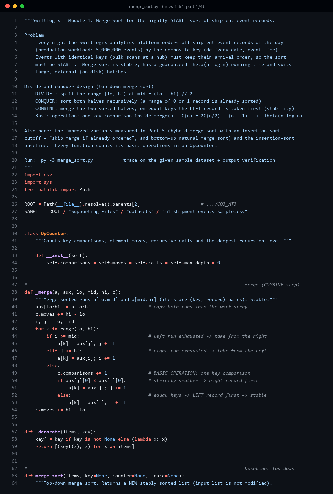

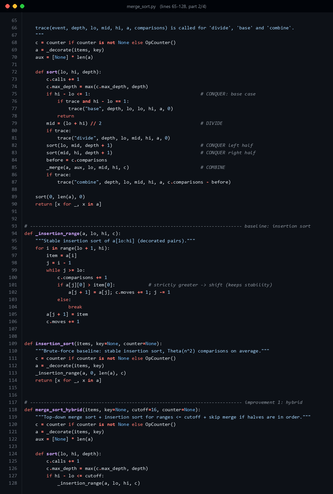

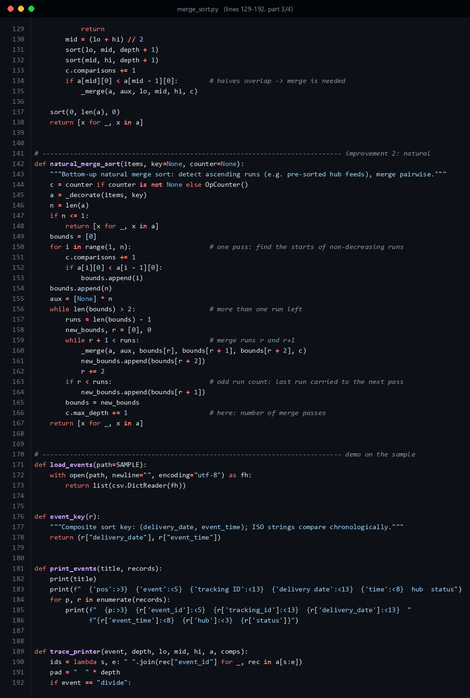

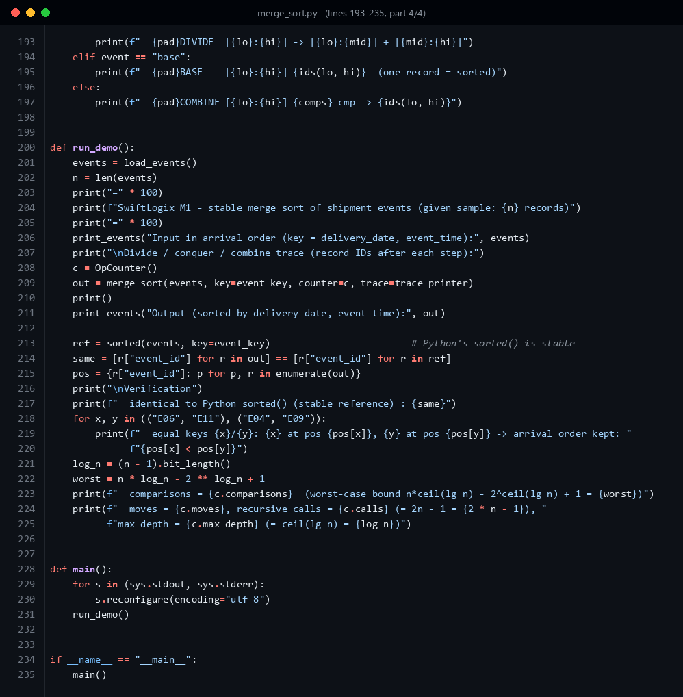

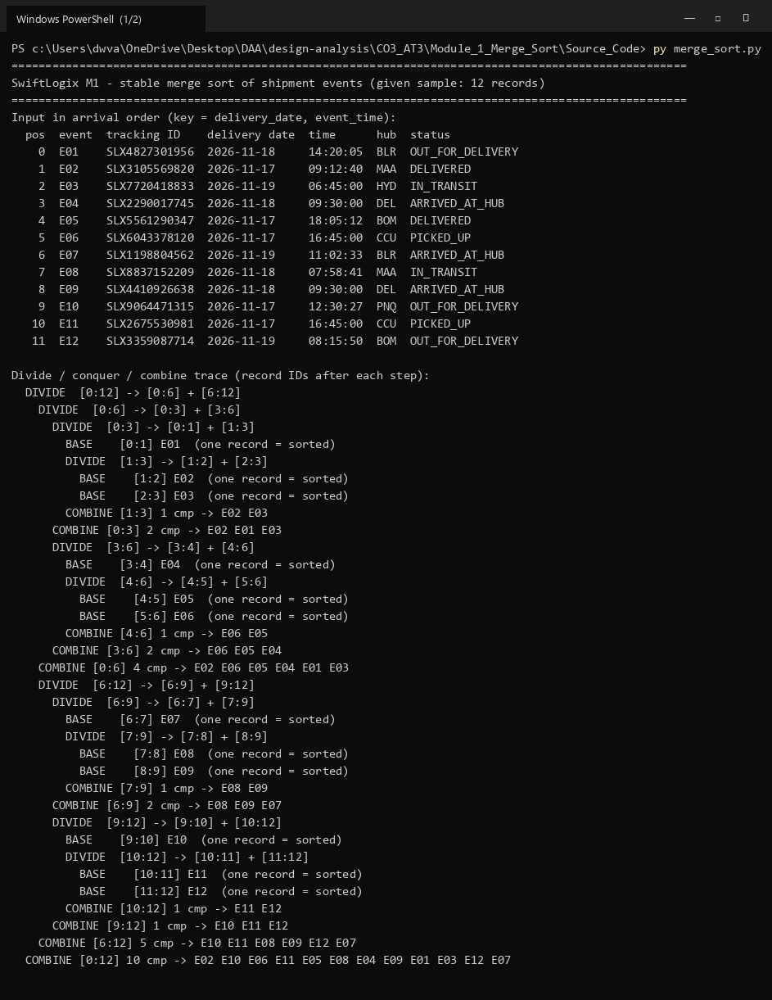

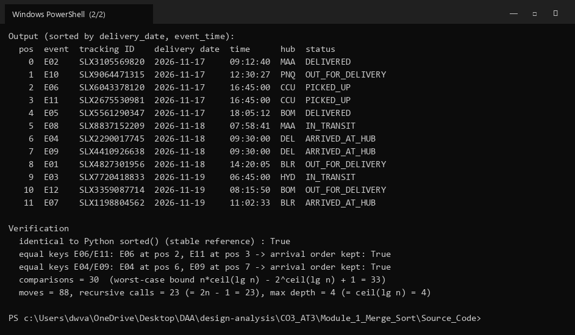

**Reading the trace (Figure 5).**

- **Divide.** `DIVIDE [0:12] -> [0:6] + [6:12]` splits the 12 events into two halves of 6; the halves are split again into 3 + 3, and each 3 into 1 + 2. There are 11 DIVIDE lines (one per internal node of the recursion tree) and 12 BASE lines (the leaves): a single record is already sorted, which is the **conquer** base case.
- **Combine.** Each `COMBINE` line shows the merged run and the comparisons it needed. For example `COMBINE [4:6] 1 cmp -> E06 E05` puts E06 (17 Nov 16:45:00) before E05 (17 Nov 18:05:12), and `COMBINE [0:6] 4 cmp -> E02 E06 E05 E04 E01 E03` merges E02 E01 E03 with E06 E05 E04. The final merge `[0:12]` needs 10 comparisons and produces E02 E10 E06 E11 E05 E08 E04 E09 E01 E03 E12 E07.
- **Stability.** In the final merge E06 (left run) and E11 (right run) have the *same* key 2026-11-17 16:45:00; the comparison `key(E11) < key(E06)` is false, so E06 is written first. The same happens to E04 and E09 (2026-11-18 09:30:00). Both pairs keep their arrival order (positions 2/3 and 6/7 in the output).
- **Counts.** 30 comparisons (1+2+1+2+4+1+2+1+1+5+10) – below the worst-case bound n⌈lg n⌉ − 2<sup>⌈lg n⌉</sup> + 1 = 12·4 − 16 + 1 = 33; 88 moves = 2 × (2+3+2+3+6+2+3+2+3+6+12); 23 calls = 2n − 1; maximum depth 4 = ⌈lg 12⌉.
- **Verification.** The output is identical to Python's stable `sorted()` on the same key.

### 3. Module 2 – Quick Sort on the 12 sample priority scores

`quick_sort.py` implements `partition_lomuto` and the recursive `quick_sort` (pivot rule selectable: `'last'` baseline, `'median3'`, `'random'`), `partition_3way`, `quick_sort_3way`, the final `quick_sort_hybrid` (median of three random elements, 3-way partition, insertion cutoff 16, heap-sort fallback, recursion on the smaller side) and the stability check.

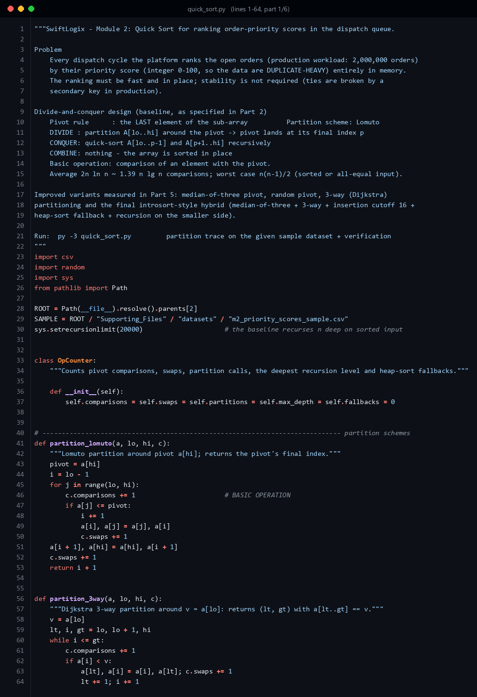

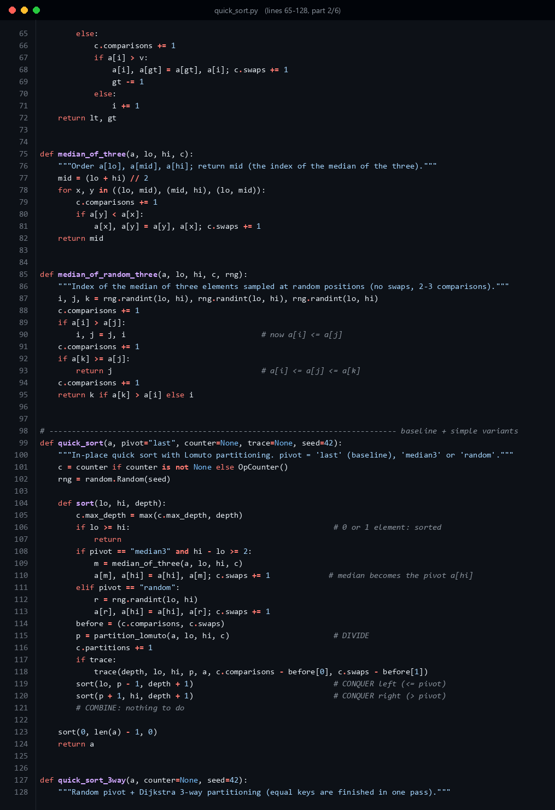

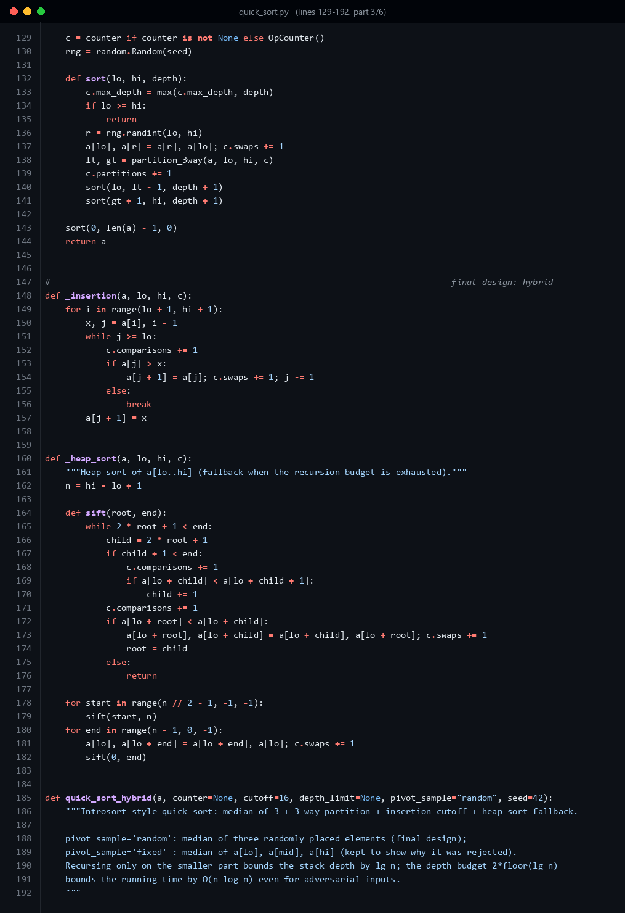

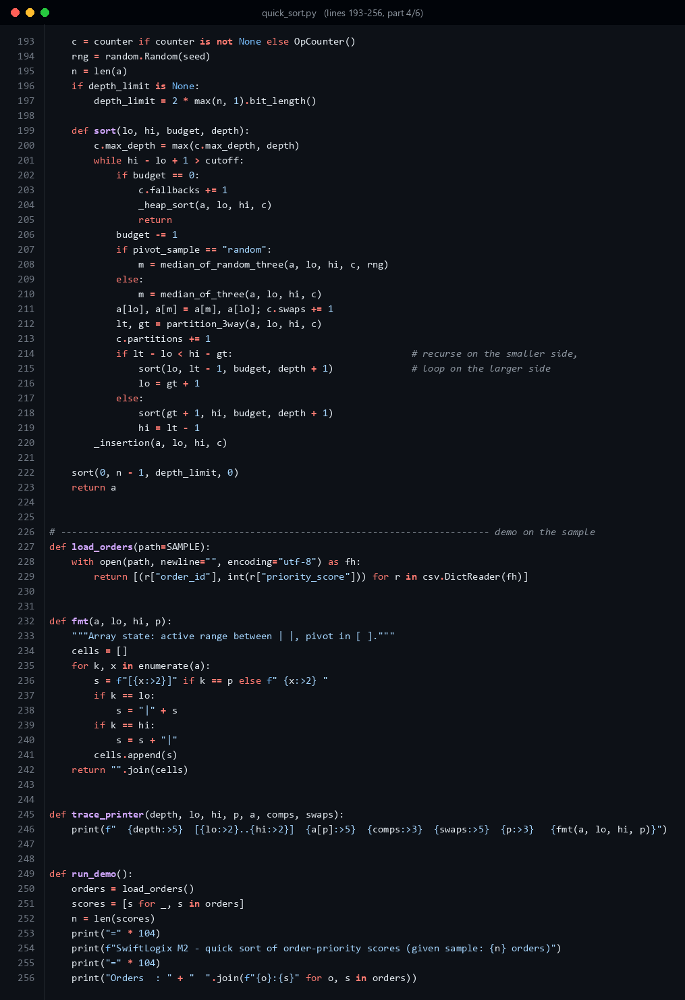

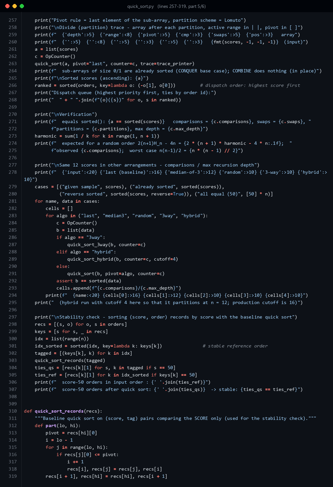

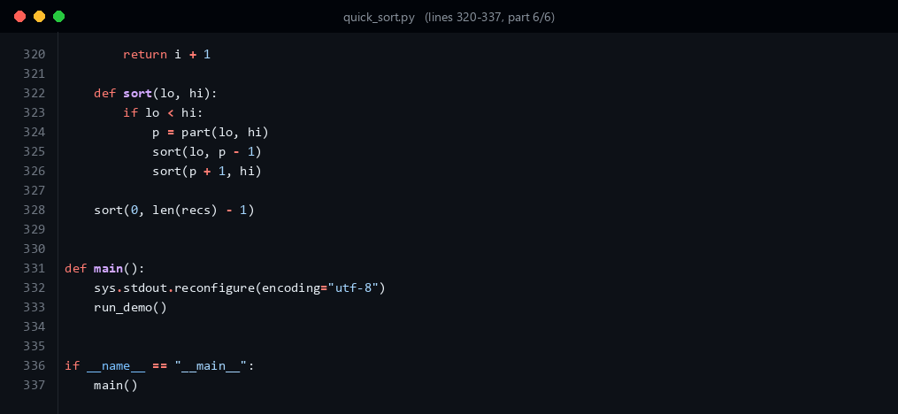

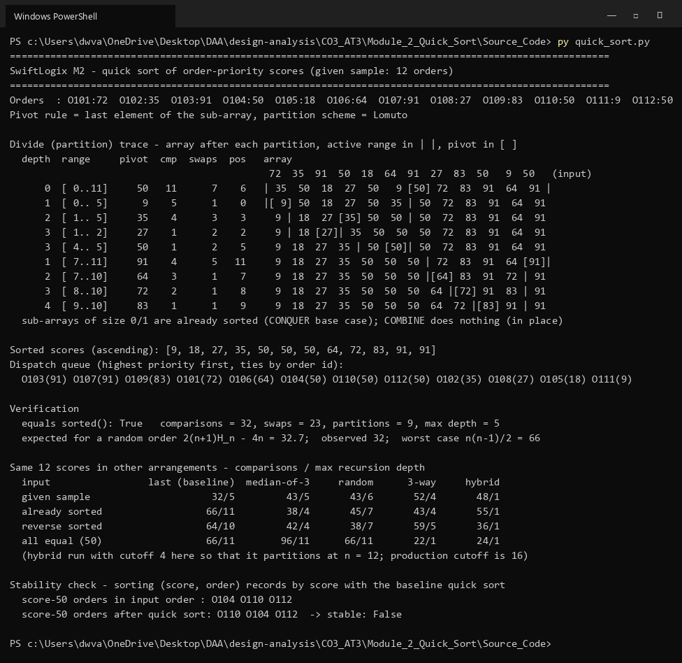

**Reading the trace (Figure 13).** Each line is one **divide** step (a partition); the array is printed after it, with the active range between `| |` and the pivot in `[ ]`.

- **Depth 0, range [0..11], pivot 50** (the last score, order O112): 11 comparisons and 7 swaps move all scores ≤ 50 to the left – 35 50 18 27 50 9 – and the pivot to its final index 6. The right part is 72 83 91 64 91.
- **Conquer.** The two parts are sorted recursively. Depth 1 on [0..5] picks pivot 9, the smallest value, so the split is 0 + 5 – an unbalanced partition caused by the fixed pivot rule; depth 1 on [7..11] picks 91 (the largest), again 4 + 0. The remaining partitions at depths 2–4 finish the ranking; sub-arrays of size 0 or 1 are the base case.
- **Combine.** Nothing is done – after the last partition the array is 9 18 27 35 50 50 50 64 72 83 91 91. The dispatch queue reads it from the high end: O103(91) O107(91) O109(83) O101(72) O106(64) O104(50) O110(50) O112(50) …
- **Counts and verification.** 32 comparisons, 23 swaps, 9 partitions, maximum depth 5. The output equals `sorted()`. For a random order of 12 distinct keys the expected count is 2(n+1)H<sub>n</sub> − 4n = 32.7, the worst case n(n − 1)/2 = 66.
- **Other arrangements of the same 12 scores** (bottom table of the output): the baseline needs **66 comparisons and depth 11 on already-sorted input and also on 12 equal scores** – exactly the worst case n(n−1)/2 – while the 3-way partition sorts the all-equal array with 22 comparisons and depth 1.
- **Stability.** The three score-50 orders arrive as O104 O110 O112 but leave as O110 O104 O112: Lomuto's long-distance swaps make quick sort **unstable**, which is acceptable here only because ties are broken by a secondary key (Part 1).

### 4. Module 3 – Binary Search on the 16-ID sample index

`binary_search.py` contains the iterative `binary_search` (production version), `binary_search_recursive`, the `linear_search` baseline and the Part 5 improvements `interpolation_search` and `guarded_interpolation_search`. The trace callback receives (step, lo, mid, hi, decision).

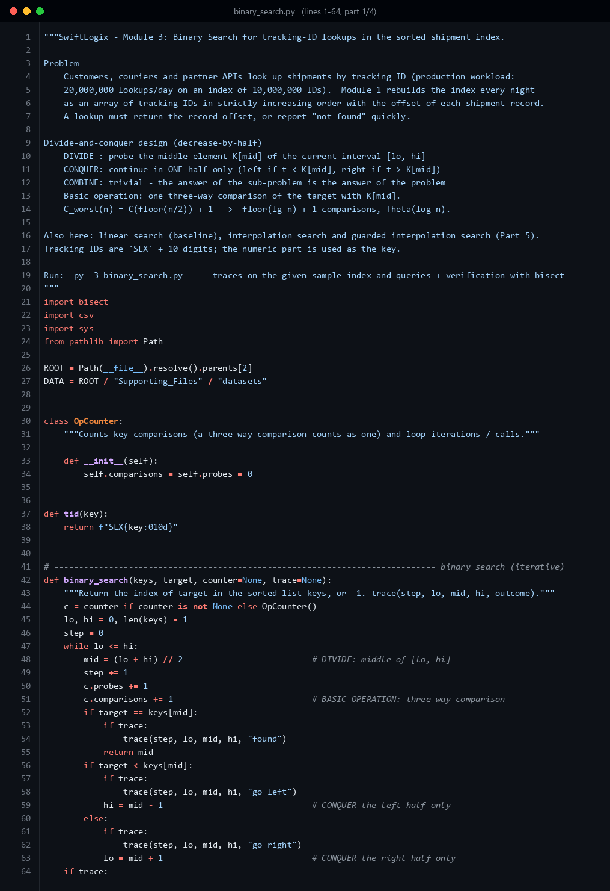

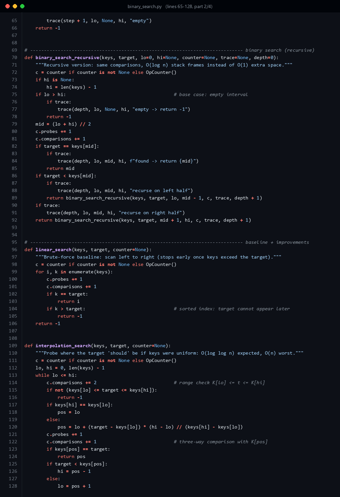

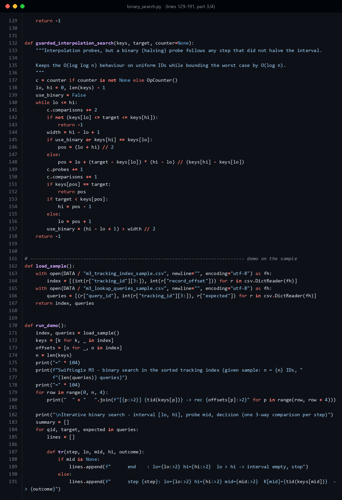

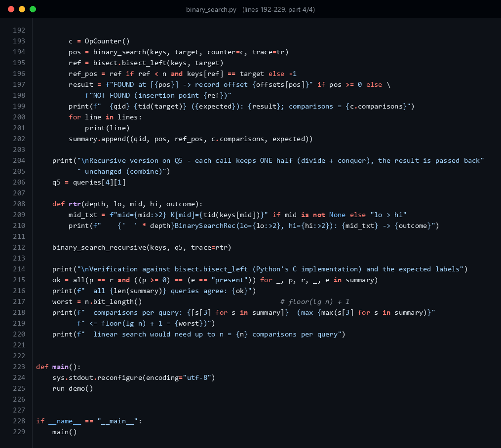

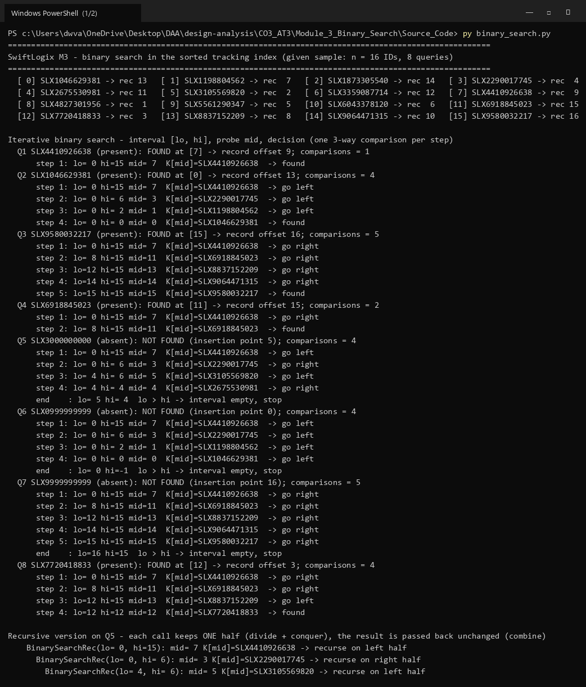

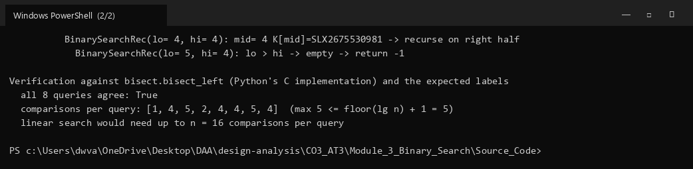

**Reading the trace (Figure 18).** Every step shows the current interval [lo, hi], the probe position mid = ⌊(lo + hi)/2⌋, the ID at that position and the decision.

- **Q1 SLX4410926638** is the middle element K[7] and is found by the first comparison (best case, 1 comparison).
- **Q2 SLX1046629381 (first ID)**: mid = 7 → 3 → 1 → 0 – the interval shrinks 16 → 7 → 3 → 1 – found after 4 comparisons. **Q3 SLX9580032217 (last ID)** needs 5 comparisons (mid = 7, 11, 13, 14, 15): the worst case ⌊lg 16⌋ + 1 = 5.
- **Absent IDs.** Q5 SLX3000000000 probes positions 7, 3, 5, 4 and stops when lo = 5 > hi = 4: not found after 4 comparisons, insertion point 5 (between SLX2675530981 and SLX3105569820). Q6 (below the minimum) ends with lo = 0, hi = −1 and Q7 (above the maximum) with lo = 16, hi = 15.
- **Divide / conquer / combine in the recursive version.** For Q5 the recursive trace shows five nested calls: each call compares with K[mid] (divide), recurses into exactly one half (conquer), and the final `return -1` of the empty interval [5, 4] is passed back unchanged through all levels (trivial combine).
- **Verification.** All 8 answers agree with `bisect.bisect_left` and with the expected present/absent labels; the comparison counts are [1, 4, 5, 2, 4, 4, 5, 4] – never more than ⌊lg n⌋ + 1 = 5, whereas linear search could need up to 16.

### 5. Module 4 – Strassen on the 4 × 4 sample route matrices

`strassen.py` implements `naive_multiply` (baseline), `mat_add` / `mat_sub` / `split` / `join`, the recursive `strassen` (with a `cutoff` for the hybrid), `padded_size` + `pad` and `strassen_multiply` (pad → multiply → strip), and the closed form `strassen_ops` used in Part 4. The seven products are listed in a table-driven `plan` that mirrors pseudocode lines 4–10.

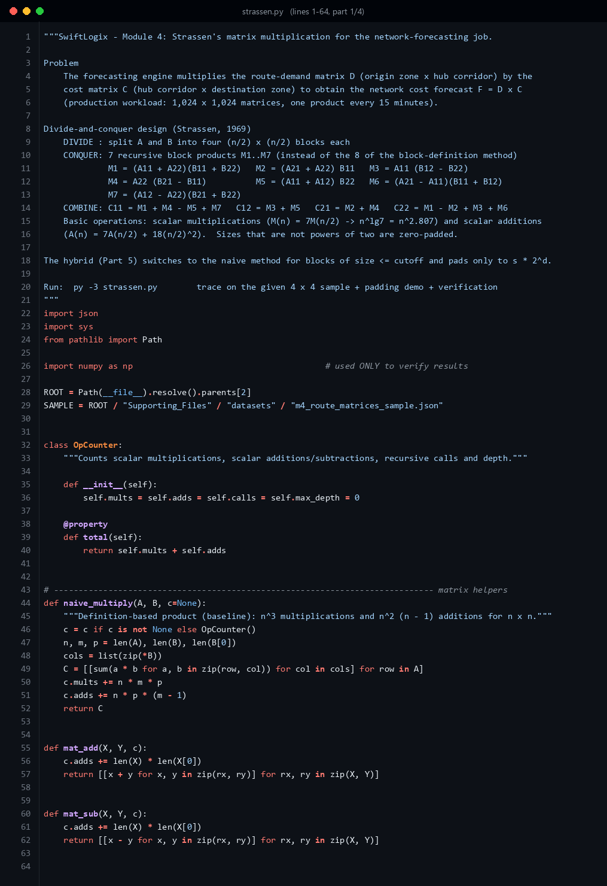

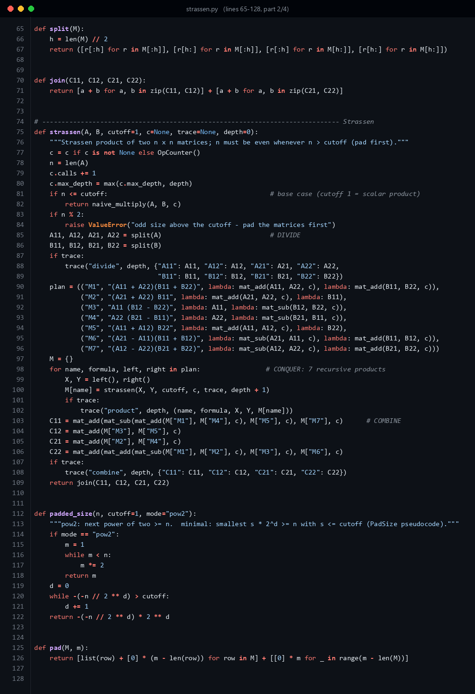

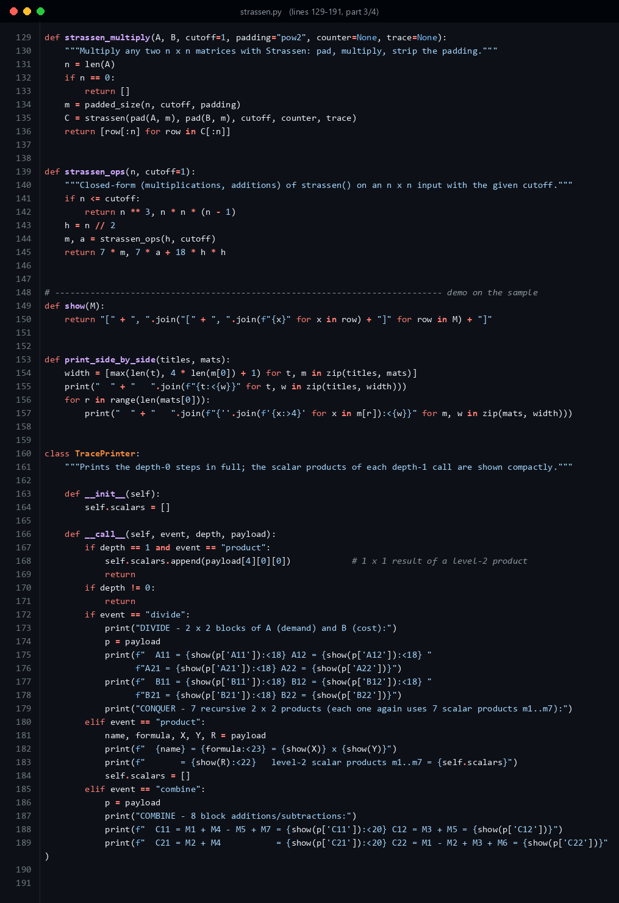

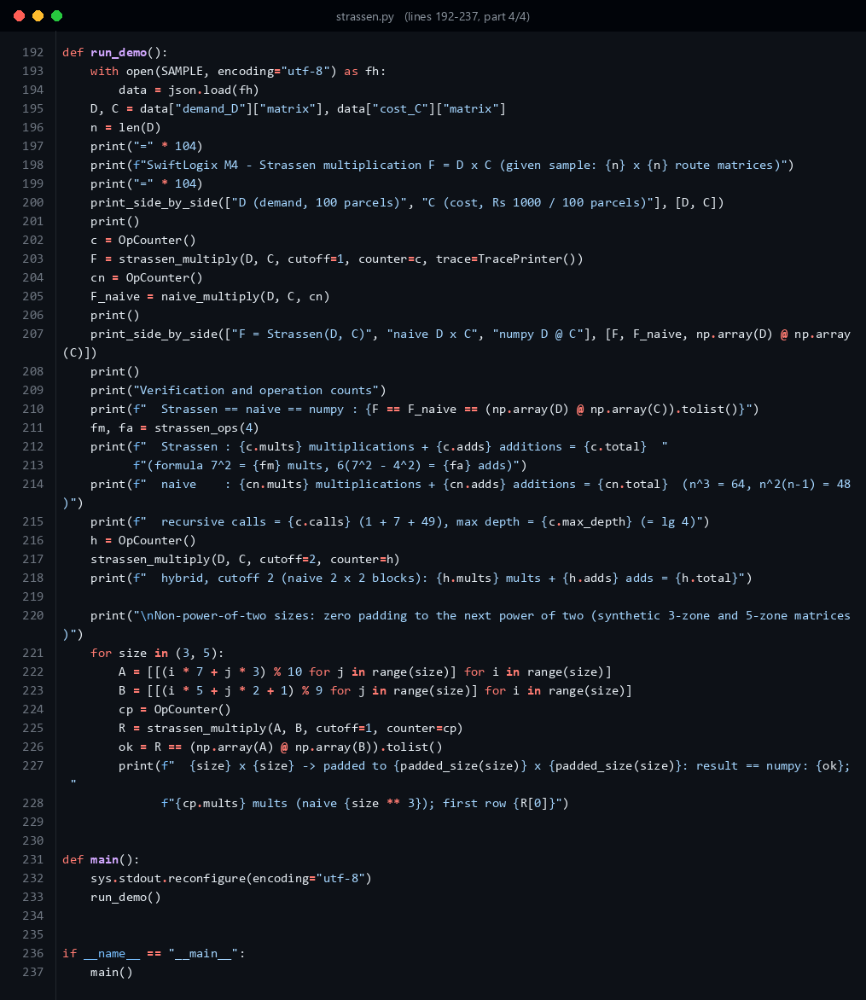

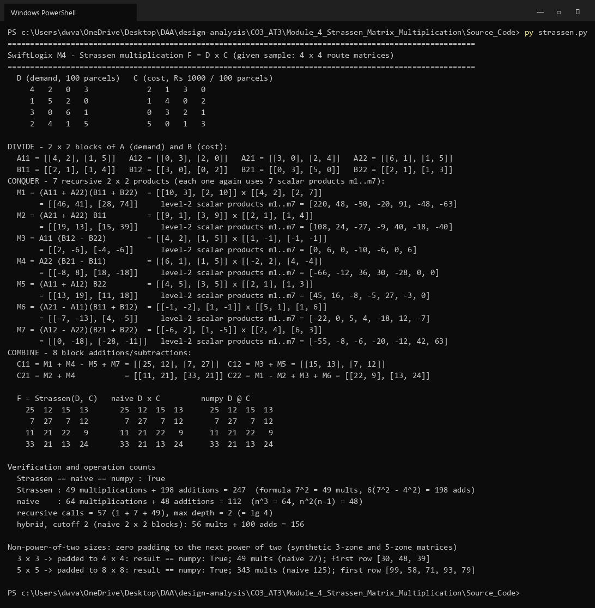

**Reading the trace (Figure 24).**

- **Divide.** D and C are split into 2 × 2 blocks, e.g. A11 = [[4, 2], [1, 5]], A22 = [[6, 1], [1, 5]], B11 = [[2, 1], [1, 4]], B22 = [[2, 1], [1, 3]].
- **Conquer.** The seven block products are formed from 10 block sums/differences. For example M1 = (A11 + A22)(B11 + B22) = [[10, 3], [2, 10]] × [[4, 2], [2, 7]]. This 2 × 2 product is itself computed by Strassen with seven *scalar* products m1..m7 = 220, 48, −50, −20, 91, −48, −63 (e.g. m1 = (10 + 10)(4 + 7) = 220, m5 = (10 + 3)·7 = 91), and its first entry is m1 + m4 − m5 + m7 = 220 − 20 − 91 − 63 = 46, so M1 = [[46, 41], [28, 74]].
- **Combine.** C11 = M1 + M4 − M5 + M7 = [[46, 41], [28, 74]] + [[−8, 8], [18, −18]] − [[13, 19], [11, 18]] + [[0, −18], [−28, −11]] = [[25, 12], [7, 27]]; C12 = M3 + M5 = [[15, 13], [7, 12]]; C21 = M2 + M4 = [[11, 21], [33, 21]]; C22 = M1 − M2 + M3 + M6 = [[22, 9], [13, 24]].
- **Result and meaning.** F = [[25, 12, 15, 13], [7, 27, 7, 12], [11, 21, 22, 9], [33, 21, 13, 24]]; e.g. F[0][0] = 25 means ₹25 thousand per day of forecast cost for Chennai-origin parcels delivered in Chennai. F is identical to the naive product and to numpy.
- **Counts.** Strassen used **49 multiplications + 198 additions = 247** scalar operations (closed forms 7² = 49 and 6(7² − 4²) = 198), 57 calls (1 + 7 + 49) and depth 2; the naive product used 64 + 48 = 112. At n = 4 Strassen saves 15 multiplications but costs 150 extra additions – the first sign of the crossover question studied in Part 5. With cutoff 2 (naive 2 × 2 blocks) the count is 56 + 100 = 156.
- **Non-power-of-two sizes.** A 3 × 3 and a 5 × 5 product were padded to 4 × 4 and 8 × 8 and match numpy; padding is costly (49 multiplications instead of 27, 343 instead of 125), which motivates the minimal-padding improvement in Part 5.

### 6. Datasets, test cases and test results

`generate_datasets.py` writes the larger datasets and the test-case files (Figure 25). The expected outputs in the JSON test cases are computed by independent references – `sorted()`, `bisect` and numpy – never by the algorithms under test. `run_all_tests.py` runs every variant of every module on these cases, on the generated datasets and on randomised inputs, and also checks the operation counts against the closed forms of Part 4 (Table 5).

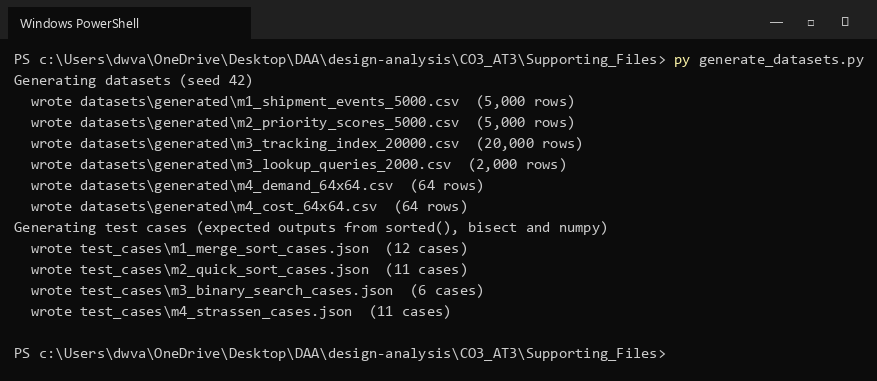

Table 5: Test plan (Supporting_Files/test_cases/*.json and run_all_tests.py)

| Module | Variants tested | Edge cases and checks | Tests |
|---|---|---|---|
| M1 Merge Sort | top-down, hybrid n₀ = 16 and 4, natural, insertion | empty, single, two reversed, duplicates, sorted, reverse, all equal, negatives, organ pipe, random; stability with 30 records / 5 keys; sample order; 5,000 generated events; 300 random lists; comparisons ≤ worst bound and calls = 2n − 1; (n/2) lg n on sorted input; natural sort on 64 feeds | 18 |
| M2 Quick Sort | last, median-of-3, random, 3-way, hybrid, hybrid n₀ = 4, hybrid fixed-m3, heap-only | the same 11 list cases; 5,000 generated scores; 300 random lists; baseline n(n−1)/2 and depth n − 1 on sorted and all-equal input; forced heap-sort fallback; hybrid depth ≤ lg n; Lomuto and 3-way partition invariants | 19 |
| M3 Binary Search | iterative, recursive, interpolation, guarded interpolation, linear | empty index, single ID hit/miss, two IDs, sample 8 queries, 1,000 IDs with first/last/middle/gaps; 20,000-ID index × 2,000 queries; ≤ ⌊lg n⌋ + 1 for every hit and gap (n ≤ 300); totals = S(n), E(n); recursive = iterative; guarded probes ≤ 2(⌊lg n⌋ + 1) | 11 |
| M4 Strassen | naive, pure, cutoff 2, cutoff 4 / 8 with minimal padding | 1 × 1, 2 × 2, sample 4 × 4, 3/5/6/7/12 (padding), identity, zero, 16 × 16; 64 × 64 generated; counted = closed form; 7<sup>k</sup> and 6(7<sup>k</sup> − 4<sup>k</sup>); PadSize; 30 random sizes × cutoffs × padding; odd size rejected | 17 |

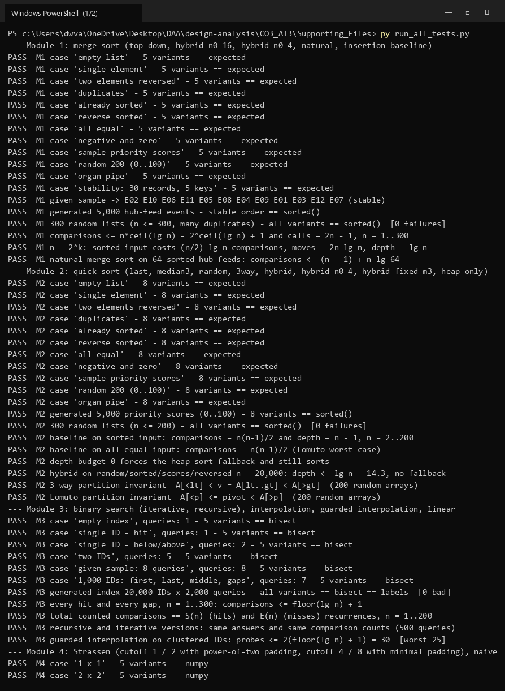

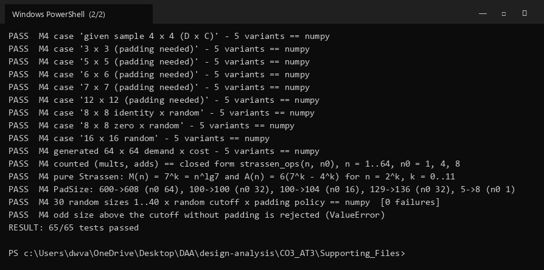

All **65 tests pass** (Figure 26; the full log is Appendix D). Together with the per-program verification lines above, this shows that the four implementations are correct on the given samples, on the edge cases and on random inputs, and that the counters measure exactly what the formulas of Part 4 predict.

## Part 4 – Recurrence Relations, Complexity and Production Workloads [15 Marks]

> Formulate and solve recurrence relations, derive time and space complexities and perform the required theoretical calculations for the specified production workloads.
> - Formulate each recurrence from the algorithm (best, average and worst case where they differ).
> - Solve each recurrence by the Master Theorem and by backward substitution or the recursion-tree method.
> - Derive the space complexity of each algorithm.
> - Compute the number of basic operations, the running time on a server executing 10⁸ basic operations per second and the memory requirement for the production workloads: 5 million shipment events per night (M1), 2 million priority scores per dispatch cycle (M2), 20 million lookups per day on an index of 10 million tracking IDs (M3) and 1,024 × 1,024 matrices (M4).

**Evidence Expected**

> Recurrences, complete solutions (Master Theorem with its parameters and substitution/recursion tree), time and space complexities, closed forms checked against counted operations, and production-workload calculations.

**Ans:**

### 1. Method

For each module I write the recurrence directly from the pseudocode of Part 2 (number of sub-problems, their size, cost of divide + combine), solve it twice – with the **Master Theorem** for T(n) = a·T(n/b) + f(n) (compare f(n) with n<sup>log<sub>b</sub> a</sup>) and with **backward substitution** or a **recursion tree** – and then check the exact closed form against the operations counted by the programs. The production figures are computed by `Supporting_Files/production_workload.py` (Figure 28) from these closed forms, at 10⁸ basic operations per second, with 1 MB = 10⁶ bytes.

### 2. Module 1 – Merge Sort

**Recurrence.** Sorting n records costs the two recursive sorts plus the merge. The merge of runs of total length n needs at most n − 1 comparisons (worst case: the runs interleave until the end) and at least ⌊n/2⌋ (best case: the shorter run is exhausted first, e.g. sorted input). Dividing costs Θ(1). Hence

- worst case: C(n) = C(⌈n/2⌉) + C(⌊n/2⌋) + (n − 1), C(1) = 0; for n = 2<sup>k</sup>: **C(n) = 2C(n/2) + (n − 1)**
- best case (sorted input, n = 2<sup>k</sup>): B(n) = 2B(n/2) + n/2, B(1) = 0
- record moves (copy to Aux and back): M(n) = 2M(n/2) + 2n, M(1) = 0

**Master Theorem.** a = 2, b = 2, f(n) = n − 1 = Θ(n); n<sup>log<sub>b</sub> a</sup> = n<sup>log₂ 2</sup> = n. Since f(n) = Θ(n<sup>log<sub>b</sub> a</sup>), **case 2** applies: C(n) = Θ(n<sup>log<sub>b</sub> a</sup> · log n) = **Θ(n log n)**. The best case (f(n) = n/2) and the moves (f(n) = 2n) fall in the same case, so merge sort is Θ(n log n) for *every* input order.

**Backward substitution** (n = 2<sup>k</sup>):

```
C(n) = 2C(n/2) + n - 1
     = 2[2C(n/4) + n/2 - 1] + n - 1           = 4C(n/4) + 2n - (1 + 2)
     = 4[2C(n/8) + n/4 - 1] + 2n - 3          = 8C(n/8) + 3n - (1 + 2 + 4)
     = ...
     = 2^i C(n/2^i) + i*n - (2^i - 1)
i = k = lg n:  C(n) = n*C(1) + n lg n - (n - 1)  =  n lg n - n + 1
```

**Recursion tree.** Level i has 2<sup>i</sup> merges of runs of total length n/2<sup>i</sup>, each costing at most n/2<sup>i</sup> − 1 comparisons, so level i costs n − 2<sup>i</sup>. Summing the k = lg n merge levels: Σ<sub>i=0</sub><sup>k−1</sup> (n − 2<sup>i</sup>) = kn − (2<sup>k</sup> − 1) = n lg n − n + 1 – the same result. For general n the worst case is n⌈lg n⌉ − 2<sup>⌈lg n⌉</sup> + 1. The same tree gives B(n) = (n/2) lg n and M(n) = 2n lg n.

**Space.** The work array Aux holds n records and the recursion stack has D(n) = D(n/2) + 1 = ⌈lg n⌉ frames, so S(n) = n + Θ(log n) = **Θ(n)** extra space. The insertion-sort baseline is in place but needs n(n − 1)/4 comparisons on average, Θ(n²).

**Check against counted operations.** Table 6 uses the counts of `merge_sort_experiments.py` on already-sorted input (best case) – they equal (n/2) lg n and 2n lg n exactly; the random-input counts of Part 5 stay below the worst-case bound at every size (Table 14).

Table 6: Merge sort on sorted input – counted vs closed form (m1_merge_sort_experiments.csv)

| n | cmp | (n/2) lg n | moves | 2n lg n | depth | lg n |
|---:|---:|---:|---:|---:|---:|---:|
| 1,024 | 5,120 | 5,120 | 20,480 | 20,480 | 10 | 10 |
| 2,048 | 11,264 | 11,264 | 45,056 | 45,056 | 11 | 11 |
| 4,096 | 24,576 | 24,576 | 98,304 | 98,304 | 12 | 12 |
| 8,192 | 53,248 | 53,248 | 212,992 | 212,992 | 13 | 13 |
| 16,384 | 114,688 | 114,688 | 458,752 | 458,752 | 14 | 14 |
| 32,768 | 245,760 | 245,760 | 983,040 | 983,040 | 15 | 15 |
| 65,536 | 524,288 | 524,288 | 2,097,152 | 2,097,152 | 16 | 16 |
| 131,072 | 1,114,112 | 1,114,112 | 4,456,448 | 4,456,448 | 17 | 17 |

**Production workload (n = 5,000,000 events, ⌈lg n⌉ = 23 because 2²² = 4,194,304 < n ≤ 2²³ = 8,388,608).** Worst-case comparisons = 5,000,000 × 23 − 8,388,608 + 1 = **106,611,393** → 1.07 s; with the 2n⌈lg n⌉ = 230,000,000 record moves the total is 336,611,393 basic operations → **3.37 s**. Insertion sort would need n(n − 1)/4 ≈ 6.25 × 10¹² comparisons → **17.36 hours**, which does not fit a nightly window. Memory: 5,000,000 × 64 B = 320 MB of records plus a 320 MB work array = **640 MB**; sorting (8-byte key, 4-byte record index) pairs instead needs 2 × 5,000,000 × 12 B = **120 MB**. The stack holds only 23 frames.

Table 7: Module 1 production estimates (production_workload.csv)

| Design / quantity | Basic operations | Time at 10⁸ ops/s | Memory (MB) | Note |
|---|---:|---:|---:|---|
| insertion sort, average n(n-1)/4 | 6.2500 × 10¹² | 17.36 h | 320.0 | comparisons; infeasible |
| top-down merge sort, worst comparisons | 106,611,393 | 1.07 s | 640.0 | records + n-record buffer |
| plus record moves 2n*ceil(lg n) | 336,611,393 | 3.37 s | 640.0 | comparisons + moves |
| natural merge sort on 64 feeds (cmp) | 34,999,999 | 350.0 ms | 120.0 | (key, index) pairs |
| plus moves 2n*lg 64 | 94,999,999 | 950.0 ms | 120.0 | final design |

### 3. Module 2 – Quick Sort

**Recurrence.** Partitioning n elements costs n − 1 comparisons; if the pivot lands at index p (p elements on its left), the two sub-arrays have p and n − 1 − p elements:

T(n) = T(p) + T(n − 1 − p) + (n − 1),  T(0) = T(1) = 0.

**Best case** (p = ⌊(n−1)/2⌋, balanced): T(n) ≈ 2T(n/2) + (n − 1). Master Theorem: a = 2, b = 2, f(n) = Θ(n) = Θ(n<sup>log₂ 2</sup>) → **case 2** → **Θ(n log n)**; the exact solution is the merge-sort one, ≈ n lg n − n + 1.

**Worst case** (pivot = maximum or minimum every time – already-sorted input with the last-element pivot, or all keys equal with Lomuto, which puts every key ≤ pivot on the left): p = n − 1 and

```
T(n) = T(n-1) + (n-1)
     = T(n-2) + (n-2) + (n-1)
     = ...
     = T(1) + 1 + 2 + ... + (n-1)  =  n(n-1)/2  =  Theta(n^2)
```

This is a *subtract-and-conquer* recurrence (sub-problem n − 1, not n/b), so the Master Theorem does not apply; the recursion tree is a chain of n − 1 levels with costs n − 1, n − 2, …, 1 and the recursion depth is n − 1.

**Average case** (random order, distinct keys, every p equally likely with probability 1/n):

```
T(n) = (n-1) + (1/n) * sum_{p=0}^{n-1} [T(p) + T(n-1-p)]  =  (n-1) + (2/n) * sum_{k=0}^{n-1} T(k)
n T(n)         = n(n-1)     + 2 * sum_{k=0}^{n-1} T(k)
(n-1) T(n-1)   = (n-1)(n-2) + 2 * sum_{k=0}^{n-2} T(k)                 (same equation for n-1)
subtract:  n T(n) - (n-1) T(n-1) = 2(n-1) + 2 T(n-1)   =>   n T(n) = (n+1) T(n-1) + 2(n-1)
divide by n(n+1):  T(n)/(n+1) = T(n-1)/n + 2(n-1)/(n(n+1)),   and (k-1)/(k(k+1)) = 2/(k+1) - 1/k
telescoping:  T(n)/(n+1) = sum_{k=2}^{n} [4/(k+1) - 2/k] = 2 H_n + 4/(n+1) - 4
=>  T(n) = 2(n+1) H_n - 4n  ~  2 n ln n  ~  1.386 n lg n      (H_n = 1 + 1/2 + ... + 1/n ~ ln n + 0.577)
```

So the average case is **Θ(n log n)** with a constant 39 % above the best case. Check: n = 12 gives 2·13·3.1032 − 48 = 32.7, and the sample needed 32 comparisons (Part 3).

**Duplicate-heavy keys.** With only k distinct scores, each repeated m = n/k times, Lomuto treats each block of equal keys like the all-equal worst case, so the comparisons grow like k · m²/2 = **n²/(2k)** – quadratic in n for fixed k = 101. Dijkstra's 3-way partition puts all keys equal to the pivot in the middle in the same pass, so each distinct value is a pivot only once and the expected cost is proportional to n lg k (measured: 1.499 · n lg k for the final hybrid, Part 5).

**Space.** Quick sort is in place (O(1) extra array space); the stack holds one frame per recursion level: Θ(log n) for balanced partitions but **n − 1 frames in the worst case**. The final hybrid recurses only into the smaller part and loops on the larger one, so its depth satisfies D(n) ≤ D(n/2) + 1 ≤ lg n, and its depth budget of 2⌊lg n⌋ partitions (then heap sort) bounds the time by O(n log n) for every input.

**Check against counted operations.** On sorted input the baseline counts are exactly n(n − 1)/2 with depth n − 1 (Table 8); on random input the counts are within 4–11 % of 2(n+1)H<sub>n</sub> − 4n (Table 17).

Table 8: Baseline quick sort on sorted input – counted vs closed form (m2_quick_sort_experiments.csv)

| input | n | cmp | n(n-1)/2 | depth | n - 1 |
|---|---:|---:|---:|---:|---:|
| sorted | 1,024 | 523,776 | 523,776 | 1,023 | 1,023 |
| sorted | 2,048 | 2,096,128 | 2,096,128 | 2,047 | 2,047 |
| sorted | 4,096 | 8,386,560 | 8,386,560 | 4,095 | 4,095 |
| reversed | 1,024 | 523,776 | 523,776 | 1,023 | 1,023 |
| reversed | 2,048 | 2,096,128 | 2,096,128 | 2,047 | 2,047 |
| reversed | 4,096 | 8,386,560 | 8,386,560 | 4,095 | 4,095 |

(Reverse-sorted input is also a worst case: the last element is the minimum, every partition removes only the pivot, and the counts are again exactly n(n − 1)/2 with depth n − 1; only the number of swaps differs – 262,655 instead of 524,799 at n = 1,024.)

**Production workload (n = 2,000,000 per dispatch cycle, lg n = 20.93, k = 101 distinct scores).** Average for distinct keys: 2(n+1)H<sub>n</sub> − 4n = **52,343,525** comparisons → 0.52 s. Worst case (the queue is already ranked, or all scores equal): n(n − 1)/2 = **1,999,999,000,000** comparisons → **5.56 hours** and a recursion depth of 1,999,999 frames (≈ 200 MB of stack – a stack overflow on any standard thread). Real duplicate-heavy scores with Lomuto: n²/(2k) = **19,801,980,198** comparisons → **198 s**, about 200 times over the 1-second budget. Final hybrid (3-way): 1.499 · n · lg 101 = **19,962,967** comparisons → **0.20 s**. Memory: the array of 2,000,000 × 8-byte (score, index) pairs is **16 MB**, sorted in place; the hybrid's stack holds at most lg n ≈ 21 frames.

Table 9: Module 2 production estimates (production_workload.csv)

| Design / quantity | Basic operations | Time at 10⁸ ops/s | Memory (MB) | Note |
|---|---:|---:|---:|---|
| baseline Lomuto, sorted/all-equal n(n-1)/2 | 2.0000 × 10¹² | 5.56 h | 216.0 | depth n: 2M stack frames |
| baseline Lomuto, duplicate scores n^2/(2k) | 19,801,980,198 | 198.02 s | 16.0 | measured model, Exp C |
| baseline, random distinct keys 2(n+1)H_n-4n | 52,343,525 | 523.4 ms | 16.0 | expected ~1.386 n lg n |
| hybrid (3-way) on scores 1.499 n lg k | 19,962,967 | 199.6 ms | 16.0 | from n = 131,072; final design |

### 4. Module 3 – Binary Search

**Recurrence.** One three-way comparison with K[mid] either finds t or leaves one half: the left half has ⌈n/2⌉ − 1 elements and the right half ⌊n/2⌋. The worst case always continues in the larger part:

**C(n) = C(⌊n/2⌋) + 1** for n ≥ 2,  C(1) = 1  (C(0) = 0 for the empty interval).

**Master Theorem.** a = 1, b = 2, f(n) = 1 = Θ(n⁰); n<sup>log<sub>b</sub> a</sup> = n<sup>log₂ 1</sup> = n⁰ = 1. Since f(n) = Θ(n<sup>log<sub>b</sub> a</sup>), **case 2**: C(n) = Θ(n⁰ · log n) = **Θ(log n)**.

**Backward substitution** (n = 2<sup>k</sup>):

```
C(2^k) = C(2^(k-1)) + 1 = C(2^(k-2)) + 2 = ... = C(2^0) + k = 1 + k   =>   C(n) = lg n + 1
general n:  C(n) = floor(lg n) + 1     (because floor(lg floor(n/2)) = floor(lg n) - 1)
```

The recursion tree is a single path of ⌊lg n⌋ + 1 nodes, each costing one comparison. Check: n = 16 → ⌊lg 16⌋ + 1 = 5, the count of Q3 and Q7 in Part 3.

**Average case.** Over all n successful searches the total number of comparisons is the internal path length of the decision tree plus n: S(n) = n + S(⌊(n−1)/2⌋) + S(⌈(n−1)/2⌉), S(0) = 0 (for n = 2<sup>k</sup> − 1: S(n)/n = ((k − 1)2<sup>k</sup> + 1)/n ≈ lg n − 1). For the n + 1 unsuccessful searches E(n) = (n + 1) + E(⌊(n−1)/2⌋) + E(⌈(n−1)/2⌉), E(0) = 0, giving E(n)/(n + 1) ≈ lg(n + 1). Both stay Θ(log n).

**Space.** The iterative version needs three indices: **Θ(1)** extra space. The recursive version keeps D(n) = D(n/2) + 1 = ⌊lg n⌋ + 1 frames: Θ(log n). The baseline linear search needs n comparisons in the worst case and (n + 1)/2 on average for a hit: Θ(n).

**Check against counted operations.** The counted averages equal S(n)/n and E(n)/(n + 1) to three decimals whenever every key and every gap is queried (n ≤ 65,536), and the worst counts equal ⌊lg n⌋ + 1 (Table 10); the test harness also checks the exact totals for every n from 1 to 200.

Table 10: Binary search – counted vs exact formulas (m3_binary_search_exact.csv; "all" = every key and gap queried, "sample" = 20,000 random queries)

| n | avg hit | S(n)/n | max hit | ⌊lg n⌋+1 | avg miss | E(n)/(n+1) | mode |
|---:|---:|---:|---:|---:|---:|---:|---|
| 1,024 | 9.012 | 9.012 | 11 | 11 | 10.002 | 10.002 | all |
| 2,048 | 10.006 | 10.006 | 12 | 12 | 11.001 | 11.001 | all |
| 4,096 | 11.003 | 11.003 | 13 | 13 | 12.001 | 12.001 | all |
| 8,192 | 12.002 | 12.002 | 14 | 14 | 13.000 | 13.000 | all |
| 16,384 | 13.001 | 13.001 | 15 | 15 | 14.000 | 14.000 | all |
| 32,768 | 14.001 | 14.001 | 16 | 16 | 15.000 | 15.000 | all |
| 65,536 | 15.000 | 15.000 | 17 | 17 | 16.000 | 16.000 | all |
| 131,072 | 16.002 | 16.000 | 17 | 18 | 17.000 | 17.000 | sample |
| 262,144 | 16.983 | 17.000 | 18 | 19 | 18.000 | 18.000 | sample |
| 524,288 | 18.007 | 18.000 | 19 | 20 | 19.000 | 19.000 | sample |
| 1,048,576 | 19.014 | 19.000 | 20 | 21 | 20.000 | 20.000 | sample |

(In sampled mode the deepest keys are rarely drawn, so the observed worst can be one below ⌊lg n⌋ + 1.)

**Production workload (n = 10,000,000 IDs, 20,000,000 lookups per day, ⌊lg n⌋ + 1 = 24 because 2²³ = 8,388,608 ≤ n < 2²⁴).** Worst case 24 comparisons per lookup → 480,000,000 comparisons per day → **4.80 s of CPU per day**; exact average for a hit S(n)/n = 22.322 (a miss 23.322). Linear search would need (n + 1)/2 = 5,000,000.5 comparisons per hit → 10¹⁴ per day → **11.6 days of CPU for one day of traffic**. Throughput per core: 10⁸/24 = **4.17 million lookups/s** if CPU-bound; with a cache miss (~100 ns) per probe, 1/(24 × 100 ns) = **416,667 lookups/s**, so the assumed peak of 2,000 lookups/s uses 0.48 % of one core. Memory: 10,000,000 × 16 B = **160 MB** for the sorted array (no extra space for the iterative search); a hash index with load factor 0.5 would need ≈ 320 MB. The nightly rebuild of the index by merge sort costs 223,222,785 comparisons (2.23 s) in Module 1's window.

Table 11: Module 3 production estimates (production_workload.csv)

| Design / quantity | Basic operations | Time at 10⁸ ops/s | Memory (MB) | Note |
|---|---:|---:|---:|---|
| linear search, (n+1)/2 per hit x Q/day | 1.0000 × 10¹⁴ | 11.6 days | 160.0 | per day; infeasible |
| binary search, worst 24 per lookup x Q | 480,000,000 | 4.80 s | 160.0 | per day (CPU) |
| binary search, average hit 22.322 x Q | 446,445,618 | 4.46 s | 160.0 | S(n)/n exact; miss 23.322 |
| guarded interpolation ~19.5 cmp/lookup x Q | 390,128,132 | 3.90 s | 160.0 | ~6.5 probes vs 24 |
| hash index (dict), ~1.5 probes x Q | 30,000,000 | 300.0 ms | 320.0 | load 0.5; no range queries |
| nightly index rebuild (merge sort, worst) | 223,222,785 | 2.23 s | 320.0 | runs in Module 1 window |

### 5. Module 4 – Strassen's Matrix Multiplication

**Recurrences.** A product of order n makes 7 recursive products of order n/2 and 18 additions/subtractions of (n/2) × (n/2) blocks (10 to form the operands, 8 to combine):

- multiplications: M(n) = 7M(n/2), M(1) = 1
- additions: A(n) = 7A(n/2) + 18(n/2)², A(1) = 0
- all scalar operations: **T(n) = 7T(n/2) + 18(n/2)² = 7T(n/2) + 4.5n²**, T(1) = 1
- naive (definition) method: n³ multiplications + n²(n − 1) additions = 2n³ − n²; written as a block recursion with 8 products, N(n) = 8N(n/2) + 4(n/2)².

**Master Theorem.** For Strassen a = 7, b = 2, n<sup>log<sub>b</sub> a</sup> = n<sup>log₂ 7</sup> = n<sup>2.807</sup>, f(n) = 4.5n² = O(n<sup>log₂ 7 − ε</sup>) with ε = 0.807 > 0 → **case 1** → T(n) = **Θ(n<sup>log₂ 7</sup>) = Θ(n<sup>2.807</sup>)**. For the block-naive recursion a = 8, n<sup>log₂ 8</sup> = n³ and f(n) = n² = O(n<sup>3 − ε</sup>) → case 1 → Θ(n³). Saving one block product lowers the exponent from 3 to 2.807.

**Backward substitution** (n = 2<sup>k</sup>):

```
M(n) = 7 M(n/2) = 7^2 M(n/4) = ... = 7^k M(1) = 7^lg n = n^lg 7 ~ n^2.807
A(n) = 7 A(n/2) + 4.5 n^2
     = 7 [7 A(n/4) + 4.5 (n/2)^2] + 4.5 n^2       = 7^2 A(n/4) + 4.5 n^2 (1 + 7/4)
     = 7^i A(n/2^i) + 4.5 n^2 * sum_{j=0}^{i-1} (7/4)^j
i = k:  A(n) = 4.5 n^2 * ((7/4)^k - 1) / (7/4 - 1) = 6 n^2 ((7/4)^k - 1) = 6 (7^k - 4^k) = 6 n^lg7 - 6 n^2
T(n) = M(n) + A(n) = 7 n^lg7 - 6 n^2          check n = 4: 49 + 198 = 247 (Part 3 trace)
```

**Recursion tree.** Level j has 7<sup>j</sup> nodes of order n/2<sup>j</sup>, each doing 18(n/2<sup>j+1</sup>)² additions, so level j costs 4.5n²·(7/4)<sup>j</sup>. The level costs *grow* geometrically (ratio 7/4 > 1), so the bottom level – 7<sup>lg n</sup> = n<sup>lg 7</sup> leaf products – dominates, which is exactly Master case 1.

**Crossover and the hybrid.** Replacing the naive product of order n by one Strassen level (naive below) pays off when 2n³ − n² > 7[2(n/2)³ − (n/2)²] + 18(n/2)² = 1.75n³ + 2.75n², i.e. 0.25n³ > 3.75n², i.e. **n > 15**. So, counting operations, recursion should stop at n₀ = 8 (for powers of two). With d = lg(n/n₀) Strassen levels the hybrid costs T(n) = 7<sup>d</sup>(2n₀³ − n₀²) + 4.5n² Σ<sub>j=0</sub><sup>d−1</sup>(7/4)<sup>j</sup>; for n = 1,024, n₀ = 8: 7⁷ × 960 + (64 × 7⁷ − 4¹⁰) × 6 = 790,601,280 + 309,949,056 = **1,100,550,336**. Pure Strassen (n₀ = 1) beats the naive count only from n = 1,024 on, because the 4.5n² additions per level are expensive at small n.

**Space.** The inputs and output need 3n² words in both methods. My implementation keeps, at each level, 8 block copies of A and B, up to 6 finished products and 2 operand blocks alive while recursing into the 7th product: S(n) = S(n/2) + 16(n/2)² = 4n²(1 + 1/4 + 1/16 + …) = (16/3)n² ≈ 5.33n² words; at the top-level combine 8 + 7 + 4 + 4 = 23 blocks (n/2)² = 5.75n² words are alive. Hence the extra space is **Θ(n²)** with constant ≈ 5.75 (a memory-economical schedule can reduce it to about n²). The recursion depth is lg(n/n₀) frames.

**Check against counted operations.** For every n from 2 to 64 (pure Strassen) and 2 to 256 (cutoffs 8, 16, 32) the counted multiplications + additions equal the closed form exactly (Table 25 in Part 5; the harness also checks M(n) = 7<sup>k</sup> and A(n) = 6(7<sup>k</sup> − 4<sup>k</sup>) for k = 0…11).

**Production workload (n = 1,024 = 2¹⁰, 96 forecasts per day).** Naive: 2n³ − n² = **2,146,435,072** operations → **21.46 s** per forecast (34.3 min per day). Pure Strassen: 7 × 7¹⁰ − 6 × 4¹⁰ = **1,971,035,287** → 19.71 s, of which only 282,475,249 are multiplications (naive 1,073,741,824 – 3.8 times fewer). Hybrid n₀ = 8: **1,100,550,336** → **11.01 s** (17.6 min per day, 1.95× faster than naive). Memory: naive 3n² × 8 B = **25.2 MB**; Strassen 2n² (inputs) + 5.75n² (workspace incl. output) = 7.75 × 1,048,576 × 8 B = **65.0 MB**.

Table 12: Module 4 production estimates (production_workload.csv)

| Design / quantity | Basic operations | Time at 10⁸ ops/s | Memory (MB) | Note |
|---|---:|---:|---:|---|
| naive product 2n^3 - n^2 | 2,146,435,072 | 21.46 s | 25.2 | 2,060.58 s/day |
| pure Strassen 7n^2.807 - 6n^2 | 1,971,035,287 | 19.71 s | 65.0 | 282,475,249 mults |
| hybrid Strassen, cutoff 8 | 1,100,550,336 | 11.01 s | 65.0 | op-optimal; 1,056.53 s/day |
| hybrid Strassen, cutoff 64 | 1,301,696,512 | 13.02 s | 65.0 | time-tuned (Python); 1,249.63 s/day |
| Strassen-Winograd (15 adds), cutoff 8 | 1,048,892,160 | 10.49 s | 65.0 | formula only (next step) |

### 6. Production-workload calculation program

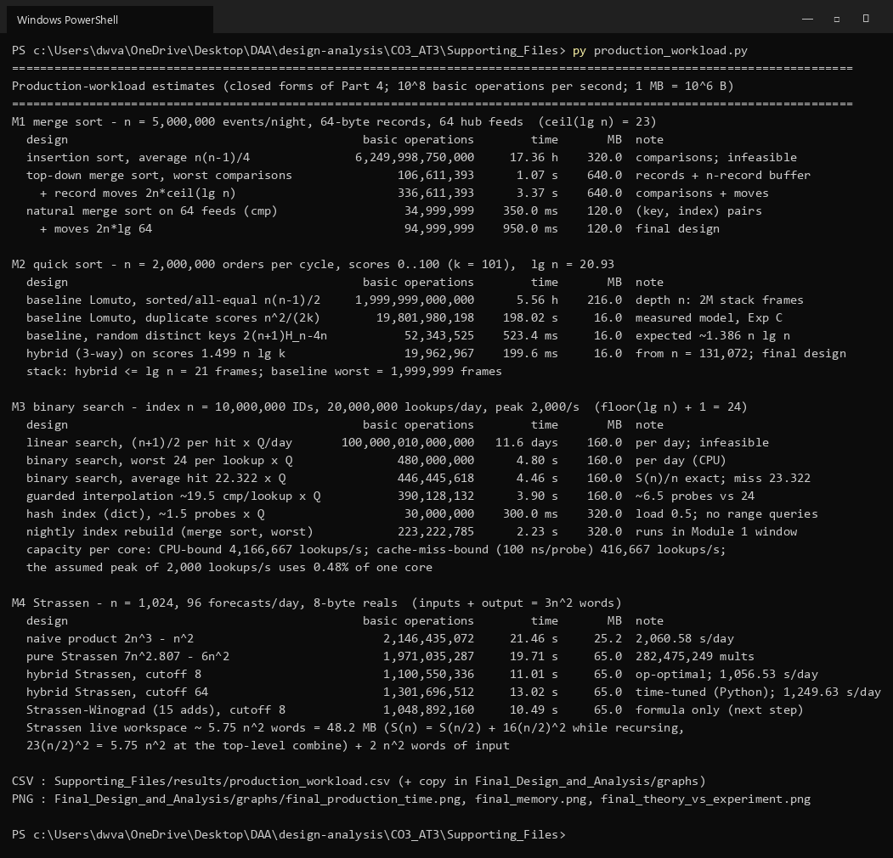

Table 13: Complexity summary of the four modules

| Module | Recurrence | Method / case | Time | Extra space | Production (designed in Part 2) |
|---|---|---|---|---|---|
| M1 Merge Sort | C(n) = 2C(n/2) + n − 1 | Master case 2; substitution n lg n − n + 1 | Θ(n log n) all cases | Θ(n) buffer + ⌈lg n⌉ stack | 106.6 M cmp + 230 M moves → 3.37 s, 640 MB |
| M2 Quick Sort | T(n) = T(p) + T(n−1−p) + n − 1 | best: case 2; worst: substitution n(n−1)/2; average 2(n+1)H<sub>n</sub> − 4n | Θ(n log n) avg, Θ(n²) worst | Θ(log n) avg, Θ(n) worst stack | 5.56 h worst, 198 s on duplicate scores, 16 MB |
| M3 Binary Search | C(n) = C(⌊n/2⌋) + 1 | Master case 2; substitution ⌊lg n⌋ + 1 | Θ(log n) | Θ(1) iterative | 24 cmp/lookup → 4.80 s/day, 160 MB |
| M4 Strassen | T(n) = 7T(n/2) + 18(n/2)² | Master case 1; substitution 7n<sup>lg 7</sup> − 6n² | Θ(n<sup>2.807</sup>) | Θ(n²) | 1.97 × 10⁹ ops → 19.71 s, 65 MB |

## Part 5 – Comparative Performance, Limitations and Improvements [10 Marks]

> Compare algorithmic performance, discuss limitations and trade-offs, and justify the proposed improvements for each module.
> - Measure operation counts and running times for increasing input sizes against suitable baselines (insertion sort, linear search, naive matrix multiplication) and against the theoretical predictions.
> - Demonstrate the quick sort worst case and determine the Strassen crossover point.
> - Discuss the limitations and trade-offs of each module; propose improvements, implement at least one improvement per module and measure its effect.

**Evidence Expected**

> Comparison tables, graphs with theoretical overlays, worst-case and crossover analysis, limitations and trade-offs, and measured, justified improvements.

**Ans:**

### 1. Experimental method

Each module has an experiment script (`*_experiments.py`, Appendix B) that generates deterministic inputs of doubling size, runs the baseline, the divide-and-conquer design and the improved variants, asserts that every output is correct, and writes the counts and times to `Supporting_Files/results/*.csv` (copies next to the graphs) and the graphs to `Report/graphs/`. **Operation counts are the primary evidence**: they are exact, repeatable and directly comparable with the formulas of Part 4. Times are secondary – other jobs shared the machine, so differences below about 20 % are within noise; I report the median (sorting) or the best (search, matrices) of repeated runs. Inputs are modelled on the case: event timestamps in a 3-day window, 64 time-ordered hub feeds, integer priority scores 0–100, uniform and clustered 10-digit tracking IDs, and integer route matrices.

### 2. Module 1 – merge sort vs insertion sort and the improved merge sorts

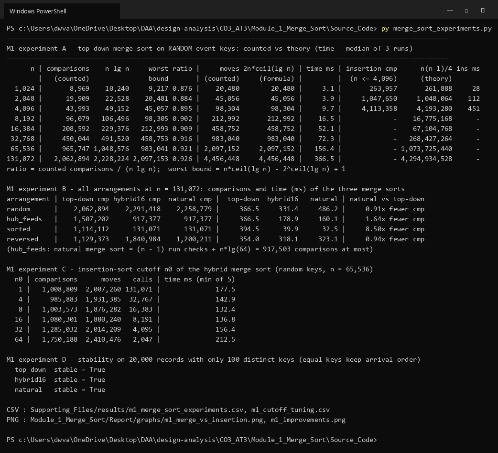

Table 14: Merge sort (random keys) vs insertion sort – counted vs theory (m1_merge_sort_experiments.csv)

| n | merge cmp | n lg n | worst bound | ratio | insertion cmp | n(n-1)/4 | merge ms | insert. ms |
|---:|---:|---:|---:|---:|---:|---:|---:|---:|
| 1,024 | 8,969 | 10,240 | 9,217 | 0.876 | 263,957 | 261,888 | 3.1 | 27.5 |
| 2,048 | 19,909 | 22,528 | 20,481 | 0.884 | 1,047,650 | 1,048,064 | 3.9 | 112.1 |
| 4,096 | 43,993 | 49,152 | 45,057 | 0.895 | 4,113,358 | 4,193,280 | 9.7 | 450.6 |
| 8,192 | 96,079 | 106,496 | 98,305 | 0.902 | – | 16,775,168 | 16.5 | – |
| 16,384 | 208,592 | 229,376 | 212,993 | 0.909 | – | 67,104,768 | 52.1 | – |
| 32,768 | 450,044 | 491,520 | 458,753 | 0.916 | – | 268,427,264 | 72.3 | – |
| 65,536 | 965,747 | 1,048,576 | 983,041 | 0.921 | – | 1,073,725,440 | 156.4 | – |
| 131,072 | 2,062,894 | 2,228,224 | 2,097,153 | 0.926 | – | 4,294,934,528 | 366.5 | – |

(ratio = merge comparisons / (n lg n); insertion sort was run up to n = 4,096 only.)

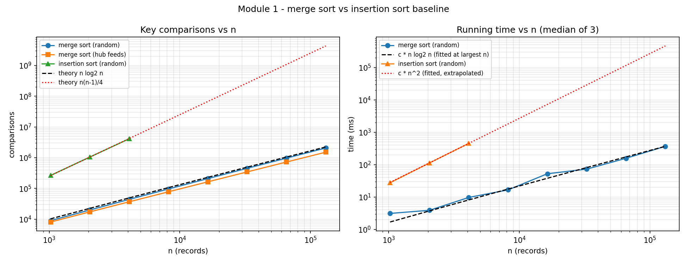

**Theory vs experiment.** On random keys the counted comparisons stay below the worst-case bound at every size, and their ratio to n lg n rises from 0.876 to 0.926 – exactly the behaviour of the average-case form n lg n − 1.26n (the linear term matters less as n grows; Figure 43 shows the overlay). The moves equal 2n⌈lg n⌉ exactly (e.g. 4,456,448 at n = 131,072). Insertion sort's counts match n(n − 1)/4 within 1–2 %. On the log–log plot (Figure 30) merge sort has slope ≈ 1 and insertion sort slope 2: at n = 4,096 insertion sort already needs **93 times** more comparisons (4,113,358 vs 43,993) and 46 times more time (451 ms vs 9.7 ms); extrapolating its fitted c·n² curve to n = 131,072 gives about 451 ms × 32² ≈ 462 s against 366.5 ms for merge sort.

Table 15: Effect of the input arrangement on the three merge sorts at n = 131,072 (m1_merge_sort_experiments.csv)

| arrangement | top-down cmp | hybrid-16 cmp | natural cmp | top-down ms | hybrid-16 ms | natural ms |
|---|---:|---:|---:|---:|---:|---:|
| random | 2,062,894 | 2,291,418 | 2,258,779 | 366.5 | 331.4 | 486.2 |
| hub_feeds | 1,507,202 | 917,377 | 917,377 | 366.5 | 178.9 | 160.1 |
| sorted | 1,114,112 | 131,071 | 131,071 | 394.5 | 39.9 | 32.5 |
| reversed | 1,129,373 | 1,840,984 | 1,200,211 | 354.0 | 318.1 | 323.1 |

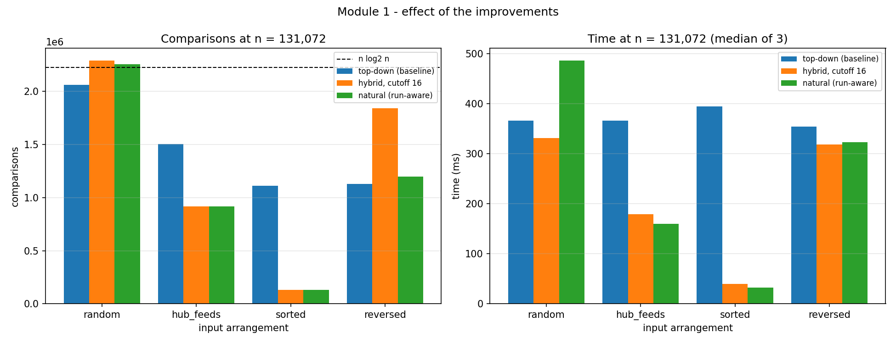

Table 16: Insertion-sort cutoff n₀ of the hybrid merge sort, random keys, n = 65,536 (m1_cutoff_tuning.csv)

| cutoff n0 | comparisons | moves | recursive calls | time ms (min of 5) |
|---:|---:|---:|---:|---:|
| 1 | 1,008,809 | 2,007,260 | 131,071 | 177.5 |
| 4 | 985,883 | 1,931,385 | 32,767 | 142.9 |
| 8 | 1,003,573 | 1,876,282 | 16,383 | 132.4 |
| 16 | 1,080,301 | 1,880,240 | 8,191 | 136.8 |
| 32 | 1,285,032 | 2,014,209 | 4,095 | 156.4 |
| 64 | 1,750,188 | 2,410,476 | 2,047 | 212.5 |

**Limitations and trade-offs of the Part 2 design.**

1. **Memory:** the work array doubles the memory – 640 MB for 5,000,000 64-byte records (Part 4).
2. **Not adaptive:** already-sorted input still costs (n/2) lg n = 1,114,112 comparisons and all 2n lg n moves at n = 131,072 (Table 15), although the real nightly file consists of 64 already-sorted hub feeds.
3. **Overhead on tiny ranges:** 2n − 1 recursive calls (131,071 at n = 65,536), half of them on single records.
4. **Moving whole records:** every level copies each 64-byte record twice.

**Improvements implemented and measured.**

- **Hybrid merge sort** (insertion sort for ranges ≤ n₀, and skip the merge when A[mid−1] ≤ A[mid]). The skip test makes sorted input cost n − 1 = 131,071 comparisons instead of 1,114,112 (**8.5× fewer, 39.9 ms instead of 394.5 ms**). On random keys it costs 11 % *more* comparisons (insertion sort on 16 records is Θ(n₀²)) but is faster (331.4 vs 366.5 ms) because it makes 16 times fewer calls; Table 16 shows the time minimum at n₀ = 8–16 (132–137 ms against 177.5 ms without cutoff, about 25 % less), while comparisons are minimal at n₀ = 4. This is a trade-off between counted comparisons and interpreter/call overhead; I keep n₀ = 16.
- **Natural (run-aware) merge sort** detects the ascending runs in one pass (n − 1 comparisons) and merges neighbouring runs bottom-up. On the realistic input – 64 sorted hub feeds – it needs 917,377 comparisons, within the bound (n − 1) + n lg 64 = 917,503, i.e. **1.64× fewer than top-down and 2.3× faster (160.1 ms vs 366.5 ms)**; on sorted input it needs only n − 1. It stays stable (runs are non-decreasing; ties go left) and keeps the O(n log n) worst case, but on purely random or reversed input it is 6–10 % worse than top-down because its runs are short (a production version would also reverse strictly descending runs, as Timsort does).
- **Sorting (key, index) pairs** instead of 64-byte records cuts the memory from 640 MB to 120 MB and the bytes moved per level by a factor of about 5 (design calculation in Part 4; the records are written once, in sorted order, at the end).

**Justification.** The production input is not random: it is 64 time-ordered feeds. The natural merge sort exploits exactly that structure, is stable and has the same worst case, so it is the right improvement for Module 1; the cutoff removes the recursion overhead, and the key-index representation addresses the memory limitation.

### 3. Module 2 – pivot rules, the quick sort worst case and duplicate keys

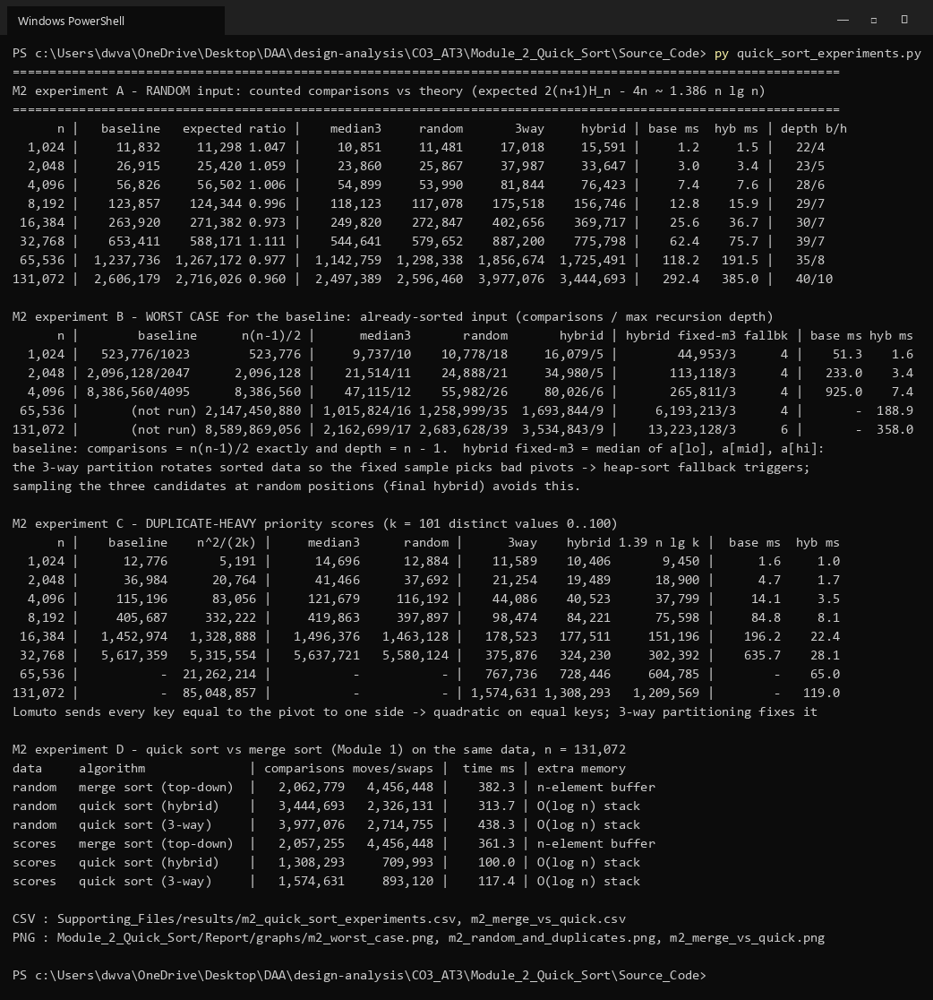

Table 17: Random input – comparisons of the five variants vs the expected 2(n+1)H<sub>n</sub> − 4n (m2_quick_sort_experiments.csv)

| n | baseline | expected | ratio | median3 | random | 3-way | hybrid |
|---:|---:|---:|---:|---:|---:|---:|---:|
| 1,024 | 11,832 | 11,298 | 1.047 | 10,851 | 11,481 | 17,018 | 15,591 |
| 2,048 | 26,915 | 25,420 | 1.059 | 23,860 | 25,867 | 37,987 | 33,647 |
| 4,096 | 56,826 | 56,502 | 1.006 | 54,899 | 53,990 | 81,844 | 76,423 |
| 8,192 | 123,857 | 124,344 | 0.996 | 118,123 | 117,078 | 175,518 | 156,746 |
| 16,384 | 263,920 | 271,382 | 0.973 | 249,820 | 272,847 | 402,656 | 369,717 |
| 32,768 | 653,411 | 588,171 | 1.111 | 544,641 | 579,652 | 887,200 | 775,798 |
| 65,536 | 1,237,736 | 1,267,172 | 0.977 | 1,142,759 | 1,298,338 | 1,856,674 | 1,725,491 |
| 131,072 | 2,606,179 | 2,716,026 | 0.960 | 2,497,389 | 2,596,460 | 3,977,076 | 3,444,693 |

Table 18: Worst-case demonstration – comparisons on already-sorted input (m2_quick_sort_experiments.csv)

| n | baseline | n(n-1)/2 | median3 | random | hybrid | fixed m3 | base ms | hyb ms |
|---:|---:|---:|---:|---:|---:|---:|---:|---:|
| 1,024 | 523,776 | 523,776 | 9,737 | 10,778 | 16,079 | 44,953 | 51.3 | 1.6 |
| 2,048 | 2,096,128 | 2,096,128 | 21,514 | 24,888 | 34,980 | 113,118 | 233.0 | 3.4 |
| 4,096 | 8,386,560 | 8,386,560 | 47,115 | 55,982 | 80,026 | 265,811 | 925.0 | 7.4 |
| 8,192 | – | 33,550,336 | 102,412 | 123,644 | 166,044 | 600,684 | – | 16.1 |
| 16,384 | – | 134,209,536 | 221,197 | 286,334 | 361,165 | 1,325,428 | – | 50.1 |
| 32,768 | – | 536,854,528 | 475,151 | 581,872 | 809,226 | 2,879,828 | – | 103.8 |
| 65,536 | – | 2,147,450,880 | 1,015,824 | 1,258,999 | 1,693,844 | 6,193,213 | – | 188.9 |
| 131,072 | – | 8,589,869,056 | 2,162,699 | 2,683,628 | 3,534,843 | 13,223,128 | – | 358.0 |

Table 19: Worst-case demonstration – maximum recursion depth on already-sorted input, and heap-sort fallbacks of the fixed-median hybrid (m2_quick_sort_experiments.csv; "–" = baseline not run)

| n | baseline | n - 1 | median3 | random | hybrid | lg n | fixed m3 | fallbacks |
|---:|---:|---:|---:|---:|---:|---:|---:|---:|
| 1,024 | 1,023 | 1,023 | 10 | 18 | 5 | 10.0 | 3 | 4 |
| 2,048 | 2,047 | 2,047 | 11 | 21 | 5 | 11.0 | 3 | 4 |
| 4,096 | 4,095 | 4,095 | 12 | 26 | 6 | 12.0 | 3 | 4 |
| 8,192 | – | 8,191 | 13 | 33 | 6 | 13.0 | 3 | 4 |
| 16,384 | – | 16,383 | 14 | 34 | 7 | 14.0 | 3 | 4 |
| 32,768 | – | 32,767 | 15 | 32 | 8 | 15.0 | 3 | 4 |
| 65,536 | – | 65,535 | 16 | 35 | 9 | 16.0 | 3 | 4 |
| 131,072 | – | 131,071 | 17 | 39 | 9 | 17.0 | 3 | 6 |

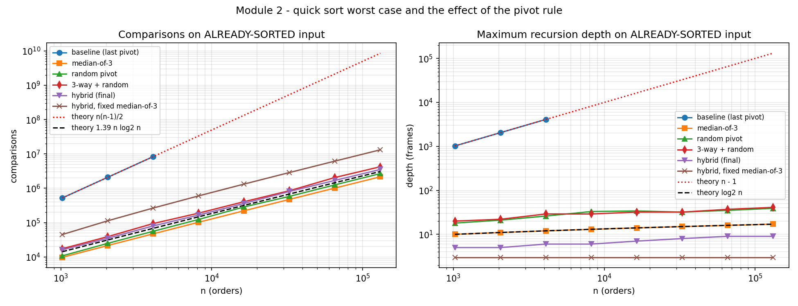

**Worst-case demonstration.** On already-sorted input the baseline needs **exactly n(n − 1)/2** comparisons – 8,386,560 at n = 4,096 – and its recursion depth is n − 1 = 4,095 (Tables 18 and 19, Figure 33); it takes 925 ms where the final hybrid takes 7.4 ms. At n = 131,072 it would need 8.6 × 10⁹ comparisons and 131,071 nested calls, so it was not run. Median-of-three and random pivots restore n log n behaviour (2,162,699 and 2,683,628 comparisons at n = 131,072). The run also exposed a subtle flaw in my first hybrid: with the **fixed** median of a[lo], a[mid], a[hi], Dijkstra's partition rotates the sorted data so that the next fixed sample picks the second-smallest key; the depth budget triggered the heap-sort fallback (4–6 times) and the count rose to 13,223,128 – still O(n log n) thanks to the fallback, but 3.7× worse than the final hybrid, which samples the three candidates at **random positions** (3,534,843 comparisons, depth 9, no fallback).

Table 20: Duplicate-heavy priority scores (k = 101 distinct values) – comparisons, ratio = hybrid / (n lg k), and times (m2_quick_sort_experiments.csv)

| n | baseline | n²/(2k) | median3 | random | 3-way | hybrid | ratio | base ms | hyb ms |
|---:|---:|---:|---:|---:|---:|---:|---:|---:|---:|
| 1,024 | 12,776 | 5,191 | 14,696 | 12,884 | 11,589 | 10,406 | 1.526 | 1.6 | 1.0 |
| 2,048 | 36,984 | 20,764 | 41,466 | 37,692 | 21,254 | 19,489 | 1.429 | 4.7 | 1.7 |
| 4,096 | 115,196 | 83,056 | 121,679 | 116,192 | 44,086 | 40,523 | 1.486 | 14.1 | 3.5 |
| 8,192 | 405,687 | 332,222 | 419,863 | 397,897 | 98,474 | 84,221 | 1.544 | 84.8 | 8.1 |
| 16,384 | 1,452,974 | 1,328,888 | 1,496,376 | 1,463,128 | 178,523 | 177,511 | 1.627 | 196.2 | 22.4 |
| 32,768 | 5,617,359 | 5,315,554 | 5,637,721 | 5,580,124 | 375,876 | 324,230 | 1.486 | 635.7 | 28.1 |
| 65,536 | – | 21,262,214 | – | – | 767,736 | 728,446 | 1.669 | – | 65.0 |
| 131,072 | – | 85,048,857 | – | – | 1,574,631 | 1,308,293 | 1.499 | – | 119.0 |

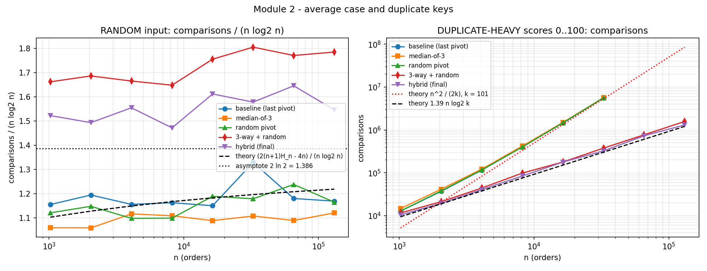

**Average case and duplicates.** On random keys the baseline stays within −4 % … +11 % of 2(n+1)H<sub>n</sub> − 4n (Table 17, Figure 34 left) – the deviation is the randomness of one input per size. Median-of-three saves 3–17 % (it makes balanced splits more likely; theory predicts about 14 %, (12/7) n ln n ≈ 1.19 n lg n); the 3-way partition costs 36–53 % *more* comparisons on distinct keys because every element larger than the pivot is compared twice. On the real, duplicate-heavy scores the picture reverses (Table 20, Figure 34 right): the baseline grows like n²/(2k) (5,617,359 vs the model's 5,315,554 at n = 32,768), and **median-of-3 and random pivots do not help at all** (5,637,721 and 5,580,124) because the problem is the equal keys, not the pivot position. The 3-way partition and the hybrid need only 375,876 and 324,230 comparisons (17× fewer) and 28.1 ms instead of 635.7 ms; at n = 131,072 the hybrid needs 1,308,293 comparisons = 1.499 · n lg k, while the baseline would need about 85 million.

**Limitations and trade-offs of the Part 2 design.** (1) Θ(n²) time and Θ(n) stack on sorted, reverse-sorted or all-equal input – exactly the situations that occur when the queue is re-ranked; (2) quadratic behaviour on duplicate-heavy scores; (3) not stable (Part 3); (4) the pivot rule is a single point of failure: any fixed rule has adversarial inputs. In return quick sort is in place (16 MB at production size) and has the fewest moves (Table 21 below).

**Improvements implemented and measured.** Median-of-three (fixes sorted input, not duplicates); random pivot (expected O(n log n) for every order, not duplicates); 3-way partitioning (fixes duplicates, costs more on distinct keys); and the **final hybrid**: median of three random elements + 3-way partition + insertion sort below 16 + heap-sort fallback after 2⌊lg n⌋ levels + recursion on the smaller side. It is the only variant that is good on all four arrangements: sorted 3,534,843 comparisons with depth 9, duplicate scores 1,308,293 with depth ≤ 5 and exactly 101 partitions – one per distinct score, random 3,444,693 (32 % more comparisons than the baseline and about 30 % slower – the price of robustness on distinct keys), and its worst case is O(n log n) with an O(log n) stack. Since production scores are duplicate-heavy, the hybrid is **about 65× cheaper than the baseline** on the real data at n = 131,072 (baseline estimated by n²/(2k)) and turns the 198 s production estimate into 0.20 s.

### 4. Merge sort vs quick sort on the same data

Table 21: Merge sort (Module 1) vs quick sort (Module 2) on the same 131,072 keys (m2_merge_vs_quick.csv)

| data | algorithm | comparisons | moves / swaps | time ms |
|---|---|---:|---:|---:|
| random | merge sort (top-down) | 2,062,779 | 4,456,448 | 382.3 |
| random | quick sort (hybrid) | 3,444,693 | 2,326,131 | 313.7 |
| random | quick sort (3-way) | 3,977,076 | 2,714,755 | 438.3 |
| scores | merge sort (top-down) | 2,057,255 | 4,456,448 | 361.3 |
| scores | quick sort (hybrid) | 1,308,293 | 709,993 | 100.0 |
| scores | quick sort (3-way) | 1,574,631 | 893,120 | 117.4 |

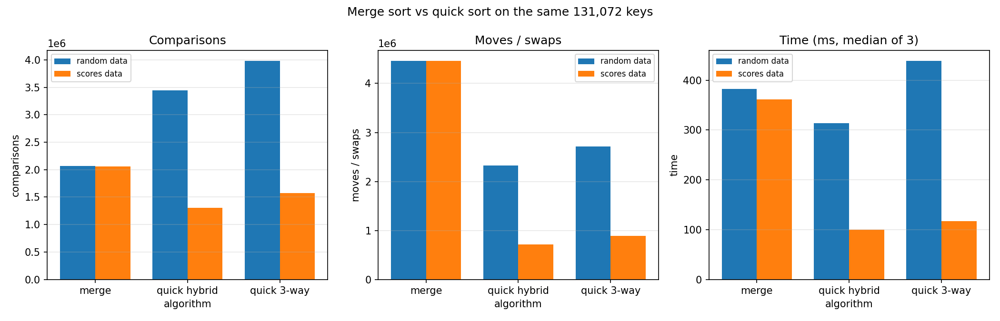

Merge sort needs the fewest comparisons on distinct keys (2,062,779, close to n lg n) but moves every element 2 lg n times (4,456,448 moves) and needs an n-element buffer; the hybrid quick sort makes 67 % more comparisons but half the moves, works in place, and is slightly faster (313.7 vs 382.3 ms). On duplicate-heavy scores the 3-way hybrid is **3.6× faster** than merge sort (100.0 vs 361.3 ms) with 36 % fewer comparisons and 6× fewer moves, because whole blocks of equal scores are finished in one pass. Merge sort keeps two advantages that matter for Module 1 – stability and a guaranteed Θ(n log n) without any safeguards – which is why the two sorting modules use different algorithms.

### 5. Module 3 – binary search vs linear, interpolation and hash lookups

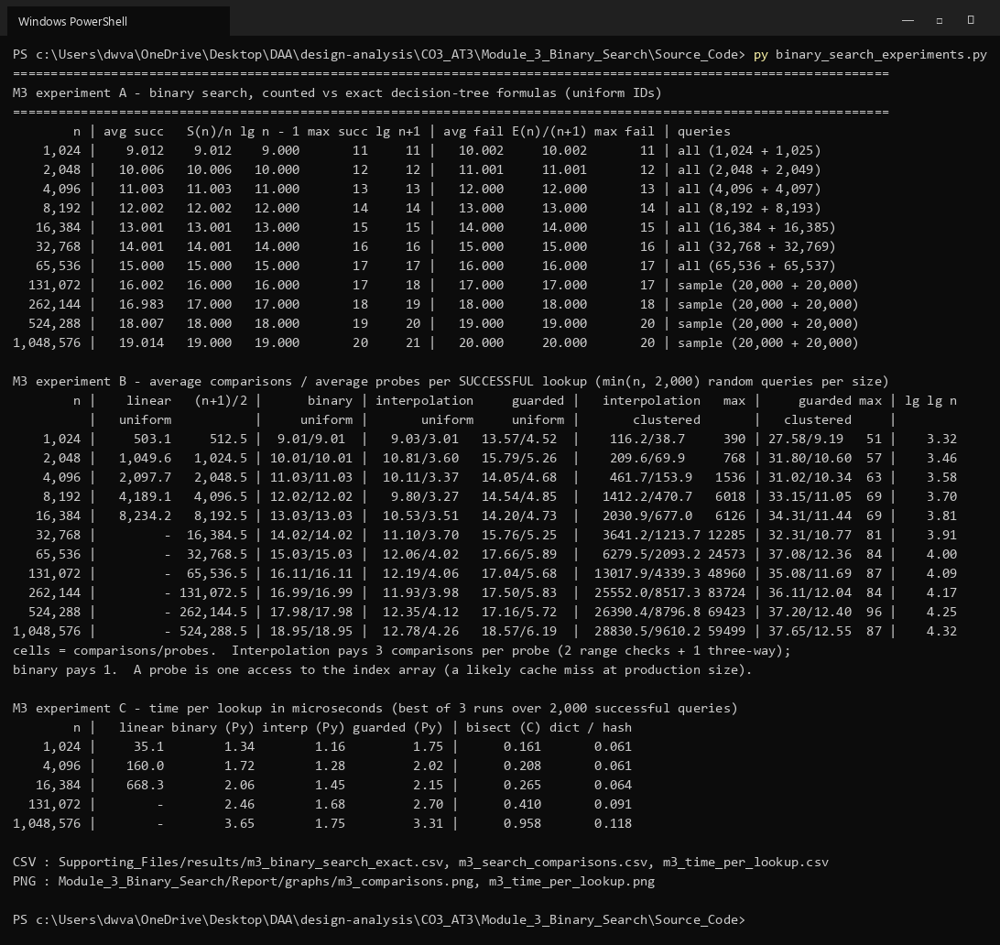

Table 22: Average comparisons per successful lookup – U = uniform IDs, C = clustered IDs (m3_search_comparisons.csv)

| n | linear (U) | (n+1)/2 | binary (U) | interp. (U) | guarded (U) | interp. (C) | guarded (C) |
|---:|---:|---:|---:|---:|---:|---:|---:|
| 1,024 | 503.1 | 512.5 | 9.01 | 9.03 | 13.57 | 116.2 | 27.58 |
| 2,048 | 1,049.6 | 1,024.5 | 10.01 | 10.81 | 15.79 | 209.6 | 31.80 |
| 4,096 | 2,097.7 | 2,048.5 | 11.03 | 10.11 | 14.05 | 461.7 | 31.02 |
| 8,192 | 4,189.1 | 4,096.5 | 12.02 | 9.80 | 14.54 | 1,412.2 | 33.15 |
| 16,384 | 8,234.2 | 8,192.5 | 13.03 | 10.53 | 14.20 | 2,030.9 | 34.31 |
| 32,768 | – | 16,384.5 | 14.02 | 11.10 | 15.76 | 3,641.2 | 32.31 |
| 65,536 | – | 32,768.5 | 15.03 | 12.06 | 17.66 | 6,279.5 | 37.08 |
| 131,072 | – | 65,536.5 | 16.11 | 12.19 | 17.04 | 13,017.9 | 35.08 |
| 262,144 | – | 131,072.5 | 16.99 | 11.93 | 17.50 | 25,552.0 | 36.11 |
| 524,288 | – | 262,144.5 | 17.98 | 12.35 | 17.16 | 26,390.4 | 37.20 |
| 1,048,576 | – | 524,288.5 | 18.95 | 12.78 | 18.57 | 28,830.5 | 37.65 |

Table 23: Average probes (index accesses) per successful lookup, and worst comparisons of interpolation (i) and guarded (g) search on clustered IDs; binary search probes = its comparisons in Table 22 (m3_search_comparisons.csv)

| n | interp. (U) | guarded (U) | lg lg n | interp. (C) | guarded (C) | worst i (C) | worst g (C) |
|---:|---:|---:|---:|---:|---:|---:|---:|
| 1,024 | 3.01 | 4.52 | 3.32 | 38.7 | 9.19 | 390 | 51 |
| 2,048 | 3.60 | 5.26 | 3.46 | 69.9 | 10.60 | 768 | 57 |
| 4,096 | 3.37 | 4.68 | 3.58 | 153.9 | 10.34 | 1,536 | 63 |
| 8,192 | 3.27 | 4.85 | 3.70 | 470.7 | 11.05 | 6,018 | 69 |
| 16,384 | 3.51 | 4.73 | 3.81 | 677.0 | 11.44 | 6,126 | 69 |
| 32,768 | 3.70 | 5.25 | 3.91 | 1,213.7 | 10.77 | 12,285 | 81 |
| 65,536 | 4.02 | 5.89 | 4.00 | 2,093.2 | 12.36 | 24,573 | 84 |
| 131,072 | 4.06 | 5.68 | 4.09 | 4,339.3 | 11.69 | 48,960 | 87 |
| 262,144 | 3.98 | 5.83 | 4.17 | 8,517.3 | 12.04 | 83,724 | 84 |
| 524,288 | 4.12 | 5.72 | 4.25 | 8,796.8 | 12.40 | 69,423 | 96 |
| 1,048,576 | 4.26 | 6.19 | 4.32 | 9,610.2 | 12.55 | 59,499 | 87 |

Table 24: Time per successful lookup in microseconds, best of 3 – Python implementations except bisect and dict, which run in C (m3_time_per_lookup.csv)

| n | linear | binary | interp. | guarded | bisect (C) | dict (C) |
|---:|---:|---:|---:|---:|---:|---:|
| 1,024 | 35.1 | 1.33 | 1.16 | 1.75 | 0.161 | 0.061 |
| 4,096 | 160.0 | 1.72 | 1.28 | 2.02 | 0.208 | 0.061 |
| 16,384 | 668.3 | 2.06 | 1.45 | 2.15 | 0.265 | 0.064 |
| 131,072 | – | 2.46 | 1.68 | 2.69 | 0.410 | 0.091 |
| 1,048,576 | – | 3.65 | 1.75 | 3.31 | 0.958 | 0.118 |

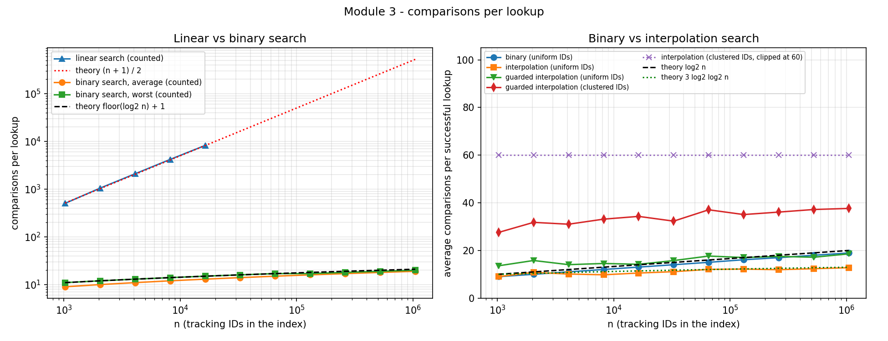

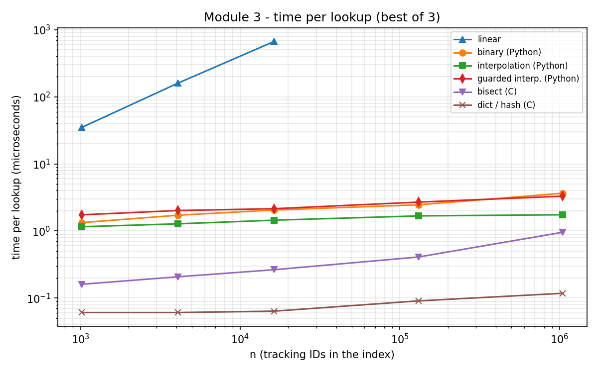

**Theory vs experiment.** Linear search costs (n + 1)/2 on average (503.1 vs 512.5 at n = 1,024; 8,234.2 vs 8,192.5 at 16,384) and 668 µs per lookup at n = 16,384, whereas binary search costs ≈ lg n comparisons (18.95 at n = 2²⁰) and 3.65 µs: the gap grows from 56× to 27,700× in comparisons between n = 1,024 and n = 2²⁰ (Figure 37 left). The binary-search counts match the exact decision-tree formulas of Part 4 (Table 10).

**Limitations and trade-offs.** (1) The index must be sorted: it is rebuilt nightly by Module 1, and IDs created during the day are not in it (a small sorted delta array or hash set is needed until the next rebuild). (2) Every probe jumps to a distant part of a 160 MB array, so at production size each of the 24 probes is likely a cache miss – memory latency, not comparisons, limits throughput (Part 4). (3) A hash table answers in ~1–2 probes (0.118 µs vs 0.958 µs for C bisect at n = 2²⁰) but needs about twice the memory and cannot answer ordered or range queries ("all shipments in ID block SLX41…"). (4) The Python loop is ~4× slower than the C `bisect` with the same algorithm – constant factors, not complexity.

**Improvements implemented and measured.** **Interpolation search** estimates the position from the key value. On uniformly distributed IDs it needs only **4.26 probes instead of 18.95** at n = 2²⁰ (Table 23) (Θ(log log n); lg lg n = 4.32) and is the fastest Python search (1.75 µs vs 3.65 µs) even though each probe costs 3 comparisons. But on **clustered IDs** (8 hub blocks of sequential IDs) it collapses towards linear behaviour: 28,830 comparisons on average and up to 59,499 at n = 2²⁰. The **guarded interpolation search** forces a halving step whenever an interpolation step did not halve the interval; it keeps 6.19 probes on uniform IDs, stays at 12.55 probes (max 87 comparisons, within the proven bound of 2(⌊lg n⌋ + 1) probes) on clustered IDs, and is never worse than about twice binary search. It is therefore the safe improvement for an index whose ID distribution can change; plain binary search remains the guaranteed fallback.

### 6. Module 4 – Strassen vs the naive product, the crossover point and the cutoff

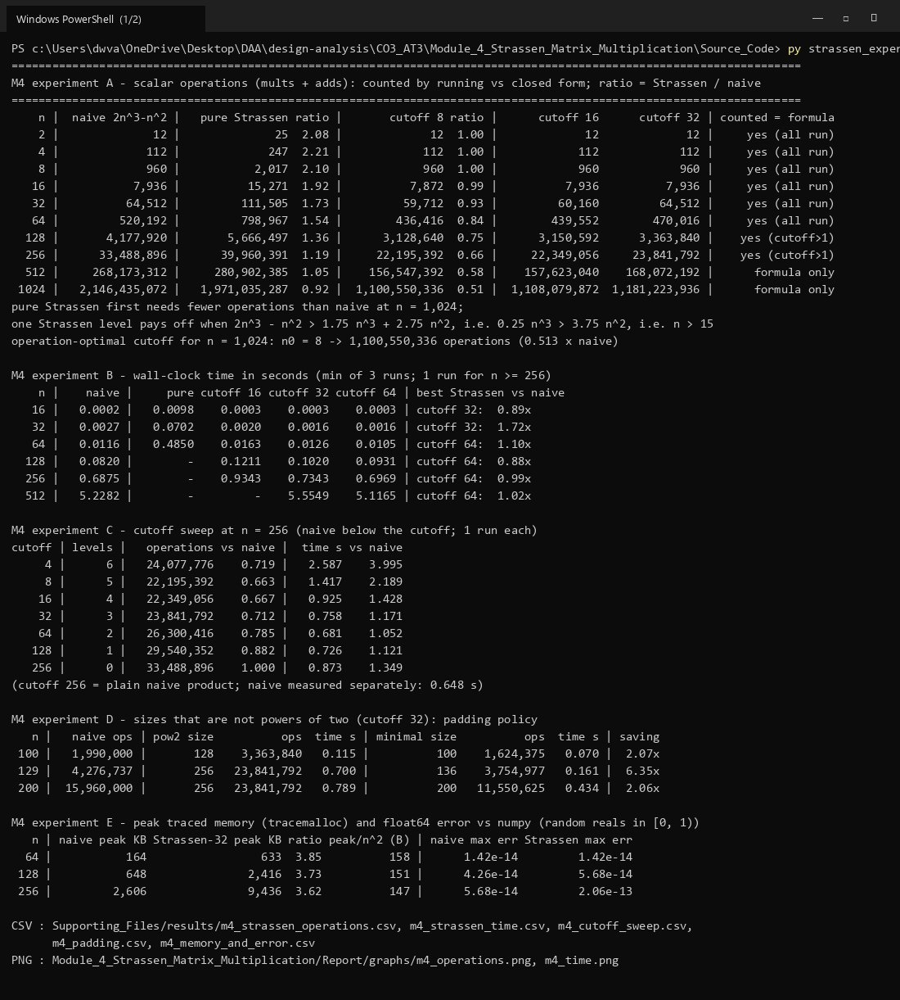

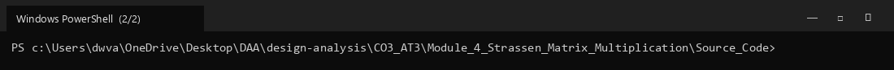

Table 25: Scalar operations (multiplications + additions) – counted = closed form (m4_strassen_operations.csv)

| n | naive 2n³ − n² | pure Strassen | ratio | cutoff 8 | ratio 8 | cutoff 16 | ratio 16 |
|---:|---:|---:|---:|---:|---:|---:|---:|
| 2 | 12 | 25 | 2.08 | 12 | 1.00 | 12 | 1.00 |
| 4 | 112 | 247 | 2.21 | 112 | 1.00 | 112 | 1.00 |
| 8 | 960 | 2,017 | 2.10 | 960 | 1.00 | 960 | 1.00 |
| 16 | 7,936 | 15,271 | 1.92 | 7,872 | 0.99 | 7,936 | 1.00 |
| 32 | 64,512 | 111,505 | 1.73 | 59,712 | 0.93 | 60,160 | 0.93 |
| 64 | 520,192 | 798,967 | 1.54 | 436,416 | 0.84 | 439,552 | 0.84 |
| 128 | 4,177,920 | 5,666,497 | 1.36 | 3,128,640 | 0.75 | 3,150,592 | 0.75 |
| 256 | 33,488,896 | 39,960,391 | 1.19 | 22,195,392 | 0.66 | 22,349,056 | 0.67 |
| 512 | 268,173,312 | 280,902,385 | 1.05 | 156,547,392 | 0.58 | 157,623,040 | 0.59 |
| 1,024 | 2,146,435,072 | 1,971,035,287 | 0.92 | 1,100,550,336 | 0.51 | 1,108,079,872 | 0.52 |

(ratio = Strassen operations / naive operations. Counted by running and equal to the closed form for every n ≤ 64 with pure Strassen and every n ≤ 256 with cutoffs 8, 16, 32, 64; n = 512 and 1,024 from the verified closed form.)

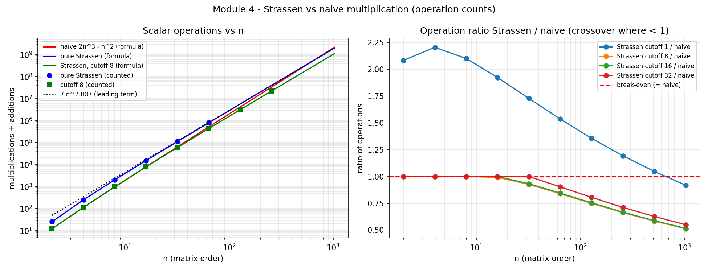

**Crossover point (operation counts).** Pure Strassen (recursion down to 1 × 1) needs *more* operations than the naive product up to n = 512 (ratio 2.21 at n = 4, 1.05 at n = 512) and crosses below only at **n = 1,024 (0.92)**, because each level adds 18 block additions. With a cutoff the crossover moves to **n = 16**, exactly as derived in Part 4 (one Strassen level pays off for n > 15): cutoff 8 gives 7,872 vs 7,936 operations at n = 16 and **0.51× the naive count at n = 1,024**. Every counted value equals the closed form.

Table 26: Wall-clock time in seconds (min of 3; 1 run for n ≥ 256) (m4_strassen_time.csv)

| n | naive | pure Strassen | cutoff 16 | cutoff 32 | cutoff 64 | speed-up |
|---:|---:|---:|---:|---:|---:|---:|
| 16 | 0.0002 | 0.0098 | 0.0003 | 0.0003 | 0.0003 | 0.88 |
| 32 | 0.0027 | 0.0702 | 0.0020 | 0.0016 | 0.0016 | 1.72 |
| 64 | 0.0116 | 0.4850 | 0.0163 | 0.0126 | 0.0106 | 1.10 |
| 128 | 0.0820 | – | 0.1211 | 0.1020 | 0.0931 | 0.88 |
| 256 | 0.6875 | – | 0.9343 | 0.7343 | 0.6968 | 0.99 |
| 512 | 5.2282 | – | – | 5.5549 | 5.1165 | 1.02 |

Table 27: Cutoff sweep at n = 256 (m4_cutoff_sweep.csv; naive measured separately 0.648 s)

| cutoff n0 | Strassen levels | operations | operations / naive | time s |
|---:|---:|---:|---:|---:|
| 4 | 6 | 24,077,776 | 0.719 | 2.587 |
| 8 | 5 | 22,195,392 | 0.663 | 1.417 |
| 16 | 4 | 22,349,056 | 0.667 | 0.925 |
| 32 | 3 | 23,841,792 | 0.712 | 0.758 |
| 64 | 2 | 26,300,416 | 0.785 | 0.681 |
| 128 | 1 | 29,540,352 | 0.882 | 0.726 |
| 256 | 0 | 33,488,896 | 1.000 | 0.873 |

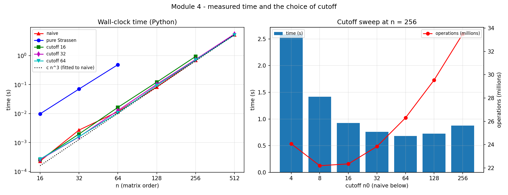

**Crossover point (time).** In CPython the time crossover lies far above the operation-count crossover (Tables 26, 27): pure Strassen is 26–43× slower than naive at n = 16–64, and even the best hybrid only matches the naive product up to n = 512 (1.02× at n = 512 with n₀ = 64). The cutoff sweep shows the reason: operations are minimal at n₀ = 8 (0.663 of naive) but time is minimal at **n₀ = 64** (0.681 s), because each block addition, split and join in Python costs more than one step of the naive inner product (`sum` over `zip`, executed in C) and allocates new lists. Rows where the cutoff ≥ n are naive products, so differences there (e.g. 0.0027 vs 0.0016 s at n = 32) show the timing noise of millisecond runs. The measured trend (0.99× at 256, 1.02× at 512 with n₀ = 64) agrees with the op-count model, which predicts a growing gain (0.61× of the naive operations at n = 1,024 for n₀ = 64).

Table 28: Non-power-of-two sizes, cutoff 32 – next-power-of-two padding vs minimal s·2<sup>d</sup> padding (m4_padding.csv)

| n | naive ops | pow2 m | pow2 ops | pow2 s | minimal m | minimal ops | minimal s | saving |
|---:|---:|---:|---:|---:|---:|---:|---:|---:|
| 100 | 1,990,000 | 128 | 3,363,840 | 0.115 | 100 | 1,624,375 | 0.070 | 2.07x |
| 129 | 4,276,737 | 256 | 23,841,792 | 0.700 | 136 | 3,754,977 | 0.161 | 6.35x |
| 200 | 15,960,000 | 256 | 23,841,792 | 0.789 | 200 | 11,550,625 | 0.434 | 2.06x |

(m = padded order; s = measured seconds, one run each.)

Table 29: Memory (tracemalloc peak during the multiplication; Strassen with n₀ = 32) and maximum float64 error against numpy (m4_memory_and_error.csv)

| n | naive KB | Strassen KB | ratio | naive error | Strassen error |
|---:|---:|---:|---:|---:|---:|
| 64 | 164 | 633 | 3.85 | 1.421e-14 | 1.421e-14 |
| 128 | 648 | 2,416 | 3.73 | 4.263e-14 | 5.684e-14 |
| 256 | 2,606 | 9,436 | 3.62 | 5.684e-14 | 2.061e-13 |

**Limitations and trade-offs.** (1) **Large constant:** 18 block additions per level make pure Strassen slower than naive below n = 1,024 in operation count and far slower in Python time. (2) **Memory:** Θ(n²) temporaries – 3.6–3.9× the naive peak in Python (Table 29) and 65 MB instead of 25.2 MB at production size. (3) **Numerical stability:** the subtractions in M3, M4, M6, M7 cause more rounding error – 2.06 × 10⁻¹³ against 5.68 × 10⁻¹⁴ for naive at n = 256 – harmless for costs in ₹ thousands, but a reason not to use deep recursion on ill-conditioned data. (4) **Padding waste:** padding 129 zones to 256 makes the product 5.6× more expensive than naive (23,841,792 vs 4,276,737 operations).

**Improvements implemented and measured.** (1) The **cutoff hybrid** (naive below n₀) – 0.51× the naive operations at n = 1,024 with n₀ = 8 (op-optimal) and the time-optimal n₀ = 64 in Python. (2) **Minimal padding** to s·2<sup>d</sup> with s ≤ n₀: 129 → 136 instead of 256 (**6.35× fewer operations, 0.161 s instead of 0.700 s**), and 100 or 200 need no padding at all (2.07× and 2.06× fewer operations); with it Strassen beats the naive operation count at n = 100 and n = 200 (1,624,375 vs 1,990,000; 11,550,625 vs 15,960,000) instead of losing. Recommended next steps (not implemented): Winograd's variant with 15 instead of 18 additions (1,048,892,160 operations at n = 1,024, n₀ = 8 – formula in `production_workload.py`), a memory-economical schedule that reuses two temporaries per level, and running the seven independent products in parallel.

### 7. Cross-module comparison: theory vs experiment

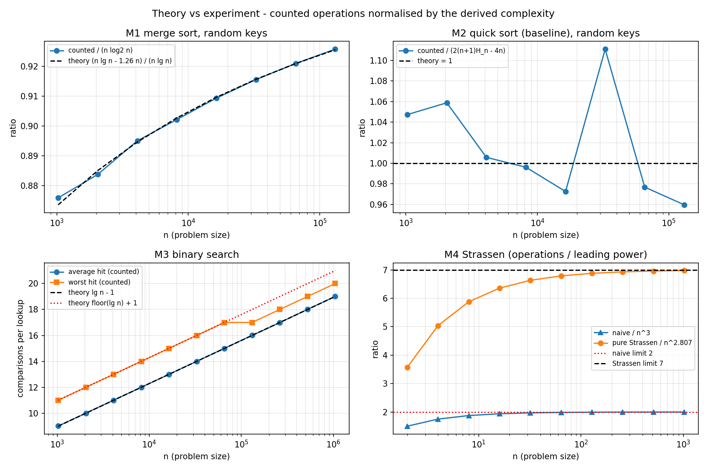

Figure 43 normalises each module's counted operations by the complexity derived in Part 4. Merge sort's comparisons/(n lg n) follow the average-case curve (n lg n − 1.26n)/(n lg n) almost exactly; quick sort's counts scatter ±11 % around 2(n+1)H<sub>n</sub> − 4n (one random input per size); binary search's average equals lg n − 1 and its worst case ⌊lg n⌋ + 1; and Strassen's operations/n<sup>2.807</sup> rise towards the leading constant 7 while the naive count/n³ rises towards 2. In every module the experiment confirms the complexity class *and* the constant of the closed form, which is what justifies using those closed forms for the production estimates of Part 4.

Table 30: Limitations, trade-offs and measured improvements per module

| Module | Main limitation found | Improvement implemented | Measured effect |
|---|---|---|---|
| M1 Merge Sort | Θ(n) buffer; not adaptive to the 64 sorted hub feeds | natural (run-aware) merge sort; hybrid cutoff; (key, index) records | hub feeds 1.64× fewer comparisons, 2.3× faster; sorted input 8.5× fewer; memory 640 → 120 MB |
| M2 Quick Sort | n(n−1)/2 on sorted/equal input; n²/(2k) on duplicate scores; deep stack | random-sample median-of-3 + 3-way + cutoff + heap fallback (introsort) | sorted 3.53 M cmp (depth 9) vs 8.6 × 10⁹; duplicate scores ~65× fewer comparisons; 198 s → 0.20 s |
| M3 Binary Search | 24 cache-missing probes per lookup; sorted index required | guarded interpolation search | 4.26 → 6.19 probes vs 18.95 on uniform IDs; bounded (12.55 probes) on clustered IDs where plain interpolation needs 9,610 |
| M4 Strassen | 18 additions per level; Θ(n²) temporaries; padding waste | cutoff hybrid; minimal padding | 0.51× naive operations at n = 1,024; padding 6.35× cheaper for n = 129 |

## Part 6 – Final Algorithmic Design and Recommendations [10 Marks]

> Present the final algorithmic design with appropriate complexity analysis, memory requirements and recommendations.
> - For each module state the recommended algorithm, its time complexity, its memory requirement (in bytes for the production sizes) and a throughput estimate.
> - Give recommendations for deployment and further optimisation.

**Evidence Expected**

> Final design per module with complexity, memory and throughput figures derived from Parts 4 and 5, and justified recommendations.

**Ans:**

### 1. Module 1 – final design: stable run-aware merge sort on (key, index) pairs

- **Algorithm.** Pack each event's key into one 8-byte integer (day number × 86,400 + second of day) and sort (key, 4-byte record index) pairs with the **natural merge sort**: one pass detects the ascending runs (the 64 hub feeds), then neighbouring runs are merged pairwise bottom-up (6 passes for 64 runs); ties go to the left run, so the sort stays **stable**. Runs shorter than 16 are first extended with insertion sort (the hybrid's cutoff), so random input still costs O(n log n). Finally the records are written once in sorted order (this output also rebuilds Module 3's tracking index).
- **Time.** O(n log r) comparisons for r input runs, O(n log n) in the worst case. Production: (n − 1) + n lg 64 = 34,999,999 comparisons + 60,000,000 moves = 94,999,999 basic operations → **0.95 s** (instead of 3.37 s for the Part 2 design and 17.4 h for insertion sort).
- **Memory.** 5,000,000 × 12 B = 60,000,000 B for the pairs + 60,000,000 B work array = **120,000,000 B (120 MB)** of working memory, instead of 640 MB when whole records are sorted; stack O(1) (bottom-up).
- **Throughput.** ≈ 5.3 million events per second at 10⁸ operations/s; even a ten-fold growth to 50 million events (run structure unchanged) needs about 9.5 s.
- **Recommendations.** If the nightly volume ever exceeds memory, keep the same merge step but run it as an **external** k-way merge of the hub files (sequential I/O only); monitor the number of runs r, because the gain over top-down merge sort depends on the feeds staying time-ordered.

### 2. Module 2 – final design: introsort-style 3-way quick sort

- **Algorithm.** Quick sort with the pivot = median of three elements at **random** positions, **Dijkstra 3-way partitioning** (keys equal to the pivot are finished in the same pass), insertion sort for sub-arrays ≤ 16, recursion into the smaller part only, and a depth budget of 2⌊lg n⌋ partitions after which **heap sort** finishes the sub-array. Ties on the score are broken by a secondary key (order creation time) where the dispatch rules need it, so the lack of stability does not matter.
- **Time.** Expected Θ(n log k) for k distinct scores (measured 1.499 n lg k), **guaranteed O(n log n)** worst case (heap-sort fallback), O(log n) stack. Production: 19,962,967 comparisons → **0.20 s per cycle**, against 198 s for the Part 2 design on duplicate-heavy scores and 5.56 h on an already-ranked queue.
- **Memory.** In place: 2,000,000 × 8 B = **16,000,000 B (16 MB)** for the (score, index) array plus at most ⌈lg n⌉ = 21 stack frames (about 2 KB).
- **Throughput.** About 5 rankings per second of 2 million orders, i.e. 5× headroom against the 1-second dispatch budget.
- **Recommendations.** Keep the depth budget and random sampling – Part 5 showed that a fixed sampling rule can be defeated by the data. Because the scores are small integers (0–100), a counting sort (O(n + k), not a comparison sort and outside CO3) would be an even cheaper option if the score domain stays fixed.

### 3. Module 3 – final design: sorted array + guarded interpolation search with binary-search guarantee

- **Algorithm.** Keep the index as one sorted array of 16-byte (tracking ID, record offset) entries, rebuilt nightly by Module 1. Look up with the **guarded interpolation search** (interpolation probe, forced halving step whenever a probe did not halve the interval) – the plain iterative **binary search** stays as the reference implementation and fallback. IDs created during the day go into a small sorted delta array that is searched the same way and merged at the nightly rebuild.
- **Time.** Worst case O(log n): binary search ≤ ⌊lg n⌋ + 1 = **24** comparisons, guarded interpolation ≤ 2(⌊lg n⌋ + 1) probes; typical ≈ 6.5 probes for uniformly issued IDs (measured 6.19 at n = 2²⁰, scaled by lg lg n). Production: 20,000,000 lookups/day × 24 = 480,000,000 comparisons → **4.8 s of CPU per day** (3.9 s with the guarded search).
- **Memory.** 10,000,000 × 16 B = **160,000,000 B (160 MB)** for the index, O(1) extra per lookup; a delta of up to 1,000,000 same-day IDs adds 16 MB. A hash index would need about 320 MB and lose range queries.
- **Throughput.** Cache-miss bound: 24 probes × 100 ns ≈ 2.4 µs → **≈ 416,000 lookups/s per core**; with ~6.5 probes ≈ 1.5 million lookups/s. The peak of 2,000 lookups/s uses under 0.5 % of one core.
- **Recommendations.** If the query rate grows by orders of magnitude, store the array in a cache-friendly layout (Eytzinger/breadth-first order or B-tree blocks of 64 keys) so that the first levels of every search stay in cache, and put a small hash cache in front for the hottest IDs.

### 4. Module 4 – final design: hybrid Strassen with tuned cutoff and minimal padding

- **Algorithm.** Strassen's recursion with the **definition-based product below a cutoff n₀** and **minimal padding** to s·2<sup>d</sup> (s ≤ n₀). The cutoff is tuned on the production machine: n₀ = 8 minimises the operation count; in the CPython measurements n₀ = 64 minimised the time; in a compiled implementation it is chosen by the same sweep (Table 27). The seven products of each level are independent and can run on separate cores.
- **Time.** Θ(n<sup>log₂ 7</sup>) = Θ(n<sup>2.807</sup>). Production n = 1,024: **1,100,550,336** operations with n₀ = 8 → **11.01 s** per forecast (1,301,696,512 → 13.02 s with n₀ = 64), against 21.46 s for the naive product: 17.6 min of CPU per day for 96 forecasts instead of 34.3 min.
- **Memory.** Inputs 2 × 1,048,576 × 8 B = 16,777,216 B; workspace including the output ≈ 5.75n² × 8 B = 48,234,496 B; **total ≈ 65,000,000 B (65 MB)**, against 25,165,824 B (25.2 MB) for the naive product – the price of the 7-product scheme.
- **Throughput.** ≈ 327 forecasts of order 1,024 per hour on one core (up to about 7× more if the seven products run on separate cores), far above the required 4 per hour.
- **Recommendations.** Use float64 (the measured error stayed at 2 × 10⁻¹³ at n = 256); adopt **Winograd's variant** (15 instead of 18 additions → 1,048,892,160 operations, 10.49 s) and a memory-economical schedule; never pad to the next power of two for zone counts such as 600 (608 is enough with n₀ = 64).

### 5. The final platform design

Table 31: Final algorithmic design of the four modules at the production workloads

| Module | Final design | Time complexity | Production operations → time (10⁸ ops/s) | Memory (production) | Throughput |
|---|---|---|---|---|---|
| M1 nightly sort | stable natural merge sort on (key, index) pairs, cutoff 16 | O(n log r), worst O(n log n) | 94,999,999 → 0.95 s | 120,000,000 B (120 MB) | ≈ 5.3 M events/s |
| M2 dispatch ranking | introsort: random median-of-3, 3-way partition, cutoff 16, heap fallback | Θ(n log k) expected, O(n log n) worst | 19,962,967 → 0.20 s per cycle | 16,000,000 B (16 MB), ≤ 21 frames | ≈ 5 rankings/s |
| M3 tracking lookup | sorted array + guarded interpolation (binary-search guarantee) | O(log n) worst, ≈ O(log log n) typical | 480,000,000/day → 4.8 s/day | 160,000,000 B (160 MB) | ≈ 416,000 lookups/s/core (cache-bound) |
| M4 forecasting | hybrid Strassen, tuned n₀, minimal padding | Θ(n<sup>2.807</sup>) | 1,100,550,336 → 11.01 s | ≈ 65,000,000 B (65 MB) | ≈ 327 forecasts/h |

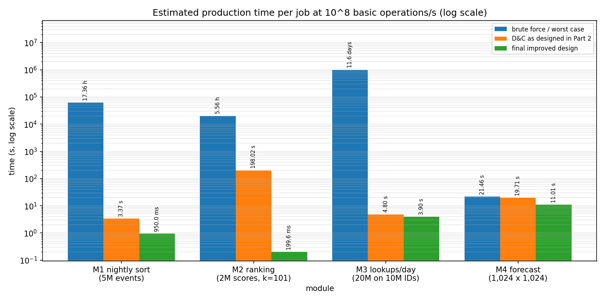

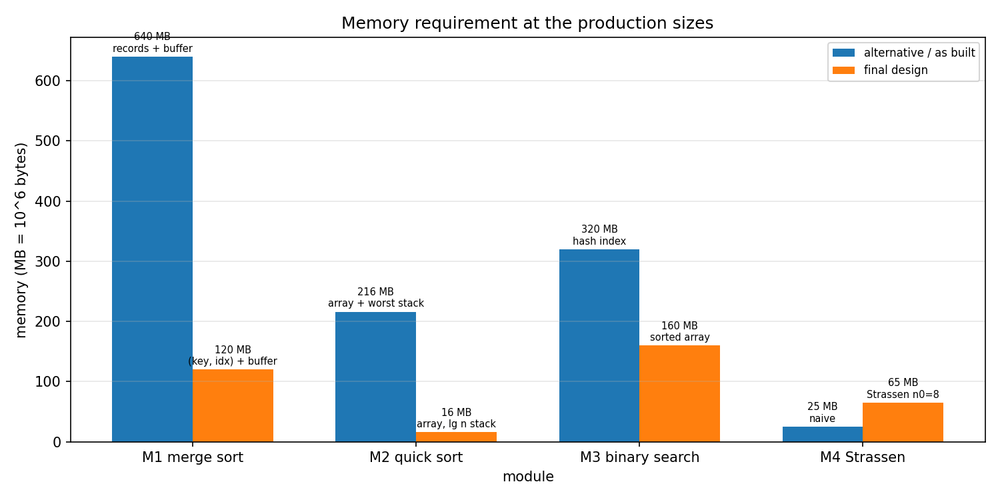

**How the modules work together.** Every night Module 1 merges the 64 hub feeds of the day's 5 million events (0.95 s) and, as a by-product, writes the sorted tracking index that Module 3 serves during the next day (rebuild 2.23 s). Module 2 re-ranks the open orders every dispatch cycle (0.20 s) and Module 4 recomputes the 1,024-zone cost forecast every 15 minutes (11 s). The whole final design needs about 120 + 16 + 160 + 65 = **361 MB** of working memory and well under one CPU-minute per hour, whereas the Part 2 designs would have needed 640 MB for Module 1 alone and could take hours on unlucky (already sorted or duplicate-heavy) inputs. Figure 44 shows the improvement over the brute-force baselines – about five orders of magnitude for M1–M3 – and over the as-designed divide-and-conquer versions.

**Recommendations.**

1. **Adopt the four final designs** above; each keeps the divide-and-conquer core of Part 2 and adds the safeguard that the experiments showed to be necessary (run detection, pivot sampling + 3-way + fallback, guarded probing, cutoff + minimal padding).
2. **Tune the cutoffs (n₀ = 16 for the sorts, n₀ for Strassen) on the production hardware** with the same sweep scripts; operation counts and times disagreed in Python, so the time-optimal value must be measured where the code runs.
3. **Monitor the input properties the choices depend on:** number of runs in the event file, share of duplicate scores, distribution of new tracking IDs, zone count. All four experiment scripts can be rerun on production samples.
4. **Plan for growth:** external k-way merge for Module 1 beyond memory; cache-friendly index layout or B-tree for Module 3 at much higher query rates; Winograd's variant and parallel products for Module 4.
5. **Keep `run_all_tests.py` in the build pipeline** – it checks correctness on edge cases *and* that the operation counts still match the closed forms, so a regression in complexity is caught as well as a wrong answer.

### Summary of Findings

Table 32: Summary of findings

| Module | Part 2 design | Verified on the sample (Part 3) | Complexity (Part 4) | Key experimental finding (Part 5) | Final design (Part 6) |
|---|---|---|---|---|---|
| M1 Merge Sort | top-down, stable merge | 30 comparisons ≤ 33; E06/E11 and E04/E09 keep order | Θ(n log n) all cases, Θ(n) space; 3.37 s, 640 MB | counts follow n lg n − 1.26n; hub feeds: natural sort 1.64× fewer cmp, 2.3× faster | natural merge sort on (key, index): 0.95 s, 120 MB |
| M2 Quick Sort | Lomuto, last-element pivot | 32 comparisons (expected 32.7); unstable; sorted/equal → 66 | Θ(n log n) avg, Θ(n²) worst; 198 s on real scores | exactly n(n−1)/2 and depth n − 1 on sorted input; n²/(2k) on duplicates; fixed median-of-3 defeated | introsort 3-way hybrid: 0.20 s, 16 MB |
| M3 Binary Search | iterative + recursive, three-way | 8/8 queries agree with bisect; ≤ 5 comparisons | Θ(log n), Θ(1) space; 24 cmp/lookup, 4.8 s/day | counts equal S(n)/n, E(n)/(n+1); interpolation 4.26 probes but collapses on clustered IDs | guarded interpolation, 160 MB, ≈ 416 k lookups/s/core |
| M4 Strassen | 7 products, pad to 2<sup>k</sup> | 49 mults + 198 adds = 247 vs naive 112; matches numpy | Θ(n<sup>2.807</sup>), Θ(n²) space; 1.97 × 10⁹ ops | op crossover n > 15 with cutoff (pure only at 1,024); time-optimal n₀ = 64 in Python; minimal padding 6.35× | hybrid Strassen n₀ tuned: 11.01 s, 65 MB |

All four divide-and-conquer algorithms were designed in pseudocode, implemented, traced on the given samples, verified (65/65 tests) and analysed with recurrences whose closed forms match the counted operations exactly. The experiments showed that the textbook versions are correct but each has a weakness that matters at SwiftLogix's production scale – memory and non-adaptivity (M1), worst cases on sorted and duplicate-heavy data (M2), memory latency and key-distribution sensitivity (M3), and constant factors and padding (M4) – and that one measured improvement per module removes it.

<!-- pagebreak -->

### Appendix A – Complete Source Code

#### Module_1_Merge_Sort/Source_Code/merge_sort.py

```
"""SwiftLogix - Module 1: Merge Sort for the nightly STABLE sort of shipment-event records.

Problem
    Every night the SwiftLogix analytics platform orders all shipment-event records of the day
    (production workload: 5,000,000 events) by the composite key (delivery_date, event_time).
    Events with identical keys (bulk scans at a hub) must keep their arrival order, so the sort
    must be STABLE.  Merge sort is stable, has a guaranteed Theta(n log n) running time and suits
    large, external (on-disk) batches.

Divide-and-conquer design (top-down merge sort)
    DIVIDE : split the range [lo, hi) at mid = (lo + hi) // 2
    CONQUER: sort both halves recursively (a range of 0 or 1 record is already sorted)
    COMBINE: merge the two sorted halves; on equal keys the LEFT record is taken first (stability)
    Basic operation: one key comparison inside merge().  C(n) = 2C(n/2) + (n - 1)  ->  Theta(n log n)

Also here: the improved variants measured in Part 5 (hybrid merge sort with an insertion-sort
cutoff + "skip merge if already ordered", and bottom-up natural merge sort) and the insertion-sort
baseline.  Every function counts its basic operations in an OpCounter.

Run:  py -3 merge_sort.py           trace on the given sample dataset + output verification
"""
import csv
import sys
from pathlib import Path

ROOT = Path(__file__).resolve().parents[2]                      # .../CO3_AT3
SAMPLE = ROOT / "Supporting_Files" / "datasets" / "m1_shipment_events_sample.csv"

class OpCounter:
    """Counts key comparisons, element moves, recursive calls and the deepest recursion level."""

    def __init__(self):
        self.comparisons = self.moves = self.calls = self.max_depth = 0

# ----------------------------------------------------------------------------- merge (COMBINE step)
def _merge(a, aux, lo, mid, hi, c):
    """Merge sorted runs a[lo:mid] and a[mid:hi] (items are (key, record) pairs). Stable."""
    aux[lo:hi] = a[lo:hi]                    # copy both runs into the work array
    c.moves += hi - lo
    i, j = lo, mid
    for k in range(lo, hi):
        if i >= mid:                         # left run exhausted -> take from the right
            a[k] = aux[j]; j += 1
        elif j >= hi:                        # right run exhausted -> take from the left
            a[k] = aux[i]; i += 1
        else:
            c.comparisons += 1               # BASIC OPERATION: one key comparison
            if aux[j][0] < aux[i][0]:        # strictly smaller -> right record first
                a[k] = aux[j]; j += 1
            else:                            # equal keys -> LEFT record first => stable
                a[k] = aux[i]; i += 1
    c.moves += hi - lo

def _decorate(items, key):
    keyf = key if key is not None else (lambda x: x)
    return [(keyf(x), x) for x in items]

# ----------------------------------------------------------------------------- baseline: top-down
def merge_sort(items, key=None, counter=None, trace=None):
    """Top-down merge sort. Returns a NEW stably sorted list (input list is not modified).

    trace(event, depth, lo, mid, hi, a, comparisons) is called for 'divide', 'base' and 'combine'.
    """
    c = counter if counter is not None else OpCounter()
    a = _decorate(items, key)
    aux = [None] * len(a)

    def sort(lo, hi, depth):
        c.calls += 1
        c.max_depth = max(c.max_depth, depth)
        if hi - lo <= 1:                                        # CONQUER: base case
            if trace and hi - lo == 1:
                trace("base", depth, lo, lo, hi, a, 0)
            return
        mid = (lo + hi) // 2                                    # DIVIDE
        if trace:
            trace("divide", depth, lo, mid, hi, a, 0)
        sort(lo, mid, depth + 1)                                # CONQUER left half
        sort(mid, hi, depth + 1)                                # CONQUER right half
        before = c.comparisons
        _merge(a, aux, lo, mid, hi, c)                          # COMBINE
        if trace:
            trace("combine", depth, lo, mid, hi, a, c.comparisons - before)

    sort(0, len(a), 0)
    return [x for _, x in a]

# ----------------------------------------------------------------------------- baseline: insertion sort
def _insertion_range(a, lo, hi, c):
    """Stable insertion sort of a[lo:hi] (decorated pairs)."""
    for i in range(lo + 1, hi):
        item = a[i]
        j = i - 1
        while j >= lo:
            c.comparisons += 1
            if a[j][0] > item[0]:            # strictly greater -> shift (keeps stability)
                a[j + 1] = a[j]; c.moves += 1; j -= 1
            else:
                break
        a[j + 1] = item
        c.moves += 1

def insertion_sort(items, key=None, counter=None):
    """Brute-force baseline: stable insertion sort, Theta(n^2) comparisons on average."""
    c = counter if counter is not None else OpCounter()
    a = _decorate(items, key)
    _insertion_range(a, 0, len(a), c)
    return [x for _, x in a]

# ----------------------------------------------------------------------------- improvement 1: hybrid
def merge_sort_hybrid(items, key=None, cutoff=16, counter=None):
    """Top-down merge sort + insertion sort for ranges <= cutoff + skip merge if halves are in order."""
    c = counter if counter is not None else OpCounter()
    a = _decorate(items, key)
    aux = [None] * len(a)

    def sort(lo, hi, depth):
        c.calls += 1
        c.max_depth = max(c.max_depth, depth)
        if hi - lo <= cutoff:
            _insertion_range(a, lo, hi, c)
            return
        mid = (lo + hi) // 2
        sort(lo, mid, depth + 1)
        sort(mid, hi, depth + 1)
        c.comparisons += 1
        if a[mid][0] < a[mid - 1][0]:        # halves overlap -> merge is needed
            _merge(a, aux, lo, mid, hi, c)

    sort(0, len(a), 0)
    return [x for _, x in a]

# ----------------------------------------------------------------------------- improvement 2: natural
def natural_merge_sort(items, key=None, counter=None):
    """Bottom-up natural merge sort: detect ascending runs (e.g. pre-sorted hub feeds), merge pairwise."""
    c = counter if counter is not None else OpCounter()
    a = _decorate(items, key)
    n = len(a)
    if n <= 1:
        return [x for _, x in a]
    bounds = [0]
    for i in range(1, n):                    # one pass: find the starts of non-decreasing runs
        c.comparisons += 1
        if a[i][0] < a[i - 1][0]:
            bounds.append(i)
    bounds.append(n)
    aux = [None] * n
    while len(bounds) > 2:                   # more than one run left
        runs = len(bounds) - 1
        new_bounds, r = [0], 0
        while r + 1 < runs:                  # merge runs r and r+1
            _merge(a, aux, bounds[r], bounds[r + 1], bounds[r + 2], c)
            new_bounds.append(bounds[r + 2])
            r += 2
        if r < runs:                         # odd run count: last run carried to the next pass
            new_bounds.append(bounds[r + 1])
        bounds = new_bounds
        c.max_depth += 1                     # here: number of merge passes
    return [x for _, x in a]

# ----------------------------------------------------------------------------- demo on the sample
def load_events(path=SAMPLE):
    with open(path, newline="", encoding="utf-8") as fh:
        return list(csv.DictReader(fh))

def event_key(r):
    """Composite sort key: (delivery_date, event_time); ISO strings compare chronologically."""
    return (r["delivery_date"], r["event_time"])

def print_events(title, records):
    print(title)
    print(f"  {'pos':>3}  {'event':<5}  {'tracking ID':<13}  {'delivery date':<13}  {'time':<8}  hub  status")
    for p, r in enumerate(records):
        print(f"  {p:>3}  {r['event_id']:<5}  {r['tracking_id']:<13}  {r['delivery_date']:<13}  "
              f"{r['event_time']:<8}  {r['hub']:<3}  {r['status']}")

def trace_printer(event, depth, lo, mid, hi, a, comps):
    ids = lambda s, e: " ".join(rec["event_id"] for _, rec in a[s:e])
    pad = "  " * depth
    if event == "divide":
        print(f"  {pad}DIVIDE  [{lo}:{hi}] -> [{lo}:{mid}] + [{mid}:{hi}]")
    elif event == "base":
        print(f"  {pad}BASE    [{lo}:{hi}] {ids(lo, hi)}  (one record = sorted)")
    else:
        print(f"  {pad}COMBINE [{lo}:{hi}] {comps} cmp -> {ids(lo, hi)}")

def run_demo():
    events = load_events()
    n = len(events)
    print("=" * 100)
    print(f"SwiftLogix M1 - stable merge sort of shipment events (given sample: {n} records)")
    print("=" * 100)
    print_events("Input in arrival order (key = delivery_date, event_time):", events)
    print("\nDivide / conquer / combine trace (record IDs after each step):")
    c = OpCounter()
    out = merge_sort(events, key=event_key, counter=c, trace=trace_printer)
    print()
    print_events("Output (sorted by delivery_date, event_time):", out)

    ref = sorted(events, key=event_key)                         # Python's sorted() is stable
    same = [r["event_id"] for r in out] == [r["event_id"] for r in ref]
    pos = {r["event_id"]: p for p, r in enumerate(out)}
    print("\nVerification")
    print(f"  identical to Python sorted() (stable reference) : {same}")
    for x, y in (("E06", "E11"), ("E04", "E09")):
        print(f"  equal keys {x}/{y}: {x} at pos {pos[x]}, {y} at pos {pos[y]} -> arrival order kept: "
              f"{pos[x] < pos[y]}")
    log_n = (n - 1).bit_length()
    worst = n * log_n - 2 ** log_n + 1
    print(f"  comparisons = {c.comparisons}  (worst-case bound n*ceil(lg n) - 2^ceil(lg n) + 1 = {worst})")
    print(f"  moves = {c.moves}, recursive calls = {c.calls} (= 2n - 1 = {2 * n - 1}), "
          f"max depth = {c.max_depth} (= ceil(lg n) = {log_n})")

def main():
    for s in (sys.stdout, sys.stderr):
        s.reconfigure(encoding="utf-8")
    run_demo()

if __name__ == "__main__":
    main()
```

#### Module_2_Quick_Sort/Source_Code/quick_sort.py

```
"""SwiftLogix - Module 2: Quick Sort for ranking order-priority scores in the dispatch queue.

Problem
    Every dispatch cycle the platform ranks the open orders (production workload: 2,000,000 orders)
    by their priority score (integer 0-100, so the data are DUPLICATE-HEAVY) entirely in memory.
    The ranking must be fast and in place; stability is not required (ties are broken by a
    secondary key in production).

Divide-and-conquer design (baseline, as specified in Part 2)
    Pivot rule      : the LAST element of the sub-array          Partition scheme: Lomuto
    DIVIDE : partition A[lo..hi] around the pivot -> pivot lands at its final index p
    CONQUER: quick-sort A[lo..p-1] and A[p+1..hi] recursively
    COMBINE: nothing - the array is sorted in place
    Basic operation: comparison of an element with the pivot.
    Average 2n ln n ~ 1.39 n lg n comparisons; worst case n(n-1)/2 (sorted or all-equal input).

Improved variants measured in Part 5: median-of-three pivot, random pivot, 3-way (Dijkstra)
partitioning and the final introsort-style hybrid (median-of-three + 3-way + insertion cutoff 16 +
heap-sort fallback + recursion on the smaller side).

Run:  py -3 quick_sort.py         partition trace on the given sample dataset + verification
"""
import csv
import random
import sys
from pathlib import Path

ROOT = Path(__file__).resolve().parents[2]
SAMPLE = ROOT / "Supporting_Files" / "datasets" / "m2_priority_scores_sample.csv"
sys.setrecursionlimit(20000)                     # the baseline recurses n deep on sorted input

class OpCounter:
    """Counts pivot comparisons, swaps, partition calls, the deepest recursion level and heap-sort fallbacks."""

    def __init__(self):
        self.comparisons = self.swaps = self.partitions = self.max_depth = self.fallbacks = 0

# ----------------------------------------------------------------------------- partition schemes
def partition_lomuto(a, lo, hi, c):
    """Lomuto partition around pivot a[hi]; returns the pivot's final index."""
    pivot = a[hi]
    i = lo - 1
    for j in range(lo, hi):
        c.comparisons += 1                       # BASIC OPERATION
        if a[j] <= pivot:
            i += 1
            a[i], a[j] = a[j], a[i]
            c.swaps += 1
    a[i + 1], a[hi] = a[hi], a[i + 1]
    c.swaps += 1
    return i + 1

def partition_3way(a, lo, hi, c):
    """Dijkstra 3-way partition around v = a[lo]: returns (lt, gt) with a[lt..gt] == v."""
    v = a[lo]
    lt, i, gt = lo, lo + 1, hi
    while i <= gt:
        c.comparisons += 1
        if a[i] < v:
            a[lt], a[i] = a[i], a[lt]; c.swaps += 1
            lt += 1; i += 1
        else:
            c.comparisons += 1
            if a[i] > v:
                a[i], a[gt] = a[gt], a[i]; c.swaps += 1
                gt -= 1
            else:
                i += 1
    return lt, gt

def median_of_three(a, lo, hi, c):
    """Order a[lo], a[mid], a[hi]; return mid (the index of the median of the three)."""
    mid = (lo + hi) // 2
    for x, y in ((lo, mid), (mid, hi), (lo, mid)):
        c.comparisons += 1
        if a[y] < a[x]:
            a[x], a[y] = a[y], a[x]; c.swaps += 1
    return mid

def median_of_random_three(a, lo, hi, c, rng):
    """Index of the median of three elements sampled at random positions (no swaps, 2-3 comparisons)."""
    i, j, k = rng.randint(lo, hi), rng.randint(lo, hi), rng.randint(lo, hi)
    c.comparisons += 1
    if a[i] > a[j]:
        i, j = j, i                              # now a[i] <= a[j]
    c.comparisons += 1
    if a[k] >= a[j]:
        return j                                 # a[i] <= a[j] <= a[k]
    c.comparisons += 1
    return k if a[k] > a[i] else i

# ----------------------------------------------------------------------------- baseline + simple variants
def quick_sort(a, pivot="last", counter=None, trace=None, seed=42):
    """In-place quick sort with Lomuto partitioning. pivot = 'last' (baseline), 'median3' or 'random'."""
    c = counter if counter is not None else OpCounter()
    rng = random.Random(seed)

    def sort(lo, hi, depth):
        c.max_depth = max(c.max_depth, depth)
        if lo >= hi:                                             # 0 or 1 element: sorted
            return
        if pivot == "median3" and hi - lo >= 2:
            m = median_of_three(a, lo, hi, c)
            a[m], a[hi] = a[hi], a[m]; c.swaps += 1             # median becomes the pivot a[hi]
        elif pivot == "random":
            r = rng.randint(lo, hi)
            a[r], a[hi] = a[hi], a[r]; c.swaps += 1
        before = (c.comparisons, c.swaps)
        p = partition_lomuto(a, lo, hi, c)                       # DIVIDE
        c.partitions += 1
        if trace:
            trace(depth, lo, hi, p, a, c.comparisons - before[0], c.swaps - before[1])
        sort(lo, p - 1, depth + 1)                               # CONQUER left (<= pivot)
        sort(p + 1, hi, depth + 1)                               # CONQUER right (> pivot)
        # COMBINE: nothing to do

    sort(0, len(a) - 1, 0)
    return a

def quick_sort_3way(a, counter=None, seed=42):
    """Random pivot + Dijkstra 3-way partitioning (equal keys are finished in one pass)."""
    c = counter if counter is not None else OpCounter()
    rng = random.Random(seed)

    def sort(lo, hi, depth):
        c.max_depth = max(c.max_depth, depth)
        if lo >= hi:
            return
        r = rng.randint(lo, hi)
        a[lo], a[r] = a[r], a[lo]; c.swaps += 1
        lt, gt = partition_3way(a, lo, hi, c)
        c.partitions += 1
        sort(lo, lt - 1, depth + 1)
        sort(gt + 1, hi, depth + 1)

    sort(0, len(a) - 1, 0)
    return a

# ----------------------------------------------------------------------------- final design: hybrid
def _insertion(a, lo, hi, c):
    for i in range(lo + 1, hi + 1):
        x, j = a[i], i - 1
        while j >= lo:
            c.comparisons += 1
            if a[j] > x:
                a[j + 1] = a[j]; c.swaps += 1; j -= 1
            else:
                break
        a[j + 1] = x

def _heap_sort(a, lo, hi, c):
    """Heap sort of a[lo..hi] (fallback when the recursion budget is exhausted)."""
    n = hi - lo + 1

    def sift(root, end):
        while 2 * root + 1 < end:
            child = 2 * root + 1
            if child + 1 < end:
                c.comparisons += 1
                if a[lo + child] < a[lo + child + 1]:
                    child += 1
            c.comparisons += 1
            if a[lo + root] < a[lo + child]:
                a[lo + root], a[lo + child] = a[lo + child], a[lo + root]; c.swaps += 1
                root = child
            else:
                return

    for start in range(n // 2 - 1, -1, -1):
        sift(start, n)
    for end in range(n - 1, 0, -1):
        a[lo], a[lo + end] = a[lo + end], a[lo]; c.swaps += 1
        sift(0, end)

def quick_sort_hybrid(a, counter=None, cutoff=16, depth_limit=None, pivot_sample="random", seed=42):
    """Introsort-style quick sort: median-of-3 + 3-way partition + insertion cutoff + heap-sort fallback.

    pivot_sample='random': median of three randomly placed elements (final design);
    pivot_sample='fixed' : median of a[lo], a[mid], a[hi] (kept to show why it was rejected).
    Recursing only on the smaller part bounds the stack depth by lg n; the depth budget 2*floor(lg n)
    bounds the running time by O(n log n) even for adversarial inputs.
    """
    c = counter if counter is not None else OpCounter()
    rng = random.Random(seed)
    n = len(a)
    if depth_limit is None:
        depth_limit = 2 * max(n, 1).bit_length()

    def sort(lo, hi, budget, depth):
        c.max_depth = max(c.max_depth, depth)
        while hi - lo + 1 > cutoff:
            if budget == 0:
                c.fallbacks += 1
                _heap_sort(a, lo, hi, c)
                return
            budget -= 1
            if pivot_sample == "random":
                m = median_of_random_three(a, lo, hi, c, rng)
            else:
                m = median_of_three(a, lo, hi, c)
            a[lo], a[m] = a[m], a[lo]; c.swaps += 1
            lt, gt = partition_3way(a, lo, hi, c)
            c.partitions += 1
            if lt - lo < hi - gt:                                # recurse on the smaller side,
                sort(lo, lt - 1, budget, depth + 1)              # loop on the larger side
                lo = gt + 1
            else:
                sort(gt + 1, hi, budget, depth + 1)
                hi = lt - 1
        _insertion(a, lo, hi, c)

    sort(0, n - 1, depth_limit, 0)
    return a

# ----------------------------------------------------------------------------- demo on the sample
def load_orders(path=SAMPLE):
    with open(path, newline="", encoding="utf-8") as fh:
        return [(r["order_id"], int(r["priority_score"])) for r in csv.DictReader(fh)]

def fmt(a, lo, hi, p):
    """Array state: active range between | |, pivot in [ ]."""
    cells = []
    for k, x in enumerate(a):
        s = f"[{x:>2}]" if k == p else f" {x:>2} "
        if k == lo:
            s = "|" + s
        if k == hi:
            s = s + "|"
        cells.append(s)
    return "".join(cells)

def trace_printer(depth, lo, hi, p, a, comps, swaps):
    print(f"  {depth:>5}  [{lo:>2}..{hi:>2}]  {a[p]:>5}  {comps:>3}  {swaps:>5}  {p:>3}   {fmt(a, lo, hi, p)}")

def run_demo():
    orders = load_orders()
    scores = [s for _, s in orders]
    n = len(scores)
    print("=" * 104)
    print(f"SwiftLogix M2 - quick sort of order-priority scores (given sample: {n} orders)")
    print("=" * 104)
    print("Orders  : " + "  ".join(f"{o}:{s}" for o, s in orders))
    print("Pivot rule = last element of the sub-array, partition scheme = Lomuto")
    print("\nDivide (partition) trace - array after each partition, active range in | |, pivot in [ ]")
    print(f"  {'depth':>5}  {'range':<8}  {'pivot':>5}  {'cmp':>3}  {'swaps':>5}  {'pos':>3}   array")
    print(f"  {'':>5}  {'':<8}  {'':>5}  {'':>3}  {'':>5}  {'':>3}   {fmt(scores, -1, -1, -1)}  (input)")
    a = list(scores)
    c = OpCounter()
    quick_sort(a, pivot="last", counter=c, trace=trace_printer)
    print(f"  sub-arrays of size 0/1 are already sorted (CONQUER base case); COMBINE does nothing (in place)")
    print(f"\nSorted scores (ascending): {a}")
    ranked = sorted(orders, key=lambda o: (-o[1], o[0]))         # dispatch order: highest score first
    print("Dispatch queue (highest priority first, ties by order id):")
    print("  " + " ".join(f"{o}({s})" for o, s in ranked))

    print("\nVerification")
    print(f"  equals sorted(): {a == sorted(scores)}   comparisons = {c.comparisons}, swaps = {c.swaps}, "
          f"partitions = {c.partitions}, max depth = {c.max_depth}")
    harmonic = sum(1 / k for k in range(1, n + 1))
    print(f"  expected for a random order 2(n+1)H_n - 4n = {2 * (n + 1) * harmonic - 4 * n:.1f};  "
          f"observed {c.comparisons};  worst case n(n-1)/2 = {n * (n - 1) // 2}")

    print("\nSame 12 scores in other arrangements - comparisons / max recursion depth")
    print(f"  {'input':<20} {'last (baseline)':>16} {'median-of-3':>12} {'random':>10} {'3-way':>10} {'hybrid':>10}")
    cases = [("given sample", scores), ("already sorted", sorted(scores)),
             ("reverse sorted", sorted(scores, reverse=True)), ("all equal (50)", [50] * n)]
    for name, data in cases:
        cells = []
        for algo in ("last", "median3", "random", "3way", "hybrid"):
            c = OpCounter()
            b = list(data)
            if algo == "3way":
                quick_sort_3way(b, counter=c)
            elif algo == "hybrid":
                quick_sort_hybrid(b, counter=c, cutoff=4)
            else:
                quick_sort(b, pivot=algo, counter=c)
            assert b == sorted(data)
            cells.append(f"{c.comparisons}/{c.max_depth}")
        print(f"  {name:<20} {cells[0]:>16} {cells[1]:>12} {cells[2]:>10} {cells[3]:>10} {cells[4]:>10}")
    print("  (hybrid run with cutoff 4 here so that it partitions at n = 12; production cutoff is 16)")

    print("\nStability check - sorting (score, order) records by score with the baseline quick sort")
    recs = [(s, o) for o, s in orders]
    keys = [s for s, _ in recs]
    idx = list(range(n))
    idx_sorted = sorted(idx, key=lambda k: keys[k])               # stable reference order
    tagged = [(keys[k], k) for k in idx]
    quick_sort_records(tagged)
    ties_qs = [recs[k][1] for s, k in tagged if s == 50]
    ties_ref = [recs[k][1] for k in idx_sorted if keys[k] == 50]
    print(f"  score-50 orders in input order : {' '.join(ties_ref)}")
    print(f"  score-50 orders after quick sort: {' '.join(ties_qs)}  -> stable: {ties_qs == ties_ref}")

def quick_sort_records(recs):
    """Baseline quick sort on (score, tag) pairs comparing the SCORE only (used for the stability check)."""
    def part(lo, hi):
        pivot = recs[hi][0]
        i = lo - 1
        for j in range(lo, hi):
            if recs[j][0] <= pivot:
                i += 1
                recs[i], recs[j] = recs[j], recs[i]
        recs[i + 1], recs[hi] = recs[hi], recs[i + 1]
        return i + 1

    def sort(lo, hi):
        if lo < hi:
            p = part(lo, hi)
            sort(lo, p - 1)
            sort(p + 1, hi)

    sort(0, len(recs) - 1)

def main():
    sys.stdout.reconfigure(encoding="utf-8")
    run_demo()

if __name__ == "__main__":
    main()
```

#### Module_3_Binary_Search/Source_Code/binary_search.py

```
"""SwiftLogix - Module 3: Binary Search for tracking-ID lookups in the sorted shipment index.

Problem
    Customers, couriers and partner APIs look up shipments by tracking ID (production workload:
    20,000,000 lookups/day on an index of 10,000,000 IDs).  Module 1 rebuilds the index every night
    as an array of tracking IDs in strictly increasing order with the offset of each shipment record.
    A lookup must return the record offset, or report "not found" quickly.

Divide-and-conquer design (decrease-by-half)
    DIVIDE : probe the middle element K[mid] of the current interval [lo, hi]
    CONQUER: continue in ONE half only (left if t < K[mid], right if t > K[mid])
    COMBINE: trivial - the answer of the sub-problem is the answer of the problem
    Basic operation: one three-way comparison of the target with K[mid].
    C_worst(n) = C(floor(n/2)) + 1  ->  floor(lg n) + 1 comparisons, Theta(log n).

Also here: linear search (baseline), interpolation search and guarded interpolation search (Part 5).
Tracking IDs are 'SLX' + 10 digits; the numeric part is used as the key.

Run:  py -3 binary_search.py      traces on the given sample index and queries + verification with bisect
"""
import bisect
import csv
import sys
from pathlib import Path

ROOT = Path(__file__).resolve().parents[2]
DATA = ROOT / "Supporting_Files" / "datasets"

class OpCounter:
    """Counts key comparisons (a three-way comparison counts as one) and loop iterations / calls."""

    def __init__(self):
        self.comparisons = self.probes = 0

def tid(key):
    return f"SLX{key:010d}"

# ----------------------------------------------------------------------------- binary search (iterative)
def binary_search(keys, target, counter=None, trace=None):
    """Return the index of target in the sorted list keys, or -1. trace(step, lo, mid, hi, outcome)."""
    c = counter if counter is not None else OpCounter()
    lo, hi = 0, len(keys) - 1
    step = 0
    while lo <= hi:
        mid = (lo + hi) // 2                          # DIVIDE: middle of [lo, hi]
        step += 1
        c.probes += 1
        c.comparisons += 1                            # BASIC OPERATION: three-way comparison
        if target == keys[mid]:
            if trace:
                trace(step, lo, mid, hi, "found")
            return mid
        if target < keys[mid]:
            if trace:
                trace(step, lo, mid, hi, "go left")
            hi = mid - 1                              # CONQUER the left half only
        else:
            if trace:
                trace(step, lo, mid, hi, "go right")
            lo = mid + 1                              # CONQUER the right half only
    if trace:
        trace(step + 1, lo, None, hi, "empty")
    return -1

# ----------------------------------------------------------------------------- binary search (recursive)
def binary_search_recursive(keys, target, lo=0, hi=None, counter=None, trace=None, depth=0):
    """Recursive version: same comparisons, O(log n) stack frames instead of O(1) extra space."""
    c = counter if counter is not None else OpCounter()
    if hi is None:
        hi = len(keys) - 1
    if lo > hi:                                       # base case: empty interval
        if trace:
            trace(depth, lo, None, hi, "empty -> return -1")
        return -1
    mid = (lo + hi) // 2
    c.probes += 1
    c.comparisons += 1
    if target == keys[mid]:
        if trace:
            trace(depth, lo, mid, hi, f"found -> return {mid}")
        return mid
    if target < keys[mid]:
        if trace:
            trace(depth, lo, mid, hi, "recurse on left half")
        return binary_search_recursive(keys, target, lo, mid - 1, c, trace, depth + 1)
    if trace:
        trace(depth, lo, mid, hi, "recurse on right half")
    return binary_search_recursive(keys, target, mid + 1, hi, c, trace, depth + 1)

# ----------------------------------------------------------------------------- baseline + improvements
def linear_search(keys, target, counter=None):
    """Brute-force baseline: scan left to right (stops early once keys exceed the target)."""
    c = counter if counter is not None else OpCounter()
    for i, k in enumerate(keys):
        c.probes += 1
        c.comparisons += 1
        if k == target:
            return i
        if k > target:                                # sorted index: target cannot appear later
            return -1
    return -1

def interpolation_search(keys, target, counter=None):
    """Probe where the target 'should' be if keys were uniform: O(log log n) expected, O(n) worst."""
    c = counter if counter is not None else OpCounter()
    lo, hi = 0, len(keys) - 1
    while lo <= hi:
        c.comparisons += 2                            # range check K[lo] <= t <= K[hi]
        if not (keys[lo] <= target <= keys[hi]):
            return -1
        if keys[hi] == keys[lo]:
            pos = lo
        else:
            pos = lo + (target - keys[lo]) * (hi - lo) // (keys[hi] - keys[lo])
        c.probes += 1
        c.comparisons += 1                            # three-way comparison with K[pos]
        if keys[pos] == target:
            return pos
        if target < keys[pos]:
            hi = pos - 1
        else:
            lo = pos + 1
    return -1

def guarded_interpolation_search(keys, target, counter=None):
    """Interpolation probes, but a binary (halving) probe follows any step that did not halve the interval.

    Keeps the O(log log n) behaviour on uniform IDs while bounding the worst case by O(log n).
    """
    c = counter if counter is not None else OpCounter()
    lo, hi = 0, len(keys) - 1
    use_binary = False
    while lo <= hi:
        c.comparisons += 2
        if not (keys[lo] <= target <= keys[hi]):
            return -1
        width = hi - lo + 1
        if use_binary or keys[hi] == keys[lo]:
            pos = (lo + hi) // 2
        else:
            pos = lo + (target - keys[lo]) * (hi - lo) // (keys[hi] - keys[lo])
        c.probes += 1
        c.comparisons += 1
        if keys[pos] == target:
            return pos
        if target < keys[pos]:
            hi = pos - 1
        else:
            lo = pos + 1
        use_binary = (hi - lo + 1) > width // 2
    return -1

# ----------------------------------------------------------------------------- demo on the sample
def load_sample():
    with open(DATA / "m3_tracking_index_sample.csv", newline="", encoding="utf-8") as fh:
        index = [(int(r["tracking_id"][3:]), int(r["record_offset"])) for r in csv.DictReader(fh)]
    with open(DATA / "m3_lookup_queries_sample.csv", newline="", encoding="utf-8") as fh:
        queries = [(r["query_id"], int(r["tracking_id"][3:]), r["expected"]) for r in csv.DictReader(fh)]
    return index, queries

def run_demo():
    index, queries = load_sample()
    keys = [k for k, _ in index]
    offsets = [o for _, o in index]
    n = len(keys)
    print("=" * 104)
    print(f"SwiftLogix M3 - binary search in the sorted tracking index (given sample: n = {n} IDs, "
          f"{len(queries)} queries)")
    print("=" * 104)
    for row in range(0, n, 4):
        print("  " + "   ".join(f"[{p:>2}] {tid(keys[p])} -> rec {offsets[p]:>2}" for p in range(row, row + 4)))

    print("\nIterative binary search - interval [lo, hi], probe mid, decision (one 3-way comparison per step)")
    summary = []
    for qid, target, expected in queries:
        lines = []

        def tr(step, lo, mid, hi, outcome):
            if mid is None:
                lines.append(f"      end    : lo={lo:>2} hi={hi:>2}  lo > hi -> interval empty, stop")
            else:
                lines.append(f"      step {step}: lo={lo:>2} hi={hi:>2} mid={mid:>2}  K[mid]={tid(keys[mid])}  -> {outcome}")

        c = OpCounter()
        pos = binary_search(keys, target, counter=c, trace=tr)
        ref = bisect.bisect_left(keys, target)
        ref_pos = ref if ref < n and keys[ref] == target else -1
        result = f"FOUND at [{pos}] -> record offset {offsets[pos]}" if pos >= 0 else \
            f"NOT FOUND (insertion point {ref})"
        print(f"  {qid} {tid(target)} ({expected}): {result}; comparisons = {c.comparisons}")
        for line in lines:
            print(line)
        summary.append((qid, pos, ref_pos, c.comparisons, expected))

    print("\nRecursive version on Q5 - each call keeps ONE half (divide + conquer), the result is passed back"
          " unchanged (combine)")
    q5 = queries[4][1]

    def rtr(depth, lo, mid, hi, outcome):
        mid_txt = f"mid={mid:>2} K[mid]={tid(keys[mid])}" if mid is not None else "lo > hi"
        print(f"    {'  ' * depth}BinarySearchRec(lo={lo:>2}, hi={hi:>2}): {mid_txt} -> {outcome}")

    binary_search_recursive(keys, q5, trace=rtr)

    print("\nVerification against bisect.bisect_left (Python's C implementation) and the expected labels")
    ok = all(p == r and ((p >= 0) == (e == "present")) for _, p, r, _, e in summary)
    print(f"  all {len(summary)} queries agree: {ok}")
    worst = n.bit_length()                                  # floor(lg n) + 1
    print(f"  comparisons per query: {[s[3] for s in summary]}  (max {max(s[3] for s in summary)}"
          f" <= floor(lg n) + 1 = {worst})")
    print(f"  linear search would need up to n = {n} comparisons per query")

def main():
    sys.stdout.reconfigure(encoding="utf-8")
    run_demo()

if __name__ == "__main__":
    main()
```

#### Module_4_Strassen_Matrix_Multiplication/Source_Code/strassen.py

```
"""SwiftLogix - Module 4: Strassen's matrix multiplication for the network-forecasting job.

Problem
    The forecasting engine multiplies the route-demand matrix D (origin zone x hub corridor) by the
    cost matrix C (hub corridor x destination zone) to obtain the network cost forecast F = D x C
    (production workload: 1,024 x 1,024 matrices, one product every 15 minutes).

Divide-and-conquer design (Strassen, 1969)
    DIVIDE : split A and B into four (n/2) x (n/2) blocks each
    CONQUER: 7 recursive block products M1..M7 (instead of the 8 of the block-definition method)
             M1 = (A11 + A22)(B11 + B22)   M2 = (A21 + A22) B11   M3 = A11 (B12 - B22)
             M4 = A22 (B21 - B11)          M5 = (A11 + A12) B22   M6 = (A21 - A11)(B11 + B12)
             M7 = (A12 - A22)(B21 + B22)
    COMBINE: C11 = M1 + M4 - M5 + M7   C12 = M3 + M5   C21 = M2 + M4   C22 = M1 - M2 + M3 + M6
    Basic operations: scalar multiplications (M(n) = 7M(n/2) -> n^lg7 = n^2.807) and scalar additions
    (A(n) = 7A(n/2) + 18(n/2)^2).  Sizes that are not powers of two are zero-padded.

The hybrid (Part 5) switches to the naive method for blocks of size <= cutoff and pads only to s * 2^d.

Run:  py -3 strassen.py        trace on the given 4 x 4 sample + padding demo + verification
"""
import json
import sys
from pathlib import Path

import numpy as np                                       # used ONLY to verify results

ROOT = Path(__file__).resolve().parents[2]
SAMPLE = ROOT / "Supporting_Files" / "datasets" / "m4_route_matrices_sample.json"

class OpCounter:
    """Counts scalar multiplications, scalar additions/subtractions, recursive calls and depth."""

    def __init__(self):
        self.mults = self.adds = self.calls = self.max_depth = 0

    @property
    def total(self):
        return self.mults + self.adds

# ----------------------------------------------------------------------------- matrix helpers
def naive_multiply(A, B, c=None):
    """Definition-based product (baseline): n^3 multiplications and n^2 (n - 1) additions for n x n."""
    c = c if c is not None else OpCounter()
    n, m, p = len(A), len(B), len(B[0])
    cols = list(zip(*B))
    C = [[sum(a * b for a, b in zip(row, col)) for col in cols] for row in A]
    c.mults += n * m * p
    c.adds += n * p * (m - 1)
    return C

def mat_add(X, Y, c):
    c.adds += len(X) * len(X[0])
    return [[x + y for x, y in zip(rx, ry)] for rx, ry in zip(X, Y)]

def mat_sub(X, Y, c):
    c.adds += len(X) * len(X[0])
    return [[x - y for x, y in zip(rx, ry)] for rx, ry in zip(X, Y)]

def split(M):
    h = len(M) // 2
    return ([r[:h] for r in M[:h]], [r[h:] for r in M[:h]], [r[:h] for r in M[h:]], [r[h:] for r in M[h:]])

def join(C11, C12, C21, C22):
    return [a + b for a, b in zip(C11, C12)] + [a + b for a, b in zip(C21, C22)]

# ----------------------------------------------------------------------------- Strassen
def strassen(A, B, cutoff=1, c=None, trace=None, depth=0):
    """Strassen product of two n x n matrices; n must be even whenever n > cutoff (pad first)."""
    c = c if c is not None else OpCounter()
    n = len(A)
    c.calls += 1
    c.max_depth = max(c.max_depth, depth)
    if n <= cutoff:                                          # base case (cutoff 1 = scalar product)
        return naive_multiply(A, B, c)
    if n % 2:
        raise ValueError("odd size above the cutoff - pad the matrices first")
    A11, A12, A21, A22 = split(A)                            # DIVIDE
    B11, B12, B21, B22 = split(B)
    if trace:
        trace("divide", depth, {"A11": A11, "A12": A12, "A21": A21, "A22": A22,
                                "B11": B11, "B12": B12, "B21": B21, "B22": B22})
    plan = (("M1", "(A11 + A22)(B11 + B22)", lambda: mat_add(A11, A22, c), lambda: mat_add(B11, B22, c)),
            ("M2", "(A21 + A22) B11", lambda: mat_add(A21, A22, c), lambda: B11),
            ("M3", "A11 (B12 - B22)", lambda: A11, lambda: mat_sub(B12, B22, c)),
            ("M4", "A22 (B21 - B11)", lambda: A22, lambda: mat_sub(B21, B11, c)),
            ("M5", "(A11 + A12) B22", lambda: mat_add(A11, A12, c), lambda: B22),
            ("M6", "(A21 - A11)(B11 + B12)", lambda: mat_sub(A21, A11, c), lambda: mat_add(B11, B12, c)),
            ("M7", "(A12 - A22)(B21 + B22)", lambda: mat_sub(A12, A22, c), lambda: mat_add(B21, B22, c)))
    M = {}
    for name, formula, left, right in plan:                 # CONQUER: 7 recursive products
        X, Y = left(), right()
        M[name] = strassen(X, Y, cutoff, c, trace, depth + 1)
        if trace:
            trace("product", depth, (name, formula, X, Y, M[name]))
    C11 = mat_add(mat_sub(mat_add(M["M1"], M["M4"], c), M["M5"], c), M["M7"], c)      # COMBINE
    C12 = mat_add(M["M3"], M["M5"], c)
    C21 = mat_add(M["M2"], M["M4"], c)
    C22 = mat_add(mat_add(mat_sub(M["M1"], M["M2"], c), M["M3"], c), M["M6"], c)
    if trace:
        trace("combine", depth, {"C11": C11, "C12": C12, "C21": C21, "C22": C22})
    return join(C11, C12, C21, C22)

def padded_size(n, cutoff=1, mode="pow2"):
    """pow2: next power of two >= n.  minimal: smallest s * 2^d >= n with s <= cutoff (PadSize pseudocode)."""
    if mode == "pow2":
        m = 1
        while m < n:
            m *= 2
        return m
    d = 0
    while -(-n // 2 ** d) > cutoff:
        d += 1
    return -(-n // 2 ** d) * 2 ** d

def pad(M, m):
    return [list(row) + [0] * (m - len(row)) for row in M] + [[0] * m for _ in range(m - len(M))]

def strassen_multiply(A, B, cutoff=1, padding="pow2", counter=None, trace=None):
    """Multiply any two n x n matrices with Strassen: pad, multiply, strip the padding."""
    n = len(A)
    if n == 0:
        return []
    m = padded_size(n, cutoff, padding)
    C = strassen(pad(A, m), pad(B, m), cutoff, counter, trace)
    return [row[:n] for row in C[:n]]

def strassen_ops(n, cutoff=1):
    """Closed-form (multiplications, additions) of strassen() on an n x n input with the given cutoff."""
    if n <= cutoff:
        return n ** 3, n * n * (n - 1)
    h = n // 2
    m, a = strassen_ops(h, cutoff)
    return 7 * m, 7 * a + 18 * h * h

# ----------------------------------------------------------------------------- demo on the sample
def show(M):
    return "[" + ", ".join("[" + ", ".join(f"{x}" for x in row) + "]" for row in M) + "]"

def print_side_by_side(titles, mats):
    width = [max(len(t), 4 * len(m[0]) + 1) for t, m in zip(titles, mats)]
    print("  " + "   ".join(f"{t:<{w}}" for t, w in zip(titles, width)))
    for r in range(len(mats[0])):
        print("  " + "   ".join(f"{''.join(f'{x:>4}' for x in m[r]):<{w}}" for m, w in zip(mats, width)))

class TracePrinter:
    """Prints the depth-0 steps in full; the scalar products of each depth-1 call are shown compactly."""

    def __init__(self):
        self.scalars = []

    def __call__(self, event, depth, payload):
        if depth == 1 and event == "product":
            self.scalars.append(payload[4][0][0])            # 1 x 1 result of a level-2 product
            return
        if depth != 0:
            return
        if event == "divide":
            print("DIVIDE - 2 x 2 blocks of A (demand) and B (cost):")
            p = payload
            print(f"  A11 = {show(p['A11']):<18} A12 = {show(p['A12']):<18} "
                  f"A21 = {show(p['A21']):<18} A22 = {show(p['A22'])}")
            print(f"  B11 = {show(p['B11']):<18} B12 = {show(p['B12']):<18} "
                  f"B21 = {show(p['B21']):<18} B22 = {show(p['B22'])}")
            print("CONQUER - 7 recursive 2 x 2 products (each one again uses 7 scalar products m1..m7):")
        elif event == "product":
            name, formula, X, Y, R = payload
            print(f"  {name} = {formula:<23} = {show(X)} x {show(Y)}")
            print(f"       = {show(R):<22}   level-2 scalar products m1..m7 = {self.scalars}")
            self.scalars = []
        elif event == "combine":
            p = payload
            print("COMBINE - 8 block additions/subtractions:")
            print(f"  C11 = M1 + M4 - M5 + M7 = {show(p['C11']):<20} C12 = M3 + M5 = {show(p['C12'])}")
            print(f"  C21 = M2 + M4           = {show(p['C21']):<20} C22 = M1 - M2 + M3 + M6 = {show(p['C22'])}")

def run_demo():
    with open(SAMPLE, encoding="utf-8") as fh:
        data = json.load(fh)
    D, C = data["demand_D"]["matrix"], data["cost_C"]["matrix"]
    n = len(D)
    print("=" * 104)
    print(f"SwiftLogix M4 - Strassen multiplication F = D x C (given sample: {n} x {n} route matrices)")
    print("=" * 104)
    print_side_by_side(["D (demand, 100 parcels)", "C (cost, Rs 1000 / 100 parcels)"], [D, C])
    print()
    c = OpCounter()
    F = strassen_multiply(D, C, cutoff=1, counter=c, trace=TracePrinter())
    cn = OpCounter()
    F_naive = naive_multiply(D, C, cn)
    print()
    print_side_by_side(["F = Strassen(D, C)", "naive D x C", "numpy D @ C"], [F, F_naive, np.array(D) @ np.array(C)])
    print()
    print("Verification and operation counts")
    print(f"  Strassen == naive == numpy : {F == F_naive == (np.array(D) @ np.array(C)).tolist()}")
    fm, fa = strassen_ops(4)
    print(f"  Strassen : {c.mults} multiplications + {c.adds} additions = {c.total}  "
          f"(formula 7^2 = {fm} mults, 6(7^2 - 4^2) = {fa} adds)")
    print(f"  naive    : {cn.mults} multiplications + {cn.adds} additions = {cn.total}  (n^3 = 64, n^2(n-1) = 48)")
    print(f"  recursive calls = {c.calls} (1 + 7 + 49), max depth = {c.max_depth} (= lg 4)")
    h = OpCounter()
    strassen_multiply(D, C, cutoff=2, counter=h)
    print(f"  hybrid, cutoff 2 (naive 2 x 2 blocks): {h.mults} mults + {h.adds} adds = {h.total}")

    print("\nNon-power-of-two sizes: zero padding to the next power of two (synthetic 3-zone and 5-zone matrices)")
    for size in (3, 5):
        A = [[(i * 7 + j * 3) % 10 for j in range(size)] for i in range(size)]
        B = [[(i * 5 + j * 2 + 1) % 9 for j in range(size)] for i in range(size)]
        cp = OpCounter()
        R = strassen_multiply(A, B, cutoff=1, counter=cp)
        ok = R == (np.array(A) @ np.array(B)).tolist()
        print(f"  {size} x {size} -> padded to {padded_size(size)} x {padded_size(size)}: result == numpy: {ok}; "
              f"{cp.mults} mults (naive {size ** 3}); first row {R[0]}")

def main():
    sys.stdout.reconfigure(encoding="utf-8")
    run_demo()

if __name__ == "__main__":
    main()
```

#### Supporting_Files/run_all_tests.py

```
"""SwiftLogix CO3 case study - test harness for all four modules.

Checks every algorithm variant against the test cases in test_cases/*.json (expected outputs produced by
independent references: sorted(), bisect, numpy), against the generated datasets, against randomised
inputs, and checks the operation counts against the closed forms derived in Part 4.

Run:  py -3 run_all_tests.py              all modules
      py -3 run_all_tests.py --module 3   one module only
Prints one PASS/FAIL line per test and a final 'RESULT: k/k tests passed'.
"""
import argparse
import bisect
import csv
import json
import random
import sys
from pathlib import Path

import numpy as np

HERE = Path(__file__).resolve().parent
ROOT = HERE.parent
for sub in ("Module_1_Merge_Sort", "Module_2_Quick_Sort", "Module_3_Binary_Search",
            "Module_4_Strassen_Matrix_Multiplication"):
    sys.path.insert(0, str(ROOT / sub / "Source_Code"))

import binary_search as m3  # noqa: E402
import merge_sort as m1  # noqa: E402
import quick_sort as m2  # noqa: E402
import strassen as m4  # noqa: E402

RESULT = {"passed": 0, "total": 0}

def check(name, ok, detail=""):
    RESULT["total"] += 1
    RESULT["passed"] += bool(ok)
    print(f"{'PASS' if ok else 'FAIL'}  {name}" + (f"  [{detail}]" if detail else ""))

def load_cases(name):
    with open(HERE / "test_cases" / name, encoding="utf-8") as fh:
        return json.load(fh)["cases"]

def lg_ceil(n):
    return (n - 1).bit_length()

# ----------------------------------------------------------------------------- Module 1
def test_m1():
    print("--- Module 1: merge sort (top-down, hybrid n0=16, hybrid n0=4, natural, insertion baseline)")
    variants = {"top-down": m1.merge_sort, "hybrid16": m1.merge_sort_hybrid,
                "hybrid4": lambda a, key=None: m1.merge_sort_hybrid(a, key=key, cutoff=4),
                "natural": m1.natural_merge_sort, "insertion": m1.insertion_sort}
    for case in load_cases("m1_merge_sort_cases.json"):
        key = (lambda r: r[0]) if "key" in case else None
        bad = [v for v, f in variants.items() if f(case["input"], key=key) != case["expected"]]
        check(f"M1 case '{case['name']}' - 5 variants == expected", not bad, ", ".join(bad))
    events = m1.load_events()
    out = [r["event_id"] for r in m1.merge_sort(events, key=m1.event_key)]
    check("M1 given sample -> E02 E10 E06 E11 E05 E08 E04 E09 E01 E03 E12 E07 (stable)",
          out == "E02 E10 E06 E11 E05 E08 E04 E09 E01 E03 E12 E07".split())
    gen = m1.load_events(HERE / "datasets" / "generated" / "m1_shipment_events_5000.csv")
    ref = [r["event_id"] for r in sorted(gen, key=m1.event_key)]
    bad = [v for v, f in variants.items() if v != "insertion" and [r["event_id"] for r in f(gen, key=m1.event_key)] != ref]
    check("M1 generated 5,000 hub-feed events - stable order == sorted()", not bad, ", ".join(bad))
    rng = random.Random(1)
    bad = 0
    for _ in range(300):
        a = [rng.randint(0, 50) for _ in range(rng.randint(0, 300))]
        bad += any(f(a) != sorted(a) for f in variants.values())
    check("M1 300 random lists (n <= 300, many duplicates) - all variants == sorted()", bad == 0, f"{bad} failures")
    ok = True
    for n in range(1, 301):
        c = m1.OpCounter()
        m1.merge_sort([rng.random() for _ in range(n)], counter=c)
        ok &= c.comparisons <= n * lg_ceil(n) - 2 ** lg_ceil(n) + 1 and c.calls == 2 * n - 1
    check("M1 comparisons <= n*ceil(lg n) - 2^ceil(lg n) + 1 and calls = 2n - 1, n = 1..300", ok)
    ok = True
    for k in range(1, 13):
        n = 2 ** k
        c = m1.OpCounter()
        m1.merge_sort(list(range(n)), counter=c)
        c2 = m1.OpCounter()
        m1.merge_sort([rng.random() for _ in range(n)], counter=c2)
        ok &= c.comparisons == n * k // 2 and c2.moves == 2 * n * k and c.max_depth == k
    check("M1 n = 2^k: sorted input costs (n/2) lg n comparisons, moves = 2n lg n, depth = lg n", ok)
    ok = True
    for n in (640, 6400, 64000):
        size = n // 64
        a = [x for h in range(64) for x in sorted(rng.random() for _ in range(size))]
        c = m1.OpCounter()
        ok &= m1.natural_merge_sort(a, counter=c) == sorted(a) and c.comparisons <= (n - 1) + 6 * n
    check("M1 natural merge sort on 64 sorted hub feeds: comparisons <= (n - 1) + n lg 64", ok)

# ----------------------------------------------------------------------------- Module 2
def run_qs(variant, a, c=None):
    b = list(a)
    if variant == "3way":
        m2.quick_sort_3way(b, counter=c)
    elif variant == "hybrid":
        m2.quick_sort_hybrid(b, counter=c)
    elif variant == "hybrid4":
        m2.quick_sort_hybrid(b, counter=c, cutoff=4)
    elif variant == "hybrid-fixed":
        m2.quick_sort_hybrid(b, counter=c, pivot_sample="fixed", cutoff=4)
    elif variant == "heap-only":
        m2.quick_sort_hybrid(b, counter=c, cutoff=1, depth_limit=0)
    else:
        m2.quick_sort(b, pivot=variant, counter=c)
    return b

QS_VARIANTS = ["last", "median3", "random", "3way", "hybrid", "hybrid4", "hybrid-fixed", "heap-only"]

def test_m2():
    print("--- Module 2: quick sort (last, median3, random, 3way, hybrid, hybrid n0=4, hybrid fixed-m3, heap-only)")
    for case in load_cases("m2_quick_sort_cases.json"):
        bad = [v for v in QS_VARIANTS if run_qs(v, case["input"]) != case["expected"]]
        check(f"M2 case '{case['name']}' - 8 variants == expected", not bad, ", ".join(bad))
    with open(HERE / "datasets" / "generated" / "m2_priority_scores_5000.csv", encoding="utf-8") as fh:
        scores = [int(r["priority_score"]) for r in csv.DictReader(fh)]
    bad = [v for v in QS_VARIANTS if run_qs(v, scores) != sorted(scores)]
    check("M2 generated 5,000 priority scores (0..100) - 8 variants == sorted()", not bad, ", ".join(bad))
    rng = random.Random(2)
    bad = 0
    for _ in range(300):
        a = [rng.randint(-20, 20) for _ in range(rng.randint(0, 200))]
        bad += any(run_qs(v, a) != sorted(a) for v in QS_VARIANTS)
    check("M2 300 random lists (n <= 200) - all variants == sorted()", bad == 0, f"{bad} failures")
    ok = True
    for n in range(2, 201):
        c = m2.OpCounter()
        run_qs("last", list(range(n)), c)
        ok &= c.comparisons == n * (n - 1) // 2 and c.max_depth == n - 1
    check("M2 baseline on sorted input: comparisons = n(n-1)/2 and depth = n - 1, n = 2..200", ok)
    ok = True
    for n in range(2, 201):
        c = m2.OpCounter()
        run_qs("last", [5] * n, c)
        ok &= c.comparisons == n * (n - 1) // 2
    check("M2 baseline on all-equal input: comparisons = n(n-1)/2 (Lomuto worst case)", ok)
    c = m2.OpCounter()
    out = run_qs("heap-only", [rng.random() for _ in range(5000)], c)
    check("M2 depth budget 0 forces the heap-sort fallback and still sorts", out == sorted(out) and c.fallbacks == 1)
    ok = True
    for data in ([rng.random() for _ in range(20000)], list(range(20000)), [rng.randint(0, 100) for _ in range(20000)],
                 list(range(20000, 0, -1))):
        c = m2.OpCounter()
        ok &= run_qs("hybrid", data, c) == sorted(data) and c.max_depth <= 15 and c.fallbacks == 0
    check("M2 hybrid on random/sorted/scores/reversed n = 20,000: depth <= lg n = 14.3, no fallback", ok)
    ok = True
    for _ in range(200):
        a = [rng.randint(0, 9) for _ in range(rng.randint(1, 60))]
        lt, gt = m2.partition_3way(a, 0, len(a) - 1, m2.OpCounter())
        v = a[lt]
        ok &= all(x < v for x in a[:lt]) and all(x == v for x in a[lt:gt + 1]) and all(x > v for x in a[gt + 1:])
    check("M2 3-way partition invariant  A[<lt] < v = A[lt..gt] < A[>gt]  (200 random arrays)", ok)
    ok = True
    for _ in range(200):
        a = [rng.randint(0, 50) for _ in range(rng.randint(1, 60))]
        p = m2.partition_lomuto(a, 0, len(a) - 1, m2.OpCounter())
        ok &= all(x <= a[p] for x in a[:p]) and all(x > a[p] for x in a[p + 1:])
    check("M2 Lomuto partition invariant  A[<p] <= pivot < A[>p]  (200 random arrays)", ok)

# ----------------------------------------------------------------------------- Module 3
def test_m3():
    print("--- Module 3: binary search (iterative, recursive), interpolation, guarded interpolation, linear")
    variants = {"binary": m3.binary_search, "recursive": m3.binary_search_recursive,
                "interpolation": m3.interpolation_search, "guarded": m3.guarded_interpolation_search,
                "linear": m3.linear_search}
    for case in load_cases("m3_binary_search_cases.json"):
        bad = [v for v, f in variants.items()
               if [f(case["keys"], q) for q in case["queries"]] != case["expected"]]
        check(f"M3 case '{case['name']}', queries: {len(case['queries'])} - 5 variants == bisect", not bad,
              ", ".join(bad))
    with open(HERE / "datasets" / "generated" / "m3_tracking_index_20000.csv", encoding="utf-8") as fh:
        keys = [int(r["tracking_id"][3:]) for r in csv.DictReader(fh)]
    with open(HERE / "datasets" / "generated" / "m3_lookup_queries_2000.csv", encoding="utf-8") as fh:
        qs = [(int(r["tracking_id"][3:]), r["expected"]) for r in csv.DictReader(fh)]
    bad = 0
    for q, label in qs:
        p = bisect.bisect_left(keys, q)
        ref = p if p < len(keys) and keys[p] == q else -1
        bad += any(f(keys, q) != ref for v, f in variants.items() if v != "linear") or ((ref >= 0) != (label == "present"))
    check("M3 generated index 20,000 IDs x 2,000 queries - all variants == bisect == labels", bad == 0, f"{bad} bad")
    ok = True
    for n in range(1, 301):
        ks = list(range(0, 3 * n, 3))
        for t in list(ks) + [k + 1 for k in ks] + [-1]:
            c = m3.OpCounter()
            m3.binary_search(ks, t, counter=c)
            ok &= c.comparisons <= n.bit_length()
    check("M3 every hit and every gap, n = 1..300: comparisons <= floor(lg n) + 1", ok)
    s_tot, e_tot = {0: 0}, {0: 0}
    for n in range(1, 201):
        left = (n - 1) // 2
        s_tot[n] = n + s_tot[left] + s_tot[n - 1 - left]
        e_tot[n] = n + 1 + e_tot[left] + e_tot[n - 1 - left]
    ok = True
    for n in range(1, 201):
        ks = list(range(0, 2 * n, 2))
        hit = fail = 0
        for t in ks:
            c = m3.OpCounter()
            m3.binary_search(ks, t, counter=c)
            hit += c.comparisons
        for t in [-1] + [k + 1 for k in ks]:
            c = m3.OpCounter()
            m3.binary_search(ks, t, counter=c)
            fail += c.comparisons
        ok &= hit == s_tot[n] and fail == e_tot[n]
    check("M3 total counted comparisons == S(n) (hits) and E(n) (misses) recurrences, n = 1..200", ok)
    rng = random.Random(3)
    ok = True
    for _ in range(500):
        t = rng.choice(keys) if rng.random() < 0.5 else rng.randrange(10 ** 9, 10 ** 10)
        c1, c2 = m3.OpCounter(), m3.OpCounter()
        ok &= m3.binary_search(keys, t, counter=c1) == m3.binary_search_recursive(keys, t, counter=c2) \
            and c1.comparisons == c2.comparisons
    check("M3 recursive and iterative versions: same answers and same comparison counts (500 queries)", ok)
    clustered = []
    for base in sorted(rng.sample(range(10 ** 9, 9 * 10 ** 9), 8)):
        k = base
        for _ in range(2500):
            k += rng.randint(1, 3)
            clustered.append(k)
    ok, worst = True, 0
    bound = 2 * (len(clustered).bit_length())
    for t in rng.sample(clustered, 2000):
        c = m3.OpCounter()
        ok &= clustered[m3.guarded_interpolation_search(clustered, t, counter=c)] == t
        worst = max(worst, c.probes)
    check(f"M3 guarded interpolation on clustered IDs: probes <= 2(floor(lg n) + 1) = {bound}", ok and worst <= bound,
          f"worst {worst}")

# ----------------------------------------------------------------------------- Module 4
def test_m4():
    print("--- Module 4: Strassen (cutoff 1 / 2 with power-of-two padding, cutoff 4 / 8 with minimal padding), naive")
    variants = {"naive": m4.naive_multiply,
                "pure": lambda A, B: m4.strassen_multiply(A, B, cutoff=1),
                "cut2": lambda A, B: m4.strassen_multiply(A, B, cutoff=2),
                "cut4-min": lambda A, B: m4.strassen_multiply(A, B, cutoff=4, padding="minimal"),
                "cut8-min": lambda A, B: m4.strassen_multiply(A, B, cutoff=8, padding="minimal")}
    for case in load_cases("m4_strassen_cases.json"):
        bad = [v for v, f in variants.items() if f(case["A"], case["B"]) != case["expected"]]
        check(f"M4 case '{case['name']}' - 5 variants == numpy", not bad, ", ".join(bad))
    gen = HERE / "datasets" / "generated"
    mats = []
    for name in ("m4_demand_64x64.csv", "m4_cost_64x64.csv"):
        with open(gen / name, encoding="utf-8") as fh:
            mats.append([[int(x) for x in row] for row in list(csv.reader(fh))[1:]])
    ref = (np.array(mats[0]) @ np.array(mats[1])).tolist()
    bad = [v for v, f in variants.items() if f(*mats) != ref]
    check("M4 generated 64 x 64 demand x cost - 5 variants == numpy", not bad, ", ".join(bad))
    ok = True
    rng = random.Random(4)
    for k in range(0, 7):
        n = 2 ** k
        A = [[rng.randint(0, 9) for _ in range(n)] for _ in range(n)]
        for cut in (1, 4, 8):
            c = m4.OpCounter()
            m4.strassen_multiply(A, A, cutoff=cut, counter=c)
            ok &= (c.mults, c.adds) == m4.strassen_ops(n, cut)
    check("M4 counted (mults, adds) == closed form strassen_ops(n, n0), n = 1..64, n0 = 1, 4, 8", ok)
    ok = all(m4.strassen_ops(2 ** k, 1) == (7 ** k, 6 * (7 ** k - 4 ** k)) for k in range(0, 12))
    check("M4 pure Strassen: M(n) = 7^k = n^lg7 and A(n) = 6(7^k - 4^k) for n = 2^k, k = 0..11", ok)
    ok = (m4.padded_size(600, 64, "minimal") == 608 and m4.padded_size(600, 64, "pow2") == 1024 and
          m4.padded_size(100, 32, "minimal") == 100 and m4.padded_size(100, 16, "minimal") == 104 and
          m4.padded_size(129, 32, "minimal") == 136 and m4.padded_size(1024, 8, "minimal") == 1024 and
          m4.padded_size(5, 1, "minimal") == 8)
    check("M4 PadSize: 600->608 (n0 64), 100->100 (n0 32), 100->104 (n0 16), 129->136 (n0 32), 5->8 (n0 1)", ok)
    bad = 0
    for _ in range(30):
        n = rng.randint(1, 40)
        A = [[rng.randint(-9, 9) for _ in range(n)] for _ in range(n)]
        B = [[rng.randint(-9, 9) for _ in range(n)] for _ in range(n)]
        cut = rng.choice([1, 2, 3, 5, 8, 16])
        mode = rng.choice(["pow2", "minimal"])
        bad += m4.strassen_multiply(A, B, cutoff=cut, padding=mode) != (np.array(A) @ np.array(B)).tolist()
    check("M4 30 random sizes 1..40 x random cutoff x padding policy == numpy", bad == 0, f"{bad} failures")
    try:
        m4.strassen([[1] * 3] * 3, [[1] * 3] * 3, cutoff=1)
        raised = False
    except ValueError:
        raised = True
    check("M4 odd size above the cutoff without padding is rejected (ValueError)", raised)

def main():
    sys.stdout.reconfigure(encoding="utf-8")
    ap = argparse.ArgumentParser()
    ap.add_argument("--module", type=int, choices=[1, 2, 3, 4])
    args = ap.parse_args()
    for k, fn in ((1, test_m1), (2, test_m2), (3, test_m3), (4, test_m4)):
        if args.module in (None, k):
            fn()
    print(f"RESULT: {RESULT['passed']}/{RESULT['total']} tests passed")
    sys.exit(0 if RESULT["passed"] == RESULT["total"] else 1)

if __name__ == "__main__":
    main()
```

#### Supporting_Files/generate_datasets.py

```
"""SwiftLogix CO3 case study - generate the larger datasets and the test-case files (seed 42).

Writes
    datasets/generated/m1_shipment_events_5000.csv   5,000 events as delivered: 16 hub feeds, each in time order
    datasets/generated/m2_priority_scores_5000.csv   5,000 open orders with integer priority scores 0..100
    datasets/generated/m3_tracking_index_20000.csv   20,000 sorted tracking IDs with record offsets
    datasets/generated/m3_lookup_queries_2000.csv    1,000 present + 1,000 absent tracking IDs
    datasets/generated/m4_demand_64x64.csv, m4_cost_64x64.csv   64 x 64 route matrices (integers 0..9)
    test_cases/m1_merge_sort_cases.json ... m4_strassen_cases.json   edge cases with EXPECTED outputs computed
        by independent references (sorted(), bisect, numpy) - never by the algorithms under test.

Run:  py -3 generate_datasets.py
"""
import bisect
import csv
import json
import random
from pathlib import Path

import numpy as np

HERE = Path(__file__).resolve().parent
GEN = HERE / "datasets" / "generated"
CASES = HERE / "test_cases"
HUBS = ["BLR", "MAA", "HYD", "DEL", "BOM", "CCU", "PNQ", "AMD", "JAI", "LKO", "COK", "IXC", "NAG", "IDR", "VTZ", "GAU"]
STATUSES = ["PICKED_UP", "ARRIVED_AT_HUB", "IN_TRANSIT", "OUT_FOR_DELIVERY", "DELIVERED"]
DATES = ["2026-11-17", "2026-11-18", "2026-11-19"]

def write_csv(path, header, rows):
    path.parent.mkdir(parents=True, exist_ok=True)
    with open(path, "w", newline="", encoding="utf-8") as fh:
        w = csv.writer(fh)
        w.writerow(header)
        w.writerows(rows)
    print(f"  wrote {path.relative_to(HERE)}  ({len(rows):,} rows)")

def write_json(path, obj):
    path.parent.mkdir(parents=True, exist_ok=True)
    with open(path, "w", encoding="utf-8") as fh:
        json.dump(obj, fh, indent=1)
    print(f"  wrote {path.relative_to(HERE)}  ({len(obj['cases'])} cases)")

def gen_events(rng, n=5000):
    rows, eid = [], 1
    for h, hub in enumerate(HUBS):                      # each hub feed is chronological; feeds are concatenated
        feed = []
        for _ in range(n // len(HUBS) + (1 if h < n % len(HUBS) else 0)):
            date = rng.choice(DATES)
            t = f"{rng.randrange(6, 22):02d}:{rng.randrange(60):02d}:{rng.choice([0, 0, 15, 30, 45]):02d}"
            feed.append((date, t))
        for date, t in sorted(feed):
            rows.append([f"E{eid:05d}", f"SLX{rng.randrange(10 ** 9, 10 ** 10)}", date, t, hub,
                         rng.choice(STATUSES)])
            eid += 1
    return rows

def main():
    rng = random.Random(42)
    print("Generating datasets (seed 42)")
    write_csv(GEN / "m1_shipment_events_5000.csv",
              ["event_id", "tracking_id", "delivery_date", "event_time", "hub", "status"], gen_events(rng))
    write_csv(GEN / "m2_priority_scores_5000.csv", ["order_id", "priority_score"],
              [[f"O{100000 + i}", rng.randint(0, 100)] for i in range(5000)])
    ids = sorted(rng.sample(range(10 ** 9, 10 ** 10), 20000))
    offsets = list(range(20000))
    rng.shuffle(offsets)
    write_csv(GEN / "m3_tracking_index_20000.csv", ["position", "tracking_id", "record_offset"],
              [[p, f"SLX{k}", o] for p, (k, o) in enumerate(zip(ids, offsets))])
    id_set = set(ids)
    present = rng.sample(ids, 1000)
    absent = []
    while len(absent) < 1000:
        k = rng.randrange(10 ** 9, 10 ** 10)
        if k not in id_set:
            absent.append(k)
    queries = [[f"Q{i + 1:04d}", f"SLX{k}", "present"] for i, k in enumerate(present)] + \
              [[f"Q{i + 1001:04d}", f"SLX{k}", "absent"] for i, k in enumerate(absent)]
    write_csv(GEN / "m3_lookup_queries_2000.csv", ["query_id", "tracking_id", "expected"], queries)
    for name, seed in (("m4_demand_64x64.csv", 1), ("m4_cost_64x64.csv", 2)):
        r = random.Random(seed)
        write_csv(GEN / name, [f"c{j}" for j in range(64)], [[r.randint(0, 9) for _ in range(64)] for _ in range(64)])

    print("Generating test cases (expected outputs from sorted(), bisect and numpy)")
    sort_inputs = {
        "empty list": [], "single element": [42], "two elements reversed": [9, 3],
        "duplicates": [5, 1, 5, 3, 1, 5, 2], "already sorted": list(range(1, 21)),
        "reverse sorted": list(range(20, 0, -1)), "all equal": [7] * 15, "negative and zero": [0, -4, 8, -4, 3, 0, -9],
        "sample priority scores": [72, 35, 91, 50, 18, 64, 91, 27, 83, 50, 9, 50],
        "random 200 (0..100)": [rng.randint(0, 100) for _ in range(200)],
        "organ pipe": list(range(1, 26)) + list(range(25, 0, -1)),
    }
    cases = [{"name": k, "input": v, "expected": sorted(v)} for k, v in sort_inputs.items()]
    stab = [[rng.randint(0, 4), f"r{i:02d}"] for i in range(30)]     # (key, arrival tag): many ties
    m1_cases = cases + [{"name": "stability: 30 records, 5 keys", "input": stab,
                         "expected": sorted(stab, key=lambda r: r[0]), "key": 0}]
    write_json(CASES / "m1_merge_sort_cases.json", {"module": "M1 merge sort", "cases": m1_cases})
    write_json(CASES / "m2_quick_sort_cases.json", {"module": "M2 quick sort", "cases": cases})

    sample = [1046629381, 1198804562, 1873305540, 2290017745, 2675530981, 3105569820, 3359087714, 4410926638,
              4827301956, 5561290347, 6043378120, 6918845023, 7720418833, 8837152209, 9064471315, 9580032217]
    big = sorted(rng.sample(range(10 ** 9, 10 ** 10), 1000))
    search_sets = [
        ("empty index", [], [5]), ("single ID - hit", [500], [500]), ("single ID - below/above", [500], [100, 900]),
        ("two IDs", [10, 20], [10, 20, 5, 15, 25]),
        ("given sample: 8 queries", sample, [4410926638, 1046629381, 9580032217, 6918845023, 3000000000,
                                             999999999, 9999999999, 7720418833]),
        ("1,000 IDs: first, last, middle, gaps", big, [big[0], big[-1], big[500], big[0] - 1, big[-1] + 1,
                                                      big[250] + 1, big[999] - 1]),
    ]
    m3_cases = []
    for name, keys, qs in search_sets:
        exp = []
        for q in qs:
            p = bisect.bisect_left(keys, q)
            exp.append(p if p < len(keys) and keys[p] == q else -1)
        m3_cases.append({"name": name, "keys": keys, "queries": qs, "expected": exp})
    write_json(CASES / "m3_binary_search_cases.json", {"module": "M3 binary search", "cases": m3_cases})

    sample_d = [[4, 2, 0, 3], [1, 5, 2, 0], [3, 0, 6, 1], [2, 4, 1, 5]]
    sample_c = [[2, 1, 3, 0], [1, 4, 0, 2], [0, 3, 2, 1], [5, 0, 1, 3]]
    mats = [("1 x 1", [[3]], [[4]]), ("2 x 2", [[1, 2], [3, 4]], [[5, 6], [7, 8]]),
            ("given sample 4 x 4 (D x C)", sample_d, sample_c)]
    for n in (3, 5, 6, 7, 12):
        mats.append((f"{n} x {n} (padding needed)", [[rng.randint(-5, 9) for _ in range(n)] for _ in range(n)],
                     [[rng.randint(-5, 9) for _ in range(n)] for _ in range(n)]))
    ident = [[int(i == j) for j in range(8)] for i in range(8)]
    rnd8 = [[rng.randint(0, 9) for _ in range(8)] for _ in range(8)]
    mats += [("8 x 8 identity x random", ident, rnd8), ("8 x 8 zero x random", [[0] * 8 for _ in range(8)], rnd8),
             ("16 x 16 random", [[rng.randint(0, 9) for _ in range(16)] for _ in range(16)],
              [[rng.randint(0, 9) for _ in range(16)] for _ in range(16)])]
    m4_cases = [{"name": nm, "A": A, "B": B, "expected": (np.array(A) @ np.array(B)).tolist()} for nm, A, B in mats]
    write_json(CASES / "m4_strassen_cases.json", {"module": "M4 Strassen", "cases": m4_cases})

if __name__ == "__main__":
    main()
```

### Appendix B – Experiment and Graph Scripts

#### Module_1_Merge_Sort/Source_Code/merge_sort_experiments.py

```
"""SwiftLogix - Module 1 experiments: merge sort vs the insertion-sort baseline and the improved variants.

Inputs are event timestamps (seconds in a 3-day window, so duplicates occur) in four arrangements:
    random     - events in arbitrary order
    hub_feeds  - the nightly file as delivered: 64 hub feeds, each already in time order, concatenated
    sorted     - already sorted          reversed - sorted in descending order
Operation counts are the primary evidence; wall-clock times (median of 3 runs) are secondary.
Writes CSVs to Supporting_Files/results (+ copies next to the graphs) and graphs to Report/graphs.

Run:  py -3 merge_sort_experiments.py        (about 1-2 minutes)
"""
import csv
import math
import random
import statistics
import sys
import time
from pathlib import Path

import matplotlib
matplotlib.use("Agg")
import matplotlib.pyplot as plt  # noqa: E402

from merge_sort import OpCounter, insertion_sort, merge_sort, merge_sort_hybrid, natural_merge_sort  # noqa: E402

ROOT = Path(__file__).resolve().parents[2]
RESULTS = ROOT / "Supporting_Files" / "results"
GRAPHS = ROOT / "Module_1_Merge_Sort" / "Report" / "graphs"
SIZES = [2 ** k for k in range(10, 18)]          # 1,024 ... 131,072
INSERTION_MAX = 4096                             # insertion sort is Theta(n^2): keep it small
DISTS = ["random", "hub_feeds", "sorted", "reversed"]
HUBS = 64
ALGOS = {"top_down": merge_sort, "hybrid16": merge_sort_hybrid, "natural": natural_merge_sort,
         "insertion": insertion_sort}
REPS = 3

def make_input(dist, n, seed=42):
    """Deterministic event-timestamp keys for one experiment."""
    rng = random.Random(seed + n)
    keys = [rng.randrange(3 * 86400) for _ in range(n)]
    if dist == "hub_feeds":                      # 64 chronologically ordered hub feeds, concatenated
        size = math.ceil(n / HUBS)
        keys = [k for h in range(0, n, size) for k in sorted(keys[h:h + size])]
    elif dist == "sorted":
        keys.sort()
    elif dist == "reversed":
        keys.sort(reverse=True)
    return keys

def measure(algo, data):
    """Return (OpCounter, median time in ms) of sorting a copy of data; checks the result."""
    times, c = [], None
    for _ in range(REPS):
        c = OpCounter()
        t0 = time.perf_counter()
        out = ALGOS[algo](data, counter=c)
        times.append((time.perf_counter() - t0) * 1000)
    assert out == sorted(data), f"{algo} produced a wrong result"
    return c, statistics.median(times)

def save_csv(name, header, rows):
    for folder in (RESULTS, GRAPHS):
        folder.mkdir(parents=True, exist_ok=True)
        with open(folder / name, "w", newline="", encoding="utf-8") as fh:
            w = csv.writer(fh)
            w.writerow(header)
            w.writerows(rows)

def main():
    sys.stdout.reconfigure(encoding="utf-8")
    rows, res = [], {}
    for dist in DISTS:
        for n in SIZES:
            data = make_input(dist, n)
            for algo in ALGOS:
                if algo == "insertion" and n > INSERTION_MAX:
                    continue
                c, ms = measure(algo, data)
                res[dist, n, algo] = (c, ms)
                rows.append([dist, n, algo, c.comparisons, c.moves, c.calls, c.max_depth, round(ms, 3)])
    save_csv("m1_merge_sort_experiments.csv",
             ["distribution", "n", "algorithm", "comparisons", "moves", "calls", "max_depth", "time_ms"], rows)

    print("=" * 112)
    print("M1 experiment A - top-down merge sort on RANDOM event keys: counted vs theory (time = median of 3 runs)")
    print("=" * 112)
    print(f"{'n':>7} | {'comparisons':>11} {'n lg n':>9} {'worst':>9} {'ratio':>5} | "
          f"{'moves':>9} {'2n*ceil(lg n)':>13} | {'time ms':>7} | {'insertion cmp':>13} {'n(n-1)/4':>13} {'ins ms':>6}")
    print(f"{'':>7} | {'(counted)':>11} {'':>9} {'bound':>9} {'':>5} | {'(counted)':>9} {'(formula)':>13} | "
          f"{'':>7} | {'(n <= 4,096)':>13} {'(theory)':>13} {'':>6}")
    for n in SIZES:
        c, ms = res["random", n, "top_down"]
        lg = math.log2(n)
        clg = math.ceil(lg)
        worst = n * clg - 2 ** clg + 1
        ins = res.get(("random", n, "insertion"))
        ins_txt = f"{ins[0].comparisons:>13,} {n * (n - 1) // 4:>13,} {ins[1]:>6.0f}" if ins else \
            f"{'-':>13} {n * (n - 1) // 4:>13,} {'-':>6}"
        print(f"{n:>7,} | {c.comparisons:>11,} {n * lg:>9,.0f} {worst:>9,} {c.comparisons / (n * lg):>5.3f} | "
              f"{c.moves:>9,} {2 * n * clg:>13,} | {ms:>7.1f} | {ins_txt}")
    print("ratio = counted comparisons / (n lg n);  worst bound = n*ceil(lg n) - 2^ceil(lg n) + 1")

    big = SIZES[-1]
    print()
    print(f"M1 experiment B - all arrangements at n = {big:,}: comparisons and time (ms) of the three merge sorts")
    print(f"{'arrangement':<11} | {'top-down cmp':>12} {'hybrid16 cmp':>12} {'natural cmp':>12} | "
          f"{'top-down':>9} {'hybrid16':>9} {'natural':>9} | {'natural vs top-down':>19}")
    for dist in DISTS:
        cs = [res[dist, big, a][0].comparisons for a in ("top_down", "hybrid16", "natural")]
        ts = [res[dist, big, a][1] for a in ("top_down", "hybrid16", "natural")]
        print(f"{dist:<11} | {cs[0]:>12,} {cs[1]:>12,} {cs[2]:>12,} | {ts[0]:>9.1f} {ts[1]:>9.1f} {ts[2]:>9.1f} | "
              f"{cs[0] / cs[2]:>8.2f}x fewer cmp")
    print(f"(hub_feeds: natural merge sort = (n - 1) run checks + n*lg(64) = {big - 1 + big * 6:,} comparisons at most)")

    # --- cutoff tuning for the hybrid (random keys)
    n = 2 ** 16
    data = make_input("random", n)
    tune = []
    print()
    print(f"M1 experiment C - insertion-sort cutoff n0 of the hybrid merge sort (random keys, n = {n:,})")
    print(f"{'n0':>4} | {'comparisons':>11} {'moves':>10} {'calls':>7} | {'time ms (min of 5)':>18}")
    for cut in (1, 4, 8, 16, 32, 64):
        times = []
        for _ in range(5):
            c = OpCounter()
            t0 = time.perf_counter()
            merge_sort_hybrid(data, cutoff=cut, counter=c)
            times.append((time.perf_counter() - t0) * 1000)
        tune.append([cut, c.comparisons, c.moves, c.calls, round(min(times), 3)])
        print(f"{cut:>4} | {c.comparisons:>11,} {c.moves:>10,} {c.calls:>7,} | {min(times):>18.1f}")
    save_csv("m1_cutoff_tuning.csv", ["cutoff", "comparisons", "moves", "calls", "time_ms"], tune)

    # --- stability check with many equal keys
    rng = random.Random(7)
    recs = [(rng.randrange(100), i) for i in range(20000)]       # (key, arrival number)
    ref = sorted(recs, key=lambda r: r[0])
    print()
    print("M1 experiment D - stability on 20,000 records with only 100 distinct keys (equal keys keep arrival order)")
    for name, f in (("top_down", merge_sort), ("hybrid16", merge_sort_hybrid), ("natural", natural_merge_sort)):
        print(f"  {name:<9} stable = {f(recs, key=lambda r: r[0]) == ref}")

    plot(res)
    print("\nCSV : Supporting_Files/results/m1_merge_sort_experiments.csv, m1_cutoff_tuning.csv")
    print("PNG : Module_1_Merge_Sort/Report/graphs/m1_merge_vs_insertion.png, m1_improvements.png")

def plot(res):
    ns = SIZES
    ins_ns = [n for n in ns if n <= INSERTION_MAX]
    fig, (ax1, ax2) = plt.subplots(1, 2, figsize=(13, 5))
    ax1.loglog(ns, [res["random", n, "top_down"][0].comparisons for n in ns], "o-", label="merge sort (random)")
    ax1.loglog(ns, [res["hub_feeds", n, "top_down"][0].comparisons for n in ns], "s-", label="merge sort (hub feeds)")
    ax1.loglog(ins_ns, [res["random", n, "insertion"][0].comparisons for n in ins_ns], "^-",
               label="insertion sort (random)")
    ax1.loglog(ns, [n * math.log2(n) for n in ns], "k--", label="theory n log2 n")
    ax1.loglog(ns, [n * (n - 1) / 4 for n in ns], "r:", label="theory n(n-1)/4")
    ax1.set(title="Key comparisons vs n", xlabel="n (records)", ylabel="comparisons")
    t_ms = [res["random", n, "top_down"][1] for n in ns]
    k = t_ms[-1] / (ns[-1] * math.log2(ns[-1]))
    ax2.loglog(ns, t_ms, "o-", label="merge sort (random)")
    ax2.loglog(ns, [k * n * math.log2(n) for n in ns], "k--", label="c * n log2 n (fitted at largest n)")
    ins_t = [res["random", n, "insertion"][1] for n in ins_ns]
    k2 = ins_t[-1] / ins_ns[-1] ** 2
    ax2.loglog(ins_ns, ins_t, "^-", label="insertion sort (random)")
    ax2.loglog(ns, [k2 * n * n for n in ns], "r:", label="c * n^2 (fitted, extrapolated)")
    ax2.set(title="Running time vs n (median of 3)", xlabel="n (records)", ylabel="time (ms)")
    for ax in (ax1, ax2):
        ax.grid(True, which="both", alpha=0.3)
        ax.legend(fontsize=8)
    fig.suptitle("Module 1 - merge sort vs insertion sort baseline")
    fig.tight_layout()
    fig.savefig(GRAPHS / "m1_merge_vs_insertion.png", dpi=150)
    plt.close(fig)

    big = SIZES[-1]
    fig, (ax1, ax2) = plt.subplots(1, 2, figsize=(13, 5))
    width = 0.27
    for i, (algo, lab) in enumerate((("top_down", "top-down (baseline)"), ("hybrid16", "hybrid, cutoff 16"),
                                      ("natural", "natural (run-aware)"))):
        xs = [d + (i - 1) * width for d in range(len(DISTS))]
        ax1.bar(xs, [res[d, big, algo][0].comparisons for d in DISTS], width, label=lab)
        ax2.bar(xs, [res[d, big, algo][1] for d in DISTS], width, label=lab)
    ax1.axhline(big * math.log2(big), color="k", ls="--", lw=1, label="n log2 n")
    ax1.set(title=f"Comparisons at n = {big:,}", ylabel="comparisons")
    ax2.set(title=f"Time at n = {big:,} (median of 3)", ylabel="time (ms)")
    for ax in (ax1, ax2):
        ax.set_xticks(range(len(DISTS)), DISTS)
        ax.set_xlabel("input arrangement")
        ax.grid(True, axis="y", alpha=0.3)
        ax.legend(fontsize=8)
    fig.suptitle("Module 1 - effect of the improvements")
    fig.tight_layout()
    fig.savefig(GRAPHS / "m1_improvements.png", dpi=150)
    plt.close(fig)

if __name__ == "__main__":
    main()
```

#### Module_2_Quick_Sort/Source_Code/quick_sort_experiments.py

```
"""SwiftLogix - Module 2 experiments: quick-sort pivot rules, worst cases, duplicates and the final hybrid.

Arrangements of the priority data:
    random    - distinct-looking integers 0..10^9          scores   - real priority scores 0..100 (duplicate-heavy)
    sorted    - already ranked (e.g. re-ranking an almost unchanged queue)       reversed - descending order
Variants: last (baseline Lomuto, last-element pivot), median3, random pivot, 3way (random pivot + Dijkstra
3-way partition) and hybrid (introsort-style final design).  Merge sort (Module 1) is run on the same data
for the cross-module comparison.  Quadratic cases are capped at small n so the script finishes in ~2 minutes.
Counts are the primary evidence; times are the median of 3 runs (1 run for the slow quadratic cases).

Run:  py -3 quick_sort_experiments.py
"""
import csv
import math
import random
import statistics
import sys
import time
from pathlib import Path

import matplotlib
matplotlib.use("Agg")
import matplotlib.pyplot as plt  # noqa: E402

from quick_sort import OpCounter, quick_sort, quick_sort_3way, quick_sort_hybrid  # noqa: E402

ROOT = Path(__file__).resolve().parents[2]
sys.path.insert(0, str(ROOT / "Module_1_Merge_Sort" / "Source_Code"))
import merge_sort as m1  # noqa: E402

RESULTS = ROOT / "Supporting_Files" / "results"
GRAPHS = ROOT / "Module_2_Quick_Sort" / "Report" / "graphs"
SIZES = [2 ** k for k in range(10, 18)]                 # 1,024 ... 131,072
DISTS = ["random", "scores", "sorted", "reversed"]
VARIANTS = ["last", "median3", "random", "3way", "hybrid", "hybrid_fixed"]
# largest n run for combinations that are quadratic (Lomuto on sorted input / on heavy duplicates)
CAP = {("last", "sorted"): 4096, ("last", "reversed"): 4096, ("last", "scores"): 32768,
       ("median3", "scores"): 32768, ("random", "scores"): 32768}

def make_input(dist, n, seed=42):
    rng = random.Random(seed + n)
    if dist == "scores":
        return [rng.randint(0, 100) for _ in range(n)]
    data = [rng.randrange(10 ** 9) for _ in range(n)]
    if dist == "sorted":
        data.sort()
    elif dist == "reversed":
        data.sort(reverse=True)
    return data

def run(variant, data):
    b = list(data)
    c = OpCounter()
    if variant == "3way":
        quick_sort_3way(b, counter=c)
    elif variant == "hybrid":
        quick_sort_hybrid(b, counter=c)
    elif variant == "hybrid_fixed":
        quick_sort_hybrid(b, counter=c, pivot_sample="fixed")
    else:
        quick_sort(b, pivot=variant, counter=c)
    return b, c

def measure(variant, data, dist):
    """Counts + median time; the quadratic (capped) combinations are timed once to save time."""
    reps = 1 if (variant, dist) in CAP and len(data) >= 4096 else 3
    times = []
    for _ in range(reps):
        t0 = time.perf_counter()
        b, c = run(variant, data)
        times.append((time.perf_counter() - t0) * 1000)
    assert b == sorted(data), f"{variant} failed"
    return c, statistics.median(times)

def save_csv(name, header, rows):
    for folder in (RESULTS, GRAPHS):
        folder.mkdir(parents=True, exist_ok=True)
        with open(folder / name, "w", newline="", encoding="utf-8") as fh:
            w = csv.writer(fh)
            w.writerow(header)
            w.writerows(rows)

def main():
    sys.stdout.reconfigure(encoding="utf-8")
    res, rows = {}, []
    for dist in DISTS:
        for n in SIZES:
            data = make_input(dist, n)
            for v in VARIANTS:
                if n > CAP.get((v, dist), 10 ** 9):
                    continue
                c, ms = measure(v, data, dist)
                res[dist, n, v] = (c, ms)
                rows.append([dist, n, v, c.comparisons, c.swaps, c.partitions, c.max_depth, c.fallbacks,
                             round(ms, 3)])
    save_csv("m2_quick_sort_experiments.csv", ["distribution", "n", "variant", "comparisons", "swaps",
                                               "partitions", "max_depth", "heap_fallbacks", "time_ms"], rows)

    print("=" * 112)
    print("M2 experiment A - RANDOM input: counted comparisons vs theory (expected 2(n+1)H_n - 4n ~ 1.386 n lg n)")
    print("=" * 112)
    print(f"{'n':>7} | {'baseline':>10} {'expected':>10} {'ratio':>5} | {'median3':>10} {'random':>10} {'3way':>10} "
          f"{'hybrid':>10} | {'base ms':>7} {'hyb ms':>7} | {'depth b/h':>9}")
    for n in SIZES:
        h = sum(1 / k for k in range(1, n + 1))
        exp = 2 * (n + 1) * h - 4 * n
        cb = res["random", n, "last"][0]
        cells = [res["random", n, v][0].comparisons for v in VARIANTS]
        print(f"{n:>7,} | {cells[0]:>10,} {exp:>10,.0f} {cells[0] / exp:>5.3f} | {cells[1]:>10,} {cells[2]:>10,} "
              f"{cells[3]:>10,} {cells[4]:>10,} | {res['random', n, 'last'][1]:>7.1f} "
              f"{res['random', n, 'hybrid'][1]:>7.1f} | {cb.max_depth:>4}/{res['random', n, 'hybrid'][0].max_depth:<4}")

    print()
    print("M2 experiment B - WORST CASE for the baseline: already-sorted input (comparisons / max recursion depth)")
    print(f"{'n':>7} | {'baseline':>15} {'n(n-1)/2':>13} | {'median3':>12} {'random':>12} {'hybrid':>12} | "
          f"{'hybrid fixed-m3':>15} {'fallbk':>6} | {'base ms':>7} {'hyb ms':>6}")
    for n in [s for s in SIZES if s <= 4096] + SIZES[-2:]:
        b = res.get(("sorted", n, "last"))
        btxt = f"{b[0].comparisons:>9,}/{b[0].max_depth:<5}" if b else f"{'(not run)':>15}"
        cells = [f"{res['sorted', n, v][0].comparisons:,}/{res['sorted', n, v][0].max_depth}"
                 for v in ("median3", "random", "hybrid", "hybrid_fixed")]
        print(f"{n:>7,} | {btxt} {n * (n - 1) // 2:>13,} | {cells[0]:>12} {cells[1]:>12} {cells[2]:>12} | "
              f"{cells[3]:>15} {res['sorted', n, 'hybrid_fixed'][0].fallbacks:>6} | "
              f"{(f'{b[1]:.1f}' if b else '-'):>7} {res['sorted', n, 'hybrid'][1]:>6.1f}")
    print("baseline: comparisons = n(n-1)/2 exactly and depth = n - 1.  hybrid fixed-m3 = median of a[lo], a[mid], a[hi]:")
    print("the 3-way partition rotates sorted data so the fixed sample picks bad pivots -> heap-sort fallback triggers;")
    print("sampling the three candidates at random positions (final hybrid) avoids this.")

    print()
    print("M2 experiment C - DUPLICATE-HEAVY priority scores (k = 101 distinct values 0..100)")
    print(f"{'n':>7} | {'baseline':>11} {'n^2/(2k)':>11} | {'median3':>11} {'random':>11} | {'3way':>9} {'hybrid':>9} "
          f"{'1.39 n lg k':>11} | {'base ms':>8} {'hyb ms':>7}")
    for n in SIZES:
        cells = []
        for v in VARIANTS:
            r = res.get(("scores", n, v))
            cells.append(f"{r[0].comparisons:,}" if r else "-")
        b = res.get(("scores", n, "last"))
        print(f"{n:>7,} | {cells[0]:>11} {n * n / 202:>11,.0f} | {cells[1]:>11} {cells[2]:>11} | {cells[3]:>9} "
              f"{cells[4]:>9} {1.386 * n * math.log2(101):>11,.0f} | {(f'{b[1]:.1f}' if b else '-'):>8} "
              f"{res['scores', n, 'hybrid'][1]:>7.1f}")
    print("Lomuto sends every key equal to the pivot to one side -> quadratic on equal keys; 3-way partitioning fixes it")

    # --- cross-module comparison with merge sort (Module 1) on the same data
    n = SIZES[-1]
    cmp_rows = []
    print()
    print(f"M2 experiment D - quick sort vs merge sort (Module 1) on the same data, n = {n:,}")
    print(f"{'data':<8} {'algorithm':<22} | {'comparisons':>11} {'moves/swaps':>11} | {'time ms':>8} | extra memory")
    for dist in ("random", "scores"):
        data = make_input(dist, n)
        for name, fn in (("merge sort (top-down)", None), ("quick sort (hybrid)", "hybrid"),
                         ("quick sort (3-way)", "3way")):
            if fn is None:
                times = []
                for _ in range(3):
                    c = m1.OpCounter()
                    t0 = time.perf_counter()
                    m1.merge_sort(data, counter=c)
                    times.append((time.perf_counter() - t0) * 1000)
                comps, moves, mem = c.comparisons, c.moves, "n-element buffer"
            else:
                c, ms = measure(fn, data, dist)
                times = [ms]
                comps, moves, mem = c.comparisons, c.swaps, "O(log n) stack"
            ms = statistics.median(times)
            cmp_rows.append([dist, n, name, comps, moves, round(ms, 3)])
            print(f"{dist:<8} {name:<22} | {comps:>11,} {moves:>11,} | {ms:>8.1f} | {mem}")
    save_csv("m2_merge_vs_quick.csv", ["distribution", "n", "algorithm", "comparisons", "moves_or_swaps",
                                       "time_ms"], cmp_rows)
    plot(res, cmp_rows)
    print("\nCSV : Supporting_Files/results/m2_quick_sort_experiments.csv, m2_merge_vs_quick.csv")
    print("PNG : Module_2_Quick_Sort/Report/graphs/m2_worst_case.png, m2_random_and_duplicates.png, "
          "m2_merge_vs_quick.png")

def plot(res, cmp_rows):
    labels = {"last": "baseline (last pivot)", "median3": "median-of-3", "random": "random pivot",
              "3way": "3-way + random", "hybrid": "hybrid (final)", "hybrid_fixed": "hybrid, fixed median-of-3"}
    fig, (ax1, ax2) = plt.subplots(1, 2, figsize=(13, 5))
    for v, mk in zip(VARIANTS, "os^dvx"):
        ns = [n for n in SIZES if ("sorted", n, v) in res]
        ax1.loglog(ns, [res["sorted", n, v][0].comparisons for n in ns], mk + "-", label=labels[v])
        ax2.loglog(ns, [max(res["sorted", n, v][0].max_depth, 1) for n in ns], mk + "-", label=labels[v])
    ax1.loglog(SIZES, [n * (n - 1) / 2 for n in SIZES], "r:", label="theory n(n-1)/2")
    ax1.loglog(SIZES, [1.386 * n * math.log2(n) for n in SIZES], "k--", label="theory 1.39 n log2 n")
    ax2.loglog(SIZES, [n - 1 for n in SIZES], "r:", label="theory n - 1")
    ax2.loglog(SIZES, [math.log2(n) for n in SIZES], "k--", label="theory log2 n")
    ax1.set(title="Comparisons on ALREADY-SORTED input", xlabel="n (orders)", ylabel="comparisons")
    ax2.set(title="Maximum recursion depth on ALREADY-SORTED input", xlabel="n (orders)", ylabel="depth (frames)")
    for ax in (ax1, ax2):
        ax.grid(True, which="both", alpha=0.3)
        ax.legend(fontsize=8)
    fig.suptitle("Module 2 - quick sort worst case and the effect of the pivot rule")
    fig.tight_layout()
    fig.savefig(GRAPHS / "m2_worst_case.png", dpi=150)
    plt.close(fig)

    fig, (ax1, ax2) = plt.subplots(1, 2, figsize=(13, 5))
    for v, mk in zip(VARIANTS, "os^dv"):
        ax1.semilogx(SIZES, [res["random", n, v][0].comparisons / (n * math.log2(n)) for n in SIZES], mk + "-",
                     label=labels[v])
        ns = [n for n in SIZES if ("scores", n, v) in res]
        ax2.loglog(ns, [res["scores", n, v][0].comparisons for n in ns], mk + "-", label=labels[v])
    exact = [(2 * (n + 1) * sum(1 / k for k in range(1, n + 1)) - 4 * n) / (n * math.log2(n)) for n in SIZES]
    ax1.semilogx(SIZES, exact, "k--", label="theory (2(n+1)H_n - 4n) / (n log2 n)")
    ax1.axhline(2 * math.log(2), color="k", ls=":", label="asymptote 2 ln 2 = 1.386")
    ax2.loglog(SIZES, [n * n / 202 for n in SIZES], "r:", label="theory n^2 / (2k), k = 101")
    ax2.loglog(SIZES, [1.386 * n * math.log2(101) for n in SIZES], "k--", label="theory 1.39 n log2 k")
    ax1.set(title="RANDOM input: comparisons / (n log2 n)", xlabel="n (orders)", ylabel="comparisons / (n log2 n)")
    ax2.set(title="DUPLICATE-HEAVY scores 0..100: comparisons", xlabel="n (orders)", ylabel="comparisons")
    for ax in (ax1, ax2):
        ax.grid(True, which="both", alpha=0.3)
        ax.legend(fontsize=8)
    fig.suptitle("Module 2 - average case and duplicate keys")
    fig.tight_layout()
    fig.savefig(GRAPHS / "m2_random_and_duplicates.png", dpi=150)
    plt.close(fig)

    fig, axes = plt.subplots(1, 3, figsize=(14, 4.5))
    names = ["merge sort (top-down)", "quick sort (hybrid)", "quick sort (3-way)"]
    for ai, (col, title) in enumerate(((3, "Comparisons"), (4, "Moves / swaps"), (5, "Time (ms, median of 3)"))):
        for di, dist in enumerate(("random", "scores")):
            vals = [r[col] for r in cmp_rows if r[0] == dist]
            axes[ai].bar([i + (di - 0.5) * 0.38 for i in range(3)], vals, 0.38, label=f"{dist} data")
        axes[ai].set_xticks(range(3), ["merge", "quick hybrid", "quick 3-way"])
        axes[ai].set(title=title, xlabel="algorithm", ylabel=title.split(" (")[0].lower())
        axes[ai].grid(True, axis="y", alpha=0.3)
        axes[ai].legend(fontsize=8)
    fig.suptitle(f"Merge sort vs quick sort on the same {SIZES[-1]:,} keys")
    fig.tight_layout()
    fig.savefig(GRAPHS / "m2_merge_vs_quick.png", dpi=150)
    plt.close(fig)

if __name__ == "__main__":
    main()
```

#### Module_3_Binary_Search/Source_Code/binary_search_experiments.py

```
"""SwiftLogix - Module 3 experiments: binary search vs linear search, interpolation search and a hash index.

Index arrangements (sorted, unique 10-digit tracking IDs):
    uniform   - IDs drawn uniformly from the 10-digit range (randomised ID issue)
    clustered - 8 hubs each issue a block of nearly consecutive IDs at a random base (sequential ID issue)
Counted comparisons are the primary evidence (a three-way comparison counts as one; interpolation search
also pays 2 range-check comparisons per step).  For binary search the counts are checked against the
exact decision-tree totals S(n) (successful) and E(n) (unsuccessful).  Times are per lookup, best of 3.

Run:  py -3 binary_search_experiments.py      (about 1-2 minutes)
"""
import bisect
import csv
import math
import random
import sys
import time
from pathlib import Path

import matplotlib
matplotlib.use("Agg")
import matplotlib.pyplot as plt  # noqa: E402

from binary_search import (OpCounter, binary_search, guarded_interpolation_search,  # noqa: E402
                           interpolation_search, linear_search)

ROOT = Path(__file__).resolve().parents[2]
RESULTS = ROOT / "Supporting_Files" / "results"
GRAPHS = ROOT / "Module_3_Binary_Search" / "Report" / "graphs"
SIZES = [2 ** k for k in range(10, 21)]          # 1,024 ... 1,048,576 IDs
EXACT_MAX = 2 ** 16                              # enumerate every key / gap up to this n, else sample
SAMPLE_Q = 20000
LINEAR_MAX = 2 ** 14

def make_keys(n, kind, seed=42):
    rng = random.Random(seed + n)
    if kind == "uniform":
        return sorted(rng.sample(range(10 ** 9, 10 ** 10), n))
    blocks = 8                                   # clustered: 8 hub blocks of nearly consecutive IDs
    bases = sorted(rng.sample(range(10 ** 9, 10 ** 10 - 10 ** 7), blocks))
    keys = []
    for b, base in enumerate(bases):
        k = base
        for _ in range(n // blocks + (1 if b < n % blocks else 0)):
            k += rng.randint(1, 3)
            keys.append(k)
    return keys

_S, _E = {0: 0}, {0: 0}

def total_successful(n):
    """S(n): total comparisons of the n successful searches = internal path length of the decision tree."""
    if n not in _S:
        left = (n - 1) // 2
        _S[n] = n + total_successful(left) + total_successful(n - 1 - left)
    return _S[n]

def total_unsuccessful(n):
    """E(n): total comparisons of the n + 1 unsuccessful searches (one per gap)."""
    if n not in _E:
        left = (n - 1) // 2
        _E[n] = (n + 1) + total_unsuccessful(left) + total_unsuccessful(n - 1 - left)
    return _E[n]

def avg_count(fn, keys, queries):
    """Average and maximum comparisons per query, plus the average number of probes (index accesses)."""
    total, worst, probes = 0, 0, 0
    for q in queries:
        c = OpCounter()
        fn(keys, q, counter=c)
        total += c.comparisons
        probes += c.probes
        worst = max(worst, c.comparisons)
    return total / len(queries), worst, probes / len(queries)

def time_per_lookup(fn, keys, queries):
    best = float("inf")
    for _ in range(3):
        t0 = time.perf_counter()
        for q in queries:
            fn(keys, q)
        best = min(best, time.perf_counter() - t0)
    return best / len(queries) * 1e6               # microseconds

def save_csv(name, header, rows):
    for folder in (RESULTS, GRAPHS):
        folder.mkdir(parents=True, exist_ok=True)
        with open(folder / name, "w", newline="", encoding="utf-8") as fh:
            w = csv.writer(fh)
            w.writerow(header)
            w.writerows(rows)

def main():
    sys.stdout.reconfigure(encoding="utf-8")
    sys.setrecursionlimit(10000)
    rows_a, rows_b, rows_c = [], [], []
    print("=" * 116)
    print("M3 experiment A - binary search, counted vs exact decision-tree formulas (uniform IDs)")
    print("=" * 116)
    print(f"{'n':>9} | {'avg succ':>8} {'S(n)/n':>8} {'lg n - 1':>8} {'max succ':>8} {'lg n+1':>6} | "
          f"{'avg fail':>8} {'E(n)/(n+1)':>10} {'max fail':>8} | queries")
    for n in SIZES:
        keys = make_keys(n, "uniform")
        rng = random.Random(n)
        if n <= EXACT_MAX:
            succ = keys
            gaps = list(range(n + 1))
            mode = "all"
        else:
            succ = rng.sample(keys, SAMPLE_Q)
            gaps = rng.sample(range(n + 1), SAMPLE_Q)
            mode = "sample"
        fail = [keys[0] - 0.5 if g == 0 else keys[g - 1] + 0.5 for g in gaps]   # one absent key in each gap
        a_s, m_s, _ = avg_count(binary_search, keys, succ)
        a_f, m_f, _ = avg_count(binary_search, keys, fail)
        f_s, f_f = total_successful(n) / n, total_unsuccessful(n) / (n + 1)
        rows_a.append([n, round(a_s, 4), round(f_s, 4), m_s, n.bit_length(), round(a_f, 4), round(f_f, 4), m_f, mode])
        print(f"{n:>9,} | {a_s:>8.3f} {f_s:>8.3f} {math.log2(n) - 1:>8.3f} {m_s:>8} {n.bit_length():>6} | "
              f"{a_f:>8.3f} {f_f:>10.3f} {m_f:>8} | {mode} ({len(succ):,} + {len(fail):,})")
    save_csv("m3_binary_search_exact.csv", ["n", "avg_success_counted", "avg_success_formula", "max_success",
                                            "floor_lg_n_plus_1", "avg_fail_counted", "avg_fail_formula",
                                            "max_fail", "query_mode"], rows_a)

    print()
    print("M3 experiment B - average comparisons / average probes per SUCCESSFUL lookup "
          "(min(n, 2,000) random queries per size)")
    print(f"{'n':>9} | {'linear':>9} {'(n+1)/2':>9} | {'binary':>11} | {'interpolation':>13} {'guarded':>11} | "
          f"{'interpolation':>15} {'max':>5} | {'guarded':>11} {'max':>3} | {'lg lg n':>7}")
    print(f"{'':>9} | {'uniform':>9} {'':>9} | {'uniform':>11} | {'uniform':>13} {'uniform':>11} | "
          f"{'clustered':>15} {'':>5} | {'clustered':>11} {'':>3} |")
    for n in SIZES:
        ku, kc = make_keys(n, "uniform"), make_keys(n, "clustered")
        rng = random.Random(n + 1)
        qu, qc = rng.sample(ku, min(2000, n)), rng.sample(kc, min(2000, n))
        lin = avg_count(linear_search, ku, qu[:300])[0] if n <= LINEAR_MAX else None
        b, _, bp = avg_count(binary_search, ku, qu)
        iu, _, iup = avg_count(interpolation_search, ku, qu)
        gu, _, gup = avg_count(guarded_interpolation_search, ku, qu)
        ic, icm, icp = avg_count(interpolation_search, kc, qc)
        gc, gcm, gcp = avg_count(guarded_interpolation_search, kc, qc)
        rows_b.append([n, round(lin, 2) if lin else "", round(b, 3), round(iu, 3), round(iup, 3), round(gu, 3),
                       round(gup, 3), round(ic, 3), icm, round(icp, 3), round(gc, 3), gcm, round(gcp, 3)])
        lin_txt = f"{lin:>9,.1f}" if lin else f"{'-':>9}"
        print(f"{n:>9,} | {lin_txt} {(n + 1) / 2:>9,.1f} | {b:>5.2f}/{bp:<5.2f} | {iu:>6.2f}/{iup:<6.2f} "
              f"{gu:>5.2f}/{gup:<5.2f} | {ic:>8.1f}/{icp:<6.1f} {icm:>5} | {gc:>5.2f}/{gcp:<5.2f} {gcm:>3} | "
              f"{math.log2(math.log2(n)):>7.2f}")
    save_csv("m3_search_comparisons.csv", ["n", "linear_uniform", "binary_uniform", "interp_uniform",
                                           "interp_uniform_probes", "guarded_uniform", "guarded_uniform_probes",
                                           "interp_clustered", "interp_clustered_max", "interp_clustered_probes",
                                           "guarded_clustered", "guarded_clustered_max", "guarded_clustered_probes"],
             rows_b)
    print("cells = comparisons/probes.  Interpolation pays 3 comparisons per probe (2 range checks + 1 three-way);")
    print("binary pays 1.  A probe is one access to the index array (a likely cache miss at production size).")

    print()
    print("M3 experiment C - time per lookup in microseconds (best of 3 runs over 2,000 successful queries)")
    print(f"{'n':>9} | {'linear':>8} {'binary (Py)':>11} {'interp (Py)':>11} {'guarded (Py)':>12} | "
          f"{'bisect (C)':>10} {'dict / hash':>11}")
    for n in (2 ** 10, 2 ** 12, 2 ** 14, 2 ** 17, 2 ** 20):
        keys = make_keys(n, "uniform")
        q = random.Random(n + 2).sample(keys, min(2000, n))
        table = {k: i for i, k in enumerate(keys)}
        lin = time_per_lookup(linear_search, keys, q[:200]) if n <= LINEAR_MAX else None
        tb = time_per_lookup(binary_search, keys, q)
        ti = time_per_lookup(interpolation_search, keys, q)
        tg = time_per_lookup(guarded_interpolation_search, keys, q)
        tc = time_per_lookup(lambda k, t: bisect.bisect_left(k, t), keys, q)
        th = time_per_lookup(lambda k, t: table.get(t, -1), keys, q)
        rows_c.append([n, round(lin, 3) if lin else "", round(tb, 3), round(ti, 3), round(tg, 3), round(tc, 3),
                       round(th, 3)])
        lin_txt = f"{lin:>8.1f}" if lin else f"{'-':>8}"
        print(f"{n:>9,} | {lin_txt} {tb:>11.2f} {ti:>11.2f} {tg:>12.2f} | {tc:>10.3f} {th:>11.3f}")
    save_csv("m3_time_per_lookup.csv", ["n", "linear_us", "binary_us", "interp_us", "guarded_us", "bisect_c_us",
                                        "dict_us"], rows_c)
    plot(rows_a, rows_b, rows_c)
    print("\nCSV : Supporting_Files/results/m3_binary_search_exact.csv, m3_search_comparisons.csv, "
          "m3_time_per_lookup.csv")
    print("PNG : Module_3_Binary_Search/Report/graphs/m3_comparisons.png, m3_time_per_lookup.png")

def plot(rows_a, rows_b, rows_c):
    ns = [r[0] for r in rows_b]
    fig, (ax1, ax2) = plt.subplots(1, 2, figsize=(13, 5))
    lin_ns = [r[0] for r in rows_b if r[1] != ""]
    ax1.loglog(lin_ns, [r[1] for r in rows_b if r[1] != ""], "^-", label="linear search (counted)")
    ax1.loglog(ns, [(n + 1) / 2 for n in ns], "r:", label="theory (n + 1) / 2")
    ax1.loglog(ns, [r[1] for r in rows_a], "o-", label="binary search, average (counted)")
    ax1.loglog(ns, [r[3] for r in rows_a], "s-", label="binary search, worst (counted)")
    ax1.loglog(ns, [math.floor(math.log2(n)) + 1 for n in ns], "k--", label="theory floor(log2 n) + 1")
    ax1.set(title="Linear vs binary search", xlabel="n (tracking IDs in the index)", ylabel="comparisons per lookup")
    ax2.semilogx(ns, [r[2] for r in rows_b], "o-", label="binary (uniform IDs)")
    ax2.semilogx(ns, [r[3] for r in rows_b], "s-", label="interpolation (uniform IDs)")
    ax2.semilogx(ns, [r[5] for r in rows_b], "v-", label="guarded interpolation (uniform IDs)")
    ax2.semilogx(ns, [r[10] for r in rows_b], "d-", label="guarded interpolation (clustered IDs)")
    ax2.semilogx(ns, [min(r[7], 60) for r in rows_b], "x:", label="interpolation (clustered IDs, clipped at 60)")
    ax2.semilogx(ns, [math.log2(n) for n in ns], "k--", label="theory log2 n")
    ax2.semilogx(ns, [3 * math.log2(math.log2(n)) for n in ns], "g:", label="theory 3 log2 log2 n")
    ax2.set(title="Binary vs interpolation search", xlabel="n (tracking IDs in the index)",
            ylabel="average comparisons per successful lookup")
    ax2.set_ylim(0, 105)
    ax1.legend(fontsize=8)
    ax2.legend(fontsize=7, loc="upper left", ncol=2)
    for ax in (ax1, ax2):
        ax.grid(True, which="both", alpha=0.3)
    fig.suptitle("Module 3 - comparisons per lookup")
    fig.tight_layout()
    fig.savefig(GRAPHS / "m3_comparisons.png", dpi=150)
    plt.close(fig)

    fig, ax = plt.subplots(figsize=(8, 5))
    ns_c = [r[0] for r in rows_c]
    labels = ["linear", "binary (Python)", "interpolation (Python)", "guarded interp. (Python)",
              "bisect (C)", "dict / hash (C)"]
    for col, (lab, mk) in enumerate(zip(labels, "^osdvx"), start=1):
        pts = [(r[0], r[col]) for r in rows_c if r[col] != ""]
        ax.loglog([p[0] for p in pts], [p[1] for p in pts], mk + "-", label=lab)
    ax.set(title="Module 3 - time per lookup (best of 3)", xlabel="n (tracking IDs in the index)",
           ylabel="time per lookup (microseconds)")
    ax.grid(True, which="both", alpha=0.3)
    ax.legend(fontsize=8)
    fig.tight_layout()
    fig.savefig(GRAPHS / "m3_time_per_lookup.png", dpi=150)
    plt.close(fig)

if __name__ == "__main__":
    main()
```

#### Module_4_Strassen_Matrix_Multiplication/Source_Code/strassen_experiments.py

```
"""SwiftLogix - Module 4 experiments: Strassen vs the naive product, the crossover point and the cutoff.

A  counted scalar operations (multiplications + additions) vs the closed forms, n = 2 ... 256
   (formula-only rows for 512 and the production size 1,024)
B  wall-clock time of naive vs Strassen with cutoffs 16 / 32 / 64 (min of 3 runs; 1 run at n = 256)
C  cutoff sweep at n = 256 (operations and time)
D  non-power-of-two sizes: next-power-of-two padding vs minimal s * 2^d padding
E  memory (tracemalloc peak) and floating-point error vs numpy float64
Matrices hold random integers 0..9 (exact arithmetic) except in E.  numpy is used only for checking.

Run:  py -3 strassen_experiments.py      (about 2-3 minutes)
"""
import csv
import math
import random
import sys
import time
import tracemalloc
from pathlib import Path

import matplotlib
matplotlib.use("Agg")
import matplotlib.pyplot as plt  # noqa: E402
import numpy as np  # noqa: E402

from strassen import OpCounter, naive_multiply, padded_size, strassen_multiply, strassen_ops  # noqa: E402

ROOT = Path(__file__).resolve().parents[2]
RESULTS = ROOT / "Supporting_Files" / "results"
GRAPHS = ROOT / "Module_4_Strassen_Matrix_Multiplication" / "Report" / "graphs"
SIZES = [2 ** k for k in range(1, 9)]            # 2 ... 256 (run);  512, 1024 by formula
CUTOFFS = [1, 8, 16, 32, 64]
PURE_MAX = 64                                    # pure Strassen (cutoff 1) is run up to this size

def rand_matrix(n, seed, floats=False):
    rng = random.Random(seed)
    if floats:
        return [[rng.random() for _ in range(n)] for _ in range(n)]
    return [[rng.randint(0, 9) for _ in range(n)] for _ in range(n)]

def naive_total(n):
    return 2 * n ** 3 - n ** 2

def strassen_total(n, cutoff):
    m, a = strassen_ops(n, cutoff)
    return m + a

def timed(fn, reps):
    best, out = float("inf"), None
    for _ in range(reps):
        t0 = time.perf_counter()
        out = fn()
        best = min(best, time.perf_counter() - t0)
    return best, out

def save_csv(name, header, rows):
    for folder in (RESULTS, GRAPHS):
        folder.mkdir(parents=True, exist_ok=True)
        with open(folder / name, "w", newline="", encoding="utf-8") as fh:
            w = csv.writer(fh)
            w.writerow(header)
            w.writerows(rows)

def main():
    sys.stdout.reconfigure(encoding="utf-8")
    rows_a, counted = [], {}
    print("=" * 117)
    print("M4 experiment A - scalar operations (mults + adds): counted by running vs closed form; ratio = Strassen / naive")
    print("=" * 117)
    print(f"{'n':>5} | {'naive 2n^3-n^2':>15} | {'pure Strassen':>15} {'ratio':>5} | {'cutoff 8':>14} {'ratio':>5} | "
          f"{'cutoff 16':>14} {'cutoff 32':>14} | {'counted = formula':>17}")
    for n in SIZES + [512, 1024]:
        A, B = rand_matrix(n, 1), rand_matrix(n, 2)
        ref = (np.array(A) @ np.array(B)).tolist() if n <= 256 else None
        ok = True
        vals = {"naive": naive_total(n)}
        if n <= 256:
            c = OpCounter()
            ok &= naive_multiply(A, B, c) == ref and c.total == vals["naive"]
        for cut in CUTOFFS:
            vals[cut] = strassen_total(n, cut)
            if n <= 256 and (cut > 1 or n <= PURE_MAX):
                c = OpCounter()
                ok &= strassen_multiply(A, B, cutoff=cut, counter=c) == ref and c.total == vals[cut]
                counted[n, cut] = c.total
        status = "yes (all run)" if n <= PURE_MAX else ("yes (cutoff>1)" if n <= 256 else "formula only")
        if n <= 256 and not ok:
            status = "MISMATCH"
        rows_a.append([n, vals["naive"]] + [vals[c] for c in CUTOFFS] + [status])
        print(f"{n:>5} | {vals['naive']:>15,} | {vals[1]:>15,} {vals[1] / vals['naive']:>5.2f} | {vals[8]:>14,} "
              f"{vals[8] / vals['naive']:>5.2f} | {vals[16]:>14,} {vals[32]:>14,} | {status:>17}")
    save_csv("m4_strassen_operations.csv", ["n", "naive_ops"] + [f"strassen_cutoff_{c}_ops" for c in CUTOFFS] +
             ["verified"], rows_a)
    pure_cross = next(n for n in [2 ** k for k in range(1, 15)] if strassen_total(n, 1) < naive_total(n))
    best_cut = min((2 ** k for k in range(11)), key=lambda k: strassen_total(1024, k))
    print(f"pure Strassen first needs fewer operations than naive at n = {pure_cross:,};")
    print("one Strassen level pays off when 2n^3 - n^2 > 1.75 n^3 + 2.75 n^2, i.e. 0.25 n^3 > 3.75 n^2, i.e. n > 15")
    print(f"operation-optimal cutoff for n = 1,024: n0 = {best_cut} -> {strassen_total(1024, best_cut):,} operations "
          f"({strassen_total(1024, best_cut) / naive_total(1024):.3f} x naive)")

    # --- B: wall-clock time
    rows_b = []
    print()
    print("M4 experiment B - wall-clock time in seconds (min of 3 runs; 1 run for n >= 256)")
    print(f"{'n':>5} | {'naive':>8} | {'pure':>8} {'cutoff 16':>9} {'cutoff 32':>9} {'cutoff 64':>9} | "
          f"{'best Strassen vs naive':>22}")
    cell = lambda t, w: f"{t:>{w}.4f}" if t is not None else f"{'-':>{w}}"
    for n in (16, 32, 64, 128, 256, 512):
        A, B = rand_matrix(n, 3), rand_matrix(n, 4)
        reps = 1 if n >= 256 else 3
        t_naive, ref = timed(lambda: naive_multiply(A, B), reps)
        times = {}
        for cut in (1, 16, 32, 64):
            if (cut == 1 and n > PURE_MAX) or (cut == 16 and n > 256):
                continue
            t, out = timed(lambda: strassen_multiply(A, B, cutoff=cut), reps)
            assert out == ref
            times[cut] = t
        best_cut = min((c for c in times if c > 1), key=times.get)
        rows_b.append([n, round(t_naive, 5)] + [round(times[c], 5) if c in times else "" for c in (1, 16, 32, 64)])
        print(f"{n:>5} | {t_naive:>8.4f} | {cell(times.get(1), 8)} {cell(times.get(16), 9)} {cell(times.get(32), 9)} "
              f"{cell(times.get(64), 9)} | cutoff {best_cut:>2}: {t_naive / times[best_cut]:>5.2f}x")
    save_csv("m4_strassen_time.csv", ["n", "naive_s", "pure_s", "cutoff16_s", "cutoff32_s", "cutoff64_s"], rows_b)

    # --- C: cutoff sweep at n = 256
    n = 256
    A, B = rand_matrix(n, 5), rand_matrix(n, 6)
    t_naive, ref = timed(lambda: naive_multiply(A, B), 1)
    rows_c = []
    print()
    print(f"M4 experiment C - cutoff sweep at n = {n} (naive below the cutoff; 1 run each)")
    print(f"{'cutoff':>6} | {'levels':>6} | {'operations':>12} {'vs naive':>8} | {'time s':>7} {'vs naive':>8}")
    for cut in (4, 8, 16, 32, 64, 128, 256):
        t, out = timed(lambda: strassen_multiply(A, B, cutoff=cut), 1)
        assert out == ref
        ops = strassen_total(n, cut)
        levels = int(math.log2(n // cut))
        rows_c.append([cut, levels, ops, round(t, 4)])
        print(f"{cut:>6} | {levels:>6} | {ops:>12,} {ops / naive_total(n):>8.3f} | {t:>7.3f} {t / t_naive:>8.3f}")
    print(f"(cutoff 256 = plain naive product; naive measured separately: {t_naive:.3f} s)")
    save_csv("m4_cutoff_sweep.csv", ["cutoff", "strassen_levels", "operations", "time_s"], rows_c)

    # --- D: padding
    rows_d = []
    print()
    print("M4 experiment D - sizes that are not powers of two (cutoff 32): padding policy")
    print(f"{'n':>4} | {'naive ops':>11} | {'pow2 size':>9} {'ops':>12} {'time s':>7} | {'minimal size':>12} {'ops':>12} "
          f"{'time s':>7} | {'saving':>6}")
    for n in (100, 129, 200):
        A, B = rand_matrix(n, 7), rand_matrix(n, 8)
        t_ref, ref = timed(lambda: naive_multiply(A, B), 1)
        res = {}
        for mode in ("pow2", "minimal"):
            c = OpCounter()
            t, out = timed(lambda: strassen_multiply(A, B, cutoff=32, padding=mode, counter=c), 1)
            assert out == ref
            res[mode] = (padded_size(n, 32, mode), c.total, t)
        rows_d.append([n, naive_total(n), *res["pow2"], *res["minimal"], round(t_ref, 4)])
        p, m = res["pow2"], res["minimal"]
        print(f"{n:>4} | {naive_total(n):>11,} | {p[0]:>9} {p[1]:>12,} {p[2]:>7.3f} | {m[0]:>12} {m[1]:>12,} "
              f"{m[2]:>7.3f} | {p[1] / m[1]:>5.2f}x")
    save_csv("m4_padding.csv", ["n", "naive_ops", "pow2_size", "pow2_ops", "pow2_time_s", "minimal_size",
                                "minimal_ops", "minimal_time_s", "naive_time_s"], rows_d)

    # --- E: memory and floating-point error
    rows_e = []
    print()
    print("M4 experiment E - peak traced memory (tracemalloc) and float64 error vs numpy (random reals in [0, 1))")
    print(f"{'n':>4} | {'naive peak KB':>13} {'Strassen-32 peak KB':>19} {'ratio':>5} {'peak/n^2 (B)':>12} | "
          f"{'naive max err':>13} {'Strassen max err':>16}")
    for n in (64, 128, 256):
        A, B = rand_matrix(n, 9, floats=True), rand_matrix(n, 10, floats=True)
        exact = np.array(A) @ np.array(B)
        peaks, errs = [], []
        for fn in (lambda: naive_multiply(A, B), lambda: strassen_multiply(A, B, cutoff=32)):
            tracemalloc.start()
            out = fn()
            peaks.append(tracemalloc.get_traced_memory()[1] / 1024)
            tracemalloc.stop()
            errs.append(float(np.max(np.abs(np.array(out) - exact))))
        rows_e.append([n, round(peaks[0], 1), round(peaks[1], 1), f"{errs[0]:.3e}", f"{errs[1]:.3e}"])
        print(f"{n:>4} | {peaks[0]:>13,.0f} {peaks[1]:>19,.0f} {peaks[1] / peaks[0]:>5.2f} "
              f"{peaks[1] * 1024 / n ** 2:>12.0f} | {errs[0]:>13.2e} {errs[1]:>16.2e}")
    save_csv("m4_memory_and_error.csv", ["n", "naive_peak_kb", "strassen32_peak_kb", "naive_max_abs_err",
                                         "strassen32_max_abs_err"], rows_e)
    plot(rows_a, counted, rows_b, rows_c)
    print("\nCSV : Supporting_Files/results/m4_strassen_operations.csv, m4_strassen_time.csv, m4_cutoff_sweep.csv,")
    print("      m4_padding.csv, m4_memory_and_error.csv")
    print("PNG : Module_4_Strassen_Matrix_Multiplication/Report/graphs/m4_operations.png, m4_time.png")

def plot(rows_a, counted, rows_b, rows_c):
    ns = [r[0] for r in rows_a]
    fig, (ax1, ax2) = plt.subplots(1, 2, figsize=(13, 5))
    ax1.loglog(ns, [r[1] for r in rows_a], "r-", label="naive 2n^3 - n^2 (formula)")
    ax1.loglog(ns, [r[2] for r in rows_a], "b-", label="pure Strassen (formula)")
    ax1.loglog(ns, [r[3] for r in rows_a], "g-", label="Strassen, cutoff 8 (formula)")
    run_n = [n for n in ns if (n, 1) in counted]
    ax1.loglog(run_n, [counted[n, 1] for n in run_n], "bo", label="pure Strassen (counted)")
    run8 = [n for n in ns if (n, 8) in counted]
    ax1.loglog(run8, [counted[n, 8] for n in run8], "gs", label="cutoff 8 (counted)")
    ax1.loglog(ns, [7 * n ** math.log2(7) for n in ns], "k:", label="7 n^2.807 (leading term)")
    ax1.set(title="Scalar operations vs n", xlabel="n (matrix order)", ylabel="multiplications + additions")
    for col, cut in ((2, 1), (3, 8), (4, 16), (5, 32)):
        ax2.semilogx(ns, [r[col] / r[1] for r in rows_a], "o-", label=f"Strassen cutoff {cut} / naive")
    ax2.axhline(1, color="r", ls="--", label="break-even (= naive)")
    ax2.set(title="Operation ratio Strassen / naive (crossover where < 1)", xlabel="n (matrix order)",
            ylabel="ratio of operations")
    for ax in (ax1, ax2):
        ax.grid(True, which="both", alpha=0.3)
        ax.legend(fontsize=8)
    fig.suptitle("Module 4 - Strassen vs naive multiplication (operation counts)")
    fig.tight_layout()
    fig.savefig(GRAPHS / "m4_operations.png", dpi=150)
    plt.close(fig)

    fig, (ax1, ax2) = plt.subplots(1, 2, figsize=(13, 5))
    bn = [r[0] for r in rows_b]
    ax1.loglog(bn, [r[1] for r in rows_b], "r^-", label="naive")
    for col, lab, mk in ((2, "pure Strassen", "bo-"), (3, "cutoff 16", "gs-"), (4, "cutoff 32", "md-"),
                         (5, "cutoff 64", "cv-")):
        pts = [(r[0], r[col]) for r in rows_b if r[col] != ""]
        ax1.loglog([p[0] for p in pts], [p[1] for p in pts], mk, label=lab)
    k = rows_b[-1][1] / bn[-1] ** 3
    ax1.loglog(bn, [k * n ** 3 for n in bn], "k:", label="c n^3 (fitted to naive)")
    ax1.set(title="Wall-clock time (Python)", xlabel="n (matrix order)", ylabel="time (s)")
    ax1.set_xticks(bn, [str(n) for n in bn])
    ax1.minorticks_off()
    cuts = [r[0] for r in rows_c]
    ax2.bar([str(c) for c in cuts], [r[3] for r in rows_c], color="tab:blue", label="time (s)")
    ax2.set(title="Cutoff sweep at n = 256", xlabel="cutoff n0 (naive below)", ylabel="time (s)")
    ax3 = ax2.twinx()
    ax3.plot([str(c) for c in cuts], [r[2] / 1e6 for r in rows_c], "ro-", label="operations (millions)")
    ax3.set_ylabel("operations (millions)")
    ax2.legend(loc="upper left", fontsize=8)
    ax3.legend(loc="upper right", fontsize=8)
    for ax in (ax1, ax2):
        ax.grid(True, which="both", alpha=0.3)
    ax1.legend(fontsize=8)
    fig.suptitle("Module 4 - measured time and the choice of cutoff")
    fig.tight_layout()
    fig.savefig(GRAPHS / "m4_time.png", dpi=150)
    plt.close(fig)

if __name__ == "__main__":
    main()
```

#### Supporting_Files/production_workload.py

```
"""SwiftLogix CO3 case study - production-workload calculations (Part 4 / Part 6) and cross-module graphs.

Assumed production workloads (reconstructed paper) and machine model
    M1  5,000,000 shipment events per night, 64-byte records, delivered as 64 time-ordered hub feeds
    M2  2,000,000 open orders per dispatch cycle, priority scores 0..100 (k = 101 distinct values)
    M3  10,000,000 tracking IDs in the index, 20,000,000 lookups per day, 16-byte entries (ID + offset)
    M4  1,024 x 1,024 route-demand and cost matrices (8-byte reals), 96 forecasts per day
    Server: 10^8 basic operations per second;  1 MB = 10^6 bytes.
Operation counts use the closed forms of Part 4; the two empirical constants (3-way quick sort on
duplicate-heavy scores, guarded interpolation probes) are read from the experiment CSVs.

Run:  py -3 production_workload.py      (needs the CSVs written by the four *_experiments.py scripts)
"""
import csv
import math
import sys
from pathlib import Path

import matplotlib
matplotlib.use("Agg")
import matplotlib.pyplot as plt  # noqa: E402

HERE = Path(__file__).resolve().parent
ROOT = HERE.parent
RESULTS = HERE / "results"
GRAPHS = ROOT / "Final_Design_and_Analysis" / "graphs"
sys.path.insert(0, str(ROOT / "Module_4_Strassen_Matrix_Multiplication" / "Source_Code"))
from strassen import strassen_ops  # noqa: E402

OPS = 1e8
MB = 1e6
N1, REC1, KEY1, IDX1, FEEDS = 5_000_000, 64, 8, 4, 64
N2, K2, REC2 = 2_000_000, 101, 8
N3, Q3, ENT3, PEAK_QPS, MISS_NS = 10_000_000, 20_000_000, 16, 2_000, 100
N4, ELEM4, RUNS4 = 1024, 8, 96

def read_csv(name):
    with open(RESULTS / name, newline="", encoding="utf-8") as fh:
        return list(csv.DictReader(fh))

def secs(ops):
    return ops / OPS

def fmt_t(s):
    if s < 1:
        return f"{s * 1000:,.1f} ms"
    if s < 3600:
        return f"{s:,.2f} s"
    if s < 86400 * 2:
        return f"{s / 3600:,.2f} h"
    return f"{s / 86400:,.1f} days"

def binary_totals(n):
    """Exact S(n) and E(n) of the binary-search decision tree (iterative, memoised by size)."""
    sizes, stack = {}, [n]
    while stack:
        m = stack.pop()
        if m in sizes or m == 0:
            continue
        left = (m - 1) // 2
        kids = [k for k in (left, m - 1 - left) if k and k not in sizes]
        if kids:
            stack.append(m)
            stack.extend(kids)
            continue
        s = m + sum(sizes.get(k, (0, 0))[0] for k in (left, m - 1 - left))
        e = m + 1 + sum(sizes.get(k, (0, 0))[1] for k in (left, m - 1 - left))
        sizes[m] = (s, e)
    return sizes[n]

def main():
    sys.stdout.reconfigure(encoding="utf-8")
    rows = []

    def add(module, design, ops, mem_mb, note):
        rows.append([module, design, f"{ops:.0f}", f"{secs(ops):.6f}", f"{mem_mb:.1f}", note])
        print(f"  {design:<44} {ops:>19,.0f} {fmt_t(secs(ops)):>11} {mem_mb:>8,.1f}  {note}")

    hdr = f"  {'design':<44} {'basic operations':>19} {'time':>11} {'MB':>8}  note"
    print("=" * 120)
    print("Production-workload estimates (closed forms of Part 4; 10^8 basic operations per second; 1 MB = 10^6 B)")
    print("=" * 120)

    # ---------------------------------------------------------------- M1
    lg = math.ceil(math.log2(N1))
    print(f"M1 merge sort - n = {N1:,} events/night, {REC1}-byte records, {FEEDS} hub feeds  (ceil(lg n) = {lg})")
    print(hdr)
    add("M1", "insertion sort, average n(n-1)/4", N1 * (N1 - 1) / 4, N1 * REC1 / MB, "comparisons; infeasible")
    worst = N1 * lg - 2 ** lg + 1
    add("M1", "top-down merge sort, worst comparisons", worst, 2 * N1 * REC1 / MB, "records + n-record buffer")
    add("M1", "  + record moves 2n*ceil(lg n)", worst + 2 * N1 * lg, 2 * N1 * REC1 / MB, "comparisons + moves")
    nat = (N1 - 1) + N1 * math.ceil(math.log2(FEEDS))
    add("M1", "natural merge sort on 64 feeds (cmp)", nat, 2 * N1 * (KEY1 + IDX1) / MB, "(key, index) pairs")
    add("M1", "  + moves 2n*lg 64", nat + 2 * N1 * 6, 2 * N1 * (KEY1 + IDX1) / MB, "final design")

    # ---------------------------------------------------------------- M2
    lg2 = math.log2(N2)
    h = sum(1 / k for k in range(1, N2 + 1))
    print(f"\nM2 quick sort - n = {N2:,} orders per cycle, scores 0..100 (k = {K2}),  lg n = {lg2:.2f}")
    print(hdr)
    add("M2", "baseline Lomuto, sorted/all-equal n(n-1)/2", N2 * (N2 - 1) / 2, N2 * REC2 / MB + N2 * 100 / MB,
        "depth n: 2M stack frames")
    add("M2", "baseline Lomuto, duplicate scores n^2/(2k)", N2 ** 2 / (2 * K2), N2 * REC2 / MB, "measured model, Exp C")
    add("M2", "baseline, random distinct keys 2(n+1)H_n-4n", 2 * (N2 + 1) * h - 4 * N2, N2 * REC2 / MB,
        "expected ~1.386 n lg n")
    qs = [r for r in read_csv("m2_quick_sort_experiments.csv") if r["distribution"] == "scores" and
          r["variant"] == "hybrid"]
    big = max(qs, key=lambda r: int(r["n"]))
    c_hyb = int(big["comparisons"]) / (int(big["n"]) * math.log2(K2))
    add("M2", f"hybrid (3-way) on scores {c_hyb:.3f} n lg k", c_hyb * N2 * math.log2(K2), N2 * REC2 / MB,
        f"from n = {int(big['n']):,}; final design")
    print(f"  stack: hybrid <= lg n = {math.ceil(lg2)} frames; baseline worst = {N2 - 1:,} frames")

    # ---------------------------------------------------------------- M3
    s_tot, e_tot = binary_totals(N3)
    worst3 = N3.bit_length()
    print(f"\nM3 binary search - index n = {N3:,} IDs, {Q3:,} lookups/day, peak {PEAK_QPS:,}/s  "
          f"(floor(lg n) + 1 = {worst3})")
    print(hdr)
    add("M3", "linear search, (n+1)/2 per hit x Q/day", Q3 * (N3 + 1) / 2, N3 * ENT3 / MB, "per day; infeasible")
    add("M3", "binary search, worst 24 per lookup x Q", Q3 * worst3, N3 * ENT3 / MB, "per day (CPU)")
    add("M3", f"binary search, average hit {s_tot / N3:.3f} x Q", Q3 * s_tot / N3, N3 * ENT3 / MB,
        f"S(n)/n exact; miss {e_tot / (N3 + 1):.3f}")
    gi = read_csv("m3_search_comparisons.csv")[-1]
    scale = math.log2(math.log2(N3)) / math.log2(math.log2(int(gi["n"])))
    g_probes = float(gi["guarded_uniform_probes"]) * scale
    g_cmp = float(gi["guarded_uniform"]) * scale
    add("M3", f"guarded interpolation ~{g_cmp:.1f} cmp/lookup x Q", Q3 * g_cmp, N3 * ENT3 / MB,
        f"~{g_probes:.1f} probes vs {worst3}")
    add("M3", "hash index (dict), ~1.5 probes x Q", Q3 * 1.5, 2 * N3 * ENT3 / MB, "load 0.5; no range queries")
    rebuild = N3 * math.ceil(math.log2(N3)) - 2 ** math.ceil(math.log2(N3)) + 1
    add("M3", "nightly index rebuild (merge sort, worst)", rebuild, 2 * N3 * ENT3 / MB, "runs in Module 1 window")
    cpu_cap = OPS / worst3
    mem_cap = 1e9 / (worst3 * MISS_NS)
    print(f"  capacity per core: CPU-bound {cpu_cap:,.0f} lookups/s; cache-miss-bound ({MISS_NS} ns/probe) "
          f"{mem_cap:,.0f} lookups/s;")
    print(f"  the assumed peak of {PEAK_QPS:,} lookups/s uses {PEAK_QPS / mem_cap:.2%} of one core")

    # ---------------------------------------------------------------- M4
    naive = 2 * N4 ** 3 - N4 ** 2
    print(f"\nM4 Strassen - n = {N4:,}, {RUNS4} forecasts/day, 8-byte reals  (inputs + output = 3n^2 words)")
    print(hdr)
    base_mem = 3 * N4 ** 2 * ELEM4 / MB
    str_mem = (2 + 5.75) * N4 ** 2 * ELEM4 / MB
    add("M4", "naive product 2n^3 - n^2", naive, base_mem, f"{fmt_t(secs(naive) * RUNS4)}/day")
    pm, pa = strassen_ops(N4, 1)
    add("M4", "pure Strassen 7n^2.807 - 6n^2", pm + pa, str_mem, f"{pm:,} mults")
    for cut in (8, 64):
        m, a = strassen_ops(N4, cut)
        add("M4", f"hybrid Strassen, cutoff {cut}", m + a, str_mem,
            ("op-optimal" if cut == 8 else "time-tuned (Python)") + f"; {fmt_t(secs(m + a) * RUNS4)}/day")
    m_w, a_w = winograd_ops(N4, 8)
    add("M4", "Strassen-Winograd (15 adds), cutoff 8", m_w + a_w, str_mem, "formula only (next step)")
    print(f"  Strassen live workspace ~ 5.75 n^2 words = {5.75 * N4 ** 2 * ELEM4 / MB:.1f} MB "
          f"(S(n) = S(n/2) + 16(n/2)^2 while recursing,")
    print("  23(n/2)^2 = 5.75 n^2 at the top-level combine) + 2 n^2 words of input")

    for folder in (RESULTS, GRAPHS):
        with open(folder / "production_workload.csv", "w", newline="", encoding="utf-8") as fh:
            w = csv.writer(fh)
            w.writerow(["module", "design", "basic_operations", "seconds_at_1e8_ops", "memory_MB", "note"])
            w.writerows(rows)
    plot(rows)
    print("\nCSV : Supporting_Files/results/production_workload.csv (+ copy in Final_Design_and_Analysis/graphs)")
    print("PNG : Final_Design_and_Analysis/graphs/final_production_time.png, final_memory.png, "
          "final_theory_vs_experiment.png")

def winograd_ops(n, cutoff):
    if n <= cutoff:
        return n ** 3, n * n * (n - 1)
    m, a = winograd_ops(n // 2, cutoff)
    return 7 * m, 7 * a + 15 * (n // 2) ** 2

def plot(rows):
    pick = {"M1": ["insertion sort, average n(n-1)/4", "  + record moves 2n*ceil(lg n)", "  + moves 2n*lg 64"],
            "M2": ["baseline Lomuto, sorted/all-equal n(n-1)/2", "baseline Lomuto, duplicate scores n^2/(2k)",
                   None],
            "M3": ["linear search, (n+1)/2 per hit x Q/day", "binary search, worst 24 per lookup x Q", None],
            "M4": ["naive product 2n^3 - n^2", "pure Strassen 7n^2.807 - 6n^2", "hybrid Strassen, cutoff 8"]}
    final_names = {"M2": None, "M3": None}
    for r in rows:
        if r[0] == "M2" and r[1].startswith("hybrid"):
            final_names["M2"] = r[1]
        if r[0] == "M3" and r[1].startswith("guarded"):
            final_names["M3"] = r[1]
    pick["M2"][2], pick["M3"][2] = final_names["M2"], final_names["M3"]
    lookup = {(r[0], r[1]): r for r in rows}
    labels = ["brute force / worst case", "D&C as designed in Part 2", "final improved design"]
    fig, ax = plt.subplots(figsize=(11, 5.5))
    mods = list(pick)
    for i, lab in enumerate(labels):
        vals = [float(lookup[m, pick[m][i]][3]) for m in mods]
        xs = [k + (i - 1) * 0.27 for k in range(len(mods))]
        bars = ax.bar(xs, vals, 0.27, label=lab)
        for b, v in zip(bars, vals):
            ax.text(b.get_x() + b.get_width() / 2, v * 1.3, fmt_t(v), ha="center", fontsize=7, rotation=90)
    ax.set_yscale("log")
    ax.set_xticks(range(len(mods)), ["M1 nightly sort\n(5M events)", "M2 ranking\n(2M scores, k=101)",
                                     "M3 lookups/day\n(20M on 10M IDs)", "M4 forecast\n(1,024 x 1,024)"])
    ax.set(title="Estimated production time per job at 10^8 basic operations/s (log scale)",
           ylabel="time (s, log scale)", xlabel="module")
    ax.grid(True, axis="y", which="both", alpha=0.3)
    ax.set_ylim(top=ax.get_ylim()[1] * 30)
    ax.legend(fontsize=8, loc="upper right")
    fig.tight_layout()
    fig.savefig(GRAPHS / "final_production_time.png", dpi=150)
    plt.close(fig)

    mem = {"M1": [2 * N1 * REC1 / MB, 2 * N1 * (KEY1 + IDX1) / MB],
           "M2": [N2 * REC2 / MB + (N2 - 1) * 100 / MB, N2 * REC2 / MB],
           "M3": [2 * N3 * ENT3 / MB, N3 * ENT3 / MB],
           "M4": [3 * N4 ** 2 * ELEM4 / MB, (2 + 5.75) * N4 ** 2 * ELEM4 / MB]}
    notes = {"M1": ["records + buffer", "(key, idx) + buffer"], "M2": ["array + worst stack", "array, lg n stack"],
             "M3": ["hash index", "sorted array"], "M4": ["naive", "Strassen n0=8"]}
    fig, ax = plt.subplots(figsize=(10, 5))
    for i, lab in enumerate(["alternative / as built", "final design"]):
        xs = [k + (i - 0.5) * 0.36 for k in range(4)]
        bars = ax.bar(xs, [mem[m][i] for m in mem], 0.36, label=lab)
        for b, m in zip(bars, mem):
            ax.text(b.get_x() + b.get_width() / 2, mem[m][i] + 8, f"{mem[m][i]:.0f} MB\n{notes[m][i]}", ha="center",
                    fontsize=7)
    ax.set_xticks(range(4), ["M1 merge sort", "M2 quick sort", "M3 binary search", "M4 Strassen"])
    ax.set(title="Memory requirement at the production sizes", ylabel="memory (MB = 10^6 bytes)", xlabel="module")
    ax.grid(True, axis="y", alpha=0.3)
    ax.legend(fontsize=8)
    fig.tight_layout()
    fig.savefig(GRAPHS / "final_memory.png", dpi=150)
    plt.close(fig)

    fig, axes = plt.subplots(2, 2, figsize=(12, 8))
    m1 = [r for r in read_csv("m1_merge_sort_experiments.csv") if r["distribution"] == "random"
          and r["algorithm"] == "top_down"]
    ns = [int(r["n"]) for r in m1]
    axes[0, 0].semilogx(ns, [int(r["comparisons"]) / (n * math.log2(n)) for r, n in zip(m1, ns)], "o-",
                        label="counted / (n log2 n)")
    axes[0, 0].semilogx(ns, [(n * math.log2(n) - 1.2645 * n) / (n * math.log2(n)) for n in ns], "k--",
                        label="theory (n lg n - 1.26 n) / (n lg n)")
    axes[0, 0].set(title="M1 merge sort, random keys", ylabel="ratio")
    m2 = [r for r in read_csv("m2_quick_sort_experiments.csv") if r["distribution"] == "random"
          and r["variant"] == "last"]
    ns2 = [int(r["n"]) for r in m2]
    exp2 = [2 * (n + 1) * sum(1 / k for k in range(1, n + 1)) - 4 * n for n in ns2]
    axes[0, 1].semilogx(ns2, [int(r["comparisons"]) / e for r, e in zip(m2, exp2)], "o-",
                        label="counted / (2(n+1)H_n - 4n)")
    axes[0, 1].axhline(1, color="k", ls="--", label="theory = 1")
    axes[0, 1].set(title="M2 quick sort (baseline), random keys", ylabel="ratio")
    m3 = read_csv("m3_binary_search_exact.csv")
    ns3 = [int(r["n"]) for r in m3]
    axes[1, 0].semilogx(ns3, [float(r["avg_success_counted"]) for r in m3], "o-", label="average hit (counted)")
    axes[1, 0].semilogx(ns3, [int(r["max_success"]) for r in m3], "s-", label="worst hit (counted)")
    axes[1, 0].semilogx(ns3, [math.log2(n) - 1 for n in ns3], "k--", label="theory lg n - 1")
    axes[1, 0].semilogx(ns3, [math.floor(math.log2(n)) + 1 for n in ns3], "r:", label="theory floor(lg n) + 1")
    axes[1, 0].set(title="M3 binary search", ylabel="comparisons per lookup")
    m4 = read_csv("m4_strassen_operations.csv")
    ns4 = [int(r["n"]) for r in m4]
    axes[1, 1].semilogx(ns4, [int(r["naive_ops"]) / n ** 3 for r, n in zip(m4, ns4)], "^-", label="naive / n^3")
    axes[1, 1].semilogx(ns4, [int(r["strassen_cutoff_1_ops"]) / n ** math.log2(7) for r, n in zip(m4, ns4)], "o-",
                        label="pure Strassen / n^2.807")
    axes[1, 1].axhline(2, color="r", ls=":", label="naive limit 2")
    axes[1, 1].axhline(7, color="k", ls="--", label="Strassen limit 7")
    axes[1, 1].set(title="M4 Strassen (operations / leading power)", ylabel="ratio")
    for ax in axes.flat:
        ax.set_xlabel("n (problem size)")
        ax.grid(True, which="both", alpha=0.3)
        ax.legend(fontsize=8)
    fig.suptitle("Theory vs experiment - counted operations normalised by the derived complexity")
    fig.tight_layout()
    fig.savefig(GRAPHS / "final_theory_vs_experiment.png", dpi=150)
    plt.close(fig)

if __name__ == "__main__":
    main()
```

### Appendix C – Raw Experimental Data

All files are in `Supporting_Files/results/` (copies next to the graphs); long files are trimmed to their first 40 data rows.

#### results/m1_merge_sort_experiments.csv

```
distribution,n,algorithm,comparisons,moves,calls,max_depth,time_ms
random,1024,top_down,8969,20480,2047,10,3.104
random,1024,hybrid16,10740,17069,127,6,1.418
random,1024,natural,9445,18408,0,9,1.291
random,1024,insertion,263957,263964,0,0,27.529
random,2048,top_down,19909,45056,4095,11,3.867
random,2048,hybrid16,23305,38058,255,7,2.978
random,2048,natural,20995,40896,0,10,2.89
random,2048,insertion,1047650,1047653,0,0,112.149
random,4096,top_down,43993,98304,8191,12,9.658
random,4096,hybrid16,51085,84668,511,8,10.904
random,4096,natural,46047,90028,0,11,6.346
random,4096,insertion,4113358,4113366,0,0,450.587
random,8192,top_down,96079,212992,16383,13,16.508
random,8192,hybrid16,110238,185644,1023,9,13.439
random,8192,natural,100280,196510,0,12,13.671
random,16384,top_down,208592,458752,32767,14,52.14
random,16384,hybrid16,237261,404471,2047,10,31.092
random,16384,natural,221013,458726,0,14,36.748
random,32768,top_down,450044,983040,65535,15,72.333
random,32768,hybrid16,507386,874642,4095,11,58.532
random,32768,natural,466505,917372,0,14,58.997
random,65536,top_down,965747,2097152,131071,16,156.444
random,65536,hybrid16,1080301,1880240,8191,12,126.161
random,65536,natural,998712,1965800,0,15,138.284
random,131072,top_down,2062894,4456448,262143,17,366.502
random,131072,hybrid16,2291418,4022227,16383,13,331.397
random,131072,natural,2258779,4454962,0,17,486.171
hub_feeds,1024,top_down,8087,20480,2047,10,1.762
hub_feeds,1024,hybrid16,7062,13248,127,6,0.9
hub_feeds,1024,natural,7062,12288,0,6,0.874
hub_feeds,1024,insertion,260141,260143,0,0,30.124
hub_feeds,2048,top_down,17282,45056,4095,11,7.848
hub_feeds,2048,hybrid16,14209,26496,255,7,3.61
hub_feeds,2048,natural,14209,24576,0,6,3.226
hub_feeds,2048,insertion,1032178,1032180,0,0,124.471
hub_feeds,4096,top_down,36734,98304,8191,12,8.323
hub_feeds,4096,hybrid16,28541,52992,511,8,3.844
hub_feeds,4096,natural,28541,49152,0,6,4.07
hub_feeds,4096,insertion,4049372,4049374,0,0,521.905
hub_feeds,8192,top_down,77692,212992,16383,13,16.451
```

*(first 40 of 108 data rows shown; the full file is in the repository)*

#### results/m1_cutoff_tuning.csv

```
cutoff,comparisons,moves,calls,time_ms
1,1008809,2007260,131071,177.516
4,985883,1931385,32767,142.928
8,1003573,1876282,16383,132.395
16,1080301,1880240,8191,136.786
32,1285032,2014209,4095,156.385
64,1750188,2410476,2047,212.478
```

#### results/m2_quick_sort_experiments.csv

```
distribution,n,variant,comparisons,swaps,partitions,max_depth,heap_fallbacks,time_ms
random,1024,last,11832,5665,692,22,0,1.189
random,1024,median3,10851,6388,577,16,0,1.254
random,1024,random,11481,6895,685,21,0,1.58
random,1024,3way,17018,12093,680,27,0,2.039
random,1024,hybrid,15591,10339,101,4,0,1.55
random,1024,hybrid_fixed,13782,9912,95,5,0,1.361
random,2048,last,26915,13778,1368,23,0,2.986
random,2048,median3,23860,14138,1168,21,0,2.892
random,2048,random,25867,16218,1369,22,0,3.533
random,2048,3way,37987,26788,1369,24,0,5.641
random,2048,hybrid,33647,22608,203,5,0,3.435
random,2048,hybrid_fixed,33583,22741,200,5,0,3.604
random,4096,last,56826,30858,2747,28,0,7.361
random,4096,median3,54899,28191,2327,20,0,6.032
random,4096,random,53990,32485,2737,27,0,7.08
random,4096,3way,81844,57080,2730,24,0,10.15
random,4096,hybrid,76423,50382,391,6,0,7.56
random,4096,hybrid_fixed,77668,51946,387,6,0,7.619
random,8192,last,123857,72518,5478,29,0,12.816
random,8192,median3,118123,69913,4668,23,0,12.893
random,8192,random,117078,73822,5514,26,0,14.899
random,8192,3way,175518,126436,5463,29,0,20.027
random,8192,hybrid,156746,108698,785,7,0,15.931
random,8192,hybrid_fixed,162659,110188,780,6,0,15.467
random,16384,last,263920,133722,10878,30,0,25.576
random,16384,median3,249820,134176,9397,23,0,26.468
random,16384,random,272847,154643,10849,31,0,31.716
random,16384,3way,402656,279511,10938,32,0,44.604
random,16384,hybrid,369717,248908,1580,7,0,36.659
random,16384,hybrid_fixed,347102,237779,1542,8,0,33.109
random,32768,last,653411,341919,21796,39,0,62.423
random,32768,median3,544641,311730,18741,26,0,54.227
random,32768,random,579652,348835,21832,34,0,65.582
random,32768,3way,887200,618116,21763,35,0,91.842
random,32768,hybrid,775798,530971,3156,7,0,75.692
random,32768,hybrid_fixed,748287,521581,3119,8,0,68.844
random,65536,last,1237736,666554,43656,35,0,118.191
random,65536,median3,1142759,621514,37401,26,0,122.138
random,65536,random,1298338,681665,43719,37,0,167.873
random,65536,3way,1856674,1272349,43657,35,0,209.497
```

*(first 40 of 176 data rows shown; the full file is in the repository)*

#### results/m2_merge_vs_quick.csv

```
distribution,n,algorithm,comparisons,moves_or_swaps,time_ms
random,131072,merge sort (top-down),2062779,4456448,382.255
random,131072,quick sort (hybrid),3444693,2326131,313.695
random,131072,quick sort (3-way),3977076,2714755,438.303
scores,131072,merge sort (top-down),2057255,4456448,361.302
scores,131072,quick sort (hybrid),1308293,709993,100.027
scores,131072,quick sort (3-way),1574631,893120,117.353
```

#### results/m3_binary_search_exact.csv

```
n,avg_success_counted,avg_success_formula,max_success,floor_lg_n_plus_1,avg_fail_counted,avg_fail_formula,max_fail,query_mode
1024,9.0117,9.0117,11,11,10.002,10.002,11,all
2048,10.0063,10.0063,12,12,11.001,11.001,12,all
4096,11.0034,11.0034,13,13,12.0005,12.0005,13,all
8192,12.0018,12.0018,14,14,13.0002,13.0002,14,all
16384,13.001,13.001,15,15,14.0001,14.0001,15,all
32768,14.0005,14.0005,16,16,15.0001,15.0001,16,all
65536,15.0003,15.0003,17,17,16.0,16.0,17,all
131072,16.0021,16.0001,17,18,17.0,17.0,17,sample
262144,16.9833,17.0001,18,19,18.0,18.0,18,sample
524288,18.0069,18.0,19,20,19.0001,19.0,20,sample
1048576,19.0138,19.0,20,21,20.0,20.0,20,sample
```

#### results/m3_search_comparisons.csv

```
n,linear_uniform,binary_uniform,interp_uniform,interp_uniform_probes,guarded_uniform,guarded_uniform_probes,interp_clustered,interp_clustered_max,interp_clustered_probes,guarded_clustered,guarded_clustered_max,guarded_clustered_probes
1024,503.11,9.012,9.026,3.009,13.57,4.523,116.238,390,38.746,27.577,51,9.192
2048,1049.58,10.006,10.809,3.603,15.79,5.263,209.598,768,69.866,31.797,57,10.599
4096,2097.66,11.026,10.107,3.369,14.05,4.684,461.733,1536,153.911,31.024,63,10.341
8192,4189.12,12.018,9.796,3.265,14.538,4.846,1412.22,6018,470.74,33.15,69,11.05
16384,8234.2,13.028,10.531,3.51,14.196,4.732,2030.893,6126,676.965,34.306,69,11.435
32768,,14.021,11.104,3.701,15.759,5.253,3641.238,12285,1213.746,32.312,81,10.771
65536,,15.031,12.062,4.021,17.66,5.886,6279.544,24573,2093.182,37.075,84,12.358
131072,,16.106,12.189,4.063,17.04,5.68,13017.865,48960,4339.288,35.076,87,11.692
262144,,16.991,11.934,3.978,17.5,5.833,25552.046,83724,8517.349,36.109,84,12.037
524288,,17.985,12.35,4.117,17.163,5.721,26390.406,69423,8796.802,37.199,96,12.399
1048576,,18.951,12.778,4.26,18.572,6.191,28830.483,59499,9610.161,37.647,87,12.549
```

#### results/m3_time_per_lookup.csv

```
n,linear_us,binary_us,interp_us,guarded_us,bisect_c_us,dict_us
1024,35.062,1.335,1.159,1.745,0.161,0.061
4096,159.995,1.72,1.28,2.02,0.208,0.061
16384,668.275,2.057,1.45,2.151,0.265,0.064
131072,,2.459,1.68,2.695,0.41,0.091
1048576,,3.652,1.746,3.306,0.958,0.118
```

#### results/m4_strassen_operations.csv

```
n,naive_ops,strassen_cutoff_1_ops,strassen_cutoff_8_ops,strassen_cutoff_16_ops,strassen_cutoff_32_ops,strassen_cutoff_64_ops,verified
2,12,25,12,12,12,12,yes (all run)
4,112,247,112,112,112,112,yes (all run)
8,960,2017,960,960,960,960,yes (all run)
16,7936,15271,7872,7936,7936,7936,yes (all run)
32,64512,111505,59712,60160,64512,64512,yes (all run)
64,520192,798967,436416,439552,470016,520192,yes (all run)
128,4177920,5666497,3128640,3150592,3363840,3715072,yes (cutoff>1)
256,33488896,39960391,22195392,22349056,23841792,26300416,yes (cutoff>1)
512,268173312,280902385,156547392,157623040,168072192,185282560,formula only
1024,2146435072,1971035287,1100550336,1108079872,1181223936,1301696512,formula only
```

#### results/m4_strassen_time.csv

```
n,naive_s,pure_s,cutoff16_s,cutoff32_s,cutoff64_s
16,0.00023,0.00981,0.00026,0.00026,0.00027
32,0.0027,0.07022,0.00197,0.00157,0.0016
64,0.01164,0.48499,0.01634,0.01265,0.01055
128,0.08205,,0.12108,0.10202,0.09306
256,0.68754,,0.93427,0.73427,0.69685
512,5.2282,,,5.55495,5.11654
```

#### results/m4_cutoff_sweep.csv

```
cutoff,strassen_levels,operations,time_s
4,6,24077776,2.5871
8,5,22195392,1.4174
16,4,22349056,0.9247
32,3,23841792,0.7582
64,2,26300416,0.6809
128,1,29540352,0.7259
256,0,33488896,0.8734
```

#### results/m4_padding.csv

```
n,naive_ops,pow2_size,pow2_ops,pow2_time_s,minimal_size,minimal_ops,minimal_time_s,naive_time_s
100,1990000,128,3363840,0.11464470000100846,100,1624375,0.06956239999999525,0.0508
129,4276737,256,23841792,0.6998100999990129,136,3754977,0.16137809999963793,0.0986
200,15960000,256,23841792,0.7894995999995444,200,11550625,0.4340319000002637,0.3439
```

#### results/m4_memory_and_error.csv

```
n,naive_peak_kb,strassen32_peak_kb,naive_max_abs_err,strassen32_max_abs_err
64,164.3,632.9,1.421e-14,1.421e-14
128,648.1,2416.1,4.263e-14,5.684e-14
256,2606.3,9436.3,5.684e-14,2.061e-13
```

#### results/production_workload.csv

```
module,design,basic_operations,seconds_at_1e8_ops,memory_MB,note
M1,"insertion sort, average n(n-1)/4",6249998750000,62499.987500,320.0,comparisons; infeasible
M1,"top-down merge sort, worst comparisons",106611393,1.066114,640.0,records + n-record buffer
M1,  + record moves 2n*ceil(lg n),336611393,3.366114,640.0,comparisons + moves
M1,natural merge sort on 64 feeds (cmp),34999999,0.350000,120.0,"(key, index) pairs"
M1,  + moves 2n*lg 64,94999999,0.950000,120.0,final design
M2,"baseline Lomuto, sorted/all-equal n(n-1)/2",1999999000000,19999.990000,216.0,depth n: 2M stack frames
M2,"baseline Lomuto, duplicate scores n^2/(2k)",19801980198,198.019802,16.0,"measured model, Exp C"
M2,"baseline, random distinct keys 2(n+1)H_n-4n",52343525,0.523435,16.0,expected ~1.386 n lg n
M2,hybrid (3-way) on scores 1.499 n lg k,19962967,0.199630,16.0,"from n = 131,072; final design"
M3,"linear search, (n+1)/2 per hit x Q/day",100000010000000,1000000.100000,160.0,per day; infeasible
M3,"binary search, worst 24 per lookup x Q",480000000,4.800000,160.0,per day (CPU)
M3,"binary search, average hit 22.322 x Q",446445618,4.464456,160.0,S(n)/n exact; miss 23.322
M3,guarded interpolation ~19.5 cmp/lookup x Q,390128132,3.901281,160.0,~6.5 probes vs 24
M3,"hash index (dict), ~1.5 probes x Q",30000000,0.300000,320.0,load 0.5; no range queries
M3,"nightly index rebuild (merge sort, worst)",223222785,2.232228,320.0,runs in Module 1 window
M4,naive product 2n^3 - n^2,2146435072,21.464351,25.2,"2,060.58 s/day"
M4,pure Strassen 7n^2.807 - 6n^2,1971035287,19.710353,65.0,"282,475,249 mults"
M4,"hybrid Strassen, cutoff 8",1100550336,11.005503,65.0,"op-optimal; 1,056.53 s/day"
M4,"hybrid Strassen, cutoff 64",1301696512,13.016965,65.0,"time-tuned (Python); 1,249.63 s/day"
M4,"Strassen-Winograd (15 adds), cutoff 8",1048892160,10.488922,65.0,formula only (next step)
```

### Appendix D – Test Results

Captured output of `py run_all_tests.py` (Supporting_Files/logs/all_tests_log.txt):

```
--- Module 1: merge sort (top-down, hybrid n0=16, hybrid n0=4, natural, insertion baseline)
PASS  M1 case 'empty list' - 5 variants == expected
PASS  M1 case 'single element' - 5 variants == expected
PASS  M1 case 'two elements reversed' - 5 variants == expected
PASS  M1 case 'duplicates' - 5 variants == expected
PASS  M1 case 'already sorted' - 5 variants == expected
PASS  M1 case 'reverse sorted' - 5 variants == expected
PASS  M1 case 'all equal' - 5 variants == expected
PASS  M1 case 'negative and zero' - 5 variants == expected
PASS  M1 case 'sample priority scores' - 5 variants == expected
PASS  M1 case 'random 200 (0..100)' - 5 variants == expected
PASS  M1 case 'organ pipe' - 5 variants == expected
PASS  M1 case 'stability: 30 records, 5 keys' - 5 variants == expected
PASS  M1 given sample -> E02 E10 E06 E11 E05 E08 E04 E09 E01 E03 E12 E07 (stable)
PASS  M1 generated 5,000 hub-feed events - stable order == sorted()
PASS  M1 300 random lists (n <= 300, many duplicates) - all variants == sorted()  [0 failures]
PASS  M1 comparisons <= n*ceil(lg n) - 2^ceil(lg n) + 1 and calls = 2n - 1, n = 1..300
PASS  M1 n = 2^k: sorted input costs (n/2) lg n comparisons, moves = 2n lg n, depth = lg n
PASS  M1 natural merge sort on 64 sorted hub feeds: comparisons <= (n - 1) + n lg 64
--- Module 2: quick sort (last, median3, random, 3way, hybrid, hybrid n0=4, hybrid fixed-m3, heap-only)
PASS  M2 case 'empty list' - 8 variants == expected
PASS  M2 case 'single element' - 8 variants == expected
PASS  M2 case 'two elements reversed' - 8 variants == expected
PASS  M2 case 'duplicates' - 8 variants == expected
PASS  M2 case 'already sorted' - 8 variants == expected
PASS  M2 case 'reverse sorted' - 8 variants == expected
PASS  M2 case 'all equal' - 8 variants == expected
PASS  M2 case 'negative and zero' - 8 variants == expected
PASS  M2 case 'sample priority scores' - 8 variants == expected
PASS  M2 case 'random 200 (0..100)' - 8 variants == expected
PASS  M2 case 'organ pipe' - 8 variants == expected
PASS  M2 generated 5,000 priority scores (0..100) - 8 variants == sorted()
PASS  M2 300 random lists (n <= 200) - all variants == sorted()  [0 failures]
PASS  M2 baseline on sorted input: comparisons = n(n-1)/2 and depth = n - 1, n = 2..200
PASS  M2 baseline on all-equal input: comparisons = n(n-1)/2 (Lomuto worst case)
PASS  M2 depth budget 0 forces the heap-sort fallback and still sorts
PASS  M2 hybrid on random/sorted/scores/reversed n = 20,000: depth <= lg n = 14.3, no fallback
PASS  M2 3-way partition invariant  A[<lt] < v = A[lt..gt] < A[>gt]  (200 random arrays)
PASS  M2 Lomuto partition invariant  A[<p] <= pivot < A[>p]  (200 random arrays)
--- Module 3: binary search (iterative, recursive), interpolation, guarded interpolation, linear
PASS  M3 case 'empty index', queries: 1 - 5 variants == bisect
PASS  M3 case 'single ID - hit', queries: 1 - 5 variants == bisect
PASS  M3 case 'single ID - below/above', queries: 2 - 5 variants == bisect
PASS  M3 case 'two IDs', queries: 5 - 5 variants == bisect
PASS  M3 case 'given sample: 8 queries', queries: 8 - 5 variants == bisect
PASS  M3 case '1,000 IDs: first, last, middle, gaps', queries: 7 - 5 variants == bisect
PASS  M3 generated index 20,000 IDs x 2,000 queries - all variants == bisect == labels  [0 bad]
PASS  M3 every hit and every gap, n = 1..300: comparisons <= floor(lg n) + 1
PASS  M3 total counted comparisons == S(n) (hits) and E(n) (misses) recurrences, n = 1..200
PASS  M3 recursive and iterative versions: same answers and same comparison counts (500 queries)
PASS  M3 guarded interpolation on clustered IDs: probes <= 2(floor(lg n) + 1) = 30  [worst 25]
--- Module 4: Strassen (cutoff 1 / 2 with power-of-two padding, cutoff 4 / 8 with minimal padding), naive
PASS  M4 case '1 x 1' - 5 variants == numpy
PASS  M4 case '2 x 2' - 5 variants == numpy
PASS  M4 case 'given sample 4 x 4 (D x C)' - 5 variants == numpy
PASS  M4 case '3 x 3 (padding needed)' - 5 variants == numpy
PASS  M4 case '5 x 5 (padding needed)' - 5 variants == numpy
PASS  M4 case '6 x 6 (padding needed)' - 5 variants == numpy
PASS  M4 case '7 x 7 (padding needed)' - 5 variants == numpy
PASS  M4 case '12 x 12 (padding needed)' - 5 variants == numpy
PASS  M4 case '8 x 8 identity x random' - 5 variants == numpy
PASS  M4 case '8 x 8 zero x random' - 5 variants == numpy
PASS  M4 case '16 x 16 random' - 5 variants == numpy
PASS  M4 generated 64 x 64 demand x cost - 5 variants == numpy
PASS  M4 counted (mults, adds) == closed form strassen_ops(n, n0), n = 1..64, n0 = 1, 4, 8
PASS  M4 pure Strassen: M(n) = 7^k = n^lg7 and A(n) = 6(7^k - 4^k) for n = 2^k, k = 0..11
PASS  M4 PadSize: 600->608 (n0 64), 100->100 (n0 32), 100->104 (n0 16), 129->136 (n0 32), 5->8 (n0 1)
PASS  M4 30 random sizes 1..40 x random cutoff x padding policy == numpy  [0 failures]
PASS  M4 odd size above the cutoff without padding is rejected (ValueError)
RESULT: 65/65 tests passed
```

### References

1. T. H. Cormen, C. E. Leiserson, R. L. Rivest and C. Stein, *Introduction to Algorithms*, 4th ed., MIT Press, 2022 – Ch. 2 (merge sort), Ch. 4 (divide and conquer, Strassen's algorithm, the Master Theorem), Ch. 7 (quicksort).
2. A. Levitin, *Introduction to the Design and Analysis of Algorithms*, 3rd ed., Pearson, 2012 – Ch. 5 (mergesort, quicksort, binary search, Strassen's matrix multiplication).
3. D. E. Knuth, *The Art of Computer Programming, Vol. 3: Sorting and Searching*, 2nd ed., Addison-Wesley, 1998 – merging, quicksort analysis, binary and interpolation search.
4. V. Strassen, "Gaussian elimination is not optimal", *Numerische Mathematik* 13 (1969) 354–356.
5. D. R. Musser, "Introspective sorting and selection algorithms", *Software: Practice and Experience* 27(8) (1997) 983–993.
6. J. L. Bentley and M. D. McIlroy, "Engineering a sort function", *Software: Practice and Experience* 23(11) (1993) 1249–1265.
7. R. Sedgewick and K. Wayne, *Algorithms*, 4th ed., Addison-Wesley, 2011 – Section 2.3 (quicksort, 3-way partitioning).
8. Y. Perl, A. Itai and H. Avni, "Interpolation search – a log log N search", *Communications of the ACM* 21(7) (1978) 550–553.
9. Python 3.13 documentation – `bisect`, `time.perf_counter`, `tracemalloc`; matplotlib 3.10 and numpy 2.4 documentation.
