<!-- cover
institution: SIMATS ENGINEERING
department: Department of Computer Science and Engineering
course: CSA06 – Design and Analysis of Algorithms
assignment: ASSESSMENT TOOL 3 – CO3
subtitle: Module 1 – Merge Sort: Nightly Stable Sort of Shipment Events (SwiftLogix Case Study)
coverage: CO3: Merge Sort – Module 1 of the SwiftLogix divide-and-conquer case study
student_name: V. Vasudevan
register_number: 192425324
nature: Individual
duration: 1 Week
total_marks: 70
marks: P1 | Part 1 – Case Analysis – shipment-event sorting module | 10
marks: P2 | Part 2 – Algorithm Design and Pseudocode – Merge Sort | 10
marks: P3 | Part 3 – Implementation and Execution Traces – Merge Sort | 15
marks: P4 | Part 4 – Recurrence Relations, Complexity and Production Workload – Merge Sort | 15
marks: P5 | Part 5 – Comparative Performance, Limitations and Improvements – Merge Sort | 10
marks: P6 | Part 6 – Final Design and Recommendations – Merge Sort | 10
details: CO3 Coverage | Divide-and-conquer technique – Merge Sort (Module 1 of the SwiftLogix case study; the other modules are in their own reports and in the complete case-study report).
details: Nature of Assignment | Individual
details: Duration | 1 Week
details: Total Marks | 70
details: Submission Date |
-->

# CSA06 – AT3 (CO3) Module 1: Merge Sort – Nightly Stable Sort of Shipment Events

### Problem Statement: SwiftLogix – National Logistics and Delivery Analytics Platform

SwiftLogix is a national parcel-logistics operator. Its analytics platform ingests every scan event of every parcel, ranks open orders for the dispatch teams, answers tracking queries from customers, couriers and partner APIs, and forecasts the cost of moving the next day's demand through its hub network. Four back-end modules sit on the critical path of the platform, and each of them is built around one **divide-and-conquer** algorithm of CO3:

- **Module 1 – Nightly shipment-event sort (Merge Sort).** Every night all scan events of the day are ordered by the composite key (delivery date, event time). Events with identical keys (bulk scans at a hub) must keep their arrival order, so the sort must be *stable*.
- **Module 2 – Dispatch-queue ranking (Quick Sort).** Every dispatch cycle the open orders are ranked in memory by an integer priority score 0–100. The data are duplicate-heavy and are often already almost in order.
- **Module 3 – Tracking-ID lookup (Binary Search).** The sorted shipment index (rebuilt nightly by Module 1) answers point lookups by tracking ID at a high query rate.
- **Module 4 – Network forecasting (Strassen's Matrix Multiplication).** The forecast cost matrix is the product F = D × C of the route-demand matrix D (origin zone × hub corridor) and the cost matrix C (hub corridor × destination zone).

The case study is set in six parts: (1) analyse the case and the four modules, (2) design the algorithms and write their pseudocode before implementing them, (3) implement and execute them on the given sample datasets with divide / conquer / combine traces and verified outputs, (4) formulate and solve the recurrences, derive time and space complexities and compute the production-workload figures, (5) compare performance experimentally, discuss limitations and trade-offs and justify measured improvements, and (6) present the final algorithmic design with complexity, memory requirements and recommendations.

This module report answers all six parts **for Module 1 (Merge Sort)**. The complete case study covering all four modules is `Final_Design_and_Analysis/CO3_AT3_Case_Study_Report` (.md / .docx / .pdf).

Table 1: The four modules, their given sample datasets and production workloads

| Module and algorithm | Platform function | Given sample dataset (Supporting_Files/datasets) | Production workload |
|---|---|---|---|
| M1 – Merge Sort | Nightly stable sort of shipment events | `m1_shipment_events_sample.csv` – 12 events, 2 pairs of equal keys | 5,000,000 events per night, 64-byte records, 64 hub feeds |
| M2 – Quick Sort | Dispatch-queue ranking | `m2_priority_scores_sample.csv` – 12 orders, scores with duplicates | 2,000,000 orders per dispatch cycle, scores 0–100 |
| M3 – Binary Search | Tracking-ID lookup | `m3_tracking_index_sample.csv` (16 IDs) + `m3_lookup_queries_sample.csv` (8 queries: 5 present, 3 absent) | 20,000,000 lookups per day on 10,000,000 IDs |
| M4 – Strassen | Network cost forecast F = D × C | `m4_route_matrices_sample.json` – two 4 × 4 matrices | 1,024 × 1,024 matrices, 96 forecasts per day |

**Evidence and reproducibility.** Every number in this report was produced by the programs in the repository and is copied from their logs or CSV files. The programs are `Source_Code/merge_sort.py` (algorithms with operation counters + trace demo on the sample) and `Source_Code/merge_sort_experiments.py` (experiments, CSVs and graphs), plus the shared `Supporting_Files/run_all_tests.py` and `production_workload.py`. Source code is in Appendices A and B, raw data in Appendix C and the test run in Appendix D. Operation counts are the primary evidence; wall-clock times are secondary because other jobs were running on the same machine during the measurements.

Table 2: Test environment

| Item | Value |
|---|---|
| Processor | 13th Gen Intel Core i5-13420H (`platform.processor()`: Intel64 Family 6 Model 186 Stepping 2, GenuineIntel) |
| Memory | 16 GB (16,802,910,208 bytes) |
| Operating system | Windows 11 Home Single Language, build 10.0.26200, 64-bit |
| Language | Python 3.13.11 (CPython, 64-bit); algorithm cores are hand-written pure Python with explicit operation counters |
| Libraries | matplotlib 3.10.8 (graphs only); numpy 2.4.4 (only to verify matrix products and in the test harness) |
| Random seeds | 42 for the datasets and test cases; fixed per-experiment seeds (e.g. `random.Random(42 + n)`) |
| Timer | `time.perf_counter`; median of 3 runs (sorting), best of 3 (search, Strassen up to n = 128), 1 run for the slowest cases |
| Machine model for Part 4 | 10⁸ basic operations per second; 1 MB = 10⁶ bytes |

### Assumed question / scope

The original case-study paper (its scenario, the wording of the six parts, the "given sample datasets" and the production workloads) was not available, so it was **reconstructed**. The assumptions are listed here so that the work can be adapted if the official paper differs:

- **Scenario:** one platform (SwiftLogix) whose four back-end modules are the four CO3 algorithms, as described above. The question text quoted at the start of each part is the reconstructed wording.
- **Six parts and marks (assumed):** Part 1 Case Analysis (10), Part 2 Algorithm Design and Pseudocode (10), Part 3 Implementation and Execution Traces (15), Part 4 Recurrences, Complexity and Production Workloads (15), Part 5 Comparative Performance, Limitations and Improvements (10), Part 6 Final Design (10); total 70. Duration 1 week (assumed). The module reports apply the same six-part rubric to one module each.
- **Given sample datasets (invented):** the five small files of Table 1. Larger datasets for testing (5,000 events, 5,000 scores, 20,000-ID index with 2,000 queries, two 64 × 64 matrices) are generated with seed 42 by `generate_datasets.py`; the experiment scripts regenerate their inputs deterministically.
- **Production workloads (assumed):** 5,000,000 events per night (64-byte records, delivered as 64 time-ordered hub feeds); 2,000,000 orders per dispatch cycle with integer scores 0–100; an index of 10,000,000 tracking IDs (16 bytes per entry) serving 20,000,000 lookups per day with a peak of 2,000 lookups per second; 1,024 × 1,024 matrices of 8-byte reals, 96 forecasts per day; a server that executes 10⁸ basic operations per second.
- **Basic operations:** key comparisons for the sorts and the searches (a three-way comparison counts as one), scalar multiplications and additions for matrix multiplication. If the official paper uses other numbers, only the constants at the top of `production_workload.py` and the sample files need to change; all tables and graphs are regenerated by re-running the programs.

## Part 1 – Case Analysis [10 Marks]

> **Problem Context – SwiftLogix analytics back end.** SwiftLogix processes millions of shipment events, dispatch decisions, tracking queries and network forecasts every day. Four back-end modules have been identified as candidates for divide-and-conquer algorithms: **Module 1 – Merge Sort | Module 2 – Quick Sort | Module 3 – Binary Search | Module 4 – Strassen's Matrix Multiplication**.
> **Your Challenge:** Analyse the case and each module before designing any algorithm.
> - Describe the input of each module, its size in the given sample and in production, and the basic operation that dominates its running time.
> - Explain why the divide-and-conquer technique suits each module.
> - Identify the requirements (stability, in-place operation, latency, memory) that the chosen algorithm must satisfy.

**Evidence Expected**

> Module-wise analysis of input, input size, basic operation, suitability of divide and conquer and requirements.

**Ans:**

### 1. The platform and the common divide-and-conquer pattern

All four modules work on data that can be **split into independent parts of the same kind**: a list of events into two half-lists, a set of orders into "lower" and "higher" priority groups, an index interval into two halves, a matrix into four blocks. Each part is solved by the same procedure (recursively) and the partial answers are combined. The general recurrence of the technique is T(n) = a·T(n/b) + f(n), where a is the number of sub-problems solved, n/b their size and f(n) the cost of dividing and combining; Part 4 solves it for each module. The modules are linked: Module 1 also builds the sorted tracking index every night that Module 3 searches during the day.

### 2. Module 1 – Nightly shipment-event sort (Merge Sort)

- **Input:** an array of n shipment-event records (event ID, tracking ID, delivery date, event time, hub, status), about 64 bytes each. The sort key is the pair (delivery_date, event_time), compared lexicographically (ISO dates and times compare correctly as strings).
- **Size:** the given sample has n = 12 records containing two pairs of equal keys (E04/E09 at 2026-11-18 09:30:00 and E06/E11 at 2026-11-17 16:45:00). In production n = 5,000,000 events per night, delivered as 64 hub feeds, each already in time order.
- **Basic operation:** the key comparison inside the merge step; record moves (copying to and from the work buffer) are the secondary cost.
- **Why divide and conquer suits it:** a large batch splits naturally into halves that are sorted independently and then merged by one sequential pass. The merge reads both runs strictly left to right, so it also works on files on disk (external sorting) and on the pre-sorted hub feeds, and it guarantees Θ(n log n) comparisons for every input order.
- **Requirements:** (1) **stability** – events with equal keys must keep their arrival order, because downstream reconciliation reads the status sequence of bulk scans in that order; (2) a guaranteed worst case, so the nightly batch window is never missed; (3) memory: an extra buffer is acceptable on the batch server but should be kept small; (4) deterministic output (the nightly report must be reproducible).

## Part 2 – Algorithm Design and Pseudocode [10 Marks]

> **Your Challenge:** Prepare the algorithmic design of the four modules before implementing them.
> - Write separate pseudocode for Merge Sort, Quick Sort (state the pivot rule and the partition scheme), Binary Search (recursive and/or iterative) and Strassen's Matrix Multiplication (the seven products M1–M7 and the combine formulas).
> - Identify the divide, conquer and combine steps of each algorithm and its basic operation.

**Evidence Expected**

> Separate pseudocode for each module prepared before implementation, with the divide, conquer and combine steps identified.

**Ans:**

### 1. Design approach

I wrote the pseudocode below **before** writing any Python. It is stored as plain-text files in each module's `Pseudocode/` folder (`merge_sort_pseudocode.txt`, `quick_sort_pseudocode.txt`, `binary_search_pseudocode.txt`, `strassen_pseudocode.txt`). Each file has two sections: the baseline design shown here, and the improved variants that Part 5 motivates and measures. The Python functions follow the pseudocode line by line and carry the same names (`merge_sort`, `quick_sort` + `partition_lomuto`, `binary_search` + `binary_search_recursive`, `strassen` + `naive_multiply`), so every trace in Part 3 can be matched to a pseudocode line.

### 2. Module 1 – Merge Sort (top-down, stable)

Design decisions: split at mid = ⌊(lo + hi)/2⌋ (half-open ranges [lo, hi)); one shared work array `Aux` of n records is allocated once instead of one per call; in `Merge` the right record is taken only when its key is **strictly** smaller, so equal keys are taken from the left run first – this single "<" (not "≤") is what makes the sort stable.

```
SwiftLogix - Module 1: Nightly stable sort of shipment-event records
Key of a record r: key(r) = (r.delivery_date, r.event_time)   (compared lexicographically)
Basic operation   : one key comparison inside Merge (line 6)

Algorithm MergeSort(A, lo, hi)
// Sorts A[lo..hi-1] stably by key; the first call is MergeSort(A, 0, n)
// Input : array A of n shipment-event records, 0 <= lo <= hi <= n
// Output: A[lo..hi-1] in non-decreasing key order, equal keys in their input order
1. if hi - lo <= 1 then return                    // CONQUER (base case): 0 or 1 record is sorted
2. mid = floor((lo + hi) / 2)                       // DIVIDE into A[lo..mid-1] and A[mid..hi-1]
3. MergeSort(A, lo, mid)                            // CONQUER the left half
4. MergeSort(A, mid, hi)                            // CONQUER the right half
5. Merge(A, lo, mid, hi)                            // COMBINE the two sorted halves

Algorithm Merge(A, lo, mid, hi)
// Merges the sorted runs A[lo..mid-1] and A[mid..hi-1]; Aux is an n-element work array
1. for k = lo to hi - 1 do Aux[k] = A[k]           // copy the two runs (hi - lo moves)
2. i = lo;  j = mid
3. for k = lo to hi - 1 do
4.     if i >= mid then A[k] = Aux[j];  j = j + 1                // left run exhausted
5.     else if j >= hi then A[k] = Aux[i];  i = i + 1            // right run exhausted
6.     else if key(Aux[j]) < key(Aux[i]) then                    // basic operation
7.         A[k] = Aux[j];  j = j + 1
8.     else A[k] = Aux[i];  i = i + 1                            // tie -> LEFT first = STABLE

Recurrence (comparisons, worst case): C(1) = 0,  C(n) = C(ceil(n/2)) + C(floor(n/2)) + (n - 1)
```

**Divide:** line 2 of `MergeSort` (constant time). **Conquer:** lines 3–4, two recursive calls on halves; base case line 1. **Combine:** `Merge`, at most hi − lo − 1 comparisons and 2(hi − lo) moves.

## Part 3 – Implementation and Execution Traces [15 Marks]

> Design, implement and execute all four algorithms using the given sample datasets.
> - Demonstrate the divide, conquer and combine operations through appropriate execution traces, intermediate steps and output verification.
> - Verify every output against an independent reference and test the programs on edge cases (empty input, single element, duplicates, sorted and reverse-sorted input, absent keys, non-power-of-two matrix sizes).

**Evidence Expected**

> Executable programs, screenshots of source code and outputs, execution traces with intermediate steps, verification against references and test results.

**Ans:**

### 1. Implementation approach

Each module has one core program in its `Source_Code/` folder. The algorithms are hand-written in pure Python exactly as in the Part 2 pseudocode, and every function takes an `OpCounter` that counts the basic operation (comparisons, swaps/moves, scalar multiplications/additions) and the recursion depth, so that the counts can be checked against the closed forms of Part 4. An optional `trace` callback prints every divide, conquer and combine step; running the program with no arguments loads the given sample from `Supporting_Files/datasets/`, prints the trace and verifies the result against an independent reference (Python's `sorted()`, `bisect`, the naive product and numpy). The screenshots below are rendered from the real source files and from the real console output (`_tools/shot_code.py`, `_tools/shot_run.py`); the same output is saved as text in each module's `Report/traces/` folder.

### 2. Module 1 – Merge Sort on the 12 sample shipment events

`merge_sort.py` decorates every record with its key (delivery_date, event_time), sorts the (key, record) pairs with the top-down merge sort of Part 2 and strips the keys again. Ties in `_merge` go to the left run (`if aux[j][0] < aux[i][0]` – strictly smaller). The same file holds the insertion-sort baseline and the two improvements of Part 5 (`merge_sort_hybrid`, `natural_merge_sort`).

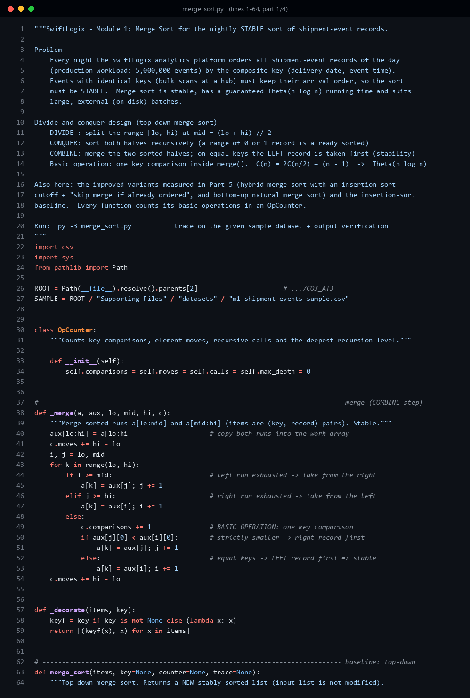

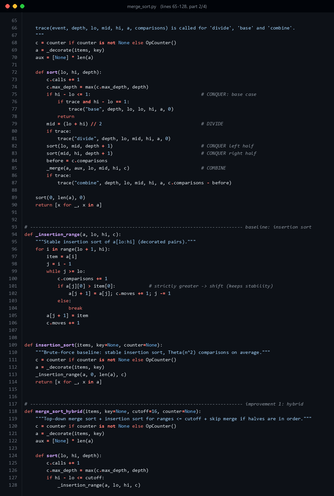

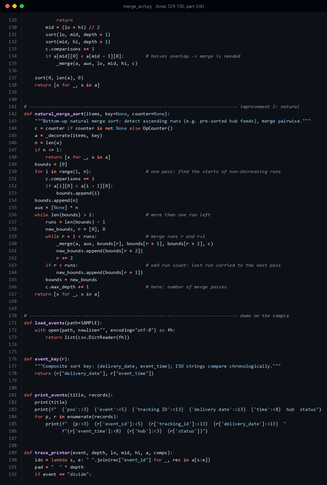

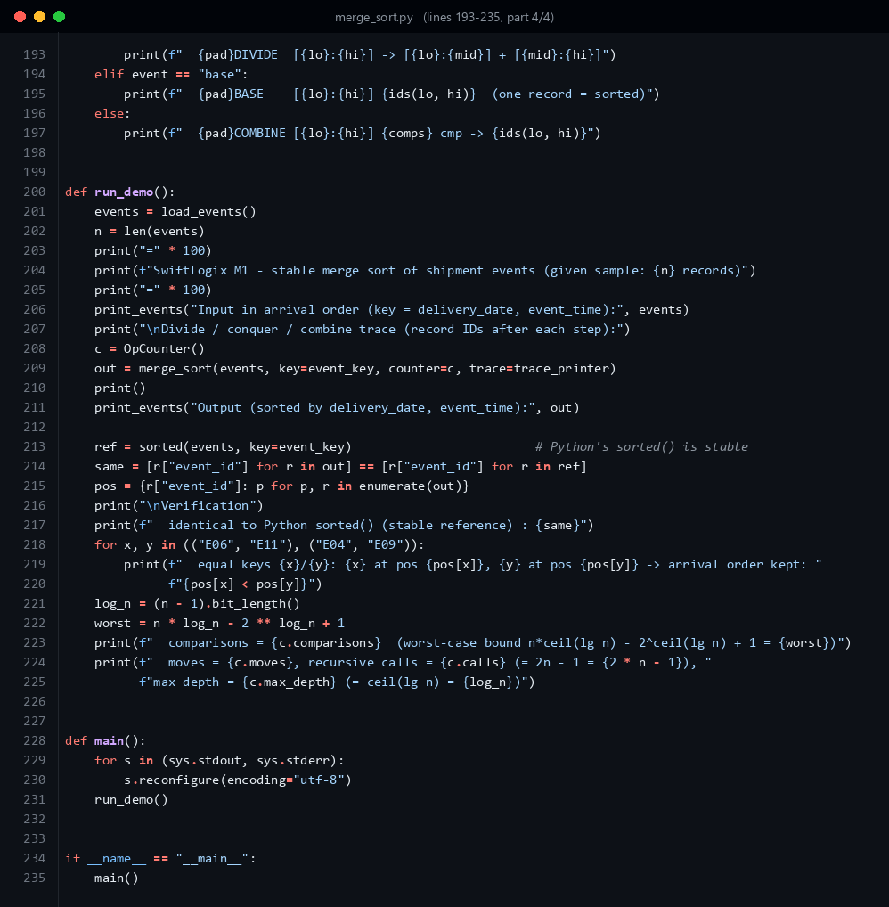

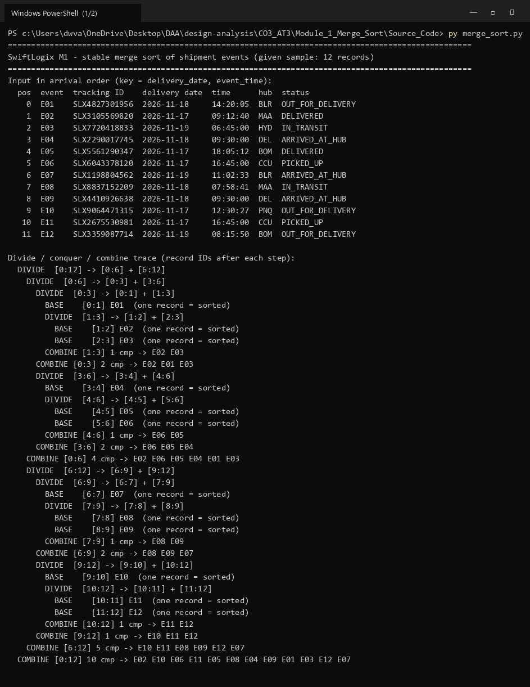

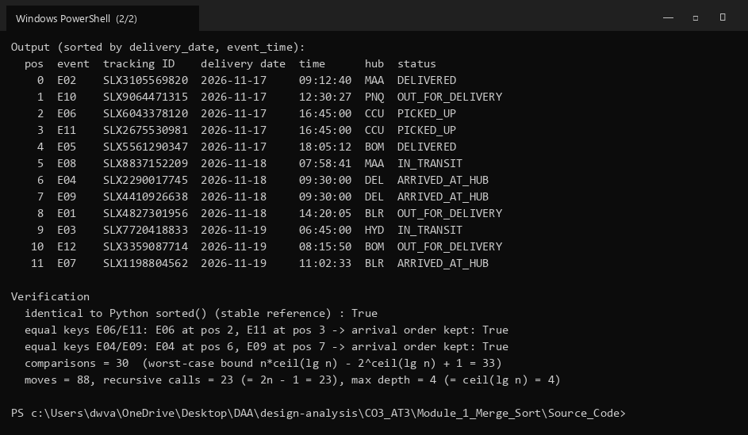

**Reading the trace (Figure 5).**

- **Divide.** `DIVIDE [0:12] -> [0:6] + [6:12]` splits the 12 events into two halves of 6; the halves are split again into 3 + 3, and each 3 into 1 + 2. There are 11 DIVIDE lines (one per internal node of the recursion tree) and 12 BASE lines (the leaves): a single record is already sorted, which is the **conquer** base case.
- **Combine.** Each `COMBINE` line shows the merged run and the comparisons it needed. For example `COMBINE [4:6] 1 cmp -> E06 E05` puts E06 (17 Nov 16:45:00) before E05 (17 Nov 18:05:12), and `COMBINE [0:6] 4 cmp -> E02 E06 E05 E04 E01 E03` merges E02 E01 E03 with E06 E05 E04. The final merge `[0:12]` needs 10 comparisons and produces E02 E10 E06 E11 E05 E08 E04 E09 E01 E03 E12 E07.
- **Stability.** In the final merge E06 (left run) and E11 (right run) have the *same* key 2026-11-17 16:45:00; the comparison `key(E11) < key(E06)` is false, so E06 is written first. The same happens to E04 and E09 (2026-11-18 09:30:00). Both pairs keep their arrival order (positions 2/3 and 6/7 in the output).
- **Counts.** 30 comparisons (1+2+1+2+4+1+2+1+1+5+10) – below the worst-case bound n⌈lg n⌉ − 2<sup>⌈lg n⌉</sup> + 1 = 12·4 − 16 + 1 = 33; 88 moves = 2 × (2+3+2+3+6+2+3+2+3+6+12); 23 calls = 2n − 1; maximum depth 4 = ⌈lg 12⌉.
- **Verification.** The output is identical to Python's stable `sorted()` on the same key.

### 3. Datasets, test cases and test results

`Supporting_Files/generate_datasets.py` writes the larger datasets and the JSON test cases, whose expected outputs come from independent references (`sorted()`, `bisect`, numpy). `Supporting_Files/run_all_tests.py --module N` runs every variant of this module on those cases, on the generated dataset, on randomised inputs, and checks the operation counts against the closed forms of Part 4.

Table 3: Test plan (Supporting_Files/test_cases/*.json and run_all_tests.py)

| Module | Variants tested | Edge cases and checks | Tests |
|---|---|---|---|
| M1 Merge Sort | top-down, hybrid n₀ = 16 and 4, natural, insertion | empty, single, two reversed, duplicates, sorted, reverse, all equal, negatives, organ pipe, random; stability with 30 records / 5 keys; sample order; 5,000 generated events; 300 random lists; comparisons ≤ worst bound and calls = 2n − 1; (n/2) lg n on sorted input; natural sort on 64 feeds | 18 |

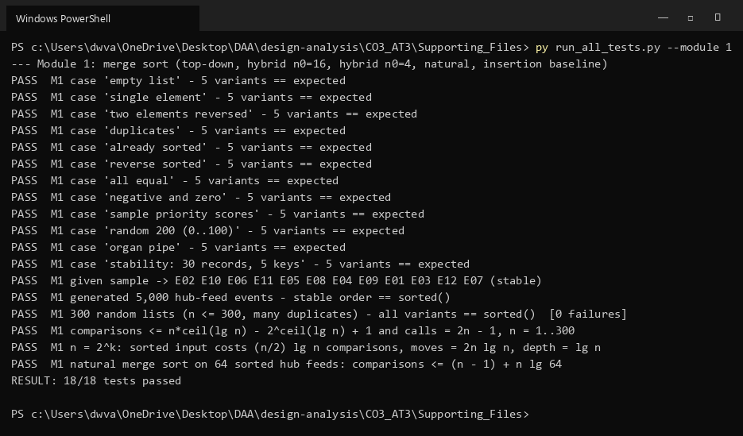

All **18 Module 1 tests pass** (Figure 7; the log is Appendix D).

## Part 4 – Recurrence Relations, Complexity and Production Workloads [15 Marks]

> Formulate and solve recurrence relations, derive time and space complexities and perform the required theoretical calculations for the specified production workloads.
> - Formulate each recurrence from the algorithm (best, average and worst case where they differ).
> - Solve each recurrence by the Master Theorem and by backward substitution or the recursion-tree method.
> - Derive the space complexity of each algorithm.
> - Compute the number of basic operations, the running time on a server executing 10⁸ basic operations per second and the memory requirement for the production workloads: 5 million shipment events per night (M1), 2 million priority scores per dispatch cycle (M2), 20 million lookups per day on an index of 10 million tracking IDs (M3) and 1,024 × 1,024 matrices (M4).

**Evidence Expected**

> Recurrences, complete solutions (Master Theorem with its parameters and substitution/recursion tree), time and space complexities, closed forms checked against counted operations, and production-workload calculations.

**Ans:**

### 1. Method

For each module I write the recurrence directly from the pseudocode of Part 2 (number of sub-problems, their size, cost of divide + combine), solve it twice – with the **Master Theorem** for T(n) = a·T(n/b) + f(n) (compare f(n) with n<sup>log<sub>b</sub> a</sup>) and with **backward substitution** or a **recursion tree** – and then check the exact closed form against the operations counted by the programs. The production figures are computed by `Supporting_Files/production_workload.py` (Figure 8) from these closed forms, at 10⁸ basic operations per second, with 1 MB = 10⁶ bytes.

### 2. Module 1 – Merge Sort

**Recurrence.** Sorting n records costs the two recursive sorts plus the merge. The merge of runs of total length n needs at most n − 1 comparisons (worst case: the runs interleave until the end) and at least ⌊n/2⌋ (best case: the shorter run is exhausted first, e.g. sorted input). Dividing costs Θ(1). Hence

- worst case: C(n) = C(⌈n/2⌉) + C(⌊n/2⌋) + (n − 1), C(1) = 0; for n = 2<sup>k</sup>: **C(n) = 2C(n/2) + (n − 1)**
- best case (sorted input, n = 2<sup>k</sup>): B(n) = 2B(n/2) + n/2, B(1) = 0
- record moves (copy to Aux and back): M(n) = 2M(n/2) + 2n, M(1) = 0

**Master Theorem.** a = 2, b = 2, f(n) = n − 1 = Θ(n); n<sup>log<sub>b</sub> a</sup> = n<sup>log₂ 2</sup> = n. Since f(n) = Θ(n<sup>log<sub>b</sub> a</sup>), **case 2** applies: C(n) = Θ(n<sup>log<sub>b</sub> a</sup> · log n) = **Θ(n log n)**. The best case (f(n) = n/2) and the moves (f(n) = 2n) fall in the same case, so merge sort is Θ(n log n) for *every* input order.

**Backward substitution** (n = 2<sup>k</sup>):

```
C(n) = 2C(n/2) + n - 1
     = 2[2C(n/4) + n/2 - 1] + n - 1           = 4C(n/4) + 2n - (1 + 2)
     = 4[2C(n/8) + n/4 - 1] + 2n - 3          = 8C(n/8) + 3n - (1 + 2 + 4)
     = ...
     = 2^i C(n/2^i) + i*n - (2^i - 1)
i = k = lg n:  C(n) = n*C(1) + n lg n - (n - 1)  =  n lg n - n + 1
```

**Recursion tree.** Level i has 2<sup>i</sup> merges of runs of total length n/2<sup>i</sup>, each costing at most n/2<sup>i</sup> − 1 comparisons, so level i costs n − 2<sup>i</sup>. Summing the k = lg n merge levels: Σ<sub>i=0</sub><sup>k−1</sup> (n − 2<sup>i</sup>) = kn − (2<sup>k</sup> − 1) = n lg n − n + 1 – the same result. For general n the worst case is n⌈lg n⌉ − 2<sup>⌈lg n⌉</sup> + 1. The same tree gives B(n) = (n/2) lg n and M(n) = 2n lg n.

**Space.** The work array Aux holds n records and the recursion stack has D(n) = D(n/2) + 1 = ⌈lg n⌉ frames, so S(n) = n + Θ(log n) = **Θ(n)** extra space. The insertion-sort baseline is in place but needs n(n − 1)/4 comparisons on average, Θ(n²).

**Check against counted operations.** Table 4 uses the counts of `merge_sort_experiments.py` on already-sorted input (best case) – they equal (n/2) lg n and 2n lg n exactly; the random-input counts of Part 5 stay below the worst-case bound at every size (Table 6).

Table 4: Merge sort on sorted input – counted vs closed form (m1_merge_sort_experiments.csv)

| n | cmp | (n/2) lg n | moves | 2n lg n | depth | lg n |
|---:|---:|---:|---:|---:|---:|---:|
| 1,024 | 5,120 | 5,120 | 20,480 | 20,480 | 10 | 10 |
| 2,048 | 11,264 | 11,264 | 45,056 | 45,056 | 11 | 11 |
| 4,096 | 24,576 | 24,576 | 98,304 | 98,304 | 12 | 12 |
| 8,192 | 53,248 | 53,248 | 212,992 | 212,992 | 13 | 13 |
| 16,384 | 114,688 | 114,688 | 458,752 | 458,752 | 14 | 14 |
| 32,768 | 245,760 | 245,760 | 983,040 | 983,040 | 15 | 15 |
| 65,536 | 524,288 | 524,288 | 2,097,152 | 2,097,152 | 16 | 16 |
| 131,072 | 1,114,112 | 1,114,112 | 4,456,448 | 4,456,448 | 17 | 17 |

**Production workload (n = 5,000,000 events, ⌈lg n⌉ = 23 because 2²² = 4,194,304 < n ≤ 2²³ = 8,388,608).** Worst-case comparisons = 5,000,000 × 23 − 8,388,608 + 1 = **106,611,393** → 1.07 s; with the 2n⌈lg n⌉ = 230,000,000 record moves the total is 336,611,393 basic operations → **3.37 s**. Insertion sort would need n(n − 1)/4 ≈ 6.25 × 10¹² comparisons → **17.36 hours**, which does not fit a nightly window. Memory: 5,000,000 × 64 B = 320 MB of records plus a 320 MB work array = **640 MB**; sorting (8-byte key, 4-byte record index) pairs instead needs 2 × 5,000,000 × 12 B = **120 MB**. The stack holds only 23 frames.

Table 5: Module 1 production estimates (production_workload.csv)

| Design / quantity | Basic operations | Time at 10⁸ ops/s | Memory (MB) | Note |
|---|---:|---:|---:|---|
| insertion sort, average n(n-1)/4 | 6.2500 × 10¹² | 17.36 h | 320.0 | comparisons; infeasible |
| top-down merge sort, worst comparisons | 106,611,393 | 1.07 s | 640.0 | records + n-record buffer |
| plus record moves 2n*ceil(lg n) | 336,611,393 | 3.37 s | 640.0 | comparisons + moves |
| natural merge sort on 64 feeds (cmp) | 34,999,999 | 350.0 ms | 120.0 | (key, index) pairs |
| plus moves 2n*lg 64 | 94,999,999 | 950.0 ms | 120.0 | final design |

### 3. Production-workload calculation program

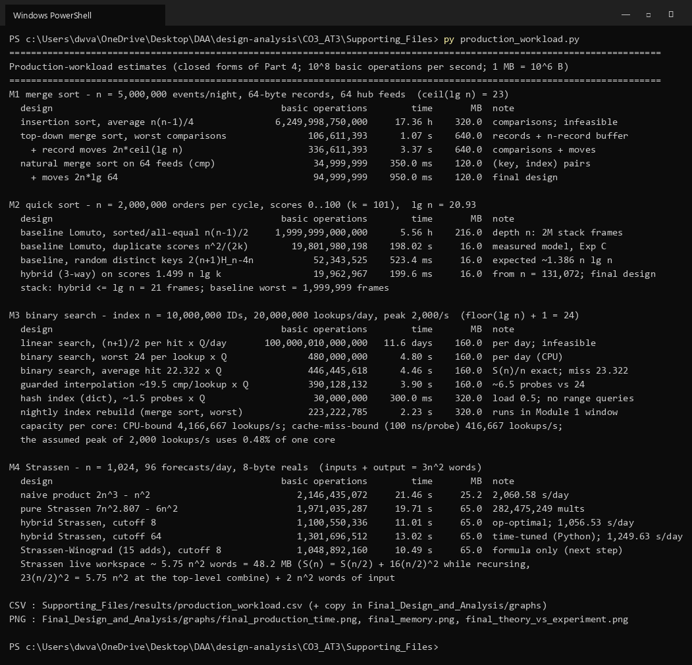

## Part 5 – Comparative Performance, Limitations and Improvements [10 Marks]

> Compare algorithmic performance, discuss limitations and trade-offs, and justify the proposed improvements for each module.
> - Measure operation counts and running times for increasing input sizes against suitable baselines (insertion sort, linear search, naive matrix multiplication) and against the theoretical predictions.
> - Demonstrate the quick sort worst case and determine the Strassen crossover point.
> - Discuss the limitations and trade-offs of each module; propose improvements, implement at least one improvement per module and measure its effect.

**Evidence Expected**

> Comparison tables, graphs with theoretical overlays, worst-case and crossover analysis, limitations and trade-offs, and measured, justified improvements.

**Ans:**

### 1. Experimental method

Each module has an experiment script (`*_experiments.py`, Appendix B) that generates deterministic inputs of doubling size, runs the baseline, the divide-and-conquer design and the improved variants, asserts that every output is correct, and writes the counts and times to `Supporting_Files/results/*.csv` (copies next to the graphs) and the graphs to `Report/graphs/`. **Operation counts are the primary evidence**: they are exact, repeatable and directly comparable with the formulas of Part 4. Times are secondary – other jobs shared the machine, so differences below about 20 % are within noise; I report the median (sorting) or the best (search, matrices) of repeated runs. Inputs are modelled on the case: event timestamps in a 3-day window, 64 time-ordered hub feeds, integer priority scores 0–100, uniform and clustered 10-digit tracking IDs, and integer route matrices.

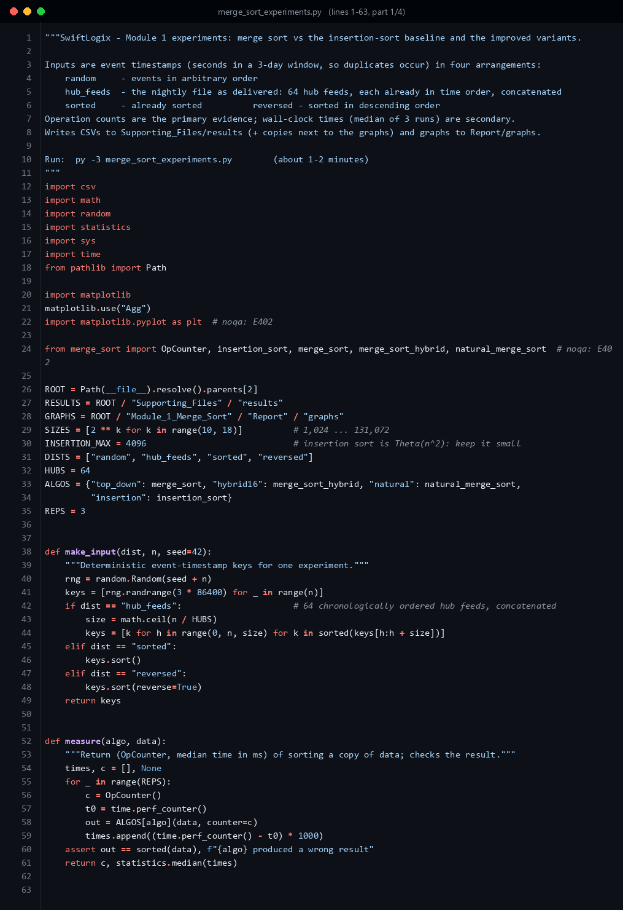

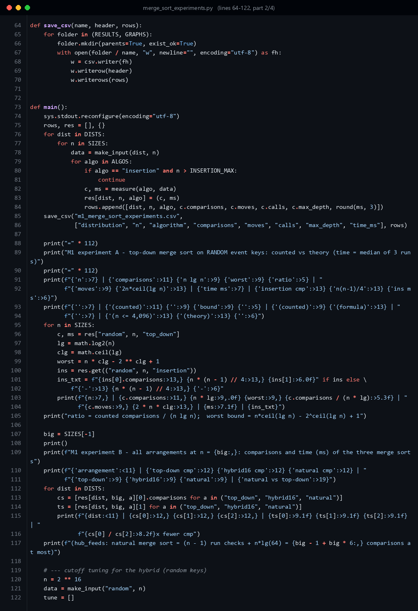

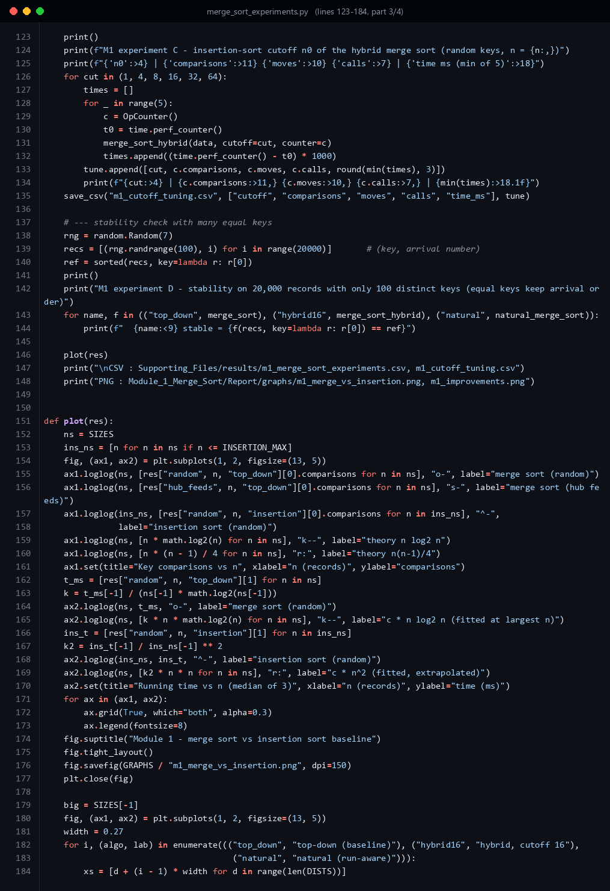

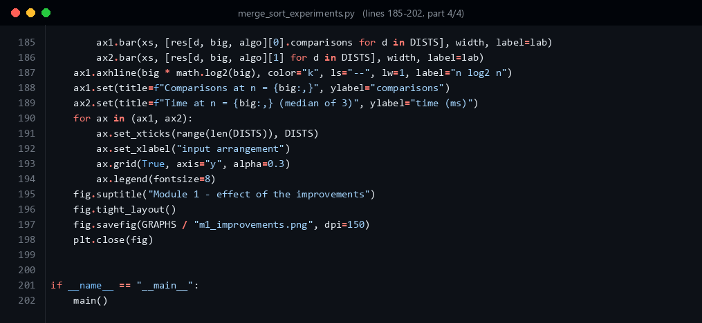

### 2. Module 1 – merge sort vs insertion sort and the improved merge sorts

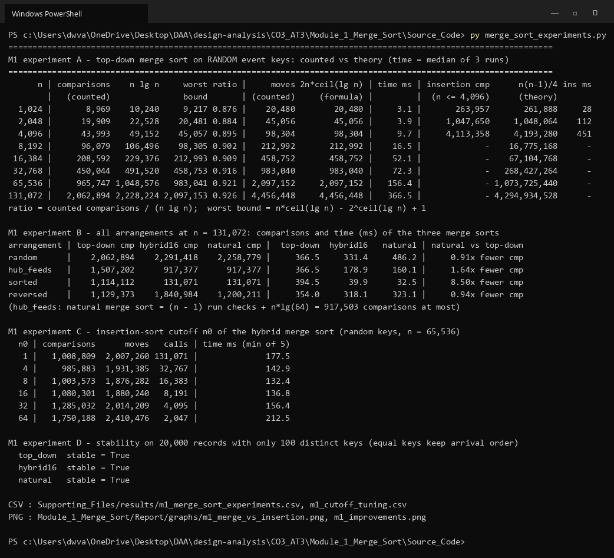

Table 6: Merge sort (random keys) vs insertion sort – counted vs theory (m1_merge_sort_experiments.csv)

| n | merge cmp | n lg n | worst bound | ratio | insertion cmp | n(n-1)/4 | merge ms | insert. ms |
|---:|---:|---:|---:|---:|---:|---:|---:|---:|
| 1,024 | 8,969 | 10,240 | 9,217 | 0.876 | 263,957 | 261,888 | 3.1 | 27.5 |
| 2,048 | 19,909 | 22,528 | 20,481 | 0.884 | 1,047,650 | 1,048,064 | 3.9 | 112.1 |
| 4,096 | 43,993 | 49,152 | 45,057 | 0.895 | 4,113,358 | 4,193,280 | 9.7 | 450.6 |
| 8,192 | 96,079 | 106,496 | 98,305 | 0.902 | – | 16,775,168 | 16.5 | – |
| 16,384 | 208,592 | 229,376 | 212,993 | 0.909 | – | 67,104,768 | 52.1 | – |
| 32,768 | 450,044 | 491,520 | 458,753 | 0.916 | – | 268,427,264 | 72.3 | – |
| 65,536 | 965,747 | 1,048,576 | 983,041 | 0.921 | – | 1,073,725,440 | 156.4 | – |
| 131,072 | 2,062,894 | 2,228,224 | 2,097,153 | 0.926 | – | 4,294,934,528 | 366.5 | – |

(ratio = merge comparisons / (n lg n); insertion sort was run up to n = 4,096 only.)

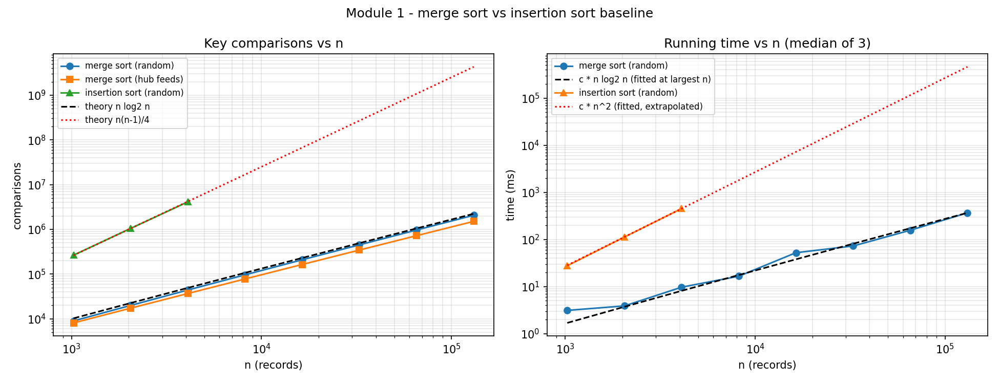

**Theory vs experiment.** On random keys the counted comparisons stay below the worst-case bound at every size, and their ratio to n lg n rises from 0.876 to 0.926 – exactly the behaviour of the average-case form n lg n − 1.26n (the linear term matters less as n grows). The moves equal 2n⌈lg n⌉ exactly (e.g. 4,456,448 at n = 131,072). Insertion sort's counts match n(n − 1)/4 within 1–2 %. On the log–log plot (Figure 14) merge sort has slope ≈ 1 and insertion sort slope 2: at n = 4,096 insertion sort already needs **93 times** more comparisons (4,113,358 vs 43,993) and 46 times more time (451 ms vs 9.7 ms); extrapolating its fitted c·n² curve to n = 131,072 gives about 451 ms × 32² ≈ 462 s against 366.5 ms for merge sort.

Table 7: Effect of the input arrangement on the three merge sorts at n = 131,072 (m1_merge_sort_experiments.csv)

| arrangement | top-down cmp | hybrid-16 cmp | natural cmp | top-down ms | hybrid-16 ms | natural ms |
|---|---:|---:|---:|---:|---:|---:|
| random | 2,062,894 | 2,291,418 | 2,258,779 | 366.5 | 331.4 | 486.2 |
| hub_feeds | 1,507,202 | 917,377 | 917,377 | 366.5 | 178.9 | 160.1 |
| sorted | 1,114,112 | 131,071 | 131,071 | 394.5 | 39.9 | 32.5 |
| reversed | 1,129,373 | 1,840,984 | 1,200,211 | 354.0 | 318.1 | 323.1 |

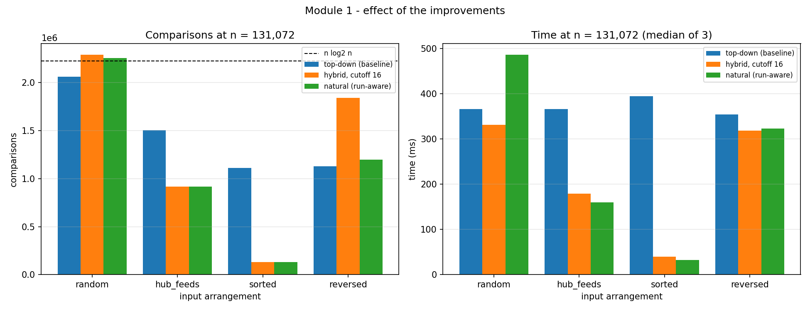

Table 8: Insertion-sort cutoff n₀ of the hybrid merge sort, random keys, n = 65,536 (m1_cutoff_tuning.csv)

| cutoff n0 | comparisons | moves | recursive calls | time ms (min of 5) |
|---:|---:|---:|---:|---:|
| 1 | 1,008,809 | 2,007,260 | 131,071 | 177.5 |
| 4 | 985,883 | 1,931,385 | 32,767 | 142.9 |
| 8 | 1,003,573 | 1,876,282 | 16,383 | 132.4 |
| 16 | 1,080,301 | 1,880,240 | 8,191 | 136.8 |
| 32 | 1,285,032 | 2,014,209 | 4,095 | 156.4 |
| 64 | 1,750,188 | 2,410,476 | 2,047 | 212.5 |

**Limitations and trade-offs of the Part 2 design.**

1. **Memory:** the work array doubles the memory – 640 MB for 5,000,000 64-byte records (Part 4).
2. **Not adaptive:** already-sorted input still costs (n/2) lg n = 1,114,112 comparisons and all 2n lg n moves at n = 131,072 (Table 7), although the real nightly file consists of 64 already-sorted hub feeds.
3. **Overhead on tiny ranges:** 2n − 1 recursive calls (131,071 at n = 65,536), half of them on single records.
4. **Moving whole records:** every level copies each 64-byte record twice.

**Improvements implemented and measured.**

- **Hybrid merge sort** (insertion sort for ranges ≤ n₀, and skip the merge when A[mid−1] ≤ A[mid]). The skip test makes sorted input cost n − 1 = 131,071 comparisons instead of 1,114,112 (**8.5× fewer, 39.9 ms instead of 394.5 ms**). On random keys it costs 11 % *more* comparisons (insertion sort on 16 records is Θ(n₀²)) but is faster (331.4 vs 366.5 ms) because it makes 16 times fewer calls; Table 8 shows the time minimum at n₀ = 8–16 (132–137 ms against 177.5 ms without cutoff, about 25 % less), while comparisons are minimal at n₀ = 4. This is a trade-off between counted comparisons and interpreter/call overhead; I keep n₀ = 16.
- **Natural (run-aware) merge sort** detects the ascending runs in one pass (n − 1 comparisons) and merges neighbouring runs bottom-up. On the realistic input – 64 sorted hub feeds – it needs 917,377 comparisons, within the bound (n − 1) + n lg 64 = 917,503, i.e. **1.64× fewer than top-down and 2.3× faster (160.1 ms vs 366.5 ms)**; on sorted input it needs only n − 1. It stays stable (runs are non-decreasing; ties go left) and keeps the O(n log n) worst case, but on purely random or reversed input it is 6–10 % worse than top-down because its runs are short (a production version would also reverse strictly descending runs, as Timsort does).
- **Sorting (key, index) pairs** instead of 64-byte records cuts the memory from 640 MB to 120 MB and the bytes moved per level by a factor of about 5 (design calculation in Part 4; the records are written once, in sorted order, at the end).

**Justification.** The production input is not random: it is 64 time-ordered feeds. The natural merge sort exploits exactly that structure, is stable and has the same worst case, so it is the right improvement for Module 1; the cutoff removes the recursion overhead, and the key-index representation addresses the memory limitation.

### 3. Merge sort vs quick sort on the same data

Table 9: Merge sort (Module 1) vs quick sort (Module 2) on the same 131,072 keys (m2_merge_vs_quick.csv)

| data | algorithm | comparisons | moves / swaps | time ms |
|---|---|---:|---:|---:|
| random | merge sort (top-down) | 2,062,779 | 4,456,448 | 382.3 |
| random | quick sort (hybrid) | 3,444,693 | 2,326,131 | 313.7 |
| random | quick sort (3-way) | 3,977,076 | 2,714,755 | 438.3 |
| scores | merge sort (top-down) | 2,057,255 | 4,456,448 | 361.3 |
| scores | quick sort (hybrid) | 1,308,293 | 709,993 | 100.0 |
| scores | quick sort (3-way) | 1,574,631 | 893,120 | 117.4 |

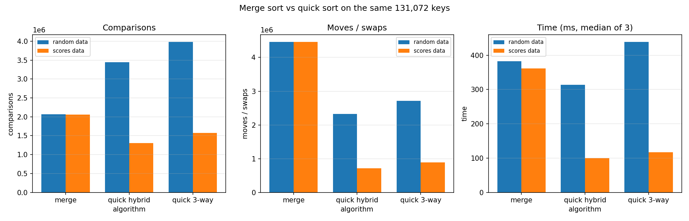

Merge sort needs the fewest comparisons on distinct keys (2,062,779, close to n lg n) but moves every element 2 lg n times (4,456,448 moves) and needs an n-element buffer; the hybrid quick sort makes 67 % more comparisons but half the moves, works in place, and is slightly faster (313.7 vs 382.3 ms). On duplicate-heavy scores the 3-way hybrid is **3.6× faster** than merge sort (100.0 vs 361.3 ms) with 36 % fewer comparisons and 6× fewer moves, because whole blocks of equal scores are finished in one pass. Merge sort keeps two advantages that matter for Module 1 – stability and a guaranteed Θ(n log n) without any safeguards – which is why the two sorting modules use different algorithms.

## Part 6 – Final Algorithmic Design and Recommendations [10 Marks]

> Present the final algorithmic design with appropriate complexity analysis, memory requirements and recommendations.
> - For each module state the recommended algorithm, its time complexity, its memory requirement (in bytes for the production sizes) and a throughput estimate.
> - Give recommendations for deployment and further optimisation.

**Evidence Expected**

> Final design per module with complexity, memory and throughput figures derived from Parts 4 and 5, and justified recommendations.

**Ans:**

### 1. Module 1 – final design: stable run-aware merge sort on (key, index) pairs

- **Algorithm.** Pack each event's key into one 8-byte integer (day number × 86,400 + second of day) and sort (key, 4-byte record index) pairs with the **natural merge sort**: one pass detects the ascending runs (the 64 hub feeds), then neighbouring runs are merged pairwise bottom-up (6 passes for 64 runs); ties go to the left run, so the sort stays **stable**. Runs shorter than 16 are first extended with insertion sort (the hybrid's cutoff), so random input still costs O(n log n). Finally the records are written once in sorted order (this output also rebuilds Module 3's tracking index).
- **Time.** O(n log r) comparisons for r input runs, O(n log n) in the worst case. Production: (n − 1) + n lg 64 = 34,999,999 comparisons + 60,000,000 moves = 94,999,999 basic operations → **0.95 s** (instead of 3.37 s for the Part 2 design and 17.4 h for insertion sort).
- **Memory.** 5,000,000 × 12 B = 60,000,000 B for the pairs + 60,000,000 B work array = **120,000,000 B (120 MB)** of working memory, instead of 640 MB when whole records are sorted; stack O(1) (bottom-up).
- **Throughput.** ≈ 5.3 million events per second at 10⁸ operations/s; even a ten-fold growth to 50 million events (run structure unchanged) needs about 9.5 s.
- **Recommendations.** If the nightly volume ever exceeds memory, keep the same merge step but run it as an **external** k-way merge of the hub files (sequential I/O only); monitor the number of runs r, because the gain over top-down merge sort depends on the feeds staying time-ordered.

### 2. Place of this module in the platform

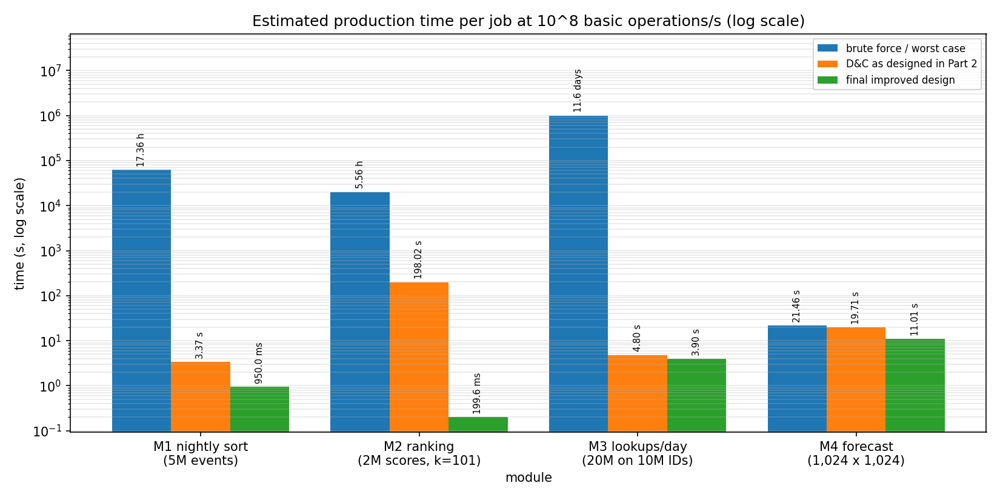

The final designs of all four modules together need about 361 MB of working memory (120 MB M1, 16 MB M2, 160 MB M3, 65 MB M4) and well under one CPU-minute per hour; the complete platform design, the memory budget and the joint recommendations are in Part 6 of the case-study report (`Final_Design_and_Analysis/CO3_AT3_Case_Study_Report`).

### Summary of Findings

Table 10: Summary of findings

| Module | Part 2 design | Verified on the sample (Part 3) | Complexity (Part 4) | Key experimental finding (Part 5) | Final design (Part 6) |
|---|---|---|---|---|---|
| M1 Merge Sort | top-down, stable merge | 30 comparisons ≤ 33; E06/E11 and E04/E09 keep order | Θ(n log n) all cases, Θ(n) space; 3.37 s, 640 MB | counts follow n lg n − 1.26n; hub feeds: natural sort 1.64× fewer cmp, 2.3× faster | natural merge sort on (key, index): 0.95 s, 120 MB |

<!-- pagebreak -->

### Appendix A – Complete Source Code: merge_sort.py

```
"""SwiftLogix - Module 1: Merge Sort for the nightly STABLE sort of shipment-event records.

Problem
    Every night the SwiftLogix analytics platform orders all shipment-event records of the day
    (production workload: 5,000,000 events) by the composite key (delivery_date, event_time).
    Events with identical keys (bulk scans at a hub) must keep their arrival order, so the sort
    must be STABLE.  Merge sort is stable, has a guaranteed Theta(n log n) running time and suits
    large, external (on-disk) batches.

Divide-and-conquer design (top-down merge sort)
    DIVIDE : split the range [lo, hi) at mid = (lo + hi) // 2
    CONQUER: sort both halves recursively (a range of 0 or 1 record is already sorted)
    COMBINE: merge the two sorted halves; on equal keys the LEFT record is taken first (stability)
    Basic operation: one key comparison inside merge().  C(n) = 2C(n/2) + (n - 1)  ->  Theta(n log n)

Also here: the improved variants measured in Part 5 (hybrid merge sort with an insertion-sort
cutoff + "skip merge if already ordered", and bottom-up natural merge sort) and the insertion-sort
baseline.  Every function counts its basic operations in an OpCounter.

Run:  py -3 merge_sort.py           trace on the given sample dataset + output verification
"""
import csv
import sys
from pathlib import Path

ROOT = Path(__file__).resolve().parents[2]                      # .../CO3_AT3
SAMPLE = ROOT / "Supporting_Files" / "datasets" / "m1_shipment_events_sample.csv"

class OpCounter:
    """Counts key comparisons, element moves, recursive calls and the deepest recursion level."""

    def __init__(self):
        self.comparisons = self.moves = self.calls = self.max_depth = 0

# ----------------------------------------------------------------------------- merge (COMBINE step)
def _merge(a, aux, lo, mid, hi, c):
    """Merge sorted runs a[lo:mid] and a[mid:hi] (items are (key, record) pairs). Stable."""
    aux[lo:hi] = a[lo:hi]                    # copy both runs into the work array
    c.moves += hi - lo
    i, j = lo, mid
    for k in range(lo, hi):
        if i >= mid:                         # left run exhausted -> take from the right
            a[k] = aux[j]; j += 1
        elif j >= hi:                        # right run exhausted -> take from the left
            a[k] = aux[i]; i += 1
        else:
            c.comparisons += 1               # BASIC OPERATION: one key comparison
            if aux[j][0] < aux[i][0]:        # strictly smaller -> right record first
                a[k] = aux[j]; j += 1
            else:                            # equal keys -> LEFT record first => stable
                a[k] = aux[i]; i += 1
    c.moves += hi - lo

def _decorate(items, key):
    keyf = key if key is not None else (lambda x: x)
    return [(keyf(x), x) for x in items]

# ----------------------------------------------------------------------------- baseline: top-down
def merge_sort(items, key=None, counter=None, trace=None):
    """Top-down merge sort. Returns a NEW stably sorted list (input list is not modified).

    trace(event, depth, lo, mid, hi, a, comparisons) is called for 'divide', 'base' and 'combine'.
    """
    c = counter if counter is not None else OpCounter()
    a = _decorate(items, key)
    aux = [None] * len(a)

    def sort(lo, hi, depth):
        c.calls += 1
        c.max_depth = max(c.max_depth, depth)
        if hi - lo <= 1:                                        # CONQUER: base case
            if trace and hi - lo == 1:
                trace("base", depth, lo, lo, hi, a, 0)
            return
        mid = (lo + hi) // 2                                    # DIVIDE
        if trace:
            trace("divide", depth, lo, mid, hi, a, 0)
        sort(lo, mid, depth + 1)                                # CONQUER left half
        sort(mid, hi, depth + 1)                                # CONQUER right half
        before = c.comparisons
        _merge(a, aux, lo, mid, hi, c)                          # COMBINE
        if trace:
            trace("combine", depth, lo, mid, hi, a, c.comparisons - before)

    sort(0, len(a), 0)
    return [x for _, x in a]

# ----------------------------------------------------------------------------- baseline: insertion sort
def _insertion_range(a, lo, hi, c):
    """Stable insertion sort of a[lo:hi] (decorated pairs)."""
    for i in range(lo + 1, hi):
        item = a[i]
        j = i - 1
        while j >= lo:
            c.comparisons += 1
            if a[j][0] > item[0]:            # strictly greater -> shift (keeps stability)
                a[j + 1] = a[j]; c.moves += 1; j -= 1
            else:
                break
        a[j + 1] = item
        c.moves += 1

def insertion_sort(items, key=None, counter=None):
    """Brute-force baseline: stable insertion sort, Theta(n^2) comparisons on average."""
    c = counter if counter is not None else OpCounter()
    a = _decorate(items, key)
    _insertion_range(a, 0, len(a), c)
    return [x for _, x in a]

# ----------------------------------------------------------------------------- improvement 1: hybrid
def merge_sort_hybrid(items, key=None, cutoff=16, counter=None):
    """Top-down merge sort + insertion sort for ranges <= cutoff + skip merge if halves are in order."""
    c = counter if counter is not None else OpCounter()
    a = _decorate(items, key)
    aux = [None] * len(a)

    def sort(lo, hi, depth):
        c.calls += 1
        c.max_depth = max(c.max_depth, depth)
        if hi - lo <= cutoff:
            _insertion_range(a, lo, hi, c)
            return
        mid = (lo + hi) // 2
        sort(lo, mid, depth + 1)
        sort(mid, hi, depth + 1)
        c.comparisons += 1
        if a[mid][0] < a[mid - 1][0]:        # halves overlap -> merge is needed
            _merge(a, aux, lo, mid, hi, c)

    sort(0, len(a), 0)
    return [x for _, x in a]

# ----------------------------------------------------------------------------- improvement 2: natural
def natural_merge_sort(items, key=None, counter=None):
    """Bottom-up natural merge sort: detect ascending runs (e.g. pre-sorted hub feeds), merge pairwise."""
    c = counter if counter is not None else OpCounter()
    a = _decorate(items, key)
    n = len(a)
    if n <= 1:
        return [x for _, x in a]
    bounds = [0]
    for i in range(1, n):                    # one pass: find the starts of non-decreasing runs
        c.comparisons += 1
        if a[i][0] < a[i - 1][0]:
            bounds.append(i)
    bounds.append(n)
    aux = [None] * n
    while len(bounds) > 2:                   # more than one run left
        runs = len(bounds) - 1
        new_bounds, r = [0], 0
        while r + 1 < runs:                  # merge runs r and r+1
            _merge(a, aux, bounds[r], bounds[r + 1], bounds[r + 2], c)
            new_bounds.append(bounds[r + 2])
            r += 2
        if r < runs:                         # odd run count: last run carried to the next pass
            new_bounds.append(bounds[r + 1])
        bounds = new_bounds
        c.max_depth += 1                     # here: number of merge passes
    return [x for _, x in a]

# ----------------------------------------------------------------------------- demo on the sample
def load_events(path=SAMPLE):
    with open(path, newline="", encoding="utf-8") as fh:
        return list(csv.DictReader(fh))

def event_key(r):
    """Composite sort key: (delivery_date, event_time); ISO strings compare chronologically."""
    return (r["delivery_date"], r["event_time"])

def print_events(title, records):
    print(title)
    print(f"  {'pos':>3}  {'event':<5}  {'tracking ID':<13}  {'delivery date':<13}  {'time':<8}  hub  status")
    for p, r in enumerate(records):
        print(f"  {p:>3}  {r['event_id']:<5}  {r['tracking_id']:<13}  {r['delivery_date']:<13}  "
              f"{r['event_time']:<8}  {r['hub']:<3}  {r['status']}")

def trace_printer(event, depth, lo, mid, hi, a, comps):
    ids = lambda s, e: " ".join(rec["event_id"] for _, rec in a[s:e])
    pad = "  " * depth
    if event == "divide":
        print(f"  {pad}DIVIDE  [{lo}:{hi}] -> [{lo}:{mid}] + [{mid}:{hi}]")
    elif event == "base":
        print(f"  {pad}BASE    [{lo}:{hi}] {ids(lo, hi)}  (one record = sorted)")
    else:
        print(f"  {pad}COMBINE [{lo}:{hi}] {comps} cmp -> {ids(lo, hi)}")

def run_demo():
    events = load_events()
    n = len(events)
    print("=" * 100)
    print(f"SwiftLogix M1 - stable merge sort of shipment events (given sample: {n} records)")
    print("=" * 100)
    print_events("Input in arrival order (key = delivery_date, event_time):", events)
    print("\nDivide / conquer / combine trace (record IDs after each step):")
    c = OpCounter()
    out = merge_sort(events, key=event_key, counter=c, trace=trace_printer)
    print()
    print_events("Output (sorted by delivery_date, event_time):", out)

    ref = sorted(events, key=event_key)                         # Python's sorted() is stable
    same = [r["event_id"] for r in out] == [r["event_id"] for r in ref]
    pos = {r["event_id"]: p for p, r in enumerate(out)}
    print("\nVerification")
    print(f"  identical to Python sorted() (stable reference) : {same}")
    for x, y in (("E06", "E11"), ("E04", "E09")):
        print(f"  equal keys {x}/{y}: {x} at pos {pos[x]}, {y} at pos {pos[y]} -> arrival order kept: "
              f"{pos[x] < pos[y]}")
    log_n = (n - 1).bit_length()
    worst = n * log_n - 2 ** log_n + 1
    print(f"  comparisons = {c.comparisons}  (worst-case bound n*ceil(lg n) - 2^ceil(lg n) + 1 = {worst})")
    print(f"  moves = {c.moves}, recursive calls = {c.calls} (= 2n - 1 = {2 * n - 1}), "
          f"max depth = {c.max_depth} (= ceil(lg n) = {log_n})")

def main():
    for s in (sys.stdout, sys.stderr):
        s.reconfigure(encoding="utf-8")
    run_demo()

if __name__ == "__main__":
    main()
```

### Appendix B – Experiment and Graph Script: merge_sort_experiments.py

```
"""SwiftLogix - Module 1 experiments: merge sort vs the insertion-sort baseline and the improved variants.

Inputs are event timestamps (seconds in a 3-day window, so duplicates occur) in four arrangements:
    random     - events in arbitrary order
    hub_feeds  - the nightly file as delivered: 64 hub feeds, each already in time order, concatenated
    sorted     - already sorted          reversed - sorted in descending order
Operation counts are the primary evidence; wall-clock times (median of 3 runs) are secondary.
Writes CSVs to Supporting_Files/results (+ copies next to the graphs) and graphs to Report/graphs.

Run:  py -3 merge_sort_experiments.py        (about 1-2 minutes)
"""
import csv
import math
import random
import statistics
import sys
import time
from pathlib import Path

import matplotlib
matplotlib.use("Agg")
import matplotlib.pyplot as plt  # noqa: E402

from merge_sort import OpCounter, insertion_sort, merge_sort, merge_sort_hybrid, natural_merge_sort  # noqa: E402

ROOT = Path(__file__).resolve().parents[2]
RESULTS = ROOT / "Supporting_Files" / "results"
GRAPHS = ROOT / "Module_1_Merge_Sort" / "Report" / "graphs"
SIZES = [2 ** k for k in range(10, 18)]          # 1,024 ... 131,072
INSERTION_MAX = 4096                             # insertion sort is Theta(n^2): keep it small
DISTS = ["random", "hub_feeds", "sorted", "reversed"]
HUBS = 64
ALGOS = {"top_down": merge_sort, "hybrid16": merge_sort_hybrid, "natural": natural_merge_sort,
         "insertion": insertion_sort}
REPS = 3

def make_input(dist, n, seed=42):
    """Deterministic event-timestamp keys for one experiment."""
    rng = random.Random(seed + n)
    keys = [rng.randrange(3 * 86400) for _ in range(n)]
    if dist == "hub_feeds":                      # 64 chronologically ordered hub feeds, concatenated
        size = math.ceil(n / HUBS)
        keys = [k for h in range(0, n, size) for k in sorted(keys[h:h + size])]
    elif dist == "sorted":
        keys.sort()
    elif dist == "reversed":
        keys.sort(reverse=True)
    return keys

def measure(algo, data):
    """Return (OpCounter, median time in ms) of sorting a copy of data; checks the result."""
    times, c = [], None
    for _ in range(REPS):
        c = OpCounter()
        t0 = time.perf_counter()
        out = ALGOS[algo](data, counter=c)
        times.append((time.perf_counter() - t0) * 1000)
    assert out == sorted(data), f"{algo} produced a wrong result"
    return c, statistics.median(times)

def save_csv(name, header, rows):
    for folder in (RESULTS, GRAPHS):
        folder.mkdir(parents=True, exist_ok=True)
        with open(folder / name, "w", newline="", encoding="utf-8") as fh:
            w = csv.writer(fh)
            w.writerow(header)
            w.writerows(rows)

def main():
    sys.stdout.reconfigure(encoding="utf-8")
    rows, res = [], {}
    for dist in DISTS:
        for n in SIZES:
            data = make_input(dist, n)
            for algo in ALGOS:
                if algo == "insertion" and n > INSERTION_MAX:
                    continue
                c, ms = measure(algo, data)
                res[dist, n, algo] = (c, ms)
                rows.append([dist, n, algo, c.comparisons, c.moves, c.calls, c.max_depth, round(ms, 3)])
    save_csv("m1_merge_sort_experiments.csv",
             ["distribution", "n", "algorithm", "comparisons", "moves", "calls", "max_depth", "time_ms"], rows)

    print("=" * 112)
    print("M1 experiment A - top-down merge sort on RANDOM event keys: counted vs theory (time = median of 3 runs)")
    print("=" * 112)
    print(f"{'n':>7} | {'comparisons':>11} {'n lg n':>9} {'worst':>9} {'ratio':>5} | "
          f"{'moves':>9} {'2n*ceil(lg n)':>13} | {'time ms':>7} | {'insertion cmp':>13} {'n(n-1)/4':>13} {'ins ms':>6}")
    print(f"{'':>7} | {'(counted)':>11} {'':>9} {'bound':>9} {'':>5} | {'(counted)':>9} {'(formula)':>13} | "
          f"{'':>7} | {'(n <= 4,096)':>13} {'(theory)':>13} {'':>6}")
    for n in SIZES:
        c, ms = res["random", n, "top_down"]
        lg = math.log2(n)
        clg = math.ceil(lg)
        worst = n * clg - 2 ** clg + 1
        ins = res.get(("random", n, "insertion"))
        ins_txt = f"{ins[0].comparisons:>13,} {n * (n - 1) // 4:>13,} {ins[1]:>6.0f}" if ins else \
            f"{'-':>13} {n * (n - 1) // 4:>13,} {'-':>6}"
        print(f"{n:>7,} | {c.comparisons:>11,} {n * lg:>9,.0f} {worst:>9,} {c.comparisons / (n * lg):>5.3f} | "
              f"{c.moves:>9,} {2 * n * clg:>13,} | {ms:>7.1f} | {ins_txt}")
    print("ratio = counted comparisons / (n lg n);  worst bound = n*ceil(lg n) - 2^ceil(lg n) + 1")

    big = SIZES[-1]
    print()
    print(f"M1 experiment B - all arrangements at n = {big:,}: comparisons and time (ms) of the three merge sorts")
    print(f"{'arrangement':<11} | {'top-down cmp':>12} {'hybrid16 cmp':>12} {'natural cmp':>12} | "
          f"{'top-down':>9} {'hybrid16':>9} {'natural':>9} | {'natural vs top-down':>19}")
    for dist in DISTS:
        cs = [res[dist, big, a][0].comparisons for a in ("top_down", "hybrid16", "natural")]
        ts = [res[dist, big, a][1] for a in ("top_down", "hybrid16", "natural")]
        print(f"{dist:<11} | {cs[0]:>12,} {cs[1]:>12,} {cs[2]:>12,} | {ts[0]:>9.1f} {ts[1]:>9.1f} {ts[2]:>9.1f} | "
              f"{cs[0] / cs[2]:>8.2f}x fewer cmp")
    print(f"(hub_feeds: natural merge sort = (n - 1) run checks + n*lg(64) = {big - 1 + big * 6:,} comparisons at most)")

    # --- cutoff tuning for the hybrid (random keys)
    n = 2 ** 16
    data = make_input("random", n)
    tune = []
    print()
    print(f"M1 experiment C - insertion-sort cutoff n0 of the hybrid merge sort (random keys, n = {n:,})")
    print(f"{'n0':>4} | {'comparisons':>11} {'moves':>10} {'calls':>7} | {'time ms (min of 5)':>18}")
    for cut in (1, 4, 8, 16, 32, 64):
        times = []
        for _ in range(5):
            c = OpCounter()
            t0 = time.perf_counter()
            merge_sort_hybrid(data, cutoff=cut, counter=c)
            times.append((time.perf_counter() - t0) * 1000)
        tune.append([cut, c.comparisons, c.moves, c.calls, round(min(times), 3)])
        print(f"{cut:>4} | {c.comparisons:>11,} {c.moves:>10,} {c.calls:>7,} | {min(times):>18.1f}")
    save_csv("m1_cutoff_tuning.csv", ["cutoff", "comparisons", "moves", "calls", "time_ms"], tune)

    # --- stability check with many equal keys
    rng = random.Random(7)
    recs = [(rng.randrange(100), i) for i in range(20000)]       # (key, arrival number)
    ref = sorted(recs, key=lambda r: r[0])
    print()
    print("M1 experiment D - stability on 20,000 records with only 100 distinct keys (equal keys keep arrival order)")
    for name, f in (("top_down", merge_sort), ("hybrid16", merge_sort_hybrid), ("natural", natural_merge_sort)):
        print(f"  {name:<9} stable = {f(recs, key=lambda r: r[0]) == ref}")

    plot(res)
    print("\nCSV : Supporting_Files/results/m1_merge_sort_experiments.csv, m1_cutoff_tuning.csv")
    print("PNG : Module_1_Merge_Sort/Report/graphs/m1_merge_vs_insertion.png, m1_improvements.png")

def plot(res):
    ns = SIZES
    ins_ns = [n for n in ns if n <= INSERTION_MAX]
    fig, (ax1, ax2) = plt.subplots(1, 2, figsize=(13, 5))
    ax1.loglog(ns, [res["random", n, "top_down"][0].comparisons for n in ns], "o-", label="merge sort (random)")
    ax1.loglog(ns, [res["hub_feeds", n, "top_down"][0].comparisons for n in ns], "s-", label="merge sort (hub feeds)")
    ax1.loglog(ins_ns, [res["random", n, "insertion"][0].comparisons for n in ins_ns], "^-",
               label="insertion sort (random)")
    ax1.loglog(ns, [n * math.log2(n) for n in ns], "k--", label="theory n log2 n")
    ax1.loglog(ns, [n * (n - 1) / 4 for n in ns], "r:", label="theory n(n-1)/4")
    ax1.set(title="Key comparisons vs n", xlabel="n (records)", ylabel="comparisons")
    t_ms = [res["random", n, "top_down"][1] for n in ns]
    k = t_ms[-1] / (ns[-1] * math.log2(ns[-1]))
    ax2.loglog(ns, t_ms, "o-", label="merge sort (random)")
    ax2.loglog(ns, [k * n * math.log2(n) for n in ns], "k--", label="c * n log2 n (fitted at largest n)")
    ins_t = [res["random", n, "insertion"][1] for n in ins_ns]
    k2 = ins_t[-1] / ins_ns[-1] ** 2
    ax2.loglog(ins_ns, ins_t, "^-", label="insertion sort (random)")
    ax2.loglog(ns, [k2 * n * n for n in ns], "r:", label="c * n^2 (fitted, extrapolated)")
    ax2.set(title="Running time vs n (median of 3)", xlabel="n (records)", ylabel="time (ms)")
    for ax in (ax1, ax2):
        ax.grid(True, which="both", alpha=0.3)
        ax.legend(fontsize=8)
    fig.suptitle("Module 1 - merge sort vs insertion sort baseline")
    fig.tight_layout()
    fig.savefig(GRAPHS / "m1_merge_vs_insertion.png", dpi=150)
    plt.close(fig)

    big = SIZES[-1]
    fig, (ax1, ax2) = plt.subplots(1, 2, figsize=(13, 5))
    width = 0.27
    for i, (algo, lab) in enumerate((("top_down", "top-down (baseline)"), ("hybrid16", "hybrid, cutoff 16"),
                                      ("natural", "natural (run-aware)"))):
        xs = [d + (i - 1) * width for d in range(len(DISTS))]
        ax1.bar(xs, [res[d, big, algo][0].comparisons for d in DISTS], width, label=lab)
        ax2.bar(xs, [res[d, big, algo][1] for d in DISTS], width, label=lab)
    ax1.axhline(big * math.log2(big), color="k", ls="--", lw=1, label="n log2 n")
    ax1.set(title=f"Comparisons at n = {big:,}", ylabel="comparisons")
    ax2.set(title=f"Time at n = {big:,} (median of 3)", ylabel="time (ms)")
    for ax in (ax1, ax2):
        ax.set_xticks(range(len(DISTS)), DISTS)
        ax.set_xlabel("input arrangement")
        ax.grid(True, axis="y", alpha=0.3)
        ax.legend(fontsize=8)
    fig.suptitle("Module 1 - effect of the improvements")
    fig.tight_layout()
    fig.savefig(GRAPHS / "m1_improvements.png", dpi=150)
    plt.close(fig)

if __name__ == "__main__":
    main()
```

### Appendix C – Raw Experimental Data

#### results/m1_merge_sort_experiments.csv

```
distribution,n,algorithm,comparisons,moves,calls,max_depth,time_ms
random,1024,top_down,8969,20480,2047,10,3.104
random,1024,hybrid16,10740,17069,127,6,1.418
random,1024,natural,9445,18408,0,9,1.291
random,1024,insertion,263957,263964,0,0,27.529
random,2048,top_down,19909,45056,4095,11,3.867
random,2048,hybrid16,23305,38058,255,7,2.978
random,2048,natural,20995,40896,0,10,2.89
random,2048,insertion,1047650,1047653,0,0,112.149
random,4096,top_down,43993,98304,8191,12,9.658
random,4096,hybrid16,51085,84668,511,8,10.904
random,4096,natural,46047,90028,0,11,6.346
random,4096,insertion,4113358,4113366,0,0,450.587
random,8192,top_down,96079,212992,16383,13,16.508
random,8192,hybrid16,110238,185644,1023,9,13.439
random,8192,natural,100280,196510,0,12,13.671
random,16384,top_down,208592,458752,32767,14,52.14
random,16384,hybrid16,237261,404471,2047,10,31.092
random,16384,natural,221013,458726,0,14,36.748
random,32768,top_down,450044,983040,65535,15,72.333
random,32768,hybrid16,507386,874642,4095,11,58.532
random,32768,natural,466505,917372,0,14,58.997
random,65536,top_down,965747,2097152,131071,16,156.444
random,65536,hybrid16,1080301,1880240,8191,12,126.161
random,65536,natural,998712,1965800,0,15,138.284
random,131072,top_down,2062894,4456448,262143,17,366.502
random,131072,hybrid16,2291418,4022227,16383,13,331.397
random,131072,natural,2258779,4454962,0,17,486.171
hub_feeds,1024,top_down,8087,20480,2047,10,1.762
hub_feeds,1024,hybrid16,7062,13248,127,6,0.9
hub_feeds,1024,natural,7062,12288,0,6,0.874
hub_feeds,1024,insertion,260141,260143,0,0,30.124
hub_feeds,2048,top_down,17282,45056,4095,11,7.848
hub_feeds,2048,hybrid16,14209,26496,255,7,3.61
hub_feeds,2048,natural,14209,24576,0,6,3.226
hub_feeds,2048,insertion,1032178,1032180,0,0,124.471
hub_feeds,4096,top_down,36734,98304,8191,12,8.323
hub_feeds,4096,hybrid16,28541,52992,511,8,3.844
hub_feeds,4096,natural,28541,49152,0,6,4.07
hub_feeds,4096,insertion,4049372,4049374,0,0,521.905
hub_feeds,8192,top_down,77692,212992,16383,13,16.451
```

*(first 40 of 108 data rows shown; the full file is in the repository)*

#### results/m1_cutoff_tuning.csv

```
cutoff,comparisons,moves,calls,time_ms
1,1008809,2007260,131071,177.516
4,985883,1931385,32767,142.928
8,1003573,1876282,16383,132.395
16,1080301,1880240,8191,136.786
32,1285032,2014209,4095,156.385
64,1750188,2410476,2047,212.478
```

#### results/m2_merge_vs_quick.csv

```
distribution,n,algorithm,comparisons,moves_or_swaps,time_ms
random,131072,merge sort (top-down),2062779,4456448,382.255
random,131072,quick sort (hybrid),3444693,2326131,313.695
random,131072,quick sort (3-way),3977076,2714755,438.303
scores,131072,merge sort (top-down),2057255,4456448,361.302
scores,131072,quick sort (hybrid),1308293,709993,100.027
scores,131072,quick sort (3-way),1574631,893120,117.353
```

### Appendix D – Test Results

Captured output of `py run_all_tests.py --module 1` (Supporting_Files/logs/m1_tests_log.txt):

```
--- Module 1: merge sort (top-down, hybrid n0=16, hybrid n0=4, natural, insertion baseline)
PASS  M1 case 'empty list' - 5 variants == expected
PASS  M1 case 'single element' - 5 variants == expected
PASS  M1 case 'two elements reversed' - 5 variants == expected
PASS  M1 case 'duplicates' - 5 variants == expected
PASS  M1 case 'already sorted' - 5 variants == expected
PASS  M1 case 'reverse sorted' - 5 variants == expected
PASS  M1 case 'all equal' - 5 variants == expected
PASS  M1 case 'negative and zero' - 5 variants == expected
PASS  M1 case 'sample priority scores' - 5 variants == expected
PASS  M1 case 'random 200 (0..100)' - 5 variants == expected
PASS  M1 case 'organ pipe' - 5 variants == expected
PASS  M1 case 'stability: 30 records, 5 keys' - 5 variants == expected
PASS  M1 given sample -> E02 E10 E06 E11 E05 E08 E04 E09 E01 E03 E12 E07 (stable)
PASS  M1 generated 5,000 hub-feed events - stable order == sorted()
PASS  M1 300 random lists (n <= 300, many duplicates) - all variants == sorted()  [0 failures]
PASS  M1 comparisons <= n*ceil(lg n) - 2^ceil(lg n) + 1 and calls = 2n - 1, n = 1..300
PASS  M1 n = 2^k: sorted input costs (n/2) lg n comparisons, moves = 2n lg n, depth = lg n
PASS  M1 natural merge sort on 64 sorted hub feeds: comparisons <= (n - 1) + n lg 64
RESULT: 18/18 tests passed
```

### References

1. T. H. Cormen, C. E. Leiserson, R. L. Rivest and C. Stein, *Introduction to Algorithms*, 4th ed., MIT Press, 2022 – Ch. 2 (merge sort), Ch. 4 (divide and conquer, Strassen's algorithm, the Master Theorem), Ch. 7 (quicksort).
2. A. Levitin, *Introduction to the Design and Analysis of Algorithms*, 3rd ed., Pearson, 2012 – Ch. 5 (mergesort, quicksort, binary search, Strassen's matrix multiplication).
3. D. E. Knuth, *The Art of Computer Programming, Vol. 3: Sorting and Searching*, 2nd ed., Addison-Wesley, 1998 – merging, quicksort analysis, binary and interpolation search.
4. V. Strassen, "Gaussian elimination is not optimal", *Numerische Mathematik* 13 (1969) 354–356.
5. D. R. Musser, "Introspective sorting and selection algorithms", *Software: Practice and Experience* 27(8) (1997) 983–993.
6. J. L. Bentley and M. D. McIlroy, "Engineering a sort function", *Software: Practice and Experience* 23(11) (1993) 1249–1265.
7. R. Sedgewick and K. Wayne, *Algorithms*, 4th ed., Addison-Wesley, 2011 – Section 2.3 (quicksort, 3-way partitioning).
8. Y. Perl, A. Itai and H. Avni, "Interpolation search – a log log N search", *Communications of the ACM* 21(7) (1978) 550–553.
9. Python 3.13 documentation – `bisect`, `time.perf_counter`, `tracemalloc`; matplotlib 3.10 and numpy 2.4 documentation.
