<!-- cover
institution: SIMATS ENGINEERING
department: Department of Computer Science and Engineering
course: CSA06 – Design and Analysis of Algorithms
assignment: ASSESSMENT TOOL 3 – CO3
subtitle: Module 2 – Quick Sort: Ranking Order-Priority Scores for the Dispatch Queue (SwiftLogix Case Study)
coverage: CO3: Quick Sort – Module 2 of the SwiftLogix divide-and-conquer case study
student_name: V. Vasudevan
register_number: 192425324
nature: Individual
duration: 1 Week
total_marks: 70
marks: P1 | Part 1 – Case Analysis – dispatch-queue ranking module | 10
marks: P2 | Part 2 – Algorithm Design and Pseudocode – Quick Sort | 10
marks: P3 | Part 3 – Implementation and Execution Traces – Quick Sort | 15
marks: P4 | Part 4 – Recurrence Relations, Complexity and Production Workload – Quick Sort | 15
marks: P5 | Part 5 – Comparative Performance, Limitations and Improvements – Quick Sort | 10
marks: P6 | Part 6 – Final Design and Recommendations – Quick Sort | 10
details: CO3 Coverage | Divide-and-conquer technique – Quick Sort (Module 2 of the SwiftLogix case study; the other modules are in their own reports and in the complete case-study report).
details: Nature of Assignment | Individual
details: Duration | 1 Week
details: Total Marks | 70
details: Submission Date |
-->

# CSA06 – AT3 (CO3) Module 2: Quick Sort – Dispatch-Queue Ranking

### Problem Statement: SwiftLogix – National Logistics and Delivery Analytics Platform

SwiftLogix is a national parcel-logistics operator. Its analytics platform ingests every scan event of every parcel, ranks open orders for the dispatch teams, answers tracking queries from customers, couriers and partner APIs, and forecasts the cost of moving the next day's demand through its hub network. Four back-end modules sit on the critical path of the platform, and each of them is built around one **divide-and-conquer** algorithm of CO3:

- **Module 1 – Nightly shipment-event sort (Merge Sort).** Every night all scan events of the day are ordered by the composite key (delivery date, event time). Events with identical keys (bulk scans at a hub) must keep their arrival order, so the sort must be *stable*.
- **Module 2 – Dispatch-queue ranking (Quick Sort).** Every dispatch cycle the open orders are ranked in memory by an integer priority score 0–100. The data are duplicate-heavy and are often already almost in order.
- **Module 3 – Tracking-ID lookup (Binary Search).** The sorted shipment index (rebuilt nightly by Module 1) answers point lookups by tracking ID at a high query rate.
- **Module 4 – Network forecasting (Strassen's Matrix Multiplication).** The forecast cost matrix is the product F = D × C of the route-demand matrix D (origin zone × hub corridor) and the cost matrix C (hub corridor × destination zone).

The case study is set in six parts: (1) analyse the case and the four modules, (2) design the algorithms and write their pseudocode before implementing them, (3) implement and execute them on the given sample datasets with divide / conquer / combine traces and verified outputs, (4) formulate and solve the recurrences, derive time and space complexities and compute the production-workload figures, (5) compare performance experimentally, discuss limitations and trade-offs and justify measured improvements, and (6) present the final algorithmic design with complexity, memory requirements and recommendations.

This module report answers all six parts **for Module 2 (Quick Sort)**. The complete case study covering all four modules is `Final_Design_and_Analysis/CO3_AT3_Case_Study_Report` (.md / .docx / .pdf).

Table 1: The four modules, their given sample datasets and production workloads

| Module and algorithm | Platform function | Given sample dataset (Supporting_Files/datasets) | Production workload |
|---|---|---|---|
| M1 – Merge Sort | Nightly stable sort of shipment events | `m1_shipment_events_sample.csv` – 12 events, 2 pairs of equal keys | 5,000,000 events per night, 64-byte records, 64 hub feeds |
| M2 – Quick Sort | Dispatch-queue ranking | `m2_priority_scores_sample.csv` – 12 orders, scores with duplicates | 2,000,000 orders per dispatch cycle, scores 0–100 |
| M3 – Binary Search | Tracking-ID lookup | `m3_tracking_index_sample.csv` (16 IDs) + `m3_lookup_queries_sample.csv` (8 queries: 5 present, 3 absent) | 20,000,000 lookups per day on 10,000,000 IDs |
| M4 – Strassen | Network cost forecast F = D × C | `m4_route_matrices_sample.json` – two 4 × 4 matrices | 1,024 × 1,024 matrices, 96 forecasts per day |

**Evidence and reproducibility.** Every number in this report was produced by the programs in the repository and is copied from their logs or CSV files. The programs are `Source_Code/quick_sort.py` (algorithms with operation counters + partition trace on the sample) and `Source_Code/quick_sort_experiments.py` (experiments, CSVs and graphs), plus the shared `Supporting_Files/run_all_tests.py` and `production_workload.py`. Source code is in Appendices A and B, raw data in Appendix C and the test run in Appendix D. Operation counts are the primary evidence; wall-clock times are secondary because other jobs were running on the same machine during the measurements.

Table 2: Test environment

| Item | Value |
|---|---|
| Processor | 13th Gen Intel Core i5-13420H (`platform.processor()`: Intel64 Family 6 Model 186 Stepping 2, GenuineIntel) |
| Memory | 16 GB (16,802,910,208 bytes) |
| Operating system | Windows 11 Home Single Language, build 10.0.26200, 64-bit |
| Language | Python 3.13.11 (CPython, 64-bit); algorithm cores are hand-written pure Python with explicit operation counters |
| Libraries | matplotlib 3.10.8 (graphs only); numpy 2.4.4 (only to verify matrix products and in the test harness) |
| Random seeds | 42 for the datasets and test cases; fixed per-experiment seeds (e.g. `random.Random(42 + n)`) |
| Timer | `time.perf_counter`; median of 3 runs (sorting), best of 3 (search, Strassen up to n = 128), 1 run for the slowest cases |
| Machine model for Part 4 | 10⁸ basic operations per second; 1 MB = 10⁶ bytes |

### Assumed question / scope

The original case-study paper (its scenario, the wording of the six parts, the "given sample datasets" and the production workloads) was not available, so it was **reconstructed**. The assumptions are listed here so that the work can be adapted if the official paper differs:

- **Scenario:** one platform (SwiftLogix) whose four back-end modules are the four CO3 algorithms, as described above. The question text quoted at the start of each part is the reconstructed wording.
- **Six parts and marks (assumed):** Part 1 Case Analysis (10), Part 2 Algorithm Design and Pseudocode (10), Part 3 Implementation and Execution Traces (15), Part 4 Recurrences, Complexity and Production Workloads (15), Part 5 Comparative Performance, Limitations and Improvements (10), Part 6 Final Design (10); total 70. Duration 1 week (assumed). The module reports apply the same six-part rubric to one module each.
- **Given sample datasets (invented):** the five small files of Table 1. Larger datasets for testing (5,000 events, 5,000 scores, 20,000-ID index with 2,000 queries, two 64 × 64 matrices) are generated with seed 42 by `generate_datasets.py`; the experiment scripts regenerate their inputs deterministically.
- **Production workloads (assumed):** 5,000,000 events per night (64-byte records, delivered as 64 time-ordered hub feeds); 2,000,000 orders per dispatch cycle with integer scores 0–100; an index of 10,000,000 tracking IDs (16 bytes per entry) serving 20,000,000 lookups per day with a peak of 2,000 lookups per second; 1,024 × 1,024 matrices of 8-byte reals, 96 forecasts per day; a server that executes 10⁸ basic operations per second.
- **Basic operations:** key comparisons for the sorts and the searches (a three-way comparison counts as one), scalar multiplications and additions for matrix multiplication. If the official paper uses other numbers, only the constants at the top of `production_workload.py` and the sample files need to change; all tables and graphs are regenerated by re-running the programs.

## Part 1 – Case Analysis [10 Marks]

> **Problem Context – SwiftLogix analytics back end.** SwiftLogix processes millions of shipment events, dispatch decisions, tracking queries and network forecasts every day. Four back-end modules have been identified as candidates for divide-and-conquer algorithms: **Module 1 – Merge Sort | Module 2 – Quick Sort | Module 3 – Binary Search | Module 4 – Strassen's Matrix Multiplication**.
> **Your Challenge:** Analyse the case and each module before designing any algorithm.
> - Describe the input of each module, its size in the given sample and in production, and the basic operation that dominates its running time.
> - Explain why the divide-and-conquer technique suits each module.
> - Identify the requirements (stability, in-place operation, latency, memory) that the chosen algorithm must satisfy.

**Evidence Expected**

> Module-wise analysis of input, input size, basic operation, suitability of divide and conquer and requirements.

**Ans:**

### 1. The platform and the common divide-and-conquer pattern

All four modules work on data that can be **split into independent parts of the same kind**: a list of events into two half-lists, a set of orders into "lower" and "higher" priority groups, an index interval into two halves, a matrix into four blocks. Each part is solved by the same procedure (recursively) and the partial answers are combined. The general recurrence of the technique is T(n) = a·T(n/b) + f(n), where a is the number of sub-problems solved, n/b their size and f(n) the cost of dividing and combining; Part 4 solves it for each module. The modules are linked: Module 1 also builds the sorted tracking index every night that Module 3 searches during the day.

### 2. Module 2 – Dispatch-queue ranking (Quick Sort)

- **Input:** an array of n open orders, each represented by its priority score (integer 0–100) and its order index – 8 bytes per entry. Only k = 101 distinct key values exist, so the data are **duplicate-heavy**.
- **Size:** the given sample has n = 12 orders whose scores include three 50s and two 91s. In production n = 2,000,000 orders are re-ranked in every dispatch cycle; the queue is often already almost in order because most scores do not change between cycles.
- **Basic operation:** the comparison of an element with the pivot inside the partition step.
- **Why divide and conquer suits it:** one partition pass places the pivot at its final rank and splits the orders into "≤ pivot" and "> pivot" groups that are sorted independently; no combine step and no second array are needed, and the sequential scans are cache-friendly, which makes quick sort the fastest in-memory comparison sort on average.
- **Requirements:** (1) **in place** (the ranking runs inside the dispatch service's memory); (2) **low latency** – a cycle must finish within 1 second (assumed); (3) robustness to already-sorted input and to many equal keys; (4) bounded recursion depth (stack); (5) stability is **not** required – ties are broken by the order's creation time when the queue is read.

## Part 2 – Algorithm Design and Pseudocode [10 Marks]

> **Your Challenge:** Prepare the algorithmic design of the four modules before implementing them.
> - Write separate pseudocode for Merge Sort, Quick Sort (state the pivot rule and the partition scheme), Binary Search (recursive and/or iterative) and Strassen's Matrix Multiplication (the seven products M1–M7 and the combine formulas).
> - Identify the divide, conquer and combine steps of each algorithm and its basic operation.

**Evidence Expected**

> Separate pseudocode for each module prepared before implementation, with the divide, conquer and combine steps identified.

**Ans:**

### 1. Design approach

I wrote the pseudocode below **before** writing any Python. It is stored as plain-text files in each module's `Pseudocode/` folder (`merge_sort_pseudocode.txt`, `quick_sort_pseudocode.txt`, `binary_search_pseudocode.txt`, `strassen_pseudocode.txt`). Each file has two sections: the baseline design shown here, and the improved variants that Part 5 motivates and measures. The Python functions follow the pseudocode line by line and carry the same names (`merge_sort`, `quick_sort` + `partition_lomuto`, `binary_search` + `binary_search_recursive`, `strassen` + `naive_multiply`), so every trace in Part 3 can be matched to a pseudocode line.

### 2. Module 2 – Quick Sort (Lomuto partition, last-element pivot)

Design decisions: **pivot rule = the last element A[hi]** of the sub-array; **partition scheme = Lomuto** (one left-to-right scan keeping the invariant A[lo..i] ≤ pivot < A[i+1..j−1]). This is the simplest correct baseline; Part 5 shows why it is not safe for this module's data and how the improved design (median of three random elements, Dijkstra 3-way partition, insertion cutoff, heap-sort fallback) fixes it.

```
SwiftLogix - Module 2: In-memory ranking of order-priority scores for the dispatch queue
Pivot rule (baseline design) : the LAST element of the sub-array, A[hi]
Partition scheme             : Lomuto (single left-to-right scan)
Basic operation              : comparison of an element with the pivot (Partition line 4)

Algorithm QuickSort(A, lo, hi)
// Sorts A[lo..hi] in place in non-decreasing order; first call QuickSort(A, 0, n-1)
1. if lo < hi then
2.     p = Partition(A, lo, hi)                   // DIVIDE: pivot moves to its final position p
3.     QuickSort(A, lo, p - 1)                    // CONQUER the part <= pivot
4.     QuickSort(A, p + 1, hi)                    // CONQUER the part  > pivot
5. // COMBINE: nothing to do - both parts are sorted in place around A[p]

Algorithm Partition(A, lo, hi)                    // Lomuto, pivot = last element
1. pivot = A[hi]
2. i = lo - 1                                     // A[lo..i] <= pivot (invariant)
3. for j = lo to hi - 1 do
4.     if A[j] <= pivot then                      // basic operation
5.         i = i + 1
6.         swap A[i], A[j]
7. swap A[i + 1], A[hi]                           // place the pivot
8. return i + 1

Recurrences (comparisons): best/average split  T(n) = 2T(n/2) + (n - 1)
                           worst (sorted input) T(n) = T(n - 1) + (n - 1),  T(1) = 0
                           expected (random)    T(n) = (n - 1) + (2/n) * sum_{k=0}^{n-1} T(k)
```

**Divide:** `Partition` (n − 1 comparisons for a sub-array of n elements) – the pivot ends at its final index p. **Conquer:** the two recursive calls on A[lo..p−1] and A[p+1..hi]. **Combine:** nothing; the array is sorted in place.

## Part 3 – Implementation and Execution Traces [15 Marks]

> Design, implement and execute all four algorithms using the given sample datasets.
> - Demonstrate the divide, conquer and combine operations through appropriate execution traces, intermediate steps and output verification.
> - Verify every output against an independent reference and test the programs on edge cases (empty input, single element, duplicates, sorted and reverse-sorted input, absent keys, non-power-of-two matrix sizes).

**Evidence Expected**

> Executable programs, screenshots of source code and outputs, execution traces with intermediate steps, verification against references and test results.

**Ans:**

### 1. Implementation approach

Each module has one core program in its `Source_Code/` folder. The algorithms are hand-written in pure Python exactly as in the Part 2 pseudocode, and every function takes an `OpCounter` that counts the basic operation (comparisons, swaps/moves, scalar multiplications/additions) and the recursion depth, so that the counts can be checked against the closed forms of Part 4. An optional `trace` callback prints every divide, conquer and combine step; running the program with no arguments loads the given sample from `Supporting_Files/datasets/`, prints the trace and verifies the result against an independent reference (Python's `sorted()`, `bisect`, the naive product and numpy). The screenshots below are rendered from the real source files and from the real console output (`_tools/shot_code.py`, `_tools/shot_run.py`); the same output is saved as text in each module's `Report/traces/` folder.

### 2. Module 2 – Quick Sort on the 12 sample priority scores

`quick_sort.py` implements `partition_lomuto` and the recursive `quick_sort` (pivot rule selectable: `'last'` baseline, `'median3'`, `'random'`), `partition_3way`, `quick_sort_3way`, the final `quick_sort_hybrid` (median of three random elements, 3-way partition, insertion cutoff 16, heap-sort fallback, recursion on the smaller side) and the stability check.

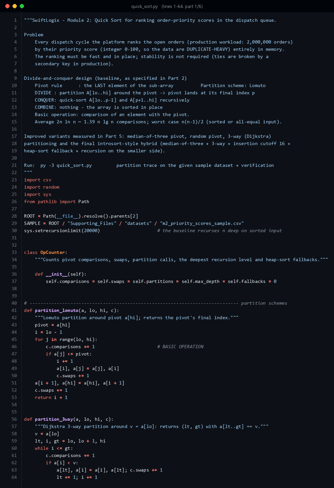

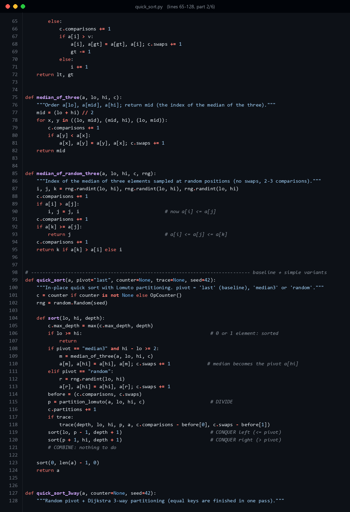

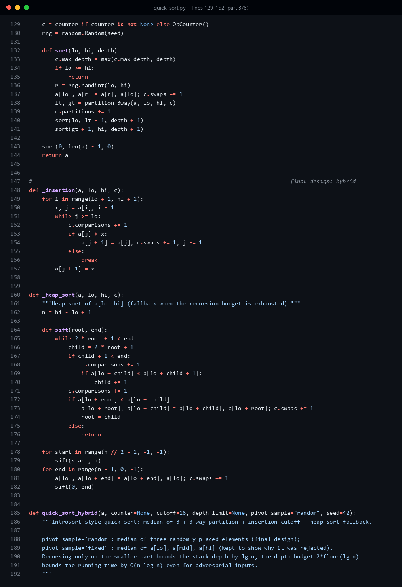

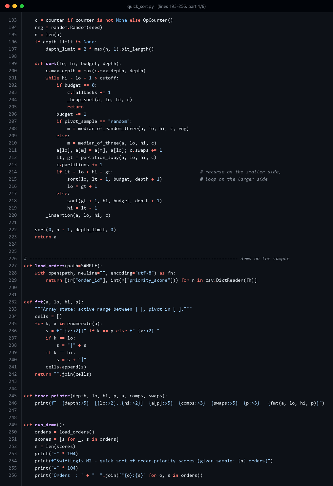

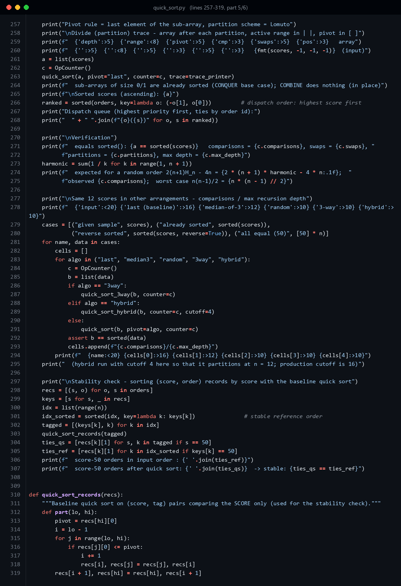

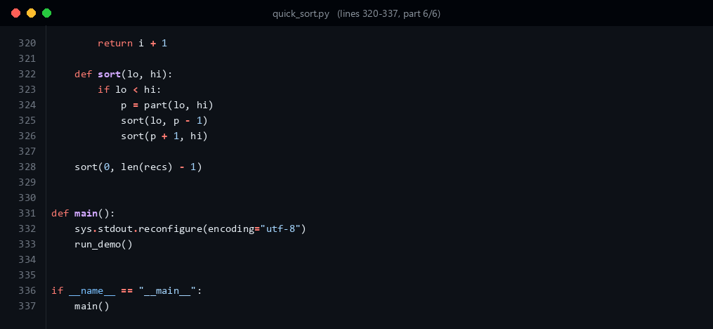

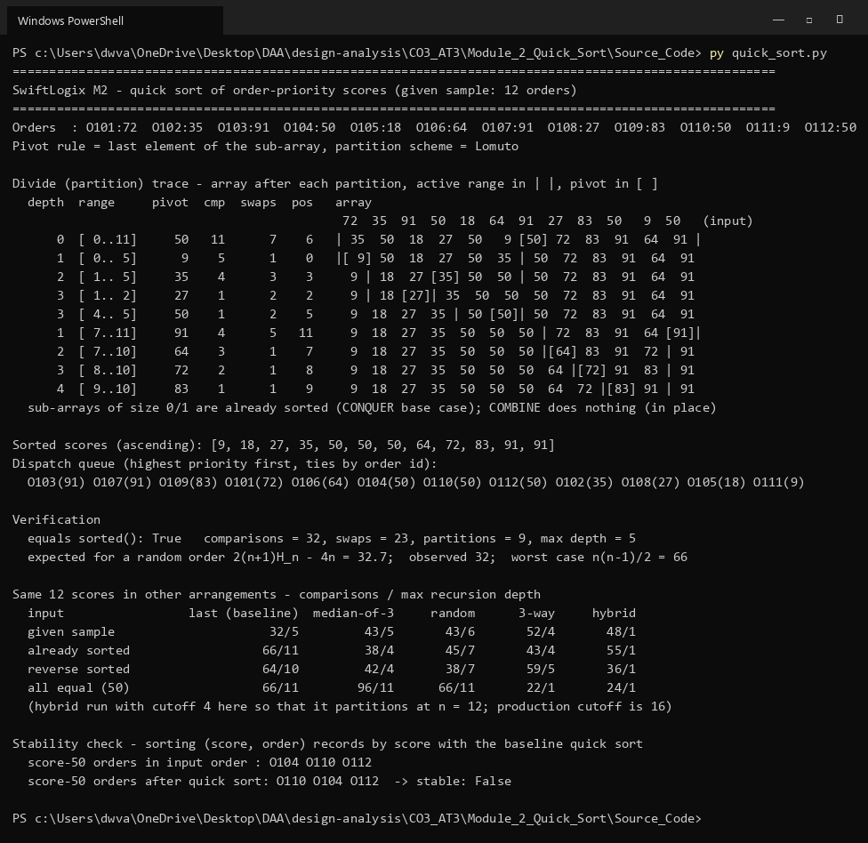

**Reading the trace (Figure 7).** Each line is one **divide** step (a partition); the array is printed after it, with the active range between `| |` and the pivot in `[ ]`.

- **Depth 0, range [0..11], pivot 50** (the last score, order O112): 11 comparisons and 7 swaps move all scores ≤ 50 to the left – 35 50 18 27 50 9 – and the pivot to its final index 6. The right part is 72 83 91 64 91.
- **Conquer.** The two parts are sorted recursively. Depth 1 on [0..5] picks pivot 9, the smallest value, so the split is 0 + 5 – an unbalanced partition caused by the fixed pivot rule; depth 1 on [7..11] picks 91 (the largest), again 4 + 0. The remaining partitions at depths 2–4 finish the ranking; sub-arrays of size 0 or 1 are the base case.
- **Combine.** Nothing is done – after the last partition the array is 9 18 27 35 50 50 50 64 72 83 91 91. The dispatch queue reads it from the high end: O103(91) O107(91) O109(83) O101(72) O106(64) O104(50) O110(50) O112(50) …
- **Counts and verification.** 32 comparisons, 23 swaps, 9 partitions, maximum depth 5. The output equals `sorted()`. For a random order of 12 distinct keys the expected count is 2(n+1)H<sub>n</sub> − 4n = 32.7, the worst case n(n − 1)/2 = 66.
- **Other arrangements of the same 12 scores** (bottom table of the output): the baseline needs **66 comparisons and depth 11 on already-sorted input and also on 12 equal scores** – exactly the worst case n(n−1)/2 – while the 3-way partition sorts the all-equal array with 22 comparisons and depth 1.
- **Stability.** The three score-50 orders arrive as O104 O110 O112 but leave as O110 O104 O112: Lomuto's long-distance swaps make quick sort **unstable**, which is acceptable here only because ties are broken by a secondary key (Part 1).

### 3. Datasets, test cases and test results

`Supporting_Files/generate_datasets.py` writes the larger datasets and the JSON test cases, whose expected outputs come from independent references (`sorted()`, `bisect`, numpy). `Supporting_Files/run_all_tests.py --module N` runs every variant of this module on those cases, on the generated dataset, on randomised inputs, and checks the operation counts against the closed forms of Part 4.

Table 3: Test plan (Supporting_Files/test_cases/*.json and run_all_tests.py)

| Module | Variants tested | Edge cases and checks | Tests |
|---|---|---|---|
| M2 Quick Sort | last, median-of-3, random, 3-way, hybrid, hybrid n₀ = 4, hybrid fixed-m3, heap-only | the same 11 list cases; 5,000 generated scores; 300 random lists; baseline n(n−1)/2 and depth n − 1 on sorted and all-equal input; forced heap-sort fallback; hybrid depth ≤ lg n; Lomuto and 3-way partition invariants | 19 |

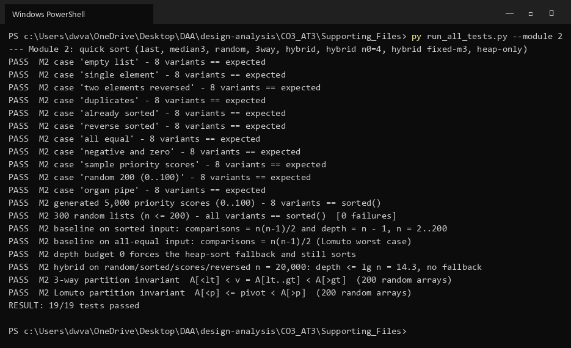

All **19 Module 2 tests pass** (Figure 8; the log is Appendix D).

## Part 4 – Recurrence Relations, Complexity and Production Workloads [15 Marks]

> Formulate and solve recurrence relations, derive time and space complexities and perform the required theoretical calculations for the specified production workloads.
> - Formulate each recurrence from the algorithm (best, average and worst case where they differ).
> - Solve each recurrence by the Master Theorem and by backward substitution or the recursion-tree method.
> - Derive the space complexity of each algorithm.
> - Compute the number of basic operations, the running time on a server executing 10⁸ basic operations per second and the memory requirement for the production workloads: 5 million shipment events per night (M1), 2 million priority scores per dispatch cycle (M2), 20 million lookups per day on an index of 10 million tracking IDs (M3) and 1,024 × 1,024 matrices (M4).

**Evidence Expected**

> Recurrences, complete solutions (Master Theorem with its parameters and substitution/recursion tree), time and space complexities, closed forms checked against counted operations, and production-workload calculations.

**Ans:**

### 1. Method

For each module I write the recurrence directly from the pseudocode of Part 2 (number of sub-problems, their size, cost of divide + combine), solve it twice – with the **Master Theorem** for T(n) = a·T(n/b) + f(n) (compare f(n) with n<sup>log<sub>b</sub> a</sup>) and with **backward substitution** or a **recursion tree** – and then check the exact closed form against the operations counted by the programs. The production figures are computed by `Supporting_Files/production_workload.py` (Figure 9) from these closed forms, at 10⁸ basic operations per second, with 1 MB = 10⁶ bytes.

### 2. Module 2 – Quick Sort

**Recurrence.** Partitioning n elements costs n − 1 comparisons; if the pivot lands at index p (p elements on its left), the two sub-arrays have p and n − 1 − p elements:

T(n) = T(p) + T(n − 1 − p) + (n − 1),  T(0) = T(1) = 0.

**Best case** (p = ⌊(n−1)/2⌋, balanced): T(n) ≈ 2T(n/2) + (n − 1). Master Theorem: a = 2, b = 2, f(n) = Θ(n) = Θ(n<sup>log₂ 2</sup>) → **case 2** → **Θ(n log n)**; the exact solution is the merge-sort one, ≈ n lg n − n + 1.

**Worst case** (pivot = maximum or minimum every time – already-sorted input with the last-element pivot, or all keys equal with Lomuto, which puts every key ≤ pivot on the left): p = n − 1 and

```
T(n) = T(n-1) + (n-1)
     = T(n-2) + (n-2) + (n-1)
     = ...
     = T(1) + 1 + 2 + ... + (n-1)  =  n(n-1)/2  =  Theta(n^2)
```

This is a *subtract-and-conquer* recurrence (sub-problem n − 1, not n/b), so the Master Theorem does not apply; the recursion tree is a chain of n − 1 levels with costs n − 1, n − 2, …, 1 and the recursion depth is n − 1.

**Average case** (random order, distinct keys, every p equally likely with probability 1/n):

```
T(n) = (n-1) + (1/n) * sum_{p=0}^{n-1} [T(p) + T(n-1-p)]  =  (n-1) + (2/n) * sum_{k=0}^{n-1} T(k)
n T(n)         = n(n-1)     + 2 * sum_{k=0}^{n-1} T(k)
(n-1) T(n-1)   = (n-1)(n-2) + 2 * sum_{k=0}^{n-2} T(k)                 (same equation for n-1)
subtract:  n T(n) - (n-1) T(n-1) = 2(n-1) + 2 T(n-1)   =>   n T(n) = (n+1) T(n-1) + 2(n-1)
divide by n(n+1):  T(n)/(n+1) = T(n-1)/n + 2(n-1)/(n(n+1)),   and (k-1)/(k(k+1)) = 2/(k+1) - 1/k
telescoping:  T(n)/(n+1) = sum_{k=2}^{n} [4/(k+1) - 2/k] = 2 H_n + 4/(n+1) - 4
=>  T(n) = 2(n+1) H_n - 4n  ~  2 n ln n  ~  1.386 n lg n      (H_n = 1 + 1/2 + ... + 1/n ~ ln n + 0.577)
```

So the average case is **Θ(n log n)** with a constant 39 % above the best case. Check: n = 12 gives 2·13·3.1032 − 48 = 32.7, and the sample needed 32 comparisons (Part 3).

**Duplicate-heavy keys.** With only k distinct scores, each repeated m = n/k times, Lomuto treats each block of equal keys like the all-equal worst case, so the comparisons grow like k · m²/2 = **n²/(2k)** – quadratic in n for fixed k = 101. Dijkstra's 3-way partition puts all keys equal to the pivot in the middle in the same pass, so each distinct value is a pivot only once and the expected cost is proportional to n lg k (measured: 1.499 · n lg k for the final hybrid, Part 5).

**Space.** Quick sort is in place (O(1) extra array space); the stack holds one frame per recursion level: Θ(log n) for balanced partitions but **n − 1 frames in the worst case**. The final hybrid recurses only into the smaller part and loops on the larger one, so its depth satisfies D(n) ≤ D(n/2) + 1 ≤ lg n, and its depth budget of 2⌊lg n⌋ partitions (then heap sort) bounds the time by O(n log n) for every input.

**Check against counted operations.** On sorted input the baseline counts are exactly n(n − 1)/2 with depth n − 1 (Table 4); on random input the counts are within 4–11 % of 2(n+1)H<sub>n</sub> − 4n (Table 6).

Table 4: Baseline quick sort on sorted input – counted vs closed form (m2_quick_sort_experiments.csv)

| input | n | cmp | n(n-1)/2 | depth | n - 1 |
|---|---:|---:|---:|---:|---:|
| sorted | 1,024 | 523,776 | 523,776 | 1,023 | 1,023 |
| sorted | 2,048 | 2,096,128 | 2,096,128 | 2,047 | 2,047 |
| sorted | 4,096 | 8,386,560 | 8,386,560 | 4,095 | 4,095 |
| reversed | 1,024 | 523,776 | 523,776 | 1,023 | 1,023 |
| reversed | 2,048 | 2,096,128 | 2,096,128 | 2,047 | 2,047 |
| reversed | 4,096 | 8,386,560 | 8,386,560 | 4,095 | 4,095 |

(Reverse-sorted input is also a worst case: the last element is the minimum, every partition removes only the pivot, and the counts are again exactly n(n − 1)/2 with depth n − 1; only the number of swaps differs – 262,655 instead of 524,799 at n = 1,024.)

**Production workload (n = 2,000,000 per dispatch cycle, lg n = 20.93, k = 101 distinct scores).** Average for distinct keys: 2(n+1)H<sub>n</sub> − 4n = **52,343,525** comparisons → 0.52 s. Worst case (the queue is already ranked, or all scores equal): n(n − 1)/2 = **1,999,999,000,000** comparisons → **5.56 hours** and a recursion depth of 1,999,999 frames (≈ 200 MB of stack – a stack overflow on any standard thread). Real duplicate-heavy scores with Lomuto: n²/(2k) = **19,801,980,198** comparisons → **198 s**, about 200 times over the 1-second budget. Final hybrid (3-way): 1.499 · n · lg 101 = **19,962,967** comparisons → **0.20 s**. Memory: the array of 2,000,000 × 8-byte (score, index) pairs is **16 MB**, sorted in place; the hybrid's stack holds at most lg n ≈ 21 frames.

Table 5: Module 2 production estimates (production_workload.csv)

| Design / quantity | Basic operations | Time at 10⁸ ops/s | Memory (MB) | Note |
|---|---:|---:|---:|---|
| baseline Lomuto, sorted/all-equal n(n-1)/2 | 2.0000 × 10¹² | 5.56 h | 216.0 | depth n: 2M stack frames |
| baseline Lomuto, duplicate scores n^2/(2k) | 19,801,980,198 | 198.02 s | 16.0 | measured model, Exp C |
| baseline, random distinct keys 2(n+1)H_n-4n | 52,343,525 | 523.4 ms | 16.0 | expected ~1.386 n lg n |
| hybrid (3-way) on scores 1.499 n lg k | 19,962,967 | 199.6 ms | 16.0 | from n = 131,072; final design |

### 3. Production-workload calculation program

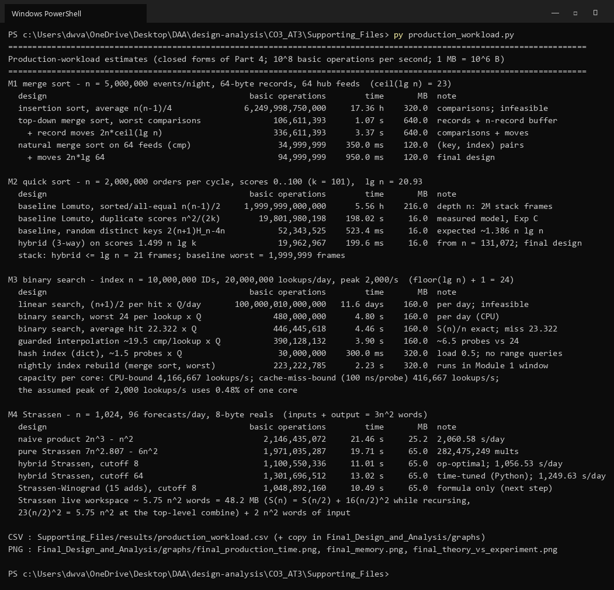

## Part 5 – Comparative Performance, Limitations and Improvements [10 Marks]

> Compare algorithmic performance, discuss limitations and trade-offs, and justify the proposed improvements for each module.
> - Measure operation counts and running times for increasing input sizes against suitable baselines (insertion sort, linear search, naive matrix multiplication) and against the theoretical predictions.
> - Demonstrate the quick sort worst case and determine the Strassen crossover point.
> - Discuss the limitations and trade-offs of each module; propose improvements, implement at least one improvement per module and measure its effect.

**Evidence Expected**

> Comparison tables, graphs with theoretical overlays, worst-case and crossover analysis, limitations and trade-offs, and measured, justified improvements.

**Ans:**

### 1. Experimental method

Each module has an experiment script (`*_experiments.py`, Appendix B) that generates deterministic inputs of doubling size, runs the baseline, the divide-and-conquer design and the improved variants, asserts that every output is correct, and writes the counts and times to `Supporting_Files/results/*.csv` (copies next to the graphs) and the graphs to `Report/graphs/`. **Operation counts are the primary evidence**: they are exact, repeatable and directly comparable with the formulas of Part 4. Times are secondary – other jobs shared the machine, so differences below about 20 % are within noise; I report the median (sorting) or the best (search, matrices) of repeated runs. Inputs are modelled on the case: event timestamps in a 3-day window, 64 time-ordered hub feeds, integer priority scores 0–100, uniform and clustered 10-digit tracking IDs, and integer route matrices.

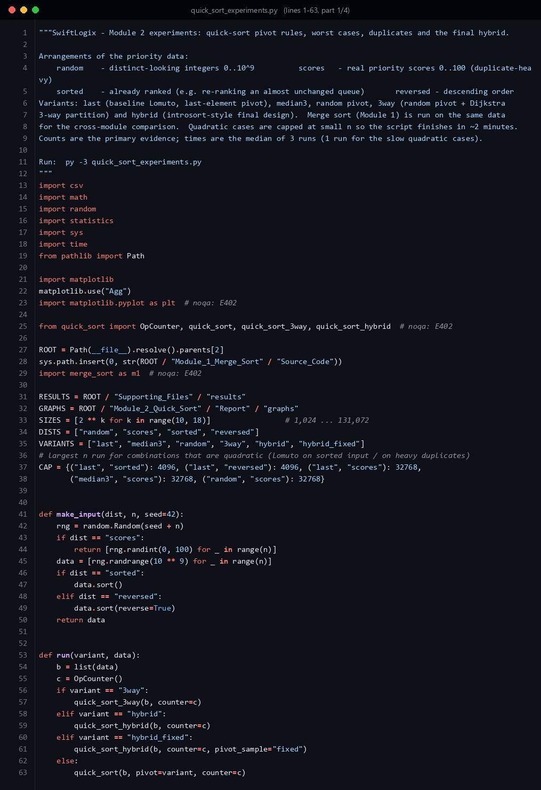

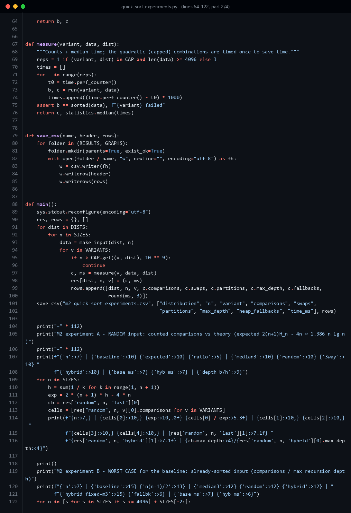

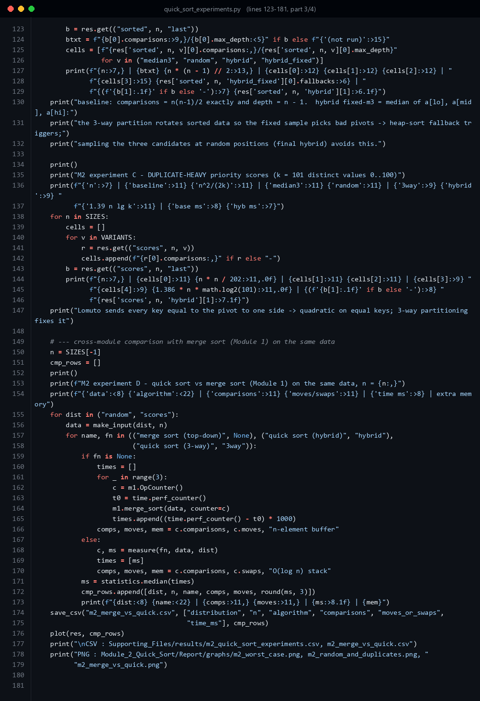

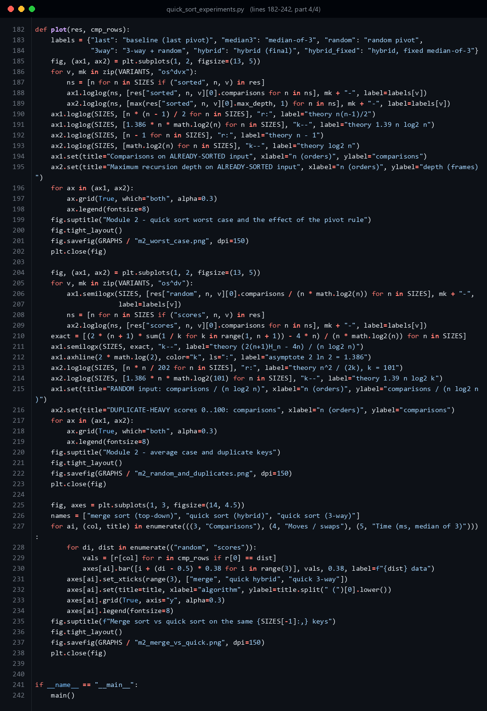

### 2. Module 2 – pivot rules, the quick sort worst case and duplicate keys

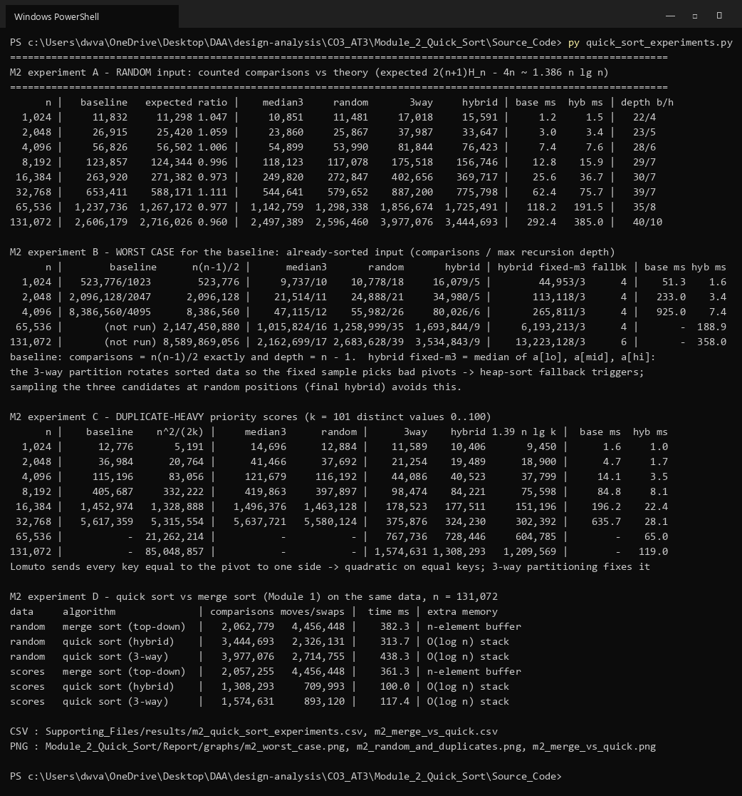

Table 6: Random input – comparisons of the five variants vs the expected 2(n+1)H<sub>n</sub> − 4n (m2_quick_sort_experiments.csv)

| n | baseline | expected | ratio | median3 | random | 3-way | hybrid |
|---:|---:|---:|---:|---:|---:|---:|---:|
| 1,024 | 11,832 | 11,298 | 1.047 | 10,851 | 11,481 | 17,018 | 15,591 |
| 2,048 | 26,915 | 25,420 | 1.059 | 23,860 | 25,867 | 37,987 | 33,647 |
| 4,096 | 56,826 | 56,502 | 1.006 | 54,899 | 53,990 | 81,844 | 76,423 |
| 8,192 | 123,857 | 124,344 | 0.996 | 118,123 | 117,078 | 175,518 | 156,746 |
| 16,384 | 263,920 | 271,382 | 0.973 | 249,820 | 272,847 | 402,656 | 369,717 |
| 32,768 | 653,411 | 588,171 | 1.111 | 544,641 | 579,652 | 887,200 | 775,798 |
| 65,536 | 1,237,736 | 1,267,172 | 0.977 | 1,142,759 | 1,298,338 | 1,856,674 | 1,725,491 |
| 131,072 | 2,606,179 | 2,716,026 | 0.960 | 2,497,389 | 2,596,460 | 3,977,076 | 3,444,693 |

Table 7: Worst-case demonstration – comparisons on already-sorted input (m2_quick_sort_experiments.csv)

| n | baseline | n(n-1)/2 | median3 | random | hybrid | fixed m3 | base ms | hyb ms |
|---:|---:|---:|---:|---:|---:|---:|---:|---:|
| 1,024 | 523,776 | 523,776 | 9,737 | 10,778 | 16,079 | 44,953 | 51.3 | 1.6 |
| 2,048 | 2,096,128 | 2,096,128 | 21,514 | 24,888 | 34,980 | 113,118 | 233.0 | 3.4 |
| 4,096 | 8,386,560 | 8,386,560 | 47,115 | 55,982 | 80,026 | 265,811 | 925.0 | 7.4 |
| 8,192 | – | 33,550,336 | 102,412 | 123,644 | 166,044 | 600,684 | – | 16.1 |
| 16,384 | – | 134,209,536 | 221,197 | 286,334 | 361,165 | 1,325,428 | – | 50.1 |
| 32,768 | – | 536,854,528 | 475,151 | 581,872 | 809,226 | 2,879,828 | – | 103.8 |
| 65,536 | – | 2,147,450,880 | 1,015,824 | 1,258,999 | 1,693,844 | 6,193,213 | – | 188.9 |
| 131,072 | – | 8,589,869,056 | 2,162,699 | 2,683,628 | 3,534,843 | 13,223,128 | – | 358.0 |

Table 8: Worst-case demonstration – maximum recursion depth on already-sorted input, and heap-sort fallbacks of the fixed-median hybrid (m2_quick_sort_experiments.csv; "–" = baseline not run)

| n | baseline | n - 1 | median3 | random | hybrid | lg n | fixed m3 | fallbacks |
|---:|---:|---:|---:|---:|---:|---:|---:|---:|
| 1,024 | 1,023 | 1,023 | 10 | 18 | 5 | 10.0 | 3 | 4 |
| 2,048 | 2,047 | 2,047 | 11 | 21 | 5 | 11.0 | 3 | 4 |
| 4,096 | 4,095 | 4,095 | 12 | 26 | 6 | 12.0 | 3 | 4 |
| 8,192 | – | 8,191 | 13 | 33 | 6 | 13.0 | 3 | 4 |
| 16,384 | – | 16,383 | 14 | 34 | 7 | 14.0 | 3 | 4 |
| 32,768 | – | 32,767 | 15 | 32 | 8 | 15.0 | 3 | 4 |
| 65,536 | – | 65,535 | 16 | 35 | 9 | 16.0 | 3 | 4 |
| 131,072 | – | 131,071 | 17 | 39 | 9 | 17.0 | 3 | 6 |

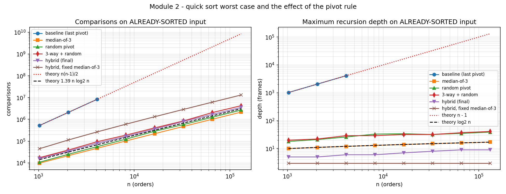

**Worst-case demonstration.** On already-sorted input the baseline needs **exactly n(n − 1)/2** comparisons – 8,386,560 at n = 4,096 – and its recursion depth is n − 1 = 4,095 (Tables 7 and 8, Figure 15); it takes 925 ms where the final hybrid takes 7.4 ms. At n = 131,072 it would need 8.6 × 10⁹ comparisons and 131,071 nested calls, so it was not run. Median-of-three and random pivots restore n log n behaviour (2,162,699 and 2,683,628 comparisons at n = 131,072). The run also exposed a subtle flaw in my first hybrid: with the **fixed** median of a[lo], a[mid], a[hi], Dijkstra's partition rotates the sorted data so that the next fixed sample picks the second-smallest key; the depth budget triggered the heap-sort fallback (4–6 times) and the count rose to 13,223,128 – still O(n log n) thanks to the fallback, but 3.7× worse than the final hybrid, which samples the three candidates at **random positions** (3,534,843 comparisons, depth 9, no fallback).

Table 9: Duplicate-heavy priority scores (k = 101 distinct values) – comparisons, ratio = hybrid / (n lg k), and times (m2_quick_sort_experiments.csv)

| n | baseline | n²/(2k) | median3 | random | 3-way | hybrid | ratio | base ms | hyb ms |
|---:|---:|---:|---:|---:|---:|---:|---:|---:|---:|
| 1,024 | 12,776 | 5,191 | 14,696 | 12,884 | 11,589 | 10,406 | 1.526 | 1.6 | 1.0 |
| 2,048 | 36,984 | 20,764 | 41,466 | 37,692 | 21,254 | 19,489 | 1.429 | 4.7 | 1.7 |
| 4,096 | 115,196 | 83,056 | 121,679 | 116,192 | 44,086 | 40,523 | 1.486 | 14.1 | 3.5 |
| 8,192 | 405,687 | 332,222 | 419,863 | 397,897 | 98,474 | 84,221 | 1.544 | 84.8 | 8.1 |
| 16,384 | 1,452,974 | 1,328,888 | 1,496,376 | 1,463,128 | 178,523 | 177,511 | 1.627 | 196.2 | 22.4 |
| 32,768 | 5,617,359 | 5,315,554 | 5,637,721 | 5,580,124 | 375,876 | 324,230 | 1.486 | 635.7 | 28.1 |
| 65,536 | – | 21,262,214 | – | – | 767,736 | 728,446 | 1.669 | – | 65.0 |
| 131,072 | – | 85,048,857 | – | – | 1,574,631 | 1,308,293 | 1.499 | – | 119.0 |

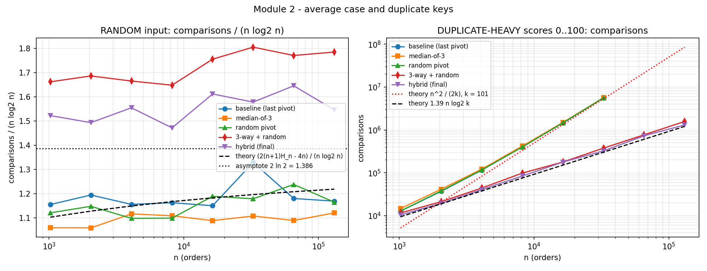

**Average case and duplicates.** On random keys the baseline stays within −4 % … +11 % of 2(n+1)H<sub>n</sub> − 4n (Table 6, Figure 16 left) – the deviation is the randomness of one input per size. Median-of-three saves 3–17 % (it makes balanced splits more likely; theory predicts about 14 %, (12/7) n ln n ≈ 1.19 n lg n); the 3-way partition costs 36–53 % *more* comparisons on distinct keys because every element larger than the pivot is compared twice. On the real, duplicate-heavy scores the picture reverses (Table 9, Figure 16 right): the baseline grows like n²/(2k) (5,617,359 vs the model's 5,315,554 at n = 32,768), and **median-of-3 and random pivots do not help at all** (5,637,721 and 5,580,124) because the problem is the equal keys, not the pivot position. The 3-way partition and the hybrid need only 375,876 and 324,230 comparisons (17× fewer) and 28.1 ms instead of 635.7 ms; at n = 131,072 the hybrid needs 1,308,293 comparisons = 1.499 · n lg k, while the baseline would need about 85 million.

**Limitations and trade-offs of the Part 2 design.** (1) Θ(n²) time and Θ(n) stack on sorted, reverse-sorted or all-equal input – exactly the situations that occur when the queue is re-ranked; (2) quadratic behaviour on duplicate-heavy scores; (3) not stable (Part 3); (4) the pivot rule is a single point of failure: any fixed rule has adversarial inputs. In return quick sort is in place (16 MB at production size) and has the fewest moves (Table 10 below).

**Improvements implemented and measured.** Median-of-three (fixes sorted input, not duplicates); random pivot (expected O(n log n) for every order, not duplicates); 3-way partitioning (fixes duplicates, costs more on distinct keys); and the **final hybrid**: median of three random elements + 3-way partition + insertion sort below 16 + heap-sort fallback after 2⌊lg n⌋ levels + recursion on the smaller side. It is the only variant that is good on all four arrangements: sorted 3,534,843 comparisons with depth 9, duplicate scores 1,308,293 with depth ≤ 5 and exactly 101 partitions – one per distinct score, random 3,444,693 (32 % more comparisons than the baseline and about 30 % slower – the price of robustness on distinct keys), and its worst case is O(n log n) with an O(log n) stack. Since production scores are duplicate-heavy, the hybrid is **about 65× cheaper than the baseline** on the real data at n = 131,072 (baseline estimated by n²/(2k)) and turns the 198 s production estimate into 0.20 s.

### 3. Merge sort vs quick sort on the same data

Table 10: Merge sort (Module 1) vs quick sort (Module 2) on the same 131,072 keys (m2_merge_vs_quick.csv)

| data | algorithm | comparisons | moves / swaps | time ms |
|---|---|---:|---:|---:|
| random | merge sort (top-down) | 2,062,779 | 4,456,448 | 382.3 |
| random | quick sort (hybrid) | 3,444,693 | 2,326,131 | 313.7 |
| random | quick sort (3-way) | 3,977,076 | 2,714,755 | 438.3 |
| scores | merge sort (top-down) | 2,057,255 | 4,456,448 | 361.3 |
| scores | quick sort (hybrid) | 1,308,293 | 709,993 | 100.0 |
| scores | quick sort (3-way) | 1,574,631 | 893,120 | 117.4 |

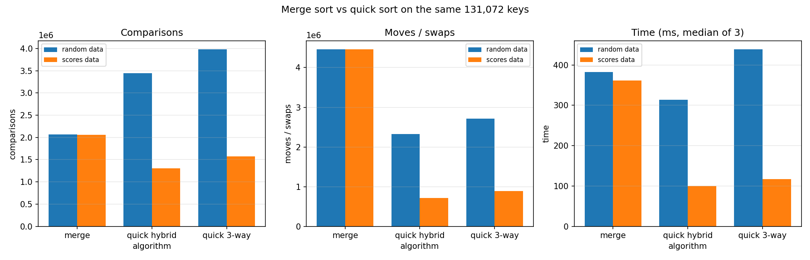

Merge sort needs the fewest comparisons on distinct keys (2,062,779, close to n lg n) but moves every element 2 lg n times (4,456,448 moves) and needs an n-element buffer; the hybrid quick sort makes 67 % more comparisons but half the moves, works in place, and is slightly faster (313.7 vs 382.3 ms). On duplicate-heavy scores the 3-way hybrid is **3.6× faster** than merge sort (100.0 vs 361.3 ms) with 36 % fewer comparisons and 6× fewer moves, because whole blocks of equal scores are finished in one pass. Merge sort keeps two advantages that matter for Module 1 – stability and a guaranteed Θ(n log n) without any safeguards – which is why the two sorting modules use different algorithms.

## Part 6 – Final Algorithmic Design and Recommendations [10 Marks]

> Present the final algorithmic design with appropriate complexity analysis, memory requirements and recommendations.
> - For each module state the recommended algorithm, its time complexity, its memory requirement (in bytes for the production sizes) and a throughput estimate.
> - Give recommendations for deployment and further optimisation.

**Evidence Expected**

> Final design per module with complexity, memory and throughput figures derived from Parts 4 and 5, and justified recommendations.

**Ans:**

### 1. Module 2 – final design: introsort-style 3-way quick sort

- **Algorithm.** Quick sort with the pivot = median of three elements at **random** positions, **Dijkstra 3-way partitioning** (keys equal to the pivot are finished in the same pass), insertion sort for sub-arrays ≤ 16, recursion into the smaller part only, and a depth budget of 2⌊lg n⌋ partitions after which **heap sort** finishes the sub-array. Ties on the score are broken by a secondary key (order creation time) where the dispatch rules need it, so the lack of stability does not matter.
- **Time.** Expected Θ(n log k) for k distinct scores (measured 1.499 n lg k), **guaranteed O(n log n)** worst case (heap-sort fallback), O(log n) stack. Production: 19,962,967 comparisons → **0.20 s per cycle**, against 198 s for the Part 2 design on duplicate-heavy scores and 5.56 h on an already-ranked queue.
- **Memory.** In place: 2,000,000 × 8 B = **16,000,000 B (16 MB)** for the (score, index) array plus at most ⌈lg n⌉ = 21 stack frames (about 2 KB).
- **Throughput.** About 5 rankings per second of 2 million orders, i.e. 5× headroom against the 1-second dispatch budget.
- **Recommendations.** Keep the depth budget and random sampling – Part 5 showed that a fixed sampling rule can be defeated by the data. Because the scores are small integers (0–100), a counting sort (O(n + k), not a comparison sort and outside CO3) would be an even cheaper option if the score domain stays fixed.

### 2. Place of this module in the platform

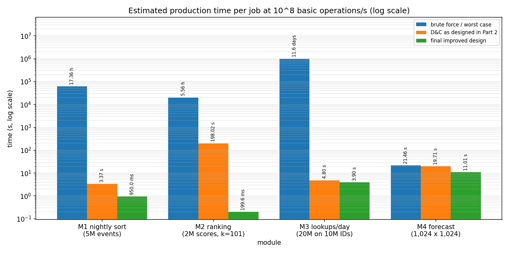

The final designs of all four modules together need about 361 MB of working memory (120 MB M1, 16 MB M2, 160 MB M3, 65 MB M4) and well under one CPU-minute per hour; the complete platform design, the memory budget and the joint recommendations are in Part 6 of the case-study report (`Final_Design_and_Analysis/CO3_AT3_Case_Study_Report`).

### Summary of Findings

Table 11: Summary of findings

| Module | Part 2 design | Verified on the sample (Part 3) | Complexity (Part 4) | Key experimental finding (Part 5) | Final design (Part 6) |
|---|---|---|---|---|---|
| M2 Quick Sort | Lomuto, last-element pivot | 32 comparisons (expected 32.7); unstable; sorted/equal → 66 | Θ(n log n) avg, Θ(n²) worst; 198 s on real scores | exactly n(n−1)/2 and depth n − 1 on sorted input; n²/(2k) on duplicates; fixed median-of-3 defeated | introsort 3-way hybrid: 0.20 s, 16 MB |

<!-- pagebreak -->

### Appendix A – Complete Source Code: quick_sort.py

```
"""SwiftLogix - Module 2: Quick Sort for ranking order-priority scores in the dispatch queue.

Problem
    Every dispatch cycle the platform ranks the open orders (production workload: 2,000,000 orders)
    by their priority score (integer 0-100, so the data are DUPLICATE-HEAVY) entirely in memory.
    The ranking must be fast and in place; stability is not required (ties are broken by a
    secondary key in production).

Divide-and-conquer design (baseline, as specified in Part 2)
    Pivot rule      : the LAST element of the sub-array          Partition scheme: Lomuto
    DIVIDE : partition A[lo..hi] around the pivot -> pivot lands at its final index p
    CONQUER: quick-sort A[lo..p-1] and A[p+1..hi] recursively
    COMBINE: nothing - the array is sorted in place
    Basic operation: comparison of an element with the pivot.
    Average 2n ln n ~ 1.39 n lg n comparisons; worst case n(n-1)/2 (sorted or all-equal input).

Improved variants measured in Part 5: median-of-three pivot, random pivot, 3-way (Dijkstra)
partitioning and the final introsort-style hybrid (median-of-three + 3-way + insertion cutoff 16 +
heap-sort fallback + recursion on the smaller side).

Run:  py -3 quick_sort.py         partition trace on the given sample dataset + verification
"""
import csv
import random
import sys
from pathlib import Path

ROOT = Path(__file__).resolve().parents[2]
SAMPLE = ROOT / "Supporting_Files" / "datasets" / "m2_priority_scores_sample.csv"
sys.setrecursionlimit(20000)                     # the baseline recurses n deep on sorted input

class OpCounter:
    """Counts pivot comparisons, swaps, partition calls, the deepest recursion level and heap-sort fallbacks."""

    def __init__(self):
        self.comparisons = self.swaps = self.partitions = self.max_depth = self.fallbacks = 0

# ----------------------------------------------------------------------------- partition schemes
def partition_lomuto(a, lo, hi, c):
    """Lomuto partition around pivot a[hi]; returns the pivot's final index."""
    pivot = a[hi]
    i = lo - 1
    for j in range(lo, hi):
        c.comparisons += 1                       # BASIC OPERATION
        if a[j] <= pivot:
            i += 1
            a[i], a[j] = a[j], a[i]
            c.swaps += 1
    a[i + 1], a[hi] = a[hi], a[i + 1]
    c.swaps += 1
    return i + 1

def partition_3way(a, lo, hi, c):
    """Dijkstra 3-way partition around v = a[lo]: returns (lt, gt) with a[lt..gt] == v."""
    v = a[lo]
    lt, i, gt = lo, lo + 1, hi
    while i <= gt:
        c.comparisons += 1
        if a[i] < v:
            a[lt], a[i] = a[i], a[lt]; c.swaps += 1
            lt += 1; i += 1
        else:
            c.comparisons += 1
            if a[i] > v:
                a[i], a[gt] = a[gt], a[i]; c.swaps += 1
                gt -= 1
            else:
                i += 1
    return lt, gt

def median_of_three(a, lo, hi, c):
    """Order a[lo], a[mid], a[hi]; return mid (the index of the median of the three)."""
    mid = (lo + hi) // 2
    for x, y in ((lo, mid), (mid, hi), (lo, mid)):
        c.comparisons += 1
        if a[y] < a[x]:
            a[x], a[y] = a[y], a[x]; c.swaps += 1
    return mid

def median_of_random_three(a, lo, hi, c, rng):
    """Index of the median of three elements sampled at random positions (no swaps, 2-3 comparisons)."""
    i, j, k = rng.randint(lo, hi), rng.randint(lo, hi), rng.randint(lo, hi)
    c.comparisons += 1
    if a[i] > a[j]:
        i, j = j, i                              # now a[i] <= a[j]
    c.comparisons += 1
    if a[k] >= a[j]:
        return j                                 # a[i] <= a[j] <= a[k]
    c.comparisons += 1
    return k if a[k] > a[i] else i

# ----------------------------------------------------------------------------- baseline + simple variants
def quick_sort(a, pivot="last", counter=None, trace=None, seed=42):
    """In-place quick sort with Lomuto partitioning. pivot = 'last' (baseline), 'median3' or 'random'."""
    c = counter if counter is not None else OpCounter()
    rng = random.Random(seed)

    def sort(lo, hi, depth):
        c.max_depth = max(c.max_depth, depth)
        if lo >= hi:                                             # 0 or 1 element: sorted
            return
        if pivot == "median3" and hi - lo >= 2:
            m = median_of_three(a, lo, hi, c)
            a[m], a[hi] = a[hi], a[m]; c.swaps += 1             # median becomes the pivot a[hi]
        elif pivot == "random":
            r = rng.randint(lo, hi)
            a[r], a[hi] = a[hi], a[r]; c.swaps += 1
        before = (c.comparisons, c.swaps)
        p = partition_lomuto(a, lo, hi, c)                       # DIVIDE
        c.partitions += 1
        if trace:
            trace(depth, lo, hi, p, a, c.comparisons - before[0], c.swaps - before[1])
        sort(lo, p - 1, depth + 1)                               # CONQUER left (<= pivot)
        sort(p + 1, hi, depth + 1)                               # CONQUER right (> pivot)
        # COMBINE: nothing to do

    sort(0, len(a) - 1, 0)
    return a

def quick_sort_3way(a, counter=None, seed=42):
    """Random pivot + Dijkstra 3-way partitioning (equal keys are finished in one pass)."""
    c = counter if counter is not None else OpCounter()
    rng = random.Random(seed)

    def sort(lo, hi, depth):
        c.max_depth = max(c.max_depth, depth)
        if lo >= hi:
            return
        r = rng.randint(lo, hi)
        a[lo], a[r] = a[r], a[lo]; c.swaps += 1
        lt, gt = partition_3way(a, lo, hi, c)
        c.partitions += 1
        sort(lo, lt - 1, depth + 1)
        sort(gt + 1, hi, depth + 1)

    sort(0, len(a) - 1, 0)
    return a

# ----------------------------------------------------------------------------- final design: hybrid
def _insertion(a, lo, hi, c):
    for i in range(lo + 1, hi + 1):
        x, j = a[i], i - 1
        while j >= lo:
            c.comparisons += 1
            if a[j] > x:
                a[j + 1] = a[j]; c.swaps += 1; j -= 1
            else:
                break
        a[j + 1] = x

def _heap_sort(a, lo, hi, c):
    """Heap sort of a[lo..hi] (fallback when the recursion budget is exhausted)."""
    n = hi - lo + 1

    def sift(root, end):
        while 2 * root + 1 < end:
            child = 2 * root + 1
            if child + 1 < end:
                c.comparisons += 1
                if a[lo + child] < a[lo + child + 1]:
                    child += 1
            c.comparisons += 1
            if a[lo + root] < a[lo + child]:
                a[lo + root], a[lo + child] = a[lo + child], a[lo + root]; c.swaps += 1
                root = child
            else:
                return

    for start in range(n // 2 - 1, -1, -1):
        sift(start, n)
    for end in range(n - 1, 0, -1):
        a[lo], a[lo + end] = a[lo + end], a[lo]; c.swaps += 1
        sift(0, end)

def quick_sort_hybrid(a, counter=None, cutoff=16, depth_limit=None, pivot_sample="random", seed=42):
    """Introsort-style quick sort: median-of-3 + 3-way partition + insertion cutoff + heap-sort fallback.

    pivot_sample='random': median of three randomly placed elements (final design);
    pivot_sample='fixed' : median of a[lo], a[mid], a[hi] (kept to show why it was rejected).
    Recursing only on the smaller part bounds the stack depth by lg n; the depth budget 2*floor(lg n)
    bounds the running time by O(n log n) even for adversarial inputs.
    """
    c = counter if counter is not None else OpCounter()
    rng = random.Random(seed)
    n = len(a)
    if depth_limit is None:
        depth_limit = 2 * max(n, 1).bit_length()

    def sort(lo, hi, budget, depth):
        c.max_depth = max(c.max_depth, depth)
        while hi - lo + 1 > cutoff:
            if budget == 0:
                c.fallbacks += 1
                _heap_sort(a, lo, hi, c)
                return
            budget -= 1
            if pivot_sample == "random":
                m = median_of_random_three(a, lo, hi, c, rng)
            else:
                m = median_of_three(a, lo, hi, c)
            a[lo], a[m] = a[m], a[lo]; c.swaps += 1
            lt, gt = partition_3way(a, lo, hi, c)
            c.partitions += 1
            if lt - lo < hi - gt:                                # recurse on the smaller side,
                sort(lo, lt - 1, budget, depth + 1)              # loop on the larger side
                lo = gt + 1
            else:
                sort(gt + 1, hi, budget, depth + 1)
                hi = lt - 1
        _insertion(a, lo, hi, c)

    sort(0, n - 1, depth_limit, 0)
    return a

# ----------------------------------------------------------------------------- demo on the sample
def load_orders(path=SAMPLE):
    with open(path, newline="", encoding="utf-8") as fh:
        return [(r["order_id"], int(r["priority_score"])) for r in csv.DictReader(fh)]

def fmt(a, lo, hi, p):
    """Array state: active range between | |, pivot in [ ]."""
    cells = []
    for k, x in enumerate(a):
        s = f"[{x:>2}]" if k == p else f" {x:>2} "
        if k == lo:
            s = "|" + s
        if k == hi:
            s = s + "|"
        cells.append(s)
    return "".join(cells)

def trace_printer(depth, lo, hi, p, a, comps, swaps):
    print(f"  {depth:>5}  [{lo:>2}..{hi:>2}]  {a[p]:>5}  {comps:>3}  {swaps:>5}  {p:>3}   {fmt(a, lo, hi, p)}")

def run_demo():
    orders = load_orders()
    scores = [s for _, s in orders]
    n = len(scores)
    print("=" * 104)
    print(f"SwiftLogix M2 - quick sort of order-priority scores (given sample: {n} orders)")
    print("=" * 104)
    print("Orders  : " + "  ".join(f"{o}:{s}" for o, s in orders))
    print("Pivot rule = last element of the sub-array, partition scheme = Lomuto")
    print("\nDivide (partition) trace - array after each partition, active range in | |, pivot in [ ]")
    print(f"  {'depth':>5}  {'range':<8}  {'pivot':>5}  {'cmp':>3}  {'swaps':>5}  {'pos':>3}   array")
    print(f"  {'':>5}  {'':<8}  {'':>5}  {'':>3}  {'':>5}  {'':>3}   {fmt(scores, -1, -1, -1)}  (input)")
    a = list(scores)
    c = OpCounter()
    quick_sort(a, pivot="last", counter=c, trace=trace_printer)
    print(f"  sub-arrays of size 0/1 are already sorted (CONQUER base case); COMBINE does nothing (in place)")
    print(f"\nSorted scores (ascending): {a}")
    ranked = sorted(orders, key=lambda o: (-o[1], o[0]))         # dispatch order: highest score first
    print("Dispatch queue (highest priority first, ties by order id):")
    print("  " + " ".join(f"{o}({s})" for o, s in ranked))

    print("\nVerification")
    print(f"  equals sorted(): {a == sorted(scores)}   comparisons = {c.comparisons}, swaps = {c.swaps}, "
          f"partitions = {c.partitions}, max depth = {c.max_depth}")
    harmonic = sum(1 / k for k in range(1, n + 1))
    print(f"  expected for a random order 2(n+1)H_n - 4n = {2 * (n + 1) * harmonic - 4 * n:.1f};  "
          f"observed {c.comparisons};  worst case n(n-1)/2 = {n * (n - 1) // 2}")

    print("\nSame 12 scores in other arrangements - comparisons / max recursion depth")
    print(f"  {'input':<20} {'last (baseline)':>16} {'median-of-3':>12} {'random':>10} {'3-way':>10} {'hybrid':>10}")
    cases = [("given sample", scores), ("already sorted", sorted(scores)),
             ("reverse sorted", sorted(scores, reverse=True)), ("all equal (50)", [50] * n)]
    for name, data in cases:
        cells = []
        for algo in ("last", "median3", "random", "3way", "hybrid"):
            c = OpCounter()
            b = list(data)
            if algo == "3way":
                quick_sort_3way(b, counter=c)
            elif algo == "hybrid":
                quick_sort_hybrid(b, counter=c, cutoff=4)
            else:
                quick_sort(b, pivot=algo, counter=c)
            assert b == sorted(data)
            cells.append(f"{c.comparisons}/{c.max_depth}")
        print(f"  {name:<20} {cells[0]:>16} {cells[1]:>12} {cells[2]:>10} {cells[3]:>10} {cells[4]:>10}")
    print("  (hybrid run with cutoff 4 here so that it partitions at n = 12; production cutoff is 16)")

    print("\nStability check - sorting (score, order) records by score with the baseline quick sort")
    recs = [(s, o) for o, s in orders]
    keys = [s for s, _ in recs]
    idx = list(range(n))
    idx_sorted = sorted(idx, key=lambda k: keys[k])               # stable reference order
    tagged = [(keys[k], k) for k in idx]
    quick_sort_records(tagged)
    ties_qs = [recs[k][1] for s, k in tagged if s == 50]
    ties_ref = [recs[k][1] for k in idx_sorted if keys[k] == 50]
    print(f"  score-50 orders in input order : {' '.join(ties_ref)}")
    print(f"  score-50 orders after quick sort: {' '.join(ties_qs)}  -> stable: {ties_qs == ties_ref}")

def quick_sort_records(recs):
    """Baseline quick sort on (score, tag) pairs comparing the SCORE only (used for the stability check)."""
    def part(lo, hi):
        pivot = recs[hi][0]
        i = lo - 1
        for j in range(lo, hi):
            if recs[j][0] <= pivot:
                i += 1
                recs[i], recs[j] = recs[j], recs[i]
        recs[i + 1], recs[hi] = recs[hi], recs[i + 1]
        return i + 1

    def sort(lo, hi):
        if lo < hi:
            p = part(lo, hi)
            sort(lo, p - 1)
            sort(p + 1, hi)

    sort(0, len(recs) - 1)

def main():
    sys.stdout.reconfigure(encoding="utf-8")
    run_demo()

if __name__ == "__main__":
    main()
```

### Appendix B – Experiment and Graph Script: quick_sort_experiments.py

```
"""SwiftLogix - Module 2 experiments: quick-sort pivot rules, worst cases, duplicates and the final hybrid.

Arrangements of the priority data:
    random    - distinct-looking integers 0..10^9          scores   - real priority scores 0..100 (duplicate-heavy)
    sorted    - already ranked (e.g. re-ranking an almost unchanged queue)       reversed - descending order
Variants: last (baseline Lomuto, last-element pivot), median3, random pivot, 3way (random pivot + Dijkstra
3-way partition) and hybrid (introsort-style final design).  Merge sort (Module 1) is run on the same data
for the cross-module comparison.  Quadratic cases are capped at small n so the script finishes in ~2 minutes.
Counts are the primary evidence; times are the median of 3 runs (1 run for the slow quadratic cases).

Run:  py -3 quick_sort_experiments.py
"""
import csv
import math
import random
import statistics
import sys
import time
from pathlib import Path

import matplotlib
matplotlib.use("Agg")
import matplotlib.pyplot as plt  # noqa: E402

from quick_sort import OpCounter, quick_sort, quick_sort_3way, quick_sort_hybrid  # noqa: E402

ROOT = Path(__file__).resolve().parents[2]
sys.path.insert(0, str(ROOT / "Module_1_Merge_Sort" / "Source_Code"))
import merge_sort as m1  # noqa: E402

RESULTS = ROOT / "Supporting_Files" / "results"
GRAPHS = ROOT / "Module_2_Quick_Sort" / "Report" / "graphs"
SIZES = [2 ** k for k in range(10, 18)]                 # 1,024 ... 131,072
DISTS = ["random", "scores", "sorted", "reversed"]
VARIANTS = ["last", "median3", "random", "3way", "hybrid", "hybrid_fixed"]
# largest n run for combinations that are quadratic (Lomuto on sorted input / on heavy duplicates)
CAP = {("last", "sorted"): 4096, ("last", "reversed"): 4096, ("last", "scores"): 32768,
       ("median3", "scores"): 32768, ("random", "scores"): 32768}

def make_input(dist, n, seed=42):
    rng = random.Random(seed + n)
    if dist == "scores":
        return [rng.randint(0, 100) for _ in range(n)]
    data = [rng.randrange(10 ** 9) for _ in range(n)]
    if dist == "sorted":
        data.sort()
    elif dist == "reversed":
        data.sort(reverse=True)
    return data

def run(variant, data):
    b = list(data)
    c = OpCounter()
    if variant == "3way":
        quick_sort_3way(b, counter=c)
    elif variant == "hybrid":
        quick_sort_hybrid(b, counter=c)
    elif variant == "hybrid_fixed":
        quick_sort_hybrid(b, counter=c, pivot_sample="fixed")
    else:
        quick_sort(b, pivot=variant, counter=c)
    return b, c

def measure(variant, data, dist):
    """Counts + median time; the quadratic (capped) combinations are timed once to save time."""
    reps = 1 if (variant, dist) in CAP and len(data) >= 4096 else 3
    times = []
    for _ in range(reps):
        t0 = time.perf_counter()
        b, c = run(variant, data)
        times.append((time.perf_counter() - t0) * 1000)
    assert b == sorted(data), f"{variant} failed"
    return c, statistics.median(times)

def save_csv(name, header, rows):
    for folder in (RESULTS, GRAPHS):
        folder.mkdir(parents=True, exist_ok=True)
        with open(folder / name, "w", newline="", encoding="utf-8") as fh:
            w = csv.writer(fh)
            w.writerow(header)
            w.writerows(rows)

def main():
    sys.stdout.reconfigure(encoding="utf-8")
    res, rows = {}, []
    for dist in DISTS:
        for n in SIZES:
            data = make_input(dist, n)
            for v in VARIANTS:
                if n > CAP.get((v, dist), 10 ** 9):
                    continue
                c, ms = measure(v, data, dist)
                res[dist, n, v] = (c, ms)
                rows.append([dist, n, v, c.comparisons, c.swaps, c.partitions, c.max_depth, c.fallbacks,
                             round(ms, 3)])
    save_csv("m2_quick_sort_experiments.csv", ["distribution", "n", "variant", "comparisons", "swaps",
                                               "partitions", "max_depth", "heap_fallbacks", "time_ms"], rows)

    print("=" * 112)
    print("M2 experiment A - RANDOM input: counted comparisons vs theory (expected 2(n+1)H_n - 4n ~ 1.386 n lg n)")
    print("=" * 112)
    print(f"{'n':>7} | {'baseline':>10} {'expected':>10} {'ratio':>5} | {'median3':>10} {'random':>10} {'3way':>10} "
          f"{'hybrid':>10} | {'base ms':>7} {'hyb ms':>7} | {'depth b/h':>9}")
    for n in SIZES:
        h = sum(1 / k for k in range(1, n + 1))
        exp = 2 * (n + 1) * h - 4 * n
        cb = res["random", n, "last"][0]
        cells = [res["random", n, v][0].comparisons for v in VARIANTS]
        print(f"{n:>7,} | {cells[0]:>10,} {exp:>10,.0f} {cells[0] / exp:>5.3f} | {cells[1]:>10,} {cells[2]:>10,} "
              f"{cells[3]:>10,} {cells[4]:>10,} | {res['random', n, 'last'][1]:>7.1f} "
              f"{res['random', n, 'hybrid'][1]:>7.1f} | {cb.max_depth:>4}/{res['random', n, 'hybrid'][0].max_depth:<4}")

    print()
    print("M2 experiment B - WORST CASE for the baseline: already-sorted input (comparisons / max recursion depth)")
    print(f"{'n':>7} | {'baseline':>15} {'n(n-1)/2':>13} | {'median3':>12} {'random':>12} {'hybrid':>12} | "
          f"{'hybrid fixed-m3':>15} {'fallbk':>6} | {'base ms':>7} {'hyb ms':>6}")
    for n in [s for s in SIZES if s <= 4096] + SIZES[-2:]:
        b = res.get(("sorted", n, "last"))
        btxt = f"{b[0].comparisons:>9,}/{b[0].max_depth:<5}" if b else f"{'(not run)':>15}"
        cells = [f"{res['sorted', n, v][0].comparisons:,}/{res['sorted', n, v][0].max_depth}"
                 for v in ("median3", "random", "hybrid", "hybrid_fixed")]
        print(f"{n:>7,} | {btxt} {n * (n - 1) // 2:>13,} | {cells[0]:>12} {cells[1]:>12} {cells[2]:>12} | "
              f"{cells[3]:>15} {res['sorted', n, 'hybrid_fixed'][0].fallbacks:>6} | "
              f"{(f'{b[1]:.1f}' if b else '-'):>7} {res['sorted', n, 'hybrid'][1]:>6.1f}")
    print("baseline: comparisons = n(n-1)/2 exactly and depth = n - 1.  hybrid fixed-m3 = median of a[lo], a[mid], a[hi]:")
    print("the 3-way partition rotates sorted data so the fixed sample picks bad pivots -> heap-sort fallback triggers;")
    print("sampling the three candidates at random positions (final hybrid) avoids this.")

    print()
    print("M2 experiment C - DUPLICATE-HEAVY priority scores (k = 101 distinct values 0..100)")
    print(f"{'n':>7} | {'baseline':>11} {'n^2/(2k)':>11} | {'median3':>11} {'random':>11} | {'3way':>9} {'hybrid':>9} "
          f"{'1.39 n lg k':>11} | {'base ms':>8} {'hyb ms':>7}")
    for n in SIZES:
        cells = []
        for v in VARIANTS:
            r = res.get(("scores", n, v))
            cells.append(f"{r[0].comparisons:,}" if r else "-")
        b = res.get(("scores", n, "last"))
        print(f"{n:>7,} | {cells[0]:>11} {n * n / 202:>11,.0f} | {cells[1]:>11} {cells[2]:>11} | {cells[3]:>9} "
              f"{cells[4]:>9} {1.386 * n * math.log2(101):>11,.0f} | {(f'{b[1]:.1f}' if b else '-'):>8} "
              f"{res['scores', n, 'hybrid'][1]:>7.1f}")
    print("Lomuto sends every key equal to the pivot to one side -> quadratic on equal keys; 3-way partitioning fixes it")

    # --- cross-module comparison with merge sort (Module 1) on the same data
    n = SIZES[-1]
    cmp_rows = []
    print()
    print(f"M2 experiment D - quick sort vs merge sort (Module 1) on the same data, n = {n:,}")
    print(f"{'data':<8} {'algorithm':<22} | {'comparisons':>11} {'moves/swaps':>11} | {'time ms':>8} | extra memory")
    for dist in ("random", "scores"):
        data = make_input(dist, n)
        for name, fn in (("merge sort (top-down)", None), ("quick sort (hybrid)", "hybrid"),
                         ("quick sort (3-way)", "3way")):
            if fn is None:
                times = []
                for _ in range(3):
                    c = m1.OpCounter()
                    t0 = time.perf_counter()
                    m1.merge_sort(data, counter=c)
                    times.append((time.perf_counter() - t0) * 1000)
                comps, moves, mem = c.comparisons, c.moves, "n-element buffer"
            else:
                c, ms = measure(fn, data, dist)
                times = [ms]
                comps, moves, mem = c.comparisons, c.swaps, "O(log n) stack"
            ms = statistics.median(times)
            cmp_rows.append([dist, n, name, comps, moves, round(ms, 3)])
            print(f"{dist:<8} {name:<22} | {comps:>11,} {moves:>11,} | {ms:>8.1f} | {mem}")
    save_csv("m2_merge_vs_quick.csv", ["distribution", "n", "algorithm", "comparisons", "moves_or_swaps",
                                       "time_ms"], cmp_rows)
    plot(res, cmp_rows)
    print("\nCSV : Supporting_Files/results/m2_quick_sort_experiments.csv, m2_merge_vs_quick.csv")
    print("PNG : Module_2_Quick_Sort/Report/graphs/m2_worst_case.png, m2_random_and_duplicates.png, "
          "m2_merge_vs_quick.png")

def plot(res, cmp_rows):
    labels = {"last": "baseline (last pivot)", "median3": "median-of-3", "random": "random pivot",
              "3way": "3-way + random", "hybrid": "hybrid (final)", "hybrid_fixed": "hybrid, fixed median-of-3"}
    fig, (ax1, ax2) = plt.subplots(1, 2, figsize=(13, 5))
    for v, mk in zip(VARIANTS, "os^dvx"):
        ns = [n for n in SIZES if ("sorted", n, v) in res]
        ax1.loglog(ns, [res["sorted", n, v][0].comparisons for n in ns], mk + "-", label=labels[v])
        ax2.loglog(ns, [max(res["sorted", n, v][0].max_depth, 1) for n in ns], mk + "-", label=labels[v])
    ax1.loglog(SIZES, [n * (n - 1) / 2 for n in SIZES], "r:", label="theory n(n-1)/2")
    ax1.loglog(SIZES, [1.386 * n * math.log2(n) for n in SIZES], "k--", label="theory 1.39 n log2 n")
    ax2.loglog(SIZES, [n - 1 for n in SIZES], "r:", label="theory n - 1")
    ax2.loglog(SIZES, [math.log2(n) for n in SIZES], "k--", label="theory log2 n")
    ax1.set(title="Comparisons on ALREADY-SORTED input", xlabel="n (orders)", ylabel="comparisons")
    ax2.set(title="Maximum recursion depth on ALREADY-SORTED input", xlabel="n (orders)", ylabel="depth (frames)")
    for ax in (ax1, ax2):
        ax.grid(True, which="both", alpha=0.3)
        ax.legend(fontsize=8)
    fig.suptitle("Module 2 - quick sort worst case and the effect of the pivot rule")
    fig.tight_layout()
    fig.savefig(GRAPHS / "m2_worst_case.png", dpi=150)
    plt.close(fig)

    fig, (ax1, ax2) = plt.subplots(1, 2, figsize=(13, 5))
    for v, mk in zip(VARIANTS, "os^dv"):
        ax1.semilogx(SIZES, [res["random", n, v][0].comparisons / (n * math.log2(n)) for n in SIZES], mk + "-",
                     label=labels[v])
        ns = [n for n in SIZES if ("scores", n, v) in res]
        ax2.loglog(ns, [res["scores", n, v][0].comparisons for n in ns], mk + "-", label=labels[v])
    exact = [(2 * (n + 1) * sum(1 / k for k in range(1, n + 1)) - 4 * n) / (n * math.log2(n)) for n in SIZES]
    ax1.semilogx(SIZES, exact, "k--", label="theory (2(n+1)H_n - 4n) / (n log2 n)")
    ax1.axhline(2 * math.log(2), color="k", ls=":", label="asymptote 2 ln 2 = 1.386")
    ax2.loglog(SIZES, [n * n / 202 for n in SIZES], "r:", label="theory n^2 / (2k), k = 101")
    ax2.loglog(SIZES, [1.386 * n * math.log2(101) for n in SIZES], "k--", label="theory 1.39 n log2 k")
    ax1.set(title="RANDOM input: comparisons / (n log2 n)", xlabel="n (orders)", ylabel="comparisons / (n log2 n)")
    ax2.set(title="DUPLICATE-HEAVY scores 0..100: comparisons", xlabel="n (orders)", ylabel="comparisons")
    for ax in (ax1, ax2):
        ax.grid(True, which="both", alpha=0.3)
        ax.legend(fontsize=8)
    fig.suptitle("Module 2 - average case and duplicate keys")
    fig.tight_layout()
    fig.savefig(GRAPHS / "m2_random_and_duplicates.png", dpi=150)
    plt.close(fig)

    fig, axes = plt.subplots(1, 3, figsize=(14, 4.5))
    names = ["merge sort (top-down)", "quick sort (hybrid)", "quick sort (3-way)"]
    for ai, (col, title) in enumerate(((3, "Comparisons"), (4, "Moves / swaps"), (5, "Time (ms, median of 3)"))):
        for di, dist in enumerate(("random", "scores")):
            vals = [r[col] for r in cmp_rows if r[0] == dist]
            axes[ai].bar([i + (di - 0.5) * 0.38 for i in range(3)], vals, 0.38, label=f"{dist} data")
        axes[ai].set_xticks(range(3), ["merge", "quick hybrid", "quick 3-way"])
        axes[ai].set(title=title, xlabel="algorithm", ylabel=title.split(" (")[0].lower())
        axes[ai].grid(True, axis="y", alpha=0.3)
        axes[ai].legend(fontsize=8)
    fig.suptitle(f"Merge sort vs quick sort on the same {SIZES[-1]:,} keys")
    fig.tight_layout()
    fig.savefig(GRAPHS / "m2_merge_vs_quick.png", dpi=150)
    plt.close(fig)

if __name__ == "__main__":
    main()
```

### Appendix C – Raw Experimental Data

#### results/m2_quick_sort_experiments.csv

```
distribution,n,variant,comparisons,swaps,partitions,max_depth,heap_fallbacks,time_ms
random,1024,last,11832,5665,692,22,0,1.189
random,1024,median3,10851,6388,577,16,0,1.254
random,1024,random,11481,6895,685,21,0,1.58
random,1024,3way,17018,12093,680,27,0,2.039
random,1024,hybrid,15591,10339,101,4,0,1.55
random,1024,hybrid_fixed,13782,9912,95,5,0,1.361
random,2048,last,26915,13778,1368,23,0,2.986
random,2048,median3,23860,14138,1168,21,0,2.892
random,2048,random,25867,16218,1369,22,0,3.533
random,2048,3way,37987,26788,1369,24,0,5.641
random,2048,hybrid,33647,22608,203,5,0,3.435
random,2048,hybrid_fixed,33583,22741,200,5,0,3.604
random,4096,last,56826,30858,2747,28,0,7.361
random,4096,median3,54899,28191,2327,20,0,6.032
random,4096,random,53990,32485,2737,27,0,7.08
random,4096,3way,81844,57080,2730,24,0,10.15
random,4096,hybrid,76423,50382,391,6,0,7.56
random,4096,hybrid_fixed,77668,51946,387,6,0,7.619
random,8192,last,123857,72518,5478,29,0,12.816
random,8192,median3,118123,69913,4668,23,0,12.893
random,8192,random,117078,73822,5514,26,0,14.899
random,8192,3way,175518,126436,5463,29,0,20.027
random,8192,hybrid,156746,108698,785,7,0,15.931
random,8192,hybrid_fixed,162659,110188,780,6,0,15.467
random,16384,last,263920,133722,10878,30,0,25.576
random,16384,median3,249820,134176,9397,23,0,26.468
random,16384,random,272847,154643,10849,31,0,31.716
random,16384,3way,402656,279511,10938,32,0,44.604
random,16384,hybrid,369717,248908,1580,7,0,36.659
random,16384,hybrid_fixed,347102,237779,1542,8,0,33.109
random,32768,last,653411,341919,21796,39,0,62.423
random,32768,median3,544641,311730,18741,26,0,54.227
random,32768,random,579652,348835,21832,34,0,65.582
random,32768,3way,887200,618116,21763,35,0,91.842
random,32768,hybrid,775798,530971,3156,7,0,75.692
random,32768,hybrid_fixed,748287,521581,3119,8,0,68.844
random,65536,last,1237736,666554,43656,35,0,118.191
random,65536,median3,1142759,621514,37401,26,0,122.138
random,65536,random,1298338,681665,43719,37,0,167.873
random,65536,3way,1856674,1272349,43657,35,0,209.497
```

*(first 40 of 176 data rows shown; the full file is in the repository)*

#### results/m2_merge_vs_quick.csv

```
distribution,n,algorithm,comparisons,moves_or_swaps,time_ms
random,131072,merge sort (top-down),2062779,4456448,382.255
random,131072,quick sort (hybrid),3444693,2326131,313.695
random,131072,quick sort (3-way),3977076,2714755,438.303
scores,131072,merge sort (top-down),2057255,4456448,361.302
scores,131072,quick sort (hybrid),1308293,709993,100.027
scores,131072,quick sort (3-way),1574631,893120,117.353
```

### Appendix D – Test Results

Captured output of `py run_all_tests.py --module 2` (Supporting_Files/logs/m2_tests_log.txt):

```
--- Module 2: quick sort (last, median3, random, 3way, hybrid, hybrid n0=4, hybrid fixed-m3, heap-only)
PASS  M2 case 'empty list' - 8 variants == expected
PASS  M2 case 'single element' - 8 variants == expected
PASS  M2 case 'two elements reversed' - 8 variants == expected
PASS  M2 case 'duplicates' - 8 variants == expected
PASS  M2 case 'already sorted' - 8 variants == expected
PASS  M2 case 'reverse sorted' - 8 variants == expected
PASS  M2 case 'all equal' - 8 variants == expected
PASS  M2 case 'negative and zero' - 8 variants == expected
PASS  M2 case 'sample priority scores' - 8 variants == expected
PASS  M2 case 'random 200 (0..100)' - 8 variants == expected
PASS  M2 case 'organ pipe' - 8 variants == expected
PASS  M2 generated 5,000 priority scores (0..100) - 8 variants == sorted()
PASS  M2 300 random lists (n <= 200) - all variants == sorted()  [0 failures]
PASS  M2 baseline on sorted input: comparisons = n(n-1)/2 and depth = n - 1, n = 2..200
PASS  M2 baseline on all-equal input: comparisons = n(n-1)/2 (Lomuto worst case)
PASS  M2 depth budget 0 forces the heap-sort fallback and still sorts
PASS  M2 hybrid on random/sorted/scores/reversed n = 20,000: depth <= lg n = 14.3, no fallback
PASS  M2 3-way partition invariant  A[<lt] < v = A[lt..gt] < A[>gt]  (200 random arrays)
PASS  M2 Lomuto partition invariant  A[<p] <= pivot < A[>p]  (200 random arrays)
RESULT: 19/19 tests passed
```

### References

1. T. H. Cormen, C. E. Leiserson, R. L. Rivest and C. Stein, *Introduction to Algorithms*, 4th ed., MIT Press, 2022 – Ch. 2 (merge sort), Ch. 4 (divide and conquer, Strassen's algorithm, the Master Theorem), Ch. 7 (quicksort).
2. A. Levitin, *Introduction to the Design and Analysis of Algorithms*, 3rd ed., Pearson, 2012 – Ch. 5 (mergesort, quicksort, binary search, Strassen's matrix multiplication).
3. D. E. Knuth, *The Art of Computer Programming, Vol. 3: Sorting and Searching*, 2nd ed., Addison-Wesley, 1998 – merging, quicksort analysis, binary and interpolation search.
4. V. Strassen, "Gaussian elimination is not optimal", *Numerische Mathematik* 13 (1969) 354–356.
5. D. R. Musser, "Introspective sorting and selection algorithms", *Software: Practice and Experience* 27(8) (1997) 983–993.
6. J. L. Bentley and M. D. McIlroy, "Engineering a sort function", *Software: Practice and Experience* 23(11) (1993) 1249–1265.
7. R. Sedgewick and K. Wayne, *Algorithms*, 4th ed., Addison-Wesley, 2011 – Section 2.3 (quicksort, 3-way partitioning).
8. Y. Perl, A. Itai and H. Avni, "Interpolation search – a log log N search", *Communications of the ACM* 21(7) (1978) 550–553.
9. Python 3.13 documentation – `bisect`, `time.perf_counter`, `tracemalloc`; matplotlib 3.10 and numpy 2.4 documentation.
