<!-- cover
institution: SIMATS ENGINEERING
department: Department of Computer Science and Engineering
course: CSA06 – Design and Analysis of Algorithms
assignment: ASSESSMENT TOOL 3 – CO3
subtitle: Module 3 – Binary Search: Tracking-ID Lookup in the Shipment Index (SwiftLogix Case Study)
coverage: CO3: Binary Search – Module 3 of the SwiftLogix divide-and-conquer case study
student_name: V. Vasudevan
register_number: 192425324
nature: Individual
duration: 1 Week
total_marks: 70
marks: P1 | Part 1 – Case Analysis – tracking-ID lookup module | 10
marks: P2 | Part 2 – Algorithm Design and Pseudocode – Binary Search | 10
marks: P3 | Part 3 – Implementation and Execution Traces – Binary Search | 15
marks: P4 | Part 4 – Recurrence Relations, Complexity and Production Workload – Binary Search | 15
marks: P5 | Part 5 – Comparative Performance, Limitations and Improvements – Binary Search | 10
marks: P6 | Part 6 – Final Design and Recommendations – Binary Search | 10
details: CO3 Coverage | Divide-and-conquer (decrease-by-half) technique – Binary Search (Module 3 of the SwiftLogix case study; the other modules are in their own reports and in the complete case-study report).
details: Nature of Assignment | Individual
details: Duration | 1 Week
details: Total Marks | 70
details: Submission Date |
-->

# CSA06 – AT3 (CO3) Module 3: Binary Search – Tracking-ID Lookup

### Problem Statement: SwiftLogix – National Logistics and Delivery Analytics Platform

SwiftLogix is a national parcel-logistics operator. Its analytics platform ingests every scan event of every parcel, ranks open orders for the dispatch teams, answers tracking queries from customers, couriers and partner APIs, and forecasts the cost of moving the next day's demand through its hub network. Four back-end modules sit on the critical path of the platform, and each of them is built around one **divide-and-conquer** algorithm of CO3:

- **Module 1 – Nightly shipment-event sort (Merge Sort).** Every night all scan events of the day are ordered by the composite key (delivery date, event time). Events with identical keys (bulk scans at a hub) must keep their arrival order, so the sort must be *stable*.
- **Module 2 – Dispatch-queue ranking (Quick Sort).** Every dispatch cycle the open orders are ranked in memory by an integer priority score 0–100. The data are duplicate-heavy and are often already almost in order.
- **Module 3 – Tracking-ID lookup (Binary Search).** The sorted shipment index (rebuilt nightly by Module 1) answers point lookups by tracking ID at a high query rate.
- **Module 4 – Network forecasting (Strassen's Matrix Multiplication).** The forecast cost matrix is the product F = D × C of the route-demand matrix D (origin zone × hub corridor) and the cost matrix C (hub corridor × destination zone).

The case study is set in six parts: (1) analyse the case and the four modules, (2) design the algorithms and write their pseudocode before implementing them, (3) implement and execute them on the given sample datasets with divide / conquer / combine traces and verified outputs, (4) formulate and solve the recurrences, derive time and space complexities and compute the production-workload figures, (5) compare performance experimentally, discuss limitations and trade-offs and justify measured improvements, and (6) present the final algorithmic design with complexity, memory requirements and recommendations.

This module report answers all six parts **for Module 3 (Binary Search)**. The complete case study covering all four modules is `Final_Design_and_Analysis/CO3_AT3_Case_Study_Report` (.md / .docx / .pdf).

Table 1: The four modules, their given sample datasets and production workloads

| Module and algorithm | Platform function | Given sample dataset (Supporting_Files/datasets) | Production workload |
|---|---|---|---|
| M1 – Merge Sort | Nightly stable sort of shipment events | `m1_shipment_events_sample.csv` – 12 events, 2 pairs of equal keys | 5,000,000 events per night, 64-byte records, 64 hub feeds |
| M2 – Quick Sort | Dispatch-queue ranking | `m2_priority_scores_sample.csv` – 12 orders, scores with duplicates | 2,000,000 orders per dispatch cycle, scores 0–100 |
| M3 – Binary Search | Tracking-ID lookup | `m3_tracking_index_sample.csv` (16 IDs) + `m3_lookup_queries_sample.csv` (8 queries: 5 present, 3 absent) | 20,000,000 lookups per day on 10,000,000 IDs |
| M4 – Strassen | Network cost forecast F = D × C | `m4_route_matrices_sample.json` – two 4 × 4 matrices | 1,024 × 1,024 matrices, 96 forecasts per day |

**Evidence and reproducibility.** Every number in this report was produced by the programs in the repository and is copied from their logs or CSV files. The programs are `Source_Code/binary_search.py` (search variants with counters + interval traces on the sample) and `Source_Code/binary_search_experiments.py` (experiments, CSVs and graphs), plus the shared `Supporting_Files/run_all_tests.py` and `production_workload.py`. Source code is in Appendices A and B, raw data in Appendix C and the test run in Appendix D. Operation counts are the primary evidence; wall-clock times are secondary because other jobs were running on the same machine during the measurements.

Table 2: Test environment

| Item | Value |
|---|---|
| Processor | 13th Gen Intel Core i5-13420H (`platform.processor()`: Intel64 Family 6 Model 186 Stepping 2, GenuineIntel) |
| Memory | 16 GB (16,802,910,208 bytes) |
| Operating system | Windows 11 Home Single Language, build 10.0.26200, 64-bit |
| Language | Python 3.13.11 (CPython, 64-bit); algorithm cores are hand-written pure Python with explicit operation counters |
| Libraries | matplotlib 3.10.8 (graphs only); numpy 2.4.4 (only to verify matrix products and in the test harness) |
| Random seeds | 42 for the datasets and test cases; fixed per-experiment seeds (e.g. `random.Random(42 + n)`) |
| Timer | `time.perf_counter`; median of 3 runs (sorting), best of 3 (search, Strassen up to n = 128), 1 run for the slowest cases |
| Machine model for Part 4 | 10⁸ basic operations per second; 1 MB = 10⁶ bytes |

### Assumed question / scope

The original case-study paper (its scenario, the wording of the six parts, the "given sample datasets" and the production workloads) was not available, so it was **reconstructed**. The assumptions are listed here so that the work can be adapted if the official paper differs:

- **Scenario:** one platform (SwiftLogix) whose four back-end modules are the four CO3 algorithms, as described above. The question text quoted at the start of each part is the reconstructed wording.
- **Six parts and marks (assumed):** Part 1 Case Analysis (10), Part 2 Algorithm Design and Pseudocode (10), Part 3 Implementation and Execution Traces (15), Part 4 Recurrences, Complexity and Production Workloads (15), Part 5 Comparative Performance, Limitations and Improvements (10), Part 6 Final Design (10); total 70. Duration 1 week (assumed). The module reports apply the same six-part rubric to one module each.
- **Given sample datasets (invented):** the five small files of Table 1. Larger datasets for testing (5,000 events, 5,000 scores, 20,000-ID index with 2,000 queries, two 64 × 64 matrices) are generated with seed 42 by `generate_datasets.py`; the experiment scripts regenerate their inputs deterministically.
- **Production workloads (assumed):** 5,000,000 events per night (64-byte records, delivered as 64 time-ordered hub feeds); 2,000,000 orders per dispatch cycle with integer scores 0–100; an index of 10,000,000 tracking IDs (16 bytes per entry) serving 20,000,000 lookups per day with a peak of 2,000 lookups per second; 1,024 × 1,024 matrices of 8-byte reals, 96 forecasts per day; a server that executes 10⁸ basic operations per second.
- **Basic operations:** key comparisons for the sorts and the searches (a three-way comparison counts as one), scalar multiplications and additions for matrix multiplication. If the official paper uses other numbers, only the constants at the top of `production_workload.py` and the sample files need to change; all tables and graphs are regenerated by re-running the programs.

## Part 1 – Case Analysis [10 Marks]

> **Problem Context – SwiftLogix analytics back end.** SwiftLogix processes millions of shipment events, dispatch decisions, tracking queries and network forecasts every day. Four back-end modules have been identified as candidates for divide-and-conquer algorithms: **Module 1 – Merge Sort | Module 2 – Quick Sort | Module 3 – Binary Search | Module 4 – Strassen's Matrix Multiplication**.
> **Your Challenge:** Analyse the case and each module before designing any algorithm.
> - Describe the input of each module, its size in the given sample and in production, and the basic operation that dominates its running time.
> - Explain why the divide-and-conquer technique suits each module.
> - Identify the requirements (stability, in-place operation, latency, memory) that the chosen algorithm must satisfy.

**Evidence Expected**

> Module-wise analysis of input, input size, basic operation, suitability of divide and conquer and requirements.

**Ans:**

### 1. The platform and the common divide-and-conquer pattern

All four modules work on data that can be **split into independent parts of the same kind**: a list of events into two half-lists, a set of orders into "lower" and "higher" priority groups, an index interval into two halves, a matrix into four blocks. Each part is solved by the same procedure (recursively) and the partial answers are combined. The general recurrence of the technique is T(n) = a·T(n/b) + f(n), where a is the number of sub-problems solved, n/b their size and f(n) the cost of dividing and combining; Part 4 solves it for each module. The modules are linked: Module 1 also builds the sorted tracking index every night that Module 3 searches during the day.

### 2. Module 3 – Tracking-ID lookup (Binary Search)

- **Input:** the sorted index K[0..n−1] of tracking IDs (10-digit numbers after the "SLX" prefix, strictly increasing) with the record offset of each shipment, and a query ID t.
- **Size:** the given sample index has n = 16 IDs and 8 queries (5 present including the first and last ID, 3 absent: below the minimum, above the maximum and between two IDs). In production the index holds 10,000,000 IDs (16 bytes per entry) and serves 20,000,000 lookups per day with a peak of 2,000 lookups per second.
- **Basic operation:** the three-way comparison of t with the middle element K[mid].
- **Why divide and conquer suits it:** because K is sorted, one comparison with the middle element tells which half can contain t, so the problem shrinks to **one** sub-problem of half the size (decrease-by-half). The index is rebuilt once per night by Module 1, so it is read-only during the day and needs no balancing or insertion logic.
- **Requirements:** (1) low and predictable latency per lookup (worst case, not only average); (2) correct "not found" answers for absent IDs (with the insertion point, useful for range queries over ID blocks); (3) compact memory (a plain sorted array); (4) support for ordered/range queries, which a hash table cannot provide.

## Part 2 – Algorithm Design and Pseudocode [10 Marks]

> **Your Challenge:** Prepare the algorithmic design of the four modules before implementing them.
> - Write separate pseudocode for Merge Sort, Quick Sort (state the pivot rule and the partition scheme), Binary Search (recursive and/or iterative) and Strassen's Matrix Multiplication (the seven products M1–M7 and the combine formulas).
> - Identify the divide, conquer and combine steps of each algorithm and its basic operation.

**Evidence Expected**

> Separate pseudocode for each module prepared before implementation, with the divide, conquer and combine steps identified.

**Ans:**

### 1. Design approach

I wrote the pseudocode below **before** writing any Python. It is stored as plain-text files in each module's `Pseudocode/` folder (`merge_sort_pseudocode.txt`, `quick_sort_pseudocode.txt`, `binary_search_pseudocode.txt`, `strassen_pseudocode.txt`). Each file has two sections: the baseline design shown here, and the improved variants that Part 5 motivates and measures. The Python functions follow the pseudocode line by line and carry the same names (`merge_sort`, `quick_sort` + `partition_lomuto`, `binary_search` + `binary_search_recursive`, `strassen` + `naive_multiply`), so every trace in Part 3 can be matched to a pseudocode line.

### 2. Module 3 – Binary Search (iterative and recursive)

Design decisions: closed interval [lo, hi], mid = ⌊(lo + hi)/2⌋ (in a fixed-width language I would write lo + (hi − lo)/2 to avoid overflow); one **three-way** comparison per step (=, <, >); on failure the final value of lo is the insertion point. The iterative version is used in production (O(1) extra space); the recursive version shows the divide-and-conquer structure explicitly.

```
SwiftLogix - Module 3: Tracking-ID lookup in the sorted shipment index
Index K[0..n-1] : tracking IDs in strictly increasing order (built nightly by Module 1)
Basic operation : one three-way comparison of the target with K[mid]

Algorithm BinarySearch(K, n, t)                   // iterative version (used in production)
// Output: position of t in K, or -1 if t is absent (lo is then the insertion point)
1. lo = 0;  hi = n - 1
2. while lo <= hi do
3.     mid = floor((lo + hi) / 2)                 // DIVIDE: probe the middle of K[lo..hi]
4.     if t = K[mid] then return mid              // basic operation (three-way comparison)
5.     else if t < K[mid] then hi = mid - 1       // CONQUER the left half only
6.     else lo = mid + 1                          // CONQUER the right half only
7. return -1                                      // empty interval: t is not in the index

Algorithm BinarySearchRec(K, lo, hi, t)           // recursive version (shows the D&C structure)
1. if lo > hi then return -1                      // base case: empty sub-array
2. mid = floor((lo + hi) / 2)                     // DIVIDE
3. if t = K[mid] then return mid
4. else if t < K[mid] then return BinarySearchRec(K, lo, mid - 1, t)   // CONQUER one half
5. else return BinarySearchRec(K, mid + 1, hi, t)
// COMBINE: trivial - the answer of the sub-problem is returned unchanged
// first call: BinarySearchRec(K, 0, n - 1, t)

Recurrence (worst case): C(n) = C(floor(n/2)) + 1,  C(1) = 1   ->  C(n) = floor(log2 n) + 1
```

**Divide:** compute mid and compare (one basic operation). **Conquer:** continue in one half only – a single sub-problem of size ⌊n/2⌋ or ⌈n/2⌉ − 1. **Combine:** none; the sub-problem's answer is returned unchanged.

## Part 3 – Implementation and Execution Traces [15 Marks]

> Design, implement and execute all four algorithms using the given sample datasets.
> - Demonstrate the divide, conquer and combine operations through appropriate execution traces, intermediate steps and output verification.
> - Verify every output against an independent reference and test the programs on edge cases (empty input, single element, duplicates, sorted and reverse-sorted input, absent keys, non-power-of-two matrix sizes).

**Evidence Expected**

> Executable programs, screenshots of source code and outputs, execution traces with intermediate steps, verification against references and test results.

**Ans:**

### 1. Implementation approach

Each module has one core program in its `Source_Code/` folder. The algorithms are hand-written in pure Python exactly as in the Part 2 pseudocode, and every function takes an `OpCounter` that counts the basic operation (comparisons, swaps/moves, scalar multiplications/additions) and the recursion depth, so that the counts can be checked against the closed forms of Part 4. An optional `trace` callback prints every divide, conquer and combine step; running the program with no arguments loads the given sample from `Supporting_Files/datasets/`, prints the trace and verifies the result against an independent reference (Python's `sorted()`, `bisect`, the naive product and numpy). The screenshots below are rendered from the real source files and from the real console output (`_tools/shot_code.py`, `_tools/shot_run.py`); the same output is saved as text in each module's `Report/traces/` folder.

### 2. Module 3 – Binary Search on the 16-ID sample index

`binary_search.py` contains the iterative `binary_search` (production version), `binary_search_recursive`, the `linear_search` baseline and the Part 5 improvements `interpolation_search` and `guarded_interpolation_search`. The trace callback receives (step, lo, mid, hi, decision).

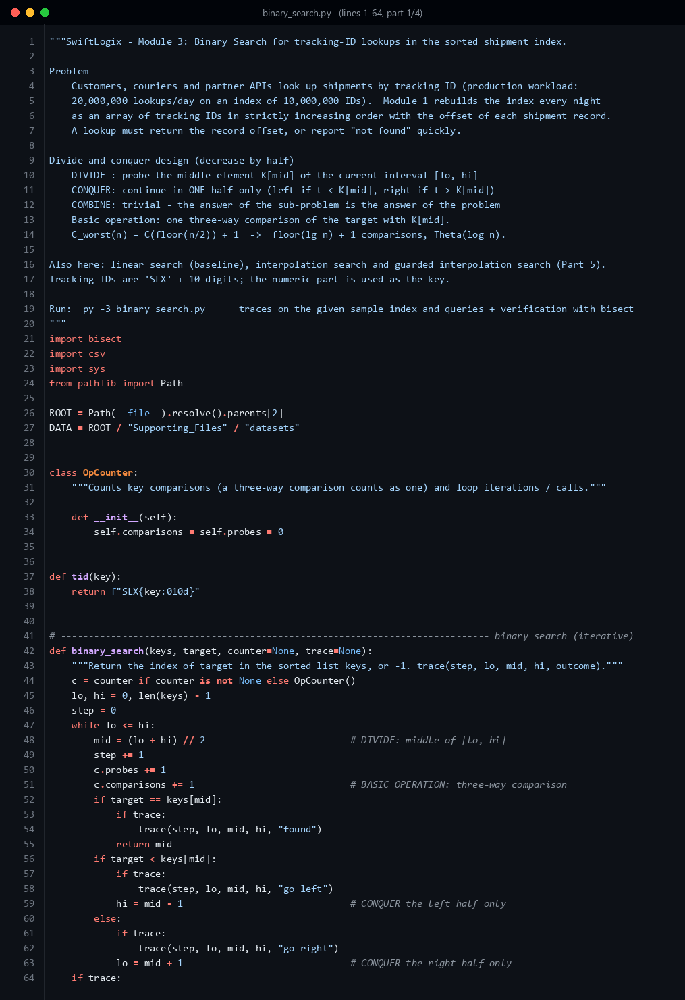

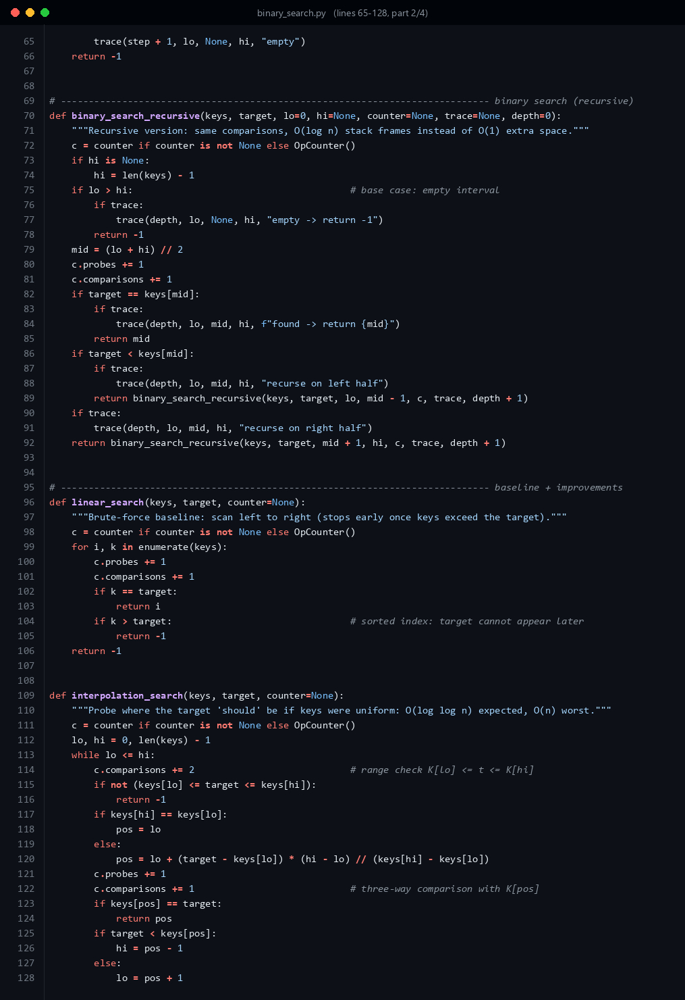

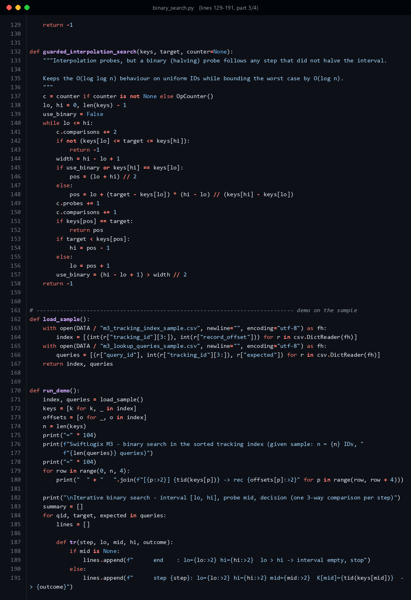

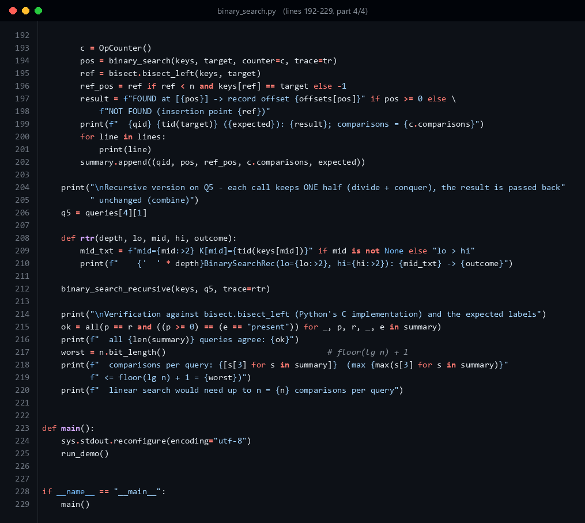

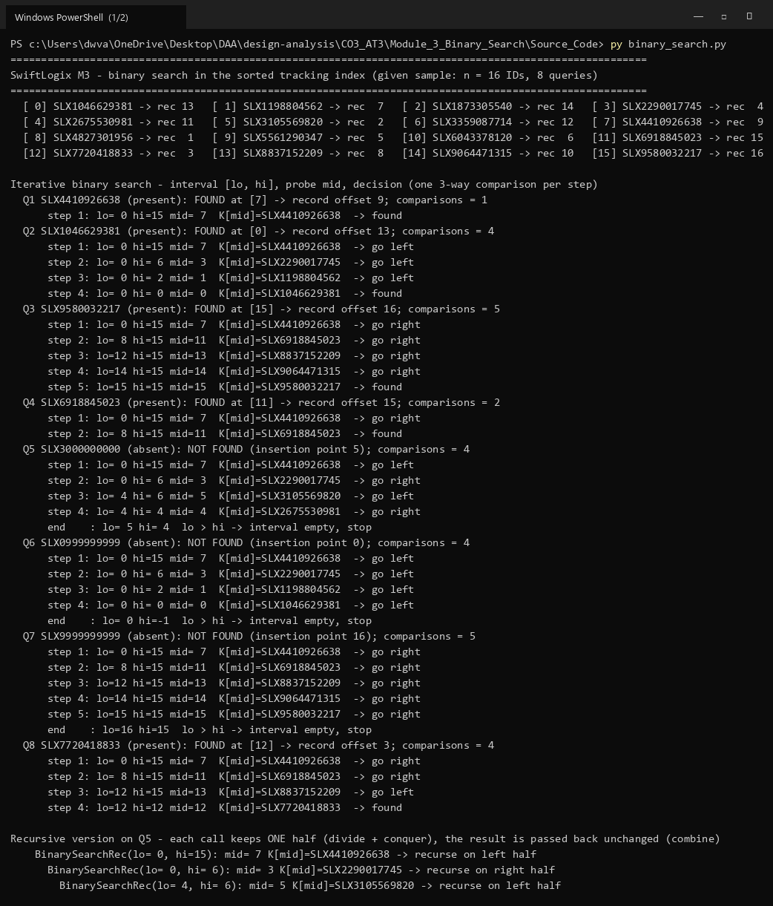

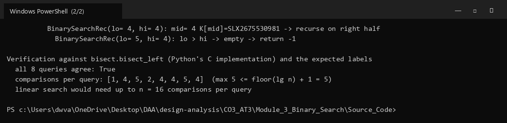

**Reading the trace (Figure 5).** Every step shows the current interval [lo, hi], the probe position mid = ⌊(lo + hi)/2⌋, the ID at that position and the decision.

- **Q1 SLX4410926638** is the middle element K[7] and is found by the first comparison (best case, 1 comparison).
- **Q2 SLX1046629381 (first ID)**: mid = 7 → 3 → 1 → 0 – the interval shrinks 16 → 7 → 3 → 1 – found after 4 comparisons. **Q3 SLX9580032217 (last ID)** needs 5 comparisons (mid = 7, 11, 13, 14, 15): the worst case ⌊lg 16⌋ + 1 = 5.
- **Absent IDs.** Q5 SLX3000000000 probes positions 7, 3, 5, 4 and stops when lo = 5 > hi = 4: not found after 4 comparisons, insertion point 5 (between SLX2675530981 and SLX3105569820). Q6 (below the minimum) ends with lo = 0, hi = −1 and Q7 (above the maximum) with lo = 16, hi = 15.
- **Divide / conquer / combine in the recursive version.** For Q5 the recursive trace shows five nested calls: each call compares with K[mid] (divide), recurses into exactly one half (conquer), and the final `return -1` of the empty interval [5, 4] is passed back unchanged through all levels (trivial combine).
- **Verification.** All 8 answers agree with `bisect.bisect_left` and with the expected present/absent labels; the comparison counts are [1, 4, 5, 2, 4, 4, 5, 4] – never more than ⌊lg n⌋ + 1 = 5, whereas linear search could need up to 16.

### 3. Datasets, test cases and test results

`Supporting_Files/generate_datasets.py` writes the larger datasets and the JSON test cases, whose expected outputs come from independent references (`sorted()`, `bisect`, numpy). `Supporting_Files/run_all_tests.py --module N` runs every variant of this module on those cases, on the generated dataset, on randomised inputs, and checks the operation counts against the closed forms of Part 4.

Table 3: Test plan (Supporting_Files/test_cases/*.json and run_all_tests.py)

| Module | Variants tested | Edge cases and checks | Tests |
|---|---|---|---|
| M3 Binary Search | iterative, recursive, interpolation, guarded interpolation, linear | empty index, single ID hit/miss, two IDs, sample 8 queries, 1,000 IDs with first/last/middle/gaps; 20,000-ID index × 2,000 queries; ≤ ⌊lg n⌋ + 1 for every hit and gap (n ≤ 300); totals = S(n), E(n); recursive = iterative; guarded probes ≤ 2(⌊lg n⌋ + 1) | 11 |

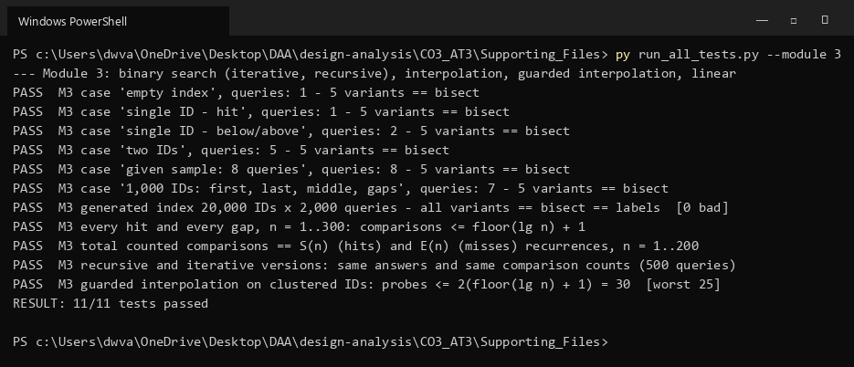

All **11 Module 3 tests pass** (Figure 7; the log is Appendix D).

## Part 4 – Recurrence Relations, Complexity and Production Workloads [15 Marks]

> Formulate and solve recurrence relations, derive time and space complexities and perform the required theoretical calculations for the specified production workloads.
> - Formulate each recurrence from the algorithm (best, average and worst case where they differ).
> - Solve each recurrence by the Master Theorem and by backward substitution or the recursion-tree method.
> - Derive the space complexity of each algorithm.
> - Compute the number of basic operations, the running time on a server executing 10⁸ basic operations per second and the memory requirement for the production workloads: 5 million shipment events per night (M1), 2 million priority scores per dispatch cycle (M2), 20 million lookups per day on an index of 10 million tracking IDs (M3) and 1,024 × 1,024 matrices (M4).

**Evidence Expected**

> Recurrences, complete solutions (Master Theorem with its parameters and substitution/recursion tree), time and space complexities, closed forms checked against counted operations, and production-workload calculations.

**Ans:**

### 1. Method

For each module I write the recurrence directly from the pseudocode of Part 2 (number of sub-problems, their size, cost of divide + combine), solve it twice – with the **Master Theorem** for T(n) = a·T(n/b) + f(n) (compare f(n) with n<sup>log<sub>b</sub> a</sup>) and with **backward substitution** or a **recursion tree** – and then check the exact closed form against the operations counted by the programs. The production figures are computed by `Supporting_Files/production_workload.py` (Figure 8) from these closed forms, at 10⁸ basic operations per second, with 1 MB = 10⁶ bytes.

### 2. Module 3 – Binary Search

**Recurrence.** One three-way comparison with K[mid] either finds t or leaves one half: the left half has ⌈n/2⌉ − 1 elements and the right half ⌊n/2⌋. The worst case always continues in the larger part:

**C(n) = C(⌊n/2⌋) + 1** for n ≥ 2,  C(1) = 1  (C(0) = 0 for the empty interval).

**Master Theorem.** a = 1, b = 2, f(n) = 1 = Θ(n⁰); n<sup>log<sub>b</sub> a</sup> = n<sup>log₂ 1</sup> = n⁰ = 1. Since f(n) = Θ(n<sup>log<sub>b</sub> a</sup>), **case 2**: C(n) = Θ(n⁰ · log n) = **Θ(log n)**.

**Backward substitution** (n = 2<sup>k</sup>):

```
C(2^k) = C(2^(k-1)) + 1 = C(2^(k-2)) + 2 = ... = C(2^0) + k = 1 + k   =>   C(n) = lg n + 1
general n:  C(n) = floor(lg n) + 1     (because floor(lg floor(n/2)) = floor(lg n) - 1)
```

The recursion tree is a single path of ⌊lg n⌋ + 1 nodes, each costing one comparison. Check: n = 16 → ⌊lg 16⌋ + 1 = 5, the count of Q3 and Q7 in Part 3.

**Average case.** Over all n successful searches the total number of comparisons is the internal path length of the decision tree plus n: S(n) = n + S(⌊(n−1)/2⌋) + S(⌈(n−1)/2⌉), S(0) = 0 (for n = 2<sup>k</sup> − 1: S(n)/n = ((k − 1)2<sup>k</sup> + 1)/n ≈ lg n − 1). For the n + 1 unsuccessful searches E(n) = (n + 1) + E(⌊(n−1)/2⌋) + E(⌈(n−1)/2⌉), E(0) = 0, giving E(n)/(n + 1) ≈ lg(n + 1). Both stay Θ(log n).

**Space.** The iterative version needs three indices: **Θ(1)** extra space. The recursive version keeps D(n) = D(n/2) + 1 = ⌊lg n⌋ + 1 frames: Θ(log n). The baseline linear search needs n comparisons in the worst case and (n + 1)/2 on average for a hit: Θ(n).

**Check against counted operations.** The counted averages equal S(n)/n and E(n)/(n + 1) to three decimals whenever every key and every gap is queried (n ≤ 65,536), and the worst counts equal ⌊lg n⌋ + 1 (Table 4); the test harness also checks the exact totals for every n from 1 to 200.

Table 4: Binary search – counted vs exact formulas (m3_binary_search_exact.csv; "all" = every key and gap queried, "sample" = 20,000 random queries)

| n | avg hit | S(n)/n | max hit | ⌊lg n⌋+1 | avg miss | E(n)/(n+1) | mode |
|---:|---:|---:|---:|---:|---:|---:|---|
| 1,024 | 9.012 | 9.012 | 11 | 11 | 10.002 | 10.002 | all |
| 2,048 | 10.006 | 10.006 | 12 | 12 | 11.001 | 11.001 | all |
| 4,096 | 11.003 | 11.003 | 13 | 13 | 12.001 | 12.001 | all |
| 8,192 | 12.002 | 12.002 | 14 | 14 | 13.000 | 13.000 | all |
| 16,384 | 13.001 | 13.001 | 15 | 15 | 14.000 | 14.000 | all |
| 32,768 | 14.001 | 14.001 | 16 | 16 | 15.000 | 15.000 | all |
| 65,536 | 15.000 | 15.000 | 17 | 17 | 16.000 | 16.000 | all |
| 131,072 | 16.002 | 16.000 | 17 | 18 | 17.000 | 17.000 | sample |
| 262,144 | 16.983 | 17.000 | 18 | 19 | 18.000 | 18.000 | sample |
| 524,288 | 18.007 | 18.000 | 19 | 20 | 19.000 | 19.000 | sample |
| 1,048,576 | 19.014 | 19.000 | 20 | 21 | 20.000 | 20.000 | sample |

(In sampled mode the deepest keys are rarely drawn, so the observed worst can be one below ⌊lg n⌋ + 1.)

**Production workload (n = 10,000,000 IDs, 20,000,000 lookups per day, ⌊lg n⌋ + 1 = 24 because 2²³ = 8,388,608 ≤ n < 2²⁴).** Worst case 24 comparisons per lookup → 480,000,000 comparisons per day → **4.80 s of CPU per day**; exact average for a hit S(n)/n = 22.322 (a miss 23.322). Linear search would need (n + 1)/2 = 5,000,000.5 comparisons per hit → 10¹⁴ per day → **11.6 days of CPU for one day of traffic**. Throughput per core: 10⁸/24 = **4.17 million lookups/s** if CPU-bound; with a cache miss (~100 ns) per probe, 1/(24 × 100 ns) = **416,667 lookups/s**, so the assumed peak of 2,000 lookups/s uses 0.48 % of one core. Memory: 10,000,000 × 16 B = **160 MB** for the sorted array (no extra space for the iterative search); a hash index with load factor 0.5 would need ≈ 320 MB. The nightly rebuild of the index by merge sort costs 223,222,785 comparisons (2.23 s) in Module 1's window.

Table 5: Module 3 production estimates (production_workload.csv)

| Design / quantity | Basic operations | Time at 10⁸ ops/s | Memory (MB) | Note |
|---|---:|---:|---:|---|
| linear search, (n+1)/2 per hit x Q/day | 1.0000 × 10¹⁴ | 11.6 days | 160.0 | per day; infeasible |
| binary search, worst 24 per lookup x Q | 480,000,000 | 4.80 s | 160.0 | per day (CPU) |
| binary search, average hit 22.322 x Q | 446,445,618 | 4.46 s | 160.0 | S(n)/n exact; miss 23.322 |
| guarded interpolation ~19.5 cmp/lookup x Q | 390,128,132 | 3.90 s | 160.0 | ~6.5 probes vs 24 |
| hash index (dict), ~1.5 probes x Q | 30,000,000 | 300.0 ms | 320.0 | load 0.5; no range queries |
| nightly index rebuild (merge sort, worst) | 223,222,785 | 2.23 s | 320.0 | runs in Module 1 window |

### 3. Production-workload calculation program

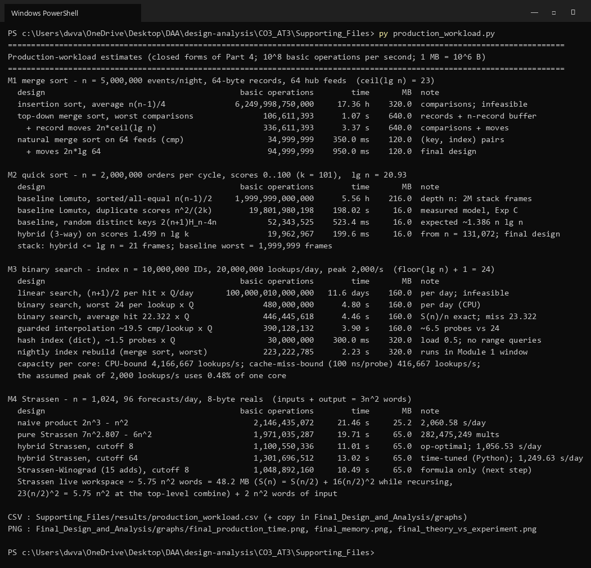

## Part 5 – Comparative Performance, Limitations and Improvements [10 Marks]

> Compare algorithmic performance, discuss limitations and trade-offs, and justify the proposed improvements for each module.
> - Measure operation counts and running times for increasing input sizes against suitable baselines (insertion sort, linear search, naive matrix multiplication) and against the theoretical predictions.
> - Demonstrate the quick sort worst case and determine the Strassen crossover point.
> - Discuss the limitations and trade-offs of each module; propose improvements, implement at least one improvement per module and measure its effect.

**Evidence Expected**

> Comparison tables, graphs with theoretical overlays, worst-case and crossover analysis, limitations and trade-offs, and measured, justified improvements.

**Ans:**

### 1. Experimental method

Each module has an experiment script (`*_experiments.py`, Appendix B) that generates deterministic inputs of doubling size, runs the baseline, the divide-and-conquer design and the improved variants, asserts that every output is correct, and writes the counts and times to `Supporting_Files/results/*.csv` (copies next to the graphs) and the graphs to `Report/graphs/`. **Operation counts are the primary evidence**: they are exact, repeatable and directly comparable with the formulas of Part 4. Times are secondary – other jobs shared the machine, so differences below about 20 % are within noise; I report the median (sorting) or the best (search, matrices) of repeated runs. Inputs are modelled on the case: event timestamps in a 3-day window, 64 time-ordered hub feeds, integer priority scores 0–100, uniform and clustered 10-digit tracking IDs, and integer route matrices.

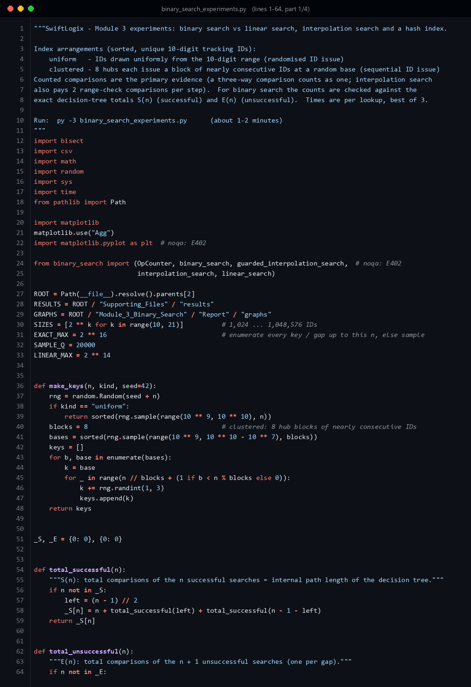

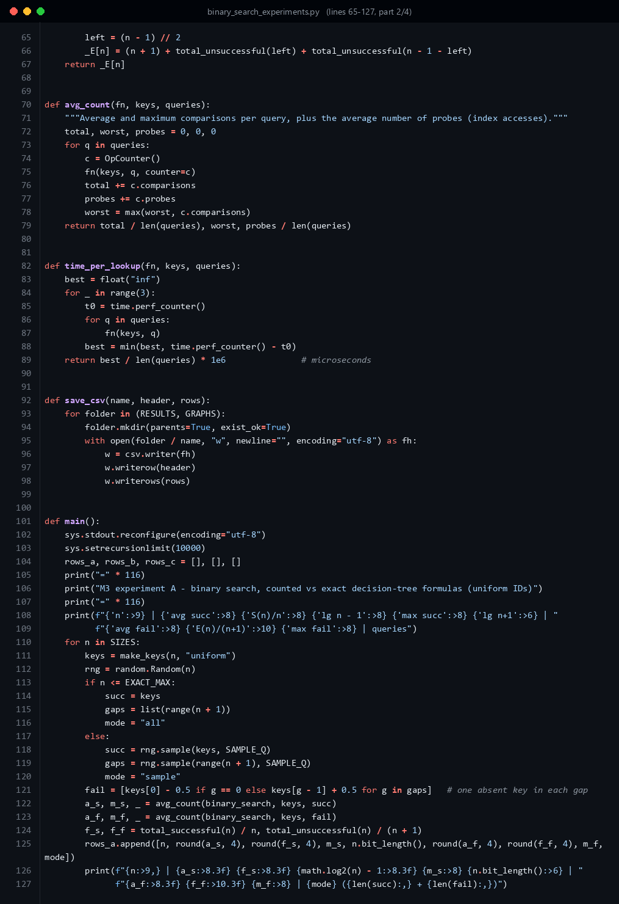

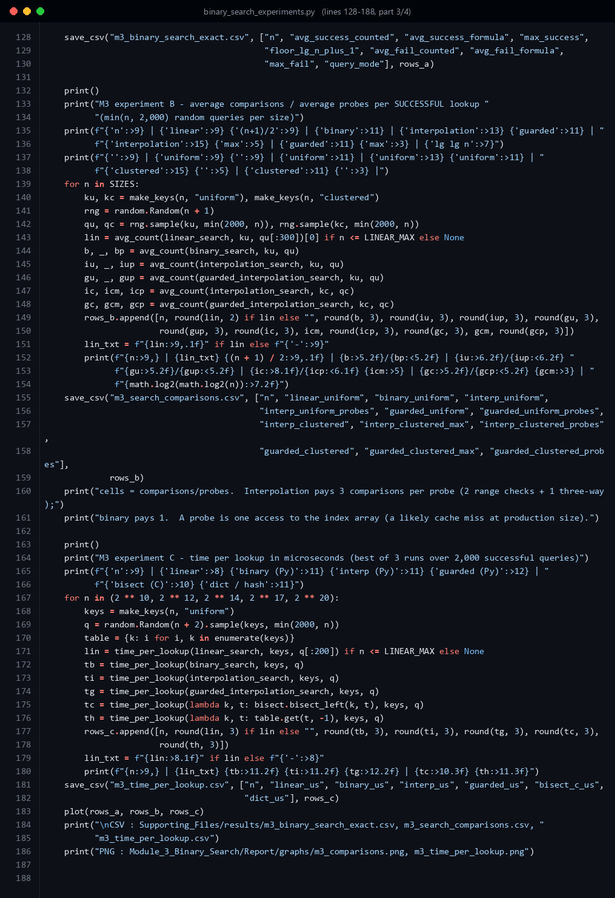

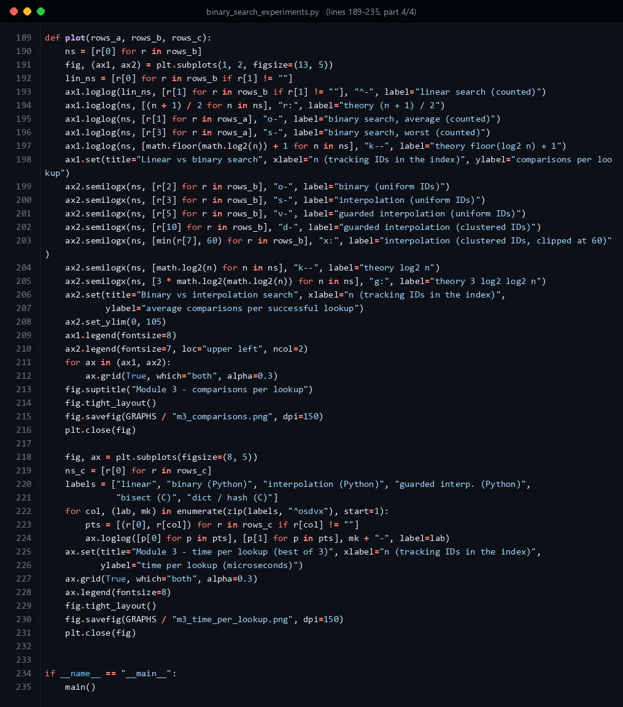

### 2. Module 3 – binary search vs linear, interpolation and hash lookups

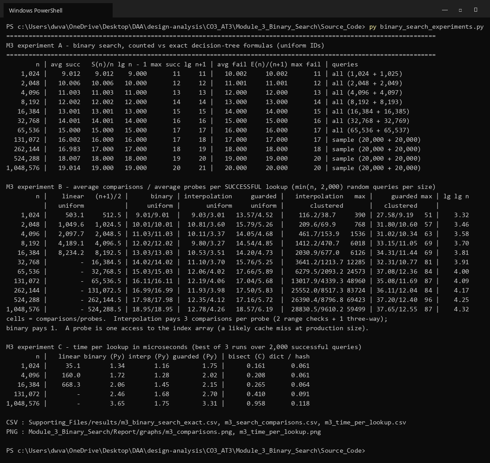

Table 6: Average comparisons per successful lookup – U = uniform IDs, C = clustered IDs (m3_search_comparisons.csv)

| n | linear (U) | (n+1)/2 | binary (U) | interp. (U) | guarded (U) | interp. (C) | guarded (C) |
|---:|---:|---:|---:|---:|---:|---:|---:|
| 1,024 | 503.1 | 512.5 | 9.01 | 9.03 | 13.57 | 116.2 | 27.58 |
| 2,048 | 1,049.6 | 1,024.5 | 10.01 | 10.81 | 15.79 | 209.6 | 31.80 |
| 4,096 | 2,097.7 | 2,048.5 | 11.03 | 10.11 | 14.05 | 461.7 | 31.02 |
| 8,192 | 4,189.1 | 4,096.5 | 12.02 | 9.80 | 14.54 | 1,412.2 | 33.15 |
| 16,384 | 8,234.2 | 8,192.5 | 13.03 | 10.53 | 14.20 | 2,030.9 | 34.31 |
| 32,768 | – | 16,384.5 | 14.02 | 11.10 | 15.76 | 3,641.2 | 32.31 |
| 65,536 | – | 32,768.5 | 15.03 | 12.06 | 17.66 | 6,279.5 | 37.08 |
| 131,072 | – | 65,536.5 | 16.11 | 12.19 | 17.04 | 13,017.9 | 35.08 |
| 262,144 | – | 131,072.5 | 16.99 | 11.93 | 17.50 | 25,552.0 | 36.11 |
| 524,288 | – | 262,144.5 | 17.98 | 12.35 | 17.16 | 26,390.4 | 37.20 |
| 1,048,576 | – | 524,288.5 | 18.95 | 12.78 | 18.57 | 28,830.5 | 37.65 |

Table 7: Average probes (index accesses) per successful lookup, and worst comparisons of interpolation (i) and guarded (g) search on clustered IDs; binary search probes = its comparisons in Table 6 (m3_search_comparisons.csv)

| n | interp. (U) | guarded (U) | lg lg n | interp. (C) | guarded (C) | worst i (C) | worst g (C) |
|---:|---:|---:|---:|---:|---:|---:|---:|
| 1,024 | 3.01 | 4.52 | 3.32 | 38.7 | 9.19 | 390 | 51 |
| 2,048 | 3.60 | 5.26 | 3.46 | 69.9 | 10.60 | 768 | 57 |
| 4,096 | 3.37 | 4.68 | 3.58 | 153.9 | 10.34 | 1,536 | 63 |
| 8,192 | 3.27 | 4.85 | 3.70 | 470.7 | 11.05 | 6,018 | 69 |
| 16,384 | 3.51 | 4.73 | 3.81 | 677.0 | 11.44 | 6,126 | 69 |
| 32,768 | 3.70 | 5.25 | 3.91 | 1,213.7 | 10.77 | 12,285 | 81 |
| 65,536 | 4.02 | 5.89 | 4.00 | 2,093.2 | 12.36 | 24,573 | 84 |
| 131,072 | 4.06 | 5.68 | 4.09 | 4,339.3 | 11.69 | 48,960 | 87 |
| 262,144 | 3.98 | 5.83 | 4.17 | 8,517.3 | 12.04 | 83,724 | 84 |
| 524,288 | 4.12 | 5.72 | 4.25 | 8,796.8 | 12.40 | 69,423 | 96 |
| 1,048,576 | 4.26 | 6.19 | 4.32 | 9,610.2 | 12.55 | 59,499 | 87 |

Table 8: Time per successful lookup in microseconds, best of 3 – Python implementations except bisect and dict, which run in C (m3_time_per_lookup.csv)

| n | linear | binary | interp. | guarded | bisect (C) | dict (C) |
|---:|---:|---:|---:|---:|---:|---:|
| 1,024 | 35.1 | 1.33 | 1.16 | 1.75 | 0.161 | 0.061 |
| 4,096 | 160.0 | 1.72 | 1.28 | 2.02 | 0.208 | 0.061 |
| 16,384 | 668.3 | 2.06 | 1.45 | 2.15 | 0.265 | 0.064 |
| 131,072 | – | 2.46 | 1.68 | 2.69 | 0.410 | 0.091 |
| 1,048,576 | – | 3.65 | 1.75 | 3.31 | 0.958 | 0.118 |

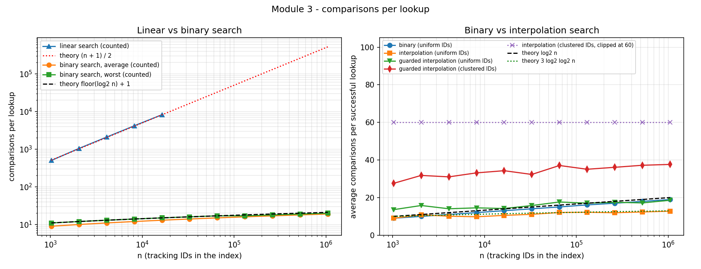

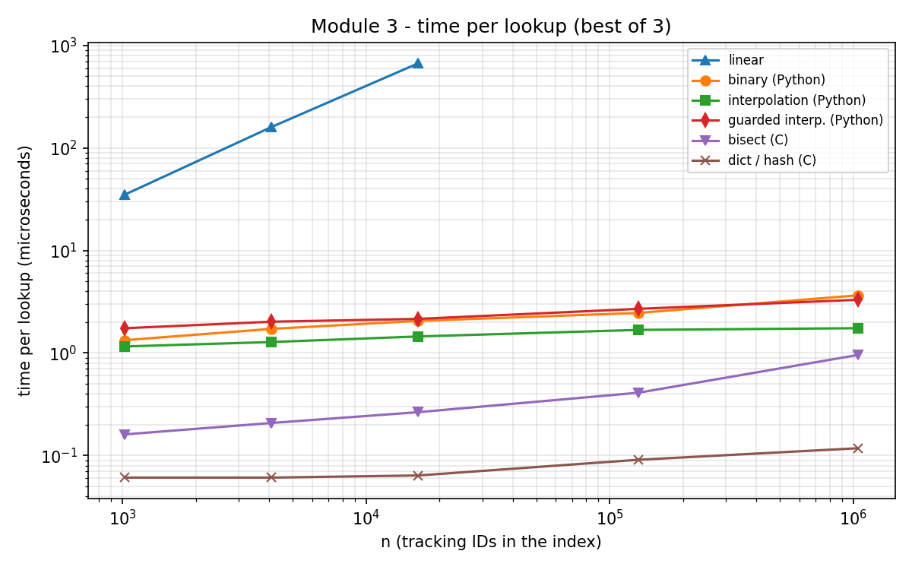

**Theory vs experiment.** Linear search costs (n + 1)/2 on average (503.1 vs 512.5 at n = 1,024; 8,234.2 vs 8,192.5 at 16,384) and 668 µs per lookup at n = 16,384, whereas binary search costs ≈ lg n comparisons (18.95 at n = 2²⁰) and 3.65 µs: the gap grows from 56× to 27,700× in comparisons between n = 1,024 and n = 2²⁰ (Figure 14 left). The binary-search counts match the exact decision-tree formulas of Part 4 (Table 4).

**Limitations and trade-offs.** (1) The index must be sorted: it is rebuilt nightly by Module 1, and IDs created during the day are not in it (a small sorted delta array or hash set is needed until the next rebuild). (2) Every probe jumps to a distant part of a 160 MB array, so at production size each of the 24 probes is likely a cache miss – memory latency, not comparisons, limits throughput (Part 4). (3) A hash table answers in ~1–2 probes (0.118 µs vs 0.958 µs for C bisect at n = 2²⁰) but needs about twice the memory and cannot answer ordered or range queries ("all shipments in ID block SLX41…"). (4) The Python loop is ~4× slower than the C `bisect` with the same algorithm – constant factors, not complexity.

**Improvements implemented and measured.** **Interpolation search** estimates the position from the key value. On uniformly distributed IDs it needs only **4.26 probes instead of 18.95** at n = 2²⁰ (Table 7) (Θ(log log n); lg lg n = 4.32) and is the fastest Python search (1.75 µs vs 3.65 µs) even though each probe costs 3 comparisons. But on **clustered IDs** (8 hub blocks of sequential IDs) it collapses towards linear behaviour: 28,830 comparisons on average and up to 59,499 at n = 2²⁰. The **guarded interpolation search** forces a halving step whenever an interpolation step did not halve the interval; it keeps 6.19 probes on uniform IDs, stays at 12.55 probes (max 87 comparisons, within the proven bound of 2(⌊lg n⌋ + 1) probes) on clustered IDs, and is never worse than about twice binary search. It is therefore the safe improvement for an index whose ID distribution can change; plain binary search remains the guaranteed fallback.

## Part 6 – Final Algorithmic Design and Recommendations [10 Marks]

> Present the final algorithmic design with appropriate complexity analysis, memory requirements and recommendations.
> - For each module state the recommended algorithm, its time complexity, its memory requirement (in bytes for the production sizes) and a throughput estimate.
> - Give recommendations for deployment and further optimisation.

**Evidence Expected**

> Final design per module with complexity, memory and throughput figures derived from Parts 4 and 5, and justified recommendations.

**Ans:**

### 1. Module 3 – final design: sorted array + guarded interpolation search with binary-search guarantee

- **Algorithm.** Keep the index as one sorted array of 16-byte (tracking ID, record offset) entries, rebuilt nightly by Module 1. Look up with the **guarded interpolation search** (interpolation probe, forced halving step whenever a probe did not halve the interval) – the plain iterative **binary search** stays as the reference implementation and fallback. IDs created during the day go into a small sorted delta array that is searched the same way and merged at the nightly rebuild.
- **Time.** Worst case O(log n): binary search ≤ ⌊lg n⌋ + 1 = **24** comparisons, guarded interpolation ≤ 2(⌊lg n⌋ + 1) probes; typical ≈ 6.5 probes for uniformly issued IDs (measured 6.19 at n = 2²⁰, scaled by lg lg n). Production: 20,000,000 lookups/day × 24 = 480,000,000 comparisons → **4.8 s of CPU per day** (3.9 s with the guarded search).
- **Memory.** 10,000,000 × 16 B = **160,000,000 B (160 MB)** for the index, O(1) extra per lookup; a delta of up to 1,000,000 same-day IDs adds 16 MB. A hash index would need about 320 MB and lose range queries.
- **Throughput.** Cache-miss bound: 24 probes × 100 ns ≈ 2.4 µs → **≈ 416,000 lookups/s per core**; with ~6.5 probes ≈ 1.5 million lookups/s. The peak of 2,000 lookups/s uses under 0.5 % of one core.
- **Recommendations.** If the query rate grows by orders of magnitude, store the array in a cache-friendly layout (Eytzinger/breadth-first order or B-tree blocks of 64 keys) so that the first levels of every search stay in cache, and put a small hash cache in front for the hottest IDs.

### 2. Place of this module in the platform

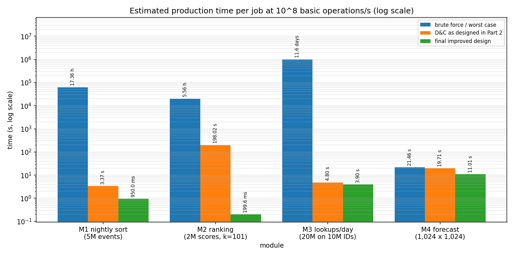

The final designs of all four modules together need about 361 MB of working memory (120 MB M1, 16 MB M2, 160 MB M3, 65 MB M4) and well under one CPU-minute per hour; the complete platform design, the memory budget and the joint recommendations are in Part 6 of the case-study report (`Final_Design_and_Analysis/CO3_AT3_Case_Study_Report`).

### Summary of Findings

Table 9: Summary of findings

| Module | Part 2 design | Verified on the sample (Part 3) | Complexity (Part 4) | Key experimental finding (Part 5) | Final design (Part 6) |
|---|---|---|---|---|---|
| M3 Binary Search | iterative + recursive, three-way | 8/8 queries agree with bisect; ≤ 5 comparisons | Θ(log n), Θ(1) space; 24 cmp/lookup, 4.8 s/day | counts equal S(n)/n, E(n)/(n+1); interpolation 4.26 probes but collapses on clustered IDs | guarded interpolation, 160 MB, ≈ 416 k lookups/s/core |

<!-- pagebreak -->

### Appendix A – Complete Source Code: binary_search.py

```
"""SwiftLogix - Module 3: Binary Search for tracking-ID lookups in the sorted shipment index.

Problem
    Customers, couriers and partner APIs look up shipments by tracking ID (production workload:
    20,000,000 lookups/day on an index of 10,000,000 IDs).  Module 1 rebuilds the index every night
    as an array of tracking IDs in strictly increasing order with the offset of each shipment record.
    A lookup must return the record offset, or report "not found" quickly.

Divide-and-conquer design (decrease-by-half)
    DIVIDE : probe the middle element K[mid] of the current interval [lo, hi]
    CONQUER: continue in ONE half only (left if t < K[mid], right if t > K[mid])
    COMBINE: trivial - the answer of the sub-problem is the answer of the problem
    Basic operation: one three-way comparison of the target with K[mid].
    C_worst(n) = C(floor(n/2)) + 1  ->  floor(lg n) + 1 comparisons, Theta(log n).

Also here: linear search (baseline), interpolation search and guarded interpolation search (Part 5).
Tracking IDs are 'SLX' + 10 digits; the numeric part is used as the key.

Run:  py -3 binary_search.py      traces on the given sample index and queries + verification with bisect
"""
import bisect
import csv
import sys
from pathlib import Path

ROOT = Path(__file__).resolve().parents[2]
DATA = ROOT / "Supporting_Files" / "datasets"

class OpCounter:
    """Counts key comparisons (a three-way comparison counts as one) and loop iterations / calls."""

    def __init__(self):
        self.comparisons = self.probes = 0

def tid(key):
    return f"SLX{key:010d}"

# ----------------------------------------------------------------------------- binary search (iterative)
def binary_search(keys, target, counter=None, trace=None):
    """Return the index of target in the sorted list keys, or -1. trace(step, lo, mid, hi, outcome)."""
    c = counter if counter is not None else OpCounter()
    lo, hi = 0, len(keys) - 1
    step = 0
    while lo <= hi:
        mid = (lo + hi) // 2                          # DIVIDE: middle of [lo, hi]
        step += 1
        c.probes += 1
        c.comparisons += 1                            # BASIC OPERATION: three-way comparison
        if target == keys[mid]:
            if trace:
                trace(step, lo, mid, hi, "found")
            return mid
        if target < keys[mid]:
            if trace:
                trace(step, lo, mid, hi, "go left")
            hi = mid - 1                              # CONQUER the left half only
        else:
            if trace:
                trace(step, lo, mid, hi, "go right")
            lo = mid + 1                              # CONQUER the right half only
    if trace:
        trace(step + 1, lo, None, hi, "empty")
    return -1

# ----------------------------------------------------------------------------- binary search (recursive)
def binary_search_recursive(keys, target, lo=0, hi=None, counter=None, trace=None, depth=0):
    """Recursive version: same comparisons, O(log n) stack frames instead of O(1) extra space."""
    c = counter if counter is not None else OpCounter()
    if hi is None:
        hi = len(keys) - 1
    if lo > hi:                                       # base case: empty interval
        if trace:
            trace(depth, lo, None, hi, "empty -> return -1")
        return -1
    mid = (lo + hi) // 2
    c.probes += 1
    c.comparisons += 1
    if target == keys[mid]:
        if trace:
            trace(depth, lo, mid, hi, f"found -> return {mid}")
        return mid
    if target < keys[mid]:
        if trace:
            trace(depth, lo, mid, hi, "recurse on left half")
        return binary_search_recursive(keys, target, lo, mid - 1, c, trace, depth + 1)
    if trace:
        trace(depth, lo, mid, hi, "recurse on right half")
    return binary_search_recursive(keys, target, mid + 1, hi, c, trace, depth + 1)

# ----------------------------------------------------------------------------- baseline + improvements
def linear_search(keys, target, counter=None):
    """Brute-force baseline: scan left to right (stops early once keys exceed the target)."""
    c = counter if counter is not None else OpCounter()
    for i, k in enumerate(keys):
        c.probes += 1
        c.comparisons += 1
        if k == target:
            return i
        if k > target:                                # sorted index: target cannot appear later
            return -1
    return -1

def interpolation_search(keys, target, counter=None):
    """Probe where the target 'should' be if keys were uniform: O(log log n) expected, O(n) worst."""
    c = counter if counter is not None else OpCounter()
    lo, hi = 0, len(keys) - 1
    while lo <= hi:
        c.comparisons += 2                            # range check K[lo] <= t <= K[hi]
        if not (keys[lo] <= target <= keys[hi]):
            return -1
        if keys[hi] == keys[lo]:
            pos = lo
        else:
            pos = lo + (target - keys[lo]) * (hi - lo) // (keys[hi] - keys[lo])
        c.probes += 1
        c.comparisons += 1                            # three-way comparison with K[pos]
        if keys[pos] == target:
            return pos
        if target < keys[pos]:
            hi = pos - 1
        else:
            lo = pos + 1
    return -1

def guarded_interpolation_search(keys, target, counter=None):
    """Interpolation probes, but a binary (halving) probe follows any step that did not halve the interval.

    Keeps the O(log log n) behaviour on uniform IDs while bounding the worst case by O(log n).
    """
    c = counter if counter is not None else OpCounter()
    lo, hi = 0, len(keys) - 1
    use_binary = False
    while lo <= hi:
        c.comparisons += 2
        if not (keys[lo] <= target <= keys[hi]):
            return -1
        width = hi - lo + 1
        if use_binary or keys[hi] == keys[lo]:
            pos = (lo + hi) // 2
        else:
            pos = lo + (target - keys[lo]) * (hi - lo) // (keys[hi] - keys[lo])
        c.probes += 1
        c.comparisons += 1
        if keys[pos] == target:
            return pos
        if target < keys[pos]:
            hi = pos - 1
        else:
            lo = pos + 1
        use_binary = (hi - lo + 1) > width // 2
    return -1

# ----------------------------------------------------------------------------- demo on the sample
def load_sample():
    with open(DATA / "m3_tracking_index_sample.csv", newline="", encoding="utf-8") as fh:
        index = [(int(r["tracking_id"][3:]), int(r["record_offset"])) for r in csv.DictReader(fh)]
    with open(DATA / "m3_lookup_queries_sample.csv", newline="", encoding="utf-8") as fh:
        queries = [(r["query_id"], int(r["tracking_id"][3:]), r["expected"]) for r in csv.DictReader(fh)]
    return index, queries

def run_demo():
    index, queries = load_sample()
    keys = [k for k, _ in index]
    offsets = [o for _, o in index]
    n = len(keys)
    print("=" * 104)
    print(f"SwiftLogix M3 - binary search in the sorted tracking index (given sample: n = {n} IDs, "
          f"{len(queries)} queries)")
    print("=" * 104)
    for row in range(0, n, 4):
        print("  " + "   ".join(f"[{p:>2}] {tid(keys[p])} -> rec {offsets[p]:>2}" for p in range(row, row + 4)))

    print("\nIterative binary search - interval [lo, hi], probe mid, decision (one 3-way comparison per step)")
    summary = []
    for qid, target, expected in queries:
        lines = []

        def tr(step, lo, mid, hi, outcome):
            if mid is None:
                lines.append(f"      end    : lo={lo:>2} hi={hi:>2}  lo > hi -> interval empty, stop")
            else:
                lines.append(f"      step {step}: lo={lo:>2} hi={hi:>2} mid={mid:>2}  K[mid]={tid(keys[mid])}  -> {outcome}")

        c = OpCounter()
        pos = binary_search(keys, target, counter=c, trace=tr)
        ref = bisect.bisect_left(keys, target)
        ref_pos = ref if ref < n and keys[ref] == target else -1
        result = f"FOUND at [{pos}] -> record offset {offsets[pos]}" if pos >= 0 else \
            f"NOT FOUND (insertion point {ref})"
        print(f"  {qid} {tid(target)} ({expected}): {result}; comparisons = {c.comparisons}")
        for line in lines:
            print(line)
        summary.append((qid, pos, ref_pos, c.comparisons, expected))

    print("\nRecursive version on Q5 - each call keeps ONE half (divide + conquer), the result is passed back"
          " unchanged (combine)")
    q5 = queries[4][1]

    def rtr(depth, lo, mid, hi, outcome):
        mid_txt = f"mid={mid:>2} K[mid]={tid(keys[mid])}" if mid is not None else "lo > hi"
        print(f"    {'  ' * depth}BinarySearchRec(lo={lo:>2}, hi={hi:>2}): {mid_txt} -> {outcome}")

    binary_search_recursive(keys, q5, trace=rtr)

    print("\nVerification against bisect.bisect_left (Python's C implementation) and the expected labels")
    ok = all(p == r and ((p >= 0) == (e == "present")) for _, p, r, _, e in summary)
    print(f"  all {len(summary)} queries agree: {ok}")
    worst = n.bit_length()                                  # floor(lg n) + 1
    print(f"  comparisons per query: {[s[3] for s in summary]}  (max {max(s[3] for s in summary)}"
          f" <= floor(lg n) + 1 = {worst})")
    print(f"  linear search would need up to n = {n} comparisons per query")

def main():
    sys.stdout.reconfigure(encoding="utf-8")
    run_demo()

if __name__ == "__main__":
    main()
```

### Appendix B – Experiment and Graph Script: binary_search_experiments.py

```
"""SwiftLogix - Module 3 experiments: binary search vs linear search, interpolation search and a hash index.

Index arrangements (sorted, unique 10-digit tracking IDs):
    uniform   - IDs drawn uniformly from the 10-digit range (randomised ID issue)
    clustered - 8 hubs each issue a block of nearly consecutive IDs at a random base (sequential ID issue)
Counted comparisons are the primary evidence (a three-way comparison counts as one; interpolation search
also pays 2 range-check comparisons per step).  For binary search the counts are checked against the
exact decision-tree totals S(n) (successful) and E(n) (unsuccessful).  Times are per lookup, best of 3.

Run:  py -3 binary_search_experiments.py      (about 1-2 minutes)
"""
import bisect
import csv
import math
import random
import sys
import time
from pathlib import Path

import matplotlib
matplotlib.use("Agg")
import matplotlib.pyplot as plt  # noqa: E402

from binary_search import (OpCounter, binary_search, guarded_interpolation_search,  # noqa: E402
                           interpolation_search, linear_search)

ROOT = Path(__file__).resolve().parents[2]
RESULTS = ROOT / "Supporting_Files" / "results"
GRAPHS = ROOT / "Module_3_Binary_Search" / "Report" / "graphs"
SIZES = [2 ** k for k in range(10, 21)]          # 1,024 ... 1,048,576 IDs
EXACT_MAX = 2 ** 16                              # enumerate every key / gap up to this n, else sample
SAMPLE_Q = 20000
LINEAR_MAX = 2 ** 14

def make_keys(n, kind, seed=42):
    rng = random.Random(seed + n)
    if kind == "uniform":
        return sorted(rng.sample(range(10 ** 9, 10 ** 10), n))
    blocks = 8                                   # clustered: 8 hub blocks of nearly consecutive IDs
    bases = sorted(rng.sample(range(10 ** 9, 10 ** 10 - 10 ** 7), blocks))
    keys = []
    for b, base in enumerate(bases):
        k = base
        for _ in range(n // blocks + (1 if b < n % blocks else 0)):
            k += rng.randint(1, 3)
            keys.append(k)
    return keys

_S, _E = {0: 0}, {0: 0}

def total_successful(n):
    """S(n): total comparisons of the n successful searches = internal path length of the decision tree."""
    if n not in _S:
        left = (n - 1) // 2
        _S[n] = n + total_successful(left) + total_successful(n - 1 - left)
    return _S[n]

def total_unsuccessful(n):
    """E(n): total comparisons of the n + 1 unsuccessful searches (one per gap)."""
    if n not in _E:
        left = (n - 1) // 2
        _E[n] = (n + 1) + total_unsuccessful(left) + total_unsuccessful(n - 1 - left)
    return _E[n]

def avg_count(fn, keys, queries):
    """Average and maximum comparisons per query, plus the average number of probes (index accesses)."""
    total, worst, probes = 0, 0, 0
    for q in queries:
        c = OpCounter()
        fn(keys, q, counter=c)
        total += c.comparisons
        probes += c.probes
        worst = max(worst, c.comparisons)
    return total / len(queries), worst, probes / len(queries)

def time_per_lookup(fn, keys, queries):
    best = float("inf")
    for _ in range(3):
        t0 = time.perf_counter()
        for q in queries:
            fn(keys, q)
        best = min(best, time.perf_counter() - t0)
    return best / len(queries) * 1e6               # microseconds

def save_csv(name, header, rows):
    for folder in (RESULTS, GRAPHS):
        folder.mkdir(parents=True, exist_ok=True)
        with open(folder / name, "w", newline="", encoding="utf-8") as fh:
            w = csv.writer(fh)
            w.writerow(header)
            w.writerows(rows)

def main():
    sys.stdout.reconfigure(encoding="utf-8")
    sys.setrecursionlimit(10000)
    rows_a, rows_b, rows_c = [], [], []
    print("=" * 116)
    print("M3 experiment A - binary search, counted vs exact decision-tree formulas (uniform IDs)")
    print("=" * 116)
    print(f"{'n':>9} | {'avg succ':>8} {'S(n)/n':>8} {'lg n - 1':>8} {'max succ':>8} {'lg n+1':>6} | "
          f"{'avg fail':>8} {'E(n)/(n+1)':>10} {'max fail':>8} | queries")
    for n in SIZES:
        keys = make_keys(n, "uniform")
        rng = random.Random(n)
        if n <= EXACT_MAX:
            succ = keys
            gaps = list(range(n + 1))
            mode = "all"
        else:
            succ = rng.sample(keys, SAMPLE_Q)
            gaps = rng.sample(range(n + 1), SAMPLE_Q)
            mode = "sample"
        fail = [keys[0] - 0.5 if g == 0 else keys[g - 1] + 0.5 for g in gaps]   # one absent key in each gap
        a_s, m_s, _ = avg_count(binary_search, keys, succ)
        a_f, m_f, _ = avg_count(binary_search, keys, fail)
        f_s, f_f = total_successful(n) / n, total_unsuccessful(n) / (n + 1)
        rows_a.append([n, round(a_s, 4), round(f_s, 4), m_s, n.bit_length(), round(a_f, 4), round(f_f, 4), m_f, mode])
        print(f"{n:>9,} | {a_s:>8.3f} {f_s:>8.3f} {math.log2(n) - 1:>8.3f} {m_s:>8} {n.bit_length():>6} | "
              f"{a_f:>8.3f} {f_f:>10.3f} {m_f:>8} | {mode} ({len(succ):,} + {len(fail):,})")
    save_csv("m3_binary_search_exact.csv", ["n", "avg_success_counted", "avg_success_formula", "max_success",
                                            "floor_lg_n_plus_1", "avg_fail_counted", "avg_fail_formula",
                                            "max_fail", "query_mode"], rows_a)

    print()
    print("M3 experiment B - average comparisons / average probes per SUCCESSFUL lookup "
          "(min(n, 2,000) random queries per size)")
    print(f"{'n':>9} | {'linear':>9} {'(n+1)/2':>9} | {'binary':>11} | {'interpolation':>13} {'guarded':>11} | "
          f"{'interpolation':>15} {'max':>5} | {'guarded':>11} {'max':>3} | {'lg lg n':>7}")
    print(f"{'':>9} | {'uniform':>9} {'':>9} | {'uniform':>11} | {'uniform':>13} {'uniform':>11} | "
          f"{'clustered':>15} {'':>5} | {'clustered':>11} {'':>3} |")
    for n in SIZES:
        ku, kc = make_keys(n, "uniform"), make_keys(n, "clustered")
        rng = random.Random(n + 1)
        qu, qc = rng.sample(ku, min(2000, n)), rng.sample(kc, min(2000, n))
        lin = avg_count(linear_search, ku, qu[:300])[0] if n <= LINEAR_MAX else None
        b, _, bp = avg_count(binary_search, ku, qu)
        iu, _, iup = avg_count(interpolation_search, ku, qu)
        gu, _, gup = avg_count(guarded_interpolation_search, ku, qu)
        ic, icm, icp = avg_count(interpolation_search, kc, qc)
        gc, gcm, gcp = avg_count(guarded_interpolation_search, kc, qc)
        rows_b.append([n, round(lin, 2) if lin else "", round(b, 3), round(iu, 3), round(iup, 3), round(gu, 3),
                       round(gup, 3), round(ic, 3), icm, round(icp, 3), round(gc, 3), gcm, round(gcp, 3)])
        lin_txt = f"{lin:>9,.1f}" if lin else f"{'-':>9}"
        print(f"{n:>9,} | {lin_txt} {(n + 1) / 2:>9,.1f} | {b:>5.2f}/{bp:<5.2f} | {iu:>6.2f}/{iup:<6.2f} "
              f"{gu:>5.2f}/{gup:<5.2f} | {ic:>8.1f}/{icp:<6.1f} {icm:>5} | {gc:>5.2f}/{gcp:<5.2f} {gcm:>3} | "
              f"{math.log2(math.log2(n)):>7.2f}")
    save_csv("m3_search_comparisons.csv", ["n", "linear_uniform", "binary_uniform", "interp_uniform",
                                           "interp_uniform_probes", "guarded_uniform", "guarded_uniform_probes",
                                           "interp_clustered", "interp_clustered_max", "interp_clustered_probes",
                                           "guarded_clustered", "guarded_clustered_max", "guarded_clustered_probes"],
             rows_b)
    print("cells = comparisons/probes.  Interpolation pays 3 comparisons per probe (2 range checks + 1 three-way);")
    print("binary pays 1.  A probe is one access to the index array (a likely cache miss at production size).")

    print()
    print("M3 experiment C - time per lookup in microseconds (best of 3 runs over 2,000 successful queries)")
    print(f"{'n':>9} | {'linear':>8} {'binary (Py)':>11} {'interp (Py)':>11} {'guarded (Py)':>12} | "
          f"{'bisect (C)':>10} {'dict / hash':>11}")
    for n in (2 ** 10, 2 ** 12, 2 ** 14, 2 ** 17, 2 ** 20):
        keys = make_keys(n, "uniform")
        q = random.Random(n + 2).sample(keys, min(2000, n))
        table = {k: i for i, k in enumerate(keys)}
        lin = time_per_lookup(linear_search, keys, q[:200]) if n <= LINEAR_MAX else None
        tb = time_per_lookup(binary_search, keys, q)
        ti = time_per_lookup(interpolation_search, keys, q)
        tg = time_per_lookup(guarded_interpolation_search, keys, q)
        tc = time_per_lookup(lambda k, t: bisect.bisect_left(k, t), keys, q)
        th = time_per_lookup(lambda k, t: table.get(t, -1), keys, q)
        rows_c.append([n, round(lin, 3) if lin else "", round(tb, 3), round(ti, 3), round(tg, 3), round(tc, 3),
                       round(th, 3)])
        lin_txt = f"{lin:>8.1f}" if lin else f"{'-':>8}"
        print(f"{n:>9,} | {lin_txt} {tb:>11.2f} {ti:>11.2f} {tg:>12.2f} | {tc:>10.3f} {th:>11.3f}")
    save_csv("m3_time_per_lookup.csv", ["n", "linear_us", "binary_us", "interp_us", "guarded_us", "bisect_c_us",
                                        "dict_us"], rows_c)
    plot(rows_a, rows_b, rows_c)
    print("\nCSV : Supporting_Files/results/m3_binary_search_exact.csv, m3_search_comparisons.csv, "
          "m3_time_per_lookup.csv")
    print("PNG : Module_3_Binary_Search/Report/graphs/m3_comparisons.png, m3_time_per_lookup.png")

def plot(rows_a, rows_b, rows_c):
    ns = [r[0] for r in rows_b]
    fig, (ax1, ax2) = plt.subplots(1, 2, figsize=(13, 5))
    lin_ns = [r[0] for r in rows_b if r[1] != ""]
    ax1.loglog(lin_ns, [r[1] for r in rows_b if r[1] != ""], "^-", label="linear search (counted)")
    ax1.loglog(ns, [(n + 1) / 2 for n in ns], "r:", label="theory (n + 1) / 2")
    ax1.loglog(ns, [r[1] for r in rows_a], "o-", label="binary search, average (counted)")
    ax1.loglog(ns, [r[3] for r in rows_a], "s-", label="binary search, worst (counted)")
    ax1.loglog(ns, [math.floor(math.log2(n)) + 1 for n in ns], "k--", label="theory floor(log2 n) + 1")
    ax1.set(title="Linear vs binary search", xlabel="n (tracking IDs in the index)", ylabel="comparisons per lookup")
    ax2.semilogx(ns, [r[2] for r in rows_b], "o-", label="binary (uniform IDs)")
    ax2.semilogx(ns, [r[3] for r in rows_b], "s-", label="interpolation (uniform IDs)")
    ax2.semilogx(ns, [r[5] for r in rows_b], "v-", label="guarded interpolation (uniform IDs)")
    ax2.semilogx(ns, [r[10] for r in rows_b], "d-", label="guarded interpolation (clustered IDs)")
    ax2.semilogx(ns, [min(r[7], 60) for r in rows_b], "x:", label="interpolation (clustered IDs, clipped at 60)")
    ax2.semilogx(ns, [math.log2(n) for n in ns], "k--", label="theory log2 n")
    ax2.semilogx(ns, [3 * math.log2(math.log2(n)) for n in ns], "g:", label="theory 3 log2 log2 n")
    ax2.set(title="Binary vs interpolation search", xlabel="n (tracking IDs in the index)",
            ylabel="average comparisons per successful lookup")
    ax2.set_ylim(0, 105)
    ax1.legend(fontsize=8)
    ax2.legend(fontsize=7, loc="upper left", ncol=2)
    for ax in (ax1, ax2):
        ax.grid(True, which="both", alpha=0.3)
    fig.suptitle("Module 3 - comparisons per lookup")
    fig.tight_layout()
    fig.savefig(GRAPHS / "m3_comparisons.png", dpi=150)
    plt.close(fig)

    fig, ax = plt.subplots(figsize=(8, 5))
    ns_c = [r[0] for r in rows_c]
    labels = ["linear", "binary (Python)", "interpolation (Python)", "guarded interp. (Python)",
              "bisect (C)", "dict / hash (C)"]
    for col, (lab, mk) in enumerate(zip(labels, "^osdvx"), start=1):
        pts = [(r[0], r[col]) for r in rows_c if r[col] != ""]
        ax.loglog([p[0] for p in pts], [p[1] for p in pts], mk + "-", label=lab)
    ax.set(title="Module 3 - time per lookup (best of 3)", xlabel="n (tracking IDs in the index)",
           ylabel="time per lookup (microseconds)")
    ax.grid(True, which="both", alpha=0.3)
    ax.legend(fontsize=8)
    fig.tight_layout()
    fig.savefig(GRAPHS / "m3_time_per_lookup.png", dpi=150)
    plt.close(fig)

if __name__ == "__main__":
    main()
```

### Appendix C – Raw Experimental Data

#### results/m3_binary_search_exact.csv

```
n,avg_success_counted,avg_success_formula,max_success,floor_lg_n_plus_1,avg_fail_counted,avg_fail_formula,max_fail,query_mode
1024,9.0117,9.0117,11,11,10.002,10.002,11,all
2048,10.0063,10.0063,12,12,11.001,11.001,12,all
4096,11.0034,11.0034,13,13,12.0005,12.0005,13,all
8192,12.0018,12.0018,14,14,13.0002,13.0002,14,all
16384,13.001,13.001,15,15,14.0001,14.0001,15,all
32768,14.0005,14.0005,16,16,15.0001,15.0001,16,all
65536,15.0003,15.0003,17,17,16.0,16.0,17,all
131072,16.0021,16.0001,17,18,17.0,17.0,17,sample
262144,16.9833,17.0001,18,19,18.0,18.0,18,sample
524288,18.0069,18.0,19,20,19.0001,19.0,20,sample
1048576,19.0138,19.0,20,21,20.0,20.0,20,sample
```

#### results/m3_search_comparisons.csv

```
n,linear_uniform,binary_uniform,interp_uniform,interp_uniform_probes,guarded_uniform,guarded_uniform_probes,interp_clustered,interp_clustered_max,interp_clustered_probes,guarded_clustered,guarded_clustered_max,guarded_clustered_probes
1024,503.11,9.012,9.026,3.009,13.57,4.523,116.238,390,38.746,27.577,51,9.192
2048,1049.58,10.006,10.809,3.603,15.79,5.263,209.598,768,69.866,31.797,57,10.599
4096,2097.66,11.026,10.107,3.369,14.05,4.684,461.733,1536,153.911,31.024,63,10.341
8192,4189.12,12.018,9.796,3.265,14.538,4.846,1412.22,6018,470.74,33.15,69,11.05
16384,8234.2,13.028,10.531,3.51,14.196,4.732,2030.893,6126,676.965,34.306,69,11.435
32768,,14.021,11.104,3.701,15.759,5.253,3641.238,12285,1213.746,32.312,81,10.771
65536,,15.031,12.062,4.021,17.66,5.886,6279.544,24573,2093.182,37.075,84,12.358
131072,,16.106,12.189,4.063,17.04,5.68,13017.865,48960,4339.288,35.076,87,11.692
262144,,16.991,11.934,3.978,17.5,5.833,25552.046,83724,8517.349,36.109,84,12.037
524288,,17.985,12.35,4.117,17.163,5.721,26390.406,69423,8796.802,37.199,96,12.399
1048576,,18.951,12.778,4.26,18.572,6.191,28830.483,59499,9610.161,37.647,87,12.549
```

#### results/m3_time_per_lookup.csv

```
n,linear_us,binary_us,interp_us,guarded_us,bisect_c_us,dict_us
1024,35.062,1.335,1.159,1.745,0.161,0.061
4096,159.995,1.72,1.28,2.02,0.208,0.061
16384,668.275,2.057,1.45,2.151,0.265,0.064
131072,,2.459,1.68,2.695,0.41,0.091
1048576,,3.652,1.746,3.306,0.958,0.118
```

### Appendix D – Test Results

Captured output of `py run_all_tests.py --module 3` (Supporting_Files/logs/m3_tests_log.txt):

```
--- Module 3: binary search (iterative, recursive), interpolation, guarded interpolation, linear
PASS  M3 case 'empty index', queries: 1 - 5 variants == bisect
PASS  M3 case 'single ID - hit', queries: 1 - 5 variants == bisect
PASS  M3 case 'single ID - below/above', queries: 2 - 5 variants == bisect
PASS  M3 case 'two IDs', queries: 5 - 5 variants == bisect
PASS  M3 case 'given sample: 8 queries', queries: 8 - 5 variants == bisect
PASS  M3 case '1,000 IDs: first, last, middle, gaps', queries: 7 - 5 variants == bisect
PASS  M3 generated index 20,000 IDs x 2,000 queries - all variants == bisect == labels  [0 bad]
PASS  M3 every hit and every gap, n = 1..300: comparisons <= floor(lg n) + 1
PASS  M3 total counted comparisons == S(n) (hits) and E(n) (misses) recurrences, n = 1..200
PASS  M3 recursive and iterative versions: same answers and same comparison counts (500 queries)
PASS  M3 guarded interpolation on clustered IDs: probes <= 2(floor(lg n) + 1) = 30  [worst 25]
RESULT: 11/11 tests passed
```

### References

1. T. H. Cormen, C. E. Leiserson, R. L. Rivest and C. Stein, *Introduction to Algorithms*, 4th ed., MIT Press, 2022 – Ch. 2 (merge sort), Ch. 4 (divide and conquer, Strassen's algorithm, the Master Theorem), Ch. 7 (quicksort).
2. A. Levitin, *Introduction to the Design and Analysis of Algorithms*, 3rd ed., Pearson, 2012 – Ch. 5 (mergesort, quicksort, binary search, Strassen's matrix multiplication).
3. D. E. Knuth, *The Art of Computer Programming, Vol. 3: Sorting and Searching*, 2nd ed., Addison-Wesley, 1998 – merging, quicksort analysis, binary and interpolation search.
4. V. Strassen, "Gaussian elimination is not optimal", *Numerische Mathematik* 13 (1969) 354–356.
5. D. R. Musser, "Introspective sorting and selection algorithms", *Software: Practice and Experience* 27(8) (1997) 983–993.
6. J. L. Bentley and M. D. McIlroy, "Engineering a sort function", *Software: Practice and Experience* 23(11) (1993) 1249–1265.
7. R. Sedgewick and K. Wayne, *Algorithms*, 4th ed., Addison-Wesley, 2011 – Section 2.3 (quicksort, 3-way partitioning).
8. Y. Perl, A. Itai and H. Avni, "Interpolation search – a log log N search", *Communications of the ACM* 21(7) (1978) 550–553.
9. Python 3.13 documentation – `bisect`, `time.perf_counter`, `tracemalloc`; matplotlib 3.10 and numpy 2.4 documentation.
