<!-- cover
institution: SIMATS ENGINEERING
department: Department of Computer Science and Engineering
course: CSA06 – Design and Analysis of Algorithms
assignment: ASSESSMENT TOOL 3 – CO3
subtitle: Module 4 – Strassen's Matrix Multiplication: Route-Demand x Cost Forecasting (SwiftLogix Case Study)
coverage: CO3: Strassen's Matrix Multiplication – Module 4 of the SwiftLogix divide-and-conquer case study
student_name: V. Vasudevan
register_number: 192425324
nature: Individual
duration: 1 Week
total_marks: 70
marks: P1 | Part 1 – Case Analysis – network-forecasting module | 10
marks: P2 | Part 2 – Algorithm Design and Pseudocode – Strassen | 10
marks: P3 | Part 3 – Implementation and Execution Traces – Strassen | 15
marks: P4 | Part 4 – Recurrence Relations, Complexity and Production Workload – Strassen | 15
marks: P5 | Part 5 – Comparative Performance, Limitations and Improvements – Strassen | 10
marks: P6 | Part 6 – Final Design and Recommendations – Strassen | 10
details: CO3 Coverage | Divide-and-conquer technique – Strassen's Matrix Multiplication (Module 4 of the SwiftLogix case study; the other modules are in their own reports and in the complete case-study report).
details: Nature of Assignment | Individual
details: Duration | 1 Week
details: Total Marks | 70
details: Submission Date |
-->

# CSA06 – AT3 (CO3) Module 4: Strassen's Matrix Multiplication – Network Forecasting

### Problem Statement: SwiftLogix – National Logistics and Delivery Analytics Platform

SwiftLogix is a national parcel-logistics operator. Its analytics platform ingests every scan event of every parcel, ranks open orders for the dispatch teams, answers tracking queries from customers, couriers and partner APIs, and forecasts the cost of moving the next day's demand through its hub network. Four back-end modules sit on the critical path of the platform, and each of them is built around one **divide-and-conquer** algorithm of CO3:

- **Module 1 – Nightly shipment-event sort (Merge Sort).** Every night all scan events of the day are ordered by the composite key (delivery date, event time). Events with identical keys (bulk scans at a hub) must keep their arrival order, so the sort must be *stable*.
- **Module 2 – Dispatch-queue ranking (Quick Sort).** Every dispatch cycle the open orders are ranked in memory by an integer priority score 0–100. The data are duplicate-heavy and are often already almost in order.
- **Module 3 – Tracking-ID lookup (Binary Search).** The sorted shipment index (rebuilt nightly by Module 1) answers point lookups by tracking ID at a high query rate.
- **Module 4 – Network forecasting (Strassen's Matrix Multiplication).** The forecast cost matrix is the product F = D × C of the route-demand matrix D (origin zone × hub corridor) and the cost matrix C (hub corridor × destination zone).

The case study is set in six parts: (1) analyse the case and the four modules, (2) design the algorithms and write their pseudocode before implementing them, (3) implement and execute them on the given sample datasets with divide / conquer / combine traces and verified outputs, (4) formulate and solve the recurrences, derive time and space complexities and compute the production-workload figures, (5) compare performance experimentally, discuss limitations and trade-offs and justify measured improvements, and (6) present the final algorithmic design with complexity, memory requirements and recommendations.

This module report answers all six parts **for Module 4 (Strassen's Matrix Multiplication)**. The complete case study covering all four modules is `Final_Design_and_Analysis/CO3_AT3_Case_Study_Report` (.md / .docx / .pdf).

Table 1: The four modules, their given sample datasets and production workloads

| Module and algorithm | Platform function | Given sample dataset (Supporting_Files/datasets) | Production workload |
|---|---|---|---|
| M1 – Merge Sort | Nightly stable sort of shipment events | `m1_shipment_events_sample.csv` – 12 events, 2 pairs of equal keys | 5,000,000 events per night, 64-byte records, 64 hub feeds |
| M2 – Quick Sort | Dispatch-queue ranking | `m2_priority_scores_sample.csv` – 12 orders, scores with duplicates | 2,000,000 orders per dispatch cycle, scores 0–100 |
| M3 – Binary Search | Tracking-ID lookup | `m3_tracking_index_sample.csv` (16 IDs) + `m3_lookup_queries_sample.csv` (8 queries: 5 present, 3 absent) | 20,000,000 lookups per day on 10,000,000 IDs |
| M4 – Strassen | Network cost forecast F = D × C | `m4_route_matrices_sample.json` – two 4 × 4 matrices | 1,024 × 1,024 matrices, 96 forecasts per day |

**Evidence and reproducibility.** Every number in this report was produced by the programs in the repository and is copied from their logs or CSV files. The programs are `Source_Code/strassen.py` (Strassen, naive product and padding with operation counters + trace on the sample) and `Source_Code/strassen_experiments.py` (experiments, CSVs and graphs), plus the shared `Supporting_Files/run_all_tests.py` and `production_workload.py`. Source code is in Appendices A and B, raw data in Appendix C and the test run in Appendix D. Operation counts are the primary evidence; wall-clock times are secondary because other jobs were running on the same machine during the measurements.

Table 2: Test environment

| Item | Value |
|---|---|
| Processor | 13th Gen Intel Core i5-13420H (`platform.processor()`: Intel64 Family 6 Model 186 Stepping 2, GenuineIntel) |
| Memory | 16 GB (16,802,910,208 bytes) |
| Operating system | Windows 11 Home Single Language, build 10.0.26200, 64-bit |
| Language | Python 3.13.11 (CPython, 64-bit); algorithm cores are hand-written pure Python with explicit operation counters |
| Libraries | matplotlib 3.10.8 (graphs only); numpy 2.4.4 (only to verify matrix products and in the test harness) |
| Random seeds | 42 for the datasets and test cases; fixed per-experiment seeds (e.g. `random.Random(42 + n)`) |
| Timer | `time.perf_counter`; median of 3 runs (sorting), best of 3 (search, Strassen up to n = 128), 1 run for the slowest cases |
| Machine model for Part 4 | 10⁸ basic operations per second; 1 MB = 10⁶ bytes |

### Assumed question / scope

The original case-study paper (its scenario, the wording of the six parts, the "given sample datasets" and the production workloads) was not available, so it was **reconstructed**. The assumptions are listed here so that the work can be adapted if the official paper differs:

- **Scenario:** one platform (SwiftLogix) whose four back-end modules are the four CO3 algorithms, as described above. The question text quoted at the start of each part is the reconstructed wording.
- **Six parts and marks (assumed):** Part 1 Case Analysis (10), Part 2 Algorithm Design and Pseudocode (10), Part 3 Implementation and Execution Traces (15), Part 4 Recurrences, Complexity and Production Workloads (15), Part 5 Comparative Performance, Limitations and Improvements (10), Part 6 Final Design (10); total 70. Duration 1 week (assumed). The module reports apply the same six-part rubric to one module each.
- **Given sample datasets (invented):** the five small files of Table 1. Larger datasets for testing (5,000 events, 5,000 scores, 20,000-ID index with 2,000 queries, two 64 × 64 matrices) are generated with seed 42 by `generate_datasets.py`; the experiment scripts regenerate their inputs deterministically.
- **Production workloads (assumed):** 5,000,000 events per night (64-byte records, delivered as 64 time-ordered hub feeds); 2,000,000 orders per dispatch cycle with integer scores 0–100; an index of 10,000,000 tracking IDs (16 bytes per entry) serving 20,000,000 lookups per day with a peak of 2,000 lookups per second; 1,024 × 1,024 matrices of 8-byte reals, 96 forecasts per day; a server that executes 10⁸ basic operations per second.
- **Basic operations:** key comparisons for the sorts and the searches (a three-way comparison counts as one), scalar multiplications and additions for matrix multiplication. If the official paper uses other numbers, only the constants at the top of `production_workload.py` and the sample files need to change; all tables and graphs are regenerated by re-running the programs.

## Part 1 – Case Analysis [10 Marks]

> **Problem Context – SwiftLogix analytics back end.** SwiftLogix processes millions of shipment events, dispatch decisions, tracking queries and network forecasts every day. Four back-end modules have been identified as candidates for divide-and-conquer algorithms: **Module 1 – Merge Sort | Module 2 – Quick Sort | Module 3 – Binary Search | Module 4 – Strassen's Matrix Multiplication**.
> **Your Challenge:** Analyse the case and each module before designing any algorithm.
> - Describe the input of each module, its size in the given sample and in production, and the basic operation that dominates its running time.
> - Explain why the divide-and-conquer technique suits each module.
> - Identify the requirements (stability, in-place operation, latency, memory) that the chosen algorithm must satisfy.

**Evidence Expected**

> Module-wise analysis of input, input size, basic operation, suitability of divide and conquer and requirements.

**Ans:**

### 1. The platform and the common divide-and-conquer pattern

All four modules work on data that can be **split into independent parts of the same kind**: a list of events into two half-lists, a set of orders into "lower" and "higher" priority groups, an index interval into two halves, a matrix into four blocks. Each part is solved by the same procedure (recursively) and the partial answers are combined. The general recurrence of the technique is T(n) = a·T(n/b) + f(n), where a is the number of sub-problems solved, n/b their size and f(n) the cost of dividing and combining; Part 4 solves it for each module. The modules are linked: Module 1 also builds the sorted tracking index every night that Module 3 searches during the day.

### 2. Module 4 – Network forecasting (Strassen's Matrix Multiplication)

- **Input:** two n × n matrices – the route-demand matrix D (D[i][k] = forecast parcels, in hundreds per day, from origin zone i through hub corridor k) and the cost matrix C (C[k][j] = cost in ₹ thousand per hundred parcels from corridor k to destination zone j). The output F = D × C gives F[i][j] = Σ<sub>k</sub> D[i][k]·C[k][j], the forecast network cost of moving zone i's demand to zone j.
- **Size:** the given sample is a pair of 4 × 4 matrices. In production n = 1,024 zones (8-byte reals) and the product is recomputed 96 times per day (every 15 minutes).
- **Basic operation:** the scalar multiplication (the definition-based method needs n³ of them); scalar additions/subtractions are counted as well because Strassen trades multiplications for additions.
- **Why divide and conquer suits it:** splitting both matrices into four (n/2) × (n/2) blocks turns one product into block products; Strassen's identities need only **7** block products instead of 8, which lowers the exponent from 3 to log₂ 7 ≈ 2.807. The seven products are independent and can run in parallel, and blocks match cache-friendly tiling.
- **Requirements:** (1) throughput – each forecast must finish well inside its 15-minute slot; (2) numerical accuracy for real-valued costs; (3) memory for the temporary blocks; (4) arbitrary n (zone counts are not powers of two), so padding must be handled.

## Part 2 – Algorithm Design and Pseudocode [10 Marks]

> **Your Challenge:** Prepare the algorithmic design of the four modules before implementing them.
> - Write separate pseudocode for Merge Sort, Quick Sort (state the pivot rule and the partition scheme), Binary Search (recursive and/or iterative) and Strassen's Matrix Multiplication (the seven products M1–M7 and the combine formulas).
> - Identify the divide, conquer and combine steps of each algorithm and its basic operation.

**Evidence Expected**

> Separate pseudocode for each module prepared before implementation, with the divide, conquer and combine steps identified.

**Ans:**

### 1. Design approach

I wrote the pseudocode below **before** writing any Python. It is stored as plain-text files in each module's `Pseudocode/` folder (`merge_sort_pseudocode.txt`, `quick_sort_pseudocode.txt`, `binary_search_pseudocode.txt`, `strassen_pseudocode.txt`). Each file has two sections: the baseline design shown here, and the improved variants that Part 5 motivates and measures. The Python functions follow the pseudocode line by line and carry the same names (`merge_sort`, `quick_sort` + `partition_lomuto`, `binary_search` + `binary_search_recursive`, `strassen` + `naive_multiply`), so every trace in Part 3 can be matched to a pseudocode line.

### 2. Module 4 – Strassen's Matrix Multiplication

Design decisions: square matrices; n is padded with zero rows/columns to a power of two (Part 5 replaces this with "minimal" padding to s·2<sup>d</sup>); the base case is n = 1 (one scalar product) in the baseline, n ≤ n₀ (definition-based product) in the improved hybrid. The seven products and the four combine formulas are Strassen's original ones.

```
SwiftLogix - Module 4: Route-demand x cost matrix product for network forecasting
Input : n x n matrices A (demand) and B (cost); n is padded to a power of two (or to s * 2^d, s <= n0)
Basic operations: scalar multiplications and scalar additions/subtractions

Algorithm Strassen(A, B, n)
// Output: C = A x B
1. if n = 1 then return [ A[1][1] * B[1][1] ]                 // base case (or n <= n0: NaiveMultiply)
2. h = n / 2                                                  // DIVIDE each matrix into 4 h x h blocks
3. split A into A11, A12, A21, A22 and B into B11, B12, B21, B22
4. M1 = Strassen(A11 + A22, B11 + B22, h)                     // CONQUER: 7 recursive products
5. M2 = Strassen(A21 + A22, B11, h)
6. M3 = Strassen(A11, B12 - B22, h)
7. M4 = Strassen(A22, B21 - B11, h)
8. M5 = Strassen(A11 + A12, B22, h)
9. M6 = Strassen(A21 - A11, B11 + B12, h)
10. M7 = Strassen(A12 - A22, B21 + B22, h)                    // 10 block additions/subtractions so far
11. C11 = M1 + M4 - M5 + M7                                   // COMBINE: 8 more block additions
12. C12 = M3 + M5
13. C21 = M2 + M4
14. C22 = M1 - M2 + M3 + M6
15. return the matrix assembled from C11, C12, C21, C22

Algorithm NaiveMultiply(A, B, n)                             // baseline (definition-based)
1. for i = 1 to n do
2.     for j = 1 to n do
3.         C[i][j] = 0
4.         for k = 1 to n do C[i][j] = C[i][j] + A[i][k] * B[k][j]
5. return C

Recurrences: multiplications  M(n) = 7 M(n/2),               M(1) = 1
             additions        A(n) = 7 A(n/2) + 18 (n/2)^2,   A(1) = 0
             naive            N(n) = n^3 multiplications + n^2 (n - 1) additions
```

**Divide:** split A and B into four (n/2) × (n/2) blocks (line 3). **Conquer:** seven recursive products M1–M7 (lines 4–10), whose operands need 10 block additions/subtractions. **Combine:** C11, C12, C21, C22 from 8 more block additions (lines 11–14) – 18 additions of (n/2) × (n/2) blocks in total.

## Part 3 – Implementation and Execution Traces [15 Marks]

> Design, implement and execute all four algorithms using the given sample datasets.
> - Demonstrate the divide, conquer and combine operations through appropriate execution traces, intermediate steps and output verification.
> - Verify every output against an independent reference and test the programs on edge cases (empty input, single element, duplicates, sorted and reverse-sorted input, absent keys, non-power-of-two matrix sizes).

**Evidence Expected**

> Executable programs, screenshots of source code and outputs, execution traces with intermediate steps, verification against references and test results.

**Ans:**

### 1. Implementation approach

Each module has one core program in its `Source_Code/` folder. The algorithms are hand-written in pure Python exactly as in the Part 2 pseudocode, and every function takes an `OpCounter` that counts the basic operation (comparisons, swaps/moves, scalar multiplications/additions) and the recursion depth, so that the counts can be checked against the closed forms of Part 4. An optional `trace` callback prints every divide, conquer and combine step; running the program with no arguments loads the given sample from `Supporting_Files/datasets/`, prints the trace and verifies the result against an independent reference (Python's `sorted()`, `bisect`, the naive product and numpy). The screenshots below are rendered from the real source files and from the real console output (`_tools/shot_code.py`, `_tools/shot_run.py`); the same output is saved as text in each module's `Report/traces/` folder.

### 2. Module 4 – Strassen on the 4 × 4 sample route matrices

`strassen.py` implements `naive_multiply` (baseline), `mat_add` / `mat_sub` / `split` / `join`, the recursive `strassen` (with a `cutoff` for the hybrid), `padded_size` + `pad` and `strassen_multiply` (pad → multiply → strip), and the closed form `strassen_ops` used in Part 4. The seven products are listed in a table-driven `plan` that mirrors pseudocode lines 4–10.

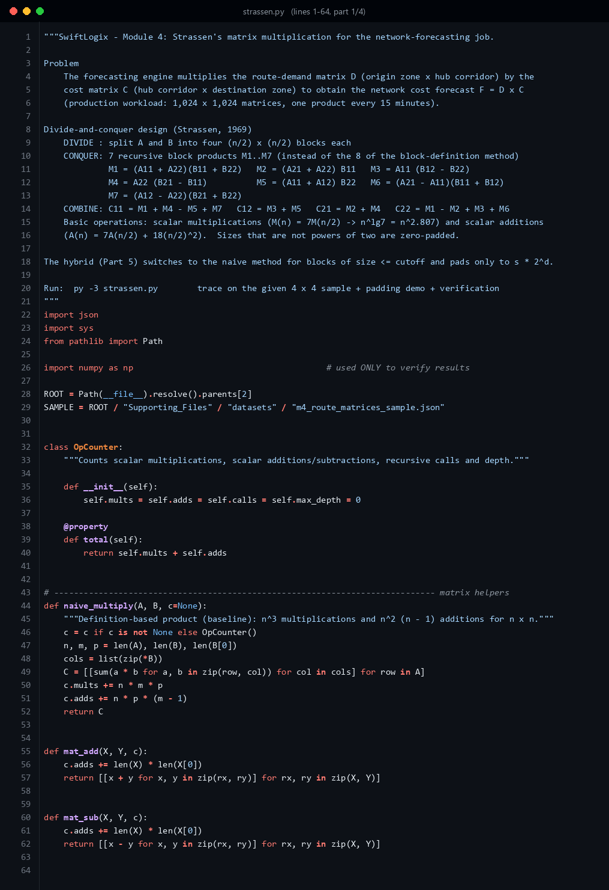

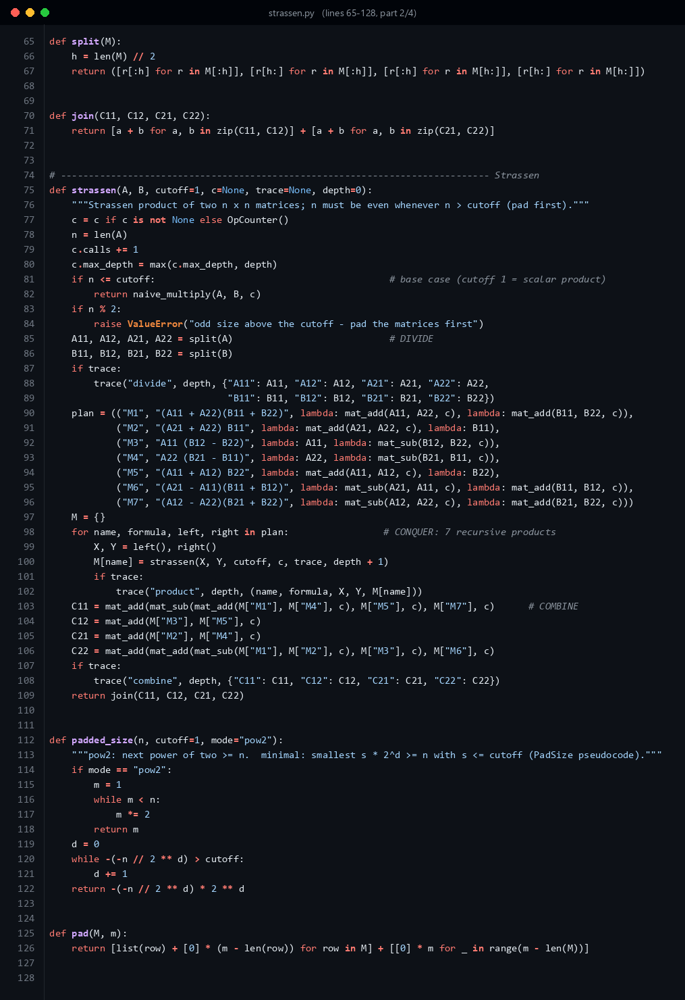

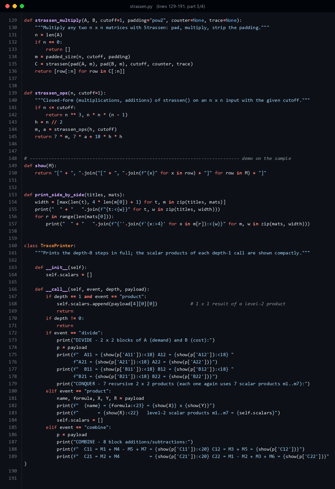

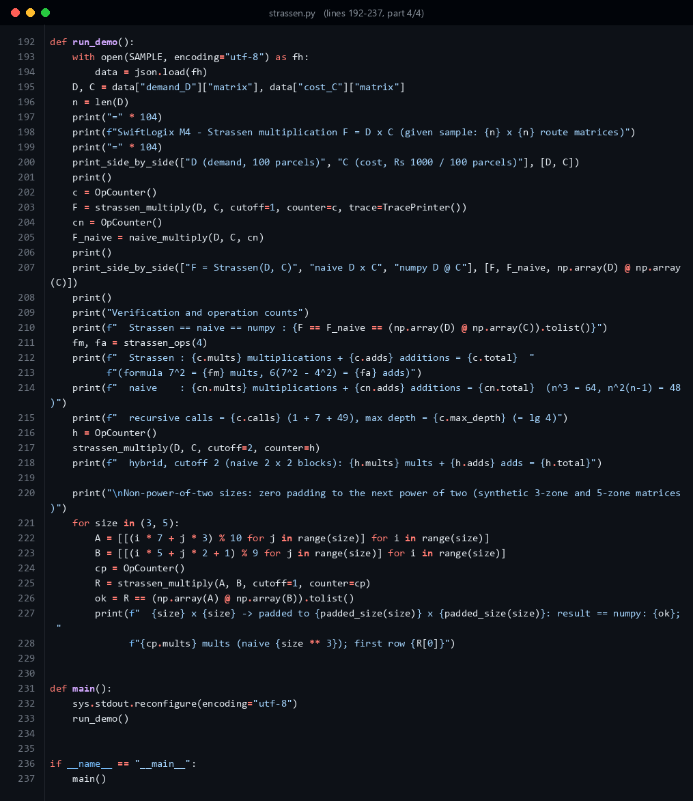

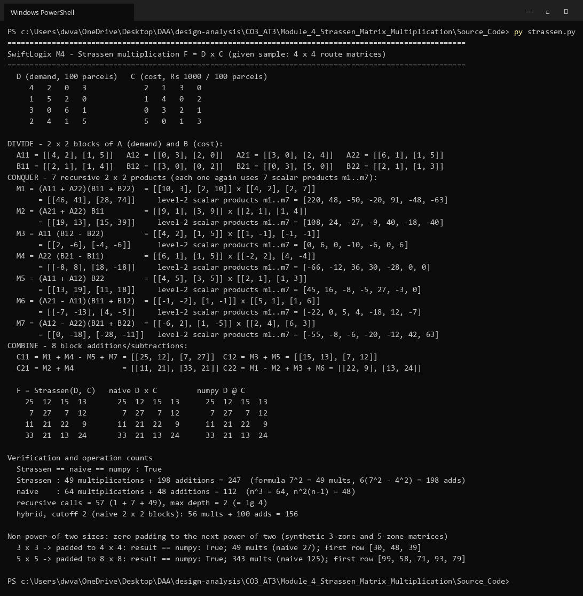

**Reading the trace (Figure 5).**

- **Divide.** D and C are split into 2 × 2 blocks, e.g. A11 = [[4, 2], [1, 5]], A22 = [[6, 1], [1, 5]], B11 = [[2, 1], [1, 4]], B22 = [[2, 1], [1, 3]].
- **Conquer.** The seven block products are formed from 10 block sums/differences. For example M1 = (A11 + A22)(B11 + B22) = [[10, 3], [2, 10]] × [[4, 2], [2, 7]]. This 2 × 2 product is itself computed by Strassen with seven *scalar* products m1..m7 = 220, 48, −50, −20, 91, −48, −63 (e.g. m1 = (10 + 10)(4 + 7) = 220, m5 = (10 + 3)·7 = 91), and its first entry is m1 + m4 − m5 + m7 = 220 − 20 − 91 − 63 = 46, so M1 = [[46, 41], [28, 74]].
- **Combine.** C11 = M1 + M4 − M5 + M7 = [[46, 41], [28, 74]] + [[−8, 8], [18, −18]] − [[13, 19], [11, 18]] + [[0, −18], [−28, −11]] = [[25, 12], [7, 27]]; C12 = M3 + M5 = [[15, 13], [7, 12]]; C21 = M2 + M4 = [[11, 21], [33, 21]]; C22 = M1 − M2 + M3 + M6 = [[22, 9], [13, 24]].
- **Result and meaning.** F = [[25, 12, 15, 13], [7, 27, 7, 12], [11, 21, 22, 9], [33, 21, 13, 24]]; e.g. F[0][0] = 25 means ₹25 thousand per day of forecast cost for Chennai-origin parcels delivered in Chennai. F is identical to the naive product and to numpy.
- **Counts.** Strassen used **49 multiplications + 198 additions = 247** scalar operations (closed forms 7² = 49 and 6(7² − 4²) = 198), 57 calls (1 + 7 + 49) and depth 2; the naive product used 64 + 48 = 112. At n = 4 Strassen saves 15 multiplications but costs 150 extra additions – the first sign of the crossover question studied in Part 5. With cutoff 2 (naive 2 × 2 blocks) the count is 56 + 100 = 156.
- **Non-power-of-two sizes.** A 3 × 3 and a 5 × 5 product were padded to 4 × 4 and 8 × 8 and match numpy; padding is costly (49 multiplications instead of 27, 343 instead of 125), which motivates the minimal-padding improvement in Part 5.

### 3. Datasets, test cases and test results

`Supporting_Files/generate_datasets.py` writes the larger datasets and the JSON test cases, whose expected outputs come from independent references (`sorted()`, `bisect`, numpy). `Supporting_Files/run_all_tests.py --module N` runs every variant of this module on those cases, on the generated dataset, on randomised inputs, and checks the operation counts against the closed forms of Part 4.

Table 3: Test plan (Supporting_Files/test_cases/*.json and run_all_tests.py)

| Module | Variants tested | Edge cases and checks | Tests |
|---|---|---|---|
| M4 Strassen | naive, pure, cutoff 2, cutoff 4 / 8 with minimal padding | 1 × 1, 2 × 2, sample 4 × 4, 3/5/6/7/12 (padding), identity, zero, 16 × 16; 64 × 64 generated; counted = closed form; 7<sup>k</sup> and 6(7<sup>k</sup> − 4<sup>k</sup>); PadSize; 30 random sizes × cutoffs × padding; odd size rejected | 17 |

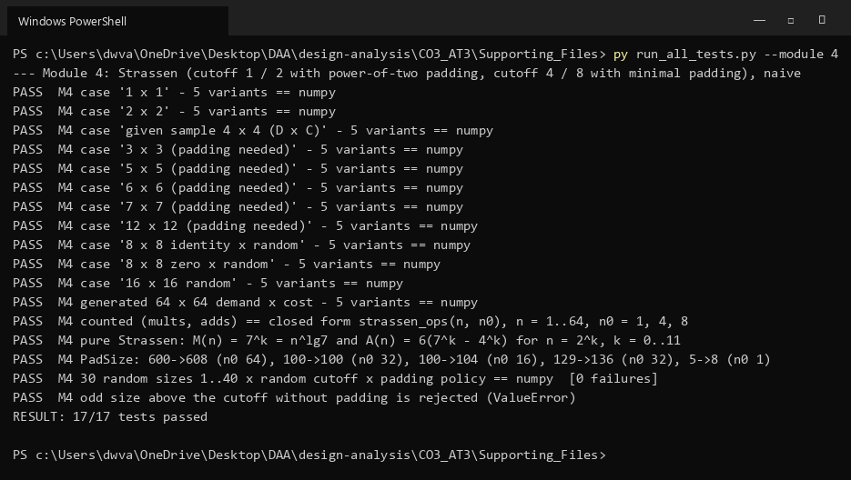

All **17 Module 4 tests pass** (Figure 6; the log is Appendix D).

## Part 4 – Recurrence Relations, Complexity and Production Workloads [15 Marks]

> Formulate and solve recurrence relations, derive time and space complexities and perform the required theoretical calculations for the specified production workloads.
> - Formulate each recurrence from the algorithm (best, average and worst case where they differ).
> - Solve each recurrence by the Master Theorem and by backward substitution or the recursion-tree method.
> - Derive the space complexity of each algorithm.
> - Compute the number of basic operations, the running time on a server executing 10⁸ basic operations per second and the memory requirement for the production workloads: 5 million shipment events per night (M1), 2 million priority scores per dispatch cycle (M2), 20 million lookups per day on an index of 10 million tracking IDs (M3) and 1,024 × 1,024 matrices (M4).

**Evidence Expected**

> Recurrences, complete solutions (Master Theorem with its parameters and substitution/recursion tree), time and space complexities, closed forms checked against counted operations, and production-workload calculations.

**Ans:**

### 1. Method

For each module I write the recurrence directly from the pseudocode of Part 2 (number of sub-problems, their size, cost of divide + combine), solve it twice – with the **Master Theorem** for T(n) = a·T(n/b) + f(n) (compare f(n) with n<sup>log<sub>b</sub> a</sup>) and with **backward substitution** or a **recursion tree** – and then check the exact closed form against the operations counted by the programs. The production figures are computed by `Supporting_Files/production_workload.py` (Figure 7) from these closed forms, at 10⁸ basic operations per second, with 1 MB = 10⁶ bytes.

### 2. Module 4 – Strassen's Matrix Multiplication

**Recurrences.** A product of order n makes 7 recursive products of order n/2 and 18 additions/subtractions of (n/2) × (n/2) blocks (10 to form the operands, 8 to combine):

- multiplications: M(n) = 7M(n/2), M(1) = 1
- additions: A(n) = 7A(n/2) + 18(n/2)², A(1) = 0
- all scalar operations: **T(n) = 7T(n/2) + 18(n/2)² = 7T(n/2) + 4.5n²**, T(1) = 1
- naive (definition) method: n³ multiplications + n²(n − 1) additions = 2n³ − n²; written as a block recursion with 8 products, N(n) = 8N(n/2) + 4(n/2)².

**Master Theorem.** For Strassen a = 7, b = 2, n<sup>log<sub>b</sub> a</sup> = n<sup>log₂ 7</sup> = n<sup>2.807</sup>, f(n) = 4.5n² = O(n<sup>log₂ 7 − ε</sup>) with ε = 0.807 > 0 → **case 1** → T(n) = **Θ(n<sup>log₂ 7</sup>) = Θ(n<sup>2.807</sup>)**. For the block-naive recursion a = 8, n<sup>log₂ 8</sup> = n³ and f(n) = n² = O(n<sup>3 − ε</sup>) → case 1 → Θ(n³). Saving one block product lowers the exponent from 3 to 2.807.

**Backward substitution** (n = 2<sup>k</sup>):

```
M(n) = 7 M(n/2) = 7^2 M(n/4) = ... = 7^k M(1) = 7^lg n = n^lg 7 ~ n^2.807
A(n) = 7 A(n/2) + 4.5 n^2
     = 7 [7 A(n/4) + 4.5 (n/2)^2] + 4.5 n^2       = 7^2 A(n/4) + 4.5 n^2 (1 + 7/4)
     = 7^i A(n/2^i) + 4.5 n^2 * sum_{j=0}^{i-1} (7/4)^j
i = k:  A(n) = 4.5 n^2 * ((7/4)^k - 1) / (7/4 - 1) = 6 n^2 ((7/4)^k - 1) = 6 (7^k - 4^k) = 6 n^lg7 - 6 n^2
T(n) = M(n) + A(n) = 7 n^lg7 - 6 n^2          check n = 4: 49 + 198 = 247 (Part 3 trace)
```

**Recursion tree.** Level j has 7<sup>j</sup> nodes of order n/2<sup>j</sup>, each doing 18(n/2<sup>j+1</sup>)² additions, so level j costs 4.5n²·(7/4)<sup>j</sup>. The level costs *grow* geometrically (ratio 7/4 > 1), so the bottom level – 7<sup>lg n</sup> = n<sup>lg 7</sup> leaf products – dominates, which is exactly Master case 1.

**Crossover and the hybrid.** Replacing the naive product of order n by one Strassen level (naive below) pays off when 2n³ − n² > 7[2(n/2)³ − (n/2)²] + 18(n/2)² = 1.75n³ + 2.75n², i.e. 0.25n³ > 3.75n², i.e. **n > 15**. So, counting operations, recursion should stop at n₀ = 8 (for powers of two). With d = lg(n/n₀) Strassen levels the hybrid costs T(n) = 7<sup>d</sup>(2n₀³ − n₀²) + 4.5n² Σ<sub>j=0</sub><sup>d−1</sup>(7/4)<sup>j</sup>; for n = 1,024, n₀ = 8: 7⁷ × 960 + (64 × 7⁷ − 4¹⁰) × 6 = 790,601,280 + 309,949,056 = **1,100,550,336**. Pure Strassen (n₀ = 1) beats the naive count only from n = 1,024 on, because the 4.5n² additions per level are expensive at small n.

**Space.** The inputs and output need 3n² words in both methods. My implementation keeps, at each level, 8 block copies of A and B, up to 6 finished products and 2 operand blocks alive while recursing into the 7th product: S(n) = S(n/2) + 16(n/2)² = 4n²(1 + 1/4 + 1/16 + …) = (16/3)n² ≈ 5.33n² words; at the top-level combine 8 + 7 + 4 + 4 = 23 blocks (n/2)² = 5.75n² words are alive. Hence the extra space is **Θ(n²)** with constant ≈ 5.75 (a memory-economical schedule can reduce it to about n²). The recursion depth is lg(n/n₀) frames.

**Check against counted operations.** For every n from 2 to 64 (pure Strassen) and 2 to 256 (cutoffs 8, 16, 32) the counted multiplications + additions equal the closed form exactly (Table 5 in Part 5; the harness also checks M(n) = 7<sup>k</sup> and A(n) = 6(7<sup>k</sup> − 4<sup>k</sup>) for k = 0…11).

**Production workload (n = 1,024 = 2¹⁰, 96 forecasts per day).** Naive: 2n³ − n² = **2,146,435,072** operations → **21.46 s** per forecast (34.3 min per day). Pure Strassen: 7 × 7¹⁰ − 6 × 4¹⁰ = **1,971,035,287** → 19.71 s, of which only 282,475,249 are multiplications (naive 1,073,741,824 – 3.8 times fewer). Hybrid n₀ = 8: **1,100,550,336** → **11.01 s** (17.6 min per day, 1.95× faster than naive). Memory: naive 3n² × 8 B = **25.2 MB**; Strassen 2n² (inputs) + 5.75n² (workspace incl. output) = 7.75 × 1,048,576 × 8 B = **65.0 MB**.

Table 4: Module 4 production estimates (production_workload.csv)

| Design / quantity | Basic operations | Time at 10⁸ ops/s | Memory (MB) | Note |
|---|---:|---:|---:|---|
| naive product 2n^3 - n^2 | 2,146,435,072 | 21.46 s | 25.2 | 2,060.58 s/day |
| pure Strassen 7n^2.807 - 6n^2 | 1,971,035,287 | 19.71 s | 65.0 | 282,475,249 mults |
| hybrid Strassen, cutoff 8 | 1,100,550,336 | 11.01 s | 65.0 | op-optimal; 1,056.53 s/day |
| hybrid Strassen, cutoff 64 | 1,301,696,512 | 13.02 s | 65.0 | time-tuned (Python); 1,249.63 s/day |
| Strassen-Winograd (15 adds), cutoff 8 | 1,048,892,160 | 10.49 s | 65.0 | formula only (next step) |

### 3. Production-workload calculation program

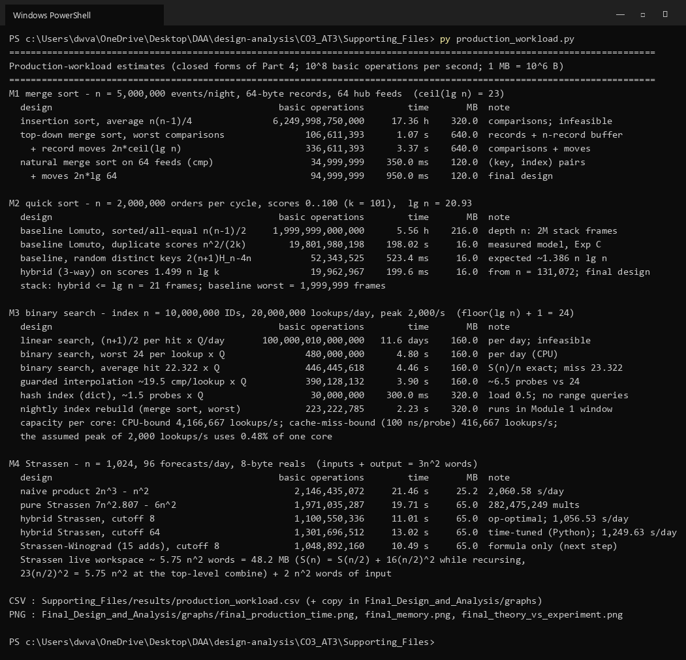

## Part 5 – Comparative Performance, Limitations and Improvements [10 Marks]

> Compare algorithmic performance, discuss limitations and trade-offs, and justify the proposed improvements for each module.
> - Measure operation counts and running times for increasing input sizes against suitable baselines (insertion sort, linear search, naive matrix multiplication) and against the theoretical predictions.
> - Demonstrate the quick sort worst case and determine the Strassen crossover point.
> - Discuss the limitations and trade-offs of each module; propose improvements, implement at least one improvement per module and measure its effect.

**Evidence Expected**

> Comparison tables, graphs with theoretical overlays, worst-case and crossover analysis, limitations and trade-offs, and measured, justified improvements.

**Ans:**

### 1. Experimental method

Each module has an experiment script (`*_experiments.py`, Appendix B) that generates deterministic inputs of doubling size, runs the baseline, the divide-and-conquer design and the improved variants, asserts that every output is correct, and writes the counts and times to `Supporting_Files/results/*.csv` (copies next to the graphs) and the graphs to `Report/graphs/`. **Operation counts are the primary evidence**: they are exact, repeatable and directly comparable with the formulas of Part 4. Times are secondary – other jobs shared the machine, so differences below about 20 % are within noise; I report the median (sorting) or the best (search, matrices) of repeated runs. Inputs are modelled on the case: event timestamps in a 3-day window, 64 time-ordered hub feeds, integer priority scores 0–100, uniform and clustered 10-digit tracking IDs, and integer route matrices.

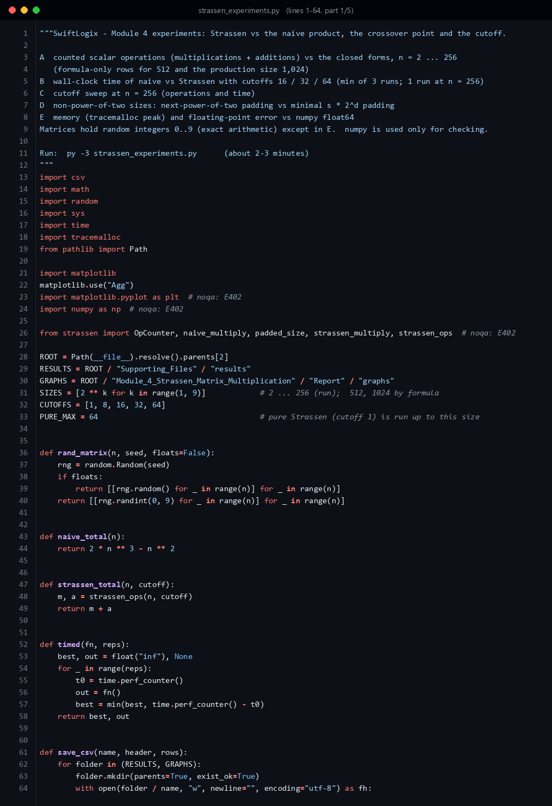

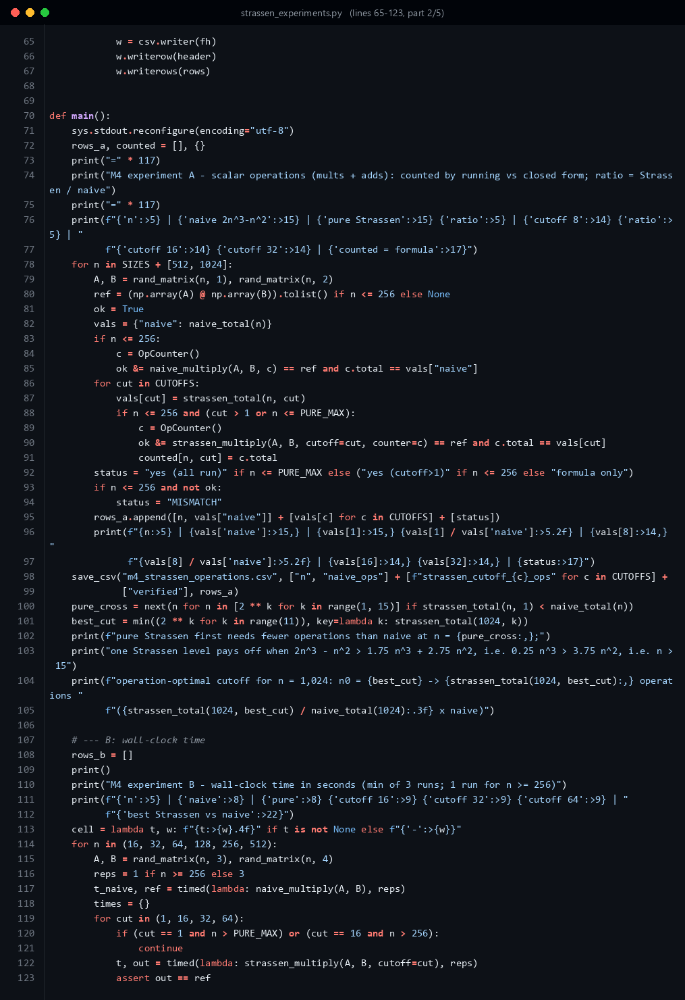

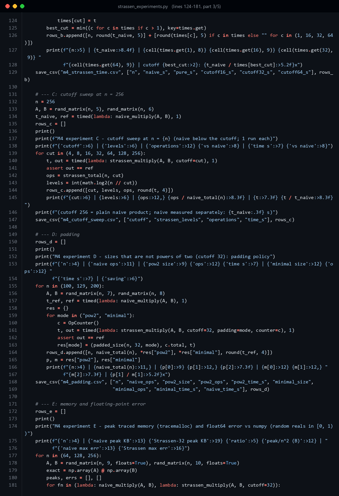

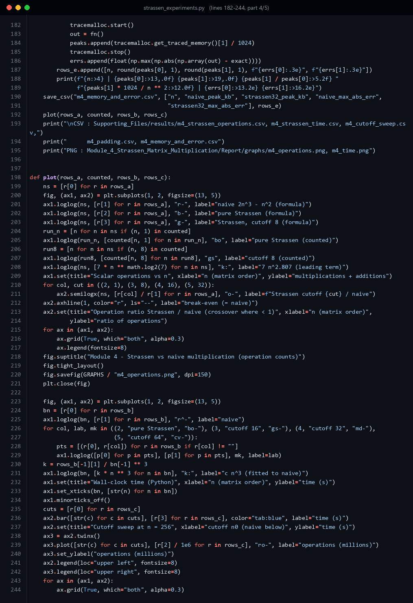

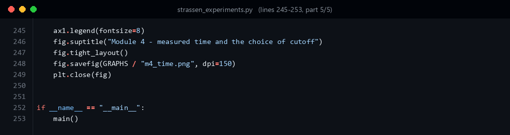

### 2. Module 4 – Strassen vs the naive product, the crossover point and the cutoff

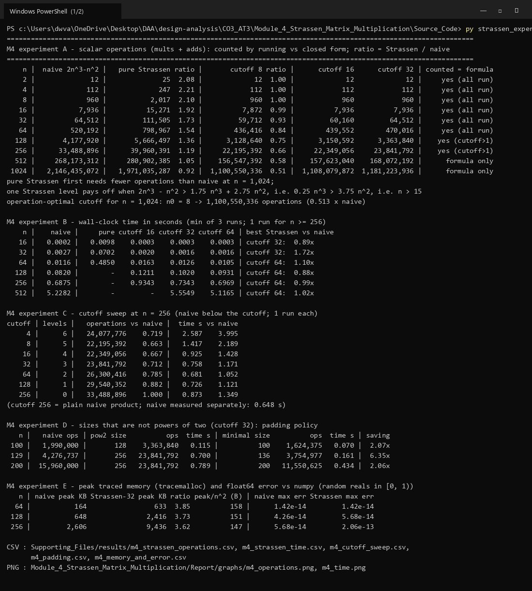

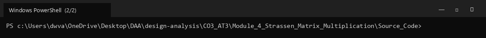

Table 5: Scalar operations (multiplications + additions) – counted = closed form (m4_strassen_operations.csv)

| n | naive 2n³ − n² | pure Strassen | ratio | cutoff 8 | ratio 8 | cutoff 16 | ratio 16 |
|---:|---:|---:|---:|---:|---:|---:|---:|
| 2 | 12 | 25 | 2.08 | 12 | 1.00 | 12 | 1.00 |
| 4 | 112 | 247 | 2.21 | 112 | 1.00 | 112 | 1.00 |
| 8 | 960 | 2,017 | 2.10 | 960 | 1.00 | 960 | 1.00 |
| 16 | 7,936 | 15,271 | 1.92 | 7,872 | 0.99 | 7,936 | 1.00 |
| 32 | 64,512 | 111,505 | 1.73 | 59,712 | 0.93 | 60,160 | 0.93 |
| 64 | 520,192 | 798,967 | 1.54 | 436,416 | 0.84 | 439,552 | 0.84 |
| 128 | 4,177,920 | 5,666,497 | 1.36 | 3,128,640 | 0.75 | 3,150,592 | 0.75 |
| 256 | 33,488,896 | 39,960,391 | 1.19 | 22,195,392 | 0.66 | 22,349,056 | 0.67 |
| 512 | 268,173,312 | 280,902,385 | 1.05 | 156,547,392 | 0.58 | 157,623,040 | 0.59 |
| 1,024 | 2,146,435,072 | 1,971,035,287 | 0.92 | 1,100,550,336 | 0.51 | 1,108,079,872 | 0.52 |

(ratio = Strassen operations / naive operations. Counted by running and equal to the closed form for every n ≤ 64 with pure Strassen and every n ≤ 256 with cutoffs 8, 16, 32, 64; n = 512 and 1,024 from the verified closed form.)

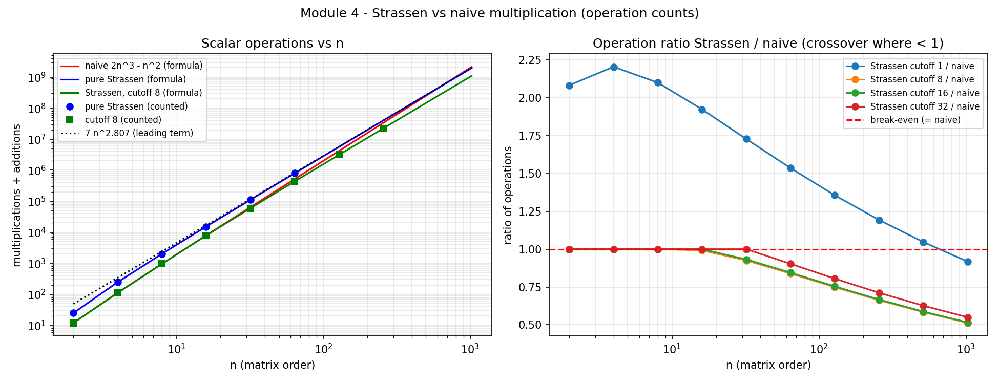

**Crossover point (operation counts).** Pure Strassen (recursion down to 1 × 1) needs *more* operations than the naive product up to n = 512 (ratio 2.21 at n = 4, 1.05 at n = 512) and crosses below only at **n = 1,024 (0.92)**, because each level adds 18 block additions. With a cutoff the crossover moves to **n = 16**, exactly as derived in Part 4 (one Strassen level pays off for n > 15): cutoff 8 gives 7,872 vs 7,936 operations at n = 16 and **0.51× the naive count at n = 1,024**. Every counted value equals the closed form.

Table 6: Wall-clock time in seconds (min of 3; 1 run for n ≥ 256) (m4_strassen_time.csv)

| n | naive | pure Strassen | cutoff 16 | cutoff 32 | cutoff 64 | speed-up |
|---:|---:|---:|---:|---:|---:|---:|
| 16 | 0.0002 | 0.0098 | 0.0003 | 0.0003 | 0.0003 | 0.88 |
| 32 | 0.0027 | 0.0702 | 0.0020 | 0.0016 | 0.0016 | 1.72 |
| 64 | 0.0116 | 0.4850 | 0.0163 | 0.0126 | 0.0106 | 1.10 |
| 128 | 0.0820 | – | 0.1211 | 0.1020 | 0.0931 | 0.88 |
| 256 | 0.6875 | – | 0.9343 | 0.7343 | 0.6968 | 0.99 |
| 512 | 5.2282 | – | – | 5.5549 | 5.1165 | 1.02 |

Table 7: Cutoff sweep at n = 256 (m4_cutoff_sweep.csv; naive measured separately 0.648 s)

| cutoff n0 | Strassen levels | operations | operations / naive | time s |
|---:|---:|---:|---:|---:|
| 4 | 6 | 24,077,776 | 0.719 | 2.587 |
| 8 | 5 | 22,195,392 | 0.663 | 1.417 |
| 16 | 4 | 22,349,056 | 0.667 | 0.925 |
| 32 | 3 | 23,841,792 | 0.712 | 0.758 |
| 64 | 2 | 26,300,416 | 0.785 | 0.681 |
| 128 | 1 | 29,540,352 | 0.882 | 0.726 |
| 256 | 0 | 33,488,896 | 1.000 | 0.873 |

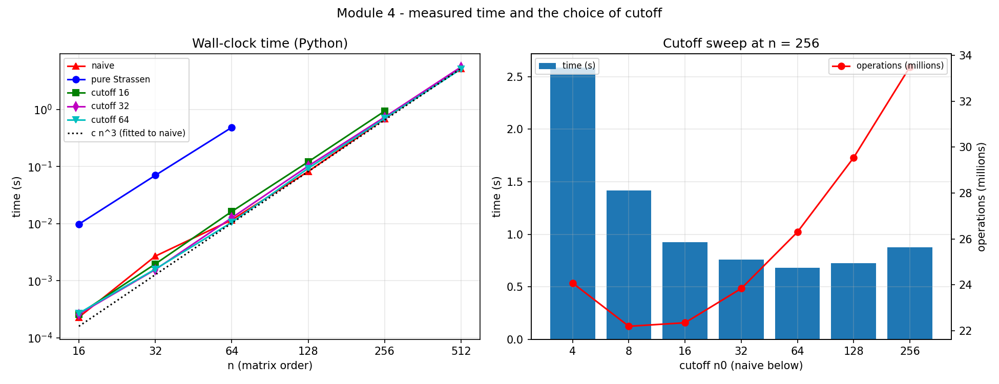

**Crossover point (time).** In CPython the time crossover lies far above the operation-count crossover (Tables 6, 7): pure Strassen is 26–43× slower than naive at n = 16–64, and even the best hybrid only matches the naive product up to n = 512 (1.02× at n = 512 with n₀ = 64). The cutoff sweep shows the reason: operations are minimal at n₀ = 8 (0.663 of naive) but time is minimal at **n₀ = 64** (0.681 s), because each block addition, split and join in Python costs more than one step of the naive inner product (`sum` over `zip`, executed in C) and allocates new lists. Rows where the cutoff ≥ n are naive products, so differences there (e.g. 0.0027 vs 0.0016 s at n = 32) show the timing noise of millisecond runs. The measured trend (0.99× at 256, 1.02× at 512 with n₀ = 64) agrees with the op-count model, which predicts a growing gain (0.61× of the naive operations at n = 1,024 for n₀ = 64).

Table 8: Non-power-of-two sizes, cutoff 32 – next-power-of-two padding vs minimal s·2<sup>d</sup> padding (m4_padding.csv)

| n | naive ops | pow2 m | pow2 ops | pow2 s | minimal m | minimal ops | minimal s | saving |
|---:|---:|---:|---:|---:|---:|---:|---:|---:|
| 100 | 1,990,000 | 128 | 3,363,840 | 0.115 | 100 | 1,624,375 | 0.070 | 2.07x |
| 129 | 4,276,737 | 256 | 23,841,792 | 0.700 | 136 | 3,754,977 | 0.161 | 6.35x |
| 200 | 15,960,000 | 256 | 23,841,792 | 0.789 | 200 | 11,550,625 | 0.434 | 2.06x |

(m = padded order; s = measured seconds, one run each.)

Table 9: Memory (tracemalloc peak during the multiplication; Strassen with n₀ = 32) and maximum float64 error against numpy (m4_memory_and_error.csv)

| n | naive KB | Strassen KB | ratio | naive error | Strassen error |
|---:|---:|---:|---:|---:|---:|
| 64 | 164 | 633 | 3.85 | 1.421e-14 | 1.421e-14 |
| 128 | 648 | 2,416 | 3.73 | 4.263e-14 | 5.684e-14 |
| 256 | 2,606 | 9,436 | 3.62 | 5.684e-14 | 2.061e-13 |

**Limitations and trade-offs.** (1) **Large constant:** 18 block additions per level make pure Strassen slower than naive below n = 1,024 in operation count and far slower in Python time. (2) **Memory:** Θ(n²) temporaries – 3.6–3.9× the naive peak in Python (Table 9) and 65 MB instead of 25.2 MB at production size. (3) **Numerical stability:** the subtractions in M3, M4, M6, M7 cause more rounding error – 2.06 × 10⁻¹³ against 5.68 × 10⁻¹⁴ for naive at n = 256 – harmless for costs in ₹ thousands, but a reason not to use deep recursion on ill-conditioned data. (4) **Padding waste:** padding 129 zones to 256 makes the product 5.6× more expensive than naive (23,841,792 vs 4,276,737 operations).

**Improvements implemented and measured.** (1) The **cutoff hybrid** (naive below n₀) – 0.51× the naive operations at n = 1,024 with n₀ = 8 (op-optimal) and the time-optimal n₀ = 64 in Python. (2) **Minimal padding** to s·2<sup>d</sup> with s ≤ n₀: 129 → 136 instead of 256 (**6.35× fewer operations, 0.161 s instead of 0.700 s**), and 100 or 200 need no padding at all (2.07× and 2.06× fewer operations); with it Strassen beats the naive operation count at n = 100 and n = 200 (1,624,375 vs 1,990,000; 11,550,625 vs 15,960,000) instead of losing. Recommended next steps (not implemented): Winograd's variant with 15 instead of 18 additions (1,048,892,160 operations at n = 1,024, n₀ = 8 – formula in `production_workload.py`), a memory-economical schedule that reuses two temporaries per level, and running the seven independent products in parallel.

## Part 6 – Final Algorithmic Design and Recommendations [10 Marks]

> Present the final algorithmic design with appropriate complexity analysis, memory requirements and recommendations.
> - For each module state the recommended algorithm, its time complexity, its memory requirement (in bytes for the production sizes) and a throughput estimate.
> - Give recommendations for deployment and further optimisation.

**Evidence Expected**

> Final design per module with complexity, memory and throughput figures derived from Parts 4 and 5, and justified recommendations.

**Ans:**

### 1. Module 4 – final design: hybrid Strassen with tuned cutoff and minimal padding

- **Algorithm.** Strassen's recursion with the **definition-based product below a cutoff n₀** and **minimal padding** to s·2<sup>d</sup> (s ≤ n₀). The cutoff is tuned on the production machine: n₀ = 8 minimises the operation count; in the CPython measurements n₀ = 64 minimised the time; in a compiled implementation it is chosen by the same sweep (Table 7). The seven products of each level are independent and can run on separate cores.
- **Time.** Θ(n<sup>log₂ 7</sup>) = Θ(n<sup>2.807</sup>). Production n = 1,024: **1,100,550,336** operations with n₀ = 8 → **11.01 s** per forecast (1,301,696,512 → 13.02 s with n₀ = 64), against 21.46 s for the naive product: 17.6 min of CPU per day for 96 forecasts instead of 34.3 min.
- **Memory.** Inputs 2 × 1,048,576 × 8 B = 16,777,216 B; workspace including the output ≈ 5.75n² × 8 B = 48,234,496 B; **total ≈ 65,000,000 B (65 MB)**, against 25,165,824 B (25.2 MB) for the naive product – the price of the 7-product scheme.
- **Throughput.** ≈ 327 forecasts of order 1,024 per hour on one core (up to about 7× more if the seven products run on separate cores), far above the required 4 per hour.
- **Recommendations.** Use float64 (the measured error stayed at 2 × 10⁻¹³ at n = 256); adopt **Winograd's variant** (15 instead of 18 additions → 1,048,892,160 operations, 10.49 s) and a memory-economical schedule; never pad to the next power of two for zone counts such as 600 (608 is enough with n₀ = 64).

### 2. Place of this module in the platform

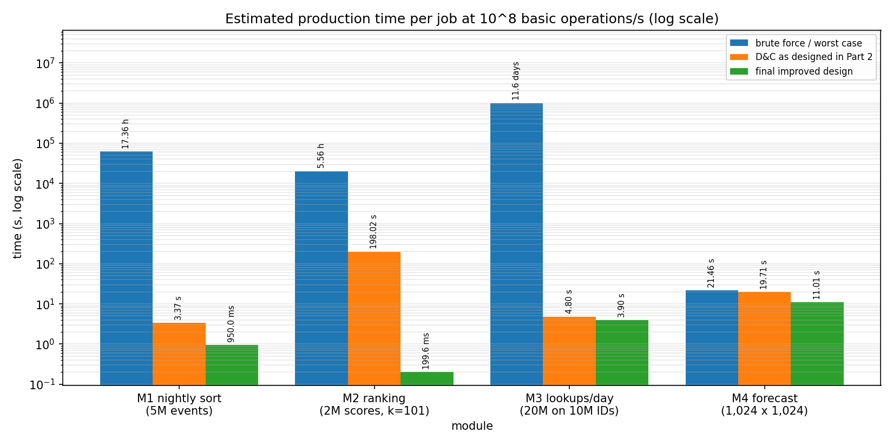

The final designs of all four modules together need about 361 MB of working memory (120 MB M1, 16 MB M2, 160 MB M3, 65 MB M4) and well under one CPU-minute per hour; the complete platform design, the memory budget and the joint recommendations are in Part 6 of the case-study report (`Final_Design_and_Analysis/CO3_AT3_Case_Study_Report`).

### Summary of Findings

Table 10: Summary of findings

| Module | Part 2 design | Verified on the sample (Part 3) | Complexity (Part 4) | Key experimental finding (Part 5) | Final design (Part 6) |
|---|---|---|---|---|---|
| M4 Strassen | 7 products, pad to 2<sup>k</sup> | 49 mults + 198 adds = 247 vs naive 112; matches numpy | Θ(n<sup>2.807</sup>), Θ(n²) space; 1.97 × 10⁹ ops | op crossover n > 15 with cutoff (pure only at 1,024); time-optimal n₀ = 64 in Python; minimal padding 6.35× | hybrid Strassen n₀ tuned: 11.01 s, 65 MB |

<!-- pagebreak -->

### Appendix A – Complete Source Code: strassen.py

```
"""SwiftLogix - Module 4: Strassen's matrix multiplication for the network-forecasting job.

Problem
    The forecasting engine multiplies the route-demand matrix D (origin zone x hub corridor) by the
    cost matrix C (hub corridor x destination zone) to obtain the network cost forecast F = D x C
    (production workload: 1,024 x 1,024 matrices, one product every 15 minutes).

Divide-and-conquer design (Strassen, 1969)
    DIVIDE : split A and B into four (n/2) x (n/2) blocks each
    CONQUER: 7 recursive block products M1..M7 (instead of the 8 of the block-definition method)
             M1 = (A11 + A22)(B11 + B22)   M2 = (A21 + A22) B11   M3 = A11 (B12 - B22)
             M4 = A22 (B21 - B11)          M5 = (A11 + A12) B22   M6 = (A21 - A11)(B11 + B12)
             M7 = (A12 - A22)(B21 + B22)
    COMBINE: C11 = M1 + M4 - M5 + M7   C12 = M3 + M5   C21 = M2 + M4   C22 = M1 - M2 + M3 + M6
    Basic operations: scalar multiplications (M(n) = 7M(n/2) -> n^lg7 = n^2.807) and scalar additions
    (A(n) = 7A(n/2) + 18(n/2)^2).  Sizes that are not powers of two are zero-padded.

The hybrid (Part 5) switches to the naive method for blocks of size <= cutoff and pads only to s * 2^d.

Run:  py -3 strassen.py        trace on the given 4 x 4 sample + padding demo + verification
"""
import json
import sys
from pathlib import Path

import numpy as np                                       # used ONLY to verify results

ROOT = Path(__file__).resolve().parents[2]
SAMPLE = ROOT / "Supporting_Files" / "datasets" / "m4_route_matrices_sample.json"

class OpCounter:
    """Counts scalar multiplications, scalar additions/subtractions, recursive calls and depth."""

    def __init__(self):
        self.mults = self.adds = self.calls = self.max_depth = 0

    @property
    def total(self):
        return self.mults + self.adds

# ----------------------------------------------------------------------------- matrix helpers
def naive_multiply(A, B, c=None):
    """Definition-based product (baseline): n^3 multiplications and n^2 (n - 1) additions for n x n."""
    c = c if c is not None else OpCounter()
    n, m, p = len(A), len(B), len(B[0])
    cols = list(zip(*B))
    C = [[sum(a * b for a, b in zip(row, col)) for col in cols] for row in A]
    c.mults += n * m * p
    c.adds += n * p * (m - 1)
    return C

def mat_add(X, Y, c):
    c.adds += len(X) * len(X[0])
    return [[x + y for x, y in zip(rx, ry)] for rx, ry in zip(X, Y)]

def mat_sub(X, Y, c):
    c.adds += len(X) * len(X[0])
    return [[x - y for x, y in zip(rx, ry)] for rx, ry in zip(X, Y)]

def split(M):
    h = len(M) // 2
    return ([r[:h] for r in M[:h]], [r[h:] for r in M[:h]], [r[:h] for r in M[h:]], [r[h:] for r in M[h:]])

def join(C11, C12, C21, C22):
    return [a + b for a, b in zip(C11, C12)] + [a + b for a, b in zip(C21, C22)]

# ----------------------------------------------------------------------------- Strassen
def strassen(A, B, cutoff=1, c=None, trace=None, depth=0):
    """Strassen product of two n x n matrices; n must be even whenever n > cutoff (pad first)."""
    c = c if c is not None else OpCounter()
    n = len(A)
    c.calls += 1
    c.max_depth = max(c.max_depth, depth)
    if n <= cutoff:                                          # base case (cutoff 1 = scalar product)
        return naive_multiply(A, B, c)
    if n % 2:
        raise ValueError("odd size above the cutoff - pad the matrices first")
    A11, A12, A21, A22 = split(A)                            # DIVIDE
    B11, B12, B21, B22 = split(B)
    if trace:
        trace("divide", depth, {"A11": A11, "A12": A12, "A21": A21, "A22": A22,
                                "B11": B11, "B12": B12, "B21": B21, "B22": B22})
    plan = (("M1", "(A11 + A22)(B11 + B22)", lambda: mat_add(A11, A22, c), lambda: mat_add(B11, B22, c)),
            ("M2", "(A21 + A22) B11", lambda: mat_add(A21, A22, c), lambda: B11),
            ("M3", "A11 (B12 - B22)", lambda: A11, lambda: mat_sub(B12, B22, c)),
            ("M4", "A22 (B21 - B11)", lambda: A22, lambda: mat_sub(B21, B11, c)),
            ("M5", "(A11 + A12) B22", lambda: mat_add(A11, A12, c), lambda: B22),
            ("M6", "(A21 - A11)(B11 + B12)", lambda: mat_sub(A21, A11, c), lambda: mat_add(B11, B12, c)),
            ("M7", "(A12 - A22)(B21 + B22)", lambda: mat_sub(A12, A22, c), lambda: mat_add(B21, B22, c)))
    M = {}
    for name, formula, left, right in plan:                 # CONQUER: 7 recursive products
        X, Y = left(), right()
        M[name] = strassen(X, Y, cutoff, c, trace, depth + 1)
        if trace:
            trace("product", depth, (name, formula, X, Y, M[name]))
    C11 = mat_add(mat_sub(mat_add(M["M1"], M["M4"], c), M["M5"], c), M["M7"], c)      # COMBINE
    C12 = mat_add(M["M3"], M["M5"], c)
    C21 = mat_add(M["M2"], M["M4"], c)
    C22 = mat_add(mat_add(mat_sub(M["M1"], M["M2"], c), M["M3"], c), M["M6"], c)
    if trace:
        trace("combine", depth, {"C11": C11, "C12": C12, "C21": C21, "C22": C22})
    return join(C11, C12, C21, C22)

def padded_size(n, cutoff=1, mode="pow2"):
    """pow2: next power of two >= n.  minimal: smallest s * 2^d >= n with s <= cutoff (PadSize pseudocode)."""
    if mode == "pow2":
        m = 1
        while m < n:
            m *= 2
        return m
    d = 0
    while -(-n // 2 ** d) > cutoff:
        d += 1
    return -(-n // 2 ** d) * 2 ** d

def pad(M, m):
    return [list(row) + [0] * (m - len(row)) for row in M] + [[0] * m for _ in range(m - len(M))]

def strassen_multiply(A, B, cutoff=1, padding="pow2", counter=None, trace=None):
    """Multiply any two n x n matrices with Strassen: pad, multiply, strip the padding."""
    n = len(A)
    if n == 0:
        return []
    m = padded_size(n, cutoff, padding)
    C = strassen(pad(A, m), pad(B, m), cutoff, counter, trace)
    return [row[:n] for row in C[:n]]

def strassen_ops(n, cutoff=1):
    """Closed-form (multiplications, additions) of strassen() on an n x n input with the given cutoff."""
    if n <= cutoff:
        return n ** 3, n * n * (n - 1)
    h = n // 2
    m, a = strassen_ops(h, cutoff)
    return 7 * m, 7 * a + 18 * h * h

# ----------------------------------------------------------------------------- demo on the sample
def show(M):
    return "[" + ", ".join("[" + ", ".join(f"{x}" for x in row) + "]" for row in M) + "]"

def print_side_by_side(titles, mats):
    width = [max(len(t), 4 * len(m[0]) + 1) for t, m in zip(titles, mats)]
    print("  " + "   ".join(f"{t:<{w}}" for t, w in zip(titles, width)))
    for r in range(len(mats[0])):
        print("  " + "   ".join(f"{''.join(f'{x:>4}' for x in m[r]):<{w}}" for m, w in zip(mats, width)))

class TracePrinter:
    """Prints the depth-0 steps in full; the scalar products of each depth-1 call are shown compactly."""

    def __init__(self):
        self.scalars = []

    def __call__(self, event, depth, payload):
        if depth == 1 and event == "product":
            self.scalars.append(payload[4][0][0])            # 1 x 1 result of a level-2 product
            return
        if depth != 0:
            return
        if event == "divide":
            print("DIVIDE - 2 x 2 blocks of A (demand) and B (cost):")
            p = payload
            print(f"  A11 = {show(p['A11']):<18} A12 = {show(p['A12']):<18} "
                  f"A21 = {show(p['A21']):<18} A22 = {show(p['A22'])}")
            print(f"  B11 = {show(p['B11']):<18} B12 = {show(p['B12']):<18} "
                  f"B21 = {show(p['B21']):<18} B22 = {show(p['B22'])}")
            print("CONQUER - 7 recursive 2 x 2 products (each one again uses 7 scalar products m1..m7):")
        elif event == "product":
            name, formula, X, Y, R = payload
            print(f"  {name} = {formula:<23} = {show(X)} x {show(Y)}")
            print(f"       = {show(R):<22}   level-2 scalar products m1..m7 = {self.scalars}")
            self.scalars = []
        elif event == "combine":
            p = payload
            print("COMBINE - 8 block additions/subtractions:")
            print(f"  C11 = M1 + M4 - M5 + M7 = {show(p['C11']):<20} C12 = M3 + M5 = {show(p['C12'])}")
            print(f"  C21 = M2 + M4           = {show(p['C21']):<20} C22 = M1 - M2 + M3 + M6 = {show(p['C22'])}")

def run_demo():
    with open(SAMPLE, encoding="utf-8") as fh:
        data = json.load(fh)
    D, C = data["demand_D"]["matrix"], data["cost_C"]["matrix"]
    n = len(D)
    print("=" * 104)
    print(f"SwiftLogix M4 - Strassen multiplication F = D x C (given sample: {n} x {n} route matrices)")
    print("=" * 104)
    print_side_by_side(["D (demand, 100 parcels)", "C (cost, Rs 1000 / 100 parcels)"], [D, C])
    print()
    c = OpCounter()
    F = strassen_multiply(D, C, cutoff=1, counter=c, trace=TracePrinter())
    cn = OpCounter()
    F_naive = naive_multiply(D, C, cn)
    print()
    print_side_by_side(["F = Strassen(D, C)", "naive D x C", "numpy D @ C"], [F, F_naive, np.array(D) @ np.array(C)])
    print()
    print("Verification and operation counts")
    print(f"  Strassen == naive == numpy : {F == F_naive == (np.array(D) @ np.array(C)).tolist()}")
    fm, fa = strassen_ops(4)
    print(f"  Strassen : {c.mults} multiplications + {c.adds} additions = {c.total}  "
          f"(formula 7^2 = {fm} mults, 6(7^2 - 4^2) = {fa} adds)")
    print(f"  naive    : {cn.mults} multiplications + {cn.adds} additions = {cn.total}  (n^3 = 64, n^2(n-1) = 48)")
    print(f"  recursive calls = {c.calls} (1 + 7 + 49), max depth = {c.max_depth} (= lg 4)")
    h = OpCounter()
    strassen_multiply(D, C, cutoff=2, counter=h)
    print(f"  hybrid, cutoff 2 (naive 2 x 2 blocks): {h.mults} mults + {h.adds} adds = {h.total}")

    print("\nNon-power-of-two sizes: zero padding to the next power of two (synthetic 3-zone and 5-zone matrices)")
    for size in (3, 5):
        A = [[(i * 7 + j * 3) % 10 for j in range(size)] for i in range(size)]
        B = [[(i * 5 + j * 2 + 1) % 9 for j in range(size)] for i in range(size)]
        cp = OpCounter()
        R = strassen_multiply(A, B, cutoff=1, counter=cp)
        ok = R == (np.array(A) @ np.array(B)).tolist()
        print(f"  {size} x {size} -> padded to {padded_size(size)} x {padded_size(size)}: result == numpy: {ok}; "
              f"{cp.mults} mults (naive {size ** 3}); first row {R[0]}")

def main():
    sys.stdout.reconfigure(encoding="utf-8")
    run_demo()

if __name__ == "__main__":
    main()
```

### Appendix B – Experiment and Graph Script: strassen_experiments.py

```
"""SwiftLogix - Module 4 experiments: Strassen vs the naive product, the crossover point and the cutoff.

A  counted scalar operations (multiplications + additions) vs the closed forms, n = 2 ... 256
   (formula-only rows for 512 and the production size 1,024)
B  wall-clock time of naive vs Strassen with cutoffs 16 / 32 / 64 (min of 3 runs; 1 run at n = 256)
C  cutoff sweep at n = 256 (operations and time)
D  non-power-of-two sizes: next-power-of-two padding vs minimal s * 2^d padding
E  memory (tracemalloc peak) and floating-point error vs numpy float64
Matrices hold random integers 0..9 (exact arithmetic) except in E.  numpy is used only for checking.

Run:  py -3 strassen_experiments.py      (about 2-3 minutes)
"""
import csv
import math
import random
import sys
import time
import tracemalloc
from pathlib import Path

import matplotlib
matplotlib.use("Agg")
import matplotlib.pyplot as plt  # noqa: E402
import numpy as np  # noqa: E402

from strassen import OpCounter, naive_multiply, padded_size, strassen_multiply, strassen_ops  # noqa: E402

ROOT = Path(__file__).resolve().parents[2]
RESULTS = ROOT / "Supporting_Files" / "results"
GRAPHS = ROOT / "Module_4_Strassen_Matrix_Multiplication" / "Report" / "graphs"
SIZES = [2 ** k for k in range(1, 9)]            # 2 ... 256 (run);  512, 1024 by formula
CUTOFFS = [1, 8, 16, 32, 64]
PURE_MAX = 64                                    # pure Strassen (cutoff 1) is run up to this size

def rand_matrix(n, seed, floats=False):
    rng = random.Random(seed)
    if floats:
        return [[rng.random() for _ in range(n)] for _ in range(n)]
    return [[rng.randint(0, 9) for _ in range(n)] for _ in range(n)]

def naive_total(n):
    return 2 * n ** 3 - n ** 2

def strassen_total(n, cutoff):
    m, a = strassen_ops(n, cutoff)
    return m + a

def timed(fn, reps):
    best, out = float("inf"), None
    for _ in range(reps):
        t0 = time.perf_counter()
        out = fn()
        best = min(best, time.perf_counter() - t0)
    return best, out

def save_csv(name, header, rows):
    for folder in (RESULTS, GRAPHS):
        folder.mkdir(parents=True, exist_ok=True)
        with open(folder / name, "w", newline="", encoding="utf-8") as fh:
            w = csv.writer(fh)
            w.writerow(header)
            w.writerows(rows)

def main():
    sys.stdout.reconfigure(encoding="utf-8")
    rows_a, counted = [], {}
    print("=" * 117)
    print("M4 experiment A - scalar operations (mults + adds): counted by running vs closed form; ratio = Strassen / naive")
    print("=" * 117)
    print(f"{'n':>5} | {'naive 2n^3-n^2':>15} | {'pure Strassen':>15} {'ratio':>5} | {'cutoff 8':>14} {'ratio':>5} | "
          f"{'cutoff 16':>14} {'cutoff 32':>14} | {'counted = formula':>17}")
    for n in SIZES + [512, 1024]:
        A, B = rand_matrix(n, 1), rand_matrix(n, 2)
        ref = (np.array(A) @ np.array(B)).tolist() if n <= 256 else None
        ok = True
        vals = {"naive": naive_total(n)}
        if n <= 256:
            c = OpCounter()
            ok &= naive_multiply(A, B, c) == ref and c.total == vals["naive"]
        for cut in CUTOFFS:
            vals[cut] = strassen_total(n, cut)
            if n <= 256 and (cut > 1 or n <= PURE_MAX):
                c = OpCounter()
                ok &= strassen_multiply(A, B, cutoff=cut, counter=c) == ref and c.total == vals[cut]
                counted[n, cut] = c.total
        status = "yes (all run)" if n <= PURE_MAX else ("yes (cutoff>1)" if n <= 256 else "formula only")
        if n <= 256 and not ok:
            status = "MISMATCH"
        rows_a.append([n, vals["naive"]] + [vals[c] for c in CUTOFFS] + [status])
        print(f"{n:>5} | {vals['naive']:>15,} | {vals[1]:>15,} {vals[1] / vals['naive']:>5.2f} | {vals[8]:>14,} "
              f"{vals[8] / vals['naive']:>5.2f} | {vals[16]:>14,} {vals[32]:>14,} | {status:>17}")
    save_csv("m4_strassen_operations.csv", ["n", "naive_ops"] + [f"strassen_cutoff_{c}_ops" for c in CUTOFFS] +
             ["verified"], rows_a)
    pure_cross = next(n for n in [2 ** k for k in range(1, 15)] if strassen_total(n, 1) < naive_total(n))
    best_cut = min((2 ** k for k in range(11)), key=lambda k: strassen_total(1024, k))
    print(f"pure Strassen first needs fewer operations than naive at n = {pure_cross:,};")
    print("one Strassen level pays off when 2n^3 - n^2 > 1.75 n^3 + 2.75 n^2, i.e. 0.25 n^3 > 3.75 n^2, i.e. n > 15")
    print(f"operation-optimal cutoff for n = 1,024: n0 = {best_cut} -> {strassen_total(1024, best_cut):,} operations "
          f"({strassen_total(1024, best_cut) / naive_total(1024):.3f} x naive)")

    # --- B: wall-clock time
    rows_b = []
    print()
    print("M4 experiment B - wall-clock time in seconds (min of 3 runs; 1 run for n >= 256)")
    print(f"{'n':>5} | {'naive':>8} | {'pure':>8} {'cutoff 16':>9} {'cutoff 32':>9} {'cutoff 64':>9} | "
          f"{'best Strassen vs naive':>22}")
    cell = lambda t, w: f"{t:>{w}.4f}" if t is not None else f"{'-':>{w}}"
    for n in (16, 32, 64, 128, 256, 512):
        A, B = rand_matrix(n, 3), rand_matrix(n, 4)
        reps = 1 if n >= 256 else 3
        t_naive, ref = timed(lambda: naive_multiply(A, B), reps)
        times = {}
        for cut in (1, 16, 32, 64):
            if (cut == 1 and n > PURE_MAX) or (cut == 16 and n > 256):
                continue
            t, out = timed(lambda: strassen_multiply(A, B, cutoff=cut), reps)
            assert out == ref
            times[cut] = t
        best_cut = min((c for c in times if c > 1), key=times.get)
        rows_b.append([n, round(t_naive, 5)] + [round(times[c], 5) if c in times else "" for c in (1, 16, 32, 64)])
        print(f"{n:>5} | {t_naive:>8.4f} | {cell(times.get(1), 8)} {cell(times.get(16), 9)} {cell(times.get(32), 9)} "
              f"{cell(times.get(64), 9)} | cutoff {best_cut:>2}: {t_naive / times[best_cut]:>5.2f}x")
    save_csv("m4_strassen_time.csv", ["n", "naive_s", "pure_s", "cutoff16_s", "cutoff32_s", "cutoff64_s"], rows_b)

    # --- C: cutoff sweep at n = 256
    n = 256
    A, B = rand_matrix(n, 5), rand_matrix(n, 6)
    t_naive, ref = timed(lambda: naive_multiply(A, B), 1)
    rows_c = []
    print()
    print(f"M4 experiment C - cutoff sweep at n = {n} (naive below the cutoff; 1 run each)")
    print(f"{'cutoff':>6} | {'levels':>6} | {'operations':>12} {'vs naive':>8} | {'time s':>7} {'vs naive':>8}")
    for cut in (4, 8, 16, 32, 64, 128, 256):
        t, out = timed(lambda: strassen_multiply(A, B, cutoff=cut), 1)
        assert out == ref
        ops = strassen_total(n, cut)
        levels = int(math.log2(n // cut))
        rows_c.append([cut, levels, ops, round(t, 4)])
        print(f"{cut:>6} | {levels:>6} | {ops:>12,} {ops / naive_total(n):>8.3f} | {t:>7.3f} {t / t_naive:>8.3f}")
    print(f"(cutoff 256 = plain naive product; naive measured separately: {t_naive:.3f} s)")
    save_csv("m4_cutoff_sweep.csv", ["cutoff", "strassen_levels", "operations", "time_s"], rows_c)

    # --- D: padding
    rows_d = []
    print()
    print("M4 experiment D - sizes that are not powers of two (cutoff 32): padding policy")
    print(f"{'n':>4} | {'naive ops':>11} | {'pow2 size':>9} {'ops':>12} {'time s':>7} | {'minimal size':>12} {'ops':>12} "
          f"{'time s':>7} | {'saving':>6}")
    for n in (100, 129, 200):
        A, B = rand_matrix(n, 7), rand_matrix(n, 8)
        t_ref, ref = timed(lambda: naive_multiply(A, B), 1)
        res = {}
        for mode in ("pow2", "minimal"):
            c = OpCounter()
            t, out = timed(lambda: strassen_multiply(A, B, cutoff=32, padding=mode, counter=c), 1)
            assert out == ref
            res[mode] = (padded_size(n, 32, mode), c.total, t)
        rows_d.append([n, naive_total(n), *res["pow2"], *res["minimal"], round(t_ref, 4)])
        p, m = res["pow2"], res["minimal"]
        print(f"{n:>4} | {naive_total(n):>11,} | {p[0]:>9} {p[1]:>12,} {p[2]:>7.3f} | {m[0]:>12} {m[1]:>12,} "
              f"{m[2]:>7.3f} | {p[1] / m[1]:>5.2f}x")
    save_csv("m4_padding.csv", ["n", "naive_ops", "pow2_size", "pow2_ops", "pow2_time_s", "minimal_size",
                                "minimal_ops", "minimal_time_s", "naive_time_s"], rows_d)

    # --- E: memory and floating-point error
    rows_e = []
    print()
    print("M4 experiment E - peak traced memory (tracemalloc) and float64 error vs numpy (random reals in [0, 1))")
    print(f"{'n':>4} | {'naive peak KB':>13} {'Strassen-32 peak KB':>19} {'ratio':>5} {'peak/n^2 (B)':>12} | "
          f"{'naive max err':>13} {'Strassen max err':>16}")
    for n in (64, 128, 256):
        A, B = rand_matrix(n, 9, floats=True), rand_matrix(n, 10, floats=True)
        exact = np.array(A) @ np.array(B)
        peaks, errs = [], []
        for fn in (lambda: naive_multiply(A, B), lambda: strassen_multiply(A, B, cutoff=32)):
            tracemalloc.start()
            out = fn()
            peaks.append(tracemalloc.get_traced_memory()[1] / 1024)
            tracemalloc.stop()
            errs.append(float(np.max(np.abs(np.array(out) - exact))))
        rows_e.append([n, round(peaks[0], 1), round(peaks[1], 1), f"{errs[0]:.3e}", f"{errs[1]:.3e}"])
        print(f"{n:>4} | {peaks[0]:>13,.0f} {peaks[1]:>19,.0f} {peaks[1] / peaks[0]:>5.2f} "
              f"{peaks[1] * 1024 / n ** 2:>12.0f} | {errs[0]:>13.2e} {errs[1]:>16.2e}")
    save_csv("m4_memory_and_error.csv", ["n", "naive_peak_kb", "strassen32_peak_kb", "naive_max_abs_err",
                                         "strassen32_max_abs_err"], rows_e)
    plot(rows_a, counted, rows_b, rows_c)
    print("\nCSV : Supporting_Files/results/m4_strassen_operations.csv, m4_strassen_time.csv, m4_cutoff_sweep.csv,")
    print("      m4_padding.csv, m4_memory_and_error.csv")
    print("PNG : Module_4_Strassen_Matrix_Multiplication/Report/graphs/m4_operations.png, m4_time.png")

def plot(rows_a, counted, rows_b, rows_c):
    ns = [r[0] for r in rows_a]
    fig, (ax1, ax2) = plt.subplots(1, 2, figsize=(13, 5))
    ax1.loglog(ns, [r[1] for r in rows_a], "r-", label="naive 2n^3 - n^2 (formula)")
    ax1.loglog(ns, [r[2] for r in rows_a], "b-", label="pure Strassen (formula)")
    ax1.loglog(ns, [r[3] for r in rows_a], "g-", label="Strassen, cutoff 8 (formula)")
    run_n = [n for n in ns if (n, 1) in counted]
    ax1.loglog(run_n, [counted[n, 1] for n in run_n], "bo", label="pure Strassen (counted)")
    run8 = [n for n in ns if (n, 8) in counted]
    ax1.loglog(run8, [counted[n, 8] for n in run8], "gs", label="cutoff 8 (counted)")
    ax1.loglog(ns, [7 * n ** math.log2(7) for n in ns], "k:", label="7 n^2.807 (leading term)")
    ax1.set(title="Scalar operations vs n", xlabel="n (matrix order)", ylabel="multiplications + additions")
    for col, cut in ((2, 1), (3, 8), (4, 16), (5, 32)):
        ax2.semilogx(ns, [r[col] / r[1] for r in rows_a], "o-", label=f"Strassen cutoff {cut} / naive")
    ax2.axhline(1, color="r", ls="--", label="break-even (= naive)")
    ax2.set(title="Operation ratio Strassen / naive (crossover where < 1)", xlabel="n (matrix order)",
            ylabel="ratio of operations")
    for ax in (ax1, ax2):
        ax.grid(True, which="both", alpha=0.3)
        ax.legend(fontsize=8)
    fig.suptitle("Module 4 - Strassen vs naive multiplication (operation counts)")
    fig.tight_layout()
    fig.savefig(GRAPHS / "m4_operations.png", dpi=150)
    plt.close(fig)

    fig, (ax1, ax2) = plt.subplots(1, 2, figsize=(13, 5))
    bn = [r[0] for r in rows_b]
    ax1.loglog(bn, [r[1] for r in rows_b], "r^-", label="naive")
    for col, lab, mk in ((2, "pure Strassen", "bo-"), (3, "cutoff 16", "gs-"), (4, "cutoff 32", "md-"),
                         (5, "cutoff 64", "cv-")):
        pts = [(r[0], r[col]) for r in rows_b if r[col] != ""]
        ax1.loglog([p[0] for p in pts], [p[1] for p in pts], mk, label=lab)
    k = rows_b[-1][1] / bn[-1] ** 3
    ax1.loglog(bn, [k * n ** 3 for n in bn], "k:", label="c n^3 (fitted to naive)")
    ax1.set(title="Wall-clock time (Python)", xlabel="n (matrix order)", ylabel="time (s)")
    ax1.set_xticks(bn, [str(n) for n in bn])
    ax1.minorticks_off()
    cuts = [r[0] for r in rows_c]
    ax2.bar([str(c) for c in cuts], [r[3] for r in rows_c], color="tab:blue", label="time (s)")
    ax2.set(title="Cutoff sweep at n = 256", xlabel="cutoff n0 (naive below)", ylabel="time (s)")
    ax3 = ax2.twinx()
    ax3.plot([str(c) for c in cuts], [r[2] / 1e6 for r in rows_c], "ro-", label="operations (millions)")
    ax3.set_ylabel("operations (millions)")
    ax2.legend(loc="upper left", fontsize=8)
    ax3.legend(loc="upper right", fontsize=8)
    for ax in (ax1, ax2):
        ax.grid(True, which="both", alpha=0.3)
    ax1.legend(fontsize=8)
    fig.suptitle("Module 4 - measured time and the choice of cutoff")
    fig.tight_layout()
    fig.savefig(GRAPHS / "m4_time.png", dpi=150)
    plt.close(fig)

if __name__ == "__main__":
    main()
```

### Appendix C – Raw Experimental Data

#### results/m4_strassen_operations.csv

```
n,naive_ops,strassen_cutoff_1_ops,strassen_cutoff_8_ops,strassen_cutoff_16_ops,strassen_cutoff_32_ops,strassen_cutoff_64_ops,verified
2,12,25,12,12,12,12,yes (all run)
4,112,247,112,112,112,112,yes (all run)
8,960,2017,960,960,960,960,yes (all run)
16,7936,15271,7872,7936,7936,7936,yes (all run)
32,64512,111505,59712,60160,64512,64512,yes (all run)
64,520192,798967,436416,439552,470016,520192,yes (all run)
128,4177920,5666497,3128640,3150592,3363840,3715072,yes (cutoff>1)
256,33488896,39960391,22195392,22349056,23841792,26300416,yes (cutoff>1)
512,268173312,280902385,156547392,157623040,168072192,185282560,formula only
1024,2146435072,1971035287,1100550336,1108079872,1181223936,1301696512,formula only
```

#### results/m4_strassen_time.csv

```
n,naive_s,pure_s,cutoff16_s,cutoff32_s,cutoff64_s
16,0.00023,0.00981,0.00026,0.00026,0.00027
32,0.0027,0.07022,0.00197,0.00157,0.0016
64,0.01164,0.48499,0.01634,0.01265,0.01055
128,0.08205,,0.12108,0.10202,0.09306
256,0.68754,,0.93427,0.73427,0.69685
512,5.2282,,,5.55495,5.11654
```

#### results/m4_cutoff_sweep.csv

```
cutoff,strassen_levels,operations,time_s
4,6,24077776,2.5871
8,5,22195392,1.4174
16,4,22349056,0.9247
32,3,23841792,0.7582
64,2,26300416,0.6809
128,1,29540352,0.7259
256,0,33488896,0.8734
```

#### results/m4_padding.csv

```
n,naive_ops,pow2_size,pow2_ops,pow2_time_s,minimal_size,minimal_ops,minimal_time_s,naive_time_s
100,1990000,128,3363840,0.11464470000100846,100,1624375,0.06956239999999525,0.0508
129,4276737,256,23841792,0.6998100999990129,136,3754977,0.16137809999963793,0.0986
200,15960000,256,23841792,0.7894995999995444,200,11550625,0.4340319000002637,0.3439
```

#### results/m4_memory_and_error.csv

```
n,naive_peak_kb,strassen32_peak_kb,naive_max_abs_err,strassen32_max_abs_err
64,164.3,632.9,1.421e-14,1.421e-14
128,648.1,2416.1,4.263e-14,5.684e-14
256,2606.3,9436.3,5.684e-14,2.061e-13
```

### Appendix D – Test Results

Captured output of `py run_all_tests.py --module 4` (Supporting_Files/logs/m4_tests_log.txt):

```
--- Module 4: Strassen (cutoff 1 / 2 with power-of-two padding, cutoff 4 / 8 with minimal padding), naive
PASS  M4 case '1 x 1' - 5 variants == numpy
PASS  M4 case '2 x 2' - 5 variants == numpy
PASS  M4 case 'given sample 4 x 4 (D x C)' - 5 variants == numpy
PASS  M4 case '3 x 3 (padding needed)' - 5 variants == numpy
PASS  M4 case '5 x 5 (padding needed)' - 5 variants == numpy
PASS  M4 case '6 x 6 (padding needed)' - 5 variants == numpy
PASS  M4 case '7 x 7 (padding needed)' - 5 variants == numpy
PASS  M4 case '12 x 12 (padding needed)' - 5 variants == numpy
PASS  M4 case '8 x 8 identity x random' - 5 variants == numpy
PASS  M4 case '8 x 8 zero x random' - 5 variants == numpy
PASS  M4 case '16 x 16 random' - 5 variants == numpy
PASS  M4 generated 64 x 64 demand x cost - 5 variants == numpy
PASS  M4 counted (mults, adds) == closed form strassen_ops(n, n0), n = 1..64, n0 = 1, 4, 8
PASS  M4 pure Strassen: M(n) = 7^k = n^lg7 and A(n) = 6(7^k - 4^k) for n = 2^k, k = 0..11
PASS  M4 PadSize: 600->608 (n0 64), 100->100 (n0 32), 100->104 (n0 16), 129->136 (n0 32), 5->8 (n0 1)
PASS  M4 30 random sizes 1..40 x random cutoff x padding policy == numpy  [0 failures]
PASS  M4 odd size above the cutoff without padding is rejected (ValueError)
RESULT: 17/17 tests passed
```

### References

1. T. H. Cormen, C. E. Leiserson, R. L. Rivest and C. Stein, *Introduction to Algorithms*, 4th ed., MIT Press, 2022 – Ch. 2 (merge sort), Ch. 4 (divide and conquer, Strassen's algorithm, the Master Theorem), Ch. 7 (quicksort).
2. A. Levitin, *Introduction to the Design and Analysis of Algorithms*, 3rd ed., Pearson, 2012 – Ch. 5 (mergesort, quicksort, binary search, Strassen's matrix multiplication).
3. D. E. Knuth, *The Art of Computer Programming, Vol. 3: Sorting and Searching*, 2nd ed., Addison-Wesley, 1998 – merging, quicksort analysis, binary and interpolation search.
4. V. Strassen, "Gaussian elimination is not optimal", *Numerische Mathematik* 13 (1969) 354–356.
5. D. R. Musser, "Introspective sorting and selection algorithms", *Software: Practice and Experience* 27(8) (1997) 983–993.
6. J. L. Bentley and M. D. McIlroy, "Engineering a sort function", *Software: Practice and Experience* 23(11) (1993) 1249–1265.
7. R. Sedgewick and K. Wayne, *Algorithms*, 4th ed., Addison-Wesley, 2011 – Section 2.3 (quicksort, 3-way partitioning).
8. Y. Perl, A. Itai and H. Avni, "Interpolation search – a log log N search", *Communications of the ACM* 21(7) (1978) 550–553.
9. Python 3.13 documentation – `bisect`, `time.perf_counter`, `tracemalloc`; matplotlib 3.10 and numpy 2.4 documentation.
