<!-- cover
institution: SIMATS ENGINEERING
department: Department of Computer Science and Engineering
course: CSA06 – Design and Analysis of Algorithms
assignment: ASSIGNMENT 3 – CO3
subtitle: Divide-and-Conquer Algorithm Engineering
coverage: CO3: Max–Min, Binary Search, Merge Sort, Quick Sort, Karatsuba, Strassen, Closest Pair, Median of Medians and Meet-in-the-Middle
student_name: V. Vasudevan (Student A); [Student B Name] (Student B)
register_number: 192425324; [Reg. No.]
nature: Pair (Student A and Student B)
duration: 1 Week
total_marks: 50
marks: Q1 | Max–Min and Binary Search by Divide-and-Conquer | 6
marks: Q2 | Merge Sort versus Quick Sort Under Different Data Conditions | 7
marks: Q3 | Karatsuba Multiplication of Large Integers | 6
marks: Q4 | Strassen versus Conventional Matrix Multiplication | 7
marks: Q5 | Divide-and-Conquer Closest Pair | 7
marks: Q6 | Advanced Divide-and-Conquer: Median of Medians and Meet-in-the-Middle | 7
marks: Q7 | Day-4 Design Challenge – Diagnose, Redesign & Validate, pair (A 2, B 2, C 2, D 2, E 2) | 10
details: CO3 Coverage | Divide-and-Conquer techniques – Max–Min, Binary Search, Merge Sort, Quick Sort, Karatsuba Multiplication, Strassen's Matrix Multiplication, Closest Pair, Median of Medians and Meet-in-the-Middle.
details: Nature of Assignment | Pair (Student A and Student B)
details: Duration | 1 Week
details: Total Marks | 50
details: Submission Date |
-->

# CSA06 – Assignment 3 (CO3): Divide-and-Conquer Algorithm Engineering

### Problem Statement: Smart Logistics – City Drone-Delivery Operations Centre

A city drone-delivery company runs its fleet from one operations centre. The centre processes flight telemetry, sorts delivery orders before every dispatch wave, signs every command sent to a drone, forecasts zone-to-zone demand, keeps airborne drones apart, reports delivery-time service levels and decides which parcels each drone carries. Data volumes grow from thousands to millions of records per day, and several of these computations have hard response times (one second for airspace separation, two seconds for interactive planning decisions).

Every question Q1–Q7 of the CO3 assignment is answered inside this operations centre, so that each divide-and-conquer technique is studied on a real task of the same system:

Table 1: The CO3 questions in the drone-delivery scenario

| Question and technique | Task in the operations centre | Problem type | Basic operation counted |
|---|---|---|---|
| Q1 – Max–Min, Binary Search | Hottest / coolest battery reading per flight; parcel look-up in a sorted manifest | extreme values; searching | element comparisons, probes |
| Q2 – Merge Sort, Quick Sort | Sorting delivery orders by deadline before each wave | sorting | comparisons, moves, recursion depth |
| Q3 – Karatsuba | Multiplying 617- and 1,234-digit integers to sign flight commands | arithmetic on large numbers | single-digit multiplications, digit additions |
| Q4 – Strassen | Multiplying zone-to-zone demand matrices (P², P⁴) | matrix arithmetic | scalar multiplications and additions |
| Q5 – Closest Pair | Finding the two closest airborne drones every second | computational geometry | distance computations |
| Q6 – Median of Medians, Meet-in-the-Middle | Median / 90th-percentile delivery time; filling a drone's payload capacity | selection; subset sum (knapsack feasibility) | element comparisons; subset sums, probes |
| Q7 – Redesign of Q2's Quick Sort | Robust order sorting for the dispatch scheduler | algorithm redesign | comparisons, moves, depth, fallbacks |

**How each question is answered.** Every answer follows the cycle *predict → design (divide / conquer / combine) → pseudocode → recurrence and solution → implement → measure → compare with the prediction → decide*. The pseudocode of each question was written first, in its own `Pseudocode/` folder, and is reproduced in the answer. Recurrences are formulated from the pseudocode and solved with the Master Theorem (a, b, f(n), n<sup>log_b a</sup>, case) and with backward substitution or a recursion tree. Decomposition diagrams are drawn by the programs themselves.

**Pair work.** The assignment is done by a pair (Student A and Student B). Both students worked on every question; the division of the individual responsibilities is recorded in a *Contribution* sub-section at the end of every answer and summarised in `Student_Contribution_Record.docx`. For the Day-4 Design Challenge (Q7) each student first produced an independent design proposal (folders `Student_A_Initial_Design/` and `Student_B_Initial_Design/`) before the joint final design.

**Evidence and reproducibility.** Every number in this report was produced by the programs in the `Implementation_Code/` folder of each question (complete listings in Appendix A; graph scripts in Appendix B). Each program writes its raw measurements to CSV files in `Implementation_Code/results/` (for Q6 in `Median_of_Medians/results/` and `Meet_in_the_Middle/results/`; Appendix C), and its real console output to `Output_Screenshots/*.txt`; the execution screenshots in this report are renderings of those real runs. Every program has a test script that checks the results against an independent reference (`sorted()`, `max()`/`min()`, `bisect`, Python's built-in integer multiplication, the triple-loop product and numpy, brute force, dynamic programming); all **125 tests passed** (Appendix D). Operation counts are the **primary evidence** and are exactly reproducible because every random generator is seeded; times are **supporting evidence** only, because other programs were running on the same computer (the same run varied by up to about ±30%).

Table 2: Test environment

| Item | Value |
|---|---|
| Processor | 13th Gen Intel Core i5-13420H (12 logical processors) |
| Memory | 16 GB RAM (15.6 GB usable) |
| Operating system | Windows 11 Home Single Language (10.0.26200) |
| Language | Python 3.13.11 (CPython, 64-bit); algorithm cores hand-written in pure Python with explicit operation counters |
| Libraries | standard library (`random`, `math`, `time`, `csv`, `bisect`, `sys`); matplotlib 3.10.8 for graphs; numpy 2.4.4 only to verify matrix products (Q4) |
| Random seed | 42 (and documented derived seeds) in every program |
| Timer | `time.perf_counter()`; minimum (or median) of 3–7 repeats, a single run for runs longer than about 0.2 s |

### Assumed question / scope

The official question texts of this assignment were not available; only the prescribed folder structure (Q1 Max–Min and Binary Search, Q2 Merge Sort and Quick Sort, Q3 Karatsuba, Q4 Strassen, Q5 Closest Pair, Q6 Median of Medians and Meet-in-the-Middle, Q7 Day-4 Design Challenge with Student A / Student B / joint designs) and the submission instructions were given. The question texts reproduced in the shaded boxes below are therefore **reconstructed** in the style of the CO2 assignment (problem context → challenge → predict → design → implement → measure → analyse → decide), and the marks (6 + 7 + 6 + 7 + 7 + 7 + 10 = 50) and the Q7 parts A–E (2 marks each) are assumed. All questions are set in one scenario (the drone-delivery operations centre). If the official paper differs, the analyses, programs and evidence can be re-mapped to its wording; the Student B name and register number are placeholders to be filled in by the pair.

## Q1 – Max–Min and Binary Search by Divide-and-Conquer [6 Marks]

> **Problem Context – Flight Telemetry and Parcel Look-up.** After every flight, a delivery drone's on-board controller must report the highest and the lowest battery-cell temperature among the n readings logged during the flight (n = 1,000 to 1,000,000). Every comparison costs energy on the low-power controller. At the hub, handheld scanners look up parcel IDs in a manifest that is kept sorted.
> **Your Challenge:** Determine how much Divide-and-Conquer can save over straightforward scanning for these two tasks.
> Before implementation:
> - Predict the number of element comparisons of a straightforward Max–Min scan and of a Divide-and-Conquer Max–Min, and of recursive Binary Search for successful and unsuccessful look-ups.
> - Explain the algorithmic reason for your prediction.
> Design both algorithms explicitly as divide, conquer and combine steps, draw their decomposition (recursion trees), formulate their recurrences from the algorithms and solve them.
> Implement both algorithms with comparison counters and test them on at least four input sizes, including sizes that are not powers of 2.
> **Design Decision:** Is Divide-and-Conquer Max–Min worth using on the controller, and how should the readings be divided when n is not a power of 2? How many comparisons will one look-up in a manifest of 1,000,000 parcels need?

**Evidence Expected**

> Divide-and-conquer designs, recursion trees, recurrences with their solutions, counted comparisons compared with ⌈3n/2⌉ − 2, 2n − 2 and ⌊log₂ n⌋ + 1 at several sizes, correctness tests against a reference, and a justified design decision.

**Ans:**

### 1. Prediction before implementation

**Straightforward Max–Min.** Every reading after the first is compared with the current maximum and with the current minimum, so the scan makes exactly **2(n − 1)** comparisons for every input order.

**Divide-and-Conquer Max–Min.** The saving comes from the base case: two readings need **one** comparison to know which is the larger and which the smaller, and only the larger can be the maximum and only the smaller the minimum. So in effect every reading takes part in about 1.5 comparisons instead of 2. For n = 2ᵏ I predict **3n/2 − 2** comparisons (25% fewer than the scan), the same for every input order. For other n I expected "about 3n/2"; whether the textbook middle split reaches the optimum ⌈3n/2⌉ − 2 was an open question I wanted the experiment to answer.

**Binary search.** Each probe halves the part of the manifest that can still contain the parcel, so a manifest of n parcels needs at most **⌊log₂ n⌋ + 1** probes (three-way comparisons), on average about log₂ n − 1 for a parcel that is present and about log₂ n for one that is absent, against (n + 1)/2 and n for sequential search.

Table 3: Predicted comparisons (calculated from the formulas)

| n | Scan 2n − 2 | D&C 3n/2 − 2 / ⌈3n/2⌉ − 2 | Binary search worst ⌊log₂ n⌋ + 1 | Sequential search, average (n + 1)/2 |
|---|---|---|---|---|
| 1,000 | 1,998 | 1,498 | 10 | 500.5 |
| 1,024 | 2,046 | 1,534 | 11 | 512.5 |
| 1,000,000 | 1,999,998 | 1,499,998 | 20 | 500,000.5 |

### 2. Divide-and-Conquer design

**Max–Min (`maxmin_dc`).**

- **Divide:** split the readings A[lo..hi] into two parts. Rule *half*: sizes ⌈n/2⌉ and ⌊n/2⌋ (textbook). Rule *even*: the first part gets the even size nearest to n/2 (introduced after the analysis in Section 4).
- **Conquer:** solve both parts recursively; base cases: one reading (it is both maximum and minimum, 0 comparisons) and two readings (1 comparison).
- **Combine:** the larger of the two maxima (1 comparison) and the smaller of the two minima (1 comparison).

**Binary search (`binary_search_rec`).**

- **Divide:** probe the middle parcel A[mid], mid = ⌊(lo + hi)/2⌋ — one three-way comparison (equal / smaller / larger).
- **Conquer:** search only the half that can still contain the ID; the other half is discarded without being looked at.
- **Combine:** nothing — the answer of the half is the answer.

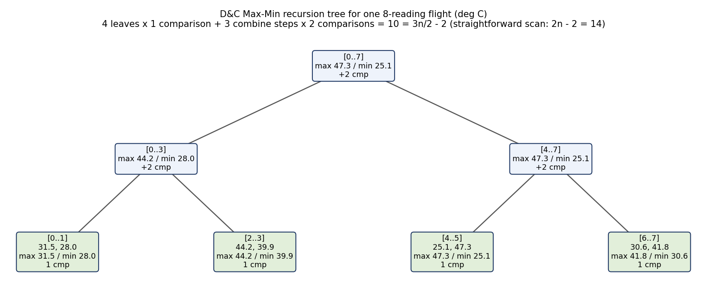

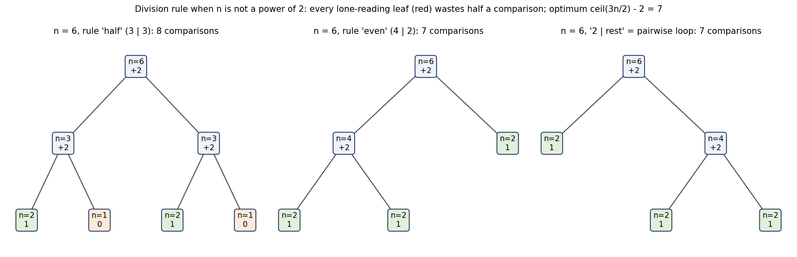

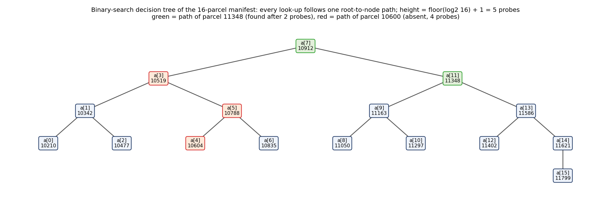

### 3. Pseudocode

```
Algorithm MaxMinDC(A, lo, hi)                  // returns (max, min) of A[lo..hi]
1. if lo = hi then return (A[lo], A[lo])       // one reading: 0 comparisons
2. if hi = lo + 1 then                         // two readings: 1 comparison
3.     if A[lo] < A[hi] then return (A[hi], A[lo]) else return (A[lo], A[hi])
4. k = LeftPartSize(hi - lo + 1)               // DIVIDE: 'half' = ceil(n/2); 'even' = even size nearest n/2
5. (max1, min1) = MaxMinDC(A, lo, lo + k - 1)  // CONQUER
6. (max2, min2) = MaxMinDC(A, lo + k, hi)
7. max = (max1 > max2) ? max1 : max2           // COMBINE: 2 comparisons
8. min = (min1 < min2) ? min1 : min2
9. return (max, min)

Algorithm BinarySearch(A, key, lo, hi)         // A sorted ascending; returns index or -1
1. if lo > hi then return -1                   // empty range: parcel not in the manifest
2. mid = floor((lo + hi) / 2)
3. if key = A[mid] then return mid             // one probe (three-way comparison)
4. if key < A[mid] then return BinarySearch(A, key, lo, mid - 1)
5. else return BinarySearch(A, key, mid + 1, hi)
```

The program also contains the straightforward scan (`maxmin_naive`, 2 comparisons per reading) and `maxmin_pairwise`, the same divide-and-conquer with the division "2 readings | the rest" written as a loop (Section 8).

### 4. Recurrence formulation and solution

**Max–Min.** From lines 1–9: two sub-problems plus 2 combine comparisons, so

T(n) = T(n₁) + T(n₂) + 2,  T(2) = 1,  T(1) = 0.

*Backward substitution for n = 2ᵏ* (n₁ = n₂ = n/2):
T(n) = 2T(n/2) + 2 = 4T(n/4) + 4 + 2 = 8T(n/8) + 8 + 4 + 2 = … = 2ᵏ⁻¹·T(2) + (2 + 4 + … + 2ᵏ⁻¹) = n/2 + (2ᵏ − 2) = **3n/2 − 2**.

*Recursion tree:* levels 0 … k − 2 contain 2ⁱ combine nodes of 2 comparisons each: Σᵢ₌₀ᵏ⁻² 2ⁱ⁺¹ = 2ᵏ − 2 = n − 2; the last level has n/2 leaves of 1 comparison; total n − 2 + n/2 = 3n/2 − 2.

*Master Theorem:* a = 2, b = 2, f(n) = 2 = Θ(1); n<sup>log_b a</sup> = n¹; f(n) = O(n<sup>1 − ε</sup>) with ε = 1 → **case 1**, T(n) = Θ(n). Divide-and-conquer does not change the class (the scan is Θ(n) as well), only the constant: 1.5 instead of 2 comparisons per reading.

*Any n (my own derivation).* Let L₁ and L₂ be the numbers of one-reading and two-reading leaves. The recursion tree is a full binary tree with L₁ + L₂ leaves, so it has L₁ + L₂ − 1 combine nodes, and n = L₁ + 2L₂. Hence

T(n) = L₂·1 + 2(L₁ + L₂ − 1) = 3L₂ + 2L₁ − 2 = 3(n − L₁)/2 + 2L₁ − 2 = **(3n + L₁)/2 − 2**.

Every one-reading leaf costs an extra half comparison. The *half* rule creates a one-reading leaf whenever it splits an odd part of size ≥ 3 (e.g. 6 → 3 + 3 → (2 + 1) + (2 + 1), Figure 2), so it can exceed the optimum. The *even* rule never splits off a lone reading except once when n is odd, so L₁ = n mod 2 and T(n) = **⌈3n/2⌉ − 2**, which is the known lower bound for any comparison-based Max–Min.

**Binary search.** Lines 2–5 make one probe and then recurse on at most ⌊n/2⌋ parcels:

C(n) = C(⌊n/2⌋) + 1,  C(1) = 1  (worst case).

*Backward substitution for n = 2ᵏ:* C(2ᵏ) = C(2ᵏ⁻¹) + 1 = C(2ᵏ⁻²) + 2 = … = C(1) + k = **log₂ n + 1**; for any n, induction with ⌊log₂⌊n/2⌋⌋ = ⌊log₂ n⌋ − 1 gives **⌊log₂ n⌋ + 1**.

*Master Theorem:* a = 1, b = 2, f(n) = 1; n<sup>log₂ 1</sup> = n⁰ = 1, so f(n) = Θ(n<sup>log_b a</sup>) → **case 2**, C(n) = Θ(log n).

*Average case:* the decision tree (Figure 3) is balanced, so its internal path length is I(n) = Σᵢ₌₁ⁿ ⌊log₂ i⌋. A present parcel at depth d needs d + 1 probes, so the exact average is (I + n)/n; an absent parcel ends in one of the n + 1 external positions, whose path lengths sum to I + 2n, so the average is (I + 2n)/(n + 1). Both are ≈ log₂ n − 1 and ≈ log₂ n.

**Meaning in the scenario.** One flight log of a million readings costs 1.5 million instead of 2 million comparisons; one manifest look-up costs at most 20 probes, a 25,000-fold saving over a sequential scan.

### 5. Implementation, test datasets and correctness

`q1_maxmin_binsearch.py` implements the four Max–Min methods and the recursive binary search; every element comparison increments a counter, and the D&C version also counts calls, depth and the one-reading leaves L₁, so that (3n + L₁)/2 − 2 can be checked. `q1_experiments.py` runs the experiments and `q1_tests.py` the correctness tests (Appendix A).

Test datasets (seed 42): flight logs of random temperatures 15.0–65.0 °C with n = 1,000, 1,024, 1,500, 10,000, 65,536, 100,000 and 1,000,000 readings (three powers of 2, four other sizes); the same 10,000 readings ascending, descending and all equal; every n from 2 to 2,048 for the division-rule study; sorted manifests of 1,000, 1,023, 1,024, 10,000, 100,000 and 1,000,000 distinct (even) parcel IDs, searched for **every** present ID and for one absent (odd) ID in **each** of the n + 1 gaps.

Correctness (Figure 9, Appendix D): all methods agree with Python's `max()`/`min()` for n = 1 … 300 (random reals and heavy duplicates); the counts equal 2n − 2, ⌈3n/2⌉ − 2 and (3n + L₁)/2 − 2 exactly for all those n; binary search returns the `bisect_left` index for every present ID, −1 for every absent ID, never more than ⌊log₂ n⌋ + 1 probes, and agrees with Python's `in` on manifests with duplicate IDs: **17/17 tests passed**.

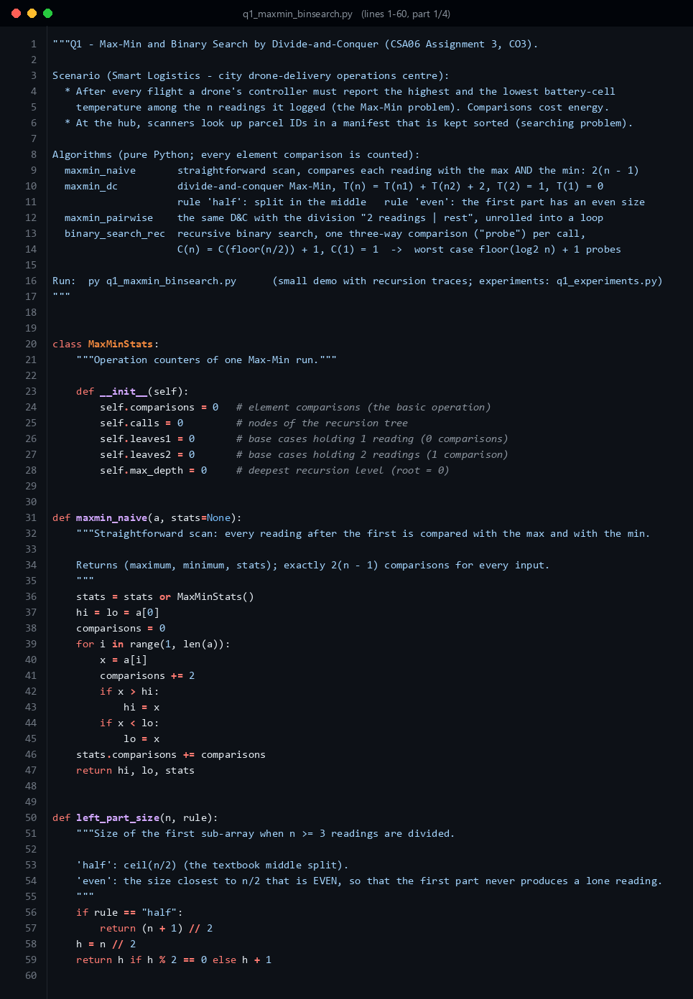

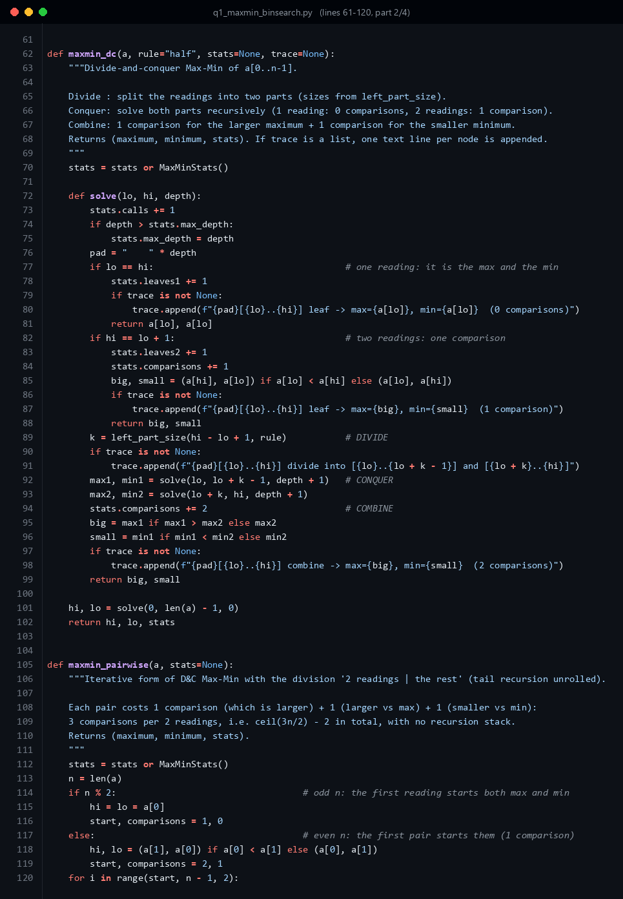

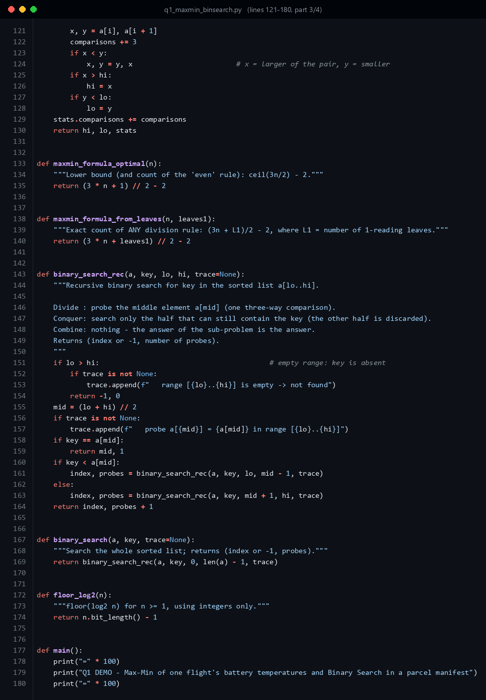

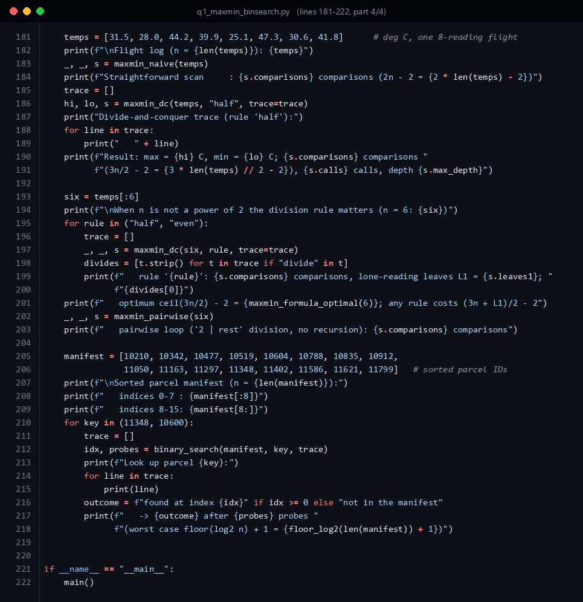

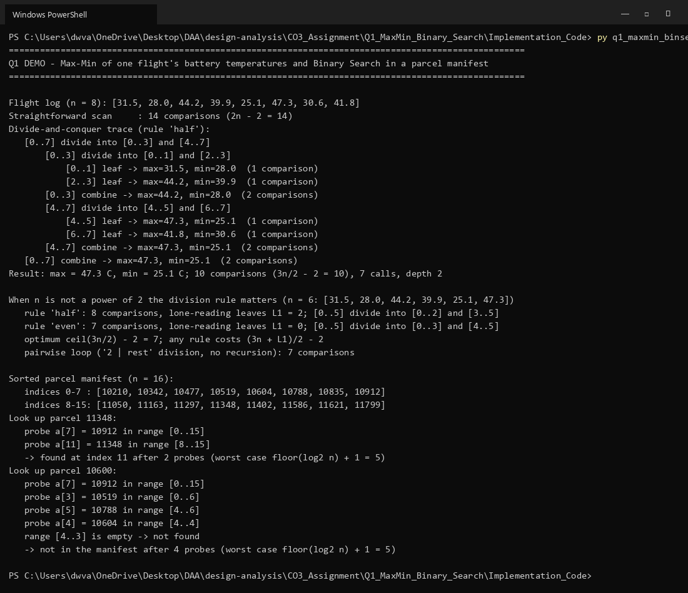

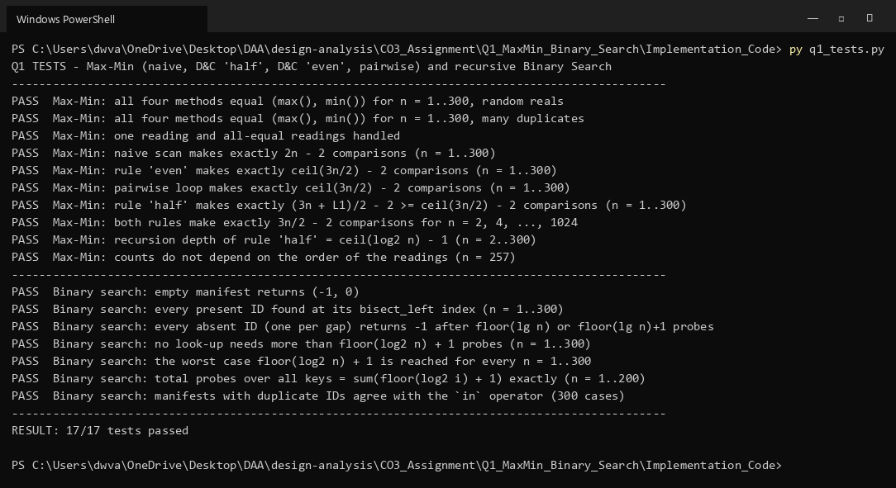

### 6. Experimental results

Table 4: Max–Min comparisons on random flight logs, counted and closed forms (q1_maxmin_growth.csv)

| Readings n | Scan (counted = 2n − 2) | D&C half | L₁ | (3n + L₁)/2 − 2 | D&C even | Pairwise loop | ⌈3n/2⌉ − 2 |
|---|---|---|---|---|---|---|---|
| 1,000 | 1,998 | 1,510 | 24 | 1,510 | 1,498 | 1,498 | 1,498 |
| 1,024 | 2,046 | 1,534 | 0 | 1,534 | 1,534 | 1,534 | 1,534 |
| 1,500 | 2,998 | 2,486 | 476 | 2,486 | 2,248 | 2,248 | 2,248 |
| 10,000 | 19,998 | 15,902 | 1,808 | 15,902 | 14,998 | 14,998 | 14,998 |
| 65,536 | 131,070 | 98,302 | 0 | 98,302 | 98,302 | 98,302 | 98,302 |
| 100,000 | 199,998 | 165,534 | 31,072 | 165,534 | 149,998 | 149,998 | 149,998 |
| 1,000,000 | 1,999,998 | 1,524,286 | 48,576 | 1,524,286 | 1,499,998 | 1,499,998 | 1,499,998 |

Table 5: Recursion size and time of the Max–Min methods (q1_maxmin_growth.csv; ms, minimum of 3 runs, 1 run at n = 1,000,000)

| Readings n | Calls (half) | Depth | Scan (ms) | D&C half (ms) | D&C even (ms) | Pairwise loop (ms) |
|---|---|---|---|---|---|---|
| 10,000 | 11,807 | 13 | 0.5 | 5.3 | 4.1 | 0.5 |
| 100,000 | 131,071 | 16 | 5.4 | 48.2 | 47.6 | 5.0 |
| 1,000,000 | 1,048,575 | 19 | 55.3 | 460.3 | 474.7 | 54.7 |

On the same 10,000 readings in random, ascending, descending and all-equal order every method made exactly the same count (19,998 / 15,902 / 14,998 / 14,998; q1_maxmin_inputs.csv): Max–Min has no best or worst case. The sweep over every n from 2 to 2,048 (q1_maxmin_sweep.csv) found that the *even* rule and the pairwise loop equal ⌈3n/2⌉ − 2 for all 2,047 sizes, while the *half* rule is above the optimum for 2,017 of them, by up to 256 comparisons (+11.1% at n = 1,536 = 3·2⁹).

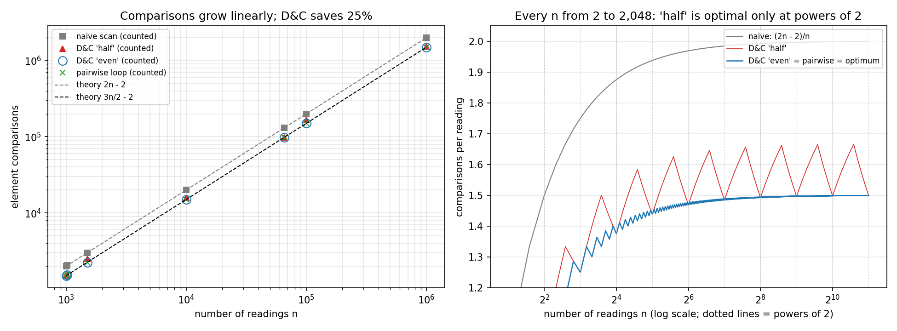

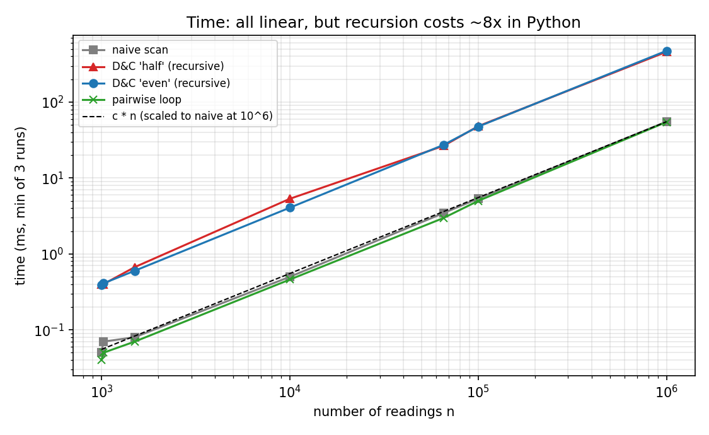

Table 6: Binary search over every present ID and one absent ID per gap (q1_binary_search.csv)

| Manifest n | Max probes found / absent | ⌊log₂ n⌋ + 1 | Avg found (theory (I + n)/n) | Avg absent (theory (I + 2n)/(n + 1)) | Sequential avg (n + 1)/2 | µs per look-up |
|---|---|---|---|---|---|---|
| 1,000 | 10 / 10 | 10 | 8.987 (8.987) | 9.977 (9.977) | 500.5 | 3.08 |
| 1,023 | 10 / 10 | 10 | 9.010 (9.010) | 10.000 (10.000) | 512.0 | 3.13 |
| 1,024 | 11 / 11 | 11 | 9.012 (9.012) | 10.002 (10.002) | 512.5 | 3.11 |
| 10,000 | 14 / 14 | 14 | 12.363 (12.363) | 13.362 (13.362) | 5,000.5 | 2.43 |
| 100,000 | 17 / 17 | 17 | 15.689 (15.689) | 16.689 (16.689) | 50,000.5 | 2.85 |
| 1,000,000 | 20 / 20 | 20 | 18.951 (18.951) | 19.951 (19.951) | 500,000.5 | 3.75 |

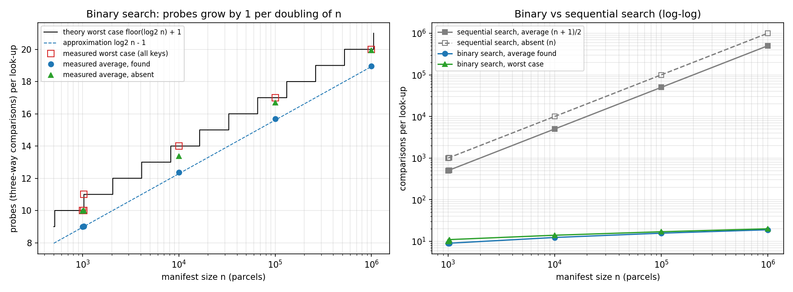

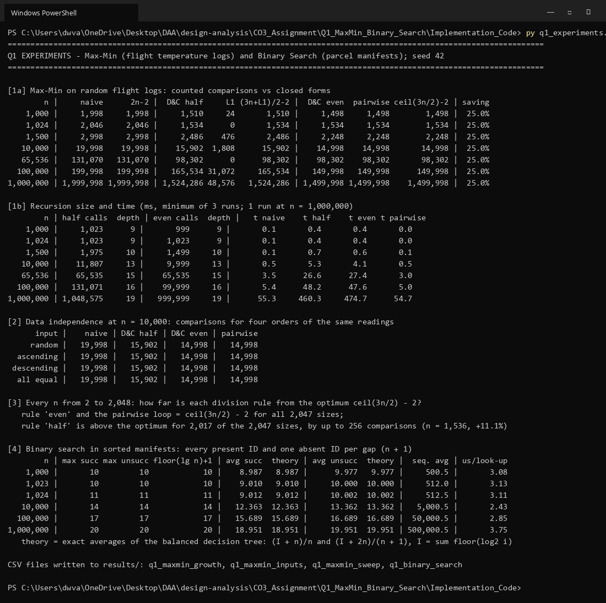

### 7. Prediction compared with observation

- **Scan and power-of-2 sizes: exactly as predicted.** 2n − 2 at every size; 3n/2 − 2 for D&C at n = 1,024 and 65,536 with both rules (25.0% fewer comparisons). Order of the readings made no difference (Table 4, q1_maxmin_inputs.csv).
- **Other sizes: the textbook split is not optimal.** My prediction "about 3n/2" was too vague. The *half* rule made 1,524,286 comparisons at n = 1,000,000, i.e. 24,288 more than ⌈3n/2⌉ − 2 — exactly L₁/2 = 48,576/2, confirming the formula (3n + L₁)/2 − 2 at every size. Its cost per reading oscillates between 1.5 and 1.67 between powers of 2 (Figure 10, right). Choosing an even first part removes all one-reading leaves but one, and the *even* rule reached the optimum at all 2,047 sizes.
- **Time.** Counting suggests D&C should be 25% faster, but in Python the recursive versions were about 8× slower than the scan (460 vs 55 ms at 10⁶) because a function call costs far more than a comparison: the tree has about n nodes (1,048,575 calls). The pairwise loop has the same optimal count without calls and was as fast as the scan (54.7 ms).
- **Binary search: exactly as predicted.** The worst case equals ⌊log₂ n⌋ + 1 at all six sizes and the measured averages equal the exact formulas to three decimals. n = 1,023 = 2¹⁰ − 1 gives a perfect tree (every absent search exactly 10 probes); one more parcel (1,024) adds a level, so the worst case jumps to 11 while the average hardly moves (9.010 → 9.012).

### 8. Design decision and technical conclusions

**Max–Min on the controller: yes, use the divide-and-conquer idea, but in its pairwise (iterative) form.**

- It saves 25% of the comparisons — the theoretical optimum ⌈3n/2⌉ − 2: 1,499,998 instead of 1,999,998 for a million readings — and the count does not depend on the data, so the energy per flight is predictable.
- Splitting "2 readings | the rest" is a valid D&C division (Figure 2, right) whose recursion is a tail call, so it unrolls into a loop: no call overhead (54.7 ms vs 460 ms recursive in Python) and O(1) memory instead of a stack of ⌈log₂ n⌉ frames — important on a small controller.
- **When n is not a power of 2**, a recursive implementation must give the first part an **even** size; the textbook middle split wastes up to 11% (L₁/2 comparisons).

**Manifest look-up:** a manifest of 1,000,000 parcels needs **at most 20 probes** (average 18.95 if the parcel is present, 19.95 if absent), against 500,000 comparisons on average for a sequential scan; it took 3.75 µs per look-up in Python. Keeping the manifest sorted is therefore worth its cost.

**Technical conclusion.** Divide-and-conquer helps in two different ways here: for Max–Min it does not change the class Θ(n) but lowers the constant to the optimum by organising comparisons in pairs, and the exact count depends on how the problem is divided; for search it changes the class from Θ(n) to Θ(log n) because each step discards half of the data without examining it.

### 9. Contribution

Table 7: Contribution record for Q1 (proposed record, to be confirmed by both students)

| Task | Student A – V. Vasudevan | Student B – [Student B Name] | Shared |
|---|---|---|---|
| Design | Divide / conquer / combine of both algorithms | Recursion trees (Figures 1–3) | Predictions (Section 1) |
| Implementation | `q1_maxmin_binsearch.py` (four Max–Min methods, binary search, counters), `q1_tests.py` | `q1_experiments.py`, `q1_graphs.py` | Code review |
| Analysis | Derivation of (3n + L₁)/2 − 2 and the *even* rule | Recurrences, Master Theorem, backward substitution, exact averages; experiments and graphs | Prediction vs observation |
| Decision | – | – | Pairwise loop for the controller; manifest look-up bound |

This is a proposed record of the division of work; both students must confirm it (and Student B's details must be filled in) before submission.

## Q2 – Merge Sort versus Quick Sort Under Different Data Conditions [7 Marks]

> **Problem Context – Delivery-Order Scheduling.** Before each dispatch wave the scheduling service sorts the pending delivery orders by their promised delivery deadline. The orders may arrive in random order, already sorted (exported by an upstream system), in reverse order, or with very many equal deadlines (deadlines are booked in 15-minute slots).
> The development team is considering: **Merge Sort | Quick Sort with last-element, random or median-of-three pivot**
> **Your Challenge:** Investigate whether one Divide-and-Conquer sort should always be preferred, or whether the right choice depends on the input data and on the pivot strategy.
> Before implementation:
> - Predict the comparisons, element moves and recursion depth of each algorithm for each input condition.
> - Formulate the recurrences of both algorithms (best, worst and average case for Quick Sort) and solve them.
> Implement the algorithms and record the number of comparisons, the number of moves, the maximum recursion depth and the execution time, where useful, for at least four sizes and four input conditions.
> Compare your prediction with the observed behaviour.
> **Design Decision:** Recommend a sorting strategy for the scheduling service and defend your decision.

**Evidence Expected**

> Recurrences and their solutions, decomposition diagrams, implementations with operation counters, designed datasets, comparison tables and graphs, prediction-versus-observation analysis and an evidence-based recommendation.

**Ans:**

### 1. Prediction before implementation

**Merge Sort** always divides in the middle, whatever the data, so its recursion depth is ⌈log₂ n⌉ and its moves are fixed (each level copies n orders out and n back: about 2n log₂ n). Only its comparisons depend on the data: a merge stops comparing when one half is exhausted, so sorted and reversed lists need about (n/2) log₂ n, random lists close to the worst case n log₂ n − n + 1.

**Quick Sort** does all its work in the partition, and the quality of a split depends on the pivot. With Lomuto's partition every key ≤ pivot goes to the left, so:

- the **last-element** pivot of a sorted (or reversed) export is the maximum (or minimum): every split is (n − 1) | 0 → n(n − 1)/2 comparisons, depth n − 1;
- **random** and **median-of-three** pivots fix sorted and reversed inputs (median-of-three even gives perfect splits on sorted data);
- an **all-equal** batch defeats every pivot rule: every key is ≤ pivot, so the split is (n − 1) | 0 again; with 64 slot values each block of n/64 equal keys behaves like that, adding about 64·(n/64)²/2 = n²/128 comparisons.

Table 8: Predicted comparisons (n orders; k = 64 slot values) and recursion depth

| Input | Merge Sort | Quick-last | Quick-random | Quick-median3 |
|---|---|---|---|---|
| random | ≈ n log₂ n − 1.25n | ≈ 2(n + 1)Hₙ − 4n ≈ 1.39 n log₂ n | ≈ 1.39 n log₂ n | ≈ 1.19 n log₂ n |
| sorted | ≈ (n/2) log₂ n | n(n − 1)/2 | ≈ 1.39 n log₂ n | ≈ n log₂ n (perfect splits) |
| reverse | ≈ (n/2) log₂ n | ≈ n(n − 1)/2 | ≈ 1.39 n log₂ n | ≈ 1.2 n log₂ n |
| slots (64 values) | ≈ n log₂ n | ≈ n²/128 + n log₂ n | ≈ n²/128 + n log₂ n | ≈ n²/128 + n log₂ n |
| all-equal | ≈ (n/2) log₂ n | n(n − 1)/2 | n(n − 1)/2 | n(n − 1)/2 |
| recursion depth | ⌈log₂ n⌉ always | up to n − 1 | O(log n) except equal keys | O(log n) except equal keys |
| extra memory / stable | n / yes | depth / no | depth / no | depth / no |

### 2. Divide-and-Conquer design

**Merge Sort (`merge_sort`).** **Divide:** split at mid = ⌊(lo + hi)/2⌋ (no comparison). **Conquer:** sort both halves recursively (one order is sorted). **Combine:** merge the two sorted halves through an auxiliary array; ties take the left order, so equal deadlines keep their booking order (stable).

**Quick Sort (`quick_sort`).** **Divide:** choose a pivot by the rule (last / random / median of first, middle, last), move it to the end and partition: keys ≤ pivot to the left, larger keys to the right, pivot between them. **Conquer:** sort both parts recursively. **Combine:** nothing — after partitioning the pivot is already in its final place. All the work is in the divide step, where Merge Sort has its work in the combine step.

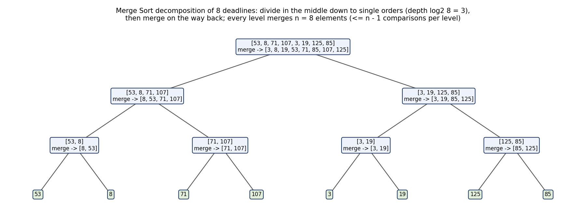

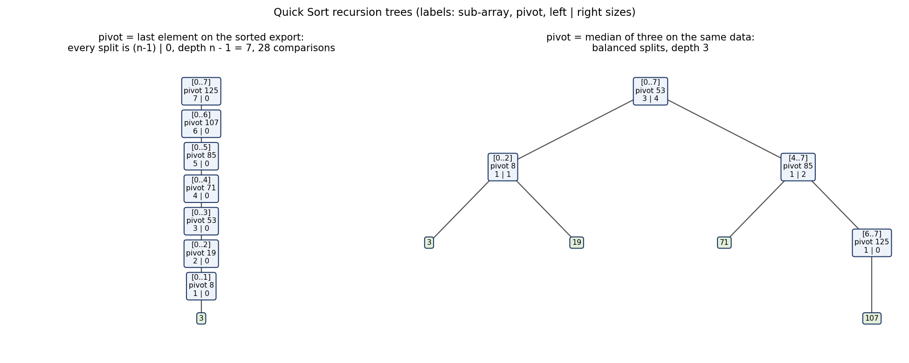

### 3. Pseudocode

```
Algorithm MergeSort(A, lo, hi)                  Algorithm Merge(A, lo, mid, hi)
1. if lo >= hi then return                      1. copy A[lo..hi] to AUX[lo..hi]          // n moves
2. mid = floor((lo + hi) / 2)      // DIVIDE    2. i = lo;  j = mid + 1
3. MergeSort(A, lo, mid)           // CONQUER   3. for k = lo to hi do                    // n moves
4. MergeSort(A, mid + 1, hi)                    4.     if i > mid then A[k] = AUX[j++]
5. Merge(A, lo, mid, hi)           // COMBINE   5.     else if j > hi then A[k] = AUX[i++]
                                                6.     else if AUX[j] < AUX[i] then A[k] = AUX[j++]   // 1 comparison
                                                7.     else A[k] = AUX[i++]               // ties: left first (stable)

Algorithm QuickSort(A, lo, hi, rule)            Algorithm Partition(A, lo, hi, rule)
1. if lo >= hi then return                      1. if rule = random  then swap A[random(lo..hi)], A[hi]
2. p = Partition(A, lo, hi, rule)  // DIVIDE    2. if rule = median3 then swap A[median of lo, mid, hi], A[hi]
3. QuickSort(A, lo, p - 1, rule)   // CONQUER   3. x = A[hi];  i = lo - 1
4. QuickSort(A, p + 1, hi, rule)                4. for j = lo to hi - 1 do                // 1 comparison each
   // no combine step                           5.     if A[j] <= x then i = i + 1;  swap A[i], A[j]
                                                6. swap A[i+1], A[hi];  return i + 1
```

### 4. Recurrence formulation and solution

**Merge Sort.** Lines 3–5: two halves plus a merge of at most n − 1 comparisons:

C(n) = 2C(n/2) + (n − 1), C(1) = 0 (worst case).

*Master Theorem:* a = 2, b = 2, f(n) = n − 1 = Θ(n); n<sup>log₂ 2</sup> = n¹ → f(n) = Θ(n<sup>log_b a</sup>) → **case 2**: C(n) = Θ(n log n).
*Recursion tree (n = 2ᵏ):* level i has 2ⁱ merges of n/2ⁱ orders, at most n/2ⁱ − 1 comparisons each, so the level costs n − 2ⁱ; summing over the k levels: Σᵢ₌₀ᵏ⁻¹ (n − 2ⁱ) = nk − (2ᵏ − 1) = **n log₂ n − n + 1**.
*Best case* (sorted or reversed: one half is exhausted after n/2 comparisons): C(n) = 2C(n/2) + n/2 ⇒ **(n/2) log₂ n**.
*Moves:* M(n) = 2M(n/2) + 2n ⇒ **2n log₂ n** for every input; *depth* ⌈log₂ n⌉.

**Quick Sort.** A partition of n keys makes n − 1 comparisons (line 4); if the pivot ends at rank q:
T(n) = T(q) + T(n − 1 − q) + (n − 1).

- *Best case* (q = n/2): T(n) = 2T(n/2) + (n − 1) → same as Merge Sort, Master case 2: **Θ(n log n)**.
- *Worst case* (q = n − 1 or 0, e.g. last-element pivot on sorted data, or any rule on all-equal data): T(n) = T(n − 1) + (n − 1). Backward substitution: T(n) = T(n − 2) + (n − 2) + (n − 1) = … = T(1) + 1 + 2 + … + (n − 1) = **n(n − 1)/2 = Θ(n²)**, depth n − 1. (The Master Theorem does not apply: the sub-problem shrinks by 1, not by a factor b.)
- *Average case* (random pivot, every rank equally likely):
  T(n) = (n − 1) + (2/n) Σₖ₌₀ⁿ⁻¹ T(k). Multiplying by n and subtracting the same equation for n − 1:
  nT(n) − (n − 1)T(n − 1) = 2(n − 1) + 2T(n − 1) ⇒ T(n)/(n + 1) = T(n − 1)/n + 2(n − 1)/(n(n + 1)).
  Telescoping: T(n)/(n + 1) = Σₖ₌₁ⁿ [4/(k + 1) − 2/k] = 2Hₙ + 4/(n + 1) − 4 ⇒ **T(n) = 2(n + 1)Hₙ − 4n ≈ 2n ln n ≈ 1.39 n log₂ n**.

**Meaning in the scenario.** For a wave of 8,000 orders: Merge Sort ≤ 95,809 comparisons on every input; Quick Sort ≈ 121,051 on average but 31,996,000 in the worst case — a factor of 264 depending only on how the upstream system delivers the list.

### 5. Implementation, test datasets and correctness

`q2_sorting.py` implements Merge Sort and Lomuto Quick Sort with the three pivot rules; every key comparison (including the 2–3 comparisons of the median-of-three) and every element write is counted, as is the recursion depth. `q2_experiments.py` generates the datasets and writes `q2_results.csv` and `q2_large.csv`.

Designed datasets (deadlines in seconds after 06:00 in a 16-hour dispatch day, seed 42; n = 1,000, 2,000, 4,000, 8,000): **random** (uniform deadlines), **sorted** and **reverse** (the same values ordered, as exported upstream), **slots** (64 distinct values = 15-minute booking slots) and the edge case **all-equal** (a whole wave due in the same slot). In addition, one random batch of n = 100,000 orders.

Correctness (Figure 21, Appendix D): all four sorts equal `sorted()` on 756 lists (n = 0 … 150 in all conditions); Merge Sort keeps equal deadlines in booking order (stability test with 300 orders); the counts equal (n/2) log₂ n comparisons, 2n log₂ n moves and depth log₂ n for Merge Sort at n = 2ᵏ, and exactly n(n − 1)/2 with depth n − 1 for Quick-last on sorted data: **14/14 tests passed**.

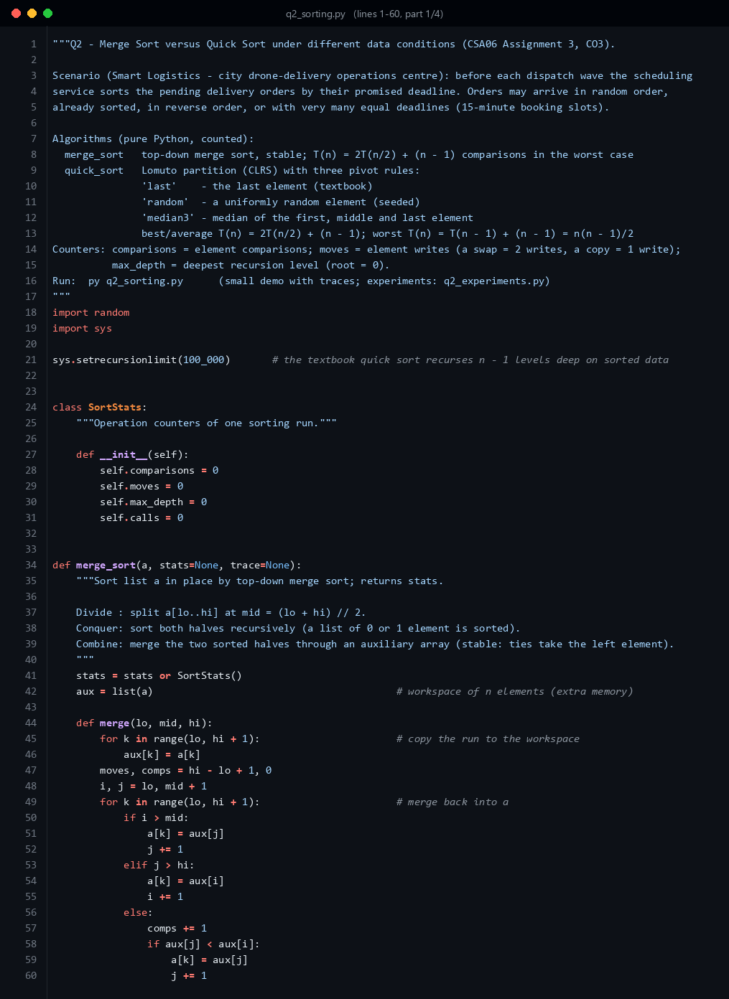

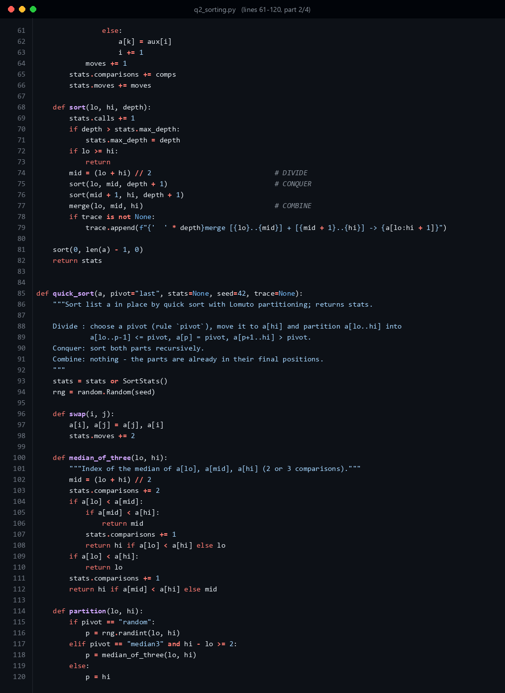

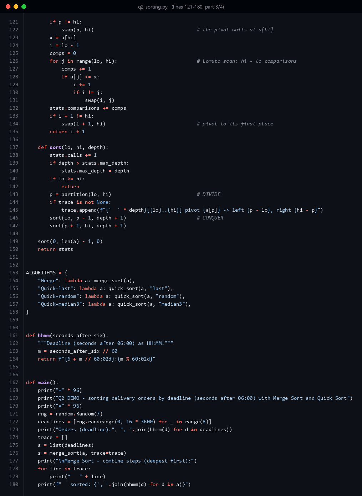

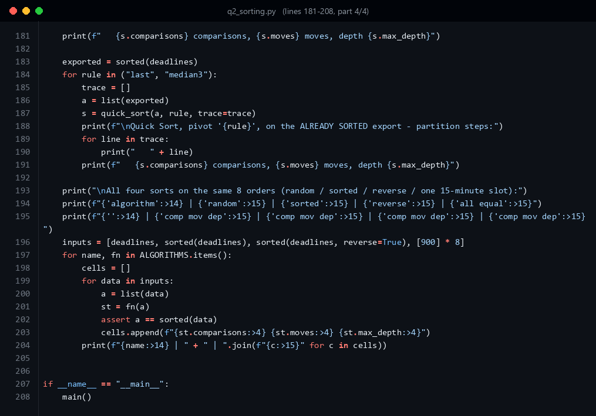

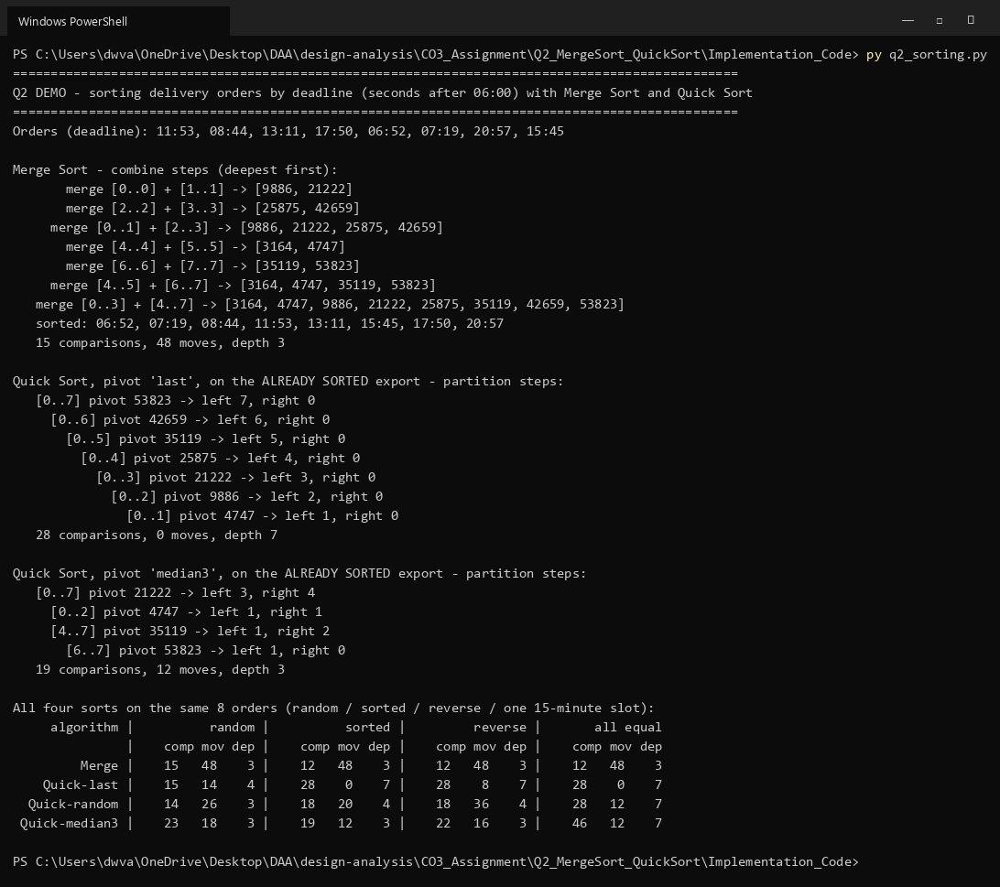

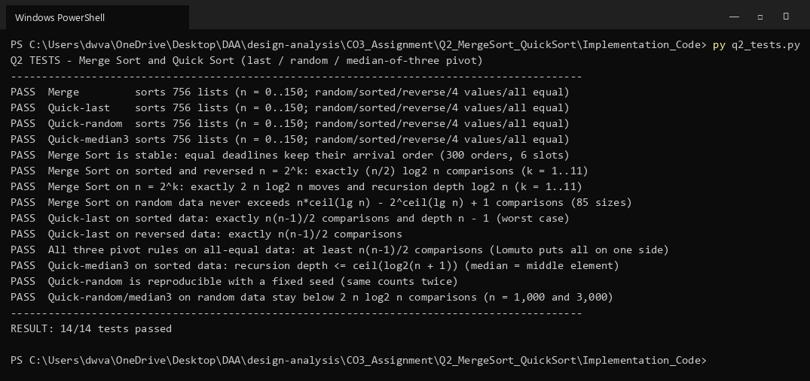

### 6. Experimental results

Table 9: Reference values used in the comparison (calculated by q2_experiments.py)

| n | n log₂ n | Merge worst n⌈log₂ n⌉ − 2<sup>⌈log₂ n⌉</sup> + 1 | Quick average 2(n + 1)Hₙ − 4n | Quick worst n(n − 1)/2 |
|---|---|---|---|---|
| 1,000 | 9,966 | 8,977 | 10,986 | 499,500 |
| 2,000 | 21,932 | 19,953 | 24,730 | 1,999,000 |
| 4,000 | 47,863 | 43,905 | 54,989 | 7,998,000 |
| 8,000 | 103,726 | 95,809 | 121,051 | 31,996,000 |

Table 10: Counted comparisons on the five input conditions (q2_results.csv)

| Input | n | Merge | Quick-last | Quick-random | Quick-median3 |
|---|---|---|---|---|---|
| random | 1,000 | 8,711 | 10,969 | 10,144 | 10,464 |
| random | 2,000 | 19,379 | 25,181 | 27,759 | 24,241 |
| random | 4,000 | 42,801 | 53,752 | 51,574 | 49,026 |
| random | 8,000 | 93,720 | 123,356 | 123,165 | 114,413 |
| sorted | 1,000 | 5,044 | 499,500 | 10,275 | 8,962 |
| sorted | 2,000 | 11,088 | 1,999,000 | 23,740 | 19,917 |
| sorted | 4,000 | 24,176 | 7,998,000 | 53,811 | 43,837 |
| sorted | 8,000 | 52,352 | 31,996,000 | 115,503 | 95,754 |
| reverse | 1,000 | 4,939 | 494,406 | 10,851 | 15,588 |
| reverse | 2,000 | 10,880 | 1,969,666 | 26,758 | 35,992 |
| reverse | 4,000 | 23,798 | 7,760,636 | 51,662 | 78,086 |
| reverse | 8,000 | 51,735 | 29,767,464 | 118,732 | 180,721 |
| slots | 1,000 | 8,702 | 14,709 | 16,083 | 17,024 |
| slots | 2,000 | 19,385 | 47,316 | 45,255 | 49,879 |
| slots | 4,000 | 42,724 | 152,566 | 155,026 | 164,484 |
| slots | 8,000 | 93,354 | 557,308 | 556,977 | 577,950 |
| all-equal | 1,000 | 5,044 | 499,500 | 499,500 | 502,494 |
| all-equal | 2,000 | 11,088 | 1,999,000 | 1,999,000 | 2,004,994 |
| all-equal | 4,000 | 24,176 | 7,998,000 | 7,998,000 | 8,009,994 |
| all-equal | 8,000 | 52,352 | 31,996,000 | 31,996,000 | 32,019,994 |

Table 11: Moves (element writes; a swap = 2) and maximum recursion depth at n = 8,000 (q2_results.csv)

| Input | Merge | Quick-last | Quick-random | Quick-median3 |
|---|---|---|---|---|
| random | 207,616; depth 13 | 122,576; depth 30 | 127,918; depth 28 | 124,678; depth 22 |
| sorted | 207,616; depth 13 | 0; depth 7,999 | 16,126; depth 27 | 15,426; depth 13 |
| reverse | 207,616; depth 13 | 8,512; depth 7,449 | 87,280; depth 29 | 207,504; depth 29 |
| slots | 207,616; depth 13 | 59,300; depth 163 | 63,358; depth 164 | 67,098; depth 167 |
| all-equal | 207,616; depth 13 | 0; depth 7,999 | 15,992; depth 7,999 | 15,996; depth 7,999 |

Table 12: Time in ms at n = 8,000 (q2_results.csv; minimum of 3 runs, single run if > 200 ms)

| Input | Merge | Quick-last | Quick-random | Quick-median3 |
|---|---|---|---|---|
| random | 20.7 | 16.4 | 18.9 | 16.1 |
| sorted | 17.6 | 2,168.8 | 12.2 | 8.9 |
| reverse | 18.3 | 1,806.2 | 19.8 | 23.7 |
| slots | 19.8 | 44.0 | 50.4 | 49.6 |
| all-equal | 17.3 | 2,445.7 | 2,189.5 | 2,123.9 |

Table 13: One random batch of n = 100,000 orders (q2_large.csv)

| Algorithm | Comparisons | / (n log₂ n) | Moves | Depth | Time (ms) |
|---|---|---|---|---|---|
| Merge | 1,536,370 | 0.925 | 3,337,856 | 17 | 345.9 |
| Quick-last | 1,997,494 | 1.203 | 2,046,558 | 38 | 267.7 |
| Quick-random | 1,980,366 | 1.192 | 1,910,178 | 40 | 293.4 |
| Quick-median3 | 1,899,767 | 1.144 | 1,812,620 | 31 | 252.4 |

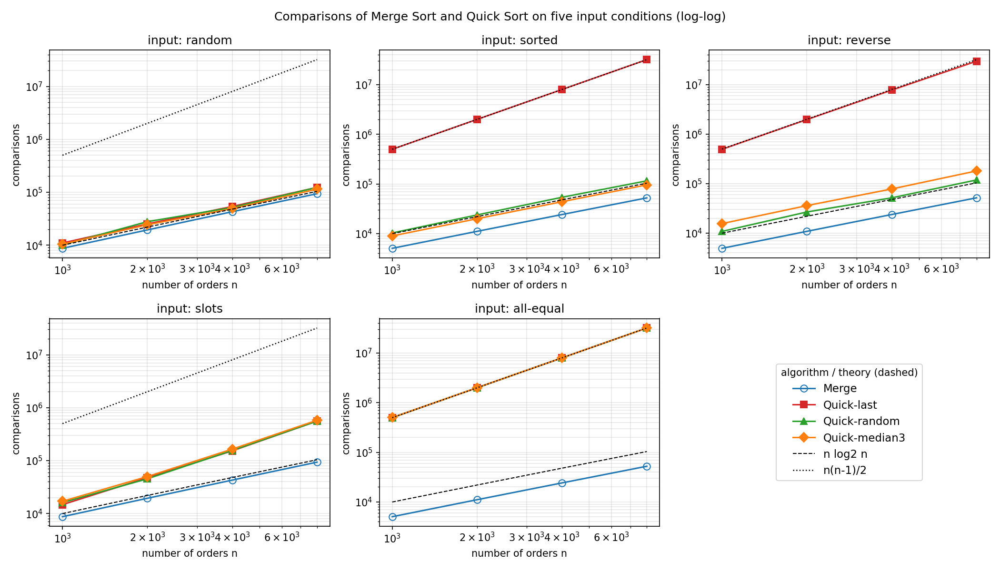

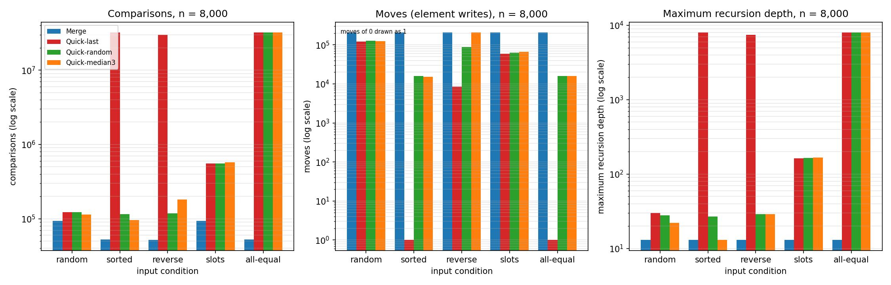

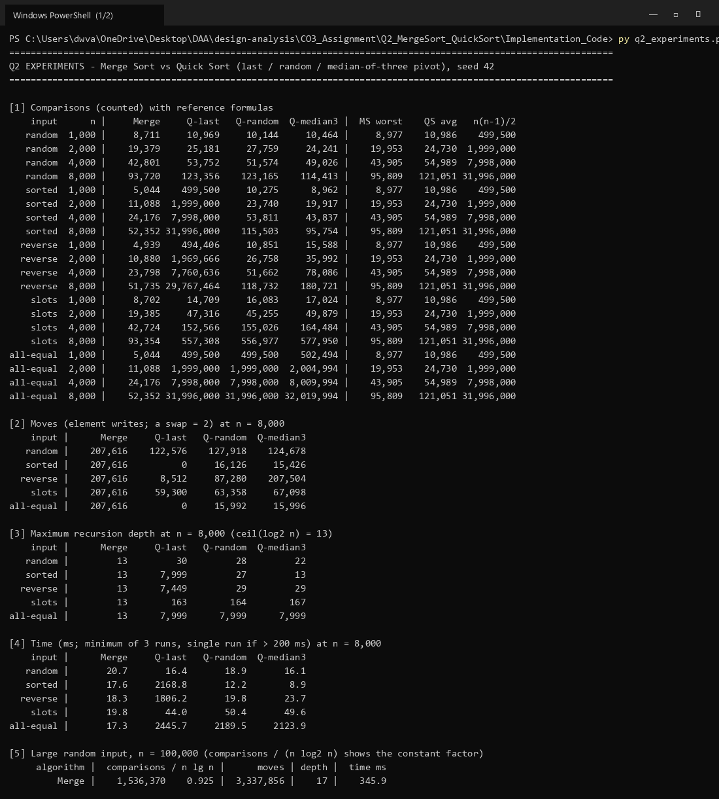

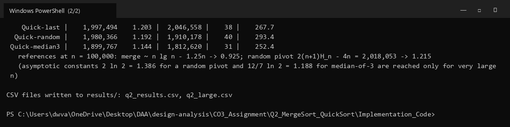

### 7. Prediction compared with observation

- **Merge Sort – as predicted.** Random data stayed just below the worst-case formula (93,720 vs 95,809 at n = 8,000); sorted, reversed and all-equal lists needed about (n/2) log₂ n (51,735–52,352); moves were 207,616 and depth 13 for **every** input. Its cost is decided by n, not by the data.
- **Quick-last – as predicted.** Exactly n(n − 1)/2 = 31,996,000 comparisons and depth n − 1 = 7,999 on sorted and all-equal data; reversed data needed 29,767,464 (93% of it: after the first swap the minimum and maximum alternate as pivots, which occasionally splits off two keys). 8,000 orders took 2.2 s instead of 16 ms. With Python's default recursion limit (1,000) it would have crashed; I had to raise the limit to 100,000.
- **Pivot rules – partly as predicted.** Random and median-of-three removed the sorted/reversed worst case (115,503 and 95,754 on sorted data; median-of-three with perfect splits and depth 13 as predicted). Two surprises: median-of-three on **reversed** data needed 180,721 comparisons and 207,504 moves (1.74 n log₂ n): Lomuto's swaps destroy the reversed order in a way that makes later medians poor. And on random data Quick Sort stayed below the asymptotic constant 1.39: at n = 100,000 random pivot gave 1.192 n log₂ n, close to the exact expectation 2(n + 1)Hₙ − 4n = 2,018,053 (1.215 n log₂ n) — the −4n term matters at practical sizes.
- **Equal keys – the decisive observation.** All three pivot rules needed n(n − 1)/2 comparisons and depth 7,999 on the all-equal batch (median-of-three: + 3 per partition = 23,994 extra), and 556,977–577,950 on the 64-slot batch, growing ×3.5–3.65 from n = 4,000 to 8,000 — the quadratic n²/128 term predicted in Section 1. Choosing a better pivot does not help here; the cause is the partition rule "≤ goes left".
- **Random data.** Quick Sort made 22–32% more comparisons than Merge Sort, but 38–46% fewer moves and was faster (n = 100,000: median-of-three 252 ms vs 346 ms). This is the usual reason for preferring Quick Sort — but only on random, distinct keys.

### 8. Design decision and technical conclusions

**No Divide-and-Conquer sort is always best; the choice depends on the data and, for Quick Sort, on the pivot and the partition.** For the scheduling service I recommend **Merge Sort** among the four candidates:

- The service's data are exactly the hard cases of Quick Sort: exports arrive sorted or reversed, and deadlines are booked in 15-minute slots (many equal keys). Every Lomuto Quick Sort became quadratic on equal keys (2.1–2.4 s and depth 7,999 for one 8,000-order wave), whatever the pivot rule.
- Merge Sort's worst case is guaranteed: at most n log₂ n − n + 1 comparisons (95,809 at n = 8,000), depth ⌈log₂ n⌉, 17–21 ms for every input condition.
- It is **stable**: orders with the same deadline keep their booking order, which is the fair first-come-first-served dispatch rule.
- Costs accepted: an auxiliary array of n orders and 1.6–1.8× the moves of Quick Sort on random data (Table 13).

If memory or speed on random data mattered more than stability, a Quick Sort would need a partition that handles equal keys and a guarantee against bad pivots; the textbook versions of Q2 have neither. This limitation is the subject of the Day-4 design challenge (Q7).

**Technical conclusion:** both algorithms follow T(n) = 2T(n/2) + Θ(n) when the division is balanced. Merge Sort guarantees the balance by construction (it divides by position and pays in the combine step); Quick Sort divides by value, so its balance — and its class, Θ(n log n) or Θ(n²) — depends on the data, the pivot rule and the treatment of equal keys.

### 9. Contribution

Table 14: Contribution record for Q2 (proposed record, to be confirmed by both students)

| Task | Student A – V. Vasudevan | Student B – [Student B Name] | Shared |
|---|---|---|---|
| Design | Datasets (five input conditions), decomposition diagrams | Counter definitions (comparison, move, depth) | Predictions (Table 8) |
| Implementation | – | `q2_sorting.py` (Merge Sort, Quick Sort with three pivot rules), `q2_tests.py`, `q2_experiments.py` | `q2_graphs.py`, code review |
| Analysis | Recurrences: Master Theorem, recursion tree, worst case, average-case derivation | Experiments, tables and graphs | Prediction vs observation |
| Decision | – | – | Recommendation for the scheduler; choice of the Q7 limitation |

This is a proposed record of the division of work; both students must confirm it (and Student B's details must be filled in) before submission.

## Q3 – Karatsuba Multiplication of Large Integers [6 Marks]

> **Problem Context – Signing Flight Commands.** Every command sent to a drone is digitally signed. Signing multiplies very large integers: a 2,048-bit RSA modulus has 617 decimal digits and a 4,096-bit modulus has 1,234 digits. The firmware currently multiplies them with the schoolbook method.
> **Your Challenge:** Determine whether Karatsuba's Divide-and-Conquer multiplication should replace the schoolbook method, and from what number size.
> Before implementation:
> - Predict the number of single-digit multiplications of both methods for n-digit numbers.
> - Formulate the recurrence of Karatsuba's algorithm from its design and solve it.
> Implement both methods on digit arrays, count the single-digit multiplications and the digit additions/subtractions, and verify every product against a trusted reference.
> Measure at least four sizes, including sizes that are not powers of 2, and determine the crossover point at which Karatsuba becomes cheaper.
> **Design Decision:** Recommend how the firmware should multiply 617-digit and 1,234-digit numbers (including the size below which it should fall back to the schoolbook method) and justify it.

**Evidence Expected**

> Divide-and-conquer design with recursion tree, recurrence solved by the Master Theorem and by a recursion tree, counted operations compared with 3<sup>⌈log₂ n⌉</sup> and n², crossover analysis, correctness verification and a justified recommendation.

**Ans:**

### 1. Prediction before implementation

**Schoolbook.** Every digit of one operand is multiplied by every digit of the other, so two n-digit numbers need exactly **n²** single-digit multiplications, whatever the digits are. Each partial product is added into the accumulator together with the carry, so I also expect exactly **2n²** digit additions, i.e. 3n² counted operations in total.

**Karatsuba.** One level replaces the four half-size products of the naive split by three. If the recursion goes down to single digits, the number of single-digit multiplications satisfies M(n) = 3·M(⌈n/2⌉), M(1) = 1, so I predict **M(n) = 3<sup>⌈log₂ n⌉</sup>** — for n = 2<sup>k</sup> that is 3<sup>k</sup> = n<sup>log₂3</sup> ≈ n<sup>1.585</sup>. The price is extra digit additions in every node (differences, sums and the shifted addition of the middle part), so Karatsuba will win on multiplications immediately but on **total** operations only above some crossover size.

Table 15: Predicted single-digit multiplications for the command-signing sizes (calculated)

| n (digits) | Schoolbook n² | Karatsuba 3<sup>⌈log₂ n⌉</sup> | Fewer multiplications |
|---|---|---|---|
| 617 (RSA-2048) | 380,689 | 3<sup>10</sup> = 59,049 | 6.4× |
| 1,234 (RSA-4096) | 1,522,756 | 3<sup>11</sup> = 177,147 | 8.6× |
| doubling n | × 4 | × 3 | gap grows by 4/3 per doubling |

Two further predictions follow from the formula: (i) because ⌈log₂ n⌉ jumps only at powers of 2, **all sizes from 513 to 1,024 digits need the same 59,049 multiplications** — 617 digits cost as many multiplications as 1,024; (ii) in Python each recursive call has a fixed interpreter overhead, so a Karatsuba that recurses down to single digits (88,573 calls at 617 digits) may well be **slower** than the schoolbook loop even though it does fewer operations — a base-case threshold will be needed.

### 2. Divide-and-Conquer design

I store each number as a little-endian list of decimal digits (1234 → [4, 3, 2, 1]), so that every digit operation can be counted.

- **Divide:** split both n-digit operands at m = ⌈n/2⌉: a = a1·10<sup>m</sup> + a0 and b = b1·10<sup>m</sup> + b0. The high halves are zero-padded to m digits, so the split works for any n, not only powers of 2.
- **Conquer:** compute only **three** m-digit products recursively: z0 = a0·b0, z2 = a1·b1 and z1′ = |a0 − a1|·|b1 − b0| (with the sign kept separately).
- **Combine:** the middle coefficient is z1 = a0·b1 + a1·b0 = z0 + z2 + (a0 − a1)(b1 − b0), and a·b = z2·10<sup>2m</sup> + z1·10<sup>m</sup> + z0. Placing z0 and z2 side by side costs no additions; only z1 is added at offset m.
- **Base case:** n ≤ t (the threshold) uses the schoolbook method; t = 1 means a single-digit product.

**Why the subtractive form.** |a0 − a1| < 10<sup>m</sup> always fits into m digits, so every sub-problem has exactly m digits and the count is exactly 3<sup>⌈log₂ n⌉</sup>. The textbook additive form z1 = (a0 + a1)(b0 + b1) − z0 − z2 can create an (m + 1)-th digit by a carry: the middle sub-problem is then larger than n/2, the count depends on the data, and for n ≤ 3 the problem does not shrink at all (m + 1 ≥ n), so that variant needs a larger base case. Section 7 measures this difference.

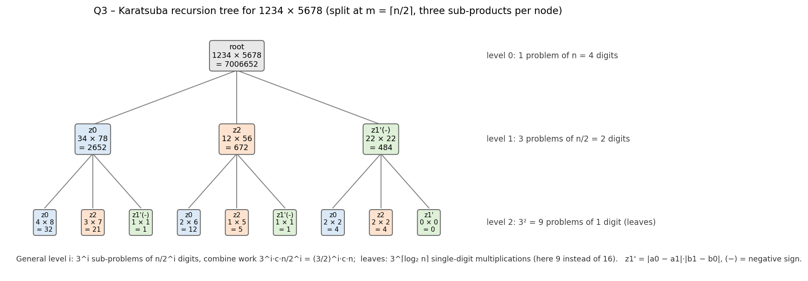

The worked example of Figure 26: 1234 × 5678 with m = 2 gives a0 = 34, a1 = 12, b0 = 78, b1 = 56; z0 = 34 × 78 = 2,652, z2 = 12 × 56 = 672, (a0 − a1)(b1 − b0) = 22 × (−22) = −484, so z1 = 2,652 + 672 − 484 = 2,840 and the product is 672·10⁴ + 2,840·10² + 2,652 = **7,006,652**, with 9 single-digit multiplications instead of 16.

### 3. Pseudocode

```
Algorithm Schoolbook(a[0..n-1], b[0..m-1])            // little-endian digit arrays
1. r[0..n+m-1] = 0
2. for i = 0 to n-1 do
3.     carry = 0
4.     for j = 0 to m-1 do
5.         t = a[i]*b[j] + r[i+j] + carry              // 1 digit multiplication, 2 additions
6.         r[i+j] = t mod 10;  carry = t div 10
7.     r[i+m] = carry
8. return r                                           // exactly n*m digit multiplications

Algorithm Karatsuba(a[0..n-1], b[0..n-1], t)          // equal lengths; returns 2n digits
1. if n <= t then return Schoolbook(a, b)             // base case (threshold)
2. m = ceil(n/2)                                      // DIVIDE
3. a0 = a[0..m-1];  a1 = a[m..n-1] padded to m digits
4. b0 = b[0..m-1];  b1 = b[m..n-1] padded to m digits
5. z0 = Karatsuba(a0, b0, t)                          // CONQUER: three m-digit products
6. z2 = Karatsuba(a1, b1, t)
7. (da, sa) = (|a0 - a1|, sign);  (db, sb) = (|b1 - b0|, sign)
8. z1' = Karatsuba(da, db, t)
9. z1 = z0 + z2 + sa*sb*z1'                           // COMBINE: z1 = a0*b1 + a1*b0 >= 0
10. r = z0 at 10^0 and z2 at 10^(2m)                   // placed side by side: no additions
11. r = r + z1 * 10^m                                  // one shifted addition
12. return r[0..2n-1]
```

The program (`schoolbook_multiply`, `karatsuba_multiply`, `karatsuba_additive` in `q3_karatsuba.py`, Appendix A) counts every single-digit multiplication and every digit addition/subtraction (each `+` or `−` applied to digits, carries and borrows included); the carry normalisation (mod 10, div 10) is identical in both methods and is not counted. It also counts the calls (nodes of the recursion tree) and the recursion depth.

### 4. Recurrence formulation and solution

**Single-digit multiplications.** Lines 5, 6 and 8 make three calls on ⌈n/2⌉ digits; nothing else multiplies:

M(n) = 3·M(⌈n/2⌉) for n > 1, M(1) = 1.

Backward substitution (using ⌈⌈n/2⌉/2⌉ = ⌈n/4⌉): M(n) = 3·M(⌈n/2⌉) = 3²·M(⌈n/4⌉) = … = 3<sup>i</sup>·M(⌈n/2<sup>i</sup>⌉). The argument reaches 1 when 2<sup>i</sup> ≥ n, i.e. at i = ⌈log₂ n⌉, so **M(n) = 3<sup>⌈log₂ n⌉</sup>**. For n = 2<sup>k</sup>: M(n) = 3<sup>k</sup> = 3<sup>log₂ n</sup> = **n<sup>log₂3</sup> ≈ n<sup>1.585</sup>**. The schoolbook method needs n², so the ratio M(n)/n² = (3/4)<sup>k</sup> falls by 3/4 per doubling.

**Running time.** Lines 3–4, 7 and 9–11 are linear in n, so T(n) = 3·T(n/2) + c·n, T(1) = c₀.

*Master Theorem:* a = 3, b = 2, f(n) = c·n, n<sup>log_b a</sup> = n<sup>log₂3</sup> ≈ n<sup>1.585</sup>. Since f(n) = O(n<sup>1.585 − ε</sup>) with ε = 0.585 > 0, **case 1** applies and **T(n) = Θ(n<sup>log₂3</sup>) ≈ Θ(n<sup>1.585</sup>)** — the leaves dominate.

*Recursion tree (n = 2<sup>k</sup>):* level i has 3<sup>i</sup> nodes of n/2<sup>i</sup> digits, each doing c·n/2<sup>i</sup> combine work, so level i costs 3<sup>i</sup> · c·n/2<sup>i</sup> = **c·n·(3/2)<sup>i</sup>**. The level costs form an increasing geometric series:

Σ<sub>i=0</sub><sup>k−1</sup> c·n·(3/2)<sup>i</sup> = c·n·((3/2)<sup>k</sup> − 1)/(3/2 − 1) = 2c·n·((3/2)<sup>k</sup> − 1) = 2c·(3<sup>k</sup> − n),

because n·(3/2)<sup>k</sup> = 2<sup>k</sup>·3<sup>k</sup>/2<sup>k</sup> = 3<sup>k</sup>. Adding the 3<sup>k</sup> leaves (c₀ each) gives T(n) = (2c + c₀)·3<sup>k</sup> − 2c·n = Θ(3<sup>k</sup>) = Θ(n<sup>log₂3</sup>), the same result.

**Digit additions.** The same recurrence with A(1) = 2 (one schoolbook digit step) gives A(n) = (2 + 2c)·3<sup>k</sup> − 2c·n. Counting one node: the two differences (2 × 2m), z0 + z2 (2 × 2m), ± z1′ (≈ 2 × 2m) and the shifted addition of the (2m + 1)-digit middle part (≈ 2 × 2m) are ≈ 8n operations, plus carries; with **c ≈ 9** this predicts **A(n) ≈ 20·3<sup>k</sup> − 18n**, which Section 7 checks against the counts.

**Meaning in the scenario.** Doubling the key length (RSA-2048 → RSA-4096) multiplies the schoolbook work by 4 but Karatsuba's by only 3, so the advantage grows with the key length.

### 5. Implementation, test datasets and correctness

Test data: random n-digit operands with a non-zero leading digit, generated with `random.Random(42)`, for n = 8, 16, 32, 64, 128, 256, 512, 1,024, 2,048 (powers of 2) and **617, 1,000, 1,234** (not powers of 2; 617 and 1,234 are the RSA sizes). Edge cases in the tests: all-nines operands (a carry at every position), a zero operand, operands of different lengths, equal halves (a0 = a1, so the middle product is 0), and 1-digit numbers. Every product is compared with **Python's built-in arbitrary-precision multiplication** `x * y`, an independent, trusted reference.

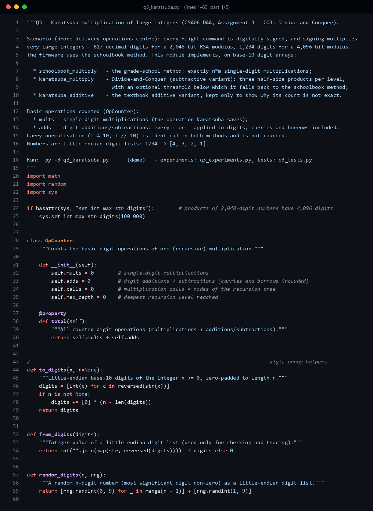

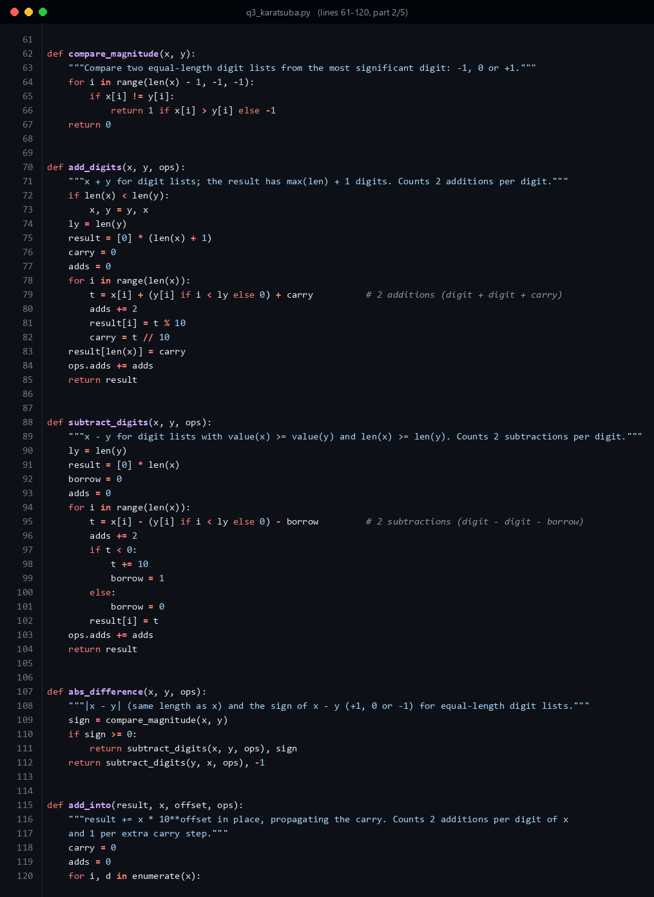

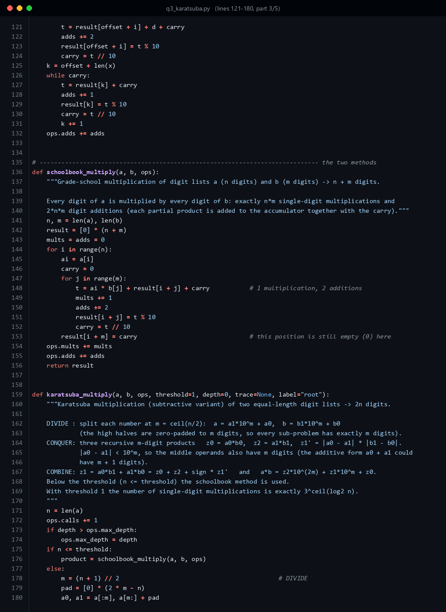

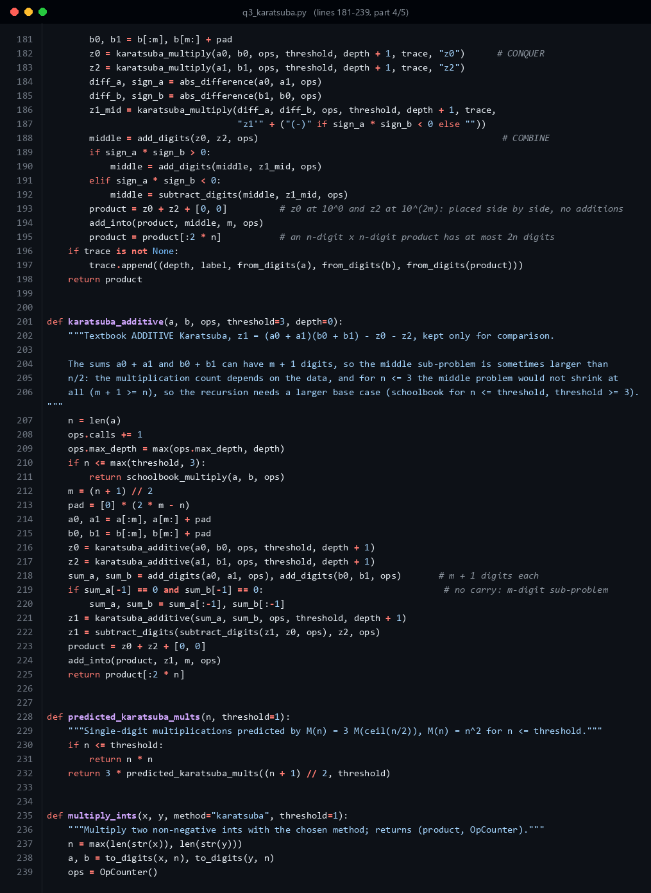

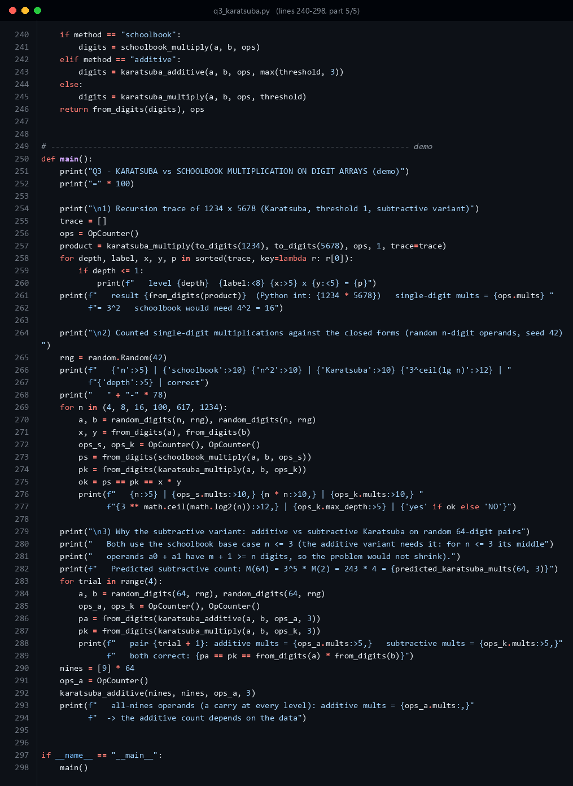

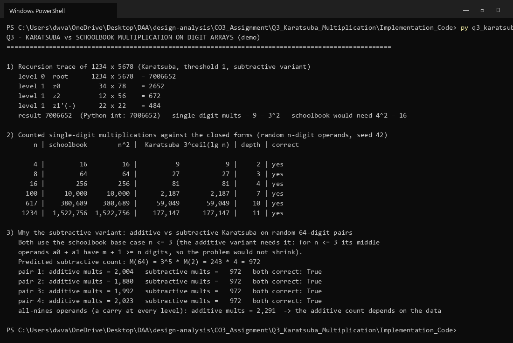

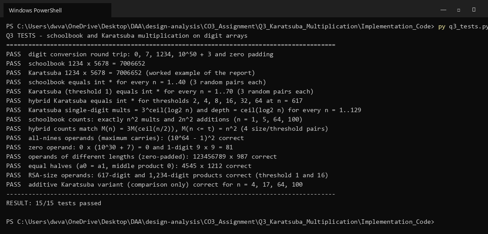

All 15 tests pass (Appendix D): both methods equal `x * y` for every n = 1–40 (schoolbook) and n = 1–70 (Karatsuba), the hybrid for thresholds 2–64 at 617 digits, and the counts equal **3<sup>⌈log₂ n⌉</sup> with recursion depth ⌈log₂ n⌉ for every n = 1–129**, n² and 2n² for the schoolbook method, and the hybrid recurrence for four size/threshold pairs.

### 6. Experimental results

`q3_experiments.py` runs both methods on the same operands (time = minimum of 7, 5 or 3 repeated runs, depending on size) and also a hybrid with threshold t = 16.

Table 16: Counted operations, schoolbook (SB) vs Karatsuba with t = 1 (K) and t = 16 (K16); SB mults = n² and K mults = 3<sup>⌈log₂ n⌉</sup> at every size (q3_sizes.csv)

| Size n | SB mults | K mults | SB total ops | K total ops | K / SB | K16 total ops | K16 / SB |
|---|---|---|---|---|---|---|---|
| 8 | 64 | 27 | 192 | 425 | 2.21 | 192 | 1.00 |
| 16 | 256 | 81 | 768 | 1,441 | 1.88 | 768 | 1.00 |
| 32 | 1,024 | 243 | 3,072 | 4,605 | 1.50 | 2,564 | 0.83 |
| 64 | 4,096 | 729 | 12,288 | 14,294 | 1.16 | 8,214 | 0.67 |
| 128 | 16,384 | 2,187 | 49,152 | 43,918 | 0.89 | 25,668 | 0.52 |
| 256 | 65,536 | 6,561 | 196,608 | 134,024 | 0.68 | 79,048 | 0.40 |
| 512 | 262,144 | 19,683 | 786,432 | 405,527 | 0.52 | 241,259 | 0.31 |
| **617** | 380,689 | 59,049 | 1,142,067 | 1,065,847 | 0.93 | 325,634 | 0.29 |
| 1,000 | 1,000,000 | 59,049 | 3,000,000 | 1,223,927 | 0.41 | 730,433 | 0.24 |
| 1,024 | 1,048,576 | 59,049 | 3,145,728 | 1,225,468 | 0.39 | 731,923 | 0.23 |
| **1,234** | 1,522,756 | 177,147 | 4,568,268 | 3,207,568 | 0.70 | 986,785 | 0.22 |
| 2,048 | 4,194,304 | 177,147 | 12,582,912 | 3,690,116 | 0.29 | 2,212,142 | 0.18 |

Table 17: Execution time in ms at selected sizes (minimum of 7, 5 or 3 runs; all sizes in Appendix C) (q3_sizes.csv)

| Size n | Schoolbook | Karatsuba t = 1 | Karatsuba t = 16 | Speed-up of t = 16 |
|---|---|---|---|---|
| 64 | 0.4 | 1.7 | 0.3 | 1.4× |
| 256 | 7.2 | 16.9 | 3.1 | 2.3× |
| 617 | 46.9 | 163.5 | 14.4 | 3.3× |
| 1,000 | 122.6 | 157.8 | 30.8 | 4.0× |
| 1,234 | 192.0 | 560.4 | 45.5 | 4.2× |
| 2,048 | 543.4 | 548.9 | 97.4 | 5.6× |

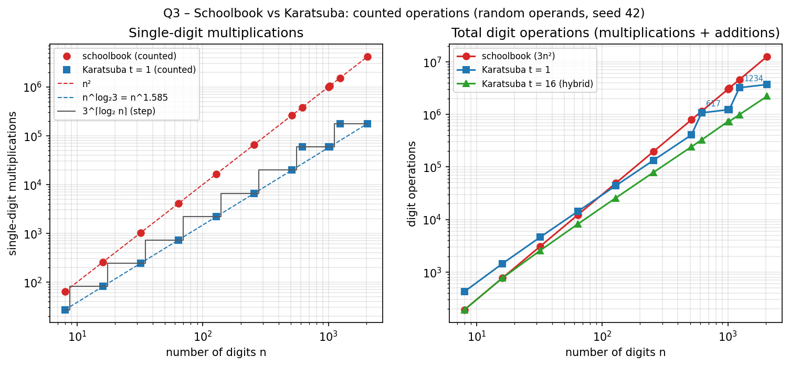

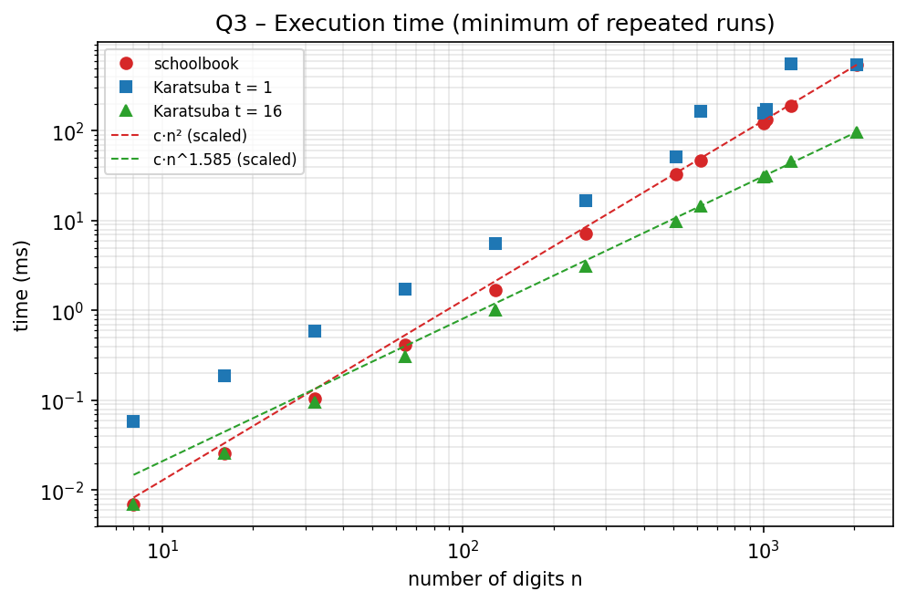

**Crossover.** Pure Karatsuba (t = 1) needs fewer single-digit multiplications from the smallest size (8 digits: 27 vs 64) but fewer **total** operations only from **128 digits** (43,918 vs 49,152; at 64 digits it still needs 1.16× more). In Python **time** it never beats the schoolbook method up to 2,048 digits (548.9 vs 543.4 ms there): at 617 digits it makes 88,573 recursive calls and is 3.5× slower. The hybrid with t = 16 needs fewer operations and less time from **32 digits** upward.

**Choosing the threshold.** To find where the recursion should stop I swept t at the two RSA sizes:

Table 18: Hybrid Karatsuba – schoolbook used for n ≤ t; gain = schoolbook ÷ hybrid, > 1 means the hybrid is better (q3_threshold.csv; time = minimum of 5 runs; additions in Appendix C)

| Size n | Threshold t | Mults | Total ops | Calls | Time (ms) | Ops gain | Time gain |
|---|---|---|---|---|---|---|---|
| 617 | SB | 380,689 | 1,142,067 | 1 | 45.2 | 1.00× | 1.00× |
| 617 | 1 | 59,049 | 1,066,045 | 88,573 | 142.5 | 1.07× | 0.32× |
| 617 | 4 | 59,049 | 460,017 | 9,841 | 29.3 | 2.48× | 1.54× |
| 617 | 8 | 54,675 | 332,849 | 3,280 | 16.3 | 3.43× | 2.77× |
| 617 | **16** | 72,900 | **325,642** | 1,093 | **12.2** | **3.51×** | **3.71×** |
| 617 | 32 | 97,200 | 358,500 | 364 | 12.4 | 3.19× | 3.64× |
| 617 | 128 | 164,268 | 516,474 | 40 | 16.9 | 2.21× | 2.68× |
| 1,234 | SB | 1,522,756 | 4,568,268 | 1 | 175.8 | 1.00× | 1.00× |
| 1,234 | 1 | 177,147 | 3,205,696 | 265,720 | 429.4 | 1.43× | 0.41× |
| 1,234 | 4 | 177,147 | 1,389,810 | 29,524 | 87.7 | 3.29× | 2.00× |
| 1,234 | 8 | 164,025 | 1,008,452 | 9,841 | 49.7 | 4.53× | 3.54× |
| 1,234 | **16** | 218,700 | **986,775** | 3,280 | **38.9** | **4.63×** | **4.53×** |
| 1,234 | 32 | 291,600 | 1,085,360 | 1,093 | 39.4 | 4.21× | 4.46× |
| 1,234 | 128 | 492,804 | 1,559,296 | 121 | 55.3 | 2.93× | 3.18× |

(t = 2 and t = 64 are in Appendix C; every product was correct and every multiplication count equalled the prediction of M(n) = 3M(⌈n/2⌉), M(n ≤ t) = n².)

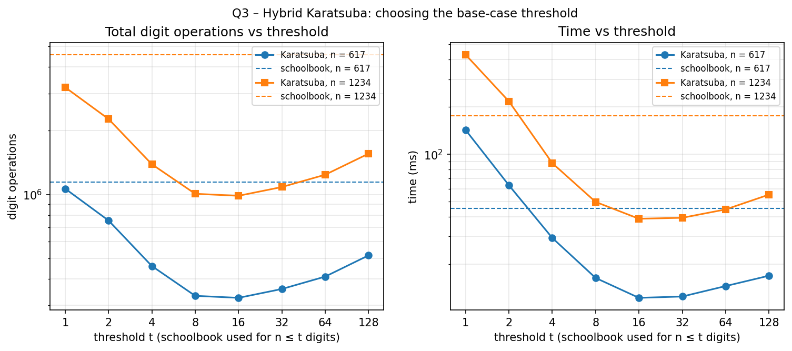

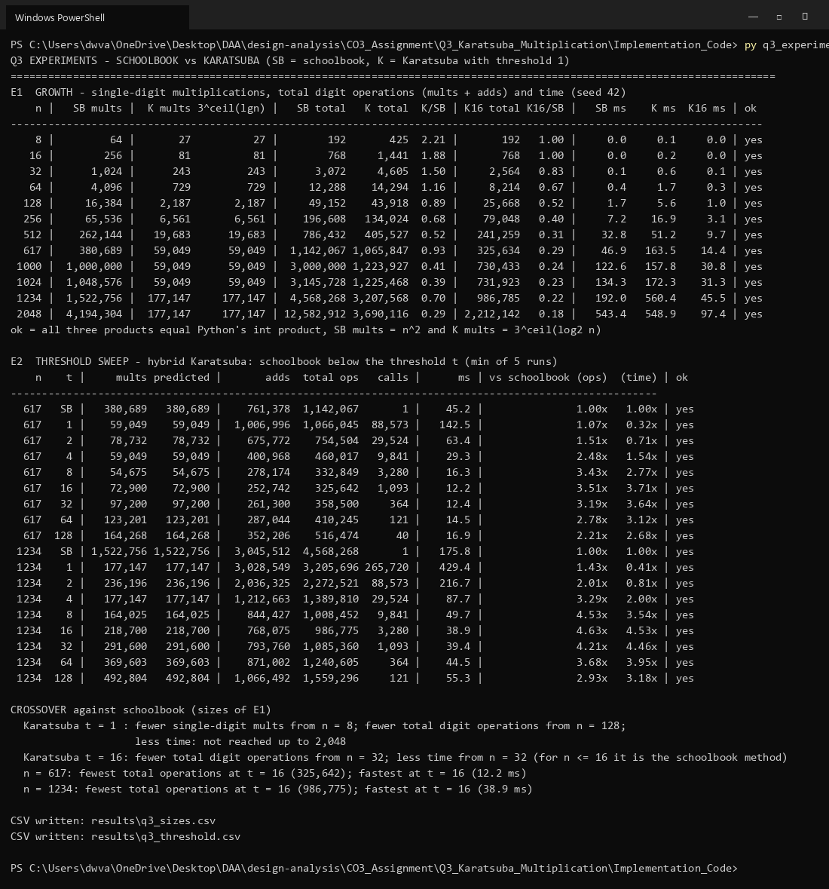

### 7. Prediction compared with observation

- **Multiplications: exactly as predicted.** The counted single-digit multiplications equal n² (schoolbook) and 3<sup>⌈log₂ n⌉</sup> (Karatsuba) at every size of Table 16, and the tests confirm 3<sup>⌈log₂ n⌉</sup> for every n from 1 to 129. At the RSA sizes the saving is 6.4× (617 digits) and 8.6× (1,234 digits), as in Table 15.
- **The step effect is real.** 617, 1,000 and 1,024 digits all need 59,049 multiplications; 617 digits even needs 0.93× the schoolbook total, while 1,000 digits needs only 0.41×. Because the recursion tree's cost is dominated by its 3<sup>⌈log₂ n⌉</sup> leaves, a size just above a power of 2 pays for a whole extra level. The hybrid removes the effect: with t = 16 the base-case size adapts to n (617 → 309 → … → 10 digits, then a 10 × 10 schoolbook product), and K16/SB falls smoothly (0.31, 0.29, 0.24, 0.23, 0.22).
- **Additions follow the derived formula.** A(n) ≈ 20·3<sup>k</sup> − 18n predicts 13,428 / 41,436 / 126,612 / 384,444 / 1,162,548 / 3,506,076 digit additions for n = 64 … 2,048; the program counted 13,565 / 41,731 / 127,463 / 385,844 / 1,166,419 / 3,512,969 (within 1.0%). The additions grow with the same exponent 1.585, but with a constant about 20 times larger than that of the multiplications — that is why the total-operation crossover is at about 110 digits (solving 21·3<sup>k</sup> = 3·4<sup>k</sup> gives k ≈ 6.8) and not at 2 digits.
- **Additive vs subtractive variant.** With the same base case (n ≤ 3), four random 64-digit pairs needed 2,004 / 1,880 / 1,992 / 2,023 single-digit multiplications with the additive variant and exactly the predicted 972 = 3⁵·4 with the subtractive variant; all-nines operands (a carry at every level) needed 2,291. This confirms that the (m + 1)-digit sums make the count data-dependent and about 2× larger, while the subtractive form keeps it exact.
- **Time differs from operation counts.** As predicted, Python's per-call overhead hides the saving of pure Karatsuba: it needs fewer operations from 128 digits but is still slower at 1,234 digits (560.4 vs 192.0 ms). The time curves of the hybrid follow c·n<sup>1.585</sup> (Figure 35); the measured times are noisy (other programs shared the processor), but the ranking never changed between runs.
- **Analytic threshold.** One split of an n-digit product costs 3·3(n/2)² + 9n = 2.25n² + 9n operations against 3n² for the schoolbook method, so splitting pays only when 0.75n² > 9n, i.e. **n > 12**. The measured optimum t = 16 (the sizes at t = 16 bottom out between 8 and 16 digits) agrees with this.

### 8. Design decision and technical conclusions

**Recommendation: replace the schoolbook method by a hybrid Karatsuba with threshold t = 16 digits** (schoolbook for operands of ≤ 16 digits, subtractive Karatsuba split at ⌈n/2⌉ above).

- For **617-digit** (RSA-2048) operands it needs 72,900 single-digit multiplications instead of 380,689 (5.2× fewer), 325,642 total digit operations instead of 1,142,067 (3.5× fewer), and was 3.7× faster (12.2 ms vs 45.2 ms).
- For **1,234-digit** (RSA-4096) operands: 218,700 instead of 1,522,756 multiplications (7.0× fewer), 986,775 instead of 4,568,268 total operations (4.6× fewer), 4.5× faster (38.9 ms vs 175.8 ms).
- **From what size?** The hybrid is cheaper than the schoolbook method from about 32 digits; the operation count says splitting pays above n = 12 digits. Pure Karatsuba (t = 1) should not be used: below about 110 digits it needs more operations, and its 88,573–265,720 recursive calls made it slower than the schoolbook method at every measured size.
- **Why not a larger or smaller threshold?** The operation counts are within about 10% of the minimum for t = 8–32 and the times within 2% for t = 16–32 at both sizes, so t = 16 is robust; t = 1–4 waste work on additions and calls, t ≥ 64 gives back part of the 3/4 saving per level.
- **Trade-offs:** the hybrid needs O(n) extra memory (n + n/2 + n/4 + … digits along the active recursion path) and more complex code than two nested loops; in real firmware digits would be 32- or 64-bit words (617 decimal digits ≈ 64 words), so the threshold must be re-measured in words on the target processor, but the method and the reasoning stay the same.

**Technical conclusion:** Karatsuba's divide-and-conquer turns Θ(n²) into Θ(n<sup>1.585</sup>) by trading one multiplication per node for about 9n additions. The asymptotic gain is real and grows by 4/3 per doubling of the key length, but it pays only above a threshold; the engineering answer is the hybrid, not the pure algorithm.

### 9. Contribution

Table 19: Contribution record for Q3 (proposed record, to be confirmed by both students)

| Task | Student A – V. Vasudevan | Student B – [Student B Name] | Shared |
|---|---|---|---|
| Design | Digit-array representation, subtractive Karatsuba design | Recursion tree and per-level cost analysis | Divide / conquer / combine description |
| Implementation | `q3_karatsuba.py` (schoolbook, Karatsuba, additive variant, counters) and `q3_tests.py` | `q3_experiments.py`, `q3_graphs.py` | Code review |
| Analysis | Prediction table, worked example 1234 × 5678 | Recurrences M(n) and T(n): Master Theorem, recursion tree, addition formula; size and crossover experiments, threshold sweep | Prediction vs observation |
| Decision | – | – | Threshold choice (t = 16) and recommendation |

This is a proposed record of the division of work; both students must confirm it (and Student B's details must be filled in) before submission.

## Q4 – Strassen versus Conventional Matrix Multiplication [7 Marks]

> **Problem Context – Zone-Demand Forecasting.** The city is divided into n delivery zones. A zone-to-zone transition matrix P (n × n) gives the share of deliveries that move from one zone to another, and multi-step demand forecasts need matrix products such as P² and P⁴. The planners expect n to grow from 16 to several hundred zones, and n is not always a power of 2.
> The development team is considering: **Conventional (triple-loop) multiplication | Strassen's algorithm**
> **Your Challenge:** Determine whether Strassen's seven-multiplication scheme pays off for these matrix sizes.
> Before implementation:
> - Predict the number of scalar multiplications and additions of both methods.
> - Formulate the recurrences from the algorithms and solve them.
> Implement both methods with operation counters, handle sizes that are not powers of 2 by padding, and verify every product.
> Measure at least four sizes and investigate the effect of a cutoff size below which Strassen switches to the conventional method.
> **Design Decision:** Recommend a multiplication strategy (including the padding policy and the cutoff) for models with 100 to 256 zones.

**Evidence Expected**

> Recurrences and their solutions (7<sup>k</sup> against 8<sup>k</sup> multiplications, additions), decomposition diagram, operation-count tables compared with theory, cutoff and crossover experiments, padding analysis, correctness verification and a justified recommendation.

**Ans:**

### 1. Prediction before implementation

**Conventional.** Each of the n² entries C[i][j] = Σ_k A[i][k]·B[k][j] needs n multiplications and n − 1 additions: exactly **n³ multiplications and n²(n − 1) additions** for every input. Written as a block divide-and-conquer (8 half-size products) it is 8<sup>k</sup> = n³ for n = 2<sup>k</sup>.

**Strassen.** One level replaces the 8 block products by **7**, at the price of 18 additions/subtractions of (n/2) × (n/2) blocks. Recursing down to 1 × 1 blocks I predict **7<sup>k</sup> = n<sup>log₂7</sup> ≈ n<sup>2.807</sup> multiplications** and **6(7<sup>k</sup> − 4<sup>k</sup>) additions** (derived in Section 4).

Table 20: Predicted operation counts for zone models (calculated from the closed forms; total ratio = Strassen ÷ conventional, multiplications + additions)

| Size n | Conv. mults n³ | Strassen mults 7<sup>k</sup> | Conv. adds n²(n − 1) | Strassen adds 6(7<sup>k</sup> − 4<sup>k</sup>) | Total ratio |
|---|---|---|---|---|---|
| 16 | 4,096 | 2,401 | 3,840 | 12,870 | 1.92 |
| 128 | 2,097,152 | 823,543 | 2,080,768 | 4,842,954 | 1.36 |
| 256 | 16,777,216 | 5,764,801 | 16,711,680 | 34,195,590 | 1.19 |

My prediction is therefore: (i) Strassen always needs fewer **multiplications** (the ratio (7/8)<sup>k</sup> falls by 7/8 per doubling: 0.34 at n = 256), but (ii) a "pure" Strassen that recurses down to 1 × 1 needs **more total operations** than the triple loop for every size the planners care about, because its additions grow with the same exponent 2.807 and a constant of 6; (iii) a cutoff (conventional multiplication for small blocks) should fix this, and the best cutoff in operation counts is small (Section 4 derives c = 8); (iv) in Python, list slicing and allocation in every call make the time-optimal cutoff larger than the operation-optimal one; (v) padding a non-power-of-2 size up to the next power of 2 wastes up to (2n/n)<sup>2.807</sup> ≈ 7× the work when n is just above a power of 2 (n = 129 → 256), so padding should be done one row/column at a time where needed.

### 2. Divide-and-Conquer design

- **Divide:** h = ⌈n/2⌉. If n is odd, add **one** zero row and column (dynamic padding) so that A and B split into four h × h blocks A11 … A22 and B11 … B22.
- **Conquer:** compute seven block products recursively; 10 block additions/subtractions prepare their operands:
  M1 = (A11 + A22)(B11 + B22), M2 = (A21 + A22)B11, M3 = A11(B12 − B22), M4 = A22(B21 − B11), M5 = (A11 + A12)B22, M6 = (A21 − A11)(B11 + B12), M7 = (A12 − A22)(B21 + B22).
- **Combine:** C11 = M1 + M4 − M5 + M7, C12 = M3 + M5, C21 = M2 + M4, C22 = M1 − M2 + M3 + M6 (8 more block additions), then remove the padding row/column.
- **Base case / cutoff:** n ≤ c uses the conventional triple loop (c = 1 gives the "pure" algorithm).

Static padding (the textbook alternative) pads the whole matrix once to the next power of 2 and runs the same algorithm.

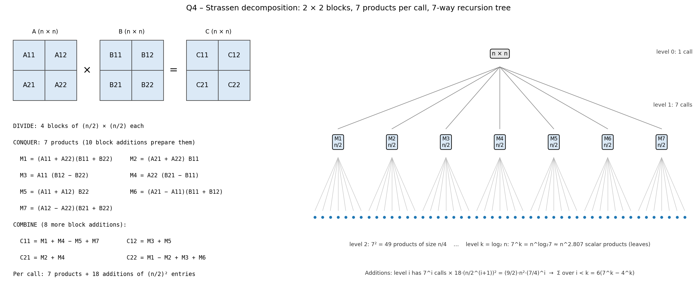

The 2 × 2 example of the demo (Figure 43): A = [[1, 3], [7, 5]], B = [[6, 8], [4, 2]] gives M1 … M7 = 48, 72, 6, −10, 8, 84, −12 and C = [[48 − 10 − 8 − 12, 6 + 8], [72 − 10, 48 − 72 + 6 + 84]] = **[[18, 14], [62, 66]]**, the same as the triple loop, with 7 multiplications and 18 additions instead of 8 and 4.

### 3. Pseudocode

```
Algorithm Conventional(A, B, n)
1. for i = 0 to n-1 do
2.     for j = 0 to n-1 do
3.         s = A[i][0] * B[0][j]
4.         for k = 1 to n-1 do
5.             s = s + A[i][k] * B[k][j]              // 1 multiplication + 1 addition
6.         C[i][j] = s
7. return C                                           // n^3 multiplications, n^2(n-1) additions

Algorithm Strassen(A, B, n, c)
1. if n <= c then return Conventional(A, B, n)       // base case / cutoff
2. h = ceil(n/2)                                      // DIVIDE
3. if n is odd then pad A and B with one zero row and one zero column
4. split A into A11, A12, A21, A22 and B into B11, B12, B21, B22   (h x h blocks)
5. M1 = Strassen(A11 + A22, B11 + B22, h, c)          // CONQUER: 7 products
6. M2 = Strassen(A21 + A22, B11, h, c)
7. M3 = Strassen(A11, B12 - B22, h, c)
8. M4 = Strassen(A22, B21 - B11, h, c)
9. M5 = Strassen(A11 + A12, B22, h, c)
10. M6 = Strassen(A21 - A11, B11 + B12, h, c)
11. M7 = Strassen(A12 - A22, B21 + B22, h, c)
12. C11 = M1 + M4 - M5 + M7;   C12 = M3 + M5          // COMBINE: 8 block additions
13. C21 = M2 + M4;             C22 = M1 - M2 + M3 + M6
14. return [[C11, C12], [C21, C22]] without the padding row/column

Algorithm StrassenStaticPadding(A, B, n, c)
1. N = smallest power of 2 >= n;  pad A and B with zeros to N x N
2. return the top-left n x n part of Strassen(A, B, N, c)
```

`conventional_multiply`, `strassen_multiply` and `strassen_static_padding` (`q4_strassen.py`, Appendix A) count every scalar multiplication and addition/subtraction (a block addition of h × h matrices counts h² additions); copying, splitting and padding only move data and are not counted. The program also counts calls, recursion depth and the number of paddings, and `predicted_strassen_counts` evaluates the recurrences for any n and cutoff so that every measured count can be compared with its prediction.

### 4. Recurrence formulation and solution

**Multiplications.** Only lines 5–11 multiply: M(n) = 7·M(n/2), M(1) = 1. Backward substitution: M(n) = 7·M(n/2) = 7²·M(n/4) = … = 7<sup>i</sup>·M(n/2<sup>i</sup>); with i = k = log₂ n: **M(n) = 7<sup>k</sup> = 7<sup>log₂ n</sup> = n<sup>log₂7</sup> ≈ n<sup>2.807</sup>**. (The block method with 8 products gives 8<sup>k</sup> = n³.)

**Additions.** Each call adds 18 blocks of (n/2)² entries: A(n) = 7·A(n/2) + 18·(n/2)², A(1) = 0. Unrolling,

A(n) = Σ<sub>i=0</sub><sup>k−1</sup> 7<sup>i</sup> · 18·(n/2<sup>i+1</sup>)² = (18n²/4) · Σ<sub>i=0</sub><sup>k−1</sup> (7/4)<sup>i</sup> = 4.5n² · ((7/4)<sup>k</sup> − 1)/(3/4) = 6n²·((7/4)<sup>k</sup> − 1) = **6(7<sup>k</sup> − 4<sup>k</sup>)**,

since n²·(7/4)<sup>k</sup> = 4<sup>k</sup>·7<sup>k</sup>/4<sup>k</sup> = 7<sup>k</sup> and n² = 4<sup>k</sup>. Check: A(2) = 6(7 − 4) = 18 ✓, A(4) = 6(49 − 16) = 198 ✓.

**Running time.** T(n) = 7·T(n/2) + Θ(n²) (the 18 additions and the data movement are quadratic).
*Master Theorem:* a = 7, b = 2, f(n) = Θ(n²), n<sup>log_b a</sup> = n<sup>log₂7</sup> ≈ n<sup>2.807</sup>. Since f(n) = O(n<sup>2.807 − ε</sup>) with ε = 0.807, **case 1** gives **T(n) = Θ(n<sup>log₂7</sup>) ≈ Θ(n<sup>2.807</sup>)**; the conventional method is Θ(n³) (a = 8: n<sup>log₂8</sup> = n³).
*Recursion tree:* level i has 7<sup>i</sup> calls on (n/2<sup>i</sup>)-blocks, each with c·(n/2<sup>i</sup>)² work, so level i costs c·n²·(7/4)<sup>i</sup> — an increasing geometric series, dominated by the 7<sup>k</sup> = n<sup>2.807</sup> leaves, the same result.

**With a cutoff c** (n = c·2<sup>k</sup>): M = 7<sup>k</sup>·c³ and A = 7<sup>k</sup>·c²(c − 1) + 6(c²·7<sup>k</sup> − n²). **Optimal cutoff from the counts:** the conventional product of size m costs 2m³ − m² operations; splitting a 2m-matrix into 7 conventional m-products costs 7(2m³ − m²) + 18m² = 14m³ + 11m² against 16m³ − 4m² for one conventional product of size 2m. Splitting is cheaper iff 2m³ − 15m² > 0, i.e. **m ≥ 8**: split 16 × 16 and larger blocks and multiply 8 × 8 blocks conventionally (**c = 8**).

**Meaning in the scenario:** doubling the number of zones multiplies the conventional work by 8 but Strassen's by 7 — a modest gain per doubling, which is why the payoff depends so strongly on the constant factors (additions, cutoff, padding) at 100–256 zones.

### 5. Implementation, test datasets and correctness

Test data: random integer matrices with entries 0–9 (`random.Random(42)`), so that every product is exact and can be compared with `==`; sizes 16, 32, 64, 128, 256 (powers of 2) and 100, 129, 200 (not powers of 2; 129 is the worst case just above a power of 2). The demo also squares a 6-zone trip-count matrix T (6 → 3 → 4 → 2 → 1 with one padding) and checks T² against the triple loop. References: the conventional triple loop and **numpy**'s matrix product (numpy is used only to verify).

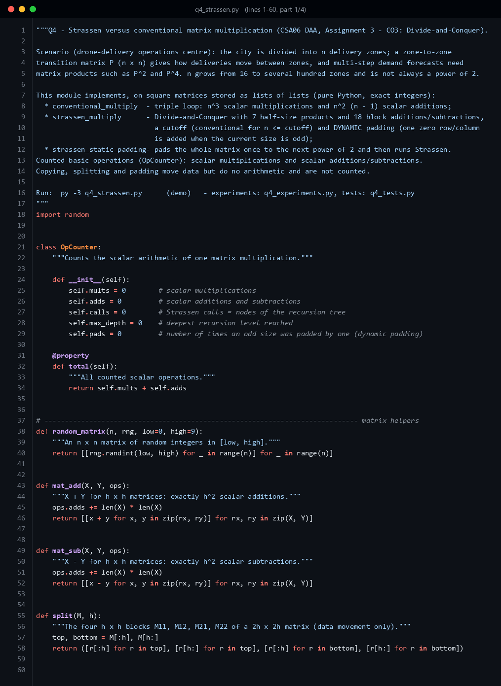

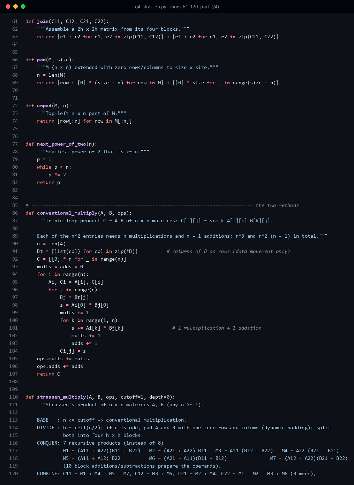

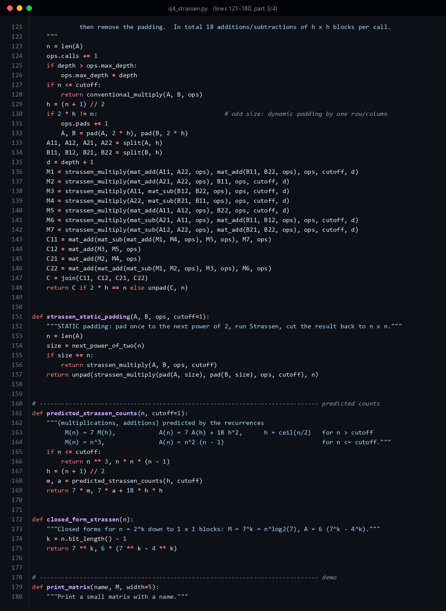

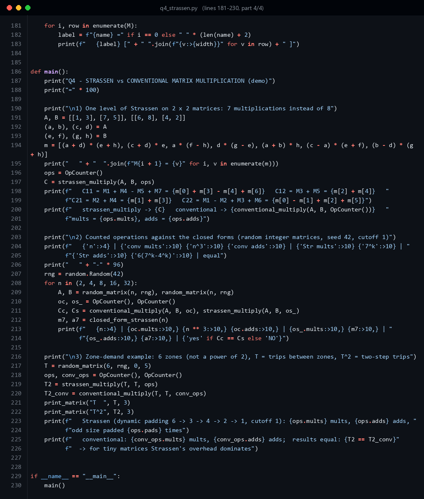

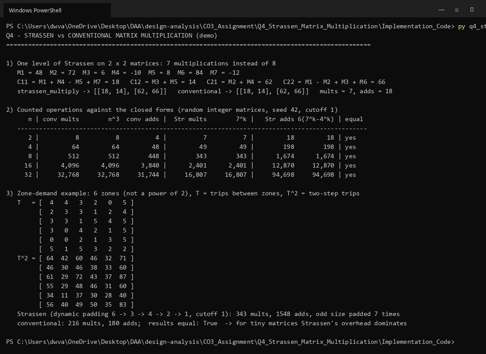

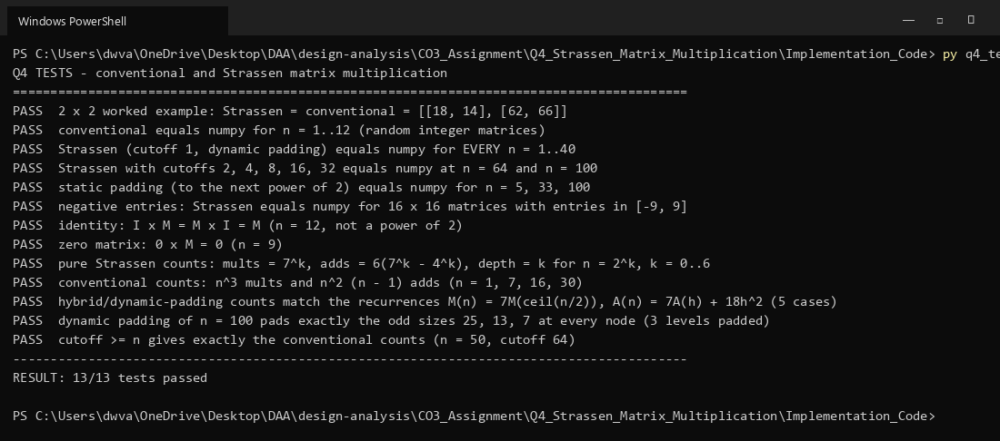

All 13 tests pass (Appendix D): Strassen equals numpy for **every n from 1 to 40** (so every odd/even padding path is exercised), for cutoffs 2–32 at n = 64 and 100, with static padding, with negative entries, for the identity and the zero matrix; the counts equal 7<sup>k</sup>, 6(7<sup>k</sup> − 4<sup>k</sup>) and depth k for n = 2<sup>k</sup> (k = 0–6), n³ and n²(n − 1) for the triple loop, and the recurrence predictions for five size/cutoff pairs; dynamic padding of n = 100 pads exactly 7² + 7³ + 7⁴ times (the 25-, 13- and 7-blocks).

### 6. Experimental results

`q4_experiments.py` runs four experiments; every Strassen product in every row was checked against the conventional product (and against numpy in E1). Time = minimum of 3 runs (1 run for the slowest configurations).

Table 21: E1 – counted operations, conventional vs pure Strassen (cutoff 1); conventional = n³ and n²(n − 1), Strassen = 7<sup>k</sup> and 6(7<sup>k</sup> − 4<sup>k</sup>) at every size; ratio = Strassen ÷ conventional (q4_growth.csv)

| Size n | Conv. mults | Conv. adds | Strassen mults | Strassen adds | Mults ratio | Total ratio |
|---|---|---|---|---|---|---|
| 16 | 4,096 | 3,840 | 2,401 | 12,870 | 0.586 | 1.924 |
| 32 | 32,768 | 31,744 | 16,807 | 94,698 | 0.513 | 1.728 |
| 64 | 262,144 | 258,048 | 117,649 | 681,318 | 0.449 | 1.536 |
| 128 | 2,097,152 | 2,080,768 | 823,543 | 4,842,954 | 0.393 | 1.356 |
| 256 | 16,777,216 | 16,711,680 | 5,764,801 | 34,195,590 | 0.344 | 1.193 |

Table 22: E1 – time of the conventional method and of pure Strassen (q4_growth.csv)

| Size n | Conventional (ms) | Pure Strassen (ms) | Strassen slower by | Strassen calls | Depth |
|---|---|---|---|---|---|
| 16 | 0.3 | 6.9 | 25.4× | 2,801 | 4 |
| 32 | 1.9 | 54.1 | 29.2× | 19,608 | 5 |
| 64 | 15.2 | 415.6 | 27.4× | 137,257 | 6 |
| 128 | 125.1 | 2,774.2 | 22.2× | 960,800 | 7 |
| 256 | 994.8 | 24,591.7 | 24.7× | 6,725,601 | 8 |

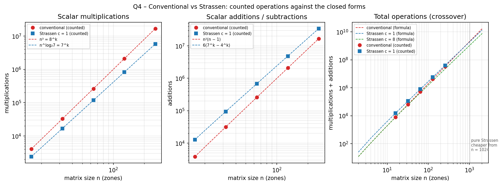

Table 23: E2 – cutoff sweep, conventional multiplication for n ≤ c; gain = conventional ÷ Strassen, > 1 means Strassen is better (q4_cutoff.csv)

| Size n | Cutoff c | Mults | Adds | Total ops | Time (ms) | Ops gain | Time gain |
|---|---|---|---|---|---|---|---|
| 128 | conventional | 2,097,152 | 2,080,768 | 4,177,920 | 122.8 | 1.00× | 1.00× |
| 128 | 1 | 823,543 | 4,842,954 | 5,666,497 | 3,020.9 | 0.74× | 0.04× |
| 128 | 4 | 1,075,648 | 2,321,904 | 3,397,552 | 337.0 | 1.23× | 0.36× |
| 128 | **8** | 1,229,312 | 1,899,328 | **3,128,640** | 228.7 | **1.34×** | 0.54× |
| 128 | 16 | 1,404,928 | 1,745,664 | 3,150,592 | 145.2 | 1.33× | 0.85× |
| 128 | 32 | 1,605,632 | 1,758,208 | 3,363,840 | **129.7** | 1.24× | **0.95×** |
| 128 | 64 | 1,835,008 | 1,880,064 | 3,715,072 | 162.8 | 1.12× | 0.75× |
| 256 | conventional | 16,777,216 | 16,711,680 | 33,488,896 | 1,014.1 | 1.00× | 1.00× |
| 256 | 1 | 5,764,801 | 34,195,590 | 39,960,391 | 20,949.6 | 0.84× | 0.05× |
| 256 | 4 | 7,529,536 | 16,548,240 | 24,077,776 | 2,232.5 | 1.39× | 0.45× |
| 256 | **8** | 8,605,184 | 13,590,208 | **22,195,392** | 1,397.1 | **1.51×** | 0.73× |
| 256 | 16 | 9,834,496 | 12,514,560 | 22,349,056 | 1,070.7 | 1.50× | 0.95× |
| 256 | 32 | 11,239,424 | 12,602,368 | 23,841,792 | 1,074.9 | 1.40× | 0.94× |
| 256 | 64 | 12,845,056 | 13,455,360 | 26,300,416 | **1,042.0** | 1.27× | **0.97×** |

(c = 2 is in Appendix C; every count equalled the recurrence prediction.)

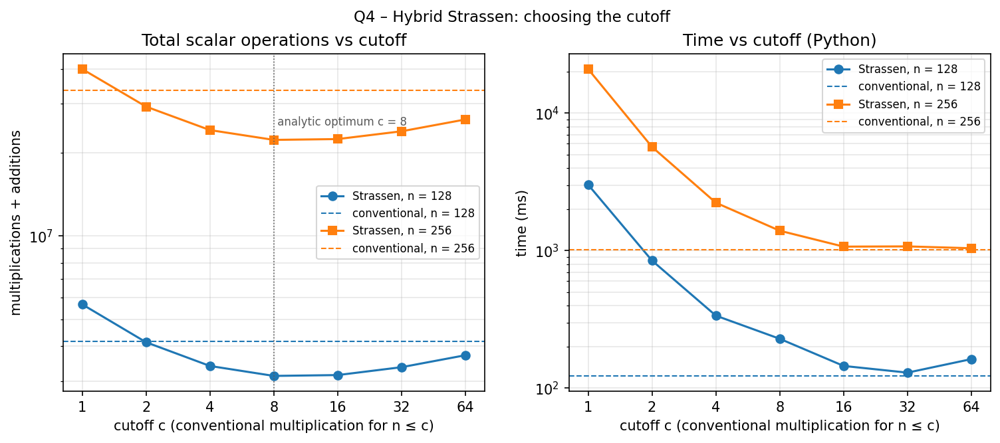

Table 24: E3 – sizes that are not powers of 2: static padding (to 128 / 256) vs dynamic padding; gain = conventional ÷ Strassen (q4_padding.csv; additions in Appendix C)

| Size n | Method | Cutoff | Mults | Total ops | Time (ms) | Ops gain | Time gain |
|---|---|---|---|---|---|---|---|
| 100 | conventional | – | 1,000,000 | 1,990,000 | 66.4 | 1.00× | 1.00× |
| 100 | static → 128 | 8 | 1,229,312 | 3,128,640 | 188.9 | 0.64× | 0.35× |
| 100 | dynamic | 8 | 823,543 | 2,104,771 | 153.0 | 0.95× | 0.43× |
| 100 | static → 128 | 32 | 1,605,632 | 3,363,840 | 128.0 | 0.59× | 0.52× |
| 100 | **dynamic** | **32** | 765,625 | **1,624,375** | **65.0** | **1.23×** | **1.02×** |
| 129 | conventional | – | 2,146,689 | 4,276,737 | 121.2 | 1.00× | 1.00× |
| 129 | static → 256 | 8 | 8,605,184 | 22,195,392 | 1,035.4 | 0.19× | 0.12× |
| 129 | dynamic | 8 | 2,100,875 | 5,830,281 | 458.9 | 0.73× | 0.26× |
| 129 | static → 256 | 32 | 11,239,424 | 23,841,792 | 764.5 | 0.18× | 0.16× |
| 129 | **dynamic** | **32** | 1,685,159 | **3,739,353** | **160.2** | **1.14×** | 0.76× |
| 200 | conventional | – | 8,000,000 | 15,960,000 | 485.4 | 1.00× | 1.00× |
| 200 | static → 256 | 8 | 8,605,184 | 22,195,392 | 1,494.9 | 0.72× | 0.32× |
| 200 | dynamic | 8 | 5,764,801 | 14,913,397 | 1,019.4 | 1.07× | 0.48× |
| 200 | static → 256 | 32 | 11,239,424 | 23,841,792 | 870.0 | 0.67× | 0.56× |
| 200 | **dynamic** | **32** | 5,359,375 | **11,550,625** | **480.4** | **1.38×** | **1.01×** |

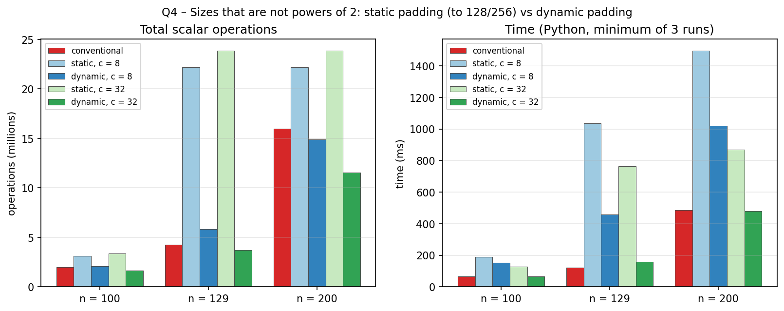

Table 25: E4 – total operations calculated from the closed forms (no products run) (q4_crossover_formula.csv)

| Size n | Conventional 2n³ − n² | Pure Strassen (c = 1) | Ratio | Hybrid Strassen (c = 8) | Ratio |
|---|---|---|---|---|---|
| 16 | 7,936 | 15,271 | 1.924 | 7,872 | 0.992 |
| 64 | 520,192 | 798,967 | 1.536 | 436,416 | 0.839 |
| 256 | 33,488,896 | 39,960,391 | 1.193 | 22,195,392 | 0.663 |
| 512 | 268,173,312 | 280,902,385 | 1.047 | 156,547,392 | 0.584 |
| 1,024 | 2,146,435,072 | 1,971,035,287 | **0.918** | 1,100,550,336 | 0.513 |
| 2,048 | 17,175,674,880 | 13,816,121,377 | 0.804 | 7,722,726,720 | 0.450 |

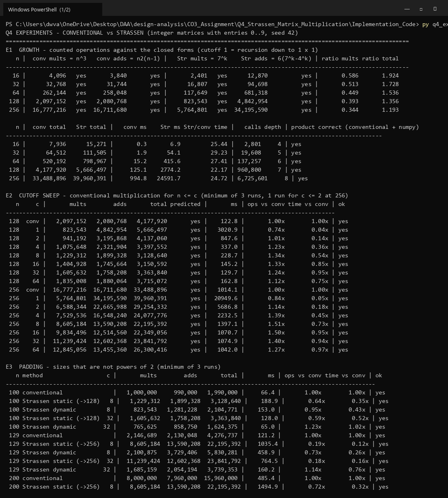

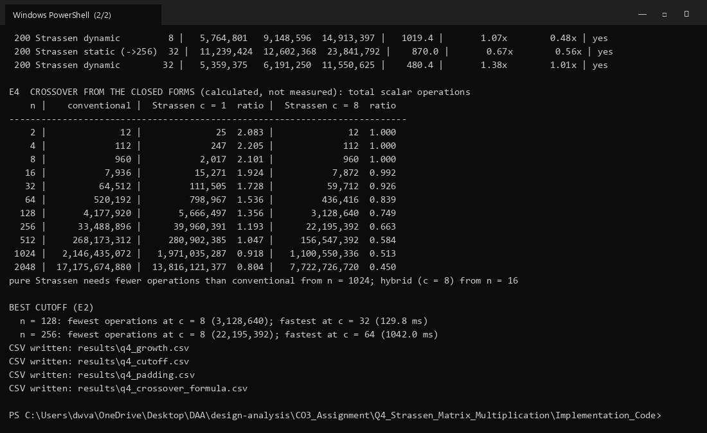

### 7. Prediction compared with observation

- **Counts: exactly as predicted.** All counted multiplications and additions equal n³, n²(n − 1), 7<sup>k</sup> and 6(7<sup>k</sup> − 4<sup>k</sup>) (Table 21) and the hybrid/dynamic-padding recurrences (every row of Tables 23 and 24). The multiplication ratio fell by 7/8 per doubling (0.586 → 0.513 → 0.449 → 0.393 → 0.344).
- **Pure Strassen loses on total operations, as predicted.** It needs 1.19–1.92× more operations than the triple loop for n = 16–256, because its additions (34,195,590 at n = 256) are twice the conventional additions. The closed forms put the crossover of the pure algorithm at **n = 1,024** zones (Table 25), far beyond the planners' range. In Python it was 22–29× slower (6,725,601 recursive calls at n = 256).
- **The cutoff behaves as derived.** The operation minimum is at **c = 8** for both n = 128 and n = 256 (3,128,640 and 22,195,392 operations, 1.34× and 1.51× fewer than conventional), exactly the analytic optimum, and the hybrid with c = 8 is cheaper than the triple loop from n = 16 upward (Table 25). The time minimum is at a larger cutoff (c = 32 at n = 128, c = 64 at n = 256) because every recursive call in Python allocates and slices lists — the constant factors that the operation count does not see.
- **Time: Strassen's advantage is within the noise at ≤ 256 zones in Python.** The best hybrid was 0.95× (n = 128) and 0.97× (n = 256) of the conventional time in the final run, and 1.01–1.02× at n = 100 and 200 with dynamic padding. Repeated runs gave identical counts, but times varied by more than ±30% because other programs shared the processor, so I treat these time ratios as "about equal". The operation counts (1.4–1.5× fewer) are the reliable evidence.
- **Padding: the predicted waste is real.** Static padding of 129 zones to 256 needed 22,195,392–23,841,792 operations, **5.2–5.6× more than the conventional method** and 6.4× more than dynamic padding with c = 32. Dynamic padding keeps the sub-problem sizes close to n/2<sup>i</sup> (100 → 50 → 25) and, with c = 32, needed 1.23× (n = 100), 1.14× (n = 129) and 1.38× (n = 200) fewer operations than conventional. With c = 8 dynamic padding was still worse than conventional at n = 100 and 129 (0.95×, 0.73×), because the odd sizes 25, 13, 7 are padded at thousands of nodes.

### 8. Design decision and technical conclusions

**Recommendation for 100–256 zones: hybrid Strassen with dynamic padding (one zero row/column only when the current size is odd) and a cutoff of c = 32** (conventional multiplication for blocks of ≤ 32 zones); never static padding.

- **Evidence:** with these settings the counted work is 1.23× (100 zones), 1.14× (129), 1.38× (200) and 1.40× (256) smaller than the triple loop, and every product was exact. Static padding would make a 129-zone forecast 5.6× more expensive than the conventional method.
- **Why c = 32 and not the operation optimum c = 8?** c = 8 is optimal for operation counts (1.51× fewer at 256 zones) but makes 19,608 recursive calls at n = 256 (c = 32: 400) and was clearly slower in Python (0.73× at n = 256) and worse with dynamic padding at odd sizes; c = 32 keeps most of the saving (1.40× vs 1.51× at n = 256) and was the fastest or within 5% of the fastest configuration in the time measurements. In a compiled implementation, where a call is cheap, the cutoff can be lowered towards 8–16.
- **What to expect:** in this Python environment the time gain at ≤ 256 zones is negligible (0.95–1.02× of conventional); the gain grows with n — by the closed forms the hybrid needs 1.71× fewer operations at 512 zones and 1.95× fewer at 1,024 — so Strassen becomes worthwhile as the model grows to many hundreds of zones. For 100–128 zones the simple triple loop is an equally acceptable choice.
- **Trade-offs:** O(n²) extra memory for the temporary blocks and products at each level; more complex code; and for real transition probabilities (floating point) Strassen's error bound is weaker than the triple loop's because of the subtractions, so forecasts should be checked (for example, each row of P<sup>k</sup> must still sum to 1). My tests used exact integers, so they verify the algorithm, not its rounding behaviour.

**Technical conclusion:** Strassen's 7-for-8 trade lowers the exponent from 3 to 2.807, but the 18 block additions, the recursion overhead and padding dominate at a few hundred zones. The engineering answer is a hybrid — Strassen at the top levels, the triple loop below a cutoff, and padding one row at a time — not the pure textbook algorithm.

### 9. Contribution

Table 26: Contribution record for Q4 (proposed record, to be confirmed by both students)

| Task | Student A – V. Vasudevan | Student B – [Student B Name] | Shared |
|---|---|---|---|
| Design | Closed forms 7<sup>k</sup>, 6(7<sup>k</sup> − 4<sup>k</sup>), n³, n²(n − 1); analytic optimal cutoff (c = 8) | Block decomposition, 7 products, dynamic vs static padding design | Divide / conquer / combine description |
| Implementation | `q4_experiments.py` (E1–E4), `q4_graphs.py` | `q4_strassen.py` (conventional, Strassen, padding, cutoff, counters) and `q4_tests.py` | Code review |
| Analysis | Recurrence solutions (Master Theorem, recursion tree), operation-count crossover, experiments | Correctness verification against numpy, padding analysis | Prediction vs observation |
| Decision | – | – | Recommendation: dynamic padding + cutoff 32 |

This is a proposed record of the division of work; both students must confirm it (and Student B's details must be filled in) before submission.

## Q5 – Divide-and-Conquer Closest Pair [7 Marks]

> **Problem Context – Airspace Deconfliction.** The operations centre receives the position (x, y) of every airborne drone once per second. To issue separation alerts it must find the two drones that are closest to one another. The fleet is expected to grow beyond 20,000 airborne drones.
> **Your Challenge:** Design a Divide-and-Conquer closest-pair algorithm and compare it with the brute-force method.
> Before implementation:
> - Predict the number of distance computations of both methods.
> - Explain why only a narrow strip around the dividing line has to be examined in the combine step, and why each point in the strip has to be compared with at most 7 neighbours.
> Formulate and solve the recurrence. Implement both algorithms, count the distance computations, and verify the Divide-and-Conquer result against brute force.
> Test at least three meaningfully different drone distributions and sizes up to at least 20,000 drones.
> **Design Decision:** Can the Divide-and-Conquer method meet a 1-second update cycle for 20,000 or more drones? Defend your answer with evidence.

**Evidence Expected**

> Divide-and-conquer design with decomposition diagram, strip argument, recurrence and solution, counted distance computations against n(n − 1)/2 and n log₂ n, verification against brute force, three distributions, scalability evidence and a justified decision.

**Ans:**

### 1. Prediction of the distance computations before implementation

**Brute force.** Without using the positions, every pair of drones is a candidate. Drone 0 is paired with n − 1 later drones, drone 1 with n − 2, …, drone n − 2 with 1:

(n − 1) + (n − 2) + … + 1 = Σᵢ₌₀ⁿ⁻² (n − 1 − i) = n(n − 1)/2

So brute force makes **exactly n(n − 1)/2** distance computations on every input (499,500 at n = 1,000; 199,990,000 at n = 20,000): Θ(n²), no best or worst case.

**Divide-and-Conquer.** Distance computations only happen in two places: the base cases (2 or 3 drones, at most 3 computations each, about n/2 base cases) and the strips. A strip point is compared with at most 7 neighbours (proved in Section 2), and a level of the recursion has at most n strip points, so the worst case is ≤ 7n per level, **≤ 7n log₂ n** in total. For real traffic I expect far less: in a sub-problem of m drones spread over a region, δ shrinks like side/√m, so a strip of width 2δ holds only about 2√m drones. Summed over the levels this is dominated by the deepest levels, so I predict **about c·n distance computations with c between 1 and 2** for the uniform and the clustered fleet. The **n log n** part of the work will instead appear in the sorting: the one-off presort by x and the merges by y cost about n log₂ n comparisons each.

Table 27: Predictions made before implementation

| Quantity | Brute force | Divide-and-Conquer |
|---|---|---|
| Distance computations | n(n − 1)/2 exactly | worst case ≤ 7n log₂ n; predicted ≈ 1–2 n on spread-out fleets |
| Sorting / merging comparisons | none | ≈ 2 n log₂ n (presort + merges) |
| Neighbours examined per strip point | – | ≤ 7 (packing bound); expected ≤ 2–3 in practice |
| Growth of the time | ×4 per doubling of n | ×≈2.1 per doubling of n (n log n) |
| All drones on one corridor (identical x) | unchanged | the strip contains every drone of every sub-problem, but each still examines very few neighbours |

### 2. Divide-and-Conquer design and decomposition

Table 28: The three Divide-and-Conquer steps of `closest_pair_dc`

| Step | What the algorithm does | Cost for n drones |
|---|---|---|
| Preprocess | sort the drones once by x (`merge_sort_by`, comparisons counted) | Θ(n log n), once |
| **Divide** | split the x-sorted list at its middle; the vertical line x = mid_x separates the left half (x ≤ mid_x) from the right half (x ≥ mid_x) | Θ(n) (list slicing) |
| **Conquer** | solve both halves recursively; each call returns its best squared distance and its drones **sorted by y**; base case ≤ 3 drones → brute force | 2T(n/2) |
| **Combine** | (1) merge the two y-sorted halves (`merge_by_y`); (2) δ = min(δ_L, δ_R); (3) keep the strip \|x − mid_x\| < δ (already in y order); (4) compare each strip drone with the following strip drones while their y-difference is < δ | Θ(n) |

**Why only the strip.** After the two recursive calls, the best pair inside the left half and the best pair inside the right half are known, so the only pairs still unchecked are cross pairs (one drone on each side). A cross pair can beat δ only if its distance is < δ; then its horizontal distance is < δ, and because the two drones lie on opposite sides of the line x = mid_x, **each** of them is less than δ from the line. Every drone outside the band |x − mid_x| < δ can therefore be discarded without computing a single distance.

**Why at most 7 neighbours.** Take a strip drone p and look only upwards (the scan runs in y order, so pairs below p were checked when the lower drone was processed). A strip drone q that can beat δ satisfies 0 ≤ q.y − p.y < δ, so q lies in the δ × 2δ rectangle [mid_x − δ, mid_x + δ] × [p.y, p.y + δ]. Its left δ × δ square contains only left-half drones, which are pairwise at least δ_L ≥ δ apart. Split that square into four δ/2 × δ/2 cells: each cell has diameter δ/√2 < δ, so it holds at most one drone, and the square at most 4. The same holds for the right square. The rectangle therefore holds at most 8 drones including p, so **p is compared with at most 7 neighbours**, and the combine step is linear: ≤ 7 · (strip size) ≤ 7n distance computations.

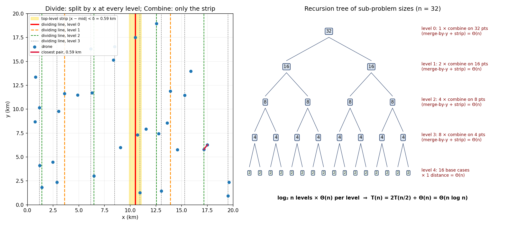

In Figure 50 the top-level strip (yellow) is only 1.2 km wide (δ = 0.59 km) and contains 3 of the 32 drones; the closest pair (red) lies inside the right half and was already found by a recursive call.

### 3. Pseudocode

```
Algorithm ClosestPairDC(D, n)                     // D[0..n-1] = (x, y) positions in metres, n >= 2
1. Px = MergeSortBy(D, x)                         // presort by x once: Theta(n log n)
2. (best2, pair, Py) = Closest(Px)
3. return sqrt(best2), pair

Algorithm Closest(Px)                             // Px sorted by x; returns (best squared distance, pair, Py)
1.  m = |Px|
2.  if m <= 3 then                                // base case: brute force on 2 or 3 drones
3.      (best2, pair) = BruteForce(Px);  Py = Px sorted by y
4.      return (best2, pair, Py)
5.  mid = floor(m / 2);  mid_x = Px[mid].x        // DIVIDE: vertical line x = mid_x
6.  (bL, pL, Ly) = Closest(Px[0 .. mid-1])        // CONQUER: left half
7.  (bR, pR, Ry) = Closest(Px[mid .. m-1])        // CONQUER: right half
8.  (best2, pair) = smaller of (bL, pL) and (bR, pR)
9.  Py = Merge(Ly, Ry) by y                       // COMBINE 1: Theta(m)
10. delta = sqrt(best2)
11. S = [p in Py with |p.x - mid_x| < delta]      // COMBINE 2: the strip, still in y order
12. for i = 0 to |S| - 1 do                       // COMBINE 3: at most 7 neighbours per strip drone
13.     j = i + 1
14.     while j < |S| and S[j].y - S[i].y < delta do
15.         d2 = (S[i].x - S[j].x)^2 + (S[i].y - S[j].y)^2      // one distance computation
16.         if d2 < best2 then best2 = d2;  pair = (S[i], S[j]);  delta = sqrt(best2)
17.         j = j + 1
18. return (best2, pair, Py)

Algorithm BruteForce(D, n)                        // baseline and reference: all n(n-1)/2 pairs
1. best2 = +infinity
2. for i = 0 to n-2 do
3.     for j = i+1 to n-1 do
4.         d2 = (D[i].x - D[j].x)^2 + (D[i].y - D[j].y)^2
5.         if d2 < best2 then best2 = d2;  pair = (D[i], D[j])
6. return (best2, pair)
```

Squared distances are compared (the square root is increasing, so the order is the same); the root is taken only for δ and for the answer. Both algorithms compute d² with the same expression, so their answers can be compared for exact equality.

### 4. Recurrence formulation and solution

From the pseudocode: lines 6–7 are two calls on n/2 drones, lines 9–17 are Θ(n) (merge: ≤ n − 1 comparisons; strip filter: n tests; strip scan: ≤ 7n distance computations), and the base case is Θ(1):

T(n) = 2T(n/2) + cn for n > 3,  T(n) ≤ c₀ for n ≤ 3

**Master Theorem.** a = 2 sub-problems, b = 2 (each of size n/2), f(n) = cn. n<sup>log_b a</sup> = n<sup>log₂ 2</sup> = n¹. Since f(n) = Θ(n<sup>log_b a</sup>), this is **case 2**: T(n) = Θ(n<sup>log_b a</sup> · log n) = **Θ(n log n)**.

**Backward substitution** (n a power of 2, T(1) = c₀ for the analysis):

T(n) = 2T(n/2) + cn = 2[2T(n/4) + cn/2] + cn = 4T(n/4) + 2cn = 8T(n/8) + 3cn = … = 2ᵏ T(n/2ᵏ) + k·cn

With n/2ᵏ = 1, i.e. k = log₂ n: T(n) = n·c₀ + cn·log₂ n = Θ(n log n).

**Recursion tree** (Figure 50, right): level i has 2ⁱ sub-problems of n/2ⁱ drones, each with c·n/2ⁱ combine work, so every level costs **cn**; there are about log₂ n levels above the ≈ n/2 base cases (Θ(n) in total). Sum: cn·log₂ n + Θ(n) = Θ(n log n). The one-off presort adds Θ(n log n), so the whole algorithm is **Θ(n log n)**.

**Distance computations alone** satisfy D(n) = 2D(n/2) + S(n) with S(n) ≤ 7n, so D(n) ≤ 7n log₂ n in the worst case; the experiments show that S(n) is much smaller than 7n in practice.

**Why the merge matters.** If each call re-sorted its strip by y, f(n) would be Θ(n log n); then a = 2, b = 2 and f(n) = Θ(n<sup>log_b a</sup> · log n), and the recursion tree gives cn log(n/2ⁱ) per level, summing to **Θ(n log² n)**. Returning the y-sorted list from every call and merging keeps f(n) linear.

**Meaning for the operations centre.** For 20,000 drones the recursion has ⌈log₂(20,000/3)⌉ ≈ 13 levels of linear work instead of 2 × 10⁸ pair checks.

### 5. Implementation, test datasets and correctness

`q5_closest_pair.py` (Appendix A) implements `closest_pair_brute_force` and `closest_pair_dc` with a `Counters` object (distance computations, presort and merge comparisons, strip points, the largest number of neighbours examined by one strip point and a histogram of those numbers, recursive calls and depth). `q5_experiments.py` generates the fleets and runs both algorithms on identical data.


**Hand-checkable demo.** Ten drones (`DEMO_FLEET`) whose closest pair, D04 (4,100, 4,100) and D07 (4,130, 4,140), is √(30² + 40²) = 50.0 m apart. Brute force makes n(n − 1)/2 = 45 distance computations, the D&C algorithm only 10 (7 recursive calls, depth 2, 5 strip points, at most 1 neighbour per strip point), and both report D04–D07 at 50.00 m (Figure 55).


Table 29: Test datasets (20 km × 20 km city, seed 42)

| Distribution | Construction | Why it is meaningful |
|---|---|---|
| uniform | x, y uniform in [0, 20,000] m | drones spread evenly; the textbook case |
| clustered | 90 % of the drones Gaussian (σ = 400 m) around 5 hubs, 10 % anywhere | realistic rush hour: dense clusters, closest distance down to 1 cm |
| line | every drone on the corridor x = 10,000 m, y uniform | identical x: the dividing line passes through every drone, so the strip contains **all** drones of every sub-problem |
| duplicate | uniform fleet plus one drone reported twice | closest distance exactly 0 (δ = 0 empties the strips above it) |

Sizes: n = 1,000, 2,000, 4,000, 8,000, 20,000, 50,000 and 100,000 for D&C; brute force was run up to 8,000 drones (uniform and clustered) and 4,000 drones (line and duplicate). Beyond that its distance count is still exactly n(n − 1)/2, and its time is **extrapolated** from its measured cost per distance (marked "ext").

**Correctness.** `q5_tests.py` (19 tests, Figure 56) checks the demo fleet by hand, n = 2 (a 3-4-5 triangle), n = 3, six drones at one position, the duplicate fleet (0 m), 500 drones on a horizontal line 7 m apart, the identical-x corridor, a closest pair that straddles the dividing line (0.2 m apart), **300 random small fleets on an integer grid with many ties and duplicates**, 20 random uniform fleets and a clustered fleet — D&C equals brute force every time, and the reported pair really has the reported distance (`math.hypot`). It also checks the counts: brute force makes exactly n(n − 1)/2 computations, the recursion depth for n = 1,024 is log₂ n − 1 = 9, and no strip point ever examined more than 7 neighbours. In addition, all 14 experiment runs in which brute force was measured gave exactly the same distance as D&C.


### 6. Experimental results


Table 30: Uniform and clustered fleets – D&C against brute force (q5_scaling.csv; "ext" = extrapolated brute-force time)

| Fleet | n | D&C distance comps | per n | strip points | max neighbours | presort + merge comparisons | D&C time (s) | BF distance comps n(n−1)/2 | BF time (s) | same distance |
|---|---|---|---|---|---|---|---|---|---|---|
| uniform | 1,000 | 1,130 | 1.13 | 3,139 | 2 | 17,409 | 0.0039 | 499,500 | 0.035 | yes |
| uniform | 2,000 | 2,280 | 1.14 | 6,760 | 2 | 38,864 | 0.0081 | 1,999,000 | 0.147 | yes |
| uniform | 4,000 | 4,700 | 1.18 | 15,577 | 2 | 85,639 | 0.0183 | 7,998,000 | 0.627 | yes |
| uniform | 8,000 | 9,352 | 1.17 | 32,844 | 2 | 187,367 | 0.0403 | 31,996,000 | 2.757 | yes |
| uniform | 20,000 | 25,973 | 1.30 | 85,207 | 2 | 521,584 | 0.1082 | 199,990,000 | 17.2 ext | – |
| uniform | 50,000 | 71,020 | 1.42 | 222,302 | 2 | 1,436,257 | 0.3490 | 1,249,975,000 | 107.7 ext | – |
| uniform | 100,000 | 142,769 | 1.43 | 481,476 | 2 | 3,072,591 | 0.7792 | 4,999,950,000 | 430.8 ext | – |
| clustered | 1,000 | 1,102 | 1.10 | 2,572 | 2 | 17,375 | 0.0037 | 499,500 | 0.037 | yes |
| clustered | 2,000 | 2,235 | 1.12 | 5,700 | 2 | 38,646 | 0.0079 | 1,999,000 | 0.147 | yes |
| clustered | 4,000 | 4,470 | 1.12 | 12,178 | 2 | 85,535 | 0.0182 | 7,998,000 | 0.615 | yes |
| clustered | 8,000 | 9,163 | 1.15 | 27,000 | 2 | 187,155 | 0.0379 | 31,996,000 | 2.546 | yes |
| clustered | 20,000 | 25,549 | 1.28 | 70,873 | 2 | 521,728 | 0.1500 | 199,990,000 | 15.9 ext | – |
| clustered | 50,000 | 70,308 | 1.41 | 188,979 | 2 | 1,436,539 | 0.4482 | 1,249,975,000 | 99.5 ext | – |
| clustered | 100,000 | 141,459 | 1.41 | 410,411 | 2 | 3,072,736 | 0.8585 | 4,999,950,000 | 397.9 ext | – |

Table 31: The two degenerate fleets – identical x and a duplicated position (q5_scaling.csv)

| Fleet | n | D&C distance comps | per n | strip points | max neighbours | presort + merge comparisons | D&C time (s) | BF time (s) | same distance | closest (m) |
|---|---|---|---|---|---|---|---|---|---|---|
| line | 1,000 | 963 | 0.96 | 8,928 | 1 | 13,651 | 0.0040 | 0.037 | yes | 0.019 |
| line | 4,000 | 3,779 | 0.94 | 43,712 | 1 | 66,578 | 0.0199 | 0.698 | yes | 0.001 |
| line | 20,000 | 21,777 | 1.09 | 260,000 | 1 | 400,128 | 0.1142 | 17.5 ext | – | 0.000 |
| line | 100,000 | 123,830 | 1.24 | 1,506,784 | 1 | 2,351,500 | 0.8122 | 436.5 ext | – | 0.000 |
| duplicate | 1,000 | 1,130 | 1.13 | 3,091 | 2 | 17,409 | 0.0033 | 0.035 | yes | 0.000 |
| duplicate | 4,000 | 4,690 | 1.17 | 15,487 | 2 | 85,672 | 0.0179 | 0.735 | yes | 0.000 |
| duplicate | 20,000 | 26,016 | 1.30 | 85,134 | 2 | 521,594 | 0.1416 | 18.4 ext | – | 0.000 |
| duplicate | 100,000 | 142,755 | 1.43 | 481,372 | 2 | 3,072,458 | 1.1375 | 459.7 ext | – | 0.000 |

(All seven sizes of the line and duplicate fleets are in `q5_scaling.csv`, Appendix C.)


Table 32: Neighbours examined per strip point at n = 20,000 (q5_strip_histogram.csv)

| Fleet | 0 neighbours | 1 | 2 | 3 – 7 | more than 7 |
|---|---|---|---|---|---|
| uniform | 74,664 | 10,537 | 6 | 0 | 0 |
| clustered | 60,759 | 10,103 | 11 | 0 | 0 |
| line | 253,647 | 6,353 | 0 | 0 | 0 |
| duplicate | 74,548 | 10,580 | 6 | 0 | 0 |


### 7. Prediction compared with observation

- **Brute force: exactly as predicted.** The count was n(n − 1)/2 in every run, and each doubling of n multiplied the time by 4.2, 4.3 and 4.4 (uniform: 0.035 → 0.147 → 0.627 → 2.757 s), i.e. quadratic growth at about 86 ns per distance computation.
- **D&C distance computations: linear, as predicted for spread-out fleets.** They stayed between 1.10n and 1.43n for the uniform and clustered fleets from 1,000 to 100,000 drones (e.g. 25,973 = 1.30n at 20,000), far below the worst-case bound 7n log₂ n (2.0 million at n = 20,000). At 8,000 drones D&C computed 9,352 distances instead of 31,996,000 — **3,421× fewer** — and at 20,000 drones 7,700× fewer. The slow rise from 1.13n to 1.43n comes from the strips, whose total grows slightly faster than n.
- **The n log n term is in the sorting, as predicted.** Presort + merge comparisons were 1.75·n log₂ n at n = 1,000 and 1.85·n log₂ n at n = 100,000 (the fitted line in Figure 61 is 1.84·n log₂ n). The D&C time grew by 0.7792/0.0039 = 200× from 1,000 to 100,000 drones, close to the n log₂ n ratio of 167 and far from the n² ratio of 10,000.
- **Strip bound.** No strip point in any of the 28 runs examined more than **2** neighbours (Table 32); 86–98 % of the strip points examined none, because the next drone in y order was already δ or more above them. The bound of 7 is a worst-case packing guarantee that makes the combine step linear; real fleets are nowhere near it.
- **Line fleet (identical x).** As predicted, every drone of every sub-problem fell into the strip: 260,000 strip points at n = 20,000 (13 per drone, one per level), against 85,207 for the uniform fleet. Yet each examined at most 1 neighbour, so the distance computations stayed linear (1.09n) and the time (0.114 s) was the same as for the uniform fleet. The degenerate case costs extra strip filtering, not extra distances.
- **Duplicate fleet.** Both algorithms found the 0 m pair. Once a sub-problem has δ = 0, the strip condition |x − mid_x| < 0 is never true, so the ancestors of that sub-problem skip their strips.
- **Clustered fleet.** Dense hubs did not hurt D&C (1.15n at 8,000 vs 1.17n uniform), because δ adapts to the local density: the closest pair at 100,000 drones is 1 cm apart and the strips become correspondingly thin.

### 8. Design decision and technical conclusions

Table 33: The 1-second update cycle at 20,000 and 100,000 drones (q5_scaling.csv)

| Fleet | D&C, 20,000 drones | Brute force, 20,000 drones | D&C, 100,000 drones | Brute force, 100,000 drones |
|---|---|---|---|---|
| uniform | 0.108 s | 17.2 s (ext) | 0.779 s | 431 s (ext) |
| clustered | 0.150 s | 15.9 s (ext) | 0.859 s | 398 s (ext) |
| line | 0.114 s | 17.5 s (ext) | 0.812 s | 437 s (ext) |
| duplicate | 0.142 s | 18.4 s (ext) | 1.138 s | 460 s (ext) |

**Yes — the Divide-and-Conquer method meets the 1-second update cycle for 20,000 drones with a large margin**, and brute force cannot:

1. At 20,000 drones D&C needed 0.108–0.150 s on all four fleets, 7–9× inside the cycle; brute force would need about 16–18 s (its 2 × 10⁸ distance computations are exact, the time is extrapolated from 86 ns per pair), about 16–18× over the cycle. Brute force already missed the cycle at 8,000 drones (2.5–2.8 s measured).
2. The margin is structural, not luck: the counts are Θ(n log n) on every distribution tested, including the identical-x corridor that fills every strip and the clustered rush-hour fleet, and the 7-neighbour bound guarantees that no distribution can make the combine step worse than linear.
3. Growth beyond 20,000: 50,000 drones took 0.34–0.45 s; at 100,000 drones the Python prototype is at the limit (0.78–1.14 s; the 1.14 s duplicate-fleet run was slowed by other programs running at the same time — its operation counts are practically the same as the uniform fleet's: 142,755 against 142,769 distance computations). For a fleet approaching 100,000 drones I would port the same algorithm to a compiled language (the operation counts show it does only about 3.1 million comparisons and 143,000 distance computations at 100,000 drones) rather than change the algorithm.

**Technical conclusions.** The brute-force method wastes almost all of its work on pairs of drones kilometres apart; the Divide-and-Conquer design uses the geometry (sorting by x, a δ-wide strip, the 7-neighbour packing bound) to examine only about 1.1–1.4 distances per drone. Its remaining n log n cost is sorting and merging, not distance computation, and the experiments confirmed the recurrence T(n) = 2T(n/2) + Θ(n) = Θ(n log n) on every distribution and size.

### 9. Contribution

Table 34: Contribution record for Q5 (proposed record, to be confirmed by both students)

| Task | Student A – V. Vasudevan (192425324) | Student B – [Student B Name] ([Reg. No.]) | Shared |
|---|---|---|---|
| Design | Divide-and-Conquer design (presort by x, merge-by-y, strip scan) | strip argument and proof of the 7-neighbour packing bound | review of the design against the brute-force baseline |
| Implementation | `closest_pair_dc`, `merge_sort_by`, `merge_by_y`, operation counters | `closest_pair_brute_force` reference, dataset generators (uniform, clustered, line, duplicate) | `q5_tests.py` (19 tests) |
| Analysis | recurrence and Master-Theorem solution | recursion-tree and substitution solution, n log² n variant | predictions before implementation |
| Experiments | – | runs on 4 distributions × 7 sizes, graphs | verification of all comparable runs, interpretation |
| Decision | – | – | 1-second update-cycle decision and conclusions |

This is a proposed division of the work; both students will confirm or adjust it before submission.

## Q6 – Advanced D&C: Median of Medians and Meet-in-the-Middle [7 Marks]

> **Problem Context (a) – SLA Reporting.** The operations dashboard must report the median and the 90th-percentile delivery time of every batch of n deliveries (n up to 1,000,000) within a guaranteed worst-case time.
> **Problem Context (b) – Payload Packing.** A drone with payload capacity W must be loaded with a subset of the n waiting parcels whose total weight is as close as possible to W without exceeding it (an exact fill is ideal). n can be up to 40 parcels.
> **Your Challenge:**
> - (a) Design the deterministic Median-of-Medians selection algorithm (groups of 5). Derive its recurrence and show that it runs in linear time. Compare it experimentally with sort-then-pick and randomised Quickselect, and investigate the choice of group size.
> - (b) Design a Meet-in-the-Middle algorithm for the packing problem. Derive its time and space complexity and compare it with exhaustive enumeration of all 2ⁿ subsets.
> For both: predict before implementing, implement with operation counters, verify against a reference and measure at least four sizes.
> **Design Decision:** Which selection method should the dashboard use, and up to how many parcels can the packing decision be made within 2 seconds by each packing method?

**Evidence Expected**

> Divide-and-conquer designs with decomposition diagrams, recurrences with solutions (linear-time selection; 2ⁿ against 2<sup>n/2</sup>·n), counted operations against theory, correctness verification, comparison tables and graphs and justified decisions for both sub-problems.

**Ans:**

### 1. (a) Prediction before implementation – selecting the median delivery time

Selection asks for the k-th smallest of n values (k = ⌊(n − 1)/2⌋ for the median, k = ⌈0.9n⌉ − 1 for the 90th percentile). All four methods I compare use the same three-way partition, which costs **one comparison for an element smaller than the pivot and two otherwise**, so only the pivot rule differs.

Table 35: Predicted element comparisons for selecting the median

| Method | Predicted comparisons | Reason |
|---|---|---|
| sort-then-pick (merge sort) | ≈ n log₂ n − 1.25n on every input | merge sort does not adapt; the k-th element is then read directly |
| randomised Quickselect | expected ≈ 4–6n, but varying from run to run; worst case Θ(n²) | a random pivot is good on average, so the part kept shrinks geometrically; one unlucky run can be much worse |
| first-element Quickselect | ≈ 3n²/4 on sorted input | the pivot is the minimum, so each round removes only one element |
| **Median of Medians, g = 5** | **c·n with c ≈ 10, the same on every input** | grouping, sorting groups (≤ 10 comparisons per 5 values) and partitioning are linear, and the kept part is at most 7n/10 + 6 |
| Median of Medians, g = 7 | c·n, similar constant | same argument with 5n/7 kept |
| Median of Medians, g = 3 | slowly growing (n log n bound) | 1/3 + 2/3 = 1: the recursion does not shrink geometrically |

### 2. (a) Divide-and-Conquer design, decomposition and pseudocode

Table 36: The Divide-and-Conquer steps of Median of Medians

| Step | Median of Medians (`mom_select`) | Cost |
|---|---|---|
| **Divide** | split the n delivery times into ⌈n/5⌉ groups of 5; sort each group by insertion sort and take its median | ≤ 10 comparisons per group: ≤ 2n |
| **Conquer (1)** | find the median of the ⌈n/5⌉ group medians **recursively** → pivot p | T(⌈n/5⌉) |
| **Combine** | partition all values into < p, = p and > p | ≤ 2n comparisons |
| **Conquer (2)** | continue only in the part that contains rank k (or return p if k falls in the "= p" part) | T(≤ 7n/10 + 6) |

**Why the pivot is guaranteed to be good.** At least half of the ⌈n/5⌉ group medians are ≥ p. Each such group (except possibly p's own group and the last, incomplete group) contains at least 3 values ≥ p: its median and the two values above it. Hence at least 3(⌈½⌈n/5⌉⌉ − 2) ≥ 3n/10 − 6 values are ≥ p, and by symmetry at least 3n/10 − 6 values are ≤ p (the blue and orange regions in Figure 64). Whichever side the algorithm continues in, it discards at least 3n/10 − 6 values, so the kept part has **at most 7n/10 + 6** values.


```
Algorithm Select(A, n, k)                          // k-th smallest (0-based), groups of g = 5
1.  if n <= 5 then InsertionSort(A); return A[k]
2.  M = empty list
3.  for i = 0 step 5 to n-1 do                     // DIVIDE
4.      G = A[i .. min(i+4, n-1)];  InsertionSort(G)
5.      append G[floor((|G|-1)/2)] to M            // median of the group
6.  p = Select(M, |M|, floor((|M|-1)/2))           // CONQUER 1: the median of the medians
7.  (L, E, R) = Partition3(A, p)                   // COMBINE: < p, = p, > p
8.  if k < |L| then return Select(L, |L|, k)       // CONQUER 2: only one side
9.  else if k < |L| + |E| then return p
10. else return Select(R, |R|, k - |L| - |E|)

Algorithm Partition3(A, p)
1. L = E = R = empty
2. for each x in A do
3.     if x < p then append x to L                 // 1 comparison
4.     else if x > p then append x to R            // 2 comparisons
5.     else append x to E                          // 2 comparisons
6. return (L, E, R)

Algorithm RandomisedQuickselect(A, n, k)           // baseline: replace lines 1-6 of Select by
1. if n = 1 then return A[0]
2. p = A[random index in 0..n-1]                   // (first-element variant: p = A[0])
3. continue with lines 7-10 (iteratively)
```

In the implementation the tail calls in lines 8 and 10 are written as a loop, so the only real recursion is line 6 (depth ≈ log₅ n). The three-way partition keeps all values equal to the pivot together, so batches with many equal delivery times (whole minutes) finish early.

### 3. (a) Recurrence formulation and solution – linear time

From the pseudocode: lines 2–5 cost at most 10 comparisons per group of 5, i.e. ≤ 2n; line 7 costs ≤ 2n; line 6 is a call on ⌈n/5⌉ values and line 8 or 10 a call on at most 7n/10 + 6 values (Section 2):

T(n) ≤ T(⌈n/5⌉) + T(7n/10 + 6) + cn  (c ≈ 4 comparisons per element),  T(n) = Θ(1) for n ≤ 5

The two sub-problems have different sizes, so the Master Theorem (which needs a sub-problems of the same size n/b) does **not** apply directly. I solve the recurrence by a recursion tree and prove the bound by substitution.

**Recursion tree** (Figure 64, right; ignoring the ceilings and the +6). The root costs cn; its children have sizes n/5 and 7n/10 and cost c(n/5 + 7n/10) = 0.9cn; the four grandchildren cost c(1/25 + 7/50 + 7/50 + 49/100)n = 0.81cn; level i costs (9/10)ⁱcn. The total is a decreasing geometric series:

T(n) ≤ cn · Σᵢ₌₀<sup>∞</sup> (9/10)ⁱ = cn · 1/(1 − 9/10) = **10cn = Θ(n)**

With c ≈ 4 this gives a worst-case guarantee of about 40n comparisons. The key is 1/5 + 7/10 = 9/10 < 1: the sub-problems together are a constant fraction smaller than the problem.

**Substitution (proof).** Guess T(n) ≤ dn for all n. Assume it holds for every m < n. Then, using ⌈n/5⌉ ≤ n/5 + 1:

T(n) ≤ d(n/5 + 1) + d(7n/10 + 6) + cn = (9/10)dn + 7d + cn = dn − (dn/10 − 7d − cn)

which is ≤ dn whenever dn/10 − 7d ≥ cn, i.e. d ≥ 10cn/(n − 70). For n ≥ 140 the right-hand side is at most 20c, so **d = 20c** works (small n are covered by choosing d large enough for the base cases). Hence T(n) = O(n), and since every value must be read at least once, T(n) = **Θ(n)**.

**Group size.** With groups of 3, only 2 values per "good" group are guaranteed on each side, so at least n/3 values are discarded and up to 2n/3 kept: T(n) ≤ T(n/3) + T(2n/3) + cn. Now 1/3 + 2/3 = 1, every level of the recursion tree costs cn, and there are log₃/₂ n levels: **Θ(n log n)**. With groups of 7, at least 4 values per good group → ≥ 2n/7 − c discarded: T(n) ≤ T(n/7) + T(5n/7 + 8) + cn, 1/7 + 5/7 = 6/7 < 1 → **Θ(n)** with a larger per-group sorting cost.

**Reference recurrences (Master Theorem).** Sort-then-pick uses merge sort: T(n) = 2T(n/2) + Θ(n) → a = 2, b = 2, f(n) = Θ(n) = Θ(n<sup>log₂ 2</sup>), case 2 → Θ(n log n). Quickselect with a pivot that always halves the problem: T(n) = T(n/2) + Θ(n) → a = 1, b = 2, n<sup>log₂ 1</sup> = n⁰ = 1, f(n) = Θ(n) = Ω(n<sup>0 + ε</sup>) with ε = 1, case 3; regularity a·f(n/b) = n/2 ≤ ½·f(n) holds → Θ(n). The worst case of Quickselect, T(n) = T(n − 1) + Θ(n), is not of Master form; it sums to Θ(n²).

**Meaning for the dashboard.** Median of Medians reports the median of a batch in time proportional to the batch size **whatever the data look like** — the guarantee the SLA dashboard asks for.

### 4. (a) Implementation, datasets and correctness

`q6_median_of_medians.py` (Appendix A) implements `mom_select` (with any group size g), `quickselect_random`, `quickselect_first`, `sort_then_pick` (hand-written merge sort) and the shared `partition3`; a `Counter` records the comparisons, the partition rounds and the largest fraction of a level that was kept for the next round.


**Datasets (seed 42).** *random*: delivery times in seconds with millisecond resolution, 8 minutes + Gamma(2, 600 s), which gives the long right tail of real deliveries (median ≈ 25 min, 90th percentile ≈ 47 min) and almost no repeated values; *sorted*: the same times in ascending order (a batch exported in time order); *duplicates*: the same times in whole minutes (fewer than 100 distinct values). Sizes n = 1,000, 10,000, 100,000 and 1,000,000 for every input, and n = 1,000, 2,000, 4,000 for the quadratic first-pivot worst case on a sorted batch of distinct times. Randomised Quickselect is run with 5 seeds (mean and maximum reported).

**Correctness.** Every one of the 72 experiment results equals `sorted(a)[k]`. `q6_tests.py` (Figure 81) additionally checks every rank k of small arrays (n = 1 … 60, many duplicates) for g = 3, 5 and 7, the minimum, median, 90th percentile and maximum of all three inputs at n = 5,000, an all-equal batch, a reversed list, both Quickselect variants and sort-then-pick, the exact worst-case count 2(k + 1)n − k(k + 1) = 750,500 at n = 1,000, and the 7n/10 + 6 bound on the kept part.

**Demo** (Figure 71). For a batch of 10,001 deliveries Median of Medians reports the median 1,479.593 s = 24.66 min with 96,271 comparisons (9.63n) and the 90th percentile 2,804.693 s = 46.74 min with 96,731 comparisons (9.67n); both equal the sorted reference.

### 5. (a) Experimental results and comparison with the prediction


Table 37: Element comparisons to find the median (q6_mom_comparisons.csv; QS = randomised Quickselect over 5 seeds)

| Input | n | sort-then-pick | QS mean | QS max | MoM g = 3 | MoM g = 5 | MoM g = 7 |
|---|---|---|---|---|---|---|---|
| random | 1,000 | 8,691 | 7,188 | 10,102 | 10,189 | 8,979 | 9,544 |
| random | 10,000 | 120,426 | 44,019 | 55,263 | 121,733 | 96,979 | 98,538 |
| random | 100,000 | 1,536,207 | 524,040 | 747,820 | 1,275,934 | 941,557 | 1,005,804 |
| random | 1,000,000 | 18,673,449 | 6,397,686 | 11,677,226 | 13,419,568 | 10,048,524 | 10,107,312 |
| sorted | 1,000,000 | 9,884,992 | 5,949,305 | 9,033,998 | 3,442,184 | 7,563,283 | 3,289,703 |
| duplicates | 1,000,000 | 18,671,157 | 4,278,129 | 6,318,917 | 3,626,166 | 3,823,606 | 4,232,358 |

Table 38: Comparisons per element (comparisons / n) – a constant means linear time (q6_mom_comparisons.csv)

| Input | n | log₂ n | sort-then-pick | QS mean | QS max | MoM g = 3 | MoM g = 5 | MoM g = 7 |
|---|---|---|---|---|---|---|---|---|
| random | 1,000 | 10.0 | 8.69 | 7.19 | 10.10 | 10.19 | 8.98 | 9.54 |
| random | 10,000 | 13.3 | 12.04 | 4.40 | 5.53 | 12.17 | 9.70 | 9.85 |
| random | 100,000 | 16.6 | 15.36 | 5.24 | 7.48 | 12.76 | 9.42 | 10.06 |
| random | 1,000,000 | 19.9 | 18.67 | 6.40 | 11.68 | 13.42 | 10.05 | 10.11 |
| sorted | 10,000 | 13.3 | 6.46 | 5.28 | 7.30 | 3.88 | 7.28 | 6.32 |
| sorted | 1,000,000 | 19.9 | 9.88 | 5.95 | 9.03 | 3.44 | 7.56 | 3.29 |
| duplicates | 10,000 | 13.3 | 12.03 | 4.22 | 5.37 | 3.61 | 3.80 | 4.22 |
| duplicates | 1,000,000 | 19.9 | 18.67 | 4.28 | 6.32 | 3.63 | 3.82 | 4.23 |

Table 39: Time in seconds at n = 1,000,000 (single run; QS = mean of 5 seeds) (q6_mom_comparisons.csv)

| Input | sort-then-pick | QS mean | QS max | MoM g = 3 | MoM g = 5 | MoM g = 7 |
|---|---|---|---|---|---|---|
| random | 3.464 | 0.374 | 0.627 | 1.982 | 1.097 | 1.070 |
| sorted | 2.857 | 0.478 | 0.820 | 0.663 | 1.032 | 0.418 |
| duplicates | 3.494 | 0.314 | 0.476 | 0.667 | 0.597 | 0.527 |

Table 40: First-element pivot Quickselect on a sorted batch of distinct times – its worst case (q6_mom_worstcase.csv)

| n | first-pivot comparisons | formula 2(k + 1)n − k(k + 1) | MoM g = 5 comparisons | first-pivot time (s) | MoM g = 5 time (s) |
|---|---|---|---|---|---|
| 1,000 | 750,500 | 750,500 | 6,887 | 0.0345 | 0.0011 |
| 2,000 | 3,001,000 | 3,001,000 | 14,152 | 0.1250 | 0.0022 |
| 4,000 | 12,002,000 | 12,002,000 | 28,903 | 0.5863 | 0.0025 |


**Prediction against observation.**

- **Median of Medians (g = 5) is linear, as predicted.** On random data it used 8.98n, 9.70n, 9.42n and 10.05n comparisons for n = 10³ … 10⁶: a flat line in Figure 73, while log₂ n doubled from 10 to 20. Its time grew by 1.097/0.0013 ≈ 840× for 1,000× more data. The measured constant (≈ 10) is well below the proven worst case (≈ 40n), because the pivot is much better than guaranteed: the largest part ever kept was **0.598 of a level** (bound 0.7 + 6/n), and the partition costs about 1.5 comparisons per element on average, not 2.
- **Group size.** g = 7 behaved like g = 5 (9.54n → 10.11n, flat). g = 3 rose from 10.19n to 13.42n — the only MoM variant whose comparisons per element kept growing, as the recurrence T(n/3) + T(2n/3) + cn predicts (on random data the growth is mild, because the actual pivots are better than the worst-case 2n/3 split). g = 5 is the smallest group size with a linear guarantee and had the lowest time of the guaranteed methods on random data together with g = 7.
- **Sort-then-pick** followed its theory exactly: 18.67n comparisons at n = 10⁶ against log₂ n − 1.25 = 18.68; it is the most expensive method (3.46 s at 10⁶, 3.2× slower than MoM g = 5).
- **Randomised Quickselect** was the fastest on average (4.4–7.2n, 0.37 s at 10⁶), as predicted — but its cost varies: at n = 10⁶ the worst of 5 seeds needed 11.68n, 1.8× its own mean and more than Median of Medians (10.05n). Nothing bounds that variation.
- **Deterministic first-element pivot:** the counts equal 2(k + 1)n − k(k + 1) ≈ 3n²/4 **exactly** (750,500; 3,001,000; 12,002,000). Doubling n multiplied the work by 4.0; at n = 4,000 it made 415× more comparisons than Median of Medians on the same sorted batch.
- **Input sensitivity.** Median of Medians was never slower on sorted or duplicate-heavy batches than on random ones (7.56n and 3.82n at 10⁶): sorted groups need fewer insertion-sort comparisons, and with whole-minute times the three-way partition puts the thousands of values equal to the pivot aside at once.

### 6. (b) Prediction before implementation – payload packing

Every subset of the n parcels is a candidate load, so exhaustive search examines **2ⁿ subsets**; with Gray-code order each costs one addition and one feasibility check. Each extra parcel doubles the work. Meet-in-the-Middle splits the parcels into two halves of n/2: it lists 2<sup>n/2</sup> subset sums per half and combines them with one binary search per sum (≈ n/2 probes).

Table 41: Predicted operations for payload packing

| Method | Predicted work | n = 24 | n = 40 | Memory |
|---|---|---|---|---|
| brute force (Gray code) | 2ⁿ subsets, 2ⁿ − 1 additions | 16.8 million subsets | 1.1 × 10¹² subsets | Θ(n) |
| MITM + binary search | ≈ 2·2<sup>n/2</sup> sums generated + (n/2)·2<sup>n/2</sup> probes | ≈ 49,000 probes | ≈ 21 million probes | Θ(2<sup>n/2</sup>) |
| MITM + two-pointer | ≈ 2·2<sup>n/2</sup> sums generated + ≤ 2·2<sup>n/2</sup> scan steps | ≈ 8,000 steps | ≈ 2.1 million steps | Θ(2<sup>n/2</sup>) |

I predicted that brute force would hit the 2-second limit at about 22–23 parcels (≈ 2–3 × 10⁻⁷ s per subset in Python), and Meet-in-the-Middle in the high 30s (binary search) or around 40 (two-pointer).

### 7. (b) Divide-and-Conquer design, decomposition and pseudocode

Table 42: The Divide-and-Conquer steps of Meet-in-the-Middle

| Step | Meet-in-the-Middle (`best_fill_mitm`) | Cost |
|---|---|---|
| **Divide** | split the parcels into half 1 (first ⌊n/2⌋) and half 2 (the rest) | Θ(1) |
| **Conquer** | list every subset sum of each half **in ascending order**: start from [0]; for each parcel w, merge the list L with L + w (L + w is already sorted, so no separate sort is needed) | Θ(2<sup>n/2</sup>) per half |
| **Combine** | for each sum a ≤ W of half 1, binary-search the largest sum b ≤ W − a of half 2 and keep the best a + b; or (improvement) scan both lists once with two pointers | Θ(n·2<sup>n/2</sup>), or Θ(2<sup>n/2</sup>) |


```
Algorithm BestFillMITM(w, n, W)                    // w = parcel weights (g), W = capacity (g)
1. H1 = w[0 .. floor(n/2)-1];  H2 = w[floor(n/2) .. n-1]          // DIVIDE
2. A = SortedSubsetSums(H1);  B = SortedSubsetSums(H2)             // CONQUER
3. best = 0
4. for each a in A in ascending order do                           // COMBINE
5.     if a > W then break                                         // every later a is larger
6.     j = largest index with B[j] <= W - a                         // binary search
7.     best = max(best, a + B[j])                                  // B[0] = 0 always qualifies
8. return best

Algorithm SortedSubsetSums(H)                                      // all 2^|H| sums, ascending
1. L = [0]
2. for each weight w in H do
3.     L' = [s + w for s in L]                                     // still sorted
4.     L = Merge(L, L')                                            // |L| doubles
5. return L

Algorithm BestFillBruteForce(w, n, W)                              // baseline: Gray-code enumeration
1. best = 0;  total = 0;  mask = 0
2. for i = 1 to 2^n - 1 do
3.     b = index of the lowest set bit of i                        // parcel b changes status
4.     if parcel b is in mask then total = total - w[b] else total = total + w[b]
5.     flip parcel b in mask                                       // one addition per subset
6.     if best < total <= W then best = total
7. return best
```

Both programs also keep bit masks, so they report which parcels to load, not only the total. The two-pointer combine replaces lines 4–7 by: i = 0 (A ascending), j = |B| − 1 (B descending); while both are valid, if A[i] + B[j] ≤ W then record it and i = i + 1, else j = j − 1.

### 8. (b) Complexity derivation – time and space

**Brute force.** The include/exclude decision tree gives N(n) = 2N(n − 1), N(0) = 1 → N(n) = 2ⁿ subsets; Gray-code order makes each O(1), so T(n) = **Θ(2ⁿ)** time and Θ(n) memory.

**Meet-in-the-Middle**, with m = ⌊n/2⌋:

1. *Generation.* Step t of `SortedSubsetSums` doubles a list of 2ᵗ⁻¹ sums: 2ᵗ⁻¹ additions and at most 2ᵗ − 1 merge comparisons. As a recurrence S(t) = S(t − 1) + Θ(2ᵗ), so S(m) = Σₜ₌₁ᵐ Θ(2ᵗ) = Θ(2ᵐ⁺¹) = **Θ(2<sup>n/2</sup>)** per half — a geometric series dominated by its last term.
2. *Combine.* 2ᵐ binary searches in a list of 2ⁿ⁻ᵐ sums, each with at most ⌊log₂ 2ⁿ⁻ᵐ⌋ + 1 = n − m + 1 probes: ≈ (n/2)·2<sup>n/2</sup> = **Θ(n·2<sup>n/2</sup>)**. With two pointers each step moves one pointer, so at most 2ᵐ + 2ⁿ⁻ᵐ steps: Θ(2<sup>n/2</sup>).
3. *Total.* T(n) = 2·Θ(2<sup>n/2</sup>) + Θ(n·2<sup>n/2</sup>) = **Θ(n·2<sup>n/2</sup>)** (binary search) or **Θ(2<sup>n/2</sup>)** (two-pointer). **Space** Θ(2<sup>n/2</sup>): both sum lists (and their masks) are kept in memory.

**Gain.** 2ⁿ / ((n/2)·2<sup>n/2</sup>) = 2<sup>n/2</sup>/(n/2): about 52,000× fewer operations at n = 40. The price is memory: 2 × 2²⁰ ≈ 2.1 million stored sums at n = 40, against a handful of variables for brute force.

### 9. (b) Implementation, datasets and correctness

`q6_meet_in_the_middle.py` (Appendix A) implements `best_fill_brute_force`, `sorted_subset_sums`, `best_fill_mitm` (`matcher = "binary"` or `"two_pointer"`) and the reference `best_fill_dp` (dynamic programming over the capacities 0 … W, using a bitset of reachable totals). `PackCounter` records subsets, additions, merge comparisons, probes, scan steps and stored sums.


**Datasets.** For each n a separate seeded instance (seed 1000 + n): parcel weights uniform in 200–5,000 g and capacity W = 40 % of their total; all methods run on the same instance. Brute force: n = 12, 16, 20, 22, 24; Meet-in-the-Middle: n = 12, 16, …, 40. **Demo:** 10 parcels [2,300, 1,700, 4,100, 900, 3,600, 2,800, 1,250, 600, 3,350, 1,900] g and W = 9,000 g: brute force, MITM and DP all find an exact 9,000 g load (P2 + P4 + P5 + P6 = 1,700 + 900 + 3,600 + 2,800), MITM with 62 additions, 99 merge comparisons and 130 probes instead of 1,024 subsets.

**Correctness.** All 21 experiment runs agree with the DP reference, and the reported masks really weigh the reported totals. `q6_tests.py` (27 tests, Figure 81) also checks **200 random instances (n = 1 … 14) where brute force, MITM with binary search, MITM with two pointers, DP and an independent `itertools.combinations` enumeration all agree**, plus W = 0, every parcel heavier than W, W larger than all parcels, n = 1, the sorted subset sums of [5, 1, 4] and the exact counts 2¹⁶ subsets / 2¹⁶ − 1 additions.


### 10. (b) Experimental results and comparison with the prediction


Table 43: Brute force – Gray-code enumeration of all 2ⁿ subsets (q6_mitm_growth.csv)

| n | subsets = 2ⁿ | additions | time (s) | ns per subset | best load (g) | W (g) |
|---|---|---|---|---|---|---|
| 12 | 4,096 | 4,095 | 0.001 | 170 | 11,438 | 11,443 |
| 16 | 65,536 | 65,535 | 0.011 | 167 | 20,505 | 20,505 |
| 20 | 1,048,576 | 1,048,575 | 0.214 | 204 | 21,250 | 21,250 |
| 22 | 4,194,304 | 4,194,303 | 1.250 | 298 | 21,877 | 21,877 |
| 24 | 16,777,216 | 16,777,215 | 3.714 | 221 | 26,691 | 26,691 |

Table 44: Meet-in-the-Middle with binary-search and two-pointer combine (q6_mitm_growth.csv)

| n | stored sums | generation additions | merge comparisons | probes | (n/2)·2<sup>n/2</sup> | binary time (s) | two-pointer steps | two-pointer time (s) | best (g) | W (g) |
|---|---|---|---|---|---|---|---|---|---|---|
| 12 | 128 | 126 | 229 | 378 | 384 | 0.000 | 127 | 0.000 | 11,438 | 11,443 |
| 16 | 512 | 510 | 982 | 1,960 | 2,048 | 0.000 | 501 | 0.000 | 20,505 | 20,505 |
| 20 | 2,048 | 2,046 | 4,013 | 9,930 | 10,240 | 0.002 | 2,017 | 0.001 | 21,250 | 21,250 |
| 24 | 8,192 | 8,190 | 16,255 | 46,452 | 49,152 | 0.008 | 7,967 | 0.004 | 26,691 | 26,691 |
| 28 | 32,768 | 32,766 | 65,296 | 221,242 | 229,376 | 0.037 | 32,187 | 0.017 | 25,784 | 25,784 |
| 32 | 131,072 | 131,070 | 261,826 | 1,016,816 | 1,048,576 | 0.173 | 129,087 | 0.063 | 31,757 | 31,757 |
| 36 | 524,288 | 524,286 | 1,047,081 | 4,421,898 | 4,718,592 | 0.763 | 507,805 | 0.259 | 29,857 | 29,857 |
| 40 | 2,097,152 | 2,097,150 | 4,193,836 | 20,969,560 | 20,971,520 | 4.011 | 2,097,054 | 1.319 | 44,639 | 44,639 |

Table 45: Largest number of parcels decided within 2 s (q6_mitm_limits.csv; cost per operation from the largest run)

| Method | cost per operation | largest measured n within 2 s | predicted limit n | predicted time at the limit | predicted time at limit + 1 |
|---|---|---|---|---|---|
| brute force | 221.3 ns | 22 | 23 | 1.86 s | 3.71 s |
| MITM + binary search | 141.7 ns | 36 | 38 | 1.93 s | 2.23 s |
| MITM + two-pointer | 157.3 ns | 40 | 41 | 1.98 s | 2.64 s |


**Prediction against observation.**

- **Brute force: exactly 2ⁿ.** The subset counts are 2ⁿ exactly and the additions 2ⁿ − 1. From n = 20 to n = 24 (4 extra parcels) the time grew 17.4× (0.214 → 3.714 s), close to 2⁴ = 16. The single 22-parcel run was slowed by other programs running at the same time (298 ns per subset instead of about 200–220 ns), so the individual steps were ×5.8 and ×3.0 while the count quadrupled each time.
- **Meet-in-the-Middle: Θ(n·2<sup>n/2</sup>) as derived.** The probes are within 0.01–6.3 % below (n/2)·2<sup>n/2</sup> (20,969,560 against 20,971,520 at n = 40; slightly below because the loop stops at the first a > W). Generation stayed linear in the list size: 2,097,150 additions and 4,193,836 ≈ 2·2²¹ merge comparisons at n = 40. Every 4 extra parcels multiplied the binary-search time by 4.4 and 5.3 (0.173 → 0.763 → 4.011 s for n = 32, 36, 40), against a predicted 2² × (n + 4)/n ≈ 4.4–4.5 (×4 from 2<sup>n/2</sup>, a little more from the n factor); the extra at n = 40 comes from the much larger lists (memory and cache effects). Brute force would grow ×16 for the same 4 parcels.
- **Two-pointer improvement.** The scan took ≤ 2·2<sup>n/2</sup> steps (2,097,054 at n = 40) instead of 21 million probes; the run time at n = 40 fell from 4.0 s to 1.3 s. Its total operations are now dominated by generating and merging the sum lists (≈ 8·2<sup>n/2</sup> operations in all, the fitted constant in Figure 83).
- **Same answer.** At n = 24 brute force and MITM both found 26,691 g (an exact fill); brute force took 3.714 s and 33,554,431 counted operations (16,777,216 subsets + 16,777,215 additions), MITM 0.0078 s and 70,897 operations — 473× fewer operations and about 475× less time. Extrapolating brute force to n = 40 gives 2⁴⁰ × 221 ns ≈ 2.4 × 10⁵ s ≈ **2.8 days**, against 1.3 s for MITM with two pointers.
- **Exact fills.** From n = 16 upwards every instance had an exact fill (best = W); with only 12 parcels the best load was 5 g short (11,438 of 11,443 g).

### 11. Design decisions and technical conclusions

**(a) Selection method for the SLA dashboard: Median of Medians with groups of 5.** It is the only measured method with a **guaranteed** linear worst case: 9.0–10.1n comparisons on random batches at every size, 7.6n on sorted and 3.8n on duplicate-heavy batches, 1.1 s for a 1,000,000-delivery batch in pure Python, and a proven bound T(n) ≤ 10cn ≈ 40n. Randomised Quickselect was about 3× faster on average (0.37 s at 10⁶) but its cost varied by 1.8× between seeds, and a deterministic pivot rule degraded to exactly 3n²/4 comparisons on sorted data — neither satisfies "guaranteed worst-case time". Sort-then-pick is guaranteed but needs 18.7n comparisons and 3.5 s at 10⁶. Groups of 3 lose the linear guarantee (13.4n and still growing); groups of 7 are equally good, so g = 5 (the smallest linear choice, cheapest group sort) is my choice. Reporting the median and the 90th percentile costs two selections (≈ 20n, about 2.2 s at 10⁶); the second one can be restricted to the part above the median, about halving its cost. In production I would wrap it as an *introselect*: start with a random pivot and switch to Median of Medians when a round fails to shrink the batch enough — the average speed of Quickselect with the guarantee of Median of Medians.

**(b) Payload packing within 2 seconds.** Brute force: **22 parcels** measured (23 predicted); Meet-in-the-Middle with binary search: **36 parcels** measured (38 predicted); Meet-in-the-Middle with two pointers: **40 parcels** measured (1.32 s; 41 predicted). Only the two-pointer Meet-in-the-Middle meets the stated maximum of 40 parcels, so I recommend it, with its memory cost (≈ 2.1 million stored sums at n = 40) accepted. Note for the team: because the weights here are whole grams and W is below 50,000 g, the dynamic-programming reference (Θ(n·W)) is also fast; Meet-in-the-Middle is the safer general design because its cost does not depend on W or on the weight resolution (milligram weights or W in the millions would make the DP table impractical, but not MITM).

**Technical conclusion.** Both advanced techniques win by dividing cleverly rather than evenly: Median of Medians spends Θ(n) work to guarantee that the problem shrinks by a constant factor, turning selection into a decreasing geometric series; Meet-in-the-Middle splits an exponential search space into two square-root-sized halves and combines them through sorted lists, turning 2ⁿ into about n·2<sup>n/2</sup> (or 2<sup>n/2</sup>).

### 12. Contribution

Table 46: Contribution record for Q6 (proposed record, to be confirmed by both students)

| Task | Student A – V. Vasudevan (192425324) | Student B – [Student B Name] ([Reg. No.]) | Shared |
|---|---|---|---|
| (a) Median of Medians | design, pseudocode, `mom_select` + baselines, recurrence (recursion tree, substitution, group sizes), experiments | review of the derivation and of the tests | interpretation, dashboard decision |
| (b) Meet-in-the-Middle | review of the complexity derivation and of the tests | design, pseudocode, `best_fill_mitm` + brute force + DP reference, time/space derivation, experiments | interpretation, 2-second packing decision |
| Tests | selection tests in `q6_tests.py` | packing tests in `q6_tests.py` | final run (27/27 tests passed) |
| Graphs and diagrams | groups-of-5 diagram, selection graphs | split-into-halves diagram, packing graphs | consistency check of all tables against the CSV files |

This is a proposed division of the work; both students will confirm or adjust it before submission.

## Q7 – Day-4 Design Challenge: Diagnose, Redesign, Validate [10 Marks]

> Review the evidence you generated in Q1–Q6. Select ONE solution that shows a significant limitation when the input characteristics or the problem size change. Each student must first propose an independent redesign; the pair then compares the two proposals on identical datasets and agrees on one joint final design. You are not permitted simply to replace the solution with a library routine and state that it is faster.

**Selected solution: the textbook Quick Sort of Q2** (Lomuto partition) used by the dispatch scheduler. Several solutions in Q1–Q6 had constant-factor limitations that were already resolved inside their own question by a better division or a threshold (Q1: the middle split wastes up to 11%; Q3/Q4: pure Karatsuba and pure Strassen lose to the classical methods below a cutoff). Quick Sort's limitation is different in kind: its complexity **class** changes from Θ(n log n) to Θ(n²) depending on how the data arrive, its recursion depth grows to n − 1 (a stack-overflow risk), and the scheduler's real data — ordered exports and slot-booked deadlines — trigger it every day.

### A. Diagnose the Limitation [2 Marks]

> Using your own mathematical and experimental evidence from Q1–Q6, identify the limitation, the inputs that trigger it, the operation that grows, and the characteristic of the original design that causes it.

**Evidence Expected**

> A precise diagnosis supported by evidence from the original implementation and its analysis.

**Ans:**

Table 47: Evidence from Q2 at n = 8,000 orders, where n(n − 1)/2 = 31,996,000 (q2_results.csv)

| Input | Quick-last comparisons | Recursion depth | Time (ms) | Best Q2 pivot rule on the same input |
|---|---|---|---|---|
| random | 123,356 | 30 | 16.4 | 114,413 (median-of-3) |
| sorted export | 31,996,000 | 7,999 | 2,168.8 | 95,754 (median-of-3) |
| reversed export | 29,767,464 | 7,449 | 1,806.2 | 118,732 (random) |
| 64 slot values | 557,308 | 163 | 44.0 | 556,977 (random) |
| all equal | 31,996,000 | 7,999 | 2,445.7 | 31,996,000 (all rules) |

- **Where the effort is spent and which operation grows:** in the partition step — the key comparisons A[j] ≤ pivot. When the split is (n − 1) | 0 the recurrence becomes T(n) = T(n − 1) + (n − 1) = n(n − 1)/2 (Q2, Section 4): exactly 31,996,000 comparisons for sorted and all-equal batches, 264 times the average-case value, and 2.2 s instead of 16 ms. Each doubling of n multiplies the work by 4 (Table 10).
- **Is work repeated unnecessarily?** Yes. In an all-equal batch the same keys are compared with an equal pivot at every one of the 7,999 levels, although after the first pass it is already known that they are all equal. On the 64-slot batch each block of equal deadlines is re-compared in the same way (the n²/128 term; ×3.65 per doubling).
- **Inputs that trigger it:** (1) ordered inputs for a fixed pivot position; (2) many equal keys for **every** pivot rule; (3) — found in this question — for any deterministic pivot rule there is a constructible adversarial input (Section B).
- **Characteristics of the original design that cause it:** (i) the pivot is taken from a **fixed position**; (ii) Lomuto's rule "≤ pivot goes left" sends **all keys equal to the pivot to one side**, so equal keys can never be balanced — this is why the random and median-of-three pivots of Q2 did not help; (iii) both parts are handled **recursively**, so the stack depth equals the number of unbalanced levels (7,999), and (iv) there is **no guarantee**: nothing in the design limits the work when splits are bad.

### B. Student A's Independent Design Proposal [2 Marks]

> Student A independently proposes a redesign: the idea, the property it exploits, pseudocode, a prediction made before testing and a small working prototype.

**Evidence Expected**

> An independent, coherent redesign with pseudocode, a prediction and a working prototype.

**Ans:**

*Proposal by Student A (V. Vasudevan), folder `Student_A_Initial_Design/`.* **Idea: "pick a representative pivot and split equal keys evenly."**

- **Median-of-three pivot** (first, middle, last): on an ordered export the middle element is the true median, so causes (i) disappears.
- **Hoare's two-pointer partition whose pointers stop on keys equal to the pivot:** equal keys are swapped across and land on **both** sides, so a run of equal deadlines is halved instead of peeled off one key at a time (cause ii).
- **Recurse into the smaller part, loop on the larger part:** every recursive call gets at most half of its parent's keys, so the depth is ≤ log₂ n on every input (cause iii).

```
Algorithm QuickSortA(A, lo, hi)
1. while lo < hi do
2.     v = MedianOfThree(A, lo, hi)              // orders A[lo] <= A[mid] <= A[hi]; v = A[mid]
3.     i = lo - 1;  j = hi + 1
4.     loop
5.         repeat i = i + 1 until A[i] >= v      // stops on equal keys
6.         repeat j = j - 1 until A[j] <= v
7.         if i >= j then break
8.         swap A[i], A[j]
9.     if j - lo < hi - j then QuickSortA(A, lo, j);  lo = j + 1     // smaller part recursively
10.    else QuickSortA(A, j + 1, hi);  hi = j                         // larger part by the loop
```

**Prediction (before testing):** about 1.2 n log₂ n comparisons on random, sorted and reversed lists (median-of-three constant 12/7·ln 2 ≈ 1.19), about n log₂ n on all-equal lists (perfect halving), depth ≤ log₂ n on every input.

**Prototype** (`proposal_a_median3_hoare.py`, n = 2,000, Figure 86): 29,982–34,069 comparisons (1.37–1.55 n log₂ n) on all five conditions, depth 8–10 ≤ log₂ 2,000 ≈ 11, all outputs correct. The quadratic behaviour is gone everywhere; the constant is higher than predicted because Hoare's pointers also compare the keys at which they stop and cross.


### C. Student B's Independent Design Proposal [2 Marks]

> Student B independently proposes a different redesign: the idea, the property it exploits, pseudocode, a prediction made before testing and a small working prototype.

**Evidence Expected**

> An independent redesign that differs from Student A's, with pseudocode, a prediction and a working prototype.

**Ans:**

*Proposal by Student B ([Student B Name]), folder `Student_B_Initial_Design/`.* **Idea: "finish equal keys in one pass and stop recursing on tiny parts."** Student B started from the observation that the scheduler's data are dominated by equal deadlines.

- **Dijkstra's 3-way partition** (< v | = v | > v): every key equal to the pivot is in its final place after one pass and is never compared again. With k distinct deadlines a path of the recursion meets at most k pivot values, so the work is about n log₂ k (k = 64 slots).
- **Random pivot** (seeded generator), so that no fixed arrival order is bad on average.
- **Insertion sort for sub-arrays of ≤ 16 orders**, which removes most of the recursive calls on tiny parts.

```
Algorithm QuickSortB(A, lo, hi)
1. if hi - lo + 1 <= 16 then InsertionSort(A, lo, hi);  return
2. v = A[random(lo..hi)];  lt = lo;  i = lo;  gt = hi
3. while i <= gt do
4.     if A[i] < v then swap A[lt], A[i];  lt = lt + 1;  i = i + 1
5.     else if A[i] > v then swap A[i], A[gt];  gt = gt - 1
6.     else i = i + 1                             // equal to the pivot: final region
7. QuickSortB(A, lo, lt - 1);  QuickSortB(A, gt + 1, hi)
```

**Prediction (before testing):** 1.4–1.6 n log₂ n comparisons on random, sorted and reversed lists; exactly 2n on an all-equal list (one partition, two tests per key); about 6n (n log₂ 64) on the 64-slot list; expected depth about 2 log₂ n.

**Prototype** (`proposal_b_threeway_cutoff.py`, n = 2,000, Figure 89): the all-equal prediction was exact (4,000 = 2n comparisons, depth 1, no moves); the slot list took 20,333 comparisons (about 10n instead of 6n, because a key can need two tests per level); random/sorted/reversed 36,034–37,625 (1.64–1.72 n log₂ n), slightly above the predicted range; all outputs correct.


The two proposals are genuinely different: A attacks the problem through **pivot quality and balanced splitting of equal keys**, B through **eliminating equal keys and small-part overhead**; A is deterministic, B randomised.

### D. Joint Final Design [2 Marks]

> Compare the two proposals on identical datasets, identify the strengths and weaknesses of each, and agree on one joint final design. Justify which elements were kept, combined or rejected, and state the design objective it must meet.

**Evidence Expected**

> A fair comparison of both proposals on identical data, a justified joint design and a measurable design objective.

**Ans:**

#### Comparison on identical datasets

`q7_experiments.py` runs every variant on the **same** lists: the five Q2 conditions (random, sorted, reverse, 64 slots, all-equal) at n = 1,000, 2,000, 4,000 and 8,000, plus three **adversarial** lists per size built with McIlroy's "killer adversary" (`q7_adversary.py`): the sort is run on placeholder keys whose values are decided only when they are compared, always so that the pivot turns out to be one of the smallest keys; replaying the sort on the resulting values repeats exactly the same comparisons (verified in the tests). killer-A is built against proposal A, killer-B against proposal B with its fixed seed 42, killer-J against the joint design without its guard.

Table 48: The original and both proposals on identical datasets, n = 8,000 (q7_results.csv; comparisons, moves, depth)

| Dataset | Original (Q2) | Proposal A | Proposal B |
|---|---|---|---|
| random | 123,356; 122,576; 30 | 155,096; 53,884; 10 | 186,917; 178,970; 22 |
| sorted | 31,996,000; 0; 7,999 | 136,505; 1,084; 12 | 183,340; 142,126; 21 |
| reverse | 29,767,464; 8,512; 7,449 | 136,506; 9,088; 12 | 179,391; 143,026; 23 |
| slots | 557,308; 59,300; 163 | 148,989; 76,286; 10 | 82,165; 84,782; 10 |
| all-equal | 31,996,000; 0; 7,999 | 142,907; 102,912; 12 | 16,000; 0; 1 |
| killer-A | 9,232,814; 11,316,662; 3,000 | 16,047,992; 15,994; 2 | 177,518; 162,294; 22 |
| killer-B | 130,998; 115,410; 34 | 153,533; 52,598; 10 | 32,004,690; 31,992,698; 3,993 |

Table 49: Strengths and weaknesses found in the comparison

| | Proposal A (median-of-3, Hoare, smaller part first) | Proposal B (random pivot, 3-way, insertion ≤ 16) |
|---|---|---|
| Strengths | fixes all five natural inputs (1.32–1.50 n log₂ n); fewest moves on distinct keys (1,084 on sorted); depth ≤ 12 everywhere, even under attack; deterministic | best on duplicates: all-equal 16,000 = 2n comparisons, slots 0.79 n log₂ n; no fixed input order is bad |
| Weaknesses | equal keys are still compared at every level and swapped back and forth (all-equal: 142,907 comparisons, 102,912 moves); its deterministic pivot can be attacked: killer-A → 16,047,992 comparisons (n²/4) | most comparisons on distinct keys and far more moves than A (random 3.3×, sorted export 142,126 vs 1,084), because Dijkstra's partition swaps every key > v; only an *expected* guarantee: with the fixed seed killer-B → 32,004,690 comparisons and depth 3,993; depth not bounded |

Neither proposal is acceptable on its own: each has an input on which it is quadratic again, and each is clearly worse than the other on one natural condition.

#### Design objective (agreed before validating the joint design)

- **O1** ≤ 1.5 n log₂ n comparisons on every natural input condition (the Q2 original reached 308 n log₂ n);
- **O2** ≤ 6 n log₂ n comparisons on adversarial inputs, i.e. a guaranteed O(n log n) worst case (bound derived below);
- **O3** recursion depth ≤ log₂ n on every input (original: 7,999);
- **O4** all-equal batches in 2n + 3 comparisons and the slot batch no costlier than a random batch (B's strength);
- **O5** always correct and deterministic (the same wave always costs the same work, which a reproducible scheduler needs).

#### First joint attempt (v1) – rejected

Our first combination was A's median-of-three with B's Dijkstra partition (+ insertion sort and a depth guard). The measurements rejected it: on the **sorted** batch it needed 484,346 comparisons (4.67 n log₂ n) and fell back to heapsort 10 times; on n = 100,000 sorted orders it needed 5.33 n log₂ n and 1.4 s (Table 55). Cause: Dijkstra's partition moves each key larger than the pivot by swapping it with the **last** unprocessed key, which reverses the upper part of a sorted list; the next median-of-three then sees a scrambled pattern and picks poor pivots. The two ideas are each good but do not fit together in this form.

#### Final joint design: what was kept, combined, rejected or added

Table 50: Elements of the joint design

| Element | From | Decision | Reason (evidence) |
|---|---|---|---|
| Median-of-three pivot | A | kept | balanced on ordered exports; deterministic (O5) |
| Two-pointer scan from both ends | A | kept, combined | no moves on sorted data (A: 1,084 vs B: 142,126) |
| Smaller part recursively, loop on the larger | A | kept | depth ≤ log₂ n (O3) |
| Equal keys finished in the partition | B | kept, combined | all-equal 2n instead of n log₂ n (O4) |
| Insertion sort for ≤ 16 orders | B | kept | fewer calls and comparisons on tiny parts |
| Dijkstra's partition | B | rejected | reverses sorted runs (joint v1) |
| Random pivot | B | rejected | guarantee depends on a secret seed; breaks O5 |
| Depth budget 2⌊log₂ n⌋ → heapsort | joint | added | the only way to guarantee O2 against any input |

The two partition ideas are combined in the **fat partition** of Bentley and McIlroy: A's two pointers scan from both ends, but a key equal to the pivot is parked at the left or right end of the sub-array; when the pointers cross, the two blocks of equal keys are swapped into the middle, where they are finished (B's idea). On a sorted list nothing but the pivot moves; on an all-equal list one pass of 2n comparisons finishes everything.

```
Algorithm HybridSort(A, n)                         Algorithm FatPartition(A, lo, hi, v)
1. Sort(A, 0, n-1, budget = 2*floor(log2 n))       1. pa = pb = lo;  pc = pd = hi
                                                   2. loop
Algorithm Sort(A, lo, hi, budget)                  3.   while pb <= pc and A[pb] <= v do
1. while hi - lo + 1 > 16 do                       4.     if A[pb] = v then swap A[pa], A[pb]; pa++
2.   if budget = 0 then HeapSort(A, lo, hi); return 5.     pb++
3.   budget = budget - 1                           6.   while pc >= pb and A[pc] >= v do
4.   v = MedianOfThree(A, lo, hi)          // A    7.     if A[pc] = v then swap A[pc], A[pd]; pd--
5.   (lt, gt) = FatPartition(A, lo, hi, v) // A+B  8.     pc--
6.   if lt - lo < hi - gt then                     9.   if pb > pc then break
7.     Sort(A, lo, lt-1, budget);  lo = gt+1       10.  swap A[pb], A[pc];  pb++;  pc--
8.   else Sort(A, gt+1, hi, budget);  hi = lt-1    11. move both '= v' blocks to the middle
9. InsertionSort(A, lo, hi)                // B    12. return (lo + pb - pa, hi - pd + pc)
```


**Analysis of the joint design.**

- *Balanced splits:* T(n) = 2T(n/2) + Θ(n) → Master Theorem case 2 (a = 2, b = 2, f(n) = Θ(n) = Θ(n<sup>log₂ 2</sup>)) → Θ(n log n).
- *All-equal:* 3 comparisons for the median plus 2 per key in one fat partition, and both remaining parts are empty: exactly **2n + 3**, Θ(n).
- *Worst case (the guarantee):* a path performs at most L = 2⌊log₂ n⌋ partitions. The partitions on one level act on disjoint sub-arrays and test each key at most twice, so a level costs ≤ 2n + O(n/16) comparisons and all levels ≤ 4n log₂ n. The heapsorts receive disjoint sub-arrays of sizes mᵢ, each costing ≤ 2mᵢ log₂ mᵢ ≤ 2mᵢ log₂ n, together ≤ 2n log₂ n. Insertion sort on parts of ≤ 16 keys costs ≤ 7.5 comparisons per key. Hence **W(n) ≤ 6n log₂ n + O(n) = O(n log n)** for every input — the source of objective O2. Without the budget an adversary can force T(n) = T(n − 2) + Θ(n) = Θ(n²).

**Prediction for the joint design (before the full validation):** natural inputs between about 0.75 n log₂ n (sorted: perfect splits and only one comparison per key) and 1.45 n log₂ n (random: like A); all-equal exactly 2n + 3; adversarial inputs ≈ 3–4 n log₂ n with exactly one heapsort fallback; depth ≤ log₂ n.

### E. Implement, Validate and Defend the Final Design [2 Marks]

> Implement the joint design and validate it against the original solution and both proposals using the same datasets and measures. Defend the final design: was the objective met, what new costs were introduced, and when would the original solution still be preferable?

**Evidence Expected**

> Comparable experimental evidence for the original solution, both proposals and the joint design, and a critical, evidence-based defence of the final design.

**Ans:**

#### Implementation and tests

`q7_introsort_hybrid.py` implements the joint design (`hybrid_sort`), the ablation without the guard and the rejected v1; `q7_adversary.py` builds the killer inputs; `q7_experiments.py` imports the original from Q2 and both prototypes from the student folders, so all five variants run on identical lists with identical counters. `q7_tests.py` checks correctness of all variants on 907 lists, the exact all-equal counts (2n for B, 2n + 3 for the joint design), depth ≤ log₂ n, that every killer is a permutation and replays exactly, and the O(n log n) bound with the guard: **20/20 tests passed** (Figure 97).


#### Original solution → proposals → joint design (identical datasets)

Table 51: Comparisons at n = 8,000 on identical datasets (q7_results.csv; n log₂ n = 103,726)

| Dataset | Original | A | B | Joint v1 | Joint (final) |
|---|---|---|---|---|---|
| random | 123,356 | 155,096 | 186,917 | 155,201 | 150,258 |
| sorted | 31,996,000 | 136,505 | 183,340 | 484,346 | **81,491** |
| reverse | 29,767,464 | 136,506 | 179,391 | 437,578 | **89,473** |
| slots | 557,308 | 148,989 | 82,165 | 77,859 | **70,071** |
| all-equal | 31,996,000 | 142,907 | 16,000 | 16,003 | 16,003 |
| killer-A | 9,232,814 | 16,047,992 | 177,518 | 326,608 | 368,708 |
| killer-B | 130,998 | 153,533 | 32,004,690 | 158,059 | 143,878 |
| killer-J | 16,000,056 | 167,577 | 179,175 | 561,534 | 379,797 |

Table 52: The joint design at n = 8,000 (q7_results.csv)

| Dataset | Comparisons / (n log₂ n) | Moves | Depth | Heapsort fallbacks | Time (ms) | Original's time (ms) |
|---|---|---|---|---|---|---|
| random | 1.45 | 62,526 | 7 | 0 | 12.4 | 16.3 |
| sorted | 0.79 | 2,296 | 9 | 0 | 5.7 | 2,162.7 |
| reverse | 0.86 | 10,324 | 9 | 0 | 9.4 | 2,023.2 |
| slots | 0.68 | 34,986 | 4 | 0 | 6.1 | 45.4 |
| all-equal | 0.15 | 0 | 1 | 0 | 0.8 | 2,176.8 |
| killer-A | 3.55 | 185,970 | 1 | 1 | 52.6 | 1,523.5 |
| killer-B | 1.39 | 62,267 | 6 | 0 | 11.9 | 16.3 |
| killer-J | 3.66 | 201,406 | 1 | 1 | 50.8 | 736.5 |

Table 53: Why the guard is needed – the joint design without and with its depth budget on killer-J (q7_guard.csv)

| n | Without guard | / (n log₂ n) | With guard | / (n log₂ n) | Heapsort fallbacks | Time without → with (ms) |
|---|---|---|---|---|---|---|
| 1,000 | 253,395 | 25.43 | 34,608 | 3.47 | 1 | 15.4 → 4.5 |
| 2,000 | 1,006,895 | 45.91 | 78,103 | 3.56 | 1 | 59.7 → 10.2 |
| 4,000 | 4,013,895 | 83.86 | 173,327 | 3.62 | 1 | 242.3 → 22.8 |
| 8,000 | 16,027,895 | 154.52 | 379,797 | 3.66 | 1 | 982.9 → 51.2 |

Table 54: Proposal B on killer-B – randomisation protects only while the seed is secret (q7_seed.csv)

| n | B with the attacked seed 42 | Depth | B with seed 7 | Depth |
|---|---|---|---|---|
| 1,000 | 501,152 | 493 | 15,783 | 15 |
| 2,000 | 2,001,724 | 993 | 36,254 | 18 |
| 4,000 | 8,001,934 | 1,993 | 82,978 | 20 |
| 8,000 | 32,004,690 | 3,993 | 188,066 | 22 |

Table 55: A large wave of n = 100,000 orders, natural inputs (q7_large.csv; comparisons / (n log₂ n) and time in ms)

| Dataset | A | B | Joint v1 | Joint (final) |
|---|---|---|---|---|
| random | 1.44; 214.0 | 1.67; 276.5 | 1.47; 291.5 | 1.41; 194.5 |
| sorted | 1.27; 139.4 | 1.76; 275.1 | 5.33; 1,397.6 | 0.85; 102.7 |
| reverse | 1.27; 145.4 | 1.84; 273.5 | 5.11; 1,148.6 | 0.91; 109.0 |
| slots | 1.34; 220.7 | 0.72; 97.3 | 0.53; 99.4 | 0.53; 78.1 |
| all-equal | 1.28; 215.6 | 0.12; 8.6 | 0.12; 8.4 | 0.12; 10.2 |


#### Defence of the final design

**Was the prediction supported?** Yes. Natural inputs cost 0.15–1.45 n log₂ n (predicted 0.75–1.45 plus 2n + 3 for all-equal, which was exact: 16,003); the inputs built against A and against the unguarded joint design cost 3.29–3.66 n log₂ n at all sizes with exactly one heapsort fallback (killer-B, aimed at B, cost only 1.34–1.42); the depth was ≤ 9 (log₂ 8,000 = 13).

**Were the objectives met?** All five, at every size (output section [10], Figure 103):
O1 max 1.45 n log₂ n ≤ 1.5 ✓; O2 max 3.66 n log₂ n ≤ 6 ✓; O3 depth ≤ log₂ n ✓; O4 all-equal 2n + 3 and slots (70,071) ≤ random (150,258) ✓; O5 196 runs equal to `sorted()`, identical counts on repeated runs ✓.

**Magnitude of improvement over the original (n = 8,000):** sorted 393× fewer comparisons (31,996,000 → 81,491) and 379× faster (2,162.7 → 5.7 ms); reversed 333×; all-equal about 2,000× fewer comparisons (→ 16,003) and 0.8 ms instead of 2.2 s; the 64-slot batch 8× fewer comparisons; recursion depth 7,999 → 9. Against its own adversarial input the guard cut the work 42× (16,027,895 → 379,797). At n = 100,000 every natural wave was sorted in 10–195 ms.

**New costs and trade-offs:**

- On **random distinct keys** the joint design makes 22% more comparisons than the original (1.45 vs 1.19 n log₂ n), because the fat partition tests the keys at which the pointers stop twice. It is still faster (12.4 vs 16.3 ms) because it makes half the moves (62,526 vs 122,576).
- The adversarial inputs cost 3.6 n log₂ n — far from n²/2, but about 2.5× a random batch: the guarantee is O(n log n), not "always fast".
- Complexity: one 157-line function with four cooperating parts instead of 66 lines; more to test and to explain.
- It is **not stable**: orders with equal deadlines may change their booking order.

**When the original (or another method) is still preferable:**

- The original textbook Quick Sort: small batches of distinct keys in random order, where its simplicity and fewer comparisons win and the quadratic inputs cannot occur.
- Merge Sort (Q2's recommendation): whenever first-come-first-served order among equal deadlines must be preserved. Alternatively the joint design can sort by the composite key (deadline, booking number), which makes keys distinct and the result FIFO, at about 1.4–1.45 n log₂ n comparisons (its cost on distinct random keys). Without that requirement the joint design is faster than Merge Sort on every Q2 condition (e.g. slots 6.1 ms vs 19.8 ms, sorted 5.7 vs 17.6 ms; Q2 used a different random draw of the same distributions), needs no auxiliary array and makes far fewer moves.

**Does it sufficiently address the diagnosed limitation?** Yes. Each diagnosed cause is removed by a specific element: fixed pivot position → median-of-three; equal keys on one side → fat partition; unbounded stack → smaller part first; no guarantee → depth budget with heapsort. The joint design's worst case over all its 32 runs is 3.66 n log₂ n, against 308 n log₂ n for the original. **Final design for the dispatch scheduler: the joint introsort-style hybrid.**

### Contribution

Table 56: Contribution record for Q7 (proposed record, to be confirmed by both students)

| Part | Student A – V. Vasudevan | Student B – [Student B Name] | Shared |
|---|---|---|---|
| A. Diagnosis | Evidence tables from Q2; causes (i) and (iii) | Cause (ii) (equal keys) and the slot-growth evidence | Choice of the limitation |
| B. Proposal A | Independent design, pseudocode, prediction, prototype `proposal_a_median3_hoare.py` | – | – |
| C. Proposal B | – | Independent design, pseudocode, prediction, prototype `proposal_b_threeway_cutoff.py` | – |
| D. Joint design | Two-pointer scan and smaller-part recursion | 3-way idea and insertion cutoff | Comparison on identical data, v1 rejection, fat partition, depth guard, objectives O1–O5 |
| E. Validation | `q7_adversary.py` (killer inputs) | `q7_experiments.py`, `q7_graphs.py` | `q7_introsort_hybrid.py`, `q7_tests.py`, defence |

This is a proposed record of the division of work; both students must confirm it (and Student B's details must be filled in) before submission. Both students are prepared to explain every part of the joint design in the viva.

### Summary of Findings

Table 57: Summary of the CO3 findings (numbers from the program runs reported above)

| Question | Divide-and-conquer result (evidence) | Decision for the operations centre |
|---|---|---|
| Q1 – Max–Min, Binary Search | Max–Min: 2n − 2 → ⌈3n/2⌉ − 2 comparisons (1,999,998 → 1,499,998 at 10⁶); the middle split costs (3n + L₁)/2 − 2, up to 11% more for non-powers of 2. Binary search: exactly ⌊log₂ n⌋ + 1 = 20 probes worst case at 10⁶; averages equal the exact formulas | pairwise (iterative) D&C Max–Min on the controller, even split if recursive; ≤ 20 probes per manifest look-up |
| Q2 – Merge vs Quick Sort | Merge: ≤ n log₂ n − n + 1 comparisons and depth 13 on every input; Lomuto Quick Sort: n(n − 1)/2 = 31,996,000 comparisons and depth 7,999 on sorted (last pivot) and all-equal (every pivot rule) waves of 8,000 | Merge Sort among the four (guaranteed, stable); Quick Sort's limitation taken to Q7 |
| Q3 – Karatsuba | single-digit multiplications exactly n² vs 3<sup>⌈log₂ n⌉</sup> (617 digits: 380,689 vs 59,049); pure Karatsuba cheaper in operations only from 128 digits and never faster in Python | hybrid Karatsuba with schoolbook below t = 16 digits: 3.5–4.6× fewer operations, 3.7–4.5× faster at 617 / 1,234 digits |
| Q4 – Strassen | 8<sup>k</sup> vs 7<sup>k</sup> multiplications and 6(7<sup>k</sup> − 4<sup>k</sup>) additions exactly; pure Strassen 1.19–1.92× more operations than the triple loop for 16–256 zones; operation-optimal cutoff c = 8 | hybrid Strassen with dynamic padding and c = 32 (1.14–1.40× fewer operations); never static padding |
| Q5 – Closest Pair | brute force n(n − 1)/2 distances; D&C 1.10–1.43n distances, ≤ 2 strip neighbours examined (bound 7), Θ(n log n); 0.108–0.150 s at 20,000 drones | D&C meets the 1-second cycle for 20,000+ drones; brute force does not (≈ 16–18 s) |
| Q6 – Median of Medians, Meet-in-the-Middle | MoM 9.0–10.1n comparisons at every size (groups of 3 keep growing, groups of 7 also linear); sort-then-pick 18.7n; Quickselect 6.4n on average but seed-dependent. Packing: 2ⁿ subsets vs (n/2)·2<sup>n/2</sup> probes | MoM with groups of 5 for guaranteed SLA reporting; two-pointer Meet-in-the-Middle packs 40 parcels within 2 s (brute force 22) |
| Q7 – Design Challenge | Proposal A fixes ordered inputs, B fixes equal keys, each is quadratic on an adversarial input; joint introsort-style hybrid: 0.15–1.45 n log₂ n on all natural inputs, ≤ 3.66 n log₂ n on adversarial inputs, depth ≤ 9 at n = 8,000 | joint hybrid (median-of-3 + fat partition + insertion cutoff + heapsort guard) for the dispatch scheduler; Merge Sort only where FIFO among equal deadlines is required |

Across the seven questions the same lesson appears: a divide-and-conquer algorithm is only as good as its **division** (balanced splits in Q1, Q2 and Q7, sub-problems of exactly n/2 in Q3, padding in Q4, a guaranteed shrink factor in Q6) and its **combine step** (the 7-neighbour strip in Q5, the merge in Q2, the sorted-list matching in Q6), and its asymptotic advantage pays off only above a crossover that must be measured (Q3, Q4) — which is why most of the final designs are hybrids.

<!-- pagebreak -->

### Appendix A – Complete Source Code

All programs are listed in full, question by question (algorithm modules, experiment programs and test programs); paths are relative to each question folder.

#### Q1 – q1_maxmin_binsearch.py

```
"""Q1 - Max-Min and Binary Search by Divide-and-Conquer (CSA06 Assignment 3, CO3).

Scenario (Smart Logistics - city drone-delivery operations centre):
  * After every flight a drone's controller must report the highest and the lowest battery-cell
    temperature among the n readings it logged (the Max-Min problem). Comparisons cost energy.
  * At the hub, scanners look up parcel IDs in a manifest that is kept sorted (searching problem).

Algorithms (pure Python; every element comparison is counted):
  maxmin_naive       straightforward scan, compares each reading with the max AND the min: 2(n - 1)
  maxmin_dc          divide-and-conquer Max-Min, T(n) = T(n1) + T(n2) + 2, T(2) = 1, T(1) = 0
                     rule 'half': split in the middle   rule 'even': the first part has an even size
  maxmin_pairwise    the same D&C with the division "2 readings | rest", unrolled into a loop
  binary_search_rec  recursive binary search, one three-way comparison ("probe") per call,
                     C(n) = C(floor(n/2)) + 1, C(1) = 1  ->  worst case floor(log2 n) + 1 probes

Run:  py q1_maxmin_binsearch.py      (small demo with recursion traces; experiments: q1_experiments.py)
"""


class MaxMinStats:
    """Operation counters of one Max-Min run."""

    def __init__(self):
        self.comparisons = 0   # element comparisons (the basic operation)
        self.calls = 0         # nodes of the recursion tree
        self.leaves1 = 0       # base cases holding 1 reading (0 comparisons)
        self.leaves2 = 0       # base cases holding 2 readings (1 comparison)
        self.max_depth = 0     # deepest recursion level (root = 0)


def maxmin_naive(a, stats=None):
    """Straightforward scan: every reading after the first is compared with the max and with the min.

    Returns (maximum, minimum, stats); exactly 2(n - 1) comparisons for every input.
    """
    stats = stats or MaxMinStats()
    hi = lo = a[0]
    comparisons = 0
    for i in range(1, len(a)):
        x = a[i]
        comparisons += 2
        if x > hi:
            hi = x
        if x < lo:
            lo = x
    stats.comparisons += comparisons
    return hi, lo, stats


def left_part_size(n, rule):
    """Size of the first sub-array when n >= 3 readings are divided.

    'half': ceil(n/2) (the textbook middle split).
    'even': the size closest to n/2 that is EVEN, so that the first part never produces a lone reading.
    """
    if rule == "half":
        return (n + 1) // 2
    h = n // 2
    return h if h % 2 == 0 else h + 1


def maxmin_dc(a, rule="half", stats=None, trace=None):
    """Divide-and-conquer Max-Min of a[0..n-1].

    Divide : split the readings into two parts (sizes from left_part_size).
    Conquer: solve both parts recursively (1 reading: 0 comparisons, 2 readings: 1 comparison).
    Combine: 1 comparison for the larger maximum + 1 comparison for the smaller minimum.
    Returns (maximum, minimum, stats). If trace is a list, one text line per node is appended.
    """
    stats = stats or MaxMinStats()

    def solve(lo, hi, depth):
        stats.calls += 1
        if depth > stats.max_depth:
            stats.max_depth = depth
        pad = "    " * depth
        if lo == hi:                                    # one reading: it is the max and the min
            stats.leaves1 += 1
            if trace is not None:
                trace.append(f"{pad}[{lo}..{hi}] leaf -> max={a[lo]}, min={a[lo]}  (0 comparisons)")
            return a[lo], a[lo]
        if hi == lo + 1:                                # two readings: one comparison
            stats.leaves2 += 1
            stats.comparisons += 1
            big, small = (a[hi], a[lo]) if a[lo] < a[hi] else (a[lo], a[hi])
            if trace is not None:
                trace.append(f"{pad}[{lo}..{hi}] leaf -> max={big}, min={small}  (1 comparison)")
            return big, small
        k = left_part_size(hi - lo + 1, rule)           # DIVIDE
        if trace is not None:
            trace.append(f"{pad}[{lo}..{hi}] divide into [{lo}..{lo + k - 1}] and [{lo + k}..{hi}]")
        max1, min1 = solve(lo, lo + k - 1, depth + 1)   # CONQUER
        max2, min2 = solve(lo + k, hi, depth + 1)
        stats.comparisons += 2                          # COMBINE
        big = max1 if max1 > max2 else max2
        small = min1 if min1 < min2 else min2
        if trace is not None:
            trace.append(f"{pad}[{lo}..{hi}] combine -> max={big}, min={small}  (2 comparisons)")
        return big, small

    hi, lo = solve(0, len(a) - 1, 0)
    return hi, lo, stats


def maxmin_pairwise(a, stats=None):
    """Iterative form of D&C Max-Min with the division '2 readings | the rest' (tail recursion unrolled).

    Each pair costs 1 comparison (which is larger) + 1 (larger vs max) + 1 (smaller vs min):
    3 comparisons per 2 readings, i.e. ceil(3n/2) - 2 in total, with no recursion stack.
    Returns (maximum, minimum, stats).
    """
    stats = stats or MaxMinStats()
    n = len(a)
    if n % 2:                                   # odd n: the first reading starts both max and min
        hi = lo = a[0]
        start, comparisons = 1, 0
    else:                                       # even n: the first pair starts them (1 comparison)
        hi, lo = (a[1], a[0]) if a[0] < a[1] else (a[0], a[1])
        start, comparisons = 2, 1
    for i in range(start, n - 1, 2):
        x, y = a[i], a[i + 1]
        comparisons += 3
        if x < y:
            x, y = y, x                         # x = larger of the pair, y = smaller
        if x > hi:
            hi = x
        if y < lo:
            lo = y
    stats.comparisons += comparisons
    return hi, lo, stats


def maxmin_formula_optimal(n):
    """Lower bound (and count of the 'even' rule): ceil(3n/2) - 2."""
    return (3 * n + 1) // 2 - 2


def maxmin_formula_from_leaves(n, leaves1):
    """Exact count of ANY division rule: (3n + L1)/2 - 2, where L1 = number of 1-reading leaves."""
    return (3 * n + leaves1) // 2 - 2


def binary_search_rec(a, key, lo, hi, trace=None):
    """Recursive binary search for key in the sorted list a[lo..hi].

    Divide : probe the middle element a[mid] (one three-way comparison).
    Conquer: search only the half that can still contain the key (the other half is discarded).
    Combine: nothing - the answer of the sub-problem is the answer.
    Returns (index or -1, number of probes).
    """
    if lo > hi:                                         # empty range: key is absent
        if trace is not None:
            trace.append(f"   range [{lo}..{hi}] is empty -> not found")
        return -1, 0
    mid = (lo + hi) // 2
    if trace is not None:
        trace.append(f"   probe a[{mid}] = {a[mid]} in range [{lo}..{hi}]")
    if key == a[mid]:
        return mid, 1
    if key < a[mid]:
        index, probes = binary_search_rec(a, key, lo, mid - 1, trace)
    else:
        index, probes = binary_search_rec(a, key, mid + 1, hi, trace)
    return index, probes + 1


def binary_search(a, key, trace=None):
    """Search the whole sorted list; returns (index or -1, probes)."""
    return binary_search_rec(a, key, 0, len(a) - 1, trace)


def floor_log2(n):
    """floor(log2 n) for n >= 1, using integers only."""
    return n.bit_length() - 1


def main():
    print("=" * 100)
    print("Q1 DEMO - Max-Min of one flight's battery temperatures and Binary Search in a parcel manifest")
    print("=" * 100)
    temps = [31.5, 28.0, 44.2, 39.9, 25.1, 47.3, 30.6, 41.8]      # deg C, one 8-reading flight
    print(f"\nFlight log (n = {len(temps)}): {temps}")
    _, _, s = maxmin_naive(temps)
    print(f"Straightforward scan     : {s.comparisons} comparisons (2n - 2 = {2 * len(temps) - 2})")
    trace = []
    hi, lo, s = maxmin_dc(temps, "half", trace=trace)
    print("Divide-and-conquer trace (rule 'half'):")
    for line in trace:
        print("   " + line)
    print(f"Result: max = {hi} C, min = {lo} C; {s.comparisons} comparisons "
          f"(3n/2 - 2 = {3 * len(temps) // 2 - 2}), {s.calls} calls, depth {s.max_depth}")

    six = temps[:6]
    print(f"\nWhen n is not a power of 2 the division rule matters (n = 6: {six})")
    for rule in ("half", "even"):
        trace = []
        _, _, s = maxmin_dc(six, rule, trace=trace)
        divides = [t.strip() for t in trace if "divide" in t]
        print(f"   rule '{rule}': {s.comparisons} comparisons, lone-reading leaves L1 = {s.leaves1}; "
              f"{divides[0]}")
    print(f"   optimum ceil(3n/2) - 2 = {maxmin_formula_optimal(6)}; any rule costs (3n + L1)/2 - 2")
    _, _, s = maxmin_pairwise(six)
    print(f"   pairwise loop ('2 | rest' division, no recursion): {s.comparisons} comparisons")

    manifest = [10210, 10342, 10477, 10519, 10604, 10788, 10835, 10912,
                11050, 11163, 11297, 11348, 11402, 11586, 11621, 11799]   # sorted parcel IDs
    print(f"\nSorted parcel manifest (n = {len(manifest)}):")
    print(f"   indices 0-7 : {manifest[:8]}")
    print(f"   indices 8-15: {manifest[8:]}")
    for key in (11348, 10600):
        trace = []
        idx, probes = binary_search(manifest, key, trace)
        print(f"Look up parcel {key}:")
        for line in trace:
            print(line)
        outcome = f"found at index {idx}" if idx >= 0 else "not in the manifest"
        print(f"   -> {outcome} after {probes} probes "
              f"(worst case floor(log2 n) + 1 = {floor_log2(len(manifest)) + 1})")


if __name__ == "__main__":
    main()
```

#### Q1 – q1_experiments.py

```
"""Q1 experiments - comparison counts of Max-Min and Binary Search against their closed forms.

Writes four CSV files to results/:
  q1_maxmin_growth.csv   naive / D&C 'half' / D&C 'even' at 7 sizes (random temperatures) + times
  q1_maxmin_inputs.csv   the same three methods on 4 input orders at n = 10,000 (data independence)
  q1_maxmin_sweep.csv    every n from 2 to 2,048: comparisons per reading of both division rules
  q1_binary_search.csv   all n successful and all n + 1 unsuccessful look-ups at 6 manifest sizes
Run:  py q1_experiments.py      (about 1 minute; seed 42)
"""
import csv
import os
import random
import sys
import time

from q1_maxmin_binsearch import (binary_search, floor_log2, maxmin_dc, maxmin_formula_from_leaves,
                                 maxmin_formula_optimal, maxmin_naive, maxmin_pairwise)

RESULTS = os.path.join(os.path.dirname(os.path.abspath(__file__)), "results")
SEED = 42


def write_csv(name, header, rows):
    """Save one table of raw numbers next to the graphs."""
    os.makedirs(RESULTS, exist_ok=True)
    with open(os.path.join(RESULTS, name), "w", newline="", encoding="utf-8") as f:
        w = csv.writer(f)
        w.writerow(header)
        w.writerows(rows)


def best_time(fn, repeats=3):
    """Minimum wall-clock time (ms) of `repeats` calls of fn()."""
    best = float("inf")
    for _ in range(repeats):
        t0 = time.perf_counter()
        fn()
        best = min(best, time.perf_counter() - t0)
    return best * 1000


def temperatures(n, rng):
    """n battery-cell temperatures in deg C (one decimal, 15.0 - 65.0)."""
    return [rng.randint(150, 650) / 10 for _ in range(n)]


def experiment_maxmin_growth(rng):
    print("\n[1a] Max-Min on random flight logs: counted comparisons vs closed forms")
    print(f"{'n':>9} | {'naive':>9} {'2n-2':>9} | {'D&C half':>9} {'L1':>6} {'(3n+L1)/2-2':>11} | "
          f"{'D&C even':>9} {'pairwise':>9} {'ceil(3n/2)-2':>12} | {'saving':>6}")
    rows, timing_lines = [], []
    for n in (1000, 1024, 1500, 10_000, 65_536, 100_000, 1_000_000):
        a = temperatures(n, rng)
        mx, mn = max(a), min(a)
        r_naive = maxmin_naive(a)
        r_half = maxmin_dc(a, "half")
        r_even = maxmin_dc(a, "even")
        r_pair = maxmin_pairwise(a)
        assert r_naive[:2] == r_half[:2] == r_even[:2] == r_pair[:2] == (mx, mn)
        c_naive, s_half, s_even = r_naive[2].comparisons, r_half[2], r_even[2]
        c_pair = r_pair[2].comparisons
        f_half = maxmin_formula_from_leaves(n, s_half.leaves1)
        f_opt = maxmin_formula_optimal(n)
        reps = 1 if n >= 1_000_000 else 3
        t_naive = best_time(lambda: maxmin_naive(a), reps)
        t_half = best_time(lambda: maxmin_dc(a, "half"), reps)
        t_even = best_time(lambda: maxmin_dc(a, "even"), reps)
        t_pair = best_time(lambda: maxmin_pairwise(a), reps)
        saving = 100 * (1 - s_even.comparisons / c_naive)
        print(f"{n:>9,} | {c_naive:>9,} {2 * n - 2:>9,} | {s_half.comparisons:>9,} {s_half.leaves1:>6,} "
              f"{f_half:>11,} | {s_even.comparisons:>9,} {c_pair:>9,} {f_opt:>12,} | {saving:>5.1f}%")
        timing_lines.append(f"{n:>9,} | {s_half.calls:>9,} {s_half.max_depth:>6} | {s_even.calls:>9,} "
                            f"{s_even.max_depth:>6} | {t_naive:>9.1f} {t_half:>9.1f} {t_even:>9.1f} {t_pair:>9.1f}")
        rows.append([n, c_naive, 2 * n - 2, s_half.comparisons, s_half.leaves1, f_half, s_half.calls,
                     s_half.max_depth, s_even.comparisons, f_opt, s_even.calls, s_even.max_depth, c_pair,
                     round(saving, 2), round(t_naive, 2), round(t_half, 2), round(t_even, 2), round(t_pair, 2)])
    print("\n[1b] Recursion size and time (ms, minimum of 3 runs; 1 run at n = 1,000,000)")
    print(f"{'n':>9} | {'half calls':>9} {'depth':>6} | {'even calls':>9} {'depth':>6} | "
          f"{'t naive':>9} {'t half':>9} {'t even':>9} {'t pairwise':>9}")
    for line in timing_lines:
        print(line)
    write_csv("q1_maxmin_growth.csv",
              ["n", "naive_comparisons", "formula_2n_minus_2", "half_comparisons", "half_leaves1",
               "half_formula_3n_plus_L1_over_2_minus_2", "half_calls", "half_depth", "even_comparisons",
               "formula_ceil_3n_over_2_minus_2", "even_calls", "even_depth", "pairwise_comparisons",
               "saving_even_vs_naive_pct", "time_naive_ms", "time_half_ms", "time_even_ms", "time_pairwise_ms"],
              rows)


def experiment_maxmin_inputs(rng):
    n = 10_000
    print(f"\n[2] Data independence at n = {n:,}: comparisons for four orders of the same readings")
    base = temperatures(n, rng)
    inputs = {"random": base, "ascending": sorted(base), "descending": sorted(base, reverse=True),
              "all equal": [36.6] * n}
    print(f"{'input':>11} | {'naive':>8} | {'D&C half':>8} | {'D&C even':>8} | {'pairwise':>8}")
    rows = []
    for name, a in inputs.items():
        c = [maxmin_naive(a)[2].comparisons, maxmin_dc(a, "half")[2].comparisons,
             maxmin_dc(a, "even")[2].comparisons, maxmin_pairwise(a)[2].comparisons]
        print(f"{name:>11} | {c[0]:>8,} | {c[1]:>8,} | {c[2]:>8,} | {c[3]:>8,}")
        rows.append([name, n] + c)
    write_csv("q1_maxmin_inputs.csv", ["input", "n", "naive", "dc_half", "dc_even", "pairwise"], rows)


def experiment_maxmin_sweep(rng):
    print("\n[3] Every n from 2 to 2,048: how far is each division rule from the optimum ceil(3n/2) - 2?")
    rows, worse, worst_gap, worst_n = [], 0, 0, 0
    for n in range(2, 2049):
        a = temperatures(n, rng)
        s_half, s_even = maxmin_dc(a, "half")[2], maxmin_dc(a, "even")[2]
        opt = maxmin_formula_optimal(n)
        assert s_even.comparisons == opt == maxmin_pairwise(a)[2].comparisons
        gap = s_half.comparisons - opt
        worse += gap > 0
        if gap > worst_gap:
            worst_gap, worst_n = gap, n
        rows.append([n, 2 * n - 2, s_half.comparisons, s_even.comparisons, opt, s_half.leaves1])
    pct = 100 * worst_gap / maxmin_formula_optimal(worst_n)
    print(f"   rule 'even' and the pairwise loop = ceil(3n/2) - 2 for all 2,047 sizes;")
    print(f"   rule 'half' is above the optimum for {worse:,} of the 2,047 sizes, by up to {worst_gap} comparisons "
          f"(n = {worst_n:,}, +{pct:.1f}%)")
    write_csv("q1_maxmin_sweep.csv", ["n", "naive", "dc_half", "dc_even", "optimum", "half_leaves1"], rows)


def exact_bs_averages(n):
    """Exact average probes of binary search over all n keys / all n + 1 gaps (balanced decision tree)."""
    internal_path = sum(floor_log2(i) for i in range(1, n + 1))
    return (internal_path + n) / n, (internal_path + 2 * n) / (n + 1)


def experiment_binary_search(rng):
    print("\n[4] Binary search in sorted manifests: every present ID and one absent ID per gap (n + 1)")
    print(f"{'n':>9} | {'max succ':>8} {'max unsucc':>10} {'floor(lg n)+1':>13} | {'avg succ':>8} {'theory':>7} | "
          f"{'avg unsucc':>10} {'theory':>7} | {'seq. avg':>9} | {'us/look-up':>10}")
    rows = []
    for n in (1000, 1023, 1024, 10_000, 100_000, 1_000_000):
        ids = sorted(rng.sample(range(5_000_000, 50_000_000), n))
        ids = [2 * x for x in ids]                      # even parcel IDs; odd numbers are absent
        absent = [ids[0] - 1] + [x + 1 for x in ids]    # one absent ID inside each of the n + 1 gaps
        t0 = time.perf_counter()
        succ = []
        for i, key in enumerate(ids):
            idx, probes = binary_search(ids, key)
            assert idx == i
            succ.append(probes)
        t_succ = (time.perf_counter() - t0) / n * 1e6
        unsucc = []
        for key in absent:
            idx, probes = binary_search(ids, key)
            assert idx == -1
            unsucc.append(probes)
        th_s, th_u = exact_bs_averages(n)
        avg_s, avg_u = sum(succ) / n, sum(unsucc) / (n + 1)
        worst = floor_log2(n) + 1
        print(f"{n:>9,} | {max(succ):>8} {max(unsucc):>10} {worst:>13} | {avg_s:>8.3f} {th_s:>7.3f} | "
              f"{avg_u:>10.3f} {th_u:>7.3f} | {(n + 1) / 2:>9,.1f} | {t_succ:>10.2f}")
        rows.append([n, max(succ), min(unsucc), max(unsucc), worst, round(avg_s, 4), round(th_s, 4),
                     round(avg_u, 4), round(th_u, 4), (n + 1) / 2, n, round(t_succ, 3)])
    print("   theory = exact averages of the balanced decision tree: (I + n)/n and (I + 2n)/(n + 1), "
          "I = sum floor(log2 i)")
    write_csv("q1_binary_search.csv",
              ["n", "max_probes_successful", "min_probes_unsuccessful", "max_probes_unsuccessful",
               "formula_floor_log2n_plus_1", "avg_probes_successful", "theory_avg_successful",
               "avg_probes_unsuccessful", "theory_avg_unsuccessful", "sequential_avg_successful",
               "sequential_unsuccessful", "time_us_per_successful_lookup"], rows)


def main():
    sys.setrecursionlimit(10_000)
    rng = random.Random(SEED)
    print("=" * 118)
    print("Q1 EXPERIMENTS - Max-Min (flight temperature logs) and Binary Search (parcel manifests); seed 42")
    print("=" * 118)
    experiment_maxmin_growth(rng)
    experiment_maxmin_inputs(rng)
    experiment_maxmin_sweep(rng)
    experiment_binary_search(rng)
    print("\nCSV files written to results/: q1_maxmin_growth, q1_maxmin_inputs, q1_maxmin_sweep, q1_binary_search")


if __name__ == "__main__":
    main()
```

#### Q1 – q1_tests.py

```
"""Q1 tests - correctness of Max-Min and Binary Search against Python references, and exact comparison counts.

References: built-in max()/min(), bisect.bisect_left and the `in` operator.
Run:  py q1_tests.py      (prints PASS/FAIL per test and a final RESULT line)
"""
import bisect
import random

from q1_maxmin_binsearch import (binary_search, floor_log2, maxmin_dc, maxmin_formula_from_leaves,
                                 maxmin_formula_optimal, maxmin_naive, maxmin_pairwise)

results = []


def check(name, condition):
    """Record and print one test outcome."""
    results.append(bool(condition))
    print(f"{'PASS' if condition else 'FAIL'}  {name}")


def ceil_log2(n):
    return (n - 1).bit_length()


def main():
    rng = random.Random(42)
    sizes = range(1, 301)
    arrays = {n: [rng.uniform(-40, 80) for _ in range(n)] for n in sizes}
    dup_arrays = {n: [rng.randint(20, 25) for _ in range(n)] for n in sizes}

    print("Q1 TESTS - Max-Min (naive, D&C 'half', D&C 'even', pairwise) and recursive Binary Search")
    print("-" * 96)
    for label, data in (("random reals", arrays), ("many duplicates", dup_arrays)):
        ok = True
        for n, a in data.items():
            ref = (max(a), min(a))
            ok &= maxmin_naive(a)[:2] == ref and maxmin_pairwise(a)[:2] == ref
            ok &= maxmin_dc(a, "half")[:2] == ref and maxmin_dc(a, "even")[:2] == ref
        check(f"Max-Min: all four methods equal (max(), min()) for n = 1..300, {label}", ok)
    check("Max-Min: one reading and all-equal readings handled",
          maxmin_dc([36.6], "half")[:2] == (36.6, 36.6) and maxmin_dc([5] * 77, "even")[:2] == (5, 5)
          and maxmin_pairwise([7])[:2] == (7, 7))
    check("Max-Min: naive scan makes exactly 2n - 2 comparisons (n = 1..300)",
          all(maxmin_naive(a)[2].comparisons == 2 * n - 2 for n, a in arrays.items()))
    check("Max-Min: rule 'even' makes exactly ceil(3n/2) - 2 comparisons (n = 1..300)",
          all(maxmin_dc(a, "even")[2].comparisons == maxmin_formula_optimal(n) for n, a in arrays.items()))
    check("Max-Min: pairwise loop makes exactly ceil(3n/2) - 2 comparisons (n = 1..300)",
          all(maxmin_pairwise(a)[2].comparisons == maxmin_formula_optimal(n) for n, a in arrays.items()))
    ok = True
    for n, a in arrays.items():
        s = maxmin_dc(a, "half")[2]
        ok &= s.comparisons == maxmin_formula_from_leaves(n, s.leaves1) and s.comparisons >= maxmin_formula_optimal(n)
    check("Max-Min: rule 'half' makes exactly (3n + L1)/2 - 2 >= ceil(3n/2) - 2 comparisons (n = 1..300)", ok)
    ok = all(maxmin_dc(arrays[2 ** k] if 2 ** k <= 300 else [rng.random() for _ in range(2 ** k)], rule)[2]
             .comparisons == 3 * 2 ** k // 2 - 2 for k in range(1, 11) for rule in ("half", "even"))
    check("Max-Min: both rules make exactly 3n/2 - 2 comparisons for n = 2, 4, ..., 1024", ok)
    check("Max-Min: recursion depth of rule 'half' = ceil(log2 n) - 1 (n = 2..300)",
          all(maxmin_dc(a, "half")[2].max_depth == ceil_log2(n) - 1 for n, a in arrays.items() if n >= 2))
    check("Max-Min: counts do not depend on the order of the readings (n = 257)",
          len({maxmin_dc(v, "half")[2].comparisons for v in (arrays[257], sorted(arrays[257]),
                                                              sorted(arrays[257], reverse=True))}) == 1)

    print("-" * 96)
    check("Binary search: empty manifest returns (-1, 0)", binary_search([], 5) == (-1, 0))
    ok_found, ok_absent, ok_worst, ok_max = True, True, True, True
    for n in range(1, 301):
        ids = sorted(rng.sample(range(0, 10 * n), n))
        ids = [2 * x for x in ids]
        probes_all = []
        for key in ids:
            idx, p = binary_search(ids, key)
            ok_found &= idx == bisect.bisect_left(ids, key)
            probes_all.append(p)
        for key in [ids[0] - 1] + [x + 1 for x in ids]:
            idx, p = binary_search(ids, key)
            ok_absent &= idx == -1 and floor_log2(n) <= p <= floor_log2(n) + 1
            probes_all.append(p)
        ok_worst &= max(probes_all) <= floor_log2(n) + 1
        ok_max &= max(probes_all) == floor_log2(n) + 1
    check("Binary search: every present ID found at its bisect_left index (n = 1..300)", ok_found)
    check("Binary search: every absent ID (one per gap) returns -1 after floor(lg n) or floor(lg n)+1 probes",
          ok_absent)
    check("Binary search: no look-up needs more than floor(log2 n) + 1 probes (n = 1..300)", ok_worst)
    check("Binary search: the worst case floor(log2 n) + 1 is reached for every n = 1..300", ok_max)
    ok = True
    for n in range(1, 201):
        ids = list(range(0, 3 * n, 3))
        total = sum(binary_search(ids, k)[1] for k in ids)
        ok &= total == sum(floor_log2(i) + 1 for i in range(1, n + 1))
    check("Binary search: total probes over all keys = sum(floor(log2 i) + 1) exactly (n = 1..200)", ok)
    ok = True
    for _ in range(300):
        a = sorted(rng.randint(0, 30) for _ in range(rng.randint(1, 60)))
        key = rng.randint(-2, 32)
        idx, _ = binary_search(a, key)
        ok &= (idx >= 0) == (key in a) and (idx < 0 or a[idx] == key)
    check("Binary search: manifests with duplicate IDs agree with the `in` operator (300 cases)", ok)

    print("-" * 96)
    print(f"RESULT: {sum(results)}/{len(results)} tests passed")


if __name__ == "__main__":
    main()
```

#### Q2 – q2_sorting.py

```
"""Q2 - Merge Sort versus Quick Sort under different data conditions (CSA06 Assignment 3, CO3).

Scenario (Smart Logistics - city drone-delivery operations centre): before each dispatch wave the scheduling
service sorts the pending delivery orders by their promised deadline. Orders may arrive in random order,
already sorted, in reverse order, or with very many equal deadlines (15-minute booking slots).

Algorithms (pure Python, counted):
  merge_sort   top-down merge sort, stable; T(n) = 2T(n/2) + (n - 1) comparisons in the worst case
  quick_sort   Lomuto partition (CLRS) with three pivot rules:
               'last'    - the last element (textbook)
               'random'  - a uniformly random element (seeded)
               'median3' - median of the first, middle and last element
               best/average T(n) = 2T(n/2) + (n - 1); worst T(n) = T(n - 1) + (n - 1) = n(n - 1)/2
Counters: comparisons = element comparisons; moves = element writes (a swap = 2 writes, a copy = 1 write);
          max_depth = deepest recursion level (root = 0).
Run:  py q2_sorting.py      (small demo with traces; experiments: q2_experiments.py)
"""
import random
import sys

sys.setrecursionlimit(100_000)       # the textbook quick sort recurses n - 1 levels deep on sorted data


class SortStats:
    """Operation counters of one sorting run."""

    def __init__(self):
        self.comparisons = 0
        self.moves = 0
        self.max_depth = 0
        self.calls = 0


def merge_sort(a, stats=None, trace=None):
    """Sort list a in place by top-down merge sort; returns stats.

    Divide : split a[lo..hi] at mid = (lo + hi) // 2.
    Conquer: sort both halves recursively (a list of 0 or 1 element is sorted).
    Combine: merge the two sorted halves through an auxiliary array (stable: ties take the left element).
    """
    stats = stats or SortStats()
    aux = list(a)                                         # workspace of n elements (extra memory)

    def merge(lo, mid, hi):
        for k in range(lo, hi + 1):                       # copy the run to the workspace
            aux[k] = a[k]
        moves, comps = hi - lo + 1, 0
        i, j = lo, mid + 1
        for k in range(lo, hi + 1):                       # merge back into a
            if i > mid:
                a[k] = aux[j]
                j += 1
            elif j > hi:
                a[k] = aux[i]
                i += 1
            else:
                comps += 1
                if aux[j] < aux[i]:
                    a[k] = aux[j]
                    j += 1
                else:
                    a[k] = aux[i]
                    i += 1
            moves += 1
        stats.comparisons += comps
        stats.moves += moves

    def sort(lo, hi, depth):
        stats.calls += 1
        if depth > stats.max_depth:
            stats.max_depth = depth
        if lo >= hi:
            return
        mid = (lo + hi) // 2                              # DIVIDE
        sort(lo, mid, depth + 1)                          # CONQUER
        sort(mid + 1, hi, depth + 1)
        merge(lo, mid, hi)                                # COMBINE
        if trace is not None:
            trace.append(f"{'  ' * depth}merge [{lo}..{mid}] + [{mid + 1}..{hi}] -> {a[lo:hi + 1]}")

    sort(0, len(a) - 1, 0)
    return stats


def quick_sort(a, pivot="last", stats=None, seed=42, trace=None):
    """Sort list a in place by quick sort with Lomuto partitioning; returns stats.

    Divide : choose a pivot (rule `pivot`), move it to a[hi] and partition a[lo..hi] into
             a[lo..p-1] <= pivot, a[p] = pivot, a[p+1..hi] > pivot.
    Conquer: sort both parts recursively.
    Combine: nothing - the parts are already in their final positions.
    """
    stats = stats or SortStats()
    rng = random.Random(seed)

    def swap(i, j):
        a[i], a[j] = a[j], a[i]
        stats.moves += 2

    def median_of_three(lo, hi):
        """Index of the median of a[lo], a[mid], a[hi] (2 or 3 comparisons)."""
        mid = (lo + hi) // 2
        stats.comparisons += 2
        if a[lo] < a[mid]:
            if a[mid] < a[hi]:
                return mid
            stats.comparisons += 1
            return hi if a[lo] < a[hi] else lo
        if a[lo] < a[hi]:
            return lo
        stats.comparisons += 1
        return hi if a[mid] < a[hi] else mid

    def partition(lo, hi):
        if pivot == "random":
            p = rng.randint(lo, hi)
        elif pivot == "median3" and hi - lo >= 2:
            p = median_of_three(lo, hi)
        else:
            p = hi
        if p != hi:
            swap(p, hi)                                   # the pivot waits at a[hi]
        x = a[hi]
        i = lo - 1
        comps = 0
        for j in range(lo, hi):                           # Lomuto scan: hi - lo comparisons
            comps += 1
            if a[j] <= x:
                i += 1
                if i != j:
                    swap(i, j)
        stats.comparisons += comps
        if i + 1 != hi:
            swap(i + 1, hi)                               # pivot to its final place
        return i + 1

    def sort(lo, hi, depth):
        stats.calls += 1
        if depth > stats.max_depth:
            stats.max_depth = depth
        if lo >= hi:
            return
        p = partition(lo, hi)                             # DIVIDE
        if trace is not None:
            trace.append(f"{'  ' * depth}[{lo}..{hi}] pivot {a[p]} -> left {p - lo}, right {hi - p}")
        sort(lo, p - 1, depth + 1)                        # CONQUER
        sort(p + 1, hi, depth + 1)

    sort(0, len(a) - 1, 0)
    return stats


ALGORITHMS = {
    "Merge": lambda a: merge_sort(a),
    "Quick-last": lambda a: quick_sort(a, "last"),
    "Quick-random": lambda a: quick_sort(a, "random"),
    "Quick-median3": lambda a: quick_sort(a, "median3"),
}


def hhmm(seconds_after_six):
    """Deadline (seconds after 06:00) as HH:MM."""
    m = seconds_after_six // 60
    return f"{6 + m // 60:02d}:{m % 60:02d}"


def main():
    print("=" * 96)
    print("Q2 DEMO - sorting delivery orders by deadline (seconds after 06:00) with Merge Sort and Quick Sort")
    print("=" * 96)
    rng = random.Random(7)
    deadlines = [rng.randrange(0, 16 * 3600) for _ in range(8)]
    print("Orders (deadline):", ", ".join(hhmm(d) for d in deadlines))
    trace = []
    a = list(deadlines)
    s = merge_sort(a, trace=trace)
    print("\nMerge Sort - combine steps (deepest first):")
    for line in trace:
        print("   " + line)
    print(f"   sorted: {', '.join(hhmm(d) for d in a)}")
    print(f"   {s.comparisons} comparisons, {s.moves} moves, depth {s.max_depth}")

    exported = sorted(deadlines)
    for rule in ("last", "median3"):
        trace = []
        a = list(exported)
        s = quick_sort(a, rule, trace=trace)
        print(f"\nQuick Sort, pivot '{rule}', on the ALREADY SORTED export - partition steps:")
        for line in trace:
            print("   " + line)
        print(f"   {s.comparisons} comparisons, {s.moves} moves, depth {s.max_depth}")

    print("\nAll four sorts on the same 8 orders (random / sorted / reverse / one 15-minute slot):")
    print(f"{'algorithm':>14} | {'random':>15} | {'sorted':>15} | {'reverse':>15} | {'all equal':>15}")
    print(f"{'':>14} | {'comp mov dep':>15} | {'comp mov dep':>15} | {'comp mov dep':>15} | {'comp mov dep':>15}")
    inputs = [deadlines, sorted(deadlines), sorted(deadlines, reverse=True), [900] * 8]
    for name, fn in ALGORITHMS.items():
        cells = []
        for data in inputs:
            a = list(data)
            st = fn(a)
            assert a == sorted(data)
            cells.append(f"{st.comparisons:>4} {st.moves:>4} {st.max_depth:>4}")
        print(f"{name:>14} | " + " | ".join(f"{c:>15}" for c in cells))


if __name__ == "__main__":
    main()
```

#### Q2 – q2_experiments.py

```
"""Q2 experiments - Merge Sort vs Quick Sort (3 pivot rules) on 5 input conditions and 4 sizes.

Datasets (deadlines in seconds after 06:00 within a 16-hour dispatch day, seed 42):
  random     uniform deadlines (0 .. 57,599 s)            sorted    the same values ascending
  reverse    the same values descending                    slots     64 distinct values (15-minute slots)
  all-equal  every order in one slot (edge case)
Writes results/q2_results.csv (every run) and results/q2_large.csv (n = 100,000 random).
Run:  py q2_experiments.py      (about 1-2 minutes)
"""
import csv
import math
import os
import random
import time

from q2_sorting import ALGORITHMS

RESULTS = os.path.join(os.path.dirname(os.path.abspath(__file__)), "results")
SIZES = (1000, 2000, 4000, 8000)
DAY = 16 * 3600
SLOT = 15 * 60


def make_inputs(n, rng):
    """The five input conditions of one size (all lists contain deadlines in seconds)."""
    base = [rng.randrange(DAY) for _ in range(n)]
    return {"random": base, "sorted": sorted(base), "reverse": sorted(base, reverse=True),
            "slots": [rng.randrange(DAY // SLOT) * SLOT for _ in range(n)], "all-equal": [9 * SLOT] * n}


def run(fn, data):
    """Sort a copy of data, verify it, return (stats, time in ms). Fast runs are repeated (minimum of 3)."""
    best, stats = float("inf"), None
    for attempt in range(3):
        a = list(data)
        t0 = time.perf_counter()
        st = fn(a)
        t = (time.perf_counter() - t0) * 1000
        assert a == sorted(data), "sort failed"
        stats, best = st, min(best, t)
        if t > 200:                                      # slow (quadratic) runs: one measurement is enough
            break
    return stats, best


def theory(n):
    """Reference counts: n log2 n, merge-sort worst case, quick-sort average 2(n+1)H_n - 4n, n(n-1)/2."""
    k = math.ceil(math.log2(n))
    h = sum(1 / i for i in range(1, n + 1))
    return n * math.log2(n), n * k - 2 ** k + 1, 2 * (n + 1) * h - 4 * n, n * (n - 1) // 2


def main():
    rng = random.Random(42)
    rows = []
    print("=" * 112)
    print("Q2 EXPERIMENTS - Merge Sort vs Quick Sort (last / random / median-of-three pivot), seed 42")
    print("=" * 112)
    print("\n[1] Comparisons (counted) with reference formulas")
    print(f"{'input':>9} {'n':>6} | {'Merge':>9} {'Q-last':>10} {'Q-random':>10} {'Q-median3':>10} | "
          f"{'MS worst':>9} {'QS avg':>9} {'n(n-1)/2':>10}")
    by_key = {}
    datasets = {n: make_inputs(n, rng) for n in SIZES}
    for inp in ("random", "sorted", "reverse", "slots", "all-equal"):
        for n in SIZES:
            data = datasets[n][inp]
            cells = []
            for alg, fn in ALGORITHMS.items():
                st, t = run(fn, data)
                by_key[(alg, inp, n)] = (st, t)
                nlg, ms_worst, qs_avg, quad = theory(n)
                rows.append([alg, inp, n, st.comparisons, st.moves, st.max_depth, st.calls, round(t, 2),
                             round(nlg), ms_worst, round(qs_avg), quad])
                cells.append(st.comparisons)
            nlg, ms_worst, qs_avg, quad = theory(n)
            print(f"{inp:>9} {n:>6,} | {cells[0]:>9,} {cells[1]:>10,} {cells[2]:>10,} {cells[3]:>10,} | "
                  f"{ms_worst:>9,} {round(qs_avg):>9,} {quad:>10,}")
    n = SIZES[-1]
    for title, idx, fmt in (("[2] Moves (element writes; a swap = 2) at n = 8,000", 0, ">10,"),
                            ("[3] Maximum recursion depth at n = 8,000 (ceil(log2 n) = 13)", 1, ">10,"),
                            ("[4] Time (ms; minimum of 3 runs, single run if > 200 ms) at n = 8,000", 2, ">10.1f")):
        print(f"\n{title}")
        print(f"{'input':>9} | {'Merge':>10} {'Q-last':>10} {'Q-random':>10} {'Q-median3':>10}")
        for inp in ("random", "sorted", "reverse", "slots", "all-equal"):
            vals = []
            for alg in ALGORITHMS:
                st, t = by_key[(alg, inp, n)]
                vals.append((st.moves, st.max_depth, t)[idx])
            print(f"{inp:>9} | " + " ".join(format(v, fmt) for v in vals))

    print("\n[5] Large random input, n = 100,000 (comparisons / (n log2 n) shows the constant factor)")
    print(f"{'algorithm':>14} | {'comparisons':>12} {'/ n lg n':>8} | {'moves':>10} | {'depth':>5} | {'time ms':>8}")
    big_rng = random.Random(4242)
    big = [big_rng.randrange(DAY) for _ in range(100_000)]
    large_rows = []
    nlg = 100_000 * math.log2(100_000)
    for alg, fn in ALGORITHMS.items():
        st, t = run(fn, big)
        print(f"{alg:>14} | {st.comparisons:>12,} {st.comparisons / nlg:>8.3f} | {st.moves:>10,} | "
              f"{st.max_depth:>5} | {t:>8.1f}")
        large_rows.append([alg, 100_000, st.comparisons, round(st.comparisons / nlg, 4), st.moves, st.max_depth,
                           round(t, 1)])
    _, _, qs_avg, _ = theory(100_000)
    print(f"   references at n = 100,000: merge ~ n lg n - 1.25n -> {1 - 1.25 / math.log2(100_000):.3f}; "
          f"random pivot 2(n+1)H_n - 4n = {qs_avg:,.0f} -> {qs_avg / nlg:.3f}")
    print("   (asymptotic constants 2 ln 2 = 1.386 for a random pivot and 12/7 ln 2 = 1.188 for median-of-3 "
          "are reached only for very large n)")

    os.makedirs(RESULTS, exist_ok=True)
    with open(os.path.join(RESULTS, "q2_results.csv"), "w", newline="", encoding="utf-8") as f:
        w = csv.writer(f)
        w.writerow(["algorithm", "input", "n", "comparisons", "moves", "max_depth", "calls", "time_ms",
                    "n_log2_n", "merge_worst_formula", "quick_avg_formula", "n_n_minus_1_over_2"])
        w.writerows(rows)
    with open(os.path.join(RESULTS, "q2_large.csv"), "w", newline="", encoding="utf-8") as f:
        w = csv.writer(f)
        w.writerow(["algorithm", "n", "comparisons", "comparisons_per_nlog2n", "moves", "max_depth", "time_ms"])
        w.writerows(large_rows)
    print("\nCSV files written to results/: q2_results.csv, q2_large.csv")


if __name__ == "__main__":
    main()
```

#### Q2 – q2_tests.py

```
"""Q2 tests - correctness of Merge Sort and the three Quick Sort variants against sorted(), plus exact counts.

Run:  py q2_tests.py      (prints PASS/FAIL per test and a final RESULT line)
"""
import math
import random

from q2_sorting import ALGORITHMS, merge_sort, quick_sort

results = []


def check(name, condition):
    """Record and print one test outcome."""
    results.append(bool(condition))
    print(f"{'PASS' if condition else 'FAIL'}  {name}")


class Order:
    """A delivery order compared by deadline only (to test stability)."""

    def __init__(self, deadline, order_id):
        self.deadline, self.order_id = deadline, order_id

    def __lt__(self, other):
        return self.deadline < other.deadline

    def __le__(self, other):
        return self.deadline <= other.deadline


def main():
    rng = random.Random(42)
    print("Q2 TESTS - Merge Sort and Quick Sort (last / random / median-of-three pivot)")
    print("-" * 92)
    cases = []
    for n in range(0, 151):
        base = [rng.randrange(57_600) for _ in range(n)]
        cases += [base, sorted(base), sorted(base, reverse=True), [rng.randrange(4) for _ in range(n)], [7] * n]
    cases.append([-5, 3.5, 0, -2.25, 99, 3.5])
    for alg, fn in ALGORITHMS.items():
        ok = True
        for data in cases:
            a = list(data)
            fn(a)
            ok &= a == sorted(data)
        check(f"{alg:<13} sorts {len(cases)} lists (n = 0..150; random/sorted/reverse/4 values/all equal)", ok)

    orders = [Order(rng.randrange(6) * 900, i) for i in range(300)]
    a = list(orders)
    merge_sort(a)
    stable = all(a[i].deadline < a[i + 1].deadline or
                 (a[i].deadline == a[i + 1].deadline and a[i].order_id < a[i + 1].order_id) for i in range(299))
    check("Merge Sort is stable: equal deadlines keep their arrival order (300 orders, 6 slots)", stable)

    ok_cmp, ok_mov, ok_dep = True, True, True
    for k in range(1, 12):
        n = 2 ** k
        for data in (list(range(n)), list(range(n, 0, -1))):
            st = merge_sort(list(data))
            ok_cmp &= st.comparisons == n * k // 2
            ok_mov &= st.moves == 2 * n * k
            ok_dep &= st.max_depth == k
    check("Merge Sort on sorted and reversed n = 2^k: exactly (n/2) log2 n comparisons (k = 1..11)", ok_cmp)
    check("Merge Sort on n = 2^k: exactly 2 n log2 n moves and recursion depth log2 n (k = 1..11)", ok_mov and ok_dep)
    ok = True
    for n in range(2, 600, 7):
        k = math.ceil(math.log2(n))
        st = merge_sort([rng.random() for _ in range(n)])
        ok &= st.comparisons <= n * k - 2 ** k + 1 and st.max_depth == k
    check("Merge Sort on random data never exceeds n*ceil(lg n) - 2^ceil(lg n) + 1 comparisons (85 sizes)", ok)

    ok = all(quick_sort(list(range(n)), "last").comparisons == n * (n - 1) // 2 and
             quick_sort(list(range(n)), "last").max_depth == n - 1 for n in range(2, 400, 13))
    check("Quick-last on sorted data: exactly n(n-1)/2 comparisons and depth n - 1 (worst case)", ok)
    ok = all(quick_sort(list(range(n, 0, -1)), "last").comparisons == n * (n - 1) // 2 for n in range(2, 400, 13))
    check("Quick-last on reversed data: exactly n(n-1)/2 comparisons", ok)
    ok = all(quick_sort([5] * n, rule).comparisons >= n * (n - 1) // 2
             for n in range(2, 300, 11) for rule in ("last", "random", "median3"))
    check("All three pivot rules on all-equal data: at least n(n-1)/2 comparisons (Lomuto puts all on one side)", ok)
    ok = all(quick_sort(list(range(n)), "median3").max_depth <= math.ceil(math.log2(n + 1)) for n in range(2, 2000, 37))
    check("Quick-median3 on sorted data: recursion depth <= ceil(log2(n + 1)) (median = middle element)", ok)
    s1, s2 = quick_sort(list(range(500, 0, -1)), "random"), quick_sort(list(range(500, 0, -1)), "random")
    check("Quick-random is reproducible with a fixed seed (same counts twice)",
          (s1.comparisons, s1.moves) == (s2.comparisons, s2.moves))
    ok = True
    for n in (1000, 3000):
        bound = 2 * n * math.log2(n)
        for rule in ("random", "median3"):
            ok &= quick_sort([rng.random() for _ in range(n)], rule).comparisons < bound
    check("Quick-random/median3 on random data stay below 2 n log2 n comparisons (n = 1,000 and 3,000)", ok)

    print("-" * 92)
    print(f"RESULT: {sum(results)}/{len(results)} tests passed")


if __name__ == "__main__":
    main()
```

#### Q3 – q3_karatsuba.py

```
"""Q3 - Karatsuba multiplication of large integers (CSA06 DAA, Assignment 3 - CO3: Divide-and-Conquer).

Scenario (drone-delivery operations centre): every flight command is digitally signed, and signing multiplies
very large integers - 617 decimal digits for a 2,048-bit RSA modulus, 1,234 digits for a 4,096-bit modulus.
The firmware uses the schoolbook method. This module implements, on base-10 digit arrays:

  * schoolbook_multiply   - the grade-school method: exactly n*m single-digit multiplications;
  * karatsuba_multiply    - Divide-and-Conquer (subtractive variant): three half-size products per level,
                            with an optional threshold below which it falls back to the schoolbook method;
  * karatsuba_additive    - the textbook additive variant, kept only to show why its count is not exact.

Basic operations counted (OpCounter):
  * mults - single-digit multiplications (the operation Karatsuba saves);
  * adds  - digit additions/subtractions: every + or - applied to digits, carries and borrows included.
Carry normalisation (t % 10, t // 10) is identical in both methods and is not counted.
Numbers are little-endian digit lists: 1234 -> [4, 3, 2, 1].

Run:  py -3 q3_karatsuba.py      (demo)   - experiments: q3_experiments.py, tests: q3_tests.py
"""
import math
import random
import sys

if hasattr(sys, "set_int_max_str_digits"):        # products of 2,048-digit numbers have 4,096 digits
    sys.set_int_max_str_digits(100_000)


class OpCounter:
    """Counts the basic digit operations of one (recursive) multiplication."""

    def __init__(self):
        self.mults = 0        # single-digit multiplications
        self.adds = 0         # digit additions / subtractions (carries and borrows included)
        self.calls = 0        # multiplication calls = nodes of the recursion tree
        self.max_depth = 0    # deepest recursion level reached

    @property
    def total(self):
        """All counted digit operations (multiplications + additions/subtractions)."""
        return self.mults + self.adds


# ----------------------------------------------------------------------------- digit-array helpers
def to_digits(x, n=None):
    """Little-endian base-10 digits of the integer x >= 0, zero-padded to length n."""
    digits = [int(c) for c in reversed(str(x))]
    if n is not None:
        digits += [0] * (n - len(digits))
    return digits


def from_digits(digits):
    """Integer value of a little-endian digit list (used only for checking and tracing)."""
    return int("".join(map(str, reversed(digits)))) if digits else 0


def random_digits(n, rng):
    """A random n-digit number (most significant digit non-zero) as a little-endian digit list."""
    return [rng.randint(0, 9) for _ in range(n - 1)] + [rng.randint(1, 9)]


def compare_magnitude(x, y):
    """Compare two equal-length digit lists from the most significant digit: -1, 0 or +1."""
    for i in range(len(x) - 1, -1, -1):
        if x[i] != y[i]:
            return 1 if x[i] > y[i] else -1
    return 0


def add_digits(x, y, ops):
    """x + y for digit lists; the result has max(len) + 1 digits. Counts 2 additions per digit."""
    if len(x) < len(y):
        x, y = y, x
    ly = len(y)
    result = [0] * (len(x) + 1)
    carry = 0
    adds = 0
    for i in range(len(x)):
        t = x[i] + (y[i] if i < ly else 0) + carry          # 2 additions (digit + digit + carry)
        adds += 2
        result[i] = t % 10
        carry = t // 10
    result[len(x)] = carry
    ops.adds += adds
    return result


def subtract_digits(x, y, ops):
    """x - y for digit lists with value(x) >= value(y) and len(x) >= len(y). Counts 2 subtractions per digit."""
    ly = len(y)
    result = [0] * len(x)
    borrow = 0
    adds = 0
    for i in range(len(x)):
        t = x[i] - (y[i] if i < ly else 0) - borrow         # 2 subtractions (digit - digit - borrow)
        adds += 2
        if t < 0:
            t += 10
            borrow = 1
        else:
            borrow = 0
        result[i] = t
    ops.adds += adds
    return result


def abs_difference(x, y, ops):
    """|x - y| (same length as x) and the sign of x - y (+1, 0 or -1) for equal-length digit lists."""
    sign = compare_magnitude(x, y)
    if sign >= 0:
        return subtract_digits(x, y, ops), sign
    return subtract_digits(y, x, ops), -1


def add_into(result, x, offset, ops):
    """result += x * 10**offset in place, propagating the carry. Counts 2 additions per digit of x
    and 1 per extra carry step."""
    carry = 0
    adds = 0
    for i, d in enumerate(x):
        t = result[offset + i] + d + carry
        adds += 2
        result[offset + i] = t % 10
        carry = t // 10
    k = offset + len(x)
    while carry:
        t = result[k] + carry
        adds += 1
        result[k] = t % 10
        carry = t // 10
        k += 1
    ops.adds += adds


# ----------------------------------------------------------------------------- the two methods
def schoolbook_multiply(a, b, ops):
    """Grade-school multiplication of digit lists a (n digits) and b (m digits) -> n + m digits.

    Every digit of a is multiplied by every digit of b: exactly n*m single-digit multiplications and
    2*n*m digit additions (each partial product is added to the accumulator together with the carry)."""
    n, m = len(a), len(b)
    result = [0] * (n + m)
    mults = adds = 0
    for i in range(n):
        ai = a[i]
        carry = 0
        for j in range(m):
            t = ai * b[j] + result[i + j] + carry           # 1 multiplication, 2 additions
            mults += 1
            adds += 2
            result[i + j] = t % 10
            carry = t // 10
        result[i + m] = carry                               # this position is still empty (0) here
    ops.mults += mults
    ops.adds += adds
    return result


def karatsuba_multiply(a, b, ops, threshold=1, depth=0, trace=None, label="root"):
    """Karatsuba multiplication (subtractive variant) of two equal-length digit lists -> 2n digits.

    DIVIDE : split each number at m = ceil(n/2):  a = a1*10^m + a0,  b = b1*10^m + b0
             (the high halves are zero-padded to m digits, so every sub-problem has exactly m digits).
    CONQUER: three recursive m-digit products   z0 = a0*b0,  z2 = a1*b1,  z1' = |a0 - a1| * |b1 - b0|.
             |a0 - a1| < 10^m, so the middle operands also have m digits (the additive form a0 + a1 could
             have m + 1 digits).
    COMBINE: z1 = a0*b1 + a1*b0 = z0 + z2 + sign * z1'   and   a*b = z2*10^(2m) + z1*10^m + z0.
    Below the threshold (n <= threshold) the schoolbook method is used.
    With threshold 1 the number of single-digit multiplications is exactly 3^ceil(log2 n).
    """
    n = len(a)
    ops.calls += 1
    if depth > ops.max_depth:
        ops.max_depth = depth
    if n <= threshold:
        product = schoolbook_multiply(a, b, ops)
    else:
        m = (n + 1) // 2                                            # DIVIDE
        pad = [0] * (2 * m - n)
        a0, a1 = a[:m], a[m:] + pad
        b0, b1 = b[:m], b[m:] + pad
        z0 = karatsuba_multiply(a0, b0, ops, threshold, depth + 1, trace, "z0")      # CONQUER
        z2 = karatsuba_multiply(a1, b1, ops, threshold, depth + 1, trace, "z2")
        diff_a, sign_a = abs_difference(a0, a1, ops)
        diff_b, sign_b = abs_difference(b1, b0, ops)
        z1_mid = karatsuba_multiply(diff_a, diff_b, ops, threshold, depth + 1, trace,
                                    "z1'" + ("(-)" if sign_a * sign_b < 0 else ""))
        middle = add_digits(z0, z2, ops)                                              # COMBINE
        if sign_a * sign_b > 0:
            middle = add_digits(middle, z1_mid, ops)
        elif sign_a * sign_b < 0:
            middle = subtract_digits(middle, z1_mid, ops)
        product = z0 + z2 + [0, 0]          # z0 at 10^0 and z2 at 10^(2m): placed side by side, no additions
        add_into(product, middle, m, ops)
        product = product[:2 * n]           # an n-digit x n-digit product has at most 2n digits
    if trace is not None:
        trace.append((depth, label, from_digits(a), from_digits(b), from_digits(product)))
    return product


def karatsuba_additive(a, b, ops, threshold=3, depth=0):
    """Textbook ADDITIVE Karatsuba, z1 = (a0 + a1)(b0 + b1) - z0 - z2, kept only for comparison.

    The sums a0 + a1 and b0 + b1 can have m + 1 digits, so the middle sub-problem is sometimes larger than
    n/2: the multiplication count depends on the data, and for n <= 3 the middle problem would not shrink at
    all (m + 1 >= n), so the recursion needs a larger base case (schoolbook for n <= threshold, threshold >= 3)."""
    n = len(a)
    ops.calls += 1
    ops.max_depth = max(ops.max_depth, depth)
    if n <= max(threshold, 3):
        return schoolbook_multiply(a, b, ops)
    m = (n + 1) // 2
    pad = [0] * (2 * m - n)
    a0, a1 = a[:m], a[m:] + pad
    b0, b1 = b[:m], b[m:] + pad
    z0 = karatsuba_additive(a0, b0, ops, threshold, depth + 1)
    z2 = karatsuba_additive(a1, b1, ops, threshold, depth + 1)
    sum_a, sum_b = add_digits(a0, a1, ops), add_digits(b0, b1, ops)       # m + 1 digits each
    if sum_a[-1] == 0 and sum_b[-1] == 0:                                  # no carry: m-digit sub-problem
        sum_a, sum_b = sum_a[:-1], sum_b[:-1]
    z1 = karatsuba_additive(sum_a, sum_b, ops, threshold, depth + 1)
    z1 = subtract_digits(subtract_digits(z1, z0, ops), z2, ops)
    product = z0 + z2 + [0, 0]
    add_into(product, z1, m, ops)
    return product[:2 * n]


def predicted_karatsuba_mults(n, threshold=1):
    """Single-digit multiplications predicted by M(n) = 3 M(ceil(n/2)), M(n) = n^2 for n <= threshold."""
    if n <= threshold:
        return n * n
    return 3 * predicted_karatsuba_mults((n + 1) // 2, threshold)


def multiply_ints(x, y, method="karatsuba", threshold=1):
    """Multiply two non-negative ints with the chosen method; returns (product, OpCounter)."""
    n = max(len(str(x)), len(str(y)))
    a, b = to_digits(x, n), to_digits(y, n)
    ops = OpCounter()
    if method == "schoolbook":
        digits = schoolbook_multiply(a, b, ops)
    elif method == "additive":
        digits = karatsuba_additive(a, b, ops, max(threshold, 3))
    else:
        digits = karatsuba_multiply(a, b, ops, threshold)
    return from_digits(digits), ops


# ----------------------------------------------------------------------------- demo
def main():
    print("Q3 - KARATSUBA vs SCHOOLBOOK MULTIPLICATION ON DIGIT ARRAYS (demo)")
    print("=" * 100)

    print("\n1) Recursion trace of 1234 x 5678 (Karatsuba, threshold 1, subtractive variant)")
    trace = []
    ops = OpCounter()
    product = karatsuba_multiply(to_digits(1234), to_digits(5678), ops, 1, trace=trace)
    for depth, label, x, y, p in sorted(trace, key=lambda r: r[0]):
        if depth <= 1:
            print(f"   level {depth}  {label:<8} {x:>5} x {y:<5} = {p}")
    print(f"   result {from_digits(product)}  (Python int: {1234 * 5678})   single-digit mults = {ops.mults} "
          f"= 3^2   schoolbook would need 4^2 = 16")

    print("\n2) Counted single-digit multiplications against the closed forms (random n-digit operands, seed 42)")
    rng = random.Random(42)
    print(f"   {'n':>5} | {'schoolbook':>10} {'n^2':>10} | {'Karatsuba':>10} {'3^ceil(lg n)':>12} | "
          f"{'depth':>5} | correct")
    print("   " + "-" * 78)
    for n in (4, 8, 16, 100, 617, 1234):
        a, b = random_digits(n, rng), random_digits(n, rng)
        x, y = from_digits(a), from_digits(b)
        ops_s, ops_k = OpCounter(), OpCounter()
        ps = from_digits(schoolbook_multiply(a, b, ops_s))
        pk = from_digits(karatsuba_multiply(a, b, ops_k))
        ok = ps == pk == x * y
        print(f"   {n:>5} | {ops_s.mults:>10,} {n * n:>10,} | {ops_k.mults:>10,} "
              f"{3 ** math.ceil(math.log2(n)):>12,} | {ops_k.max_depth:>5} | {'yes' if ok else 'NO'}")

    print("\n3) Why the subtractive variant: additive vs subtractive Karatsuba on random 64-digit pairs")
    print("   Both use the schoolbook base case n <= 3 (the additive variant needs it: for n <= 3 its middle")
    print("   operands a0 + a1 have m + 1 >= n digits, so the problem would not shrink).")
    print(f"   Predicted subtractive count: M(64) = 3^5 * M(2) = 243 * 4 = {predicted_karatsuba_mults(64, 3)}")
    for trial in range(4):
        a, b = random_digits(64, rng), random_digits(64, rng)
        ops_a, ops_k = OpCounter(), OpCounter()
        pa = from_digits(karatsuba_additive(a, b, ops_a, 3))
        pk = from_digits(karatsuba_multiply(a, b, ops_k, 3))
        print(f"   pair {trial + 1}: additive mults = {ops_a.mults:>5,}   subtractive mults = {ops_k.mults:>5,}"
              f"   both correct: {pa == pk == from_digits(a) * from_digits(b)}")
    nines = [9] * 64
    ops_a = OpCounter()
    karatsuba_additive(nines, nines, ops_a, 3)
    print(f"   all-nines operands (a carry at every level): additive mults = {ops_a.mults:,}"
          f"  -> the additive count depends on the data")


if __name__ == "__main__":
    main()
```

#### Q3 – q3_experiments.py

```
"""Q3 experiments - schoolbook vs Karatsuba on n-digit numbers (CSA06 DAA, Assignment 3 - CO3).

E1  Growth: n = 8 ... 2,048 (powers of 2) plus 617, 1,000 and 1,234 digits (RSA-2048 / RSA-4096 sizes).
    Counts single-digit multiplications and digit additions of both methods, compares them with n^2 and
    3^ceil(log2 n), measures the time, and checks every product against Python's built-in int multiplication.
E2  Threshold sweep: hybrid Karatsuba that falls back to the schoolbook method for n <= t,
    t in {1, 2, 4, 8, 16, 32, 64, 128}, at n = 617 and n = 1,234 digits.
Writes results/q3_sizes.csv and results/q3_threshold.csv.   Run:  py -3 q3_experiments.py
"""
import csv
import math
import os
import random
import time

from q3_karatsuba import (OpCounter, from_digits, karatsuba_multiply, predicted_karatsuba_mults,
                          random_digits, schoolbook_multiply)

HERE = os.path.dirname(os.path.abspath(__file__))
RESULTS = os.path.join(HERE, "results")
SIZES = [8, 16, 32, 64, 128, 256, 512, 617, 1000, 1024, 1234, 2048]
THRESHOLDS = [1, 2, 4, 8, 16, 32, 64, 128]


def timed_run(func, a, b, repeats, *args):
    """Run func(a, b, ops, *args) `repeats` times; return (digits, OpCounter of one run, minimum seconds)."""
    best = float("inf")
    for _ in range(repeats):
        ops = OpCounter()
        start = time.perf_counter()
        digits = func(a, b, ops, *args)
        best = min(best, time.perf_counter() - start)
    return digits, ops, best


def repeats_for(n):
    """Repeat every measurement and keep the minimum (other programs share the processor)."""
    return 7 if n <= 256 else (5 if n <= 1234 else 3)


def experiment_growth(rng):
    """E1: schoolbook, Karatsuba (threshold 1) and hybrid Karatsuba (threshold 16) on random n-digit operands;
    returns the rows written to q3_sizes.csv."""
    print("E1  GROWTH - single-digit multiplications, total digit operations (mults + adds) and time (seed 42)")
    print(f"{'n':>5} | {'SB mults':>10} | {'K mults':>8} {'3^ceil(lgn)':>11} | {'SB total':>10} {'K total':>9} "
          f"{'K/SB':>5} | {'K16 total':>9} {'K16/SB':>6} | {'SB ms':>7} {'K ms':>7} {'K16 ms':>7} | ok")
    print("-" * 121)
    rows = []
    for n in SIZES:
        a, b = random_digits(n, rng), random_digits(n, rng)
        expected = from_digits(a) * from_digits(b)
        reps = repeats_for(n)
        ds, sb, t_sb = timed_run(schoolbook_multiply, a, b, reps)
        dk, ka, t_k = timed_run(karatsuba_multiply, a, b, reps, 1)
        dh, hy, t_h = timed_run(karatsuba_multiply, a, b, reps, 16)
        formula = 3 ** math.ceil(math.log2(n))
        ok = (from_digits(ds) == expected and from_digits(dk) == expected and from_digits(dh) == expected
              and sb.mults == n * n and ka.mults == formula)
        rows.append({"n": n, "power_of_2": int(n & (n - 1) == 0), "sb_mults": sb.mults, "n_squared": n * n,
                     "sb_adds": sb.adds, "sb_total": sb.total, "k_mults": ka.mults, "k_formula_3pow": formula,
                     "k_adds": ka.adds, "k_total": ka.total, "k_calls": ka.calls, "k_depth": ka.max_depth,
                     "k16_mults": hy.mults, "k16_adds": hy.adds, "k16_total": hy.total,
                     "sb_ms": round(t_sb * 1000, 3), "k_ms": round(t_k * 1000, 3), "k16_ms": round(t_h * 1000, 3),
                     "correct": int(ok)})
        print(f"{n:>5} | {sb.mults:>10,} | {ka.mults:>8,} {formula:>11,} | {sb.total:>10,} {ka.total:>9,} "
              f"{ka.total / sb.total:>5.2f} | {hy.total:>9,} {hy.total / sb.total:>6.2f} | "
              f"{t_sb * 1000:>7.1f} {t_k * 1000:>7.1f} {t_h * 1000:>7.1f} | {'yes' if ok else 'NO'}")
    print("ok = all three products equal Python's int product, SB mults = n^2 and K mults = 3^ceil(log2 n)")
    return rows


def experiment_threshold(rng):
    """E2: hybrid Karatsuba (schoolbook for n <= t) at the two RSA sizes; returns the CSV rows."""
    print("\nE2  THRESHOLD SWEEP - hybrid Karatsuba: schoolbook below the threshold t (min of 5 runs)")
    print(f"{'n':>5} {'t':>4} | {'mults':>9} {'predicted':>9} | {'adds':>10} {'total ops':>10} {'calls':>7} | "
          f"{'ms':>7} | {'vs schoolbook (ops)':>19} {'(time)':>7} | ok")
    print("-" * 104)
    rows = []
    for n in (617, 1234):
        a, b = random_digits(n, rng), random_digits(n, rng)
        expected = from_digits(a) * from_digits(b)
        _, sb, t_sb = timed_run(schoolbook_multiply, a, b, 5)
        rows.append({"n": n, "threshold": "schoolbook", "mults": sb.mults, "predicted_mults": n * n,
                     "adds": sb.adds, "total": sb.total, "calls": 1, "ms": round(t_sb * 1000, 3), "correct": 1})
        print(f"{n:>5} {'SB':>4} | {sb.mults:>9,} {n * n:>9,} | {sb.adds:>10,} {sb.total:>10,} {1:>7} | "
              f"{t_sb * 1000:>7.1f} | {'1.00x':>19} {'1.00x':>7} | yes")
        for t in THRESHOLDS:
            dk, ka, t_k = timed_run(karatsuba_multiply, a, b, 5, t)
            ok = from_digits(dk) == expected
            pred = predicted_karatsuba_mults(n, t)
            rows.append({"n": n, "threshold": t, "mults": ka.mults, "predicted_mults": pred, "adds": ka.adds,
                         "total": ka.total, "calls": ka.calls, "ms": round(t_k * 1000, 3), "correct": int(ok)})
            print(f"{n:>5} {t:>4} | {ka.mults:>9,} {pred:>9,} | {ka.adds:>10,} {ka.total:>10,} {ka.calls:>7,} | "
                  f"{t_k * 1000:>7.1f} | {sb.total / ka.total:>18.2f}x {t_sb / t_k:>6.2f}x | {'yes' if ok else 'NO'}")
    return rows


def write_csv(name, rows):
    """Write a list of dicts to results/<name>."""
    path = os.path.join(RESULTS, name)
    with open(path, "w", newline="", encoding="utf-8") as f:
        writer = csv.DictWriter(f, fieldnames=list(rows[0].keys()))
        writer.writeheader()
        writer.writerows(rows)
    return os.path.relpath(path, HERE)


def main():
    os.makedirs(RESULTS, exist_ok=True)
    rng = random.Random(42)
    print("Q3 EXPERIMENTS - SCHOOLBOOK vs KARATSUBA (SB = schoolbook, K = Karatsuba with threshold 1)")
    print("=" * 123)
    growth = experiment_growth(rng)
    sweep = experiment_threshold(rng)

    # crossover: first size from which a Karatsuba variant needs fewer operations / less time than schoolbook
    def first(key_k, key_sb, above=0):
        n = next((r["n"] for r in growth if r["n"] > above and r[key_k] < r[key_sb]), None)
        return f"n = {n}" if n else "not reached up to 2,048"
    print("\nCROSSOVER against schoolbook (sizes of E1)")
    print(f"  Karatsuba t = 1 : fewer single-digit mults from {first('k_mults', 'sb_mults')}; fewer total digit "
          f"operations from {first('k_total', 'sb_total')};")
    print(f"                    less time: {first('k_ms', 'sb_ms')}")
    print(f"  Karatsuba t = 16: fewer total digit operations from {first('k16_total', 'sb_total', 16)}; "
          f"less time from {first('k16_ms', 'sb_ms', 16)} (for n <= 16 it is the schoolbook method)")
    for n in (617, 1234):
        rows = [r for r in sweep if r["n"] == n and r["threshold"] != "schoolbook"]
        best_ops = min(rows, key=lambda r: r["total"])
        best_time = min(rows, key=lambda r: r["ms"])
        print(f"  n = {n}: fewest total operations at t = {best_ops['threshold']} ({best_ops['total']:,}); "
              f"fastest at t = {best_time['threshold']} ({best_time['ms']:.1f} ms)")
    print(f"\nCSV written: {write_csv('q3_sizes.csv', growth)}")
    print(f"CSV written: {write_csv('q3_threshold.csv', sweep)}")


if __name__ == "__main__":
    main()
```

#### Q3 – q3_tests.py

```
"""Q3 tests - correctness and operation-count checks for schoolbook and Karatsuba multiplication.

Reference: Python's built-in arbitrary-precision int multiplication (x * y).
Prints one PASS/FAIL line per test and a final "RESULT: k/k tests passed".   Run:  py -3 q3_tests.py
"""
import math
import random

from q3_karatsuba import (OpCounter, from_digits, karatsuba_additive, karatsuba_multiply, multiply_ints,
                          predicted_karatsuba_mults, random_digits, schoolbook_multiply, to_digits)

RESULTS = []


def check(name, condition):
    """Record and print one test result."""
    RESULTS.append(bool(condition))
    print(f"{'PASS' if condition else 'FAIL'}  {name}")


def all_n_correct(method, threshold, sizes, pairs, rng):
    """True if method gives the int product for `pairs` random operand pairs of every size in `sizes`."""
    for n in sizes:
        for _ in range(pairs):
            a, b = random_digits(n, rng), random_digits(n, rng)
            ops = OpCounter()
            if method == "schoolbook":
                digits = schoolbook_multiply(a, b, ops)
            else:
                digits = karatsuba_multiply(a, b, ops, threshold)
            if from_digits(digits) != from_digits(a) * from_digits(b):
                return False
    return True


def main():
    rng = random.Random(42)
    print("Q3 TESTS - schoolbook and Karatsuba multiplication on digit arrays")
    print("=" * 90)

    check("digit conversion round trip: 0, 7, 1234, 10^50 + 3 and zero padding",
          all(from_digits(to_digits(x)) == x for x in (0, 7, 1234, 10 ** 50 + 3))
          and to_digits(42, 5) == [2, 4, 0, 0, 0])
    check("schoolbook 1234 x 5678 = 7006652", multiply_ints(1234, 5678, "schoolbook")[0] == 7006652)
    check("Karatsuba 1234 x 5678 = 7006652 (worked example of the report)",
          multiply_ints(1234, 5678)[0] == 7006652)
    check("schoolbook equals int * for every n = 1..40 (3 random pairs each)",
          all_n_correct("schoolbook", 1, range(1, 41), 3, rng))
    check("Karatsuba (threshold 1) equals int * for every n = 1..70 (3 random pairs each)",
          all_n_correct("karatsuba", 1, range(1, 71), 3, rng))
    check("hybrid Karatsuba equals int * for thresholds 2, 4, 8, 16, 32, 64 at n = 617",
          all(all_n_correct("karatsuba", t, [617], 1, rng) for t in (2, 4, 8, 16, 32, 64)))

    counts_ok = True
    for n in range(1, 130):
        a, b = random_digits(n, rng), random_digits(n, rng)
        ops = OpCounter()
        karatsuba_multiply(a, b, ops, 1)
        if ops.mults != 3 ** math.ceil(math.log2(n)) or ops.max_depth != math.ceil(math.log2(n)):
            counts_ok = False
    check("Karatsuba single-digit mults = 3^ceil(log2 n) and depth = ceil(log2 n) for every n = 1..129", counts_ok)

    sb_ok = True
    for n in (1, 5, 64, 100):
        ops = OpCounter()
        schoolbook_multiply(random_digits(n, rng), random_digits(n, rng), ops)
        sb_ok &= ops.mults == n * n and ops.adds == 2 * n * n
    check("schoolbook counts: exactly n^2 mults and 2n^2 additions (n = 1, 5, 64, 100)", sb_ok)

    hyb_ok = True
    for n, t in ((617, 16), (1234, 32), (1000, 8), (100, 4)):
        ops = OpCounter()
        karatsuba_multiply(random_digits(n, rng), random_digits(n, rng), ops, t)
        hyb_ok &= ops.mults == predicted_karatsuba_mults(n, t)
    check("hybrid counts match M(n) = 3M(ceil(n/2)), M(n <= t) = n^2 (4 size/threshold pairs)", hyb_ok)

    nines = 10 ** 64 - 1
    check("all-nines operands (maximum carries): (10^64 - 1)^2 correct",
          multiply_ints(nines, nines)[0] == nines * nines)
    check("zero operand: 0 x (10^30 + 7) = 0 and 1-digit 9 x 9 = 81",
          multiply_ints(0, 10 ** 30 + 7)[0] == 0 and multiply_ints(9, 9)[0] == 81)
    check("operands of different lengths (zero-padded): 123456789 x 987 correct",
          multiply_ints(123456789, 987)[0] == 123456789 * 987)
    check("equal halves (a0 = a1, middle product 0): 4545 x 1212 correct",
          multiply_ints(4545, 1212)[0] == 4545 * 1212)
    rsa = [random_digits(617, rng), random_digits(617, rng), random_digits(1234, rng), random_digits(1234, rng)]
    check("RSA-size operands: 617-digit and 1,234-digit products correct (threshold 1 and 16)",
          all(from_digits(karatsuba_multiply(rsa[i], rsa[i + 1], OpCounter(), t))
              == from_digits(rsa[i]) * from_digits(rsa[i + 1]) for i in (0, 2) for t in (1, 16)))
    add_ok = True
    for n in (4, 17, 64, 100):
        a, b = random_digits(n, rng), random_digits(n, rng)
        add_ok &= from_digits(karatsuba_additive(a, b, OpCounter(), 3)) == from_digits(a) * from_digits(b)
    check("additive Karatsuba variant (comparison only) correct for n = 4, 17, 64, 100", add_ok)

    passed = sum(RESULTS)
    print("-" * 90)
    print(f"RESULT: {passed}/{len(RESULTS)} tests passed")


if __name__ == "__main__":
    main()
```

#### Q4 – q4_strassen.py

```
"""Q4 - Strassen versus conventional matrix multiplication (CSA06 DAA, Assignment 3 - CO3: Divide-and-Conquer).

Scenario (drone-delivery operations centre): the city is divided into n delivery zones; a zone-to-zone
transition matrix P (n x n) gives how deliveries move between zones, and multi-step demand forecasts need
matrix products such as P^2 and P^4. n grows from 16 to several hundred zones and is not always a power of 2.

This module implements, on square matrices stored as lists of lists (pure Python, exact integers):
  * conventional_multiply  - triple loop: n^3 scalar multiplications and n^2 (n - 1) scalar additions;
  * strassen_multiply      - Divide-and-Conquer with 7 half-size products and 18 block additions/subtractions,
                             a cutoff (conventional for n <= cutoff) and DYNAMIC padding (one zero row/column
                             is added when the current size is odd);
  * strassen_static_padding- pads the whole matrix once to the next power of 2 and then runs Strassen.
Counted basic operations (OpCounter): scalar multiplications and scalar additions/subtractions.
Copying, splitting and padding move data but do no arithmetic and are not counted.

Run:  py -3 q4_strassen.py      (demo)   - experiments: q4_experiments.py, tests: q4_tests.py
"""
import random


class OpCounter:
    """Counts the scalar arithmetic of one matrix multiplication."""

    def __init__(self):
        self.mults = 0        # scalar multiplications
        self.adds = 0         # scalar additions and subtractions
        self.calls = 0        # Strassen calls = nodes of the recursion tree
        self.max_depth = 0    # deepest recursion level reached
        self.pads = 0         # number of times an odd size was padded by one (dynamic padding)

    @property
    def total(self):
        """All counted scalar operations."""
        return self.mults + self.adds


# ----------------------------------------------------------------------------- matrix helpers
def random_matrix(n, rng, low=0, high=9):
    """An n x n matrix of random integers in [low, high]."""
    return [[rng.randint(low, high) for _ in range(n)] for _ in range(n)]


def mat_add(X, Y, ops):
    """X + Y for h x h matrices: exactly h^2 scalar additions."""
    ops.adds += len(X) * len(X)
    return [[x + y for x, y in zip(rx, ry)] for rx, ry in zip(X, Y)]


def mat_sub(X, Y, ops):
    """X - Y for h x h matrices: exactly h^2 scalar subtractions."""
    ops.adds += len(X) * len(X)
    return [[x - y for x, y in zip(rx, ry)] for rx, ry in zip(X, Y)]


def split(M, h):
    """The four h x h blocks M11, M12, M21, M22 of a 2h x 2h matrix (data movement only)."""
    top, bottom = M[:h], M[h:]
    return ([r[:h] for r in top], [r[h:] for r in top], [r[:h] for r in bottom], [r[h:] for r in bottom])


def join(C11, C12, C21, C22):
    """Assemble a 2h x 2h matrix from its four blocks."""
    return [r1 + r2 for r1, r2 in zip(C11, C12)] + [r1 + r2 for r1, r2 in zip(C21, C22)]


def pad(M, size):
    """M (n x n) extended with zero rows/columns to size x size."""
    n = len(M)
    return [row + [0] * (size - n) for row in M] + [[0] * size for _ in range(size - n)]


def unpad(M, n):
    """Top-left n x n part of M."""
    return [row[:n] for row in M[:n]]


def next_power_of_two(n):
    """Smallest power of 2 that is >= n."""
    p = 1
    while p < n:
        p *= 2
    return p


# ----------------------------------------------------------------------------- the two methods
def conventional_multiply(A, B, ops):
    """Triple-loop product C = A B of n x n matrices: C[i][j] = sum_k A[i][k] B[k][j].

    Each of the n^2 entries needs n multiplications and n - 1 additions: n^3 and n^2 (n - 1) in total."""
    n = len(A)
    Bt = [list(col) for col in zip(*B)]          # columns of B as rows (data movement only)
    C = [[0] * n for _ in range(n)]
    mults = adds = 0
    for i in range(n):
        Ai, Ci = A[i], C[i]
        for j in range(n):
            Bj = Bt[j]
            s = Ai[0] * Bj[0]
            mults += 1
            for k in range(1, n):
                s += Ai[k] * Bj[k]                 # 1 multiplication + 1 addition
                mults += 1
                adds += 1
            Ci[j] = s
    ops.mults += mults
    ops.adds += adds
    return C


def strassen_multiply(A, B, ops, cutoff=1, depth=0):
    """Strassen's product of n x n matrices A, B (any n >= 1).

    BASE   : n <= cutoff -> conventional multiplication.
    DIVIDE : h = ceil(n/2); if n is odd, pad A and B with one zero row and column (dynamic padding); split
             both into four h x h blocks.
    CONQUER: 7 recursive products (instead of 8)
             M1 = (A11 + A22)(B11 + B22)   M2 = (A21 + A22) B11   M3 = A11 (B12 - B22)   M4 = A22 (B21 - B11)
             M5 = (A11 + A12) B22          M6 = (A21 - A11)(B11 + B12)               M7 = (A12 - A22)(B21 + B22)
             (10 block additions/subtractions prepare the operands).
    COMBINE: C11 = M1 + M4 - M5 + M7, C12 = M3 + M5, C21 = M2 + M4, C22 = M1 - M2 + M3 + M6 (8 more),
             then remove the padding.  In total 18 additions/subtractions of h x h blocks per call.
    """
    n = len(A)
    ops.calls += 1
    if depth > ops.max_depth:
        ops.max_depth = depth
    if n <= cutoff:
        return conventional_multiply(A, B, ops)
    h = (n + 1) // 2
    if 2 * h != n:                                   # odd size: dynamic padding by one row/column
        ops.pads += 1
        A, B = pad(A, 2 * h), pad(B, 2 * h)
    A11, A12, A21, A22 = split(A, h)
    B11, B12, B21, B22 = split(B, h)
    d = depth + 1
    M1 = strassen_multiply(mat_add(A11, A22, ops), mat_add(B11, B22, ops), ops, cutoff, d)
    M2 = strassen_multiply(mat_add(A21, A22, ops), B11, ops, cutoff, d)
    M3 = strassen_multiply(A11, mat_sub(B12, B22, ops), ops, cutoff, d)
    M4 = strassen_multiply(A22, mat_sub(B21, B11, ops), ops, cutoff, d)
    M5 = strassen_multiply(mat_add(A11, A12, ops), B22, ops, cutoff, d)
    M6 = strassen_multiply(mat_sub(A21, A11, ops), mat_add(B11, B12, ops), ops, cutoff, d)
    M7 = strassen_multiply(mat_sub(A12, A22, ops), mat_add(B21, B22, ops), ops, cutoff, d)
    C11 = mat_add(mat_sub(mat_add(M1, M4, ops), M5, ops), M7, ops)
    C12 = mat_add(M3, M5, ops)
    C21 = mat_add(M2, M4, ops)
    C22 = mat_add(mat_add(mat_sub(M1, M2, ops), M3, ops), M6, ops)
    C = join(C11, C12, C21, C22)
    return C if 2 * h == n else unpad(C, n)


def strassen_static_padding(A, B, ops, cutoff=1):
    """STATIC padding: pad once to the next power of 2, run Strassen, cut the result back to n x n."""
    n = len(A)
    size = next_power_of_two(n)
    if size == n:
        return strassen_multiply(A, B, ops, cutoff)
    return unpad(strassen_multiply(pad(A, size), pad(B, size), ops, cutoff), n)


# ----------------------------------------------------------------------------- predicted counts
def predicted_strassen_counts(n, cutoff=1):
    """(multiplications, additions) predicted by the recurrences
         M(n) = 7 M(h),            A(n) = 7 A(h) + 18 h^2,      h = ceil(n/2)   for n > cutoff
         M(n) = n^3,               A(n) = n^2 (n - 1)                           for n <= cutoff."""
    if n <= cutoff:
        return n ** 3, n * n * (n - 1)
    h = (n + 1) // 2
    m, a = predicted_strassen_counts(h, cutoff)
    return 7 * m, 7 * a + 18 * h * h


def closed_form_strassen(n):
    """Closed forms for n = 2^k down to 1 x 1 blocks: M = 7^k = n^log2(7), A = 6 (7^k - 4^k)."""
    k = n.bit_length() - 1
    return 7 ** k, 6 * (7 ** k - 4 ** k)


# ----------------------------------------------------------------------------- demo
def print_matrix(name, M, width=5):
    """Print a small matrix with a name."""
    for i, row in enumerate(M):
        label = f"{name} =" if i == 0 else " " * (len(name) + 2)
        print(f"   {label} [" + " ".join(f"{v:>{width}}" for v in row) + " ]")


def main():
    print("Q4 - STRASSEN vs CONVENTIONAL MATRIX MULTIPLICATION (demo)")
    print("=" * 100)

    print("\n1) One level of Strassen on 2 x 2 matrices: 7 multiplications instead of 8")
    A, B = [[1, 3], [7, 5]], [[6, 8], [4, 2]]
    (a, b), (c, d) = A
    (e, f), (g, h) = B
    m = [(a + d) * (e + h), (c + d) * e, a * (f - h), d * (g - e), (a + b) * h, (c - a) * (e + f), (b - d) * (g + h)]
    print("   " + "  ".join(f"M{i + 1} = {v}" for i, v in enumerate(m)))
    ops = OpCounter()
    C = strassen_multiply(A, B, ops)
    print(f"   C11 = M1 + M4 - M5 + M7 = {m[0] + m[3] - m[4] + m[6]}   C12 = M3 + M5 = {m[2] + m[4]}   "
          f"C21 = M2 + M4 = {m[1] + m[3]}   C22 = M1 - M2 + M3 + M6 = {m[0] - m[1] + m[2] + m[5]}")
    print(f"   strassen_multiply -> {C}   conventional -> {conventional_multiply(A, B, OpCounter())}   "
          f"mults = {ops.mults}, adds = {ops.adds}")

    print("\n2) Counted operations against the closed forms (random integer matrices, seed 42, cutoff 1)")
    print(f"   {'n':>4} | {'conv mults':>10} {'n^3':>10} {'conv adds':>10} | {'Str mults':>10} {'7^k':>10} | "
          f"{'Str adds':>10} {'6(7^k-4^k)':>10} | equal")
    print("   " + "-" * 96)
    rng = random.Random(42)
    for n in (2, 4, 8, 16, 32):
        A, B = random_matrix(n, rng), random_matrix(n, rng)
        oc, os_ = OpCounter(), OpCounter()
        Cc, Cs = conventional_multiply(A, B, oc), strassen_multiply(A, B, os_)
        m7, a7 = closed_form_strassen(n)
        print(f"   {n:>4} | {oc.mults:>10,} {n ** 3:>10,} {oc.adds:>10,} | {os_.mults:>10,} {m7:>10,} | "
              f"{os_.adds:>10,} {a7:>10,} | {'yes' if Cc == Cs else 'NO'}")

    print("\n3) Zone-demand example: 6 zones (not a power of 2), T = trips between zones, T^2 = two-step trips")
    T = random_matrix(6, rng, 0, 5)
    ops, conv_ops = OpCounter(), OpCounter()
    T2 = strassen_multiply(T, T, ops)
    T2_conv = conventional_multiply(T, T, conv_ops)
    print_matrix("T  ", T, 3)
    print_matrix("T^2", T2, 3)
    print(f"   Strassen (dynamic padding 6 -> 3 -> 4 -> 2 -> 1, cutoff 1): {ops.mults} mults, {ops.adds} adds, "
          f"odd size padded {ops.pads} times")
    print(f"   conventional: {conv_ops.mults} mults, {conv_ops.adds} adds;  results equal: {T2 == T2_conv}"
          f"  -> for tiny matrices Strassen's overhead dominates")


if __name__ == "__main__":
    main()
```

#### Q4 – q4_experiments.py

```
"""Q4 experiments - conventional vs Strassen matrix multiplication (CSA06 DAA, Assignment 3 - CO3).

E1  Growth (n = 16 ... 256, powers of 2): conventional and pure Strassen (cutoff 1); counted operations
    against n^3, n^2 (n - 1), 7^k and 6 (7^k - 4^k); time; every product checked against conventional and numpy.
E2  Cutoff sweep at n = 128 and 256: Strassen switches to the conventional method for n <= c,
    c in {1, 2, 4, 8, 16, 32, 64}; counted operations against the recurrence prediction; time.
E3  Sizes that are not powers of 2 (n = 100, 129, 200): conventional vs Strassen with STATIC padding (once, to
    the next power of 2) vs DYNAMIC padding (one zero row/column whenever the current size is odd).
E4  Crossover calculated from the closed forms for n = 2 ... 2,048.
Writes results/q4_growth.csv, q4_cutoff.csv, q4_padding.csv, q4_crossover_formula.csv.   Run:  py -3 q4_experiments.py
"""
import csv
import os
import random
import time

import numpy as np   # used ONLY to verify the products

from q4_strassen import (OpCounter, closed_form_strassen, conventional_multiply, next_power_of_two,
                         predicted_strassen_counts, random_matrix, strassen_multiply, strassen_static_padding)

HERE = os.path.dirname(os.path.abspath(__file__))
RESULTS = os.path.join(HERE, "results")
GROWTH_SIZES = [16, 32, 64, 128, 256]
CUTOFFS = [1, 2, 4, 8, 16, 32, 64]
PAD_SIZES = [100, 129, 200]
PAD_CUTOFFS = [8, 32]


def timed(func, A, B, repeats, *args):
    """Run func(A, B, ops, *args) `repeats` times; return (C, OpCounter of one run, minimum seconds)."""
    best, C, ops = float("inf"), None, None
    for _ in range(repeats):
        ops = OpCounter()
        start = time.perf_counter()
        C = func(A, B, ops, *args)
        best = min(best, time.perf_counter() - start)
    return C, ops, best


def numpy_check(A, B, C):
    """True if C equals the numpy (int64) product of A and B."""
    return bool(np.array_equal(np.array(A, dtype=np.int64) @ np.array(B, dtype=np.int64), np.array(C)))


def write_csv(name, rows):
    """Write a list of dicts to results/<name> and return the path."""
    path = os.path.join(RESULTS, name)
    with open(path, "w", newline="", encoding="utf-8") as f:
        writer = csv.DictWriter(f, fieldnames=list(rows[0].keys()))
        writer.writeheader()
        writer.writerows(rows)
    return os.path.relpath(path, HERE)


def experiment_growth(rng):
    """E1: conventional vs pure Strassen on powers of 2."""
    print("E1  GROWTH - counted operations against the closed forms (cutoff 1 = recursion down to 1 x 1)")
    print(f"{'n':>4} | {'conv mults':>11} {'= n^3':>5} {'conv adds':>11} {'= n2(n-1)':>9} | {'Str mults':>11} "
          f"{'= 7^k':>5} {'Str adds':>11} {'= 6(7^k-4^k)':>12} | {'ratio mults':>11} {'ratio total':>11}")
    print("-" * 120)
    rows = []
    for n in GROWTH_SIZES:
        A, B = random_matrix(n, rng), random_matrix(n, rng)
        reps = 3 if n <= 128 else 1
        Cc, conv, t_c = timed(conventional_multiply, A, B, reps)
        Cs, st, t_s = timed(strassen_multiply, A, B, reps, 1)
        m7, a7 = closed_form_strassen(n)
        ok = Cs == Cc and numpy_check(A, B, Cs)
        rows.append({"n": n, "conv_mults": conv.mults, "n_cubed": n ** 3, "conv_adds": conv.adds,
                     "conv_total": conv.total, "str_mults": st.mults, "formula_7k": m7, "str_adds": st.adds,
                     "formula_adds": a7, "str_total": st.total, "str_calls": st.calls, "str_depth": st.max_depth,
                     "conv_ms": round(t_c * 1000, 2), "str_ms": round(t_s * 1000, 2), "correct": int(ok)})
        yes = lambda c: "yes" if c else "NO"  # noqa: E731
        print(f"{n:>4} | {conv.mults:>11,} {yes(conv.mults == n ** 3):>5} {conv.adds:>11,} "
              f"{yes(conv.adds == n * n * (n - 1)):>9} | {st.mults:>11,} {yes(st.mults == m7):>5} {st.adds:>11,} "
              f"{yes(st.adds == a7):>12} | {st.mults / conv.mults:>11.3f} {st.total / conv.total:>11.3f}")
    print(f"\n{'n':>4} | {'conv total':>11} {'Str total':>11} | {'conv ms':>9} {'Str ms':>9} {'Str/conv time':>13} | "
          f"{'calls':>7} {'depth':>5} | product correct (conventional + numpy)")
    print("-" * 112)
    for r in rows:
        print(f"{r['n']:>4} | {r['conv_total']:>11,} {r['str_total']:>11,} | {r['conv_ms']:>9.1f} {r['str_ms']:>9.1f} "
              f"{r['str_ms'] / r['conv_ms']:>13.2f} | {r['str_calls']:>7,} {r['str_depth']:>5} | "
              f"{'yes' if r['correct'] else 'NO'}")
    return rows


def experiment_cutoff(rng):
    """E2: cutoff sweep at n = 128 and 256."""
    print("\nE2  CUTOFF SWEEP - conventional multiplication for n <= c (minimum of 3 runs, 1 run for c <= 2 at 256)")
    print(f"{'n':>4} {'c':>5} | {'mults':>11} {'adds':>11} {'total':>11} {'predicted':>9} | {'ms':>8} | "
          f"{'ops vs conv':>11} {'time vs conv':>12} | ok")
    print("-" * 98)
    rows = []
    for n in (128, 256):
        A, B = random_matrix(n, rng), random_matrix(n, rng)
        Cc, conv, t_c = timed(conventional_multiply, A, B, 3)
        rows.append({"n": n, "cutoff": "conventional", "mults": conv.mults, "adds": conv.adds, "total": conv.total,
                     "pred_mults": n ** 3, "pred_adds": n * n * (n - 1), "calls": 1, "ms": round(t_c * 1000, 2),
                     "correct": 1})
        print(f"{n:>4} {'conv':>5} | {conv.mults:>11,} {conv.adds:>11,} {conv.total:>11,} {'yes':>9} | "
              f"{t_c * 1000:>8.1f} | {'1.00x':>11} {'1.00x':>12} | yes")
        for c in CUTOFFS:
            reps = 1 if (n == 256 and c <= 2) else 3
            Cs, st, t_s = timed(strassen_multiply, A, B, reps, c)
            pm, pa = predicted_strassen_counts(n, c)
            ok = Cs == Cc
            rows.append({"n": n, "cutoff": c, "mults": st.mults, "adds": st.adds, "total": st.total,
                         "pred_mults": pm, "pred_adds": pa, "calls": st.calls, "ms": round(t_s * 1000, 2),
                         "correct": int(ok)})
            print(f"{n:>4} {c:>5} | {st.mults:>11,} {st.adds:>11,} {st.total:>11,} "
                  f"{'yes' if (st.mults, st.adds) == (pm, pa) else 'NO':>9} | {t_s * 1000:>8.1f} | "
                  f"{conv.total / st.total:>10.2f}x {t_c / t_s:>11.2f}x | {'yes' if ok else 'NO'}")
    return rows


def experiment_padding(rng):
    """E3: static vs dynamic padding for sizes that are not powers of 2."""
    print("\nE3  PADDING - sizes that are not powers of 2 (minimum of 3 runs)")
    print(f"{'n':>4} {'method':<22} {'c':>3} | {'mults':>11} {'adds':>11} {'total':>11} | {'ms':>8} | "
          f"{'ops vs conv':>11} {'time vs conv':>12} | ok")
    print("-" * 110)
    rows = []
    for n in PAD_SIZES:
        A, B = random_matrix(n, rng), random_matrix(n, rng)
        Cc, conv, t_c = timed(conventional_multiply, A, B, 3)
        rows.append({"n": n, "method": "conventional", "cutoff": "", "padded_to": n, "mults": conv.mults,
                     "adds": conv.adds, "total": conv.total, "ms": round(t_c * 1000, 2), "correct": 1})
        print(f"{n:>4} {'conventional':<22} {'':>3} | {conv.mults:>11,} {conv.adds:>11,} {conv.total:>11,} | "
              f"{t_c * 1000:>8.1f} | {'1.00x':>11} {'1.00x':>12} | yes")
        for c in PAD_CUTOFFS:
            for label, func in (("static", strassen_static_padding), ("dynamic", strassen_multiply)):
                C, st, t_s = timed(func, A, B, 3, c)
                ok = C == Cc and (n != 100 or numpy_check(A, B, C))
                size = next_power_of_two(n) if label == "static" else n
                name = f"Strassen {label}" + (f" (->{size})" if label == "static" else "")
                pm, pa = predicted_strassen_counts(size, c)
                rows.append({"n": n, "method": f"strassen_{label}", "cutoff": c, "padded_to": size,
                             "mults": st.mults, "adds": st.adds, "total": st.total, "ms": round(t_s * 1000, 2),
                             "correct": int(ok and (st.mults, st.adds) == (pm, pa))})
                print(f"{n:>4} {name:<22} {c:>3} | {st.mults:>11,} {st.adds:>11,} {st.total:>11,} | "
                      f"{t_s * 1000:>8.1f} | {conv.total / st.total:>10.2f}x {t_c / t_s:>11.2f}x | "
                      f"{'yes' if rows[-1]['correct'] else 'NO'}")
    return rows


def crossover_from_formulas():
    """E4: total operations from the closed forms (no multiplication is run) for n = 2 ... 2048:
    conventional 2n^3 - n^2, pure Strassen 7^k + 6(7^k - 4^k), hybrid Strassen with cutoff 8."""
    print("\nE4  CROSSOVER FROM THE CLOSED FORMS (calculated, not measured): total scalar operations")
    print(f"{'n':>5} | {'conventional':>15} | {'Strassen c = 1':>15} {'ratio':>6} | {'Strassen c = 8':>15} {'ratio':>6}")
    print("-" * 75)
    rows = []
    for k in range(1, 12):
        n = 2 ** k
        conv = 2 * n ** 3 - n * n
        m1, a1 = predicted_strassen_counts(n, 1)
        m8, a8 = predicted_strassen_counts(n, 8)
        rows.append({"n": n, "conv_total": conv, "str1_total": m1 + a1, "str8_total": m8 + a8})
        print(f"{n:>5} | {conv:>15,} | {m1 + a1:>15,} {(m1 + a1) / conv:>6.3f} | {m8 + a8:>15,} "
              f"{(m8 + a8) / conv:>6.3f}")
    first1 = next(r["n"] for r in rows if r["str1_total"] < r["conv_total"])
    first8 = next(r["n"] for r in rows if r["str8_total"] < r["conv_total"])
    print(f"pure Strassen needs fewer operations than conventional from n = {first1}; "
          f"hybrid (c = 8) from n = {first8}")
    return rows


def main():
    os.makedirs(RESULTS, exist_ok=True)
    rng = random.Random(42)
    print("Q4 EXPERIMENTS - CONVENTIONAL vs STRASSEN (integer matrices with entries 0..9, seed 42)")
    print("=" * 120)
    growth = experiment_growth(rng)
    cutoff = experiment_cutoff(rng)
    padding = experiment_padding(rng)
    formulas = crossover_from_formulas()
    print("\nBEST CUTOFF (E2)")
    for n in (128, 256):
        sub = [r for r in cutoff if r["n"] == n and r["cutoff"] != "conventional"]
        by_ops, by_time = min(sub, key=lambda r: r["total"]), min(sub, key=lambda r: r["ms"])
        print(f"  n = {n}: fewest operations at c = {by_ops['cutoff']} ({by_ops['total']:,}); "
              f"fastest at c = {by_time['cutoff']} ({by_time['ms']:.1f} ms)")
    for name, rows in (("q4_growth.csv", growth), ("q4_cutoff.csv", cutoff), ("q4_padding.csv", padding),
                       ("q4_crossover_formula.csv", formulas)):
        print("CSV written:", write_csv(name, rows))


if __name__ == "__main__":
    main()
```

#### Q4 – q4_tests.py

```
"""Q4 tests - correctness and operation-count checks for conventional and Strassen matrix multiplication.

References: the conventional triple loop and numpy's matrix product (numpy is used only for verification).
Prints one PASS/FAIL line per test and a final "RESULT: k/k tests passed".   Run:  py -3 q4_tests.py
"""
import random

import numpy as np

from q4_strassen import (OpCounter, closed_form_strassen, conventional_multiply, predicted_strassen_counts,
                         random_matrix, strassen_multiply, strassen_static_padding)

RESULTS = []


def check(name, condition):
    """Record and print one test result."""
    RESULTS.append(bool(condition))
    print(f"{'PASS' if condition else 'FAIL'}  {name}")


def numpy_product(A, B):
    """Reference product computed by numpy (int64)."""
    return (np.array(A, dtype=np.int64) @ np.array(B, dtype=np.int64)).tolist()


def main():
    rng = random.Random(42)
    print("Q4 TESTS - conventional and Strassen matrix multiplication")
    print("=" * 90)

    A, B = [[1, 3], [7, 5]], [[6, 8], [4, 2]]
    check("2 x 2 worked example: Strassen = conventional = [[18, 14], [62, 66]]",
          strassen_multiply(A, B, OpCounter()) == conventional_multiply(A, B, OpCounter()) == [[18, 14], [62, 66]])
    check("conventional equals numpy for n = 1..12 (random integer matrices)",
          all(conventional_multiply(X, Y, OpCounter()) == numpy_product(X, Y)
              for X, Y in ((random_matrix(n, rng), random_matrix(n, rng)) for n in range(1, 13))))
    check("Strassen (cutoff 1, dynamic padding) equals numpy for EVERY n = 1..40",
          all(strassen_multiply(X, Y, OpCounter()) == numpy_product(X, Y)
              for X, Y in ((random_matrix(n, rng), random_matrix(n, rng)) for n in range(1, 41))))
    check("Strassen with cutoffs 2, 4, 8, 16, 32 equals numpy at n = 64 and n = 100",
          all(strassen_multiply(X, Y, OpCounter(), c) == numpy_product(X, Y)
              for X, Y in ((random_matrix(n, rng), random_matrix(n, rng)) for n in (64, 100))
              for c in (2, 4, 8, 16, 32)))
    check("static padding (to the next power of 2) equals numpy for n = 5, 33, 100",
          all(strassen_static_padding(X, Y, OpCounter(), 4) == numpy_product(X, Y)
              for X, Y in ((random_matrix(n, rng), random_matrix(n, rng)) for n in (5, 33, 100))))
    check("negative entries: Strassen equals numpy for 16 x 16 matrices with entries in [-9, 9]",
          all(strassen_multiply(X, Y, OpCounter()) == numpy_product(X, Y)
              for X, Y in [(random_matrix(16, rng, -9, 9), random_matrix(16, rng, -9, 9))]))
    identity = [[int(i == j) for j in range(12)] for i in range(12)]
    M = random_matrix(12, rng)
    check("identity: I x M = M x I = M (n = 12, not a power of 2)",
          strassen_multiply(identity, M, OpCounter()) == M == strassen_multiply(M, identity, OpCounter()))
    zero = [[0] * 9 for _ in range(9)]
    check("zero matrix: 0 x M = 0 (n = 9)", strassen_multiply(zero, random_matrix(9, rng), OpCounter()) == zero)

    counts_ok = True
    for k in range(0, 7):
        n = 2 ** k
        ops = OpCounter()
        strassen_multiply(random_matrix(n, rng), random_matrix(n, rng), ops)
        counts_ok &= (ops.mults, ops.adds) == closed_form_strassen(n) and ops.max_depth == k
    check("pure Strassen counts: mults = 7^k, adds = 6(7^k - 4^k), depth = k for n = 2^k, k = 0..6", counts_ok)
    conv_ok = True
    for n in (1, 7, 16, 30):
        ops = OpCounter()
        conventional_multiply(random_matrix(n, rng), random_matrix(n, rng), ops)
        conv_ok &= ops.mults == n ** 3 and ops.adds == n * n * (n - 1)
    check("conventional counts: n^3 mults and n^2 (n - 1) adds (n = 1, 7, 16, 30)", conv_ok)
    pred_ok = True
    for n, c in ((100, 8), (129, 32), (200, 16), (37, 1), (64, 8)):
        ops = OpCounter()
        strassen_multiply(random_matrix(n, rng), random_matrix(n, rng), ops, c)
        pred_ok &= (ops.mults, ops.adds) == predicted_strassen_counts(n, c)
    check("hybrid/dynamic-padding counts match the recurrences M(n) = 7M(ceil(n/2)), "
          "A(n) = 7A(h) + 18h^2 (5 cases)", pred_ok)
    ops = OpCounter()
    strassen_multiply(random_matrix(100, rng), random_matrix(100, rng), ops, 1)
    check("dynamic padding of n = 100 pads exactly the odd sizes 25, 13, 7 at every node (3 levels padded)",
          ops.pads == 7 ** 2 + 7 ** 3 + 7 ** 4)
    ops = OpCounter()
    strassen_multiply(random_matrix(50, rng), random_matrix(50, rng), ops, 64)
    check("cutoff >= n gives exactly the conventional counts (n = 50, cutoff 64)",
          ops.mults == 50 ** 3 and ops.adds == 50 * 50 * 49)

    passed = sum(RESULTS)
    print("-" * 90)
    print(f"RESULT: {passed}/{len(RESULTS)} tests passed")


if __name__ == "__main__":
    main()
```

#### Q5 – q5_closest_pair.py

```
"""Q5 - Divide-and-Conquer Closest Pair (CSA06 DAA, Assignment 3 - CO3).

Problem (airspace deconfliction): the operations centre receives the position (x, y) in metres of every airborne
drone once per second and must find the two drones that are closest to one another.

Two algorithms are implemented, both with explicit operation counters:

* closest_pair_brute_force(points) - examines every one of the n(n-1)/2 pairs (baseline and reference).
* closest_pair_dc(points)          - Divide-and-Conquer:
      presort  : the drones are sorted ONCE by x (hand-written merge sort, comparisons counted);
      divide   : split the x-sorted list at its middle -> vertical dividing line x = mid_x;
      conquer  : solve the left and the right half recursively (each call also returns its points sorted by y);
      combine  : merge the two y-sorted halves (Theta(n)) and examine only the strip |x - mid_x| < delta,
                 comparing each strip point with the following strip points while dy < delta (at most 7 of them).
  Recurrence: T(n) = 2T(n/2) + Theta(n)  ->  Theta(n log n).

Run:  py -3 q5_closest_pair.py      (small hand-checkable demo; experiments are in q5_experiments.py)
"""
import math


class Counters:
    """Operation counters of one closest-pair run."""

    def __init__(self):
        self.distances = 0            # distance computations (primary measure)
        self.sort_comparisons = 0     # x-comparisons of the one-off presort
        self.merge_comparisons = 0    # y-comparisons while merging halves (and sorting base cases by y)
        self.strip_points = 0         # total number of points placed in strips over all calls
        self.max_neighbours = 0       # most neighbours examined by any single strip point (theory: <= 7)
        self.neighbour_hist = [0] * 9  # how many strip points examined 0,1,...,7 neighbours; index 8 = more than 7
        self.calls = 0                # recursive calls
        self.max_depth = 0            # deepest recursion level reached


# ----------------------------------------------------------------------------------------------- brute force
def closest_pair_brute_force(points, counters=None):
    """Return (distance, (p, q), counters) by examining all n(n-1)/2 pairs of points.

    Squared distances are compared (same order as the true distance); the square root is taken once at the end.
    """
    if counters is None:
        counters = Counters()
    n = len(points)
    best2, pair = math.inf, None
    for i in range(n - 1):
        xi, yi = points[i]
        for j in range(i + 1, n):
            xj, yj = points[j]
            dx, dy = xi - xj, yi - yj
            d2 = dx * dx + dy * dy
            if d2 < best2:
                best2, pair = d2, (points[i], points[j])
        counters.distances += n - 1 - i      # the inner loop made exactly n-1-i distance computations
    return math.sqrt(best2), pair, counters


# ----------------------------------------------------------------------------------------------- helpers
def merge_sort_by(points, axis, counters):
    """Stable top-down merge sort of a list of (x, y) points by coordinate `axis` (0 = x, 1 = y).

    Every key comparison is counted in counters.sort_comparisons (used for the one-off presort by x).
    """
    if len(points) <= 1:
        return list(points)
    mid = len(points) // 2
    left = merge_sort_by(points[:mid], axis, counters)
    right = merge_sort_by(points[mid:], axis, counters)
    out, i, j, comps = [], 0, 0, 0
    while i < len(left) and j < len(right):
        comps += 1
        if left[i][axis] <= right[j][axis]:
            out.append(left[i])
            i += 1
        else:
            out.append(right[j])
            j += 1
    out.extend(left[i:])
    out.extend(right[j:])
    counters.sort_comparisons += comps
    return out


def merge_by_y(left_y, right_y, counters):
    """Merge two lists that are sorted by y into one y-sorted list (the Theta(n) part of the combine step)."""
    out, i, j, comps = [], 0, 0, 0
    nl, nr = len(left_y), len(right_y)
    while i < nl and j < nr:
        comps += 1
        if left_y[i][1] <= right_y[j][1]:
            out.append(left_y[i])
            i += 1
        else:
            out.append(right_y[j])
            j += 1
    out.extend(left_y[i:])
    out.extend(right_y[j:])
    counters.merge_comparisons += comps
    return out


# ----------------------------------------------------------------------------------------------- divide and conquer
def closest_pair_dc(points, counters=None):
    """Return (distance, (p, q), counters) using the Divide-and-Conquer algorithm (n >= 2 points)."""
    if counters is None:
        counters = Counters()
    if len(points) < 2:
        raise ValueError("at least two drones are needed")
    px = merge_sort_by(points, 0, counters)          # presort by x once: Theta(n log n)
    best2, pair, _ = _closest_rec(px, counters, 0)
    return math.sqrt(best2), pair, counters


def _closest_rec(px, c, depth):
    """Closest pair of the x-sorted list px. Returns (best squared distance, pair, px's points sorted by y)."""
    c.calls += 1
    if depth > c.max_depth:
        c.max_depth = depth
    n = len(px)
    if n <= 3:                                       # base case: brute force on 2 or 3 drones
        best2, pair = math.inf, None
        for i in range(n - 1):
            for j in range(i + 1, n):
                c.distances += 1
                dx, dy = px[i][0] - px[j][0], px[i][1] - px[j][1]
                d2 = dx * dx + dy * dy
                if d2 < best2:
                    best2, pair = d2, (px[i], px[j])
        py = list(px)                                # insertion sort by y (at most 3 comparisons)
        for i in range(1, n):
            key, k = py[i], i - 1
            while k >= 0:
                c.merge_comparisons += 1
                if py[k][1] > key[1]:
                    py[k + 1] = py[k]
                    k -= 1
                else:
                    break
            py[k + 1] = key
        return best2, pair, py

    # DIVIDE: vertical line through the middle drone
    mid = n // 2
    mid_x = px[mid][0]
    # CONQUER: the two halves
    best_l, pair_l, left_y = _closest_rec(px[:mid], c, depth + 1)
    best_r, pair_r, right_y = _closest_rec(px[mid:], c, depth + 1)
    best2, pair = (best_l, pair_l) if best_l <= best_r else (best_r, pair_r)

    # COMBINE (1): merge the y-sorted halves -> this call returns its points sorted by y
    py = merge_by_y(left_y, right_y, c)
    # COMBINE (2): only drones closer than delta to the dividing line can form a closer cross pair
    delta = math.sqrt(best2)
    strip = [p for p in py if abs(p[0] - mid_x) < delta]
    c.strip_points += len(strip)
    m = len(strip)
    for i in range(m):
        xi, yi = strip[i]
        examined = 0
        j = i + 1
        while j < m and strip[j][1] - yi < delta:    # at most 7 strip points can satisfy this (packing bound)
            examined += 1
            c.distances += 1
            dx, dy = xi - strip[j][0], yi - strip[j][1]
            d2 = dx * dx + dy * dy
            if d2 < best2:
                best2, pair = d2, (strip[i], strip[j])
                delta = math.sqrt(best2)
            j += 1
        c.neighbour_hist[min(examined, 8)] += 1
        if examined > c.max_neighbours:
            c.max_neighbours = examined
    return best2, pair, py


# ----------------------------------------------------------------------------------------------- demo
DEMO_FLEET = [  # 10 drones, positions in metres (hand-checkable): closest pair is D04-D07 at 50.0 m
    ("D01", (1200.0, 3400.0)), ("D02", (5200.0, 800.0)), ("D03", (2500.0, 2600.0)), ("D04", (4100.0, 4100.0)),
    ("D05", (300.0, 900.0)), ("D06", (6100.0, 3900.0)), ("D07", (4130.0, 4140.0)), ("D08", (3500.0, 300.0)),
    ("D09", (2450.0, 2700.0)), ("D10", (5800.0, 5600.0)),
]


def main():
    print("=" * 96)
    print("Q5  Divide-and-Conquer closest pair  -  demo on a hand-checkable fleet of 10 drones")
    print("=" * 96)
    names = {pos: name for name, pos in DEMO_FLEET}
    pts = [pos for _, pos in DEMO_FLEET]
    for name, (x, y) in DEMO_FLEET:
        print(f"  {name}: x = {x:7.1f} m   y = {y:7.1f} m")
    d_bf, pair_bf, c_bf = closest_pair_brute_force(pts)
    d_dc, pair_dc, c_dc = closest_pair_dc(pts)
    n = len(pts)
    print("-" * 96)
    print(f"{'Method':<22}{'closest pair':<16}{'distance (m)':>14}{'distance comps':>16}{'theory':>18}")
    print(f"{'Brute force':<22}{names[pair_bf[0]] + '-' + names[pair_bf[1]]:<16}{d_bf:>14.2f}"
          f"{c_bf.distances:>16}{'n(n-1)/2 = ' + str(n * (n - 1) // 2):>18}")
    print(f"{'Divide-and-Conquer':<22}{names[pair_dc[0]] + '-' + names[pair_dc[1]]:<16}{d_dc:>14.2f}"
          f"{c_dc.distances:>16}{'<= 7 per strip pt':>18}")
    print("-" * 96)
    print(f"D&C details: recursive calls = {c_dc.calls}, max depth = {c_dc.max_depth}, presort comparisons = "
          f"{c_dc.sort_comparisons}, merge comparisons = {c_dc.merge_comparisons}")
    print(f"             strip points = {c_dc.strip_points}, max neighbours examined by one strip point = "
          f"{c_dc.max_neighbours} (bound 7)")
    print(f"Same answer: {'YES' if abs(d_bf - d_dc) < 1e-9 else 'NO'}   "
          f"(hand check: sqrt(30^2 + 40^2) = {math.hypot(30, 40):.1f} m between D04 and D07)")


if __name__ == "__main__":
    main()
```

#### Q5 – q5_experiments.py

```
"""Q5 - Experiments: Divide-and-Conquer closest pair against brute force (CSA06 DAA, Assignment 3 - CO3).

Four drone distributions over a 20 km x 20 km city (fixed seeds):
  uniform   - drones spread evenly over the city;
  clustered - 90 % of the drones within ~400 m of five delivery hubs (realistic rush-hour traffic);
  line      - every drone on the same north-south corridor (identical x): the strip contains ALL points;
  duplicate - uniform, plus one drone reported twice at the same position (closest distance 0).

For every run the program records distance computations (primary evidence), presort/merge comparisons, strip sizes,
the largest number of neighbours examined by one strip point (theory: <= 7), and the time. Brute force is run up to
8,000 drones; beyond that its n(n-1)/2 distance computations are exact and its time is EXTRAPOLATED from the measured
cost per distance (labelled "extrap."). Every comparable run checks that both algorithms return the same distance.

Writes results/q5_scaling.csv and results/q5_strip_histogram.csv.   Run:  py -3 q5_experiments.py
"""
import csv
import math
import os
import random
import time

from q5_closest_pair import closest_pair_brute_force, closest_pair_dc, Counters

HERE = os.path.dirname(os.path.abspath(__file__))
RESULTS = os.path.join(HERE, "results")
AREA = 20000.0                                  # metres
HUBS = [(4000.0, 4000.0), (15000.0, 5000.0), (10000.0, 10000.0), (5000.0, 16000.0), (16000.0, 15000.0)]
DC_SIZES = [1000, 2000, 4000, 8000, 20000, 50000, 100000]
BF_SIZES = {"uniform": [1000, 2000, 4000, 8000], "clustered": [1000, 2000, 4000, 8000],
            "line": [1000, 2000, 4000], "duplicate": [1000, 2000, 4000]}
HIST_N = 20000


# ----------------------------------------------------------------------------------------------- datasets
def uniform_fleet(n, seed=42):
    """n drones uniformly distributed over the city."""
    rng = random.Random(seed)
    return [(rng.uniform(0, AREA), rng.uniform(0, AREA)) for _ in range(n)]


def clustered_fleet(n, seed=42):
    """90 % of the drones near one of five hubs (Gaussian, sigma 400 m), 10 % anywhere in the city."""
    rng = random.Random(seed)
    pts = []
    for _ in range(n):
        if rng.random() < 0.9:
            hx, hy = HUBS[rng.randrange(len(HUBS))]
            x = min(max(rng.gauss(hx, 400.0), 0.0), AREA)
            y = min(max(rng.gauss(hy, 400.0), 0.0), AREA)
        else:
            x, y = rng.uniform(0, AREA), rng.uniform(0, AREA)
        pts.append((x, y))
    return pts


def line_fleet(n, seed=42):
    """All drones on the corridor x = 10 km (identical x), spread along y."""
    rng = random.Random(seed)
    return [(10000.0, rng.uniform(0, AREA)) for _ in range(n)]


def duplicate_fleet(n, seed=42):
    """Uniform fleet of n - 1 drones plus a second report of one drone's position (closest distance = 0)."""
    rng = random.Random(seed)
    pts = uniform_fleet(n - 1, seed)
    pts.insert(rng.randrange(n), pts[rng.randrange(n - 1)])
    return pts


GENERATORS = {"uniform": uniform_fleet, "clustered": clustered_fleet, "line": line_fleet, "duplicate": duplicate_fleet}


def timed(fn, pts, repeats):
    """Run fn(pts) `repeats` times; return (result of the last run, minimum wall-clock time in seconds)."""
    best_t, res = math.inf, None
    for _ in range(repeats):
        t0 = time.perf_counter()
        res = fn(pts, Counters())
        best_t = min(best_t, time.perf_counter() - t0)
    return res, best_t


def main():
    os.makedirs(RESULTS, exist_ok=True)
    rows, hist_rows = [], []
    print("=" * 120)
    print("Q5  Closest pair of airborne drones: Divide-and-Conquer (D&C) vs brute force (BF)   (seed 42, 20 km x 20 km)")
    print("=" * 120)
    head = (f"{'distribution':<10}{'n':>8}{'D&C dist':>10}{'dist/n':>7}{'strip pts':>10}{'max nb':>7}{'sort+merge':>11}"
            f"{'D&C time s':>11}{'BF n(n-1)/2':>15}{'BF time s':>14}{'same':>6}{'closest m':>11}")
    for dist_name, gen in GENERATORS.items():
        print(head)
        print("-" * 120)
        cost_per_pair = None
        for n in DC_SIZES:
            pts = gen(n)
            (d_dc, pair_dc, c), t_dc = timed(closest_pair_dc, pts, 3 if n <= 20000 else 1)
            pairs = n * (n - 1) // 2
            if n in BF_SIZES[dist_name]:
                (d_bf, _, cb), t_bf = timed(closest_pair_brute_force, pts, 3 if n <= 2000 else 1)
                assert cb.distances == pairs
                cost_per_pair = t_bf / pairs
                status, same = "measured", ("YES" if d_bf == d_dc else "NO")
            else:
                t_bf, status, same = cost_per_pair * pairs, "extrap.", "-"
            sm = c.sort_comparisons + c.merge_comparisons
            rows.append({"distribution": dist_name, "n": n, "dc_distances": c.distances,
                         "dc_distances_per_n": round(c.distances / n, 3), "dc_strip_points": c.strip_points,
                         "dc_max_neighbours": c.max_neighbours, "dc_sort_comparisons": c.sort_comparisons,
                         "dc_merge_comparisons": c.merge_comparisons, "dc_calls": c.calls, "dc_max_depth": c.max_depth,
                         "n_log2_n": round(n * math.log2(n)), "dc_time_s": round(t_dc, 5), "bf_distances": pairs,
                         "bf_time_s": round(t_bf, 4), "bf_time_status": status, "same_distance": same,
                         "closest_distance_m": round(d_dc, 4)})
            if n == HIST_N:
                for k in range(9):
                    hist_rows.append({"distribution": dist_name, "n": n, "neighbours_examined": k if k < 8 else ">7",
                                      "strip_points": c.neighbour_hist[k]})
            bf_txt = f"{t_bf:.3f}" + ("    " if status == "measured" else " ext")
            print(f"{dist_name:<10}{n:>8,}{c.distances:>10,}{c.distances / n:>7.2f}{c.strip_points:>10,}"
                  f"{c.max_neighbours:>7}{sm:>11,}{t_dc:>11.4f}{pairs:>15,}{bf_txt:>14}{same:>6}{d_dc:>11.3f}")
        print()

    with open(os.path.join(RESULTS, "q5_scaling.csv"), "w", newline="") as f:
        w = csv.DictWriter(f, fieldnames=list(rows[0].keys()))
        w.writeheader()
        w.writerows(rows)
    with open(os.path.join(RESULTS, "q5_strip_histogram.csv"), "w", newline="") as f:
        w = csv.DictWriter(f, fieldnames=list(hist_rows[0].keys()))
        w.writeheader()
        w.writerows(hist_rows)

    # ------------------------------------------------------------------ 1-second update cycle
    print("1-second update cycle (D&C measured; BF beyond 8,000 extrapolated from its measured cost per distance):")
    for dist_name in GENERATORS:
        r20 = next(r for r in rows if r["distribution"] == dist_name and r["n"] == 20000)
        r100 = next(r for r in rows if r["distribution"] == dist_name and r["n"] == 100000)
        print(f"  {dist_name:<10} n = 20,000: D&C {r20['dc_time_s']:.3f} s, BF {r20['bf_time_s']:.1f} s   |   "
              f"n = 100,000: D&C {r100['dc_time_s']:.3f} s, BF {r100['bf_time_s']:.0f} s")
    worst_nb = max(r["dc_max_neighbours"] for r in rows)
    mism = sum(1 for r in rows if r["same_distance"] == "NO")
    print(f"Largest number of neighbours examined by any strip point in all {len(rows)} runs: {worst_nb} (bound 7)")
    print(f"Runs where D&C and brute force disagreed: {mism}")
    print("CSV written: results/q5_scaling.csv, results/q5_strip_histogram.csv")


if __name__ == "__main__":
    main()
```

#### Q5 – q5_tests.py

```
"""Q5 - Correctness tests for the closest-pair algorithms (CSA06 DAA, Assignment 3 - CO3).

Each test prints PASS/FAIL; the last line is "RESULT: k/k tests passed".
Reference: the brute-force algorithm (all pairs) and hand-computed answers; math.hypot for the reported pair.
Run:  py -3 q5_tests.py
"""
import math
import random

from q5_closest_pair import closest_pair_brute_force, closest_pair_dc, merge_sort_by, Counters, DEMO_FLEET
from q5_experiments import uniform_fleet, clustered_fleet, line_fleet, duplicate_fleet

results = []


def check(name, condition):
    """Record and print one test result."""
    results.append(bool(condition))
    print(f"{'PASS' if condition else 'FAIL'}  {name}")


def pair_distance(pair):
    """Euclidean distance of a reported pair (independent check of the returned distance)."""
    (x1, y1), (x2, y2) = pair
    return math.hypot(x1 - x2, y1 - y2)


def main():
    print("Q5 closest pair - correctness tests")
    print("-" * 90)
    # 1. hand-made fleet
    pts = [p for _, p in DEMO_FLEET]
    d_bf, pair_bf, _ = closest_pair_brute_force(pts)
    d_dc, pair_dc, _ = closest_pair_dc(pts)
    check("demo fleet: brute force finds D04-D07 at 50.0 m", abs(d_bf - 50.0) < 1e-9 and
          set(pair_bf) == {(4100.0, 4100.0), (4130.0, 4140.0)})
    check("demo fleet: D&C finds the same pair at 50.0 m", abs(d_dc - 50.0) < 1e-9 and set(pair_dc) == set(pair_bf))
    # 2. smallest inputs
    d, pair, _ = closest_pair_dc([(0.0, 0.0), (3.0, 4.0)])
    check("n = 2: distance 5 (3-4-5 triangle)", abs(d - 5.0) < 1e-12)
    d, pair, _ = closest_pair_dc([(0.0, 0.0), (10.0, 0.0), (10.0, 1.0)])
    check("n = 3: distance 1", abs(d - 1.0) < 1e-12)
    # 3. degenerate positions
    d, pair, _ = closest_pair_dc([(5.0, 5.0)] * 6)
    check("six drones at the same position: distance 0", d == 0.0)
    d_dup, _, _ = closest_pair_dc(duplicate_fleet(3000))
    check("duplicate fleet (n = 3,000): distance 0", d_dup == 0.0)
    pts = [(float(i * 7), 100.0) for i in range(500)]
    check("500 drones on a horizontal line spaced 7 m: distance 7", abs(closest_pair_dc(pts)[0] - 7.0) < 1e-12)
    pts = line_fleet(2000)
    check("line fleet (identical x, n = 2,000): D&C = brute force",
          closest_pair_dc(pts)[0] == closest_pair_brute_force(pts)[0])
    # 4. the cross-pair case: closest pair straddles the dividing line
    pts = [(float(x), float(y)) for x in range(0, 100, 10) for y in range(0, 100, 10)]
    pts.append((44.9, 50.0))
    pts.append((45.1, 50.0))
    d, pair, _ = closest_pair_dc(pts)
    check("closest pair straddles the dividing line (0.2 m apart)", abs(d - 0.2) < 1e-9)
    # 5. random tests against brute force
    rng = random.Random(42)
    ok, worst_nb = True, 0
    for trial in range(300):
        n = rng.randint(2, 60)
        pts = [(rng.randint(0, 50) * 1.0, rng.randint(0, 50) * 1.0) for _ in range(n)]   # many ties/duplicates
        db = closest_pair_brute_force(pts)[0]
        dd, pr, c = closest_pair_dc(pts)
        ok &= (db == dd) and abs(pair_distance(pr) - dd) < 1e-9
        worst_nb = max(worst_nb, c.max_neighbours)
    check("300 random small fleets on an integer grid (ties, duplicates): D&C = brute force", ok)
    ok = True
    for trial in range(20):
        pts = uniform_fleet(rng.randint(500, 1500), seed=trial)
        dd, pr, c = closest_pair_dc(pts)
        ok &= dd == closest_pair_brute_force(pts)[0] and abs(pair_distance(pr) - dd) < 1e-9
        worst_nb = max(worst_nb, c.max_neighbours)
    check("20 random uniform fleets (500-1,500 drones): D&C = brute force", ok)
    pts = clustered_fleet(4000)
    dd, pr, c = closest_pair_dc(pts)
    check("clustered fleet (n = 4,000): D&C = brute force", dd == closest_pair_brute_force(pts)[0])
    worst_nb = max(worst_nb, c.max_neighbours)
    check(f"every strip point examined at most 7 neighbours in all tests (max seen = {worst_nb})", worst_nb <= 7)
    # 6. operation counts
    for n in (10, 100, 1000):
        _, _, cb = closest_pair_brute_force(uniform_fleet(n))
        check(f"brute force makes exactly n(n-1)/2 = {n * (n - 1) // 2:,} distance computations (n = {n:,})",
              cb.distances == n * (n - 1) // 2)
    _, _, c = closest_pair_dc(uniform_fleet(1024))
    check(f"D&C recursion depth for n = 1,024 is log2(n) - 1 = 9 (got {c.max_depth})", c.max_depth == 9)
    c2 = Counters()
    srt = merge_sort_by(uniform_fleet(1000), 0, c2)
    check("presort by x returns the points in x order (= sorted())", srt == sorted(uniform_fleet(1000)))
    _, _, c = closest_pair_dc(uniform_fleet(20000))
    check(f"D&C at n = 20,000 makes far fewer distance computations than n log2 n ({c.distances:,} < "
          f"{round(20000 * math.log2(20000)):,})", c.distances < 20000 * math.log2(20000))
    print("-" * 90)
    print(f"RESULT: {sum(results)}/{len(results)} tests passed")


if __name__ == "__main__":
    main()
```

#### Q6 – q6_median_of_medians.py

```
"""Q6(a) - Median of Medians: deterministic linear-time selection (CSA06 DAA, Assignment 3 - CO3).

Problem (SLA reporting): report the median and the 90th-percentile delivery time of a batch of n deliveries
(n up to 1,000,000) with a GUARANTEED worst-case time.  Selection = find the k-th smallest of n values.

Methods (all pure Python, every element comparison counted; all use the same three-way partition, which costs one
comparison for an element smaller than the pivot and two otherwise, so only the PIVOT RULE differs):
  sort_then_pick       hand-written merge sort, then a[k]                                     Theta(n log n)
  quickselect_random   random pivot                                expected Theta(n), worst case Theta(n^2)
  quickselect_first    first element as pivot (deterministic)      Theta(n^2) on sorted input
  mom_select           Median of Medians, groups of g (g = 3, 5, 7):
      DIVIDE   into ceil(n/g) groups of g, sort each group (insertion sort) and take its median;
      CONQUER  (1) select the median of these medians recursively -> pivot p;
      COMBINE  partition around p; at least ~3n/10 elements (g = 5) lie on each side of p, so
      CONQUER  (2) continues in ONE part of size <= 7n/10 + 6.
      T(n) <= T(ceil(n/5)) + T(7n/10 + 6) + Theta(n)  ->  Theta(n)   (g = 3 gives Theta(n log n)).

Run:  py -3 q6_median_of_medians.py     (demo + experiments; writes ../Median_of_Medians/results/*.csv)
"""
import csv
import math
import os
import random
import time

HERE = os.path.dirname(os.path.abspath(__file__))
RESULTS = os.path.join(os.path.dirname(HERE), "Median_of_Medians", "results")


class Counter:
    """Comparison counter of one selection run (plus diagnostics of Median of Medians)."""

    def __init__(self):
        self.comparisons = 0
        self.rounds = 0             # partition rounds of the main (one-sided) recursion
        self.max_keep = 0.0         # largest fraction of a level kept for the next round (n >= 100), g = 5: <= 0.7 + 6/n


# ----------------------------------------------------------------------------------------------- building blocks
def partition3(a, pivot):
    """Split list a into (less, equal, greater) around pivot. Returns the three lists and the comparisons made."""
    less, equal, greater = [], [], []
    comps = 0
    for x in a:
        if x < pivot:
            less.append(x)
            comps += 1
        elif x > pivot:
            greater.append(x)
            comps += 2
        else:
            equal.append(x)
            comps += 2
    return less, equal, greater, comps


def insertion_sort_count(a):
    """Sort the small list a in place by insertion sort; return the number of comparisons made."""
    comps = 0
    for s in range(1, len(a)):
        key, t = a[s], s - 1
        while t >= 0:
            comps += 1
            if a[t] > key:
                a[t + 1] = a[t]
                t -= 1
            else:
                break
        a[t + 1] = key
    return comps


def merge_sort_count(a, counter):
    """Return a sorted copy of a (top-down merge sort); comparisons added to counter.comparisons."""
    if len(a) <= 1:
        return list(a)
    mid = len(a) // 2
    left, right = merge_sort_count(a[:mid], counter), merge_sort_count(a[mid:], counter)
    out, i, j, comps = [], 0, 0, 0
    nl, nr = len(left), len(right)
    while i < nl and j < nr:
        comps += 1
        if left[i] <= right[j]:
            out.append(left[i])
            i += 1
        else:
            out.append(right[j])
            j += 1
    out.extend(left[i:])
    out.extend(right[j:])
    counter.comparisons += comps
    return out


# ----------------------------------------------------------------------------------------------- selection methods
def sort_then_pick(a, k, counter):
    """k-th smallest (0-based) by sorting everything first: Theta(n log n) comparisons."""
    return merge_sort_count(a, counter)[k]


def quickselect_random(a, k, counter, rng):
    """k-th smallest with a uniformly random pivot (expected linear, no worst-case guarantee)."""
    while True:
        if len(a) == 1:
            return a[0]
        pivot = a[rng.randrange(len(a))]
        less, equal, greater, comps = partition3(a, pivot)
        counter.comparisons += comps
        counter.rounds += 1
        if k < len(less):
            a = less
        elif k < len(less) + len(equal):
            return pivot
        else:
            k -= len(less) + len(equal)
            a = greater


def quickselect_first(a, k, counter):
    """k-th smallest with the FIRST element as pivot (deterministic; quadratic on sorted input)."""
    while True:
        if len(a) == 1:
            return a[0]
        less, equal, greater, comps = partition3(a, a[0])
        counter.comparisons += comps
        counter.rounds += 1
        if k < len(less):
            a = less
        elif k < len(less) + len(equal):
            return equal[0]                              # equal always holds the pivot
        else:
            k -= len(less) + len(equal)
            a = greater


def mom_select(a, k, counter, group=5):
    """k-th smallest (0-based) of list a by the Median-of-Medians algorithm with groups of `group` elements."""
    while True:
        n = len(a)
        if n <= group:                                   # small problem: sort directly
            s = list(a)
            counter.comparisons += insertion_sort_count(s)
            return s[k]
        # DIVIDE: groups of `group`, sort each group, collect the group medians
        medians, comps = [], 0
        for i in range(0, n, group):
            grp = a[i:i + group]
            comps += insertion_sort_count(grp)
            medians.append(grp[(len(grp) - 1) // 2])
        counter.comparisons += comps
        # CONQUER (1): the pivot is the median of the medians, found by the same algorithm
        pivot = mom_select(medians, (len(medians) - 1) // 2, counter, group)
        # COMBINE: three-way partition around the pivot
        less, equal, greater, comps = partition3(a, pivot)
        counter.comparisons += comps
        counter.rounds += 1
        # CONQUER (2): continue in the one part that contains rank k (tail recursion written as a loop)
        if k < len(less):
            kept = less
        elif k < len(less) + len(equal):
            return pivot
        else:
            k -= len(less) + len(equal)
            kept = greater
        if n >= 100:
            counter.max_keep = max(counter.max_keep, len(kept) / n)
        a = kept


# ----------------------------------------------------------------------------------------------- datasets
def delivery_times(n, seed=42):
    """n delivery times in seconds (ms resolution): 8 min + Gamma(2, 600 s) -> long right tail, almost all distinct."""
    rng = random.Random(seed)
    return [round(480.0 + rng.gammavariate(2.0, 600.0), 3) for _ in range(n)]


def make_input(kind, n):
    """'random' delivery times, the same times 'sorted', or 'duplicates' (whole minutes: < 100 distinct values)."""
    base = delivery_times(n)
    if kind == "sorted":
        return sorted(base)
    if kind == "duplicates":
        return [int(t // 60) for t in base]
    return base


SIZES = [1_000, 10_000, 100_000, 1_000_000]
INPUTS = ["random", "sorted", "duplicates"]
QS_SEEDS = [1, 2, 3, 4, 5]
WORST_SIZES = [1_000, 2_000, 4_000]


def run_method(name, a, k):
    """Run one selection method on a copy of a; return (value, Counter, seconds)."""
    c = Counter()
    t0 = time.perf_counter()
    if name == "sort_then_pick":
        v = sort_then_pick(a, k, c)
    elif name.startswith("mom_g"):
        v = mom_select(a, k, c, int(name[-1]))
    elif name == "quickselect_first":
        v = quickselect_first(a, k, c)
    else:
        raise ValueError(name)
    return v, c, time.perf_counter() - t0


def main():
    os.makedirs(RESULTS, exist_ok=True)
    print("=" * 112)
    print("Q6(a)  Median of Medians - SLA report of one batch of 10,001 deliveries (demo)")
    print("=" * 112)
    batch = delivery_times(10_001, seed=7)
    k50, k90 = (len(batch) - 1) // 2, math.ceil(0.9 * len(batch)) - 1
    ref = sorted(batch)
    for label, k in (("median", k50), ("90th percentile", k90)):
        c = Counter()
        v = mom_select(batch, k, c)
        print(f"  {label:<16} rank k = {k:>5}: {v:9.3f} s = {v / 60:6.2f} min   comparisons = {c.comparisons:>7,} "
              f"({c.comparisons / len(batch):.2f} n)   correct = {v == ref[k]}")

    rows = []
    methods = ["sort_then_pick", "qs_random", "mom_g3", "mom_g5", "mom_g7"]
    table = {}
    for kind in INPUTS:
        for n in SIZES:
            a = make_input(kind, n)
            k = (n - 1) // 2
            truth = sorted(a)[k]
            for m in methods:
                if m == "qs_random":
                    comps, times, ok = [], [], True
                    for s in QS_SEEDS:
                        c = Counter()
                        t0 = time.perf_counter()
                        v = quickselect_random(a, k, c, random.Random(s))
                        times.append(time.perf_counter() - t0)
                        comps.append(c.comparisons)
                        ok &= v == truth
                    rows.append({"input": kind, "n": n, "method": "qs_random_mean", "comparisons": round(sum(comps) / 5),
                                 "comparisons_per_n": round(sum(comps) / 5 / n, 3), "time_s": round(sum(times) / 5, 5),
                                 "max_keep_fraction": "", "correct": ok})
                    rows.append({"input": kind, "n": n, "method": "qs_random_max", "comparisons": max(comps),
                                 "comparisons_per_n": round(max(comps) / n, 3), "time_s": round(max(times), 5),
                                 "max_keep_fraction": "", "correct": ok})
                    table[(kind, n, "qs_random_mean")] = (sum(comps) / 5, sum(times) / 5)
                    table[(kind, n, "qs_random_max")] = (max(comps), max(times))
                else:
                    v, c, t = run_method(m, a, k)
                    rows.append({"input": kind, "n": n, "method": m, "comparisons": c.comparisons,
                                 "comparisons_per_n": round(c.comparisons / n, 3), "time_s": round(t, 5),
                                 "max_keep_fraction": round(c.max_keep, 4) if m.startswith("mom") else "",
                                 "correct": v == truth})
                    table[(kind, n, m)] = (c.comparisons, t)
    with open(os.path.join(RESULTS, "q6_mom_comparisons.csv"), "w", newline="") as f:
        w = csv.DictWriter(f, fieldnames=list(rows[0].keys()))
        w.writeheader()
        w.writerows(rows)

    cols = ["sort_then_pick", "qs_random_mean", "qs_random_max", "mom_g3", "mom_g5", "mom_g7"]
    heads = ["sort+pick", "QS rand mean", "QS rand max", "MoM g=3", "MoM g=5", "MoM g=7"]
    print("\nElement comparisons to find the median (k = (n-1)/2); QS = randomised Quickselect over 5 seeds")
    print(f"{'input':<11}{'n':>10}" + "".join(f"{h:>15}" for h in heads))
    print("-" * 111)
    for kind in INPUTS:
        for n in SIZES:
            print(f"{kind:<11}{n:>10,}" + "".join(f"{round(table[(kind, n, c)][0]):>15,}" for c in cols))
    print("\nComparisons per element (comparisons / n)  -  constant = linear time; log2 n shown for reference")
    print(f"{'input':<11}{'n':>10}{'log2 n':>8}" + "".join(f"{h:>15}" for h in heads))
    print("-" * 111)
    for kind in INPUTS:
        for n in SIZES:
            print(f"{kind:<11}{n:>10,}{math.log2(n):>8.1f}" +
                  "".join(f"{table[(kind, n, c)][0] / n:>15.2f}" for c in cols))
    print("\nTime in seconds (single run; QS = mean of 5 seeds)")
    print(f"{'input':<11}{'n':>10}" + "".join(f"{h:>15}" for h in heads))
    print("-" * 111)
    for kind in INPUTS:
        for n in SIZES:
            print(f"{kind:<11}{n:>10,}" + "".join(f"{table[(kind, n, c)][1]:>15.4f}" for c in cols))
    keep = max(r["max_keep_fraction"] for r in rows if r["method"] == "mom_g5")
    print(f"\nLargest fraction of the elements kept for the next round by MoM g=5 (n >= 100): {keep} (bound 0.7 + 6/n)")
    print(f"All {len(rows)} results equal sorted(a)[k]: {all(r['correct'] for r in rows)}")

    # worst case of a deterministic pivot rule: first element as pivot on sorted input
    wrows = []
    print("\nDeterministic first-element pivot on SORTED, DISTINCT input (its worst case) vs Median of Medians g=5")
    print(f"{'n':>8}{'QS first: comparisons':>24}{'formula 2(k+1)n - k(k+1)':>27}{'MoM g=5':>12}{'QS first s':>12}"
          f"{'MoM g=5 s':>11}")
    for n in WORST_SIZES:
        a = [600.0 + 0.5 * i for i in range(n)]          # strictly increasing (sorted, all distinct) delivery times
        k = (n - 1) // 2
        v1, c1, t1 = run_method("quickselect_first", a, k)
        v2, c2, t2 = run_method("mom_g5", a, k)
        formula = 2 * (k + 1) * n - k * (k + 1)
        wrows.append({"n": n, "input": "sorted", "qs_first_comparisons": c1.comparisons, "formula": formula,
                      "mom_g5_comparisons": c2.comparisons, "qs_first_time_s": round(t1, 5),
                      "mom_g5_time_s": round(t2, 5), "correct": v1 == v2 == a[k]})
        print(f"{n:>8,}{c1.comparisons:>24,}{formula:>27,}{c2.comparisons:>12,}{t1:>12.4f}{t2:>11.4f}")
    with open(os.path.join(RESULTS, "q6_mom_worstcase.csv"), "w", newline="") as f:
        w = csv.DictWriter(f, fieldnames=list(wrows[0].keys()))
        w.writeheader()
        w.writerows(wrows)
    print("CSV written: Median_of_Medians/results/q6_mom_comparisons.csv, q6_mom_worstcase.csv")


if __name__ == "__main__":
    main()
```

#### Q6 – q6_meet_in_the_middle.py

```
"""Q6(b) - Meet-in-the-Middle for drone payload packing (CSA06 DAA, Assignment 3 - CO3).

Problem: a drone with payload capacity W grams must carry a subset of n waiting parcels (weights w_i in grams) whose
total weight is as large as possible without exceeding W (an exact fill, total = W, is ideal).  n is up to 40.

Methods (pure Python, operations counted):
  best_fill_brute_force  enumerate all 2^n subsets in Gray-code order: each subset differs from the previous one by
                         one parcel, so it costs exactly ONE addition/subtraction + one feasibility check. Theta(2^n).
  best_fill_mitm         Meet-in-the-Middle (Divide-and-Conquer on the item set):
      DIVIDE   the parcels into two halves of n/2;
      CONQUER  list all 2^(n/2) subset sums of each half IN SORTED ORDER (built by merging L and L + w, no sort);
      COMBINE  for every sum a of half 1 (a <= W), binary-search the largest sum b <= W - a of half 2;
               best = max(a + b).  Time Theta(n * 2^(n/2)), memory Theta(2^(n/2)).
      matcher="two_pointer" replaces the binary searches by one linear scan (A ascending, B descending): the
      combine step becomes Theta(2^(n/2)) - an improvement that the sorted lists make possible.
  best_fill_dp           reference: dynamic programming over the capacity (bitset of reachable totals).

Run:  py -3 q6_meet_in_the_middle.py    (demo + experiments; writes ../Meet_in_the_Middle/results/*.csv)
"""
import csv
import math
import os
import random
import time

HERE = os.path.dirname(os.path.abspath(__file__))
RESULTS = os.path.join(os.path.dirname(HERE), "Meet_in_the_Middle", "results")


class PackCounter:
    """Operation counters of one packing run."""

    def __init__(self):
        self.subsets = 0             # brute force: subsets examined
        self.additions = 0           # additions / subtractions of weights
        self.merge_comparisons = 0   # MITM: comparisons while merging sorted sum lists
        self.probes = 0              # MITM binary search: probes B[mid] <= target
        self.scan_steps = 0          # MITM two-pointer: steps of the linear scan
        self.stored_sums = 0         # MITM: number of subset sums held in memory

    def total_ops(self):
        return self.subsets + self.additions + self.merge_comparisons + self.probes + self.scan_steps


# ----------------------------------------------------------------------------------------------- brute force
def best_fill_brute_force(weights, W, counter):
    """Best total <= W over all 2^n subsets (Gray-code order). Returns (best total, bit mask of chosen parcels)."""
    n = len(weights)
    best, best_mask, total, mask = 0, 0, 0, 0          # the empty subset (total 0) is always feasible
    for i in range(1, 1 << n):
        bit = (i & -i).bit_length() - 1                # parcel whose status changes (Gray code)
        if mask >> bit & 1:
            total -= weights[bit]
        else:
            total += weights[bit]
        mask ^= 1 << bit
        if best < total <= W:                          # feasibility check + keep the best
            best, best_mask = total, mask
    counter.subsets += 1 << n
    counter.additions += (1 << n) - 1
    return best, best_mask


# ----------------------------------------------------------------------------------------------- meet in the middle
def sorted_subset_sums(weights, counter):
    """All 2^m subset sums of `weights` in ascending order (with bit masks), built by repeated merging."""
    sums, masks = [0], [0]
    for idx, w in enumerate(weights):
        bit = 1 << idx
        plus_s = [s + w for s in sums]                 # still sorted: every sum shifted by w
        plus_m = [m | bit for m in masks]
        counter.additions += len(sums)
        out_s, out_m = [], []
        i = j = comps = 0
        size = len(sums)
        while i < size and j < size:
            comps += 1
            if sums[i] <= plus_s[j]:
                out_s.append(sums[i])
                out_m.append(masks[i])
                i += 1
            else:
                out_s.append(plus_s[j])
                out_m.append(plus_m[j])
                j += 1
        out_s.extend(sums[i:])
        out_m.extend(masks[i:])
        out_s.extend(plus_s[j:])
        out_m.extend(plus_m[j:])
        counter.merge_comparisons += comps
        sums, masks = out_s, out_m
    counter.stored_sums += len(sums)
    return sums, masks


def best_fill_mitm(weights, W, counter, matcher="binary"):
    """Best total <= W by Meet-in-the-Middle. Returns (best total, bit mask over all n parcels)."""
    m = len(weights) // 2
    A, MA = sorted_subset_sums(weights[:m], counter)       # half 1: 2^m sums
    B, MB = sorted_subset_sums(weights[m:], counter)       # half 2: 2^(n-m) sums
    best, ma, mb = -1, 0, 0
    if matcher == "binary":
        probes, nb = 0, len(B)
        for idx in range(len(A)):
            a = A[idx]
            if a > W:                                      # A is ascending: no later a can fit either
                break
            target = W - a
            lo, hi, pos = 0, nb - 1, -1                    # largest pos with B[pos] <= target
            while lo <= hi:
                mid = (lo + hi) >> 1
                probes += 1
                if B[mid] <= target:
                    pos, lo = mid, mid + 1
                else:
                    hi = mid - 1
            if a + B[pos] > best:                          # B[0] = 0, so pos >= 0 whenever a <= W
                best, ma, mb = a + B[pos], MA[idx], MB[pos]
        counter.probes += probes
    else:                                                  # two-pointer scan
        i, j, steps = 0, len(B) - 1, 0
        while i < len(A) and j >= 0:
            steps += 1
            s = A[i] + B[j]
            if s <= W:
                if s > best:
                    best, ma, mb = s, MA[i], MB[j]
                i += 1
            else:
                j -= 1
        counter.scan_steps += steps
    return best, ma | (mb << m)


def best_fill_dp(weights, W):
    """Reference answer: dynamic programming over capacities 0..W, the bitset `reach` marks reachable totals."""
    reach, full = 1, (1 << (W + 1)) - 1
    for w in weights:
        reach = (reach | (reach << w)) & full
    return reach.bit_length() - 1


def mask_total(weights, mask):
    """Total weight of the parcels selected by a bit mask."""
    return sum(w for i, w in enumerate(weights) if mask >> i & 1)


# ----------------------------------------------------------------------------------------------- experiments
def make_instance(n):
    """n parcels of 200-5,000 g (seeded per n) and a capacity W = 40 % of their total weight."""
    rng = random.Random(1000 + n)
    weights = [rng.randint(200, 5000) for _ in range(n)]
    return weights, int(0.4 * sum(weights))


BF_SIZES = [12, 16, 20, 22, 24]
MITM_SIZES = [12, 16, 20, 24, 28, 32, 36, 40]
LIMIT_S = 2.0


def timed(fn, weights, W, repeats=1):
    """Run fn(weights, W, counter) `repeats` times; return (result, counter of the last run, minimum seconds)."""
    best_t, res, c = math.inf, None, None
    for _ in range(repeats):
        c = PackCounter()
        t0 = time.perf_counter()
        res = fn(weights, W, c)
        best_t = min(best_t, time.perf_counter() - t0)
    return res, c, best_t


def run_mitm(weights, W, matcher, repeats):
    """Run Meet-in-the-Middle with the given matcher `repeats` times; return (result, counter, minimum seconds)."""
    best_t, res, c = math.inf, None, None
    for _ in range(repeats):
        c = PackCounter()
        t0 = time.perf_counter()
        res = best_fill_mitm(weights, W, c, matcher)
        best_t = min(best_t, time.perf_counter() - t0)
    return res, c, best_t


def predicted_mitm_ops(n, matcher):
    """Operation model used for extrapolation: generation (additions + merges) + combine step."""
    m = n // 2
    gen = 3 * ((1 << m) + (1 << (n - m)))
    return gen + ((1 << m) * (n - m + 1) if matcher == "binary" else (1 << m) + (1 << (n - m)))


def main():
    os.makedirs(RESULTS, exist_ok=True)
    print("=" * 112)
    print("Q6(b)  Payload packing by Meet-in-the-Middle - demo: 10 parcels, capacity W = 9,000 g")
    print("=" * 112)
    demo_w = [2300, 1700, 4100, 900, 3600, 2800, 1250, 600, 3350, 1900]
    W = 9000
    best_b, mask_b = best_fill_brute_force(demo_w, W, PackCounter())
    c = PackCounter()
    best_m, mask_m = best_fill_mitm(demo_w, W, c)
    chosen = [f"P{i + 1}:{w}" for i, w in enumerate(demo_w) if mask_m >> i & 1]
    print(f"  weights (g): {demo_w}")
    print(f"  half 1 = {demo_w[:5]} -> 32 sums;  half 2 = {demo_w[5:]} -> 32 sums")
    print(f"  brute force best = {best_b} g  |  MITM best = {best_m} g  |  DP reference = {best_fill_dp(demo_w, W)} g")
    print(f"  MITM load: {', '.join(chosen)}  (total {mask_total(demo_w, mask_m)} g, exact fill = {best_m == W})")
    print(f"  MITM operations: {c.additions} additions, {c.merge_comparisons} merge comparisons, {c.probes} probes"
          f"  vs brute force 2^10 = 1,024 subsets")

    rows = []
    print("\nBrute force (Gray-code enumeration of all 2^n subsets)")
    print(f"{'n':>4}{'subsets = 2^n':>16}{'additions':>14}{'time s':>10}{'ns/subset':>11}{'best g':>9}{'W g':>8}{'= DP':>6}")
    print("-" * 78)
    for n in BF_SIZES:
        weights, W = make_instance(n)
        (best, mask), c, t = timed(best_fill_brute_force, weights, W, repeats=3 if n <= 20 else 1)
        ok = best == best_fill_dp(weights, W) == mask_total(weights, mask)
        rows.append({"method": "brute_force", "n": n, "W": W, "best": best, "subsets": c.subsets,
                     "additions": c.additions, "merge_comparisons": 0, "probes": 0, "scan_steps": 0,
                     "stored_sums": 0, "total_ops": c.total_ops(), "theory": 1 << n, "time_s": round(t, 5),
                     "correct": ok})
        print(f"{n:>4}{c.subsets:>16,}{c.additions:>14,}{t:>10.3f}{t / c.subsets * 1e9:>11.0f}{best:>9,}{W:>8,}"
              f"{'yes' if ok else 'NO':>6}")

    print("\nMeet-in-the-Middle (sorted half-sum lists by merging; binary search or two-pointer combine)")
    print(f"{'n':>4}{'stored sums':>13}{'gen adds':>11}{'merge cmp':>12}{'probes':>13}{'(n/2)2^(n/2)':>14}"
          f"{'binary s':>10}{'2-ptr steps':>13}{'2-ptr s':>9}{'best g':>9}{'W g':>8}{'= DP':>6}")
    print("-" * 122)
    for n in MITM_SIZES:
        weights, W = make_instance(n)
        reps = 3 if n <= 28 else 1
        (best, mask), c, t = run_mitm(weights, W, "binary", reps)
        (best2, mask2), c2, t2 = run_mitm(weights, W, "two_pointer", reps)
        ok = best == best2 == best_fill_dp(weights, W) == mask_total(weights, mask) == mask_total(weights, mask2)
        theory = (n // 2) * (1 << (n // 2))
        for name, cc, tt in (("mitm_binary", c, t), ("mitm_two_pointer", c2, t2)):
            rows.append({"method": name, "n": n, "W": W, "best": best, "subsets": 0, "additions": cc.additions,
                         "merge_comparisons": cc.merge_comparisons, "probes": cc.probes, "scan_steps": cc.scan_steps,
                         "stored_sums": cc.stored_sums, "total_ops": cc.total_ops(),
                         "theory": theory if name == "mitm_binary" else 1 << (n // 2), "time_s": round(tt, 5),
                         "correct": ok})
        print(f"{n:>4}{c.stored_sums:>13,}{c.additions:>11,}{c.merge_comparisons:>12,}{c.probes:>13,}{theory:>14,}"
              f"{t:>10.3f}{c2.scan_steps:>13,}{t2:>9.3f}{best:>9,}{W:>8,}{'yes' if ok else 'NO':>6}")
    with open(os.path.join(RESULTS, "q6_mitm_growth.csv"), "w", newline="") as f:
        w = csv.DictWriter(f, fieldnames=list(rows[0].keys()))
        w.writeheader()
        w.writerows(rows)

    # ------------------------------------------------------------------ the 2-second decision
    lim_rows = []
    bf_last = [r for r in rows if r["method"] == "brute_force"][-1]
    c_bf = bf_last["time_s"] / bf_last["subsets"]
    n_bf = int(math.floor(math.log2(LIMIT_S / c_bf)))
    lim_rows.append({"method": "brute_force", "cost_per_op_ns": round(c_bf * 1e9, 1),
                     "largest_measured_n_within_2s": max(r["n"] for r in rows if r["method"] == "brute_force"
                                                         and r["time_s"] <= LIMIT_S),
                     "predicted_largest_n_within_2s": n_bf, "predicted_time_at_that_n_s": round(c_bf * 2 ** n_bf, 2),
                     "predicted_time_next_n_s": round(c_bf * 2 ** (n_bf + 1), 2)})
    for name, matcher in (("mitm_binary", "binary"), ("mitm_two_pointer", "two_pointer")):
        last = [r for r in rows if r["method"] == name][-1]
        c_op = last["time_s"] / predicted_mitm_ops(last["n"], matcher)
        n_lim = max(n for n in range(2, 80) if c_op * predicted_mitm_ops(n, matcher) <= LIMIT_S)
        lim_rows.append({"method": name, "cost_per_op_ns": round(c_op * 1e9, 1),
                         "largest_measured_n_within_2s": max(r["n"] for r in rows if r["method"] == name
                                                             and r["time_s"] <= LIMIT_S),
                         "predicted_largest_n_within_2s": n_lim,
                         "predicted_time_at_that_n_s": round(c_op * predicted_mitm_ops(n_lim, matcher), 2),
                         "predicted_time_next_n_s": round(c_op * predicted_mitm_ops(n_lim + 1, matcher), 2)})
    with open(os.path.join(RESULTS, "q6_mitm_limits.csv"), "w", newline="") as f:
        w = csv.DictWriter(f, fieldnames=list(lim_rows[0].keys()))
        w.writeheader()
        w.writerows(lim_rows)
    print(f"\nLargest number of parcels decided within {LIMIT_S:.0f} s (cost per operation from the largest run):")
    for r in lim_rows:
        print(f"  {r['method']:<17} {r['cost_per_op_ns']:>7.1f} ns/op   largest measured n within 2 s = "
              f"{r['largest_measured_n_within_2s']:>2}   predicted limit n = {r['predicted_largest_n_within_2s']:>2} "
              f"({r['predicted_time_at_that_n_s']} s; n + 1: {r['predicted_time_next_n_s']} s)")
    print(f"All {len(rows)} runs agree with the DP reference: {all(r['correct'] for r in rows)}")
    print("CSV written: Meet_in_the_Middle/results/q6_mitm_growth.csv, q6_mitm_limits.csv")


if __name__ == "__main__":
    main()
```

#### Q6 – q6_tests.py

```
"""Q6 - Correctness tests for Median of Medians and Meet-in-the-Middle (CSA06 DAA, Assignment 3 - CO3).

References: sorted(a)[k] for selection; exhaustive enumeration and dynamic programming (bitset over capacities)
for payload packing. Each test prints PASS/FAIL; the last line is "RESULT: k/k tests passed".
Run:  py -3 q6_tests.py
"""
import itertools
import random

from q6_median_of_medians import (Counter, mom_select, quickselect_random, quickselect_first, sort_then_pick,
                                  merge_sort_count, insertion_sort_count, partition3, make_input)
from q6_meet_in_the_middle import (PackCounter, best_fill_brute_force, best_fill_mitm, best_fill_dp,
                                   sorted_subset_sums, mask_total)

results = []


def check(name, condition):
    """Record and print one test result."""
    results.append(bool(condition))
    print(f"{'PASS' if condition else 'FAIL'}  {name}")


def all_ranks_ok(select, a):
    """True if select(a, k) == sorted(a)[k] for every rank k."""
    ref = sorted(a)
    return all(select(list(a), k) == ref[k] for k in range(len(a)))


def main():
    print("Q6 Median of Medians and Meet-in-the-Middle - correctness tests")
    print("-" * 96)
    rng = random.Random(42)
    # ---------------------------------------------------------------- (a) selection
    check("partition3 splits [5,1,5,9,3] around 5 into [1,3] | [5,5] | [9]",
          partition3([5, 1, 5, 9, 3], 5)[:3] == ([1, 3], [5, 5], [9]))
    g = [4, 2, 5, 1, 3]
    comps = insertion_sort_count(g)
    check(f"insertion sort of a group of 5 sorts it ({g}) with <= 10 comparisons ({comps})",
          g == [1, 2, 3, 4, 5] and comps <= 10)
    a = [rng.randint(0, 10**6) for _ in range(2000)]
    check("merge sort equals sorted() on 2,000 random integers", merge_sort_count(a, Counter()) == sorted(a))
    for grp in (3, 5, 7):
        ok = all(all_ranks_ok(lambda x, k: mom_select(x, k, Counter(), grp), [rng.randint(0, 50) for _ in range(n)])
                 for n in (1, 2, 3, 4, 5, 6, 7, 11, 25, 60))
        check(f"MoM g={grp}: every rank k of 10 small arrays (n = 1..60, duplicates) equals sorted(a)[k]", ok)
    for kind in ("random", "sorted", "duplicates"):
        a = make_input(kind, 5000)
        ref = sorted(a)
        ks = [0, 1, 2499, 4499, 4999]
        ok = all(mom_select(a, k, Counter()) == ref[k] for k in ks)
        check(f"MoM g=5 on the {kind!r} delivery-time input (n = 5,000): min, median, P90, max correct", ok)
    a = [7] * 1001
    check("MoM g=5 on 1,001 equal values returns 7", mom_select(a, 500, Counter()) == 7)
    a = list(range(3000, 0, -1))
    check("MoM g=5 on a reversed list: median = 1500", mom_select(a, 1499, Counter()) == 1500)
    ok = all(all_ranks_ok(lambda x, k: quickselect_random(x, k, Counter(), random.Random(s)),
                          [rng.randint(0, 30) for _ in range(40)]) for s in range(5))
    check("randomised Quickselect: all ranks of 5 random arrays (n = 40) correct", ok)
    ok = all_ranks_ok(lambda x, k: quickselect_first(x, k, Counter()), [rng.randint(0, 30) for _ in range(40)])
    check("first-pivot Quickselect: all ranks of a random array (n = 40) correct", ok)
    a = [rng.random() for _ in range(999)]
    check("sort-then-pick median equals sorted(a)[499]", sort_then_pick(a, 499, Counter()) == sorted(a)[499])
    a = list(range(1000))
    c = Counter()
    quickselect_first(a, 499, c)
    check(f"first-pivot Quickselect on sorted distinct input makes 2(k+1)n - k(k+1) = 750,500 comparisons "
          f"({c.comparisons:,})", c.comparisons == 750_500)
    c = Counter()
    mom_select([rng.random() for _ in range(50_000)], 25_000, c)
    check(f"MoM g=5 keeps at most 7n/10 + 6 elements per round, n >= 100 (max fraction {c.max_keep:.3f} <= 0.76)",
          c.max_keep <= 0.7 + 6 / 100)
    check(f"MoM g=5 uses fewer than 20n comparisons at n = 50,000 ({c.comparisons / 50_000:.2f} n)",
          c.comparisons < 20 * 50_000)
    # ---------------------------------------------------------------- (b) payload packing
    w = [2300, 1700, 4100, 900, 3600, 2800, 1250, 600, 3350, 1900]
    best, mask = best_fill_mitm(w, 9000, PackCounter())
    check("demo: MITM finds an exact 9,000 g load and the mask really weighs 9,000 g",
          best == 9000 and mask_total(w, mask) == 9000)
    check("brute force on [3, 5, 7], W = 11 gives 10 (3 + 7)", best_fill_brute_force([3, 5, 7], 11, PackCounter())[0] == 10)
    check("W = 0: best load is empty (0 g)", best_fill_mitm([300, 400, 500], 0, PackCounter())[0] == 0)
    check("every parcel heavier than W: best load 0 g", best_fill_mitm([900, 800, 700, 1000], 500, PackCounter())[0] == 0)
    check("W larger than all parcels together: take everything",
          best_fill_mitm([100, 200, 300, 400, 500], 10_000, PackCounter())[0] == 1500)
    check("single parcel (n = 1) that fits", best_fill_mitm([700], 800, PackCounter())[0] == 700)
    ok = True
    for trial in range(200):
        n = rng.randint(1, 14)
        ws = [rng.randint(1, 60) for _ in range(n)]
        W = rng.randint(0, sum(ws))
        exh = max(s for r in range(n + 1) for comb in itertools.combinations(ws, r) if (s := sum(comb)) <= W)
        bf = best_fill_brute_force(ws, W, PackCounter())
        mb = best_fill_mitm(ws, W, PackCounter(), "binary")
        mt = best_fill_mitm(ws, W, PackCounter(), "two_pointer")
        ok &= exh == bf[0] == mb[0] == mt[0] == best_fill_dp(ws, W)
        ok &= mask_total(ws, bf[1]) == bf[0] and mask_total(ws, mb[1]) == mb[0] and mask_total(ws, mt[1]) == mt[0]
    check("200 random instances (n = 1..14): brute force = MITM binary = MITM two-pointer = DP = itertools", ok)
    sums, _ = sorted_subset_sums([5, 1, 4], PackCounter())
    check("sorted subset sums of [5, 1, 4] = [0, 1, 4, 5, 5, 6, 9, 10]", sums == [0, 1, 4, 5, 5, 6, 9, 10])
    c = PackCounter()
    best_fill_brute_force(list(range(1, 17)), 50, c)
    check("brute force examines exactly 2^16 = 65,536 subsets with 65,535 additions",
          c.subsets == 65_536 and c.additions == 65_535)
    c = PackCounter()
    best_fill_mitm([rng.randint(200, 5000) for _ in range(20)], 20_000, c)
    check(f"MITM n = 20 stores 2 x 2^10 = 2,048 sums and makes <= 10 x 2^10 + 2^10 probes ({c.probes:,})",
          c.stored_sums == 2048 and c.probes <= 11 * 1024)
    print("-" * 96)
    print(f"RESULT: {sum(results)}/{len(results)} tests passed")


if __name__ == "__main__":
    main()
```

#### Q7 – proposal_a_median3_hoare.py (Student_A_Initial_Design)

```
"""Q7 - Student A's independent design proposal (initial prototype).

Diagnosed limitation (Q2): the textbook quick sort (Lomuto partition, last-element pivot) needs n(n - 1)/2
comparisons and recursion depth n - 1 on sorted, reversed and all-equal order lists, and degrades badly on
deadlines booked in a few 15-minute slots.

Proposal A - "pick a representative pivot and split equal keys evenly":
  1. median-of-three pivot (first, middle, last element)  -> sorted / reversed lists split in the middle
  2. Hoare's two-pointer partition whose pointers STOP on keys equal to the pivot
                                                          -> runs of equal deadlines are split in two halves
  3. recurse into the smaller part and loop on the larger -> recursion depth <= log2 n on every input
Prediction (made before testing): about 1.2 n log2 n comparisons on random, sorted and reversed lists,
about n log2 n on all-equal lists, recursion depth <= log2 n everywhere.
Run:  py proposal_a_median3_hoare.py      (prototype check on the five Q2 input conditions, n = 2,000)
"""
import math
import random


class SortStats:
    """Operation counters (same meaning as in Q2: moves = element writes, a swap = 2)."""

    def __init__(self):
        self.comparisons = 0
        self.moves = 0
        self.max_depth = 0
        self.heapsort_fallbacks = 0     # not used by proposal A (kept for a common interface)


def quick_sort_a(a, stats=None):
    """Proposal A: median-of-three pivot + Hoare partition + smaller-part-first recursion. Returns stats."""
    stats = stats or SortStats()

    def swap(i, j):
        a[i], a[j] = a[j], a[i]
        stats.moves += 2

    def median_of_three(lo, hi):
        """Order a[lo] <= a[mid] <= a[hi] in place (3 comparisons); the median a[mid] is the pivot."""
        mid = (lo + hi) // 2
        stats.comparisons += 3
        if a[mid] < a[lo]:
            swap(lo, mid)
        if a[hi] < a[lo]:
            swap(lo, hi)
        if a[hi] < a[mid]:
            swap(mid, hi)
        return a[mid]

    def partition(lo, hi):
        """Hoare partition: returns j with a[lo..j] <= pivot <= a[j+1..hi] and lo <= j < hi."""
        pivot = median_of_three(lo, hi)
        i, j = lo - 1, hi + 1
        comps = 0
        while True:
            i += 1
            comps += 1
            while a[i] < pivot:                 # stops on keys >= pivot (equal keys stop the pointer)
                i += 1
                comps += 1
            j -= 1
            comps += 1
            while a[j] > pivot:                 # stops on keys <= pivot
                j -= 1
                comps += 1
            if i >= j:
                stats.comparisons += comps
                return j
            swap(i, j)

    def sort(lo, hi, depth):
        if depth > stats.max_depth:
            stats.max_depth = depth
        while lo < hi:
            p = partition(lo, hi)
            if p - lo < hi - p:                 # recurse into the smaller part ...
                sort(lo, p, depth + 1)
                lo = p + 1                      # ... and continue the loop with the larger part
            else:
                sort(p + 1, hi, depth + 1)
                hi = p

    sort(0, len(a) - 1, 0)
    return stats


def main():
    n = 2000
    rng = random.Random(42)
    base = [rng.randrange(57_600) for _ in range(n)]
    inputs = {"random": base, "sorted": sorted(base), "reverse": sorted(base, reverse=True),
              "slots": [rng.randrange(64) * 900 for _ in range(n)], "all-equal": [8100] * n}
    lg = math.log2(n)
    print("Q7 - Student A prototype: median-of-three + Hoare partition + smaller-part recursion (n = 2,000)")
    print(f"{'input':>10} | {'comparisons':>11} {'/ n lg n':>8} | {'moves':>7} | {'depth':>5} | correct")
    for name, data in inputs.items():
        a = list(data)
        st = quick_sort_a(a)
        print(f"{name:>10} | {st.comparisons:>11,} {st.comparisons / (n * lg):>8.2f} | {st.moves:>7,} | "
              f"{st.max_depth:>5} | {a == sorted(data)}")
    print(f"Prediction: ~1.2 n lg n on random/sorted/reverse, ~1.0 n lg n on all-equal, depth <= lg n = {lg:.1f}")


if __name__ == "__main__":
    main()
```

#### Q7 – proposal_b_threeway_cutoff.py (Student_B_Initial_Design)

```
"""Q7 - Student B's independent design proposal (initial prototype).

Diagnosed limitation (Q2): the textbook quick sort compares every key with the pivot again and again when
many orders share the same deadline (15-minute booking slots, all-equal batches), and a fixed pivot position
makes sorted and reversed exports quadratic.

Proposal B - "finish equal keys in one pass and stop recursing on tiny parts":
  1. random pivot (seeded generator)                     -> no fixed input order is bad on average
  2. Dijkstra's 3-way partition  < pivot | = pivot | > pivot  -> all keys equal to the pivot are DONE and
                                                            never compared again (k distinct keys: n log k)
  3. insertion sort for sub-arrays of <= 16 orders       -> removes the many tiny recursive calls
Prediction (made before testing): about 1.4-1.6 n log2 n comparisons on random, sorted and reversed lists,
about 2n comparisons (one partition) on an all-equal list and about n log2 64 on 64 slot values;
expected recursion depth about 2 log2 n.
Run:  py proposal_b_threeway_cutoff.py      (prototype check on the five Q2 input conditions, n = 2,000)
"""
import math
import random


class SortStats:
    """Operation counters (same meaning as in Q2: moves = element writes, a swap = 2)."""

    def __init__(self):
        self.comparisons = 0
        self.moves = 0
        self.max_depth = 0
        self.heapsort_fallbacks = 0     # not used by proposal B (kept for a common interface)


def quick_sort_b(a, stats=None, seed=42, cutoff=16):
    """Proposal B: random pivot + 3-way partition + insertion sort for n <= cutoff. Returns stats."""
    stats = stats or SortStats()
    rng = random.Random(seed)

    def insertion_sort(lo, hi):
        comps = moves = 0
        for k in range(lo + 1, hi + 1):
            key = a[k]
            j = k - 1
            while j >= lo:
                comps += 1
                if a[j] > key:
                    a[j + 1] = a[j]                 # shift one place right (1 write)
                    moves += 1
                    j -= 1
                else:
                    break
            if j + 1 != k:
                a[j + 1] = key
                moves += 1
        stats.comparisons += comps
        stats.moves += moves

    def sort(lo, hi, depth):
        if depth > stats.max_depth:
            stats.max_depth = depth
        if hi - lo + 1 <= cutoff:
            insertion_sort(lo, hi)
            return
        pivot = a[rng.randint(lo, hi)]
        lt, i, gt = lo, lo, hi                      # a[lo..lt-1] < p, a[lt..i-1] = p, a[gt+1..hi] > p
        comps = moves = 0
        while i <= gt:
            comps += 1
            if a[i] < pivot:
                if lt != i:
                    a[lt], a[i] = a[i], a[lt]
                    moves += 2
                lt += 1
                i += 1
            else:
                comps += 1
                if a[i] > pivot:
                    a[i], a[gt] = a[gt], a[i]
                    moves += 2
                    gt -= 1
                else:
                    i += 1                          # equal to the pivot: already in its final region
        stats.comparisons += comps
        stats.moves += moves
        sort(lo, lt - 1, depth + 1)
        sort(gt + 1, hi, depth + 1)

    sort(0, len(a) - 1, 0)
    return stats


def main():
    n = 2000
    rng = random.Random(42)
    base = [rng.randrange(57_600) for _ in range(n)]
    inputs = {"random": base, "sorted": sorted(base), "reverse": sorted(base, reverse=True),
              "slots": [rng.randrange(64) * 900 for _ in range(n)], "all-equal": [8100] * n}
    lg = math.log2(n)
    print("Q7 - Student B prototype: random pivot + 3-way partition + insertion sort below 16 (n = 2,000)")
    print(f"{'input':>10} | {'comparisons':>11} {'/ n lg n':>8} | {'moves':>7} | {'depth':>5} | correct")
    for name, data in inputs.items():
        a = list(data)
        st = quick_sort_b(a)
        print(f"{name:>10} | {st.comparisons:>11,} {st.comparisons / (n * lg):>8.2f} | {st.moves:>7,} | "
              f"{st.max_depth:>5} | {a == sorted(data)}")
    print(f"Prediction: ~1.4-1.6 n lg n on random/sorted/reverse, 2n = {2 * n:,} on all-equal, "
          f"~n lg 64 = {6 * n:,} on slots")


if __name__ == "__main__":
    main()
```

#### Q7 – q7_introsort_hybrid.py

```
"""Q7 - Joint final design: an introsort-style hybrid quick sort for the dispatch scheduler.

It combines the parts of both independent proposals that the comparison on identical datasets supported,
and adds the joint elements that neither proposal had:
  from A : median-of-three pivot; two-pointer (Hoare) scanning; recursion into the smaller part and a loop
           on the larger part (recursion depth <= log2 n)
  from B : keys equal to the pivot are finished in the partition step (3-way idea); insertion sort for
           sub-arrays of <= 16 orders
  joint  : (1) "fat" partition of Bentley & McIlroy (1993): Hoare's two-pointer scan that parks keys equal
               to the pivot at both ends and swaps them to the middle at the end. It keeps A's behaviour on
               sorted data (no element moves) and B's behaviour on equal keys (2n comparisons for all-equal).
           (2) depth budget of 2*floor(log2 n) partition levels; a path that exhausts it is finished by
               heapsort -> worst case O(n log n) GUARANTEED, even for adversarial inputs.
The first joint attempt (v1) paired A's pivot with B's Dijkstra partition; it is kept as hybrid_sort_v1 because
the experiments showed why it was rejected (Dijkstra's partition reverses the upper part of a sorted list).
Counters: comparisons, moves (element writes; a swap = 2), max_depth, heapsort_fallbacks.
Run:  py q7_introsort_hybrid.py      (small demo; the full comparison is q7_experiments.py)
"""
import math
import random


class SortStats:
    """Operation counters (same meaning as in Q2)."""

    def __init__(self):
        self.comparisons = 0
        self.moves = 0
        self.max_depth = 0
        self.heapsort_fallbacks = 0


def hybrid_sort(a, stats=None, cutoff=16, guard=True, partition="fat"):
    """Sort list a in place with the joint hybrid design; returns stats.

    partition='fat'      final design (Bentley-McIlroy fat partition)
    partition='dijkstra' rejected first attempt v1 (Dijkstra 3-way partition)
    guard=False          switches the depth budget off (only to show why it is needed)
    """
    stats = stats or SortStats()
    n = len(a)

    def swap(i, j):
        a[i], a[j] = a[j], a[i]
        stats.moves += 2

    def insertion_sort(lo, hi):                  # from proposal B
        comps = moves = 0
        for k in range(lo + 1, hi + 1):
            key = a[k]
            j = k - 1
            while j >= lo:
                comps += 1
                if a[j] > key:
                    a[j + 1] = a[j]
                    moves += 1
                    j -= 1
                else:
                    break
            if j + 1 != k:
                a[j + 1] = key
                moves += 1
        stats.comparisons += comps
        stats.moves += moves

    def heapsort(lo, hi):                        # joint safety net
        """Classic heapsort of a[lo..hi] (max-heap, sift-down); worst case O(m log m) for m elements."""
        stats.heapsort_fallbacks += 1
        m = hi - lo + 1

        def sift_down(root, end):               # heap indices are relative to lo
            while 2 * root + 1 <= end:
                child = 2 * root + 1
                if child + 1 <= end:
                    stats.comparisons += 1
                    if a[lo + child] < a[lo + child + 1]:
                        child += 1
                stats.comparisons += 1
                if a[lo + root] < a[lo + child]:
                    swap(lo + root, lo + child)
                    root = child
                else:
                    return
        for start in range(m // 2 - 1, -1, -1):  # build the heap bottom-up
            sift_down(start, m - 1)
        for end in range(m - 1, 0, -1):          # move the maximum to the end, restore the heap
            swap(lo, lo + end)
            sift_down(0, end - 1)

    def median_of_three(lo, hi):                 # from proposal A
        mid = (lo + hi) // 2
        stats.comparisons += 3
        if a[mid] < a[lo]:
            swap(lo, mid)
        if a[hi] < a[lo]:
            swap(lo, hi)
        if a[hi] < a[mid]:
            swap(mid, hi)
        return a[mid]

    def partition_fat(lo, hi, v):
        """Bentley-McIlroy fat partition; returns (lt, gt) with a[lo..lt-1] < v, a[lt..gt] = v, a[gt+1..hi] > v."""
        pa = pb = lo
        pc = pd = hi
        comps = 0
        while True:
            while pb <= pc:                      # left pointer (A's scan): passes keys < v
                x = a[pb]
                comps += 1
                if x < v:
                    pb += 1
                    continue
                comps += 1
                if x > v:
                    break
                if pa != pb:                     # key equal to v: park it at the left end (B's idea)
                    swap(pa, pb)
                pa += 1
                pb += 1
            while pc >= pb:                      # right pointer: passes keys > v
                x = a[pc]
                comps += 1
                if x > v:
                    pc -= 1
                    continue
                comps += 1
                if x < v:
                    break
                if pc != pd:                     # equal key: park it at the right end
                    swap(pc, pd)
                pd -= 1
                pc -= 1
            if pb > pc:
                break
            swap(pb, pc)                         # a[pb] > v and a[pc] < v: exchange them
            pb += 1
            pc -= 1
        stats.comparisons += comps
        s = min(pa - lo, pb - pa)                # move the left block of equal keys to the middle
        for k in range(s):
            swap(lo + k, pb - s + k)
        s = min(pd - pc, hi - pd)                # move the right block of equal keys to the middle
        for k in range(s):
            swap(pb + k, hi - s + 1 + k)
        return lo + (pb - pa), hi - (pd - pc)

    def partition_dijkstra(lo, hi, v):
        """Dijkstra 3-way partition (proposal B); used only by the rejected v1."""
        lt, i, gt = lo, lo, hi
        comps = 0
        while i <= gt:
            comps += 1
            if a[i] < v:
                if lt != i:
                    swap(lt, i)
                lt += 1
                i += 1
            else:
                comps += 1
                if a[i] > v:
                    swap(i, gt)
                    gt -= 1
                else:
                    i += 1
        stats.comparisons += comps
        return lt, gt

    split = partition_fat if partition == "fat" else partition_dijkstra

    def sort(lo, hi, budget, depth):
        if depth > stats.max_depth:
            stats.max_depth = depth
        while hi - lo + 1 > cutoff:
            if guard and budget == 0:            # too many partition levels on this path
                heapsort(lo, hi)
                return
            budget -= 1
            lt, gt = split(lo, hi, median_of_three(lo, hi))
            if lt - lo < hi - gt:                # smaller part first (recursion), larger part by the loop
                sort(lo, lt - 1, budget, depth + 1)
                lo = gt + 1
            else:
                sort(gt + 1, hi, budget, depth + 1)
                hi = lt - 1
        insertion_sort(lo, hi)

    budget = 2 * int(math.log2(n)) if n > 1 else 0
    sort(0, n - 1, budget, 0)
    return stats


def hybrid_sort_unguarded(a, stats=None):
    """Final design WITHOUT the depth budget (ablation; also the target of the adversary)."""
    return hybrid_sort(a, stats, guard=False)


def hybrid_sort_v1(a, stats=None):
    """Rejected first joint attempt: median-of-three + Dijkstra 3-way partition (+ cutoff, guard)."""
    return hybrid_sort(a, stats, partition="dijkstra")


def main():
    n = 2000
    rng = random.Random(42)
    base = [rng.randrange(57_600) for _ in range(n)]
    inputs = {"random": base, "sorted": sorted(base), "reverse": sorted(base, reverse=True),
              "slots": [rng.randrange(64) * 900 for _ in range(n)], "all-equal": [8100] * n}
    lg = math.log2(n)
    print("Q7 - Joint final design vs the rejected first attempt v1 (n = 2,000 orders)")
    print(f"{'design':>13} {'input':>10} | {'comparisons':>11} {'/ n lg n':>8} | {'moves':>7} | {'depth':>5} | "
          f"{'heapsort':>8} | correct")
    for label, fn in (("final (fat)", hybrid_sort), ("v1 Dijkstra", hybrid_sort_v1)):
        for name, data in inputs.items():
            a = list(data)
            st = fn(a)
            print(f"{label:>13} {name:>10} | {st.comparisons:>11,} {st.comparisons / (n * lg):>8.2f} | "
                  f"{st.moves:>7,} | {st.max_depth:>5} | {st.heapsort_fallbacks:>8} | {a == sorted(data)}")


if __name__ == "__main__":
    main()
```

#### Q7 – q7_adversary.py

```
"""Q7 - adversarial ("killer") inputs for deterministic quick sorts, after M. D. McIlroy (1999),
"A Killer Adversary for Quicksort", Software - Practice and Experience 29(4).

Idea: the sort is run on n placeholder items whose values are NOT decided in advance ("gas"). When two gas
items are compared, one of them is frozen to the next smallest value; a gas item always compares larger than
a frozen one. A quick sort that chooses its pivot with a few comparisons therefore almost always meets a
pivot that becomes one of the smallest values, so each partition splits off only a constant number of items.
All answers are consistent with the final values, so running the same deterministic sort on those values
repeats exactly the same comparisons - the values form an input that makes this particular sort quadratic.
Requirement: the sort must only compare items with <, <=, > or >= (no arithmetic on keys) - true for every
sort in Q2 and Q7.
"""


class Adversary:
    """Decides values lazily, as in McIlroy's paper."""

    def __init__(self, n):
        self.gas = n                    # 'not yet decided' (larger than every frozen value)
        self.val = [n] * n
        self.nsolid = 0
        self.candidate = 0
        self.comparisons = 0

    def freeze(self, x):
        self.val[x] = self.nsolid
        self.nsolid += 1

    def cmp(self, x, y):
        """Three-way comparison of items x and y (negative, 0, positive)."""
        self.comparisons += 1
        val, gas = self.val, self.gas
        if val[x] == gas and val[y] == gas:
            if x == self.candidate:
                self.freeze(x)
            else:
                self.freeze(y)
        if val[x] == gas:
            self.candidate = x
        elif val[y] == gas:
            self.candidate = y
        return val[x] - val[y]


class GasItem:
    """Placeholder key whose comparisons are answered by the adversary."""

    __slots__ = ("ident", "adv")

    def __init__(self, ident, adv):
        self.ident, self.adv = ident, adv

    def __lt__(self, other):
        return self.adv.cmp(self.ident, other.ident) < 0

    def __le__(self, other):
        return self.adv.cmp(self.ident, other.ident) <= 0

    def __gt__(self, other):
        return self.adv.cmp(self.ident, other.ident) > 0

    def __ge__(self, other):
        return self.adv.cmp(self.ident, other.ident) >= 0


def make_killer(sort_fn, n):
    """Return (killer input of n distinct-ish integers, comparisons made under attack) for sort_fn(list)."""
    adv = Adversary(n)
    items = [GasItem(i, adv) for i in range(n)]
    sort_fn(items)
    for i in range(n):                  # at most one item is still undecided: give it the largest value
        if adv.val[i] == adv.gas:
            adv.freeze(i)
    return list(adv.val), adv.comparisons


if __name__ == "__main__":
    import os
    import sys
    sys.path.insert(0, os.path.join(os.path.dirname(os.path.abspath(__file__)), "..", "Student_A_Initial_Design"))
    from proposal_a_median3_hoare import quick_sort_a
    killer, c = make_killer(quick_sort_a, 1000)
    print(f"killer for proposal A, n = 1,000: {c:,} comparisons under attack; first values {killer[:12]}")
    print(f"proposal A on the killer: {quick_sort_a(list(killer)).comparisons:,} comparisons")
```

#### Q7 – q7_experiments.py

```
"""Q7 experiments - the original quick sort, both independent proposals and the joint designs on IDENTICAL datasets.

Variants
  Baseline   Q2's textbook quick sort (Lomuto, last-element pivot)          - imported from Q2
  A          Student A: median-of-3 + Hoare partition + smaller-part recursion - Student_A_Initial_Design
  B          Student B: random pivot (seed 42) + Dijkstra 3-way + insertion <= 16 - Student_B_Initial_Design
  Joint-v1   first joint attempt: A's pivot + B's Dijkstra partition (+ cutoff, guard) - rejected
  Joint      final joint design: median-of-3 + fat partition + insertion <= 16 + depth budget/heapsort
Datasets (n = 1,000 / 2,000 / 4,000 / 8,000; deadlines in seconds after 06:00, seed 42)
  random, sorted, reverse, slots (64 distinct 15-minute slots), all-equal,
  killer-A / killer-B / killer-J: adversarial inputs built by McIlroy's adversary against A, B (seed 42)
  and the Joint design without its guard (q7_adversary.py).
Writes results/q7_results.csv, q7_guard.csv, q7_seed.csv, q7_large.csv.
Run:  py q7_experiments.py      (about 3-5 minutes)
"""
import csv
import math
import os
import random
import sys
import time

HERE = os.path.dirname(os.path.abspath(__file__))
Q7 = os.path.dirname(HERE)
sys.path.insert(0, os.path.join(Q7, "Student_A_Initial_Design"))
sys.path.insert(0, os.path.join(Q7, "Student_B_Initial_Design"))
sys.path.insert(0, os.path.join(os.path.dirname(Q7), "Q2_MergeSort_QuickSort", "Implementation_Code"))

from proposal_a_median3_hoare import quick_sort_a  # noqa: E402
from proposal_b_threeway_cutoff import quick_sort_b  # noqa: E402
from q2_sorting import quick_sort  # noqa: E402
from q7_adversary import make_killer  # noqa: E402
from q7_introsort_hybrid import hybrid_sort, hybrid_sort_unguarded, hybrid_sort_v1  # noqa: E402

sys.setrecursionlimit(200_000)
RESULTS = os.path.join(HERE, "results")
SIZES = (1000, 2000, 4000, 8000)
DAY, SLOT = 16 * 3600, 900
VARIANTS = {"Baseline": lambda a: quick_sort(a, "last"), "A": quick_sort_a, "B": quick_sort_b,
            "Joint-v1": hybrid_sort_v1, "Joint": hybrid_sort}
NATURAL = ("random", "sorted", "reverse", "slots", "all-equal")
DATASETS = NATURAL + ("killer-A", "killer-B", "killer-J")


def make_datasets(n, rng):
    base = [rng.randrange(DAY) for _ in range(n)]
    data = {"random": base, "sorted": sorted(base), "reverse": sorted(base, reverse=True),
            "slots": [rng.randrange(DAY // SLOT) * SLOT for _ in range(n)], "all-equal": [9 * SLOT] * n}
    data["killer-A"] = make_killer(quick_sort_a, n)[0]
    data["killer-B"] = make_killer(quick_sort_b, n)[0]
    data["killer-J"] = make_killer(hybrid_sort_unguarded, n)[0]
    return data


def run(fn, data):
    """Sort a copy, verify against sorted(), return (stats, ms); fast runs repeated 3 times (minimum)."""
    best, stats = float("inf"), None
    for _ in range(3):
        a = list(data)
        t0 = time.perf_counter()
        st = fn(a)
        t = (time.perf_counter() - t0) * 1000
        assert a == sorted(data)
        stats, best = st, min(best, t)
        if t > 200:
            break
    return stats, best


def table(title, rows_by_ds, fmt, width=11):
    print(f"\n{title}")
    print(f"{'dataset':>10} | " + " ".join(f"{v:>{width}}" for v in VARIANTS))
    for ds in DATASETS:
        print(f"{ds:>10} | " + " ".join(format(x, fmt) for x in rows_by_ds[ds]))


def main():
    rng = random.Random(42)
    t_start = time.perf_counter()
    print("=" * 104)
    print("Q7 EXPERIMENTS - original quick sort vs proposal A vs proposal B vs joint designs (identical datasets)")
    print("=" * 104)
    rows, res = [], {}
    for n in SIZES:
        data = make_datasets(n, rng)
        for ds in DATASETS:
            for name, fn in VARIANTS.items():
                st, t = run(fn, data[ds])
                hs = getattr(st, "heapsort_fallbacks", 0)
                res[(name, ds, n)] = (st, t)
                rows.append([name, ds, n, st.comparisons, st.moves, st.max_depth, hs, round(t, 2),
                             round(n * math.log2(n)), round(st.comparisons / (n * math.log2(n)), 3)])
    n = SIZES[-1]
    nlg = n * math.log2(n)
    table(f"[1] Comparisons at n = {n:,} (n log2 n = {nlg:,.0f}; n(n-1)/2 = {n * (n - 1) // 2:,})",
          {ds: [res[(v, ds, n)][0].comparisons for v in VARIANTS] for ds in DATASETS}, ">11,")
    table(f"[2] Comparisons / (n log2 n) at n = {n:,}",
          {ds: [res[(v, ds, n)][0].comparisons / nlg for v in VARIANTS] for ds in DATASETS}, ">11.2f")
    table(f"[3] Moves (element writes; a swap = 2) at n = {n:,}",
          {ds: [res[(v, ds, n)][0].moves for v in VARIANTS] for ds in DATASETS}, ">11,")
    table(f"[4] Maximum recursion depth at n = {n:,} (log2 n = {math.log2(n):.1f})",
          {ds: [res[(v, ds, n)][0].max_depth for v in VARIANTS] for ds in DATASETS}, ">11,")
    table(f"[5] Time in ms at n = {n:,} (minimum of 3 runs; single run if > 200 ms)",
          {ds: [res[(v, ds, n)][1] for v in VARIANTS] for ds in DATASETS}, ">11.1f")

    print("\n[6] Joint design: comparisons / (n log2 n) and heapsort fallbacks at every size")
    print(f"{'dataset':>10} | " + " ".join(f"{f'n={s:,}':>13}" for s in SIZES))
    for ds in DATASETS:
        cells = [f"{res[('Joint', ds, s)][0].comparisons / (s * math.log2(s)):>7.2f} ({res[('Joint', ds, s)][0].heapsort_fallbacks})"
                 for s in SIZES]
        print(f"{ds:>10} | " + " ".join(f"{c:>13}" for c in cells))

    print("\n[7] Why the depth budget is needed: Joint without and with the guard on its own adversarial input")
    print(f"{'n':>6} | {'unguarded comps':>15} {'/ n lg n':>8} {'time ms':>8} | {'guarded comps':>13} {'/ n lg n':>8} "
          f"{'time ms':>8} {'fallbacks':>9}")
    guard_rows = []
    for s in SIZES:
        killer = make_killer(hybrid_sort_unguarded, s)[0]
        su, tu = run(hybrid_sort_unguarded, killer)
        sg, tg = run(hybrid_sort, killer)
        sl = s * math.log2(s)
        print(f"{s:>6,} | {su.comparisons:>15,} {su.comparisons / sl:>8.2f} {tu:>8.1f} | {sg.comparisons:>13,} "
              f"{sg.comparisons / sl:>8.2f} {tg:>8.1f} {sg.heapsort_fallbacks:>9}")
        guard_rows.append([s, su.comparisons, su.max_depth, round(tu, 2), sg.comparisons, sg.max_depth,
                           sg.heapsort_fallbacks, round(tg, 2)])

    print("\n[8] Proposal B on its adversarial input: the random pivot protects only while the seed is secret")
    print(f"{'n':>6} | {'B seed 42 (attacked)':>21} {'depth':>6} | {'B seed 7':>9} {'depth':>6}")
    seed_rows = []
    for s in SIZES:
        killer = make_killer(quick_sort_b, s)[0]
        s42, _ = run(quick_sort_b, killer)
        s7, _ = run(lambda a: quick_sort_b(a, seed=7), killer)
        print(f"{s:>6,} | {s42.comparisons:>21,} {s42.max_depth:>6,} | {s7.comparisons:>9,} {s7.max_depth:>6}")
        seed_rows.append([s, s42.comparisons, s42.max_depth, s7.comparisons, s7.max_depth])

    print("\n[9] Large batch, n = 100,000 (natural inputs only): comparisons / (n log2 n) | time ms")
    big_rng = random.Random(4242)
    base = [big_rng.randrange(DAY) for _ in range(100_000)]
    big = {"random": base, "sorted": sorted(base), "reverse": sorted(base, reverse=True),
           "slots": [big_rng.randrange(64) * SLOT for _ in range(100_000)], "all-equal": [9 * SLOT] * 100_000}
    large_rows = []
    lgb = 100_000 * math.log2(100_000)
    names = [v for v in VARIANTS if v != "Baseline"]
    print(f"{'dataset':>10} | " + " ".join(f"{v:>17}" for v in names))
    for ds, data in big.items():
        cells = []
        for v in names:
            st, t = run(VARIANTS[v], data)
            cells.append(f"{st.comparisons / lgb:>6.2f} | {t:>8.1f}")
            large_rows.append([v, ds, 100_000, st.comparisons, round(st.comparisons / lgb, 3), st.moves,
                               st.max_depth, getattr(st, "heapsort_fallbacks", 0), round(t, 1)])
        print(f"{ds:>10} | " + " ".join(f"{c:>17}" for c in cells))

    print("\n[10] Design objectives of the joint design (all sizes, all datasets above)")
    joint = [r for r in rows if r[0] == "Joint"]
    nat = max(r[9] for r in joint if r[1] in NATURAL)
    adv = max(r[9] for r in joint if r[1] not in NATURAL)
    depth_ok = all(r[5] <= math.log2(r[2]) for r in joint)
    eq = max(r[3] - 2 * r[2] for r in joint if r[1] == "all-equal")
    slots_ok = all(res[("Joint", "slots", s)][0].comparisons <= res[("Joint", "random", s)][0].comparisons for s in SIZES)
    print(f"   O1 natural inputs <= 1.5 n lg n          : max {nat:.2f} n lg n  -> {'met' if nat <= 1.5 else 'NOT met'}")
    print(f"   O2 adversarial inputs <= 6 n lg n        : max {adv:.2f} n lg n  -> {'met' if adv <= 6 else 'NOT met'}")
    print(f"   O3 recursion depth <= log2 n             : {'met' if depth_ok else 'NOT met'}")
    print(f"   O4 all-equal <= 2n + 3, slots <= random  : all-equal 2n{eq:+d}, slots <= random: "
          f"{'met' if eq <= 3 and slots_ok else 'NOT met'}")
    print(f"   O5 every output equal to sorted()        : met ({len(rows) + 2 * len(SIZES) * 2 + len(large_rows)} runs "
          f"checked)")
    print(f"\nTotal run time {time.perf_counter() - t_start:.0f} s. CSV files written to results/.")

    os.makedirs(RESULTS, exist_ok=True)
    for name, header, data in (
            ("q7_results.csv", ["variant", "dataset", "n", "comparisons", "moves", "max_depth", "heapsort_fallbacks",
                                "time_ms", "n_log2_n", "comparisons_per_nlog2n"], rows),
            ("q7_guard.csv", ["n", "unguarded_comparisons", "unguarded_depth", "unguarded_ms", "guarded_comparisons",
                              "guarded_depth", "heapsort_fallbacks", "guarded_ms"], guard_rows),
            ("q7_seed.csv", ["n", "B_seed42_comparisons", "B_seed42_depth", "B_seed7_comparisons", "B_seed7_depth"],
             seed_rows),
            ("q7_large.csv", ["variant", "dataset", "n", "comparisons", "comparisons_per_nlog2n", "moves", "max_depth",
                              "heapsort_fallbacks", "time_ms"], large_rows)):
        with open(os.path.join(RESULTS, name), "w", newline="", encoding="utf-8") as f:
            w = csv.writer(f)
            w.writerow(header)
            w.writerows(data)


if __name__ == "__main__":
    main()
```

#### Q7 – q7_tests.py

```
"""Q7 tests - correctness of the original, both proposals and the joint designs; adversary consistency; guarantees.

Run:  py q7_tests.py      (prints PASS/FAIL per test and a final RESULT line)
"""
import math
import os
import random
import sys

HERE = os.path.dirname(os.path.abspath(__file__))
Q7 = os.path.dirname(HERE)
sys.path.insert(0, os.path.join(Q7, "Student_A_Initial_Design"))
sys.path.insert(0, os.path.join(Q7, "Student_B_Initial_Design"))
sys.path.insert(0, os.path.join(os.path.dirname(Q7), "Q2_MergeSort_QuickSort", "Implementation_Code"))

from proposal_a_median3_hoare import quick_sort_a  # noqa: E402
from proposal_b_threeway_cutoff import quick_sort_b  # noqa: E402
from q2_sorting import quick_sort  # noqa: E402
from q7_adversary import make_killer  # noqa: E402
from q7_introsort_hybrid import hybrid_sort, hybrid_sort_unguarded, hybrid_sort_v1  # noqa: E402

sys.setrecursionlimit(200_000)
results = []
VARIANTS = {"Baseline": lambda a: quick_sort(a, "last"), "A": quick_sort_a, "B": quick_sort_b,
            "Joint-v1": hybrid_sort_v1, "Joint": hybrid_sort, "Joint-unguarded": hybrid_sort_unguarded}


def check(name, condition):
    """Record and print one test outcome."""
    results.append(bool(condition))
    print(f"{'PASS' if condition else 'FAIL'}  {name}")


def natural_inputs(n, rng):
    base = [rng.randrange(57_600) for _ in range(n)]
    return [base, sorted(base), sorted(base, reverse=True), [rng.randrange(64) * 900 for _ in range(n)], [8100] * n]


def main():
    rng = random.Random(42)
    print("Q7 TESTS - original quick sort, proposals A and B, joint designs, adversary")
    print("-" * 100)
    cases = []
    for n in range(0, 151):
        cases += natural_inputs(n, rng) + [[rng.randrange(3) for _ in range(n)]]
    cases.append([-3.5, 2, 2, -7, 0.25, 99, -7])
    for name, fn in VARIANTS.items():
        ok = True
        for data in cases:
            a = list(data)
            fn(a)
            ok &= a == sorted(data)
        check(f"{name:<15} sorts {len(cases)} lists (n = 0..150: random/sorted/reverse/slots/all-equal/3 values)", ok)

    ok = all(quick_sort_a(list(d)).max_depth <= math.log2(n) for n in (100, 1000, 3000)
             for d in natural_inputs(n, rng))
    check("A: recursion depth <= log2 n on all five natural inputs (n = 100, 1,000, 3,000)", ok)
    ok = all(quick_sort_b([5] * n).comparisons == 2 * n for n in range(17, 3000, 97))
    check("B: an all-equal list costs exactly 2n comparisons (one 3-way partition)", ok)
    ok = all(hybrid_sort([5] * n).comparisons == 2 * n + 3 for n in range(17, 3000, 97))
    check("Joint: an all-equal list costs exactly 2n + 3 comparisons (median-of-3 + one fat partition)", ok)
    ok = True
    for n in (100, 1000, 5000):
        for d in natural_inputs(n, rng):
            st = hybrid_sort(list(d))
            ok &= st.max_depth <= math.log2(n) and st.heapsort_fallbacks == 0
    check("Joint: depth <= log2 n and no heapsort fallback on the natural inputs (n = 100, 1,000, 5,000)", ok)
    ok = all(hybrid_sort(list(range(n))).moves <= n // 2 for n in (1000, 4000))
    check("Joint: an already sorted list is left almost untouched (moves <= n/2)", ok)
    v1 = hybrid_sort_v1(list(range(4000)))
    check(f"Joint-v1 (rejected): sorted input triggers heapsort fallbacks ({v1.heapsort_fallbacks}) - the reason for "
          f"rejecting it", v1.heapsort_fallbacks > 0)

    print("-" * 100)
    ok_perm, ok_replay = True, True
    for fn in (quick_sort_a, quick_sort_b, hybrid_sort_unguarded):
        for n in (50, 300, 1000):
            killer, attacked = make_killer(fn, n)
            ok_perm &= sorted(killer) == list(range(n))
            ok_replay &= fn(list(killer)).comparisons == attacked
    check("Adversary: every killer input is a permutation of 0..n-1 (A, B seed 42, Joint unguarded)", ok_perm)
    check("Adversary: replaying the sort on its killer repeats exactly the comparisons made under attack", ok_replay)
    ok_quad, ok_guard, ok_fb = True, True, True
    for n in (500, 1000, 2000):
        killer = make_killer(hybrid_sort_unguarded, n)[0]
        ok_quad &= hybrid_sort_unguarded(list(killer)).comparisons >= n * n / 8
        st = hybrid_sort(list(killer))
        ok_guard &= st.comparisons <= 6 * n * math.log2(n)
        ok_fb &= st.heapsort_fallbacks >= 1
    check("Killer-J forces the unguarded joint design to >= n^2/8 comparisons (quadratic)", ok_quad)
    check("With the depth budget the same killers cost <= 6 n log2 n comparisons (O(n log n) guarantee)", ok_guard)
    check("The guard is what saves it: at least one heapsort fallback on every killer-J input", ok_fb)
    ok = True
    for n in (500, 1000):
        killer = make_killer(quick_sort_a, n)[0]
        ok &= quick_sort_a(list(killer)).comparisons >= n * n / 8
    check("Killer-A forces proposal A to >= n^2/8 comparisons (median-of-3 is deterministic)", ok)
    killer = make_killer(quick_sort_b, 1000)[0]
    check("Killer-B hurts B only with the attacked seed: seed 42 quadratic, seed 7 below 2 n log2 n",
          quick_sort_b(list(killer)).comparisons >= 1000 ** 2 / 8 and
          quick_sort_b(list(killer), seed=7).comparisons < 2 * 1000 * math.log2(1000))
    data = natural_inputs(2000, rng)[0]
    s1, s2 = hybrid_sort(list(data)), hybrid_sort(list(data))
    check("Joint is deterministic: the same batch always costs the same work",
          (s1.comparisons, s1.moves, s1.max_depth) == (s2.comparisons, s2.moves, s2.max_depth))

    print("-" * 100)
    print(f"RESULT: {sum(results)}/{len(results)} tests passed")


if __name__ == "__main__":
    main()
```

### Appendix B – Graph Scripts

Each graph script reads the CSV files of its question and draws the graphs and decomposition diagrams.

#### Q1 – q1_graphs.py

```
"""Q1 graphs - draws the recursion trees and the result graphs of Q1 from results/*.csv.

Writes to results/: q1_maxmin_tree.png, q1_split_rules.png, q1_bsearch_tree.png,
                    q1_maxmin_comparisons.png, q1_maxmin_time.png, q1_binary_search.png
Run after q1_experiments.py:  py q1_graphs.py
"""
import csv
import math
import os

import matplotlib

matplotlib.use("Agg")
import matplotlib.pyplot as plt  # noqa: E402

from q1_maxmin_binsearch import left_part_size  # noqa: E402

RESULTS = os.path.join(os.path.dirname(os.path.abspath(__file__)), "results")
C_NAIVE, C_HALF, C_EVEN, C_PAIR, C_THEORY = "#7f7f7f", "#d62728", "#1f77b4", "#2ca02c", "black"


def read_csv(name):
    with open(os.path.join(RESULTS, name), encoding="utf-8") as f:
        return list(csv.DictReader(f))


def layout(node, depth=0, counter=None):
    """Give every node (dict with 'children') an (x, y): leaves left to right, parents centred."""
    counter = counter if counter is not None else [0]
    node["y"] = -depth
    if not node["children"]:
        node["x"] = counter[0]
        counter[0] += 1
    else:
        for child in node["children"]:
            layout(child, depth + 1, counter)
        node["x"] = sum(c["x"] for c in node["children"]) / len(node["children"])


def draw_tree(ax, root, fontsize=8):
    """Draw boxes and edges of a laid-out tree on ax."""
    layout(root)

    def draw(node):
        for child in node["children"]:
            style = dict(color=child.get("edge", "#555555"), lw=child.get("lw", 1.2))
            ax.plot([node["x"], child["x"]], [node["y"], child["y"]], zorder=1, **style)
            draw(child)
        ax.text(node["x"], node["y"], node["text"], ha="center", va="center", fontsize=fontsize, zorder=2,
                bbox=dict(boxstyle="round,pad=0.35", fc=node.get("fc", "#eef3fb"), ec=node.get("ec", "#1f3864")))
    draw(root)
    ax.axis("off")
    ax.margins(x=0.08, y=0.18)


def maxmin_tree(a, lo, hi, rule="half"):
    """Build the recursion tree of D&C Max-Min (same division as maxmin_dc) with labels."""
    n = hi - lo + 1
    if n == 1:
        return {"text": f"[{lo}]\n{a[lo]}\n0 cmp", "children": [], "fc": "#fde9d9"}, a[lo], a[lo]
    if n == 2:
        big, small = max(a[lo], a[hi]), min(a[lo], a[hi])
        return {"text": f"[{lo}..{hi}]\n{a[lo]}, {a[hi]}\nmax {big} / min {small}\n1 cmp", "children": [],
                "fc": "#e2efda"}, big, small
    k = left_part_size(n, rule)
    left, mx1, mn1 = maxmin_tree(a, lo, lo + k - 1, rule)
    right, mx2, mn2 = maxmin_tree(a, lo + k, hi, rule)
    big, small = max(mx1, mx2), min(mn1, mn2)
    return {"text": f"[{lo}..{hi}]\nmax {big} / min {small}\n+2 cmp", "children": [left, right]}, big, small


def size_tree(n, rule):
    """Tree of sub-problem sizes for a division rule, with comparisons per node."""
    if n == 1:
        return {"text": "n=1\n0", "children": [], "fc": "#fde9d9"}
    if n == 2:
        return {"text": "n=2\n1", "children": [], "fc": "#e2efda"}
    k = left_part_size(n, rule) if rule != "pairs" else 2
    return {"text": f"n={n}\n+2", "children": [size_tree(k, rule), size_tree(n - k, rule)]}


def count_tree(node):
    """Total comparisons stored in the size-tree labels."""
    own = int(node["text"].split("\n")[1].replace("+", ""))
    return own + sum(count_tree(c) for c in node["children"])


def fig_maxmin_tree():
    temps = [31.5, 28.0, 44.2, 39.9, 25.1, 47.3, 30.6, 41.8]
    root, _, _ = maxmin_tree(temps, 0, 7)
    fig, ax = plt.subplots(figsize=(11, 4.6))
    draw_tree(ax, root, fontsize=8.5)
    ax.set_title("D&C Max-Min recursion tree for one 8-reading flight (deg C)\n"
                 "4 leaves x 1 comparison + 3 combine steps x 2 comparisons = 10 = 3n/2 - 2 "
                 "(straightforward scan: 2n - 2 = 14)", fontsize=10)
    fig.tight_layout()
    fig.savefig(os.path.join(RESULTS, "q1_maxmin_tree.png"), dpi=150)
    plt.close(fig)


def fig_split_rules():
    fig, axes = plt.subplots(1, 3, figsize=(13, 4.2))
    for ax, rule, title in zip(axes, ("half", "even", "pairs"),
                               ("rule 'half' (3 | 3)", "rule 'even' (4 | 2)", "'2 | rest' = pairwise loop")):
        root = size_tree(6, rule)
        draw_tree(ax, root, fontsize=9)
        ax.set_title(f"n = 6, {title}: {count_tree(root)} comparisons", fontsize=10)
    fig.suptitle("Division rule when n is not a power of 2: every lone-reading leaf (red) wastes half a comparison; "
                 "optimum ceil(3n/2) - 2 = 7", fontsize=10)
    fig.tight_layout()
    fig.savefig(os.path.join(RESULTS, "q1_split_rules.png"), dpi=150)
    plt.close(fig)


def fig_bsearch_tree():
    manifest = [10210, 10342, 10477, 10519, 10604, 10788, 10835, 10912,
                11050, 11163, 11297, 11348, 11402, 11586, 11621, 11799]
    path_found = {7, 11}            # probes for parcel 11348
    path_absent = {7, 3, 5, 4}      # probes for parcel 10600 (absent)

    def build(lo, hi):
        if lo > hi:
            return None
        mid = (lo + hi) // 2
        node = {"text": f"a[{mid}]\n{manifest[mid]}", "children": []}
        if mid in path_found:
            node["fc"], node["ec"] = "#e2efda", "#2ca02c"
        elif mid in path_absent:
            node["fc"], node["ec"] = "#fde9d9", "#d62728"
        for child in (build(lo, mid - 1), build(mid + 1, hi)):
            if child is not None:
                node["children"].append(child)
        return node
    fig, ax = plt.subplots(figsize=(13, 4.4))
    draw_tree(ax, build(0, 15), fontsize=7.5)
    ax.set_title("Binary-search decision tree of the 16-parcel manifest: every look-up follows one root-to-node path; "
                 "height = floor(log2 16) + 1 = 5 probes\n"
                 "green = path of parcel 11348 (found after 2 probes), red = path of parcel 10600 "
                 "(absent, 4 probes)", fontsize=9.5)
    fig.tight_layout()
    fig.savefig(os.path.join(RESULTS, "q1_bsearch_tree.png"), dpi=150)
    plt.close(fig)


def fig_maxmin_comparisons():
    growth, sweep = read_csv("q1_maxmin_growth.csv"), read_csv("q1_maxmin_sweep.csv")
    n = [int(r["n"]) for r in growth]
    fig, (ax1, ax2) = plt.subplots(1, 2, figsize=(13, 4.8))
    ax1.loglog(n, [int(r["naive_comparisons"]) for r in growth], "s", color=C_NAIVE, label="naive scan (counted)")
    ax1.loglog(n, [int(r["half_comparisons"]) for r in growth], "^", color=C_HALF, label="D&C 'half' (counted)")
    ax1.loglog(n, [int(r["even_comparisons"]) for r in growth], "o", color=C_EVEN, mfc="none", ms=9,
               label="D&C 'even' (counted)")
    ax1.loglog(n, [int(r["pairwise_comparisons"]) for r in growth], "x", color=C_PAIR, label="pairwise loop (counted)")
    nn = [10 ** (3 + i / 20) for i in range(61)]
    ax1.loglog(nn, [2 * x - 2 for x in nn], "--", color=C_NAIVE, lw=1, label="theory 2n - 2")
    ax1.loglog(nn, [1.5 * x - 2 for x in nn], "--", color=C_THEORY, lw=1, label="theory 3n/2 - 2")
    ax1.set_xlabel("number of readings n")
    ax1.set_ylabel("element comparisons")
    ax1.set_title("Comparisons grow linearly; D&C saves 25%")
    ax1.grid(True, which="both", alpha=0.3)
    ax1.legend(fontsize=8)
    ns = [int(r["n"]) for r in sweep]
    ax2.plot(ns, [int(r["naive"]) / int(r["n"]) for r in sweep], color=C_NAIVE, lw=1, label="naive: (2n - 2)/n")
    ax2.plot(ns, [int(r["dc_half"]) / int(r["n"]) for r in sweep], color=C_HALF, lw=0.8, label="D&C 'half'")
    ax2.plot(ns, [int(r["dc_even"]) / int(r["n"]) for r in sweep], color=C_EVEN, lw=1.2,
             label="D&C 'even' = pairwise = optimum")
    for k in range(2, 12):
        ax2.axvline(2 ** k, color="#bbbbbb", lw=0.6, ls=":")
    ax2.set_ylim(1.2, 2.05)
    ax2.set_xscale("log", base=2)
    ax2.set_xlabel("number of readings n (log scale; dotted lines = powers of 2)")
    ax2.set_ylabel("comparisons per reading")
    ax2.set_title("Every n from 2 to 2,048: 'half' is optimal only at powers of 2")
    ax2.grid(True, alpha=0.3)
    ax2.legend(fontsize=8, loc="upper right")
    fig.tight_layout()
    fig.savefig(os.path.join(RESULTS, "q1_maxmin_comparisons.png"), dpi=150)
    plt.close(fig)


def fig_maxmin_time():
    growth = read_csv("q1_maxmin_growth.csv")
    n = [int(r["n"]) for r in growth]
    fig, ax = plt.subplots(figsize=(7.5, 4.6))
    for key, color, mark, label in (("time_naive_ms", C_NAIVE, "s", "naive scan"),
                                    ("time_half_ms", C_HALF, "^", "D&C 'half' (recursive)"),
                                    ("time_even_ms", C_EVEN, "o", "D&C 'even' (recursive)"),
                                    ("time_pairwise_ms", C_PAIR, "x", "pairwise loop")):
        ax.loglog(n, [max(float(r[key]), 0.01) for r in growth], mark + "-", color=color, label=label)
    ref = float(growth[-1]["time_naive_ms"]) / n[-1]
    ax.loglog(n, [ref * x for x in n], "--", color=C_THEORY, lw=1, label="c * n (scaled to naive at 10^6)")
    ax.set_xlabel("number of readings n")
    ax.set_ylabel("time (ms, min of 3 runs)")
    ax.set_title("Time: all linear, but recursion costs ~8x in Python")
    ax.grid(True, which="both", alpha=0.3)
    ax.legend(fontsize=8)
    fig.tight_layout()
    fig.savefig(os.path.join(RESULTS, "q1_maxmin_time.png"), dpi=150)
    plt.close(fig)


def fig_binary_search():
    rows = read_csv("q1_binary_search.csv")
    n = [int(r["n"]) for r in rows]
    fig, (ax1, ax2) = plt.subplots(1, 2, figsize=(13, 4.8))
    nn = sorted({int(10 ** (2.7 + e / 400)) for e in range(0, 1330)})
    ax1.step(nn, [math.floor(math.log2(x)) + 1 for x in nn], where="post", color=C_THEORY, lw=1,
             label="theory worst case floor(log2 n) + 1")
    ax1.plot(nn, [math.log2(x) - 1 for x in nn], "--", color=C_EVEN, lw=1, label="approximation log2 n - 1")
    ax1.plot(n, [int(r["max_probes_successful"]) for r in rows], "s", color=C_HALF, ms=8, mfc="none",
             label="measured worst case (all keys)")
    ax1.plot(n, [float(r["avg_probes_successful"]) for r in rows], "o", color=C_EVEN, label="measured average, found")
    ax1.plot(n, [float(r["avg_probes_unsuccessful"]) for r in rows], "^", color=C_PAIR,
             label="measured average, absent")
    ax1.set_xscale("log")
    ax1.set_xlabel("manifest size n (parcels)")
    ax1.set_ylabel("probes (three-way comparisons) per look-up")
    ax1.set_title("Binary search: probes grow by 1 per doubling of n")
    ax1.grid(True, which="both", alpha=0.3)
    ax1.legend(fontsize=8)
    ax2.loglog(n, [float(r["sequential_avg_successful"]) for r in rows], "s-", color=C_NAIVE,
               label="sequential search, average (n + 1)/2")
    ax2.loglog(n, [float(r["sequential_unsuccessful"]) for r in rows], "s--", color=C_NAIVE, mfc="none",
               label="sequential search, absent (n)")
    ax2.loglog(n, [float(r["avg_probes_successful"]) for r in rows], "o-", color=C_EVEN,
               label="binary search, average found")
    ax2.loglog(n, [int(r["max_probes_unsuccessful"]) for r in rows], "^-", color=C_PAIR,
               label="binary search, worst case")
    ax2.set_xlabel("manifest size n (parcels)")
    ax2.set_ylabel("comparisons per look-up")
    ax2.set_title("Binary vs sequential search (log-log)")
    ax2.grid(True, which="both", alpha=0.3)
    ax2.legend(fontsize=8)
    fig.tight_layout()
    fig.savefig(os.path.join(RESULTS, "q1_binary_search.png"), dpi=150)
    plt.close(fig)


def main():
    fig_maxmin_tree()
    fig_split_rules()
    fig_bsearch_tree()
    fig_maxmin_comparisons()
    fig_maxmin_time()
    fig_binary_search()
    print("Q1 graphs written to", RESULTS)


if __name__ == "__main__":
    main()
```

#### Q2 – q2_graphs.py

```
"""Q2 graphs - decomposition diagrams and result graphs of Merge Sort vs Quick Sort.

Writes to results/: q2_mergesort_tree.png, q2_quicksort_trees.png, q2_comparisons_by_input.png, q2_bars_n8000.png
Run after q2_experiments.py:  py q2_graphs.py
"""
import csv
import os

import matplotlib

matplotlib.use("Agg")
import matplotlib.pyplot as plt  # noqa: E402

RESULTS = os.path.join(os.path.dirname(os.path.abspath(__file__)), "results")
ALGS = ("Merge", "Quick-last", "Quick-random", "Quick-median3")
COLORS = {"Merge": "#1f77b4", "Quick-last": "#d62728", "Quick-random": "#2ca02c", "Quick-median3": "#ff7f0e"}
MARKS = {"Merge": "o", "Quick-last": "s", "Quick-random": "^", "Quick-median3": "D"}
INPUTS = ("random", "sorted", "reverse", "slots", "all-equal")


def read_rows():
    with open(os.path.join(RESULTS, "q2_results.csv"), encoding="utf-8") as f:
        return list(csv.DictReader(f))


def layout(node, depth=0, counter=None):
    """Leaves left to right, parents centred above their children."""
    counter = counter if counter is not None else [0]
    node["y"] = -depth
    if not node["children"]:
        node["x"] = counter[0]
        counter[0] += 1
    else:
        for c in node["children"]:
            layout(c, depth + 1, counter)
        node["x"] = sum(c["x"] for c in node["children"]) / len(node["children"])


def draw_tree(ax, root, fontsize=8):
    layout(root)

    def draw(node):
        for c in node["children"]:
            ax.plot([node["x"], c["x"]], [node["y"], c["y"]], color="#555555", lw=1.1, zorder=1)
            draw(c)
        ax.text(node["x"], node["y"], node["text"], ha="center", va="center", fontsize=fontsize, zorder=2,
                bbox=dict(boxstyle="round,pad=0.3", fc=node.get("fc", "#eef3fb"), ec="#1f3864"))
    draw(root)
    ax.axis("off")
    ax.margins(x=0.06, y=0.15)


def fig_mergesort_tree():
    """Divide phase (unsorted halves) with the merged result written under each node."""
    data = [53, 8, 71, 107, 3, 19, 125, 85]          # deadlines in minutes after 06:00 (example)

    def build(lo, hi):
        part = data[lo:hi + 1]
        if lo == hi:
            return {"text": f"{part[0]}", "children": [], "fc": "#e2efda"}
        mid = (lo + hi) // 2
        node = {"text": f"{part}\nmerge -> {sorted(part)}", "children": [build(lo, mid), build(mid + 1, hi)]}
        return node
    fig, ax = plt.subplots(figsize=(12, 4.6))
    draw_tree(ax, build(0, 7), fontsize=8)
    ax.set_title("Merge Sort decomposition of 8 deadlines: divide in the middle down to single orders (depth log2 8 = 3),\n"
                 "then merge on the way back; every level merges n = 8 elements (<= n - 1 comparisons per level)",
                 fontsize=10)
    fig.tight_layout()
    fig.savefig(os.path.join(RESULTS, "q2_mergesort_tree.png"), dpi=150)
    plt.close(fig)


def quick_tree(values, rule):
    """Recursion tree of Lomuto quick sort (same pivot rules as q2_sorting) on a copy of values."""
    a = list(values)

    def median3(lo, hi):
        mid = (lo + hi) // 2
        trio = sorted([(a[lo], lo), (a[mid], mid), (a[hi], hi)])
        return trio[1][1]

    def sort(lo, hi):
        if lo > hi:
            return None
        if lo == hi:
            return {"text": f"{a[lo]}", "children": [], "fc": "#e2efda"}
        p = median3(lo, hi) if (rule == "median3" and hi - lo >= 2) else hi
        a[p], a[hi] = a[hi], a[p]
        x, i = a[hi], lo - 1
        for j in range(lo, hi):
            if a[j] <= x:
                i += 1
                a[i], a[j] = a[j], a[i]
        a[i + 1], a[hi] = a[hi], a[i + 1]
        p = i + 1
        node = {"text": f"[{lo}..{hi}]\npivot {a[p]}\n{p - lo} | {hi - p}", "children": []}
        for child in (sort(lo, p - 1), sort(p + 1, hi)):
            if child is not None:
                node["children"].append(child)
        return node
    return sort(0, len(a) - 1)


def fig_quicksort_trees():
    sorted_export = [3, 8, 19, 53, 71, 85, 107, 125]
    fig, (ax1, ax2) = plt.subplots(1, 2, figsize=(13, 5.2), gridspec_kw={"width_ratios": [1, 1.3]})
    draw_tree(ax1, quick_tree(sorted_export, "last"), fontsize=7.5)
    ax1.set_title("pivot = last element on the sorted export:\nevery split is (n-1) | 0, depth n - 1 = 7, "
                  "28 comparisons", fontsize=10)
    draw_tree(ax2, quick_tree(sorted_export, "median3"), fontsize=7.5)
    ax2.set_title("pivot = median of three on the same data:\nbalanced splits, depth 3", fontsize=10)
    fig.suptitle("Quick Sort recursion trees (labels: sub-array, pivot, left | right sizes)", fontsize=11)
    fig.tight_layout()
    fig.savefig(os.path.join(RESULTS, "q2_quicksort_trees.png"), dpi=150)
    plt.close(fig)


def fig_comparisons_by_input(rows):
    fig, axes = plt.subplots(2, 3, figsize=(14, 8))
    for ax, inp in zip(axes.flat, INPUTS):
        for alg in ALGS:
            pts = [(int(r["n"]), int(r["comparisons"])) for r in rows if r["algorithm"] == alg and r["input"] == inp]
            ax.loglog([p[0] for p in pts], [p[1] for p in pts], MARKS[alg] + "-", color=COLORS[alg], label=alg,
                      mfc="none" if alg == "Merge" else None, ms=7)
        ref = [r for r in rows if r["algorithm"] == "Merge" and r["input"] == inp]
        ns = [int(r["n"]) for r in ref]
        ax.loglog(ns, [float(r["n_log2_n"]) for r in ref], "k--", lw=1, label="n log2 n")
        ax.loglog(ns, [int(r["n_n_minus_1_over_2"]) for r in ref], "k:", lw=1.2, label="n(n-1)/2")
        ax.set_title(f"input: {inp}")
        ax.set_xlabel("number of orders n")
        ax.set_ylabel("comparisons")
        ax.grid(True, which="both", alpha=0.3)
    handles, labels = axes.flat[0].get_legend_handles_labels()
    axes.flat[5].axis("off")
    axes.flat[5].legend(handles, labels, loc="center", fontsize=11, title="algorithm / theory (dashed)")
    fig.suptitle("Comparisons of Merge Sort and Quick Sort on five input conditions (log-log)", fontsize=12)
    fig.tight_layout()
    fig.savefig(os.path.join(RESULTS, "q2_comparisons_by_input.png"), dpi=150)
    plt.close(fig)


def fig_bars(rows):
    n = 8000
    fig, axes = plt.subplots(1, 3, figsize=(15, 4.8))
    width = 0.2
    for ax, key, title in zip(axes, ("comparisons", "moves", "max_depth"),
                              ("Comparisons", "Moves (element writes)", "Maximum recursion depth")):
        for k, alg in enumerate(ALGS):
            vals = []
            for inp in INPUTS:
                r = next(r for r in rows if r["algorithm"] == alg and r["input"] == inp and int(r["n"]) == n)
                vals.append(max(int(r[key]), 1))
            ax.bar([i + (k - 1.5) * width for i in range(len(INPUTS))], vals, width, color=COLORS[alg], label=alg)
        ax.set_yscale("log")
        ax.set_xticks(range(len(INPUTS)))
        ax.set_xticklabels(INPUTS)
        ax.set_title(f"{title}, n = 8,000")
        ax.set_xlabel("input condition")
        ax.set_ylabel(title.split(" (")[0].lower() + " (log scale)")
        ax.grid(True, axis="y", which="both", alpha=0.3)
    axes[0].legend(fontsize=8)
    axes[1].text(0.02, 0.97, "moves of 0 drawn as 1", transform=axes[1].transAxes, fontsize=7, va="top")
    fig.tight_layout()
    fig.savefig(os.path.join(RESULTS, "q2_bars_n8000.png"), dpi=150)
    plt.close(fig)


def main():
    rows = read_rows()
    fig_mergesort_tree()
    fig_quicksort_trees()
    fig_comparisons_by_input(rows)
    fig_bars(rows)
    print("Q2 graphs written to", RESULTS)


if __name__ == "__main__":
    main()
```

#### Q3 – q3_graphs.py

```
"""Q3 graphs - draws the figures of the Karatsuba question from the CSV files written by q3_experiments.py.

  results/q3_growth.png          single-digit multiplications and total digit operations against n (log-log)
  results/q3_time.png            execution time against n with scaled n^2 and n^log2(3) overlays
  results/q3_threshold.png       hybrid threshold sweep at 617 and 1,234 digits (operations and time)
  results/q3_recursion_tree.png  decomposition (recursion tree) of 1234 x 5678, with the level sums
Run:  py -3 q3_graphs.py   (after q3_experiments.py)
"""
import csv
import math
import os

import matplotlib

matplotlib.use("Agg")
import matplotlib.pyplot as plt  # noqa: E402

from q3_karatsuba import OpCounter, karatsuba_multiply, to_digits  # noqa: E402

HERE = os.path.dirname(os.path.abspath(__file__))
RESULTS = os.path.join(HERE, "results")
LOG3 = math.log2(3)
C_SB, C_K, C_K16, C_TH = "tab:red", "tab:blue", "tab:green", "0.35"


def read_csv(name):
    """Rows of results/<name> as a list of dicts (numbers converted where possible)."""
    with open(os.path.join(RESULTS, name), encoding="utf-8") as f:
        rows = list(csv.DictReader(f))
    for row in rows:
        for key, value in row.items():
            try:
                row[key] = float(value) if "." in value else int(value)
            except ValueError:
                pass
    return rows


def save(fig, name):
    """Save a figure into results/ and print its path."""
    path = os.path.join(RESULTS, name)
    fig.savefig(path, dpi=150, bbox_inches="tight")
    plt.close(fig)
    print("wrote", path)


def plot_growth(rows):
    """Left: single-digit multiplications; right: total digit operations, both against n."""
    n = [r["n"] for r in rows]
    fig, (ax1, ax2) = plt.subplots(1, 2, figsize=(12, 4.6))
    ax1.loglog(n, [r["sb_mults"] for r in rows], "o", color=C_SB, label="schoolbook (counted)")
    ax1.loglog(n, [r["k_mults"] for r in rows], "s", color=C_K, label="Karatsuba t = 1 (counted)")
    grid = [2 ** (i / 8) for i in range(24, 89)]
    ax1.loglog(grid, [x * x for x in grid], "--", color=C_SB, lw=1, label="n²")
    ax1.loglog(grid, [x ** LOG3 for x in grid], "--", color=C_K, lw=1, label="n^log₂3 = n^1.585")
    ax1.step(grid, [3 ** math.ceil(math.log2(x) - 1e-12) for x in grid], where="post", color=C_TH, lw=1,
             label="3^⌈log₂ n⌉ (step)")
    ax1.set_title("Single-digit multiplications")
    ax1.set_xlabel("number of digits n")
    ax1.set_ylabel("single-digit multiplications")
    ax1.grid(True, which="both", alpha=0.3)
    ax1.legend(fontsize=8)

    ax2.loglog(n, [r["sb_total"] for r in rows], "o-", color=C_SB, label="schoolbook (3n²)")
    ax2.loglog(n, [r["k_total"] for r in rows], "s-", color=C_K, label="Karatsuba t = 1")
    ax2.loglog(n, [r["k16_total"] for r in rows], "^-", color=C_K16, label="Karatsuba t = 16 (hybrid)")
    for r in rows:
        if r["n"] in (617, 1234):
            ax2.annotate(f"{r['n']}", (r["n"], r["k_total"]), textcoords="offset points", xytext=(4, 6),
                         fontsize=7, color=C_K)
    ax2.set_title("Total digit operations (multiplications + additions)")
    ax2.set_xlabel("number of digits n")
    ax2.set_ylabel("digit operations")
    ax2.grid(True, which="both", alpha=0.3)
    ax2.legend(fontsize=8)
    fig.suptitle("Q3 – Schoolbook vs Karatsuba: counted operations (random operands, seed 42)", fontsize=11)
    save(fig, "q3_growth.png")


def plot_time(rows):
    """Execution time against n with theory curves scaled to the largest measurement."""
    n = [r["n"] for r in rows]
    fig, ax = plt.subplots(figsize=(7.5, 4.6))
    ax.loglog(n, [r["sb_ms"] for r in rows], "o", color=C_SB, label="schoolbook")
    ax.loglog(n, [r["k_ms"] for r in rows], "s", color=C_K, label="Karatsuba t = 1")
    ax.loglog(n, [r["k16_ms"] for r in rows], "^", color=C_K16, label="Karatsuba t = 16")
    big = rows[-1]
    grid = [2 ** (i / 8) for i in range(24, 89)]
    c2 = big["sb_ms"] / big["n"] ** 2
    ck = big["k16_ms"] / big["n"] ** LOG3
    ax.loglog(grid, [c2 * x * x for x in grid], "--", color=C_SB, lw=1, label="c·n² (scaled)")
    ax.loglog(grid, [ck * x ** LOG3 for x in grid], "--", color=C_K16, lw=1, label="c·n^1.585 (scaled)")
    ax.set_title("Q3 – Execution time (minimum of repeated runs)")
    ax.set_xlabel("number of digits n")
    ax.set_ylabel("time (ms)")
    ax.grid(True, which="both", alpha=0.3)
    ax.legend(fontsize=8)
    save(fig, "q3_time.png")


def plot_threshold(rows):
    """Threshold sweep: total operations (left) and time (right) against the threshold t."""
    fig, (ax1, ax2) = plt.subplots(1, 2, figsize=(12, 4.4))
    for n, marker in ((617, "o"), (1234, "s")):
        sub = [r for r in rows if r["n"] == n and r["threshold"] != "schoolbook"]
        sb = next(r for r in rows if r["n"] == n and r["threshold"] == "schoolbook")
        t = [r["threshold"] for r in sub]
        line = ax1.semilogx(t, [r["total"] for r in sub], marker + "-", base=2, label=f"Karatsuba, n = {n}")[0]
        ax1.axhline(sb["total"], ls="--", lw=1, color=line.get_color(), label=f"schoolbook, n = {n}")
        line = ax2.semilogx(t, [r["ms"] for r in sub], marker + "-", base=2, label=f"Karatsuba, n = {n}")[0]
        ax2.axhline(sb["ms"], ls="--", lw=1, color=line.get_color(), label=f"schoolbook, n = {n}")
    ax1.set_title("Total digit operations vs threshold")
    ax1.set_ylabel("digit operations")
    ax2.set_title("Time vs threshold")
    ax2.set_ylabel("time (ms)")
    for ax in (ax1, ax2):
        ax.set_xlabel("threshold t (schoolbook used for n ≤ t digits)")
        ax.set_xticks(t)
        ax.set_xticklabels([str(v) for v in t])
        ax.set_yscale("log")
        ax.grid(True, which="both", alpha=0.3)
        ax.legend(fontsize=8)
    fig.suptitle("Q3 – Hybrid Karatsuba: choosing the base-case threshold", fontsize=11)
    save(fig, "q3_threshold.png")


def build_tree(trace):
    """Turn the post-order trace (depth, label, a, b, product) into nested dicts."""
    stack = []
    for depth, label, a, b, product in trace:
        node = {"depth": depth, "label": label, "a": a, "b": b, "p": product, "kids": []}
        while stack and stack[-1]["depth"] == depth + 1:
            node["kids"].insert(0, stack.pop())
        stack.append(node)
    return stack[0]


def plot_recursion_tree():
    """Recursion tree of 1234 x 5678 with the per-level cost on the right."""
    trace = []
    karatsuba_multiply(to_digits(1234), to_digits(5678), OpCounter(), 1, trace=trace)
    root = build_tree(trace)
    leaves = []

    def place(node):
        if not node["kids"]:
            node["x"] = len(leaves)
            leaves.append(node)
        else:
            for kid in node["kids"]:
                place(kid)
            node["x"] = sum(k["x"] for k in node["kids"]) / len(node["kids"])

    place(root)
    fig, ax = plt.subplots(figsize=(13, 5.2))
    colours = {"z0": "#dbe9f6", "z2": "#fde3cf", "root": "#e8e8e8"}

    def draw(node):
        y = -node["depth"] * 1.6
        for kid in node["kids"]:
            ax.plot([node["x"], kid["x"]], [y - 0.28, -kid["depth"] * 1.6 + 0.28], color="0.5", lw=1)
            draw(kid)
        key = node["label"] if node["label"] in colours else "z1"
        text = f"{node['label']}\n{node['a']} × {node['b']}\n= {node['p']}"
        ax.text(node["x"], y, text, ha="center", va="center", fontsize=8.5 if node["depth"] < 2 else 7.5,
                bbox=dict(boxstyle="round,pad=0.35", fc=colours.get(key, "#dff0d8"), ec="0.4"))

    draw(root)
    notes = ["level 0: 1 problem of n = 4 digits",
             "level 1: 3 problems of n/2 = 2 digits",
             "level 2: 3² = 9 problems of 1 digit (leaves)"]
    for d, note in enumerate(notes):
        ax.text(len(leaves) + 0.2, -d * 1.6, note, ha="left", va="center", fontsize=9, color="0.25")
    ax.text(-0.6, -3.95, "General level i: 3^i sub-problems of n/2^i digits, combine work 3^i·c·n/2^i = (3/2)^i·c·n;  "
            "leaves: 3^⌈log₂ n⌉ single-digit multiplications (here 9 instead of 16).   "
            "z1' = |a0 − a1|·|b1 − b0|, (−) = negative sign.", fontsize=8.5, color="0.2")
    ax.set_xlim(-0.8, len(leaves) + 3.6)
    ax.set_ylim(-4.2, 0.7)
    ax.axis("off")
    ax.set_title("Q3 – Karatsuba recursion tree for 1234 × 5678 (split at m = ⌈n/2⌉, three sub-products per node)",
                 fontsize=11)
    save(fig, "q3_recursion_tree.png")


def main():
    plot_growth(read_csv("q3_sizes.csv"))
    plot_time(read_csv("q3_sizes.csv"))
    plot_threshold(read_csv("q3_threshold.csv"))
    plot_recursion_tree()


if __name__ == "__main__":
    main()
```

#### Q4 – q4_graphs.py

```
"""Q4 graphs - draws the figures of the Strassen question from the CSV files written by q4_experiments.py.

  results/q4_growth.png         multiplications and additions against n (log-log) with theory overlays
  results/q4_cutoff.png         cutoff sweep at n = 128 and 256: total operations and time against the cutoff
  results/q4_padding.png        static vs dynamic padding for n = 100, 129, 200 (operations and time)
  results/q4_decomposition.png  block decomposition (7 products) and the 7-way recursion tree with level sums
Run:  py -3 q4_graphs.py   (after q4_experiments.py)
"""
import csv
import math
import os

import matplotlib

matplotlib.use("Agg")
import matplotlib.pyplot as plt  # noqa: E402
from matplotlib.patches import Rectangle  # noqa: E402

HERE = os.path.dirname(os.path.abspath(__file__))
RESULTS = os.path.join(HERE, "results")
LOG7 = math.log2(7)
C_CONV, C_STR, C_TH = "tab:red", "tab:blue", "0.35"


def read_csv(name):
    """Rows of results/<name> as a list of dicts (numbers converted where possible)."""
    with open(os.path.join(RESULTS, name), encoding="utf-8") as f:
        rows = list(csv.DictReader(f))
    for row in rows:
        for key, value in row.items():
            try:
                row[key] = float(value) if "." in value else int(value)
            except ValueError:
                pass
    return rows


def save(fig, name):
    """Save a figure into results/ and print its path."""
    path = os.path.join(RESULTS, name)
    fig.savefig(path, dpi=150, bbox_inches="tight")
    plt.close(fig)
    print("wrote", path)


def plot_growth(rows, formula_rows):
    """Left: multiplications; middle: additions; right: total operations incl. the calculated crossover."""
    n = [r["n"] for r in rows]
    grid = [2 ** (i / 4) for i in range(16, 33)]
    fig, axes = plt.subplots(1, 3, figsize=(15, 4.6))
    ax = axes[0]
    ax.loglog(n, [r["conv_mults"] for r in rows], "o", color=C_CONV, label="conventional (counted)")
    ax.loglog(n, [r["str_mults"] for r in rows], "s", color=C_STR, label="Strassen c = 1 (counted)")
    ax.loglog(grid, [x ** 3 for x in grid], "--", color=C_CONV, lw=1, label="n³ = 8^k")
    ax.loglog(grid, [x ** LOG7 for x in grid], "--", color=C_STR, lw=1, label="n^log₂7 = 7^k")
    ax.set_title("Scalar multiplications")
    ax.set_ylabel("multiplications")
    ax = axes[1]
    ax.loglog(n, [r["conv_adds"] for r in rows], "o", color=C_CONV, label="conventional (counted)")
    ax.loglog(n, [r["str_adds"] for r in rows], "s", color=C_STR, label="Strassen c = 1 (counted)")
    ax.loglog(grid, [x * x * (x - 1) for x in grid], "--", color=C_CONV, lw=1, label="n²(n − 1)")
    ax.loglog(grid, [6 * (x ** LOG7 - x * x) for x in grid], "--", color=C_STR, lw=1, label="6(7^k − 4^k)")
    ax.set_title("Scalar additions / subtractions")
    ax.set_ylabel("additions")
    ax = axes[2]
    fn = [r["n"] for r in formula_rows]
    ax.loglog(fn, [r["conv_total"] for r in formula_rows], "--", color=C_CONV, lw=1, label="conventional (formula)")
    ax.loglog(fn, [r["str1_total"] for r in formula_rows], "--", color=C_STR, lw=1, label="Strassen c = 1 (formula)")
    ax.loglog(fn, [r["str8_total"] for r in formula_rows], "--", color="tab:green", lw=1,
              label="Strassen c = 8 (formula)")
    ax.loglog(n, [r["conv_total"] for r in rows], "o", color=C_CONV, label="conventional (counted)")
    ax.loglog(n, [r["str_total"] for r in rows], "s", color=C_STR, label="Strassen c = 1 (counted)")
    ax.axvline(1024, color=C_TH, lw=0.8, ls=":")
    ax.text(1024, 30, " pure Strassen\n cheaper from\n n = 1024", fontsize=7, color=C_TH)
    ax.set_title("Total operations (crossover)")
    ax.set_ylabel("multiplications + additions")
    for ax in axes:
        ax.set_xlabel("matrix size n (zones)")
        ax.grid(True, which="both", alpha=0.3)
        ax.legend(fontsize=7)
    fig.suptitle("Q4 – Conventional vs Strassen: counted operations against the closed forms", fontsize=11)
    save(fig, "q4_growth.png")


def plot_cutoff(rows):
    """Cutoff sweep: total operations (left) and time (right) against the cutoff c."""
    fig, (ax1, ax2) = plt.subplots(1, 2, figsize=(12, 4.4))
    for n, marker in ((128, "o"), (256, "s")):
        sub = [r for r in rows if r["n"] == n and r["cutoff"] != "conventional"]
        conv = next(r for r in rows if r["n"] == n and r["cutoff"] == "conventional")
        c = [r["cutoff"] for r in sub]
        line = ax1.plot(c, [r["total"] for r in sub], marker + "-", label=f"Strassen, n = {n}")[0]
        ax1.axhline(conv["total"], ls="--", lw=1, color=line.get_color(), label=f"conventional, n = {n}")
        line = ax2.plot(c, [r["ms"] for r in sub], marker + "-", label=f"Strassen, n = {n}")[0]
        ax2.axhline(conv["ms"], ls="--", lw=1, color=line.get_color(), label=f"conventional, n = {n}")
    ax1.axvline(8, color=C_TH, lw=0.8, ls=":")
    ax1.text(8, ax1.get_ylim()[1] * 0.6, " analytic optimum c = 8", fontsize=8, color=C_TH)
    ax1.set_title("Total scalar operations vs cutoff")
    ax1.set_ylabel("multiplications + additions")
    ax2.set_title("Time vs cutoff (Python)")
    ax2.set_ylabel("time (ms)")
    for ax in (ax1, ax2):
        ax.set_xscale("log", base=2)
        ax.set_yscale("log")
        ax.set_xticks(c)
        ax.set_xticklabels([str(v) for v in c])
        ax.set_xlabel("cutoff c (conventional multiplication for n ≤ c)")
        ax.grid(True, which="both", alpha=0.3)
        ax.legend(fontsize=8)
    fig.suptitle("Q4 – Hybrid Strassen: choosing the cutoff", fontsize=11)
    save(fig, "q4_cutoff.png")


def plot_padding(rows):
    """Grouped bars: total operations and time for conventional / static / dynamic padding (cutoff 32 and 8)."""
    sizes = sorted({r["n"] for r in rows})
    variants = [("conventional", "", "conventional", C_CONV), ("strassen_static", 8, "static, c = 8", "#9ecae1"),
                ("strassen_dynamic", 8, "dynamic, c = 8", "#3182bd"), ("strassen_static", 32, "static, c = 32", "#c7e9c0"),
                ("strassen_dynamic", 32, "dynamic, c = 32", "#31a354")]
    fig, (ax1, ax2) = plt.subplots(1, 2, figsize=(13, 4.4))
    width = 0.16
    for i, (method, cutoff, label, colour) in enumerate(variants):
        sel = [next(r for r in rows if r["n"] == n and r["method"] == method and r["cutoff"] == cutoff)
               for n in sizes]
        xs = [k + (i - 2) * width for k in range(len(sizes))]
        ax1.bar(xs, [r["total"] / 1e6 for r in sel], width, color=colour, label=label, edgecolor="0.3", lw=0.5)
        ax2.bar(xs, [r["ms"] for r in sel], width, color=colour, label=label, edgecolor="0.3", lw=0.5)
    for ax, title, ylabel in ((ax1, "Total scalar operations", "operations (millions)"),
                              (ax2, "Time (Python, minimum of 3 runs)", "time (ms)")):
        ax.set_xticks(range(len(sizes)))
        ax.set_xticklabels([f"n = {n}" for n in sizes])
        ax.set_title(title)
        ax.set_ylabel(ylabel)
        ax.grid(True, axis="y", alpha=0.3)
        ax.legend(fontsize=8)
    fig.suptitle("Q4 – Sizes that are not powers of 2: static padding (to 128/256) vs dynamic padding", fontsize=11)
    save(fig, "q4_padding.png")


def plot_decomposition():
    """Left: the 2 x 2 block decomposition and the 7 products; right: the 7-way recursion tree with level sums."""
    fig = plt.figure(figsize=(15, 6))
    ax = fig.add_axes([0.0, 0.0, 0.42, 1.0])
    ax.axis("off")
    ax.set_xlim(0, 10)
    ax.set_ylim(0, 10)

    def block_matrix(x0, y0, name):
        for r in range(2):
            for c in range(2):
                ax.add_patch(Rectangle((x0 + c * 1.1, y0 + (1 - r) * 1.1), 1.1, 1.1, fc="#dbe9f6", ec="0.3"))
                ax.text(x0 + c * 1.1 + 0.55, y0 + (1 - r) * 1.1 + 0.55, f"{name}{r + 1}{c + 1}", ha="center",
                        va="center", fontsize=10)
        ax.text(x0 + 1.1, y0 + 2.45, f"{name} (n × n)", ha="center", fontsize=9)

    block_matrix(0.3, 7.0, "A")
    ax.text(2.85, 8.1, "×", fontsize=16, ha="center", va="center")
    block_matrix(3.3, 7.0, "B")
    ax.text(5.85, 8.1, "=", fontsize=16, ha="center", va="center")
    block_matrix(6.3, 7.0, "C")
    lines = ["DIVIDE: 4 blocks of (n/2) × (n/2) each",
             "CONQUER: 7 products (10 block additions prepare them)",
             "  M1 = (A11 + A22)(B11 + B22)     M2 = (A21 + A22) B11",
             "  M3 = A11 (B12 − B22)            M4 = A22 (B21 − B11)",
             "  M5 = (A11 + A12) B22            M6 = (A21 − A11)(B11 + B12)",
             "  M7 = (A12 − A22)(B21 + B22)",
             "COMBINE (8 more block additions):",
             "  C11 = M1 + M4 − M5 + M7        C12 = M3 + M5",
             "  C21 = M2 + M4                  C22 = M1 − M2 + M3 + M6",
             "Per call: 7 products + 18 additions of (n/2)² entries"]
    for i, line in enumerate(lines):
        ax.text(0.3, 6.0 - i * 0.6, line, fontsize=9, family="monospace")

    ax = fig.add_axes([0.44, 0.0, 0.56, 1.0])
    ax.axis("off")
    ax.set_xlim(-0.5, 49.5)
    ax.set_ylim(-5.4, 0.8)
    ax.text(24.5, 0, "n × n", ha="center", va="center", fontsize=9, bbox=dict(boxstyle="round", fc="#e8e8e8"))
    xs1 = [3.5 + 7 * i for i in range(7)]
    for i, x in enumerate(xs1):
        ax.plot([24.5, x], [-0.3, -1.7], color="0.5", lw=0.8)
        ax.text(x, -2.0, f"M{i + 1}\nn/2", ha="center", va="center", fontsize=8,
                bbox=dict(boxstyle="round", fc="#dbe9f6"))
        for j in range(7):
            xx = x - 3 + j
            ax.plot([x, xx], [-2.35, -3.55], color="0.7", lw=0.5)
            ax.plot(xx, -3.7, "o", ms=3.5, color="tab:blue")
    ax.text(24.5, -4.35, "level 2: 7² = 49 products of size n/4    …    level k = log₂ n: 7^k = n^log₂7 ≈ n^2.807 "
            "scalar products (leaves)", ha="center", fontsize=8.5, color="0.2")
    ax.text(24.5, -5.0, "Additions: level i has 7^i calls × 18·(n/2^(i+1))² = (9/2)·n²·(7/4)^i  →  "
            "Σ over i < k = 6(7^k − 4^k)", ha="center", fontsize=8.5, color="0.2")
    ax.text(49.5, 0, "level 0: 1 call", ha="right", fontsize=8.5, color="0.25")
    ax.text(49.5, -1.2, "level 1: 7 calls", ha="right", fontsize=8.5, color="0.25")
    fig.suptitle("Q4 – Strassen decomposition: 2 × 2 blocks, 7 products per call, 7-way recursion tree", fontsize=12,
                 y=1.05)
    save(fig, "q4_decomposition.png")


def main():
    plot_growth(read_csv("q4_growth.csv"), read_csv("q4_crossover_formula.csv"))
    plot_cutoff(read_csv("q4_cutoff.csv"))
    plot_padding(read_csv("q4_padding.csv"))
    plot_decomposition()


if __name__ == "__main__":
    main()
```

#### Q5 – q5_graphs.py

```
"""Q5 - Graphs and decomposition diagram for the closest-pair experiments (CSA06 DAA, Assignment 3 - CO3).

Reads results/q5_scaling.csv and results/q5_strip_histogram.csv (written by q5_experiments.py) and writes:
  results/q5_operations.png      distance computations and presort+merge comparisons against theory (log-log)
  results/q5_time.png            running time against n with the 1-second update cycle
  results/q5_strip_histogram.png neighbours examined per strip point at n = 20,000 (bound 7)
  results/q5_decomposition.png   geometric decomposition of 32 drones + recursion tree of sub-problem sizes
Run:  py -3 q5_graphs.py
"""
import csv
import math
import os
import random

import matplotlib
matplotlib.use("Agg")
import matplotlib.pyplot as plt  # noqa: E402

from q5_closest_pair import closest_pair_dc  # noqa: E402

HERE = os.path.dirname(os.path.abspath(__file__))
RES = os.path.join(HERE, "results")
COLORS = {"uniform": "#1f77b4", "clustered": "#ff7f0e", "line": "#2ca02c", "duplicate": "#9467bd"}
MARKERS = {"uniform": "o", "clustered": "s", "line": "^", "duplicate": "D"}


def load(name):
    with open(os.path.join(RES, name), newline="") as f:
        return list(csv.DictReader(f))


def operations_figure(rows):
    """Distance computations (left) and presort + merge comparisons (right) with theoretical overlays."""
    fig, (ax1, ax2) = plt.subplots(1, 2, figsize=(13, 5.2))
    ns = sorted({int(r["n"]) for r in rows})
    ax1.plot(ns, [n * (n - 1) / 2 for n in ns], "k--", lw=1.5, label="brute force: n(n−1)/2 (exact count)")
    for d in COLORS:
        rr = [r for r in rows if r["distribution"] == d]
        ax1.plot([int(r["n"]) for r in rr], [int(r["dc_distances"]) for r in rr], marker=MARKERS[d],
                 color=COLORS[d], label=f"D&C – {d}")
    ax1.plot(ns, [7 * n * math.log2(n) for n in ns], ":", color="grey", lw=1.5, label="upper bound 7·n·log₂ n")
    ax1.plot(ns, [1.5 * n for n in ns], "-.", color="black", lw=1, label="linear reference 1.5·n")
    ax1.set_xscale("log")
    ax1.set_yscale("log")
    ax1.set_xlabel("number of drones n")
    ax1.set_ylabel("distance computations")
    ax1.set_title("Distance computations: brute force vs Divide-and-Conquer")
    ax1.grid(True, which="both", alpha=0.3)
    ax1.legend(fontsize=8)

    uni = [r for r in rows if r["distribution"] == "uniform"]
    c = sum(int(r["dc_sort_comparisons"]) + int(r["dc_merge_comparisons"]) for r in uni) / \
        sum(int(r["n_log2_n"]) for r in uni)
    for d in COLORS:
        rr = [r for r in rows if r["distribution"] == d]
        ax2.plot([int(r["n"]) for r in rr],
                 [int(r["dc_sort_comparisons"]) + int(r["dc_merge_comparisons"]) for r in rr],
                 marker=MARKERS[d], color=COLORS[d], label=f"D&C – {d}")
    ax2.plot(ns, [c * n * math.log2(n) for n in ns], "k--", lw=1.5, label=f"theory {c:.2f}·n·log₂ n (fitted)")
    ax2.set_xscale("log")
    ax2.set_yscale("log")
    ax2.set_xlabel("number of drones n")
    ax2.set_ylabel("key comparisons (presort by x + merges by y)")
    ax2.set_title("Sorting/merging work of D&C grows as n log n")
    ax2.grid(True, which="both", alpha=0.3)
    ax2.legend(fontsize=8)
    fig.tight_layout()
    fig.savefig(os.path.join(RES, "q5_operations.png"), dpi=150)
    plt.close(fig)


def time_figure(rows):
    """Measured times (and extrapolated brute-force times) against n, with the 1-second update cycle."""
    fig, ax = plt.subplots(figsize=(8.5, 5.2))
    for d in ("uniform", "clustered"):
        rr = [r for r in rows if r["distribution"] == d]
        meas = [r for r in rr if r["bf_time_status"] == "measured"]
        ext = [r for r in rr if r["bf_time_status"] != "measured"]
        ax.plot([int(r["n"]) for r in meas], [float(r["bf_time_s"]) for r in meas], marker=MARKERS[d],
                color=COLORS[d], ls="-", label=f"brute force – {d} (measured)")
        ax.plot([int(r["n"]) for r in ext], [float(r["bf_time_s"]) for r in ext], marker=MARKERS[d],
                color=COLORS[d], ls=":", mfc="none", label=f"brute force – {d} (extrapolated)")
    for d in COLORS:
        rr = [r for r in rows if r["distribution"] == d]
        ax.plot([int(r["n"]) for r in rr], [float(r["dc_time_s"]) for r in rr], marker=MARKERS[d], color=COLORS[d],
                ls="--", label=f"D&C – {d}")
    uni = [r for r in rows if r["distribution"] == "uniform"]
    k = float(uni[-1]["dc_time_s"]) / (int(uni[-1]["n"]) * math.log2(int(uni[-1]["n"])))
    ns = [int(r["n"]) for r in uni]
    ax.plot(ns, [k * n * math.log2(n) for n in ns], color="black", lw=1, ls="-.", label="c·n·log₂ n (scaled)")
    ax.axhline(1.0, color="red", lw=1.5, label="1-second update cycle")
    ax.set_xscale("log")
    ax.set_yscale("log")
    ax.set_xlabel("number of drones n")
    ax.set_ylabel("time per update (s)")
    ax.set_title("Running time: only Divide-and-Conquer meets the 1 s cycle at 20,000+ drones")
    ax.grid(True, which="both", alpha=0.3)
    ax.legend(fontsize=7.5, ncol=2)
    fig.tight_layout()
    fig.savefig(os.path.join(RES, "q5_time.png"), dpi=150)
    plt.close(fig)


def histogram_figure(hist):
    """How many strip points examined 0, 1, ..., 7 (and > 7) neighbours, for each distribution at n = 20,000."""
    fig, ax = plt.subplots(figsize=(8.5, 4.6))
    labels = [h["neighbours_examined"] for h in hist if h["distribution"] == "uniform"]
    width = 0.2
    for i, d in enumerate(COLORS):
        vals = [int(h["strip_points"]) for h in hist if h["distribution"] == d]
        ax.bar([x + (i - 1.5) * width for x in range(len(labels))], vals, width, color=COLORS[d], label=d)
    ax.axvline(7.5, color="red", ls="--", lw=1.5, label="packing bound: at most 7 neighbours")
    ax.set_xticks(range(len(labels)))
    ax.set_xticklabels(labels)
    ax.set_yscale("symlog", linthresh=1)
    ax.set_xlabel("neighbours examined by one strip point (dy < δ)")
    ax.set_ylabel("number of strip points (symlog)")
    seen = max(i for i, lab in enumerate(labels) if any(int(h["strip_points"]) > 0 for h in hist
                                                         if h["neighbours_examined"] == lab))
    ax.set_title(f"Strip work at n = 20,000: no strip point examined more than {seen} neighbours (bound 7)")
    ax.grid(True, axis="y", alpha=0.3)
    ax.legend(fontsize=8, loc="upper right")
    fig.tight_layout()
    fig.savefig(os.path.join(RES, "q5_strip_histogram.png"), dpi=150)
    plt.close(fig)


def collect_splits(px, depth, out):
    """Record (mid_x, depth) of every dividing line the recursion draws (base case: <= 3 points)."""
    if len(px) <= 3:
        return
    mid = len(px) // 2
    out.append((px[mid][0], depth))
    collect_splits(px[:mid], depth + 1, out)
    collect_splits(px[mid:], depth + 1, out)


def decomposition_figure():
    """Left: 32 drones with the dividing lines of every level and the top-level strip. Right: recursion tree."""
    rng = random.Random(7)
    pts = [(rng.uniform(0, 20), rng.uniform(0, 20)) for _ in range(32)]
    px = sorted(pts)
    splits = []
    collect_splits(px, 0, splits)
    d, pair, _ = closest_pair_dc(pts)
    # top-level delta = min of the two halves' answers
    dl, _, _ = closest_pair_dc(px[:16])
    dr, _, _ = closest_pair_dc(px[16:])
    delta, mid_x = min(dl, dr), px[16][0]

    fig, (ax, at) = plt.subplots(1, 2, figsize=(14, 6.2), gridspec_kw={"width_ratios": [1, 1.25]})
    ax.axvspan(mid_x - delta, mid_x + delta, color="gold", alpha=0.35, label=f"top-level strip |x − mid| < δ = {delta:.2f} km")
    styles = {0: ("red", 2.4), 1: ("darkorange", 1.6), 2: ("green", 1.1), 3: ("grey", 0.8)}
    used = set()
    for x, dep in splits:
        col, lw = styles.get(dep, ("grey", 0.6))
        ax.axvline(x, color=col, lw=lw, ls="-" if dep == 0 else "--",
                   label=(f"dividing line, level {dep}" if dep not in used else None))
        used.add(dep)
    ax.scatter([p[0] for p in pts], [p[1] for p in pts], s=28, color="#1f77b4", zorder=3, label="drone")
    ax.plot([pair[0][0], pair[1][0]], [pair[0][1], pair[1][1]], color="crimson", lw=2.5, zorder=4,
            label=f"closest pair, {d:.2f} km")
    ax.set_xlim(0, 20)
    ax.set_ylim(0, 20)
    ax.set_xlabel("x (km)")
    ax.set_ylabel("y (km)")
    ax.set_title("Divide: split by x at every level; Combine: only the strip")
    ax.legend(fontsize=7.5, loc="upper left", framealpha=0.9)
    ax.grid(alpha=0.2)

    # recursion tree of sub-problem sizes for n = 32 (base case n <= 3)
    at.set_xlim(0, 1)
    at.set_ylim(-0.6, 4.8)
    at.axis("off")
    levels = [[32]]
    while levels[-1][0] > 3:
        levels.append([s // 2 for s in levels[-1] for _ in (0, 1)])
    pos = {}
    tree_w = 0.66                                     # tree on the left, level costs on the right
    for lv, sizes in enumerate(levels):
        k = len(sizes)
        for i, s in enumerate(sizes):
            x, y = tree_w * (i + 0.5) / k, 4.3 - lv
            pos[(lv, i)] = (x, y)
            at.text(x, y, f"{s}", ha="center", va="center", fontsize=9 if k <= 8 else 6.5,
                    bbox=dict(boxstyle="round,pad=0.2", fc="#dce6f2" if s > 3 else "#e8f5e9", ec="#1f3864"))
            if lv > 0:
                px_, py_ = pos[(lv - 1, i // 2)]
                at.plot([px_, x], [py_ - 0.17, y + 0.17], color="#1f3864", lw=0.7)
        txt = (f"level {lv}: {k} × combine on {sizes[0]} pts\n(merge-by-y + strip) = Θ(n)" if lv < len(levels) - 1
               else f"level {lv}: {k} base cases\n× 1 distance = Θ(n)")
        at.text(tree_w + 0.03, 4.3 - lv, txt, ha="left", va="center", fontsize=8.5, color="#7f0000")
    at.text(0.5, -0.45, "log₂ n levels × Θ(n) per level  ⇒  T(n) = 2T(n/2) + Θ(n) = Θ(n log n)",
            ha="center", fontsize=10, weight="bold")
    at.set_title("Recursion tree of sub-problem sizes (n = 32)")
    fig.tight_layout()
    fig.savefig(os.path.join(RES, "q5_decomposition.png"), dpi=150)
    plt.close(fig)


def main():
    rows = load("q5_scaling.csv")
    hist = load("q5_strip_histogram.csv")
    operations_figure(rows)
    time_figure(rows)
    histogram_figure(hist)
    decomposition_figure()
    for f in ("q5_operations.png", "q5_time.png", "q5_strip_histogram.png", "q5_decomposition.png"):
        print("wrote results/" + f)


if __name__ == "__main__":
    main()
```

#### Q6 – q6_graphs.py

```
"""Q6 - Graphs and decomposition diagrams for Median of Medians and Meet-in-the-Middle (CSA06 DAA, Assignment 3 - CO3).

Reads the CSVs written by q6_median_of_medians.py and q6_meet_in_the_middle.py and writes:
  ../Median_of_Medians/results/q6_mom_comparisons.png    comparisons per element and time against n (random input)
  ../Median_of_Medians/results/q6_mom_inputs.png         input sensitivity at n = 10^6 and the first-pivot worst case
  ../Median_of_Medians/results/q6_mom_decomposition.png  groups-of-5 diagram + recursion tree of sizes
  ../Meet_in_the_Middle/results/q6_mitm_growth.png       operations and time against n with the 2-second limit
  ../Meet_in_the_Middle/results/q6_mitm_decomposition.png  split into halves, sorted sum lists, matching
Run:  py -3 q6_graphs.py
"""
import csv
import math
import os
import random

import matplotlib
matplotlib.use("Agg")
import matplotlib.pyplot as plt  # noqa: E402
from matplotlib.patches import FancyBboxPatch, Rectangle  # noqa: E402

from q6_meet_in_the_middle import sorted_subset_sums, PackCounter, predicted_mitm_ops  # noqa: E402

HERE = os.path.dirname(os.path.abspath(__file__))
MOM = os.path.join(os.path.dirname(HERE), "Median_of_Medians", "results")
MITM = os.path.join(os.path.dirname(HERE), "Meet_in_the_Middle", "results")
MCOL = {"sort_then_pick": "#d62728", "qs_random_mean": "#1f77b4", "qs_random_max": "#7fb3e0", "mom_g3": "#2ca02c",
        "mom_g5": "#ff7f0e", "mom_g7": "#9467bd"}
MLAB = {"sort_then_pick": "sort-then-pick (merge sort)", "qs_random_mean": "randomised Quickselect (mean of 5)",
        "qs_random_max": "randomised Quickselect (max of 5)", "mom_g3": "Median of Medians, g = 3",
        "mom_g5": "Median of Medians, g = 5", "mom_g7": "Median of Medians, g = 7"}


def load(path):
    with open(path, newline="") as f:
        return list(csv.DictReader(f))


# ----------------------------------------------------------------------------------------------- (a) graphs
def mom_comparisons_figure(rows):
    fig, (ax1, ax2) = plt.subplots(1, 2, figsize=(13, 5.2))
    rnd = [r for r in rows if r["input"] == "random"]
    ns = sorted({int(r["n"]) for r in rnd})
    for m in MCOL:
        rr = [r for r in rnd if r["method"] == m]
        ax1.plot([int(r["n"]) for r in rr], [float(r["comparisons_per_n"]) for r in rr], marker="o", color=MCOL[m],
                 label=MLAB[m], ls=":" if m == "qs_random_max" else "-")
    ax1.plot(ns, [math.log2(n) - 1.25 for n in ns], "k--", lw=1.2, label="theory for merge sort: log₂ n − 1.25")
    ax1.set_xscale("log")
    ax1.set_xlabel("batch size n (deliveries)")
    ax1.set_ylabel("element comparisons / n")
    ax1.set_title("Comparisons per element (random input): flat = linear time")
    ax1.grid(True, which="both", alpha=0.3)
    ax1.legend(fontsize=7.5)
    for m in ("sort_then_pick", "qs_random_mean", "mom_g5"):
        rr = [r for r in rnd if r["method"] == m]
        ax2.plot([int(r["n"]) for r in rr], [float(r["time_s"]) for r in rr], marker="o", color=MCOL[m], label=MLAB[m])
    g5 = [r for r in rnd if r["method"] == "mom_g5"][-1]
    k = float(g5["time_s"]) / int(g5["n"])
    ax2.plot(ns, [k * n for n in ns], "k--", lw=1, label="c·n (scaled to MoM at 10⁶)")
    st = [r for r in rnd if r["method"] == "sort_then_pick"][-1]
    k2 = float(st["time_s"]) / (int(st["n"]) * math.log2(int(st["n"])))
    ax2.plot(ns, [k2 * n * math.log2(n) for n in ns], "r:", lw=1, label="c·n·log₂ n (scaled to sort at 10⁶)")
    ax2.set_xscale("log")
    ax2.set_yscale("log")
    ax2.set_xlabel("batch size n (deliveries)")
    ax2.set_ylabel("time (s)")
    ax2.set_title("Running time (random input)")
    ax2.grid(True, which="both", alpha=0.3)
    ax2.legend(fontsize=7.5)
    fig.tight_layout()
    fig.savefig(os.path.join(MOM, "q6_mom_comparisons.png"), dpi=150)
    plt.close(fig)


def mom_inputs_figure(rows, worst):
    fig, (ax1, ax2) = plt.subplots(1, 2, figsize=(13, 5))
    inputs = ["random", "sorted", "duplicates"]
    big = max(int(r["n"]) for r in rows)
    width = 0.13
    for i, m in enumerate(MCOL):
        vals = [float(next(r["comparisons_per_n"] for r in rows if r["input"] == inp and int(r["n"]) == big
                           and r["method"] == m)) for inp in inputs]
        ax1.bar([x + (i - 2.5) * width for x in range(3)], vals, width, color=MCOL[m], label=MLAB[m])
    ax1.set_xticks(range(3))
    ax1.set_xticklabels(inputs)
    ax1.set_ylabel("element comparisons / n")
    ax1.set_title(f"Input sensitivity at n = {big:,}")
    ax1.grid(True, axis="y", alpha=0.3)
    ax1.legend(fontsize=7)
    ns = [int(r["n"]) for r in worst]
    ax2.plot(ns, [int(r["qs_first_comparisons"]) for r in worst], "o-", color="#8c564b",
             label="first-element pivot Quickselect (measured)")
    ax2.plot(ns, [int(r["formula"]) for r in worst], "k--", label="theory 2(k+1)n − k(k+1) ≈ 3n²/4")
    ax2.plot(ns, [int(r["mom_g5_comparisons"]) for r in worst], "s-", color=MCOL["mom_g5"],
             label="Median of Medians g = 5 (measured)")
    ax2.set_xscale("log")
    ax2.set_yscale("log")
    ax2.set_xlabel("batch size n (sorted, distinct delivery times)")
    ax2.set_ylabel("element comparisons")
    ax2.set_title("A deterministic pivot rule without a guarantee: Θ(n²)")
    ax2.grid(True, which="both", alpha=0.3)
    ax2.legend(fontsize=8)
    fig.tight_layout()
    fig.savefig(os.path.join(MOM, "q6_mom_inputs.png"), dpi=150)
    plt.close(fig)


def mom_decomposition_figure():
    rng = random.Random(5)
    vals = rng.sample(range(10, 100), 35)
    groups = [sorted(vals[i:i + 5]) for i in range(0, 35, 5)]
    groups.sort(key=lambda g: g[2])                       # drawn in order of their medians
    pivot = groups[3][2]
    fig, (ax, at) = plt.subplots(1, 2, figsize=(14, 6), gridspec_kw={"width_ratios": [1, 1.2]})
    ax.add_patch(Rectangle((-0.45, -0.45), 3.9, 2.9, color="#cfe2f3", zorder=0))
    ax.add_patch(Rectangle((2.55, 1.55), 3.9, 2.9, color="#fde2c8", zorder=0))
    for c, g in enumerate(groups):
        for r, v in enumerate(g):
            is_med, is_piv = r == 2, (c == 3 and r == 2)
            ax.scatter(c, r, s=900, color="crimson" if is_piv else ("#ffd966" if is_med else "white"),
                       edgecolors="black", zorder=2)
            ax.text(c, r, str(v), ha="center", va="center", fontsize=10, zorder=3,
                    color="white" if is_piv else "black", weight="bold" if is_med else None)
    ax.text(1.5, -0.85, "≤ pivot: 3 elements in each of at least ⌈⌈n/5⌉/2⌉ − 2 groups ⇒ ≥ 3n/10 − 6", ha="center",
            fontsize=9, color="#1f4e79")
    ax.text(4.5, 4.75, "≥ pivot: likewise ≥ 3n/10 − 6 elements", ha="center", fontsize=9, color="#a0522d")
    ax.set_xlim(-0.8, 6.8)
    ax.set_ylim(-1.2, 5.1)
    ax.set_xticks(range(7))
    ax.set_xticklabels([f"G{c + 1}" for c in range(7)])
    ax.set_yticks(range(5))
    ax.set_yticklabels(["smallest", "", "median", "", "largest"])
    ax.set_title(f"n = 35 delivery times in 7 sorted groups of 5 (yellow = group medians, red = pivot {pivot})",
                 fontsize=10)
    ax.set_xlabel("groups drawn in order of their medians (the algorithm does NOT sort them)")

    at.axis("off")
    at.set_xlim(0, 1)
    at.set_ylim(-0.3, 3.6)
    nodes = {0: [(0.5, "n", 1.0)], 1: [(0.25, "n/5", 0.2), (0.75, "7n/10", 0.7)],
             2: [(0.1, "n/25", 0.04), (0.32, "7n/50", 0.14), (0.62, "7n/50", 0.14), (0.88, "49n/100", 0.49)]}
    parent = {1: [0, 0], 2: [0, 0, 1, 1]}
    for lv, lst in nodes.items():
        y = 3.2 - 1.2 * lv
        for i, (x, lab, _) in enumerate(lst):
            at.text(x, y, lab, ha="center", va="center", fontsize=11,
                    bbox=dict(boxstyle="round,pad=0.3", fc="#dce6f2", ec="#1f3864"))
            if lv > 0:
                px = nodes[lv - 1][parent[lv][i]][0]
                at.plot([px, x], [y + 1.2 - 0.18, y + 0.18], color="#1f3864", lw=0.8)
        total = sum(f for _, _, f in lst)
        at.text(1.02, y, f"level sum {total:.2f}·cn", ha="left", va="center", fontsize=10, color="#7f0000")
    at.text(0.5, 0.35, "…  level i: (9/10)ⁱ·cn  (since 1/5 + 7/10 = 9/10 < 1)", ha="center", fontsize=10)
    at.text(0.5, -0.15, "T(n) ≤ cn·Σ (9/10)ⁱ = 10cn = Θ(n);   with g = 3: 1/3 + 2/3 = 1 ⇒ every level costs cn ⇒ Θ(n log n)",
            ha="center", fontsize=9.5, weight="bold")
    at.set_title("Recursion tree: T(n) ≤ T(n/5) + T(7n/10 + 6) + cn")
    fig.tight_layout()
    fig.savefig(os.path.join(MOM, "q6_mom_decomposition.png"), dpi=150)
    plt.close(fig)


# ----------------------------------------------------------------------------------------------- (b) graphs
def mitm_growth_figure(rows, limits):
    fig, (ax1, ax2) = plt.subplots(1, 2, figsize=(13, 5.2))
    styles = {"brute_force": ("#d62728", "o", "brute force"),
              "mitm_binary": ("#1f77b4", "s", "MITM + binary search"),
              "mitm_two_pointer": ("#2ca02c", "^", "MITM + two-pointer")}
    for m, (col, mk, lab) in styles.items():
        rr = [r for r in rows if r["method"] == m]
        ax1.plot([int(r["n"]) for r in rr], [int(r["total_ops"]) for r in rr], marker=mk, color=col,
                 label=f"{lab} (counted operations)")
    ns = list(range(12, 41))
    theory = {"brute_force": (lambda n: 2 ** n, "2ⁿ"), "mitm_binary": (lambda n: (n / 2) * 2 ** (n / 2), "(n/2)·2^(n/2)"),
              "mitm_two_pointer": (lambda n: 2 ** (n / 2), "2^(n/2)")}
    for m, (f, lab) in theory.items():                  # theory curves scaled to the largest measured run
        last = [r for r in rows if r["method"] == m][-1]
        c = int(last["total_ops"]) / f(int(last["n"]))
        ax1.plot(ns, [c * f(n) for n in ns], "--", color=styles[m][0], lw=1, label=f"theory {c:.2f}·{lab}")
    ax1.set_yscale("log", base=2)
    ax1.set_xlabel("number of parcels n")
    ax1.set_ylabel("operations (log₂ scale)")
    ax1.set_title("Search effort: 2ⁿ against n·2^(n/2) and 2^(n/2)")
    ax1.grid(True, which="both", alpha=0.3)
    ax1.legend(fontsize=7.5)
    lim = {r["method"]: float(r["cost_per_op_ns"]) * 1e-9 for r in limits}
    for m, (col, mk, lab) in styles.items():
        rr = [r for r in rows if r["method"] == m]
        ax2.plot([int(r["n"]) for r in rr], [float(r["time_s"]) for r in rr], marker=mk, color=col,
                 label=f"{lab} (measured)")
        if m == "brute_force":
            ext = list(range(24, 41))
            ax2.plot(ext, [lim[m] * 2 ** n for n in ext], ":", color=col, label="brute force (extrapolated)")
        else:
            ext = list(range(40, 47))
            ax2.plot(ext, [lim[m] * predicted_mitm_ops(n, "binary" if m == "mitm_binary" else "two") for n in ext],
                     ":", color=col, label=f"{lab} (extrapolated)")
    ax2.axhline(2.0, color="black", lw=1.5, label="2-second decision limit")
    ax2.set_yscale("log")
    ax2.set_xlabel("number of parcels n")
    ax2.set_ylabel("time (s)")
    ax2.set_title("Running time and the 2-second limit")
    ax2.grid(True, which="both", alpha=0.3)
    ax2.legend(fontsize=7.5)
    fig.tight_layout()
    fig.savefig(os.path.join(MITM, "q6_mitm_growth.png"), dpi=150)
    plt.close(fig)


def mitm_decomposition_figure():
    w = [1200, 2500, 800, 3100, 1700, 2200]
    W = 6000
    A, _ = sorted_subset_sums(w[:3], PackCounter())
    B, _ = sorted_subset_sums(w[3:], PackCounter())
    fig, (ax0, ax) = plt.subplots(1, 2, figsize=(14, 6.2), gridspec_kw={"width_ratios": [1, 1.25]})
    # left: generating half 1's sorted sums by merging
    ax0.axis("off")
    ax0.set_xlim(0, 1)
    ax0.set_ylim(-0.5, 4.2)
    ax0.set_title("CONQUER: sorted subset sums of half 1 by merging L and L + w")
    L = [0]
    ax0.text(0.02, 3.6, "start", fontsize=9, va="center")
    ax0.text(0.25, 3.6, str(L), fontsize=9.5, va="center", family="monospace",
             bbox=dict(boxstyle="round", fc="#e8f5e9"))
    for step, wt in enumerate(w[:3], start=1):
        plus = [s + wt for s in L]
        L = sorted(L + plus)
        y = 3.6 - 1.15 * step
        ax0.text(0.02, y + 0.3, f"+ w{step} = {wt}", fontsize=9, color="#7f0000")
        ax0.text(0.25, y + 0.3, f"L + w = {plus}", fontsize=8.5, family="monospace", color="#555555")
        ax0.text(0.25, y - 0.12, f"merge → {L}", fontsize=9, family="monospace",
                 bbox=dict(boxstyle="round", fc="#e8f5e9"))
    ax0.text(0.5, -0.4, "2^(n/2) sums, already sorted: no separate sort is needed", ha="center", fontsize=9.5,
             weight="bold")
    # right: matching
    ax.axis("off")
    ax.set_xlim(0, 1)
    ax.set_ylim(-1.2, len(A) + 1.6)
    ax.set_title(f"DIVIDE into halves; COMBINE: for each a ≤ W find the largest b ≤ W − a  (W = {W:,} g)")
    ax.text(0.2, len(A) + 0.9, f"half 1: {w[:3]}", ha="center", fontsize=9.5, weight="bold")
    ax.text(0.8, len(A) + 0.9, f"half 2: {w[3:]}", ha="center", fontsize=9.5, weight="bold")
    best = (-1, None, None)
    for i, a in enumerate(A):
        ya = len(A) - 1 - i
        ax.add_patch(FancyBboxPatch((0.12, ya - 0.3), 0.16, 0.6, boxstyle="round,pad=0.02", fc="#dce6f2", ec="#1f3864"))
        ax.text(0.2, ya, f"a = {a:,}", ha="center", va="center", fontsize=9)
        if a <= W:
            j = max(k for k, b in enumerate(B) if b <= W - a)
            if a + B[j] > best[0]:
                best = (a + B[j], i, j)
    for j, b in enumerate(B):
        yb = len(B) - 1 - j
        ax.add_patch(FancyBboxPatch((0.72, yb - 0.3), 0.16, 0.6, boxstyle="round,pad=0.02", fc="#fde2c8", ec="#a0522d"))
        ax.text(0.8, yb, f"b = {b:,}", ha="center", va="center", fontsize=9)
    for i, a in enumerate(A):
        if a <= W:
            j = max(k for k, b in enumerate(B) if b <= W - a)
            is_best = (i == best[1] and j == best[2])
            ax.annotate("", xy=(0.71, len(B) - 1 - j), xytext=(0.29, len(A) - 1 - i),
                        arrowprops=dict(arrowstyle="->", color="crimson" if is_best else "grey",
                                        lw=2.2 if is_best else 0.8))
    ax.text(0.5, -0.8, f"best load a + b = {A[best[1]]:,} + {B[best[2]]:,} = {best[0]:,} g "
                       f"(binary search: ≈ log₂ 2^(n/2) = n/2 probes per a)", ha="center", fontsize=9.5,
            weight="bold", color="crimson")
    fig.tight_layout()
    fig.savefig(os.path.join(MITM, "q6_mitm_decomposition.png"), dpi=150)
    plt.close(fig)


def main():
    rows = load(os.path.join(MOM, "q6_mom_comparisons.csv"))
    worst = load(os.path.join(MOM, "q6_mom_worstcase.csv"))
    mom_comparisons_figure(rows)
    mom_inputs_figure(rows, worst)
    mom_decomposition_figure()
    mrows = load(os.path.join(MITM, "q6_mitm_growth.csv"))
    limits = load(os.path.join(MITM, "q6_mitm_limits.csv"))
    mitm_growth_figure(mrows, limits)
    mitm_decomposition_figure()
    for f in ("Median_of_Medians/results/q6_mom_comparisons.png", "Median_of_Medians/results/q6_mom_inputs.png",
              "Median_of_Medians/results/q6_mom_decomposition.png", "Meet_in_the_Middle/results/q6_mitm_growth.png",
              "Meet_in_the_Middle/results/q6_mitm_decomposition.png"):
        print("wrote ../" + f)


if __name__ == "__main__":
    main()
```

#### Q7 – q7_graphs.py

```
"""Q7 graphs - design diagram of the joint design and the comparison graphs of all variants.

Writes to results/: q7_design_diagram.png, q7_ratio_n8000.png, q7_growth.png, q7_guard_seed.png, q7_depth_moves.png
Run after q7_experiments.py:  py q7_graphs.py
"""
import csv
import math
import os

import matplotlib

matplotlib.use("Agg")
import matplotlib.pyplot as plt  # noqa: E402
from matplotlib.patches import FancyBboxPatch, Rectangle  # noqa: E402

RESULTS = os.path.join(os.path.dirname(os.path.abspath(__file__)), "results")
VARIANTS = ("Baseline", "A", "B", "Joint-v1", "Joint")
COLORS = {"Baseline": "#d62728", "A": "#1f77b4", "B": "#2ca02c", "Joint-v1": "#9467bd", "Joint": "#ff7f0e"}
MARKS = {"Baseline": "s", "A": "o", "B": "^", "Joint-v1": "v", "Joint": "D"}
DATASETS = ("random", "sorted", "reverse", "slots", "all-equal", "killer-A", "killer-B", "killer-J")


def read(name):
    with open(os.path.join(RESULTS, name), encoding="utf-8") as f:
        return list(csv.DictReader(f))


def get(rows, variant, dataset, n, key):
    r = next(r for r in rows if r["variant"] == variant and r["dataset"] == dataset and int(r["n"]) == n)
    return float(r[key])


def fig_design():
    fig, (ax1, ax2) = plt.subplots(1, 2, figsize=(14, 5.4), gridspec_kw={"width_ratios": [1.1, 1]})
    # left: the fat partition of one sub-array
    stages = [("during the scan", [("= v", 1.2, "#ffe699"), ("< v", 2.6, "#c6e0b4"), ("unscanned", 2.4, "#ededed"),
                                   ("> v", 2.6, "#f8cbad"), ("= v", 1.2, "#ffe699")]),
              ("after the scan", [("= v", 1.4, "#ffe699"), ("< v", 3.6, "#c6e0b4"), ("> v", 3.6, "#f8cbad"),
                                  ("= v", 1.4, "#ffe699")]),
              ("equal blocks swapped to the middle", [("< v  -> recurse", 3.6, "#c6e0b4"),
                                                     ("= v  DONE", 2.8, "#ffe699"),
                                                     ("> v  -> recurse/loop", 3.6, "#f8cbad")])]
    for row, (label, parts) in enumerate(stages):
        x, y = 0, -row * 1.6
        for text, w, color in parts:
            ax1.add_patch(Rectangle((x, y), w, 0.9, fc=color, ec="#1f3864"))
            ax1.text(x + w / 2, y + 0.45, text, ha="center", va="center", fontsize=8.5)
            x += w
        ax1.text(-0.2, y + 0.45, label, ha="right", va="center", fontsize=9)
    ax1.annotate("", xy=(3.8, 0.95), xytext=(3.8, 1.5), arrowprops=dict(arrowstyle="->"))
    ax1.text(3.8, 1.55, "left pointer pb (A's Hoare scan)", ha="center", fontsize=8)
    ax1.annotate("", xy=(6.2, 0.95), xytext=(6.2, 1.5), arrowprops=dict(arrowstyle="->"))
    ax1.text(7.0, 1.55, "right pointer pc", ha="center", fontsize=8)
    ax1.set_xlim(-4.6, 10.4)
    ax1.set_ylim(-3.6, 2.1)
    ax1.axis("off")
    ax1.set_title("Divide: fat partition around v = median of three\n(keys equal to v are finished: B's 3-way idea)",
                  fontsize=10)
    # right: control flow of one call
    boxes = [(0.5, 4.6, "sort(lo, hi, budget)", "#eef3fb"),
             (0.5, 3.6, "size <= 16 ?  -> insertion sort (B)", "#e2efda"),
             (0.5, 2.6, "budget = 0 ?  -> heapsort (joint guard)", "#fde9d9"),
             (0.5, 1.6, "v = median of three (A);  fat partition", "#eef3fb"),
             (0.5, 0.6, "recurse on smaller part (A), loop on larger", "#eef3fb")]
    for x, y, text, color in boxes:
        ax2.add_patch(FancyBboxPatch((x, y), 9, 0.7, boxstyle="round,pad=0.08", fc=color, ec="#1f3864"))
        ax2.text(x + 4.5, y + 0.35, text, ha="center", va="center", fontsize=9)
    for y in (4.6, 3.6, 2.6, 1.6):
        ax2.annotate("", xy=(5, y - 0.28), xytext=(5, y - 0.02), arrowprops=dict(arrowstyle="->"))
    ax2.annotate("", xy=(9.7, 4.95), xytext=(9.7, 0.95),
                 arrowprops=dict(arrowstyle="->", connectionstyle="arc3,rad=0.5", color="#555555"))
    ax2.text(10.9, 2.9, "loop:\nbudget - 1\nper level", fontsize=8, ha="left")
    ax2.set_xlim(0, 12.2)
    ax2.set_ylim(0.2, 5.6)
    ax2.axis("off")
    ax2.set_title("Conquer / combine: one call of the joint design\n(budget = 2 floor(log2 n) partition levels)",
                  fontsize=10)
    fig.tight_layout()
    fig.savefig(os.path.join(RESULTS, "q7_design_diagram.png"), dpi=150)
    plt.close(fig)


def fig_ratio(rows):
    n = 8000
    fig, ax = plt.subplots(figsize=(13, 5))
    width = 0.16
    for k, v in enumerate(VARIANTS):
        vals = [get(rows, v, d, n, "comparisons_per_nlog2n") for d in DATASETS]
        ax.bar([i + (k - 2) * width for i in range(len(DATASETS))], vals, width, color=COLORS[v], label=v)
    ax.axhline(1.5, color="black", ls="--", lw=1, label="objective O1: 1.5 (natural inputs)")
    ax.axhline(6, color="black", ls=":", lw=1.2, label="objective O2: 6 (adversarial inputs)")
    ax.set_yscale("log")
    ax.set_xticks(range(len(DATASETS)))
    ax.set_xticklabels(DATASETS)
    ax.set_xlabel("dataset (identical for every variant)")
    ax.set_ylabel("comparisons / (n log2 n)  (log scale)")
    ax.set_title("Comparisons per n log2 n at n = 8,000: only the joint design stays within both objectives on every dataset")
    ax.grid(True, axis="y", which="both", alpha=0.3)
    ax.legend(fontsize=8, ncol=4, loc="upper left")
    fig.tight_layout()
    fig.savefig(os.path.join(RESULTS, "q7_ratio_n8000.png"), dpi=150)
    plt.close(fig)


def fig_growth(rows):
    sizes = sorted({int(r["n"]) for r in rows})
    fig, axes = plt.subplots(2, 4, figsize=(16, 8))
    for ax, d in zip(axes.flat, DATASETS):
        for v in VARIANTS:
            ax.loglog(sizes, [get(rows, v, d, s, "comparisons") for s in sizes], MARKS[v] + "-", color=COLORS[v],
                      label=v, ms=5)
        ax.loglog(sizes, [s * math.log2(s) for s in sizes], "k--", lw=1, label="n log2 n")
        ax.loglog(sizes, [s * (s - 1) / 2 for s in sizes], "k:", lw=1.2, label="n(n-1)/2")
        ax.set_title(d)
        ax.set_xlabel("orders n")
        ax.set_ylabel("comparisons")
        ax.grid(True, which="both", alpha=0.3)
    axes.flat[0].legend(fontsize=7)
    fig.suptitle("Growth of the comparisons on each dataset (log-log): slope 2 = quadratic, slope ~1 = n log n",
                 fontsize=12)
    fig.tight_layout()
    fig.savefig(os.path.join(RESULTS, "q7_growth.png"), dpi=150)
    plt.close(fig)


def fig_guard_seed():
    guard, seed = read("q7_guard.csv"), read("q7_seed.csv")
    n = [int(r["n"]) for r in guard]
    fig, (ax1, ax2) = plt.subplots(1, 2, figsize=(13, 4.8))
    ax1.loglog(n, [int(r["unguarded_comparisons"]) for r in guard], "s-", color="#d62728", label="joint WITHOUT guard")
    ax1.loglog(n, [int(r["guarded_comparisons"]) for r in guard], "D-", color="#ff7f0e", label="joint WITH guard")
    ax1.loglog(n, [x * x / 4 for x in n], "k:", lw=1.2, label="n^2/4")
    ax1.loglog(n, [6 * x * math.log2(x) for x in n], "k--", lw=1, label="6 n log2 n (objective O2)")
    ax1.set_title("killer-J: the depth budget turns n^2/4 into O(n log n)")
    ax1.set_xlabel("orders n")
    ax1.set_ylabel("comparisons")
    ax1.grid(True, which="both", alpha=0.3)
    ax1.legend(fontsize=8)
    ns = [int(r["n"]) for r in seed]
    ax2.loglog(ns, [int(r["B_seed42_comparisons"]) for r in seed], "^-", color="#2ca02c",
               label="B, seed 42 (known to the attacker)")
    ax2.loglog(ns, [int(r["B_seed7_comparisons"]) for r in seed], "^--", color="#2ca02c", mfc="none",
               label="B, seed 7 (unknown)")
    ax2.loglog(ns, [x * x / 2 for x in ns], "k:", lw=1.2, label="n^2/2")
    ax2.loglog(ns, [x * math.log2(x) for x in ns], "k--", lw=1, label="n log2 n")
    ax2.set_title("killer-B: a random pivot protects only with a secret seed")
    ax2.set_xlabel("orders n")
    ax2.set_ylabel("comparisons")
    ax2.grid(True, which="both", alpha=0.3)
    ax2.legend(fontsize=8)
    fig.tight_layout()
    fig.savefig(os.path.join(RESULTS, "q7_guard_seed.png"), dpi=150)
    plt.close(fig)


def fig_depth_moves(rows):
    n = 8000
    fig, (ax1, ax2) = plt.subplots(1, 2, figsize=(15, 4.8))
    width = 0.16
    for k, v in enumerate(VARIANTS):
        xs = [i + (k - 2) * width for i in range(len(DATASETS))]
        ax1.bar(xs, [max(get(rows, v, d, n, "max_depth"), 1) for d in DATASETS], width, color=COLORS[v], label=v)
        ax2.bar(xs, [max(get(rows, v, d, n, "moves"), 1) for d in DATASETS], width, color=COLORS[v], label=v)
    ax1.axhline(math.log2(n), color="black", ls="--", lw=1, label="log2 n = 13 (objective O3)")
    for ax, title, ylabel in ((ax1, "Maximum recursion depth, n = 8,000", "depth (log scale)"),
                              (ax2, "Moves (element writes), n = 8,000", "moves (log scale; 0 drawn as 1)")):
        ax.set_yscale("log")
        ax.set_xticks(range(len(DATASETS)))
        ax.set_xticklabels(DATASETS, rotation=20)
        ax.set_title(title)
        ax.set_ylabel(ylabel)
        ax.grid(True, axis="y", which="both", alpha=0.3)
    ax1.legend(fontsize=7, ncol=2)
    fig.tight_layout()
    fig.savefig(os.path.join(RESULTS, "q7_depth_moves.png"), dpi=150)
    plt.close(fig)


def main():
    rows = read("q7_results.csv")
    fig_design()
    fig_ratio(rows)
    fig_growth(rows)
    fig_guard_seed()
    fig_depth_moves(rows)
    print("Q7 graphs written to", RESULTS)


if __name__ == "__main__":
    main()
```

### Appendix C – Raw Experimental Data

Every CSV file written by the experiment programs; files longer than 40 data rows are shown with their first 40 rows (the complete files are in the repository).

#### Q1_MaxMin_Binary_Search/Implementation_Code/results/q1_maxmin_growth.csv

```
n,naive_comparisons,formula_2n_minus_2,half_comparisons,half_leaves1,half_formula_3n_plus_L1_over_2_minus_2,half_calls,half_depth,even_comparisons,formula_ceil_3n_over_2_minus_2,even_calls,even_depth,pairwise_comparisons,saving_even_vs_naive_pct,time_naive_ms,time_half_ms,time_even_ms,time_pairwise_ms
1000,1998,1998,1510,24,1510,1023,9,1498,1498,999,9,1498,25.03,0.05,0.4,0.39,0.04
1024,2046,2046,1534,0,1534,1023,9,1534,1534,1023,9,1534,25.02,0.07,0.4,0.41,0.05
1500,2998,2998,2486,476,2486,1975,10,2248,2248,1499,10,2248,25.02,0.08,0.67,0.6,0.07
10000,19998,19998,15902,1808,15902,11807,13,14998,14998,9999,13,14998,25.0,0.5,5.33,4.07,0.46
65536,131070,131070,98302,0,98302,65535,15,98302,98302,65535,15,98302,25.0,3.46,26.56,27.36,2.98
100000,199998,199998,165534,31072,165534,131071,16,149998,149998,99999,16,149998,25.0,5.36,48.2,47.56,5.0
1000000,1999998,1999998,1524286,48576,1524286,1048575,19,1499998,1499998,999999,19,1499998,25.0,55.28,460.25,474.69,54.71
```

#### Q1_MaxMin_Binary_Search/Implementation_Code/results/q1_maxmin_inputs.csv

```
input,n,naive,dc_half,dc_even,pairwise
random,10000,19998,15902,14998,14998
ascending,10000,19998,15902,14998,14998
descending,10000,19998,15902,14998,14998
all equal,10000,19998,15902,14998,14998
```

#### Q1_MaxMin_Binary_Search/Implementation_Code/results/q1_maxmin_sweep.csv   (first 40 of 2047 rows)

```
n,naive,dc_half,dc_even,optimum,half_leaves1
2,2,1,1,1,0
3,4,3,3,3,1
4,6,4,4,4,0
5,8,6,6,6,1
6,10,8,7,7,2
7,12,9,9,9,1
8,14,10,10,10,0
9,16,12,12,12,1
10,18,14,13,13,2
11,20,16,15,15,3
12,22,18,16,16,4
13,24,19,18,18,3
14,26,20,19,19,2
15,28,21,21,21,1
16,30,22,22,22,0
17,32,24,24,24,1
18,34,26,25,25,2
19,36,28,27,27,3
20,38,30,28,28,4
21,40,32,30,30,5
22,42,34,31,31,6
23,44,36,33,33,7
24,46,38,34,34,8
25,48,39,36,36,7
26,50,40,37,37,6
27,52,41,39,39,5
28,54,42,40,40,4
29,56,43,42,42,3
30,58,44,43,43,2
31,60,45,45,45,1
32,62,46,46,46,0
33,64,48,48,48,1
34,66,50,49,49,2
35,68,52,51,51,3
36,70,54,52,52,4
37,72,56,54,54,5
38,74,58,55,55,6
39,76,60,57,57,7
40,78,62,58,58,8
41,80,64,60,60,9
```

#### Q1_MaxMin_Binary_Search/Implementation_Code/results/q1_binary_search.csv

```
n,max_probes_successful,min_probes_unsuccessful,max_probes_unsuccessful,formula_floor_log2n_plus_1,avg_probes_successful,theory_avg_successful,avg_probes_unsuccessful,theory_avg_unsuccessful,sequential_avg_successful,sequential_unsuccessful,time_us_per_successful_lookup
1000,10,9,10,10,8.987,8.987,9.977,9.977,500.5,1000,3.079
1023,10,10,10,10,9.0098,9.0098,10.0,10.0,512.0,1023,3.127
1024,11,10,11,11,9.0117,9.0117,10.002,10.002,512.5,1024,3.109
10000,14,13,14,14,12.3631,12.3631,13.3618,13.3618,5000.5,10000,2.427
100000,17,16,17,17,15.6895,15.6895,16.6893,16.6893,50000.5,100000,2.848
1000000,20,19,20,20,18.9514,18.9514,19.9514,19.9514,500000.5,1000000,3.75
```

#### Q2_MergeSort_QuickSort/Implementation_Code/results/q2_results.csv   (first 40 of 80 rows)

```
algorithm,input,n,comparisons,moves,max_depth,calls,time_ms,n_log2_n,merge_worst_formula,quick_avg_formula,n_n_minus_1_over_2
Merge,random,1000,8711,19952,10,1999,2.06,9966,8977,10986,499500
Quick-last,random,1000,10969,8640,23,1365,1.48,9966,8977,10986,499500
Quick-random,random,1000,10144,9158,18,1313,1.82,9966,8977,10986,499500
Quick-median3,random,1000,10464,10294,16,1151,2.01,9966,8977,10986,499500
Merge,random,2000,19379,43904,11,3999,4.38,21932,19953,24730,1999000
Quick-last,random,2000,25181,22684,23,2687,3.84,21932,19953,24730,1999000
Quick-random,random,2000,27759,22680,29,2705,4.02,21932,19953,24730,1999000
Quick-median3,random,2000,24241,23600,21,2301,3.31,21932,19953,24730,1999000
Merge,random,4000,42801,95808,12,7999,9.46,47863,43905,54989,7998000
Quick-last,random,4000,53752,50832,24,5333,7.25,47863,43905,54989,7998000
Quick-random,random,4000,51574,54370,23,5341,8.44,47863,43905,54989,7998000
Quick-median3,random,4000,49026,47042,17,4581,8.9,47863,43905,54989,7998000
Merge,random,8000,93720,207616,13,15999,20.71,103726,95809,121051,31996000
Quick-last,random,8000,123356,122576,30,10651,16.37,103726,95809,121051,31996000
Quick-random,random,8000,123165,127918,28,10673,18.94,103726,95809,121051,31996000
Quick-median3,random,8000,114413,124678,22,9225,16.14,103726,95809,121051,31996000
Merge,sorted,1000,5044,19952,10,1999,2.87,9966,8977,10986,499500
Quick-last,sorted,1000,499500,0,999,1999,31.64,9966,8977,10986,499500
Quick-random,sorted,1000,10275,2046,18,1327,1.49,9966,8977,10986,499500
Quick-median3,sorted,1000,8962,1946,10,1031,0.91,9966,8977,10986,499500
Merge,sorted,2000,11088,43904,11,3999,3.85,21932,19953,24730,1999000
Quick-last,sorted,2000,1999000,0,1999,3999,147.95,21932,19953,24730,1999000
Quick-random,sorted,2000,23740,3934,22,2647,2.73,21932,19953,24730,1999000
Quick-median3,sorted,2000,19917,3900,11,2069,1.94,21932,19953,24730,1999000
Merge,sorted,4000,24176,95808,12,7999,8.3,47863,43905,54989,7998000
Quick-last,sorted,4000,7998000,0,3999,7999,552.45,47863,43905,54989,7998000
Quick-random,sorted,4000,53811,7960,27,5337,5.87,47863,43905,54989,7998000
Quick-median3,sorted,4000,43837,7796,12,4179,4.1,47863,43905,54989,7998000
Merge,sorted,8000,52352,207616,13,15999,17.59,103726,95809,121051,31996000
Quick-last,sorted,8000,31996000,0,7999,15999,2168.82,103726,95809,121051,31996000
Quick-random,sorted,8000,115503,16126,27,10719,12.21,103726,95809,121051,31996000
Quick-median3,sorted,8000,95754,15426,13,8571,8.9,103726,95809,121051,31996000
Merge,reverse,1000,4939,19952,10,1999,1.82,9966,8977,10986,499500
Quick-last,reverse,1000,494406,1010,989,1979,34.86,9966,8977,10986,499500
Quick-random,reverse,1000,10851,8362,23,1331,2.46,9966,8977,10986,499500
Quick-median3,reverse,1000,15588,17432,20,1095,2.12,9966,8977,10986,499500
Merge,reverse,2000,10880,43904,11,3999,3.96,21932,19953,24730,1999000
Quick-last,reverse,2000,1969666,2030,1968,3937,137.16,21932,19953,24730,1999000
Quick-random,reverse,2000,26758,20920,23,2661,4.07,21932,19953,24730,1999000
Quick-median3,reverse,2000,35992,41508,23,2201,4.73,21932,19953,24730,1999000
```

#### Q2_MergeSort_QuickSort/Implementation_Code/results/q2_large.csv

```
algorithm,n,comparisons,comparisons_per_nlog2n,moves,max_depth,time_ms
Merge,100000,1536370,0.925,3337856,17,345.9
Quick-last,100000,1997494,1.2026,2046558,38,267.7
Quick-random,100000,1980366,1.1923,1910178,40,293.4
Quick-median3,100000,1899767,1.1438,1812620,31,252.4
```

#### Q3_Karatsuba_Multiplication/Implementation_Code/results/q3_sizes.csv

```
n,power_of_2,sb_mults,n_squared,sb_adds,sb_total,k_mults,k_formula_3pow,k_adds,k_total,k_calls,k_depth,k16_mults,k16_adds,k16_total,sb_ms,k_ms,k16_ms,correct
8,1,64,64,128,192,27,27,398,425,40,3,64,128,192,0.007,0.059,0.007,1
16,1,256,256,512,768,81,81,1360,1441,121,4,256,512,768,0.026,0.186,0.026,1
32,1,1024,1024,2048,3072,243,243,4362,4605,364,5,768,1796,2564,0.104,0.585,0.096,1
64,1,4096,4096,8192,12288,729,729,13565,14294,1093,6,2304,5910,8214,0.419,1.741,0.306,1
128,1,16384,16384,32768,49152,2187,2187,41731,43918,3280,7,6912,18756,25668,1.683,5.569,1.01,1
256,1,65536,65536,131072,196608,6561,6561,127463,134024,9841,8,20736,58312,79048,7.159,16.881,3.086,1
512,1,262144,262144,524288,786432,19683,19683,385844,405527,29524,9,62208,179051,241259,32.822,51.161,9.654,1
617,0,380689,380689,761378,1142067,59049,59049,1006798,1065847,88573,10,72900,252734,325634,46.925,163.455,14.437,1
1000,0,1000000,1000000,2000000,3000000,59049,59049,1164878,1223927,88573,10,186624,543809,730433,122.6,157.763,30.794,1
1024,1,1048576,1048576,2097152,3145728,59049,59049,1166419,1225468,88573,10,186624,545299,731923,134.309,172.308,31.336,1
1234,0,1522756,1522756,3045512,4568268,177147,177147,3030421,3207568,265720,11,218700,768085,986785,192.009,560.406,45.504,1
2048,1,4194304,4194304,8388608,12582912,177147,177147,3512969,3690116,265720,11,559872,1652270,2212142,543.438,548.856,97.381,1
```

#### Q3_Karatsuba_Multiplication/Implementation_Code/results/q3_threshold.csv

```
n,threshold,mults,predicted_mults,adds,total,calls,ms,correct
617,schoolbook,380689,380689,761378,1142067,1,45.235,1
617,1,59049,59049,1006996,1066045,88573,142.521,1
617,2,78732,78732,675772,754504,29524,63.408,1
617,4,59049,59049,400968,460017,9841,29.338,1
617,8,54675,54675,278174,332849,3280,16.323,1
617,16,72900,72900,252742,325642,1093,12.196,1
617,32,97200,97200,261300,358500,364,12.436,1
617,64,123201,123201,287044,410245,121,14.492,1
617,128,164268,164268,352206,516474,40,16.866,1
1234,schoolbook,1522756,1522756,3045512,4568268,1,175.81,1
1234,1,177147,177147,3028549,3205696,265720,429.411,1
1234,2,236196,236196,2036325,2272521,88573,216.722,1
1234,4,177147,177147,1212663,1389810,29524,87.729,1
1234,8,164025,164025,844427,1008452,9841,49.703,1
1234,16,218700,218700,768075,986775,3280,38.851,1
1234,32,291600,291600,793760,1085360,1093,39.404,1
1234,64,369603,369603,871002,1240605,364,44.533,1
1234,128,492804,492804,1066492,1559296,121,55.309,1
```

#### Q4_Strassen_Matrix_Multiplication/Implementation_Code/results/q4_growth.csv

```
n,conv_mults,n_cubed,conv_adds,conv_total,str_mults,formula_7k,str_adds,formula_adds,str_total,str_calls,str_depth,conv_ms,str_ms,correct
16,4096,4096,3840,7936,2401,2401,12870,12870,15271,2801,4,0.27,6.87,1
32,32768,32768,31744,64512,16807,16807,94698,94698,111505,19608,5,1.85,54.07,1
64,262144,262144,258048,520192,117649,117649,681318,681318,798967,137257,6,15.16,415.58,1
128,2097152,2097152,2080768,4177920,823543,823543,4842954,4842954,5666497,960800,7,125.12,2774.22,1
256,16777216,16777216,16711680,33488896,5764801,5764801,34195590,34195590,39960391,6725601,8,994.81,24591.66,1
```

#### Q4_Strassen_Matrix_Multiplication/Implementation_Code/results/q4_cutoff.csv

```
n,cutoff,mults,adds,total,pred_mults,pred_adds,calls,ms,correct
128,conventional,2097152,2080768,4177920,2097152,2080768,1,122.83,1
128,1,823543,4842954,5666497,823543,4842954,960800,3020.87,1
128,2,941192,3195868,4137060,941192,3195868,137257,847.62,1
128,4,1075648,2321904,3397552,1075648,2321904,19608,336.98,1
128,8,1229312,1899328,3128640,1229312,1899328,2801,228.68,1
128,16,1404928,1745664,3150592,1404928,1745664,400,145.16,1
128,32,1605632,1758208,3363840,1605632,1758208,57,129.75,1
128,64,1835008,1880064,3715072,1835008,1880064,8,162.8,1
256,conventional,16777216,16711680,33488896,16777216,16711680,1,1014.08,1
256,1,5764801,34195590,39960391,5764801,34195590,6725601,20949.65,1
256,2,6588344,22665988,29254332,6588344,22665988,960800,5686.84,1
256,4,7529536,16548240,24077776,7529536,16548240,137257,2232.53,1
256,8,8605184,13590208,22195392,8605184,13590208,19608,1397.14,1
256,16,9834496,12514560,22349056,9834496,12514560,2801,1070.68,1
256,32,11239424,12602368,23841792,11239424,12602368,400,1074.85,1
256,64,12845056,13455360,26300416,12845056,13455360,57,1041.97,1
```

#### Q4_Strassen_Matrix_Multiplication/Implementation_Code/results/q4_padding.csv

```
n,method,cutoff,padded_to,mults,adds,total,ms,correct
100,conventional,,100,1000000,990000,1990000,66.4,1
100,strassen_static,8,128,1229312,1899328,3128640,188.94,1
100,strassen_dynamic,8,100,823543,1281228,2104771,153.01,1
100,strassen_static,32,128,1605632,1758208,3363840,127.98,1
100,strassen_dynamic,32,100,765625,858750,1624375,65.04,1
129,conventional,,129,2146689,2130048,4276737,121.25,1
129,strassen_static,8,256,8605184,13590208,22195392,1035.4,1
129,strassen_dynamic,8,129,2100875,3729406,5830281,458.95,1
129,strassen_static,32,256,11239424,12602368,23841792,764.47,1
129,strassen_dynamic,32,129,1685159,2054194,3739353,160.18,1
200,conventional,,200,8000000,7960000,15960000,485.43,1
200,strassen_static,8,256,8605184,13590208,22195392,1494.91,1
200,strassen_dynamic,8,200,5764801,9148596,14913397,1019.41,1
200,strassen_static,32,256,11239424,12602368,23841792,869.96,1
200,strassen_dynamic,32,200,5359375,6191250,11550625,480.41,1
```

#### Q4_Strassen_Matrix_Multiplication/Implementation_Code/results/q4_crossover_formula.csv

```
n,conv_total,str1_total,str8_total
2,12,25,12
4,112,247,112
8,960,2017,960
16,7936,15271,7872
32,64512,111505,59712
64,520192,798967,436416
128,4177920,5666497,3128640
256,33488896,39960391,22195392
512,268173312,280902385,156547392
1024,2146435072,1971035287,1100550336
2048,17175674880,13816121377,7722726720
```

#### Q5_Divide_Conquer_Closest_Pair/Implementation_Code/results/q5_scaling.csv

```
distribution,n,dc_distances,dc_distances_per_n,dc_strip_points,dc_max_neighbours,dc_sort_comparisons,dc_merge_comparisons,dc_calls,dc_max_depth,n_log2_n,dc_time_s,bf_distances,bf_time_s,bf_time_status,same_distance,closest_distance_m
uniform,1000,1130,1.13,3139,2,8681,8728,975,9,9966,0.00391,499500,0.0351,measured,YES,25.0284
uniform,2000,2280,1.14,6760,2,19399,19465,1951,10,21932,0.00808,1999000,0.1469,measured,YES,4.3597
uniform,4000,4700,1.175,15577,2,42779,42860,3903,11,47863,0.01834,7998000,0.6271,measured,YES,4.3597
uniform,8000,9352,1.169,32844,2,93661,93706,7807,12,103726,0.04029,31996000,2.757,measured,YES,1.6958
uniform,20000,25973,1.299,85207,2,260678,260906,16383,13,285754,0.10825,199990000,17.2325,extrap.,-,0.9841
uniform,50000,71020,1.42,222302,2,718064,718193,34463,15,780482,0.34899,1249975000,107.7066,extrap.,-,0.3516
uniform,100000,142769,1.428,481476,2,1536152,1536439,68927,16,1660964,0.77916,4999950000,430.8306,extrap.,-,0.2626
clustered,1000,1102,1.102,2572,2,8685,8690,975,9,9966,0.00368,499500,0.037,measured,YES,1.2467
clustered,2000,2235,1.117,5700,2,19376,19270,1951,10,21932,0.00792,1999000,0.1471,measured,YES,1.2467
clustered,4000,4470,1.117,12178,2,42782,42753,3903,11,47863,0.01821,7998000,0.6151,measured,YES,0.6265
clustered,8000,9163,1.145,27000,2,93556,93599,7807,12,103726,0.03792,31996000,2.5465,measured,YES,0.1478
clustered,20000,25549,1.277,70873,2,260923,260805,16383,13,285754,0.15003,199990000,15.9167,extrap.,-,0.0367
clustered,50000,70308,1.406,188979,2,718360,718179,34463,15,780482,0.44817,1249975000,99.4823,extrap.,-,0.0359
clustered,100000,141459,1.415,410411,2,1536507,1536229,68927,16,1660964,0.85847,4999950000,397.933,extrap.,-,0.0102
line,1000,963,0.963,8928,1,4932,8719,975,9,9966,0.00404,499500,0.0369,measured,YES,0.0191
line,2000,1904,0.952,19856,1,10864,19432,1951,10,21932,0.00942,1999000,0.1494,measured,YES,0.0143
line,4000,3779,0.945,43712,1,23728,42850,3903,11,47863,0.01995,7998000,0.6982,measured,YES,0.0008
line,8000,7567,0.946,95424,1,51456,93631,7807,12,103726,0.04332,31996000,2.7933,extrap.,-,0.0008
line,20000,21777,1.089,260000,1,139216,260912,16383,13,285754,0.11424,199990000,17.4597,extrap.,-,0.0
line,50000,61775,1.236,703392,1,382512,718329,34463,15,780482,0.34295,1249975000,109.1262,extrap.,-,0.0
line,100000,123830,1.238,1506784,1,815024,1536476,68927,16,1660964,0.81224,4999950000,436.5092,extrap.,-,0.0
duplicate,1000,1130,1.13,3091,2,8684,8725,975,9,9966,0.00332,499500,0.0351,measured,YES,0.0
duplicate,2000,2284,1.142,6735,2,19409,19473,1951,10,21932,0.00848,1999000,0.1521,measured,YES,0.0
duplicate,4000,4690,1.173,15487,2,42798,42874,3903,11,47863,0.01791,7998000,0.7354,measured,YES,0.0
duplicate,8000,9294,1.162,32716,2,93682,93613,7807,12,103726,0.04432,31996000,2.942,extrap.,-,0.0
duplicate,20000,26016,1.301,85134,2,260657,260937,16383,13,285754,0.14164,199990000,18.3886,extrap.,-,0.0
duplicate,50000,71030,1.421,222194,2,718167,718132,34463,15,780482,0.41072,1249975000,114.9321,extrap.,-,0.0
duplicate,100000,142755,1.428,481372,2,1536168,1536290,68927,16,1660964,1.13753,4999950000,459.7331,extrap.,-,0.0
```

#### Q5_Divide_Conquer_Closest_Pair/Implementation_Code/results/q5_strip_histogram.csv

```
distribution,n,neighbours_examined,strip_points
uniform,20000,0,74664
uniform,20000,1,10537
uniform,20000,2,6
uniform,20000,3,0
uniform,20000,4,0
uniform,20000,5,0
uniform,20000,6,0
uniform,20000,7,0
uniform,20000,>7,0
clustered,20000,0,60759
clustered,20000,1,10103
clustered,20000,2,11
clustered,20000,3,0
clustered,20000,4,0
clustered,20000,5,0
clustered,20000,6,0
clustered,20000,7,0
clustered,20000,>7,0
line,20000,0,253647
line,20000,1,6353
line,20000,2,0
line,20000,3,0
line,20000,4,0
line,20000,5,0
line,20000,6,0
line,20000,7,0
line,20000,>7,0
duplicate,20000,0,74548
duplicate,20000,1,10580
duplicate,20000,2,6
duplicate,20000,3,0
duplicate,20000,4,0
duplicate,20000,5,0
duplicate,20000,6,0
duplicate,20000,7,0
duplicate,20000,>7,0
```

#### Q6_Advanced_Divide_Conquer/Median_of_Medians/results/q6_mom_comparisons.csv   (first 40 of 72 rows)

```
input,n,method,comparisons,comparisons_per_n,time_s,max_keep_fraction,correct
random,1000,sort_then_pick,8691,8.691,0.00233,,True
random,1000,qs_random_mean,7188,7.188,0.00041,,True
random,1000,qs_random_max,10102,10.102,0.00056,,True
random,1000,mom_g3,10189,10.189,0.00186,0.5412,True
random,1000,mom_g5,8979,8.979,0.0013,0.5347,True
random,1000,mom_g7,9544,9.544,0.00119,0.5669,True
random,10000,sort_then_pick,120426,12.043,0.02448,,True
random,10000,qs_random_mean,44019,4.402,0.00198,,True
random,10000,qs_random_max,55263,5.526,0.00244,,True
random,10000,mom_g3,121733,12.173,0.01601,0.5446,True
random,10000,mom_g5,96979,9.698,0.00808,0.5347,True
random,10000,mom_g7,98538,9.854,0.01147,0.5481,True
random,100000,sort_then_pick,1536207,15.362,0.29784,,True
random,100000,qs_random_mean,524040,5.24,0.02306,,True
random,100000,qs_random_max,747820,7.478,0.02852,,True
random,100000,mom_g3,1275934,12.759,0.18424,0.5678,True
random,100000,mom_g5,941557,9.416,0.09208,0.5976,True
random,100000,mom_g7,1005804,10.058,0.12532,0.5746,True
random,1000000,sort_then_pick,18673449,18.673,3.46346,,True
random,1000000,qs_random_mean,6397686,6.398,0.37361,,True
random,1000000,qs_random_max,11677226,11.677,0.62733,,True
random,1000000,mom_g3,13419568,13.42,1.98153,0.5802,True
random,1000000,mom_g5,10048524,10.049,1.09726,0.5781,True
random,1000000,mom_g7,10107312,10.107,1.07037,0.581,True
sorted,1000,sort_then_pick,4932,4.932,0.00181,,True
sorted,1000,qs_random_mean,5955,5.955,0.00035,,True
sorted,1000,qs_random_max,9802,9.802,0.00057,,True
sorted,1000,mom_g3,3363,3.363,0.00058,0.0,True
sorted,1000,mom_g5,6887,6.887,0.00101,0.5149,True
sorted,1000,mom_g7,5963,5.963,0.00076,0.5105,True
sorted,10000,sort_then_pick,64608,6.461,0.01817,,True
sorted,10000,qs_random_mean,52847,5.285,0.00187,,True
sorted,10000,qs_random_max,72993,7.299,0.00225,,True
sorted,10000,mom_g3,38843,3.884,0.00389,0.5072,True
sorted,10000,mom_g5,72776,7.278,0.00603,0.5149,True
sorted,10000,mom_g7,63153,6.315,0.00639,0.5138,True
sorted,100000,sort_then_pick,815024,8.15,0.20074,,True
sorted,100000,qs_random_mean,594031,5.94,0.02396,,True
sorted,100000,qs_random_max,815609,8.156,0.03056,,True
sorted,100000,mom_g3,398211,3.982,0.04491,0.5072,True
```

#### Q6_Advanced_Divide_Conquer/Median_of_Medians/results/q6_mom_worstcase.csv

```
n,input,qs_first_comparisons,formula,mom_g5_comparisons,qs_first_time_s,mom_g5_time_s,correct
1000,sorted,750500,750500,6887,0.03447,0.00112,True
2000,sorted,3001000,3001000,14152,0.12497,0.00222,True
4000,sorted,12002000,12002000,28903,0.58632,0.00253,True
```

#### Q6_Advanced_Divide_Conquer/Meet_in_the_Middle/results/q6_mitm_growth.csv

```
method,n,W,best,subsets,additions,merge_comparisons,probes,scan_steps,stored_sums,total_ops,theory,time_s,correct
brute_force,12,11443,11438,4096,4095,0,0,0,0,8191,4096,0.00069,True
brute_force,16,20505,20505,65536,65535,0,0,0,0,131071,65536,0.01091,True
brute_force,20,21250,21250,1048576,1048575,0,0,0,0,2097151,1048576,0.21387,True
brute_force,22,21877,21877,4194304,4194303,0,0,0,0,8388607,4194304,1.25004,True
brute_force,24,26691,26691,16777216,16777215,0,0,0,0,33554431,16777216,3.71359,True
mitm_binary,12,11443,11438,0,126,229,378,0,128,733,384,8e-05,True
mitm_two_pointer,12,11443,11438,0,126,229,0,127,128,482,64,5e-05,True
mitm_binary,16,20505,20505,0,510,982,1960,0,512,3452,2048,0.00033,True
mitm_two_pointer,16,20505,20505,0,510,982,0,501,512,1993,256,0.00019,True
mitm_binary,20,21250,21250,0,2046,4013,9930,0,2048,15989,10240,0.0017,True
mitm_two_pointer,20,21250,21250,0,2046,4013,0,2017,2048,8076,1024,0.00083,True
mitm_binary,24,26691,26691,0,8190,16255,46452,0,8192,70897,49152,0.00782,True
mitm_two_pointer,24,26691,26691,0,8190,16255,0,7967,8192,32412,4096,0.0036,True
mitm_binary,28,25784,25784,0,32766,65296,221242,0,32768,319304,229376,0.03687,True
mitm_two_pointer,28,25784,25784,0,32766,65296,0,32187,32768,130249,16384,0.01693,True
mitm_binary,32,31757,31757,0,131070,261826,1016816,0,131072,1409712,1048576,0.17324,True
mitm_two_pointer,32,31757,31757,0,131070,261826,0,129087,131072,521983,65536,0.06335,True
mitm_binary,36,29857,29857,0,524286,1047081,4421898,0,524288,5993265,4718592,0.76255,True
mitm_two_pointer,36,29857,29857,0,524286,1047081,0,507805,524288,2079172,262144,0.25914,True
mitm_binary,40,44639,44639,0,2097150,4193836,20969560,0,2097152,27260546,20971520,4.01055,True
mitm_two_pointer,40,44639,44639,0,2097150,4193836,0,2097054,2097152,8388040,1048576,1.3194,True
```

#### Q6_Advanced_Divide_Conquer/Meet_in_the_Middle/results/q6_mitm_limits.csv

```
method,cost_per_op_ns,largest_measured_n_within_2s,predicted_largest_n_within_2s,predicted_time_at_that_n_s,predicted_time_next_n_s
brute_force,221.3,22,23,1.86,3.71
mitm_binary,141.7,36,38,1.93,2.23
mitm_two_pointer,157.3,40,41,1.98,2.64
```

#### Q7_Day4_Design_Challenge/Implementation_Code/results/q7_results.csv   (first 40 of 160 rows)

```
variant,dataset,n,comparisons,moves,max_depth,heapsort_fallbacks,time_ms,n_log2_n,comparisons_per_nlog2n
Baseline,random,1000,10969,8640,23,0,1.48,9966,1.101
A,random,1000,15845,5284,7,0,1.42,9966,1.59
B,random,1000,14971,15019,13,0,1.47,9966,1.502
Joint-v1,random,1000,14312,12319,5,0,1.56,9966,1.436
Joint,random,1000,14314,6532,5,0,1.24,9966,1.436
Baseline,sorted,1000,499500,0,999,0,32.06,9966,50.121
A,sorted,1000,13985,20,9,0,0.95,9966,1.403
B,sorted,1000,15800,12286,14,0,1.41,9966,1.585
Joint-v1,sorted,1000,34122,33666,4,3,3.91,9966,3.424
Joint,sorted,1000,7187,272,6,0,0.53,9966,0.721
Baseline,reverse,1000,494406,1010,989,0,27.2,9966,49.61
A,reverse,1000,13986,1024,9,0,1.05,9966,1.403
B,reverse,1000,16306,13579,12,0,1.45,9966,1.636
Joint-v1,reverse,1000,26985,25457,4,2,2.93,9966,2.708
Joint,reverse,1000,8181,1280,6,0,1.05,9966,0.821
Baseline,slots,1000,14709,6312,34,0,2.93,9966,1.476
A,slots,1000,15655,6800,8,0,1.61,9966,1.571
B,slots,1000,9501,9932,10,0,0.92,9966,0.953
Joint-v1,slots,1000,8887,9484,4,0,1.69,9966,0.892
Joint,slots,1000,8255,4240,4,0,0.76,9966,0.828
Baseline,all-equal,1000,499500,0,999,0,30.81,9966,50.121
A,all-equal,1000,14859,9864,9,0,1.48,9966,1.491
B,all-equal,1000,2000,0,1,0,0.1,9966,0.201
Joint-v1,all-equal,1000,2003,0,1,0,0.09,9966,0.201
Joint,all-equal,1000,2003,0,1,0,0.11,9966,0.201
Baseline,killer-A,1000,152137,186458,375,0,23.28,9966,15.266
A,killer-A,1000,255992,1994,2,0,12.32,9966,25.687
B,killer-A,1000,17902,17410,19,0,1.61,9966,1.796
Joint-v1,killer-A,1000,19883,17476,6,1,2.0,9966,1.995
Joint,killer-A,1000,32833,16370,1,1,4.1,9966,3.295
Baseline,killer-B,1000,10869,9202,22,0,1.43,9966,1.091
A,killer-B,1000,15178,5254,8,0,1.34,9966,1.523
B,killer-B,1000,501152,499660,493,0,38.96,9966,50.287
Joint-v1,killer-B,1000,13927,11857,5,0,1.5,9966,1.397
Joint,killer-B,1000,13326,6494,4,0,1.16,9966,1.337
Baseline,killer-J,1000,250056,986,507,0,16.36,9966,25.091
A,killer-J,1000,16607,1862,9,0,1.29,9966,1.666
B,killer-J,1000,16643,13463,15,0,1.49,9966,1.67
Joint-v1,killer-J,1000,47872,49411,2,2,6.07,9966,4.804
Joint,killer-J,1000,34608,18618,1,1,5.61,9966,3.473
```

#### Q7_Day4_Design_Challenge/Implementation_Code/results/q7_guard.csv

```
n,unguarded_comparisons,unguarded_depth,unguarded_ms,guarded_comparisons,guarded_depth,heapsort_fallbacks,guarded_ms
1000,253395,1,15.38,34608,1,1,4.54
2000,1006895,1,59.66,78103,1,1,10.25
4000,4013895,1,242.29,173327,1,1,22.84
8000,16027895,1,982.91,379797,1,1,51.23
```

#### Q7_Day4_Design_Challenge/Implementation_Code/results/q7_seed.csv

```
n,B_seed42_comparisons,B_seed42_depth,B_seed7_comparisons,B_seed7_depth
1000,501152,493,15783,15
2000,2001724,993,36254,18
4000,8001934,1993,82978,20
8000,32004690,3993,188066,22
```

#### Q7_Day4_Design_Challenge/Implementation_Code/results/q7_large.csv

```
variant,dataset,n,comparisons,comparisons_per_nlog2n,moves,max_depth,heapsort_fallbacks,time_ms
A,random,100000,2384338,1.436,885634,12,0,214.0
B,random,100000,2772397,1.669,3030371,29,0,276.5
Joint-v1,random,100000,2449320,1.475,2658559,9,0,291.5
Joint,random,100000,2346581,1.413,902946,9,0,194.5
A,sorted,100000,2114435,1.273,118208,16,0,139.4
B,sorted,100000,2920844,1.759,2075257,33,0,275.1
Joint-v1,sorted,100000,8856141,5.332,8927853,8,16,1397.6
Joint,sorted,100000,1410337,0.849,89543,13,0,102.7
A,reverse,100000,2114454,1.273,218212,16,0,145.4
B,reverse,100000,3055503,1.84,2422331,33,0,273.5
Joint-v1,reverse,100000,8493317,5.113,8507461,9,28,1148.6
Joint,reverse,100000,1510645,0.909,188780,13,0,109.0
A,slots,100000,2226007,1.34,1316276,14,0,220.7
B,slots,100000,1190094,0.717,1208796,13,0,97.3
Joint-v1,slots,100000,875578,0.527,903406,5,0,99.4
Joint,slots,100000,887936,0.535,435276,4,0,78.1
A,all-equal,100000,2130043,1.282,1630048,16,0,215.6
B,all-equal,100000,200000,0.12,0,1,0,8.6
Joint-v1,all-equal,100000,200003,0.12,0,1,0,8.4
Joint,all-equal,100000,200003,0.12,0,1,0,10.2
```

### Appendix D – Test Results

Captured output of the test program of every question (each test compares the programs with an independent reference).

#### Q1 – q1_tests.py

```
Q1 TESTS - Max-Min (naive, D&C 'half', D&C 'even', pairwise) and recursive Binary Search
------------------------------------------------------------------------------------------------
PASS  Max-Min: all four methods equal (max(), min()) for n = 1..300, random reals
PASS  Max-Min: all four methods equal (max(), min()) for n = 1..300, many duplicates
PASS  Max-Min: one reading and all-equal readings handled
PASS  Max-Min: naive scan makes exactly 2n - 2 comparisons (n = 1..300)
PASS  Max-Min: rule 'even' makes exactly ceil(3n/2) - 2 comparisons (n = 1..300)
PASS  Max-Min: pairwise loop makes exactly ceil(3n/2) - 2 comparisons (n = 1..300)
PASS  Max-Min: rule 'half' makes exactly (3n + L1)/2 - 2 >= ceil(3n/2) - 2 comparisons (n = 1..300)
PASS  Max-Min: both rules make exactly 3n/2 - 2 comparisons for n = 2, 4, ..., 1024
PASS  Max-Min: recursion depth of rule 'half' = ceil(log2 n) - 1 (n = 2..300)
PASS  Max-Min: counts do not depend on the order of the readings (n = 257)
------------------------------------------------------------------------------------------------
PASS  Binary search: empty manifest returns (-1, 0)
PASS  Binary search: every present ID found at its bisect_left index (n = 1..300)
PASS  Binary search: every absent ID (one per gap) returns -1 after floor(lg n) or floor(lg n)+1 probes
PASS  Binary search: no look-up needs more than floor(log2 n) + 1 probes (n = 1..300)
PASS  Binary search: the worst case floor(log2 n) + 1 is reached for every n = 1..300
PASS  Binary search: total probes over all keys = sum(floor(log2 i) + 1) exactly (n = 1..200)
PASS  Binary search: manifests with duplicate IDs agree with the `in` operator (300 cases)
------------------------------------------------------------------------------------------------
RESULT: 17/17 tests passed
```

#### Q2 – q2_tests.py

```
Q2 TESTS - Merge Sort and Quick Sort (last / random / median-of-three pivot)
--------------------------------------------------------------------------------------------
PASS  Merge         sorts 756 lists (n = 0..150; random/sorted/reverse/4 values/all equal)
PASS  Quick-last    sorts 756 lists (n = 0..150; random/sorted/reverse/4 values/all equal)
PASS  Quick-random  sorts 756 lists (n = 0..150; random/sorted/reverse/4 values/all equal)
PASS  Quick-median3 sorts 756 lists (n = 0..150; random/sorted/reverse/4 values/all equal)
PASS  Merge Sort is stable: equal deadlines keep their arrival order (300 orders, 6 slots)
PASS  Merge Sort on sorted and reversed n = 2^k: exactly (n/2) log2 n comparisons (k = 1..11)
PASS  Merge Sort on n = 2^k: exactly 2 n log2 n moves and recursion depth log2 n (k = 1..11)
PASS  Merge Sort on random data never exceeds n*ceil(lg n) - 2^ceil(lg n) + 1 comparisons (85 sizes)
PASS  Quick-last on sorted data: exactly n(n-1)/2 comparisons and depth n - 1 (worst case)
PASS  Quick-last on reversed data: exactly n(n-1)/2 comparisons
PASS  All three pivot rules on all-equal data: at least n(n-1)/2 comparisons (Lomuto puts all on one side)
PASS  Quick-median3 on sorted data: recursion depth <= ceil(log2(n + 1)) (median = middle element)
PASS  Quick-random is reproducible with a fixed seed (same counts twice)
PASS  Quick-random/median3 on random data stay below 2 n log2 n comparisons (n = 1,000 and 3,000)
--------------------------------------------------------------------------------------------
RESULT: 14/14 tests passed
```

#### Q3 – q3_tests.py

```
Q3 TESTS - schoolbook and Karatsuba multiplication on digit arrays
==========================================================================================
PASS  digit conversion round trip: 0, 7, 1234, 10^50 + 3 and zero padding
PASS  schoolbook 1234 x 5678 = 7006652
PASS  Karatsuba 1234 x 5678 = 7006652 (worked example of the report)
PASS  schoolbook equals int * for every n = 1..40 (3 random pairs each)
PASS  Karatsuba (threshold 1) equals int * for every n = 1..70 (3 random pairs each)
PASS  hybrid Karatsuba equals int * for thresholds 2, 4, 8, 16, 32, 64 at n = 617
PASS  Karatsuba single-digit mults = 3^ceil(log2 n) and depth = ceil(log2 n) for every n = 1..129
PASS  schoolbook counts: exactly n^2 mults and 2n^2 additions (n = 1, 5, 64, 100)
PASS  hybrid counts match M(n) = 3M(ceil(n/2)), M(n <= t) = n^2 (4 size/threshold pairs)
PASS  all-nines operands (maximum carries): (10^64 - 1)^2 correct
PASS  zero operand: 0 x (10^30 + 7) = 0 and 1-digit 9 x 9 = 81
PASS  operands of different lengths (zero-padded): 123456789 x 987 correct
PASS  equal halves (a0 = a1, middle product 0): 4545 x 1212 correct
PASS  RSA-size operands: 617-digit and 1,234-digit products correct (threshold 1 and 16)
PASS  additive Karatsuba variant (comparison only) correct for n = 4, 17, 64, 100
------------------------------------------------------------------------------------------
RESULT: 15/15 tests passed
```

#### Q4 – q4_tests.py

```
Q4 TESTS - conventional and Strassen matrix multiplication
==========================================================================================
PASS  2 x 2 worked example: Strassen = conventional = [[18, 14], [62, 66]]
PASS  conventional equals numpy for n = 1..12 (random integer matrices)
PASS  Strassen (cutoff 1, dynamic padding) equals numpy for EVERY n = 1..40
PASS  Strassen with cutoffs 2, 4, 8, 16, 32 equals numpy at n = 64 and n = 100
PASS  static padding (to the next power of 2) equals numpy for n = 5, 33, 100
PASS  negative entries: Strassen equals numpy for 16 x 16 matrices with entries in [-9, 9]
PASS  identity: I x M = M x I = M (n = 12, not a power of 2)
PASS  zero matrix: 0 x M = 0 (n = 9)
PASS  pure Strassen counts: mults = 7^k, adds = 6(7^k - 4^k), depth = k for n = 2^k, k = 0..6
PASS  conventional counts: n^3 mults and n^2 (n - 1) adds (n = 1, 7, 16, 30)
PASS  hybrid/dynamic-padding counts match the recurrences M(n) = 7M(ceil(n/2)), A(n) = 7A(h) + 18h^2 (5 cases)
PASS  dynamic padding of n = 100 pads exactly the odd sizes 25, 13, 7 at every node (3 levels padded)
PASS  cutoff >= n gives exactly the conventional counts (n = 50, cutoff 64)
------------------------------------------------------------------------------------------
RESULT: 13/13 tests passed
```

#### Q5 – q5_tests.py

```
Q5 closest pair - correctness tests
------------------------------------------------------------------------------------------
PASS  demo fleet: brute force finds D04-D07 at 50.0 m
PASS  demo fleet: D&C finds the same pair at 50.0 m
PASS  n = 2: distance 5 (3-4-5 triangle)
PASS  n = 3: distance 1
PASS  six drones at the same position: distance 0
PASS  duplicate fleet (n = 3,000): distance 0
PASS  500 drones on a horizontal line spaced 7 m: distance 7
PASS  line fleet (identical x, n = 2,000): D&C = brute force
PASS  closest pair straddles the dividing line (0.2 m apart)
PASS  300 random small fleets on an integer grid (ties, duplicates): D&C = brute force
PASS  20 random uniform fleets (500-1,500 drones): D&C = brute force
PASS  clustered fleet (n = 4,000): D&C = brute force
PASS  every strip point examined at most 7 neighbours in all tests (max seen = 3)
PASS  brute force makes exactly n(n-1)/2 = 45 distance computations (n = 10)
PASS  brute force makes exactly n(n-1)/2 = 4,950 distance computations (n = 100)
PASS  brute force makes exactly n(n-1)/2 = 499,500 distance computations (n = 1,000)
PASS  D&C recursion depth for n = 1,024 is log2(n) - 1 = 9 (got 9)
PASS  presort by x returns the points in x order (= sorted())
PASS  D&C at n = 20,000 makes far fewer distance computations than n log2 n (25,973 < 285,754)
------------------------------------------------------------------------------------------
RESULT: 19/19 tests passed
```

#### Q6 – q6_tests.py

```
Q6 Median of Medians and Meet-in-the-Middle - correctness tests
------------------------------------------------------------------------------------------------
PASS  partition3 splits [5,1,5,9,3] around 5 into [1,3] | [5,5] | [9]
PASS  insertion sort of a group of 5 sorts it ([1, 2, 3, 4, 5]) with <= 10 comparisons (8)
PASS  merge sort equals sorted() on 2,000 random integers
PASS  MoM g=3: every rank k of 10 small arrays (n = 1..60, duplicates) equals sorted(a)[k]
PASS  MoM g=5: every rank k of 10 small arrays (n = 1..60, duplicates) equals sorted(a)[k]
PASS  MoM g=7: every rank k of 10 small arrays (n = 1..60, duplicates) equals sorted(a)[k]
PASS  MoM g=5 on the 'random' delivery-time input (n = 5,000): min, median, P90, max correct
PASS  MoM g=5 on the 'sorted' delivery-time input (n = 5,000): min, median, P90, max correct
PASS  MoM g=5 on the 'duplicates' delivery-time input (n = 5,000): min, median, P90, max correct
PASS  MoM g=5 on 1,001 equal values returns 7
PASS  MoM g=5 on a reversed list: median = 1500
PASS  randomised Quickselect: all ranks of 5 random arrays (n = 40) correct
PASS  first-pivot Quickselect: all ranks of a random array (n = 40) correct
PASS  sort-then-pick median equals sorted(a)[499]
PASS  first-pivot Quickselect on sorted distinct input makes 2(k+1)n - k(k+1) = 750,500 comparisons (750,500)
PASS  MoM g=5 keeps at most 7n/10 + 6 elements per round, n >= 100 (max fraction 0.551 <= 0.76)
PASS  MoM g=5 uses fewer than 20n comparisons at n = 50,000 (9.86 n)
PASS  demo: MITM finds an exact 9,000 g load and the mask really weighs 9,000 g
PASS  brute force on [3, 5, 7], W = 11 gives 10 (3 + 7)
PASS  W = 0: best load is empty (0 g)
PASS  every parcel heavier than W: best load 0 g
PASS  W larger than all parcels together: take everything
PASS  single parcel (n = 1) that fits
PASS  200 random instances (n = 1..14): brute force = MITM binary = MITM two-pointer = DP = itertools
PASS  sorted subset sums of [5, 1, 4] = [0, 1, 4, 5, 5, 6, 9, 10]
PASS  brute force examines exactly 2^16 = 65,536 subsets with 65,535 additions
PASS  MITM n = 20 stores 2 x 2^10 = 2,048 sums and makes <= 10 x 2^10 + 2^10 probes (9,650)
------------------------------------------------------------------------------------------------
RESULT: 27/27 tests passed
```

#### Q7 – q7_tests.py

```
Q7 TESTS - original quick sort, proposals A and B, joint designs, adversary
----------------------------------------------------------------------------------------------------
PASS  Baseline        sorts 907 lists (n = 0..150: random/sorted/reverse/slots/all-equal/3 values)
PASS  A               sorts 907 lists (n = 0..150: random/sorted/reverse/slots/all-equal/3 values)
PASS  B               sorts 907 lists (n = 0..150: random/sorted/reverse/slots/all-equal/3 values)
PASS  Joint-v1        sorts 907 lists (n = 0..150: random/sorted/reverse/slots/all-equal/3 values)
PASS  Joint           sorts 907 lists (n = 0..150: random/sorted/reverse/slots/all-equal/3 values)
PASS  Joint-unguarded sorts 907 lists (n = 0..150: random/sorted/reverse/slots/all-equal/3 values)
PASS  A: recursion depth <= log2 n on all five natural inputs (n = 100, 1,000, 3,000)
PASS  B: an all-equal list costs exactly 2n comparisons (one 3-way partition)
PASS  Joint: an all-equal list costs exactly 2n + 3 comparisons (median-of-3 + one fat partition)
PASS  Joint: depth <= log2 n and no heapsort fallback on the natural inputs (n = 100, 1,000, 5,000)
PASS  Joint: an already sorted list is left almost untouched (moves <= n/2)
PASS  Joint-v1 (rejected): sorted input triggers heapsort fallbacks (8) - the reason for rejecting it
----------------------------------------------------------------------------------------------------
PASS  Adversary: every killer input is a permutation of 0..n-1 (A, B seed 42, Joint unguarded)
PASS  Adversary: replaying the sort on its killer repeats exactly the comparisons made under attack
PASS  Killer-J forces the unguarded joint design to >= n^2/8 comparisons (quadratic)
PASS  With the depth budget the same killers cost <= 6 n log2 n comparisons (O(n log n) guarantee)
PASS  The guard is what saves it: at least one heapsort fallback on every killer-J input
PASS  Killer-A forces proposal A to >= n^2/8 comparisons (median-of-3 is deterministic)
PASS  Killer-B hurts B only with the attacked seed: seed 42 quadratic, seed 7 below 2 n log2 n
PASS  Joint is deterministic: the same batch always costs the same work
----------------------------------------------------------------------------------------------------
RESULT: 20/20 tests passed
```

All 125/125 tests passed.

### References

1. A. Levitin, *Introduction to the Design and Analysis of Algorithms*, 3rd ed., Pearson, 2012 – Chapter 5 (Divide-and-Conquer) and Section 4.5 (selection).
2. T. H. Cormen, C. E. Leiserson, R. L. Rivest and C. Stein, *Introduction to Algorithms*, 3rd ed., MIT Press, 2009 – Chapters 2, 4 (recurrences, Master Theorem, Strassen), 7 (Quicksort), 9 (selection) and Section 33.4 (closest pair).
3. I. Pohl, "A sorting problem and its complexity", *Communications of the ACM* 15(6), 1972, 462–464 (lower bound ⌈3n/2⌉ − 2 for Max–Min).
4. C. A. R. Hoare, "Quicksort", *The Computer Journal* 5(1), 1962, 10–16.
5. A. Karatsuba and Yu. Ofman, "Multiplication of multidigit numbers on automata", *Soviet Physics Doklady* 7, 1963, 595–596.
6. V. Strassen, "Gaussian elimination is not optimal", *Numerische Mathematik* 13, 1969, 354–356.
7. M. I. Shamos and D. Hoey, "Closest-point problems", *Proc. 16th IEEE Symposium on Foundations of Computer Science*, 1975, 151–162.
8. M. Blum, R. W. Floyd, V. Pratt, R. L. Rivest and R. E. Tarjan, "Time bounds for selection", *Journal of Computer and System Sciences* 7(4), 1973, 448–461.
9. E. Horowitz and S. Sahni, "Computing partitions with applications to the knapsack problem", *Journal of the ACM* 21(2), 1974, 277–292.
10. E. W. Dijkstra, *A Discipline of Programming*, Prentice-Hall, 1976 (the Dutch national flag problem: 3-way partitioning).
11. J. L. Bentley and M. D. McIlroy, "Engineering a sort function", *Software – Practice and Experience* 23(11), 1993, 1249–1265.
12. D. R. Musser, "Introspective sorting and selection algorithms", *Software – Practice and Experience* 27(8), 1997, 983–993.
13. M. D. McIlroy, "A killer adversary for quicksort", *Software – Practice and Experience* 29(4), 1999, 341–344.
14. Python Software Foundation, *Python 3.13 Documentation* (`random`, `time.perf_counter`, `bisect`); J. D. Hunter et al., *Matplotlib 3.10 documentation*.
