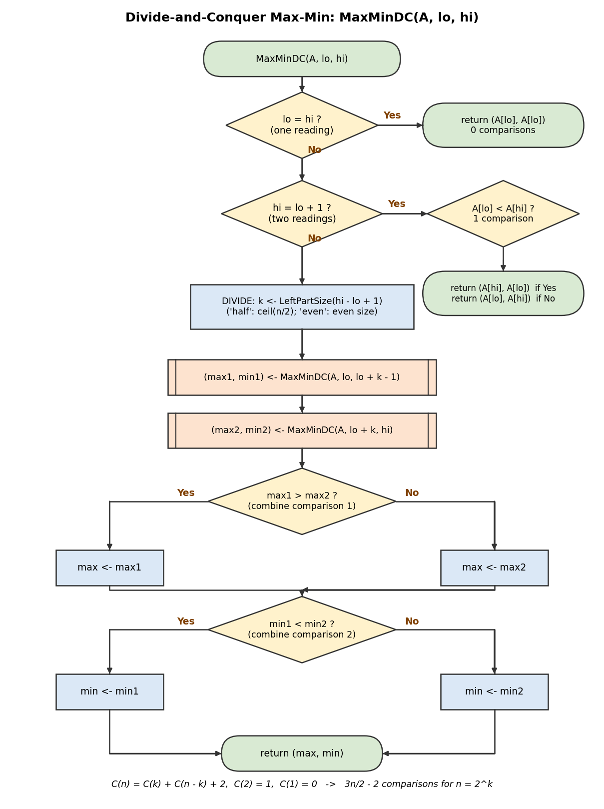
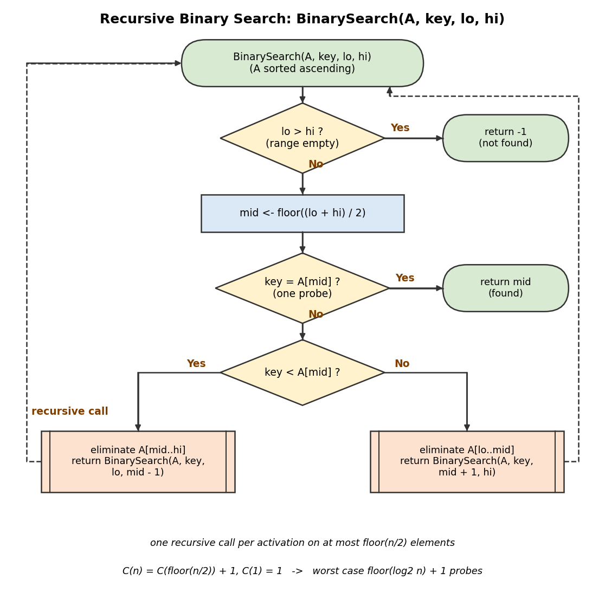

# Q1 – Decomposition and Elimination in Ordered Data: pseudocode and flowcharts

Part A = Finding Maximum and Minimum (D&C / tournament strategy); Part B = Binary Search (elimination).

**Scenario.** A drone's controller reports the highest and lowest battery-cell temperature of the n readings of a
flight (Max–Min). Hub scanners look up parcel IDs in a sorted manifest (Binary Search).

## 1. Straightforward Max–Min (reference)

```
Algorithm MaxMinScan(A, n)                     // A[0..n-1] = temperature readings, n >= 1
1. max = A[0];  min = A[0]
2. for i = 1 to n-1 do
3.     if A[i] > max then max = A[i]           // comparison 1
4.     if A[i] < min then min = A[i]           // comparison 2
5. return (max, min)                           // exactly 2(n - 1) comparisons
```

## 2. Divide-and-Conquer Max–Min

- **Divide:** split A[lo..hi] into two parts; rule *half*: sizes ⌈n/2⌉ and ⌊n/2⌋; rule *even*: the first part has an
  even size (so no part is ever reduced to a lone reading unless n is odd).
- **Conquer:** solve both parts recursively. Base cases: 1 reading (0 comparisons), 2 readings (1 comparison).
- **Combine:** max = larger of the two maxima (1 comparison), min = smaller of the two minima (1 comparison).

```
Algorithm MaxMinDC(A, lo, hi)                  // returns (max, min) of A[lo..hi]
1. if lo = hi then return (A[lo], A[lo])       // one reading: 0 comparisons
2. if hi = lo + 1 then                         // two readings: 1 comparison
3.     if A[lo] < A[hi] then return (A[hi], A[lo]) else return (A[lo], A[hi])
4. k = LeftPartSize(hi - lo + 1)               // DIVIDE: 'half' = ceil(n/2), 'even' = even size nearest n/2
5. (max1, min1) = MaxMinDC(A, lo, lo + k - 1)  // CONQUER
6. (max2, min2) = MaxMinDC(A, lo + k, hi)
7. max = (max1 > max2) ? max1 : max2           // COMBINE: 2 comparisons
8. min = (min1 < min2) ? min1 : min2
9. return (max, min)
```

**Recurrence:** T(n) = T(n₁) + T(n₂) + 2, T(2) = 1, T(1) = 0. For n = 2ᵏ: T(n) = 2T(n/2) + 2 ⇒ T(n) = 3n/2 − 2.
For any division rule: T(n) = (3n + L₁)/2 − 2, where L₁ is the number of one-reading leaves; the *even* rule gives
L₁ = n mod 2, i.e. the optimum ⌈3n/2⌉ − 2.

The rule "2 readings | rest" gives the same optimum and can be unrolled into a loop (no recursion stack):

```
Algorithm MaxMinPairs(A, n)
1. if n is odd then max = min = A[0];  i = 1
2. else (max, min) = ordered pair of A[0], A[1] (1 comparison);  i = 2
3. while i < n do                              // 3 comparisons per pair of readings
4.     (big, small) = ordered pair of A[i], A[i+1]
5.     if big > max then max = big
6.     if small < min then min = small
7.     i = i + 2
8. return (max, min)                           // ceil(3n/2) - 2 comparisons
```

## 3. Recursive Binary Search

- **Divide:** probe the middle element A[mid], mid = ⌊(lo + hi)/2⌋ (one three-way comparison).
- **Conquer:** continue in the one half that can still contain the key; the other half is discarded.
- **Combine:** nothing — the answer of the half is the answer.

```
Algorithm BinarySearch(A, key, lo, hi)         // A sorted ascending; returns index or -1
1. if lo > hi then return -1                   // empty range: the parcel is not in the manifest
2. mid = floor((lo + hi) / 2)
3. if key = A[mid] then return mid             // one probe (three-way comparison)
4. if key < A[mid] then return BinarySearch(A, key, lo, mid - 1)
5. else return BinarySearch(A, key, mid + 1, hi)
```

**Recurrence:** C(n) = C(⌊n/2⌋) + 1, C(1) = 1 ⇒ C_worst(n) = ⌊log₂ n⌋ + 1 (Master Theorem case 2 with a = 1, b = 2,
f(n) = 1 = Θ(n^log₂1)) ⇒ Θ(log n).

## 4. Flowcharts (drawn by `../Implementation_Code/q1_flowcharts.py`)





## 5. Elimination rule of Binary Search (Part B)

If key < A[mid], every element of A[mid..hi] is ≥ A[mid] > key (A is sorted), so the key cannot be there and the
search continues in A[lo..mid − 1]; symmetrically for key > A[mid]. Each probe removes at least ⌈n/2⌉ candidates; the
range strictly shrinks, so after at most ⌊log₂ n⌋ + 1 probes it is found or the range is empty (lo > hi).

Decomposition diagrams: `../Implementation_Code/results/q1_maxmin_tree.png`, `q1_split_rules.png`, `q1_bsearch_tree.png`.
