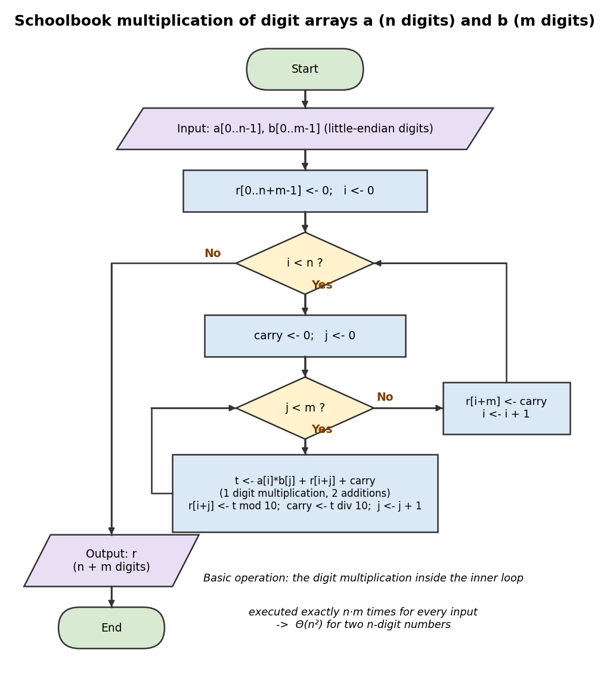
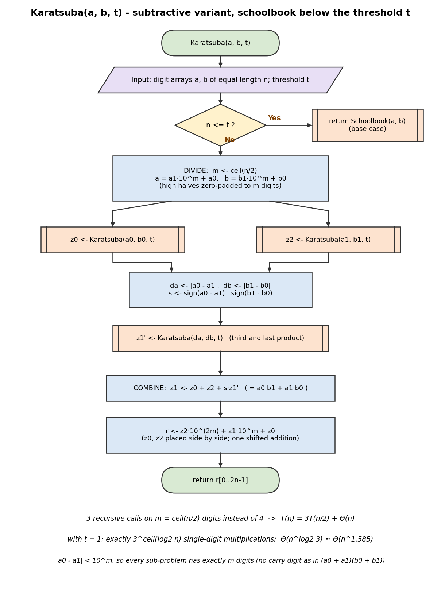
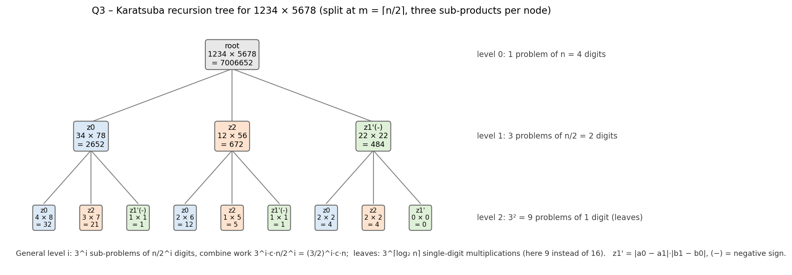

# Q3 – Breaking the Quadratic Barrier: Karatsuba Multiplication – Pseudocode and Flowcharts

**Scenario.** Signing a flight command multiplies two n-digit integers (n = 617 digits for RSA-2048, 1,234 digits
for RSA-4096). Numbers are stored as little-endian base-10 digit arrays, so the cost can be counted in
single-digit multiplications and digit additions/subtractions.

## Divide-and-Conquer logic

| Step | What Karatsuba does |
|---|---|
| **Divide** | Split each n-digit operand at m = ⌈n/2⌉: a = a1·10^m + a0, b = b1·10^m + b0 (high halves padded to m digits). |
| **Conquer** | Compute only **three** m-digit products recursively: z0 = a0·b0, z2 = a1·b1 and z1' = (a0 − a1)·(b1 − b0). |
| **Combine** | z1 = a0·b1 + a1·b0 = z0 + z2 + z1'; then a·b = z2·10^(2m) + z1·10^m + z0 (shifts and O(n) digit additions). |
| **Base case** | n ≤ t (threshold): schoolbook multiplication (t = 1 → one single-digit product). |

The naive split needs four products (a0b0, a0b1, a1b0, a1b1). Karatsuba obtains the two "cross" products from a
single extra product, so each level multiplies the number of sub-problems by 3 instead of 4.

**Why the subtractive form.** |a0 − a1| < 10^m always has m digits, so every sub-problem has exactly m digits.
The textbook additive form (a0 + a1)(b0 + b1) can produce (m + 1)-digit operands (a carry), which makes the count
data-dependent and, for n ≤ 3, does not shrink the problem at all.

## Pseudocode

```
Algorithm Schoolbook(a[0..n-1], b[0..m-1])            // little-endian digit arrays
1. r[0..n+m-1] = 0
2. for i = 0 to n-1 do
3.     carry = 0
4.     for j = 0 to m-1 do
5.         t = a[i]*b[j] + r[i+j] + carry              // 1 digit multiplication, 2 additions
6.         r[i+j] = t mod 10;  carry = t div 10
7.     r[i+m] = carry
8. return r                                           // exactly n*m single-digit multiplications
```

```
Algorithm Karatsuba(a[0..n-1], b[0..n-1], t)          // equal lengths, returns 2n digits
1. if n <= t then return Schoolbook(a, b)             // base case
2. m = ceil(n/2)                                      // DIVIDE
3. a0 = a[0..m-1];  a1 = a[m..n-1] padded to m digits
4. b0 = b[0..m-1];  b1 = b[m..n-1] padded to m digits
5. z0 = Karatsuba(a0, b0, t)                          // CONQUER: three m-digit products
6. z2 = Karatsuba(a1, b1, t)
7. (da, sa) = |a0 - a1|, sign;   (db, sb) = |b1 - b0|, sign
8. z1' = Karatsuba(da, db, t)
9. z1 = z0 + z2 + sa*sb*z1'                           // COMBINE: = a0*b1 + a1*b0  (>= 0)
10. r = z0 placed at 10^0, z2 placed at 10^(2m)        // side by side, no additions
11. r = r + z1 * 10^m                                  // one shifted addition
12. return r[0..2n-1]
```

## Flowcharts

Drawn with standard symbols by `../Implementation_Code/q3_flowcharts.py`.





## Recurrences (from the algorithm)

- Single-digit multiplications: M(n) = 3·M(⌈n/2⌉), M(1) = 1 ⇒ **M(n) = 3^⌈log₂ n⌉ = n^log₂3 ≈ n^1.585** (n = 2^k).
- Time: T(n) = 3·T(n/2) + c·n (lines 7, 9–11 are linear) ⇒ Master Theorem a = 3, b = 2, f(n) = n,
  n^(log₂ 3) = n^1.585, f(n) = O(n^(1.585 − ε)) ⇒ case 1 ⇒ **T(n) = Θ(n^log₂3)**.
- Schoolbook: exactly n² single-digit multiplications and 2n² additions ⇒ Θ(n²).

## Decomposition diagram

The recursion tree of 1234 × 5678 (three children per node) is drawn by `q3_graphs.py`:
`../Implementation_Code/results/q3_recursion_tree.png`.



## Experiments (where the evidence is)

- `q3_experiments.py` – growth of the counted operations (n = 8 … 2,048, incl. 617 / 1,000 / 1,234 digits) and the
  threshold sweep at 617 and 1,234 digits.
- `q3_crossover.py` – Student B's crossover investigation: repeated timing (median, min, max) of pure Karatsuba vs
  schoolbook at 256 … 4,096 digits, hybrid (t = 16, 32) vs schoolbook at 8 … 128 digits, and the per-level overhead
  breakdown (nodes, own additions, digits in temporary lists).

