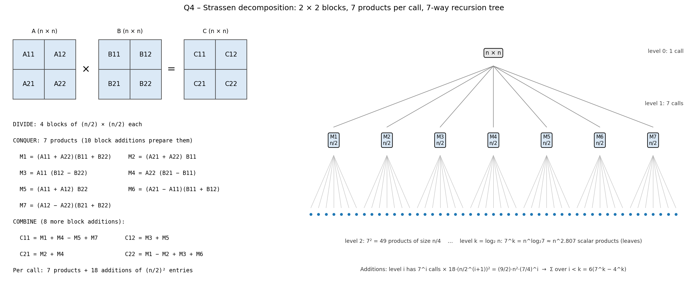

# Q4 – Strassen versus Conventional Matrix Multiplication: Pseudocode (prepared before implementation)

**Scenario.** Multi-step zone-demand forecasts multiply n × n zone-to-zone matrices (n = 16 … several hundred
zones, not always a power of 2). The cost is counted in scalar multiplications and scalar additions/subtractions.

## Divide-and-Conquer logic

| Step | What Strassen's algorithm does |
|---|---|
| **Divide** | h = ⌈n/2⌉; if n is odd, add one zero row and column (dynamic padding); split A and B into four h × h blocks. |
| **Conquer** | Compute **seven** block products M1 … M7 recursively (the block method needs eight). 10 block additions/subtractions prepare their operands. |
| **Combine** | C11 = M1 + M4 − M5 + M7, C12 = M3 + M5, C21 = M2 + M4, C22 = M1 − M2 + M3 + M6 (8 more block additions); remove the padding. |
| **Base case** | n ≤ c (cutoff): conventional triple loop (c = 1 → one scalar product). |

## Pseudocode

```
Algorithm Conventional(A, B, n)
1. for i = 0 to n-1 do
2.     for j = 0 to n-1 do
3.         s = A[i][0] * B[0][j]
4.         for k = 1 to n-1 do
5.             s = s + A[i][k] * B[k][j]              // 1 multiplication + 1 addition
6.         C[i][j] = s
7. return C                                           // n^3 multiplications, n^2 (n-1) additions
```

```
Algorithm Strassen(A, B, n, c)
1. if n <= c then return Conventional(A, B, n)       // base case / cutoff
2. h = ceil(n/2)                                      // DIVIDE
3. if n is odd then pad A and B with one zero row and one zero column
4. split A into A11, A12, A21, A22 and B into B11, B12, B21, B22   (h x h blocks)
5. M1 = Strassen(A11 + A22, B11 + B22, h, c)          // CONQUER: 7 products
6. M2 = Strassen(A21 + A22, B11, h, c)
7. M3 = Strassen(A11, B12 - B22, h, c)
8. M4 = Strassen(A22, B21 - B11, h, c)
9. M5 = Strassen(A11 + A12, B22, h, c)
10. M6 = Strassen(A21 - A11, B11 + B12, h, c)
11. M7 = Strassen(A12 - A22, B21 + B22, h, c)
12. C11 = M1 + M4 - M5 + M7;  C12 = M3 + M5          // COMBINE: 8 block additions
13. C21 = M2 + M4;            C22 = M1 - M2 + M3 + M6
14. C = [[C11, C12], [C21, C22]] without the padding row/column
15. return C
```

```
Algorithm StrassenStaticPadding(A, B, n, c)           // alternative padding policy
1. N = smallest power of 2 >= n
2. pad A and B with zeros to N x N
3. return top-left n x n part of Strassen(A, B, N, c)
```

## Recurrences (from the algorithm)

- Multiplications: M(n) = 7·M(n/2), M(1) = 1 ⇒ **M(n) = 7^k = n^log₂7 ≈ n^2.807** (n = 2^k); conventional 8^k = n³.
- Additions: A(n) = 7·A(n/2) + 18·(n/2)², A(1) = 0 ⇒ **A(n) = 6(7^k − 4^k)**; conventional n²(n − 1).
- Time: T(n) = 7·T(n/2) + Θ(n²) ⇒ Master Theorem a = 7, b = 2, f(n) = n², n^log₂7 ≈ n^2.807,
  f(n) = O(n^(2.807 − ε)) ⇒ case 1 ⇒ **T(n) = Θ(n^log₂7)**.
- With cutoff c (n = c·2^k): M = 7^k·c³, A = 7^k·c²(c − 1) + 6(c²·7^k − n²).

## Decomposition diagram

`q4_graphs.py` draws the 2 × 2 block decomposition and the 7-way recursion tree:
`../Implementation_Code/results/q4_decomposition.png`.


