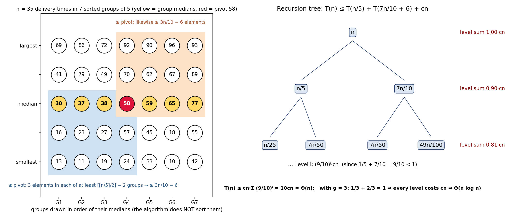
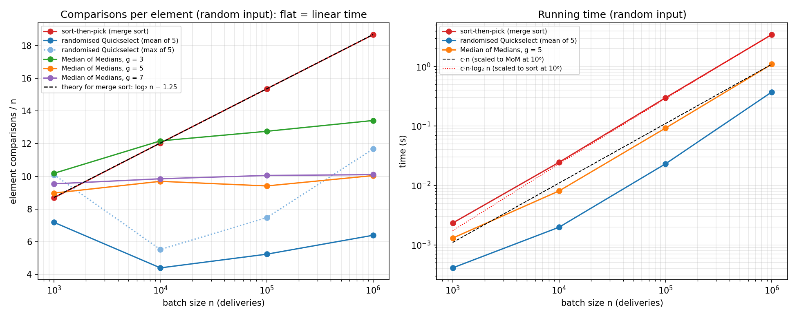
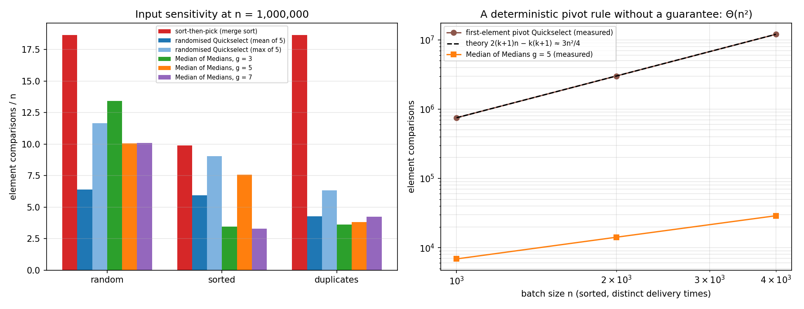

# Q6(a) – Median of Medians (deterministic linear-time selection)

**Scenario – SLA reporting.** The drone-delivery dashboard must report the median and the 90th-percentile delivery
time of every batch of n deliveries (n up to 1,000,000) within a *guaranteed* worst-case time.

- Code: `../Implementation_Code/q6_median_of_medians.py` (algorithms, demo, experiments), tests in
  `../Implementation_Code/q6_tests.py`, graphs in `../Implementation_Code/q6_graphs.py`
- Pseudocode: `../Pseudocode/Q6_Advanced_DC_Pseudocode.md`
- Data and graphs: `results/` (`q6_mom_comparisons.csv`, `q6_mom_worstcase.csv`, `*.png`)
- Screenshots: `../Output_Screenshots/q6_median_of_medians_*.png`, `q6_tests_output.png`

## Design (Divide / Conquer / Combine)

| Step | What it does | Cost |
|---|---|---|
| Divide | split the n values into ⌈n/5⌉ groups of 5, sort each group (insertion sort, ≤ 10 comparisons), take its median | ≤ 2n comparisons |
| Conquer (1) | find the median of the group medians recursively → pivot p | T(⌈n/5⌉) |
| Combine | three-way partition into < p, = p, > p | ≤ 2n comparisons |
| Conquer (2) | continue only in the part containing rank k (at most 7n/10 + 6 values) | T(7n/10 + 6) |

At least half of the group medians are ≥ p and each such group (except p's own and the last incomplete one) holds
≥ 3 values ≥ p, so ≥ 3n/10 − 6 values are ≥ p, and symmetrically ≤ p: every round discards ≥ 3n/10 − 6 values.

## Recurrence and solution

T(n) ≤ T(⌈n/5⌉) + T(7n/10 + 6) + cn  (c ≈ 4 comparisons per element). The Master Theorem does not apply (two different
sub-problem sizes). **Recursion tree:** level i costs (1/5 + 7/10)ⁱ·cn = (9/10)ⁱ·cn, so T(n) ≤ cn·Σ(9/10)ⁱ = 10cn = Θ(n).
**Substitution:** assuming T(m) ≤ dm for m < n, T(n) ≤ d(n/5 + 1) + d(7n/10 + 6) + cn = (9/10)dn + 7d + cn ≤ dn
whenever d ≥ 10cn/(n − 70); d = 20c suffices for n ≥ 140 → T(n) = Θ(n).
**Group size:** g = 3 → T(n/3) + T(2n/3) + cn, fractions sum to 1 → Θ(n log n); g = 7 → T(n/7) + T(5n/7 + 8) + cn → Θ(n).
Baselines: sort-then-pick (merge sort, Master case 2) Θ(n log n); randomised Quickselect expected Θ(n) (T(n/2) + Θ(n),
Master case 3) but worst case Θ(n²); first-element-pivot Quickselect Θ(n²) on sorted input.

## Results (element comparisons; every method uses the same three-way partition: 1 comparison if x < p, else 2)

Comparisons per element (comparisons / n) – from `results/q6_mom_comparisons.csv`:

| Input | n | log₂ n | sort-then-pick | QS random mean | QS random max (5 seeds) | MoM g=3 | MoM g=5 | MoM g=7 |
|---|---|---|---|---|---|---|---|---|
| random | 1,000 | 10.0 | 8.69 | 7.19 | 10.10 | 10.19 | 8.98 | 9.54 |
| random | 10,000 | 13.3 | 12.04 | 4.40 | 5.53 | 12.17 | 9.70 | 9.85 |
| random | 100,000 | 16.6 | 15.36 | 5.24 | 7.48 | 12.76 | 9.42 | 10.06 |
| random | 1,000,000 | 19.9 | 18.67 | 6.40 | 11.68 | 13.42 | 10.05 | 10.11 |
| sorted | 1,000,000 | 19.9 | 9.88 | 5.95 | 9.03 | 3.44 | 7.56 | 3.29 |
| duplicates | 1,000,000 | 19.9 | 18.67 | 4.28 | 6.32 | 3.63 | 3.82 | 4.23 |

Time at n = 1,000,000 (random): sort-then-pick 3.464 s, randomised Quickselect 0.374 s (mean; 0.627 s worst seed),
MoM g=3 1.982 s, **MoM g=5 1.097 s**, MoM g=7 1.070 s.

Worst case of a deterministic pivot rule (first element, sorted distinct batch) – `results/q6_mom_worstcase.csv`:

| n | first-pivot comparisons | 2(k+1)n − k(k+1) | MoM g=5 comparisons |
|---|---|---|---|
| 1,000 | 750,500 | 750,500 | 6,887 |
| 2,000 | 3,001,000 | 3,001,000 | 14,152 |
| 4,000 | 12,002,000 | 12,002,000 | 28,903 |

Demo (batch of 10,001 deliveries): median 1,479.593 s = 24.66 min (96,271 comparisons, 9.63n), 90th percentile
2,804.693 s = 46.74 min (96,731 comparisons, 9.67n), both equal to the sorted reference. All 72 experiment results
equal `sorted(a)[k]`; the largest fraction ever kept by MoM g=5 was 0.598 (bound 0.7 + 6/n).

## Conclusions

- MoM g=5 is linear in practice (≈ 9–10 comparisons per element on random data at every size) and in theory (≤ 10cn).
- g=3 keeps growing (10.2n → 13.4n) as its Θ(n log n) recurrence allows; g=7 is as good as g=5.
- Randomised Quickselect is ≈ 3× faster on average but varies by 1.8× between seeds and has no guarantee; a
  deterministic pivot degrades to exactly 3n²/4 comparisons on sorted data.
- **Decision:** the dashboard should use Median of Medians with groups of 5 (guaranteed linear time; 1.1 s per
  selection at 10⁶ in Python), ideally wrapped as an introselect (random pivot first, MoM fallback).
