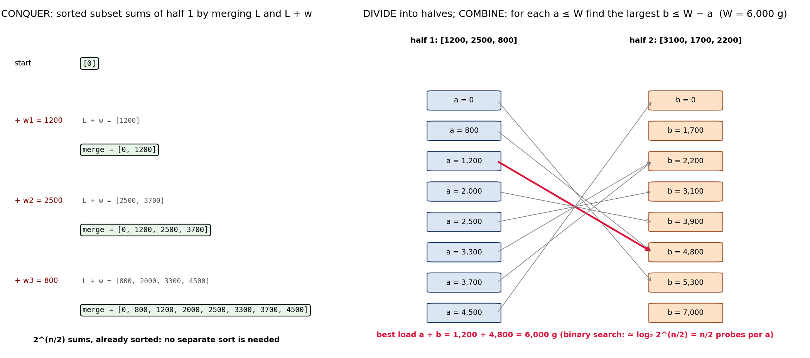
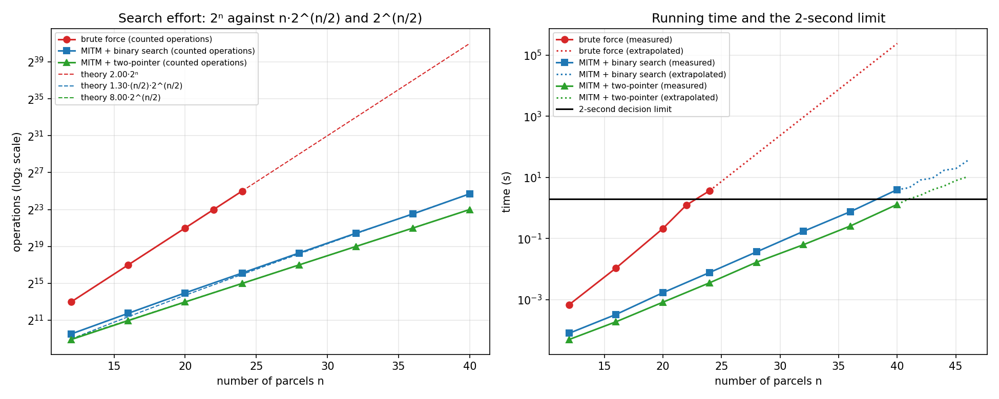

# Q6(b) – Meet-in-the-Middle (drone payload packing)

**Scenario – payload packing.** A drone with payload capacity W grams must carry a subset of n waiting parcels whose
total weight is as large as possible without exceeding W (an exact fill is ideal); n can be up to 40.

- Code: `../Implementation_Code/q6_meet_in_the_middle.py` (algorithms, demo, experiments), tests in
  `../Implementation_Code/q6_tests.py`, graphs in `../Implementation_Code/q6_graphs.py`
- Pseudocode: `../Pseudocode/Q6_Advanced_DC_Pseudocode.md`
- Data and graphs: `results/` (`q6_mitm_growth.csv`, `q6_mitm_limits.csv`, `*.png`)
- Screenshots: `../Output_Screenshots/q6_meet_in_the_middle_*.png`, `q6_tests_output.png`

## Design (Divide / Conquer / Combine)

| Step | What it does | Cost |
|---|---|---|
| Divide | split the parcels into half 1 (first ⌊n/2⌋) and half 2 (the rest) | Θ(1) |
| Conquer | list all subset sums of each half in ascending order: start with [0], for each weight w merge L with L + w | Θ(2^(n/2)) per half |
| Combine | for each sum a ≤ W of half 1 binary-search the largest b ≤ W − a of half 2; keep the best a + b (improvement: one two-pointer scan) | Θ(n·2^(n/2)) or Θ(2^(n/2)) |

Baseline: Gray-code enumeration of all 2ⁿ subsets (one addition + one feasibility check per subset).
Reference: dynamic programming over the capacities 0 … W (bitset of reachable totals).

## Complexity

- Brute force: N(n) = 2N(n − 1) → 2ⁿ subsets, Θ(2ⁿ) time, Θ(n) memory.
- Generation: S(t) = S(t − 1) + Θ(2ᵗ) → Σ Θ(2ᵗ) = Θ(2^(n/2)) per half (geometric series).
- Combine: 2^(n/2) binary searches of ≈ n/2 + 1 probes → Θ(n·2^(n/2)); two pointers: ≤ 2·2^(n/2) steps → Θ(2^(n/2)).
- Total: **Θ(n·2^(n/2))** time (binary search) or **Θ(2^(n/2))** (two-pointer); memory **Θ(2^(n/2))**.
  Gain over brute force: 2^(n/2)/(n/2) ≈ 52,000× at n = 40.

## Results (`results/q6_mitm_growth.csv`, `results/q6_mitm_limits.csv`)

Brute force: n = 12, 16, 20, 22, 24 → exactly 2ⁿ subsets (4,096 … 16,777,216); times 0.001, 0.011, 0.214, 1.250,
3.714 s (≈ 170–300 ns per subset).

| n | stored sums | merge comparisons | probes | (n/2)·2^(n/2) | binary time (s) | two-pointer steps | two-pointer time (s) | best = W (g) |
|---|---|---|---|---|---|---|---|---|
| 24 | 8,192 | 16,255 | 46,452 | 49,152 | 0.008 | 7,967 | 0.004 | 26,691 |
| 28 | 32,768 | 65,296 | 221,242 | 229,376 | 0.037 | 32,187 | 0.017 | 25,784 |
| 32 | 131,072 | 261,826 | 1,016,816 | 1,048,576 | 0.173 | 129,087 | 0.063 | 31,757 |
| 36 | 524,288 | 1,047,081 | 4,421,898 | 4,718,592 | 0.763 | 507,805 | 0.259 | 29,857 |
| 40 | 2,097,152 | 4,193,836 | 20,969,560 | 20,971,520 | 4.011 | 2,097,054 | 1.319 | 44,639 |

| Method | cost per operation | largest measured n within 2 s | predicted limit n |
|---|---|---|---|
| brute force | 221.3 ns | 22 | 23 |
| MITM + binary search | 141.7 ns | 36 | 38 |
| MITM + two-pointer | 157.3 ns | 40 | 41 |

All 21 runs agree with the DP reference; `q6_tests.py` also cross-checks brute force, both MITM variants, DP and
`itertools` on 200 random instances.

## Conclusions

- The counts follow the theory: 2ⁿ subsets for brute force; probes within 6.3 % of (n/2)·2^(n/2) for MITM.
- At n = 24 MITM used 473× fewer operations than brute force (70,897 against 33,554,431); brute force at n = 40
  would take ≈ 2.8 days (extrapolated), MITM with two pointers 1.3 s.
- **Decision:** within 2 s, brute force handles 22 parcels, MITM with binary search 36 (38 predicted) and MITM with two
  pointers the full 40 — so the two-pointer Meet-in-the-Middle is recommended (memory ≈ 2.1 million stored sums at
  n = 40). For whole-gram weights and W < 50 kg a DP over the capacity is also fast; MITM is preferred because its cost
  does not depend on W or on the weight resolution.
