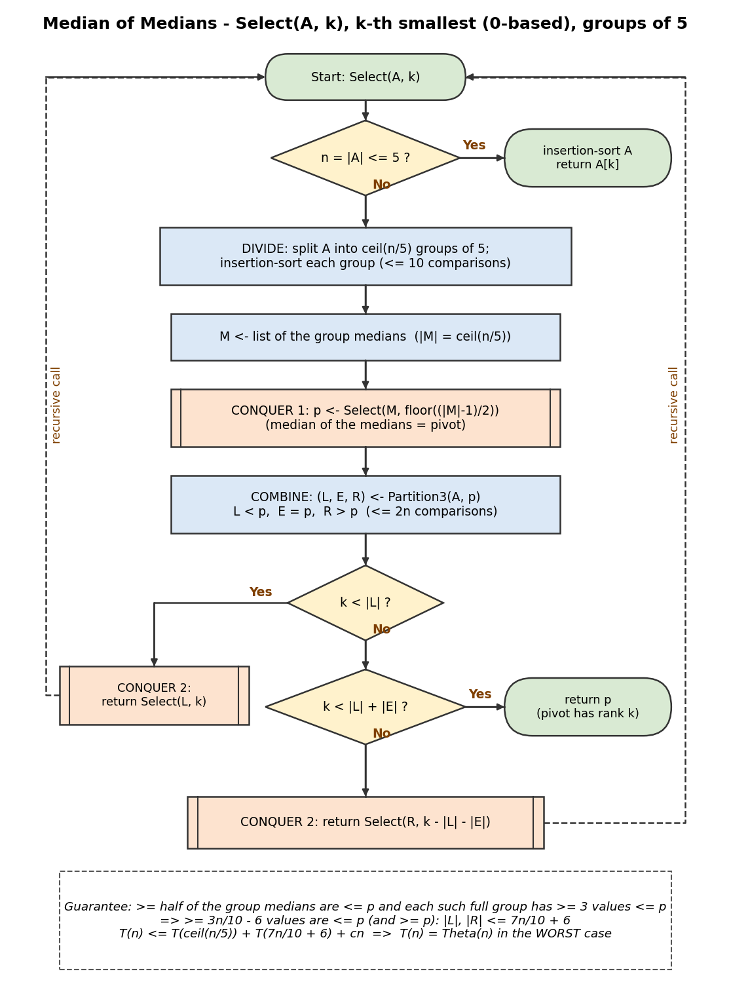
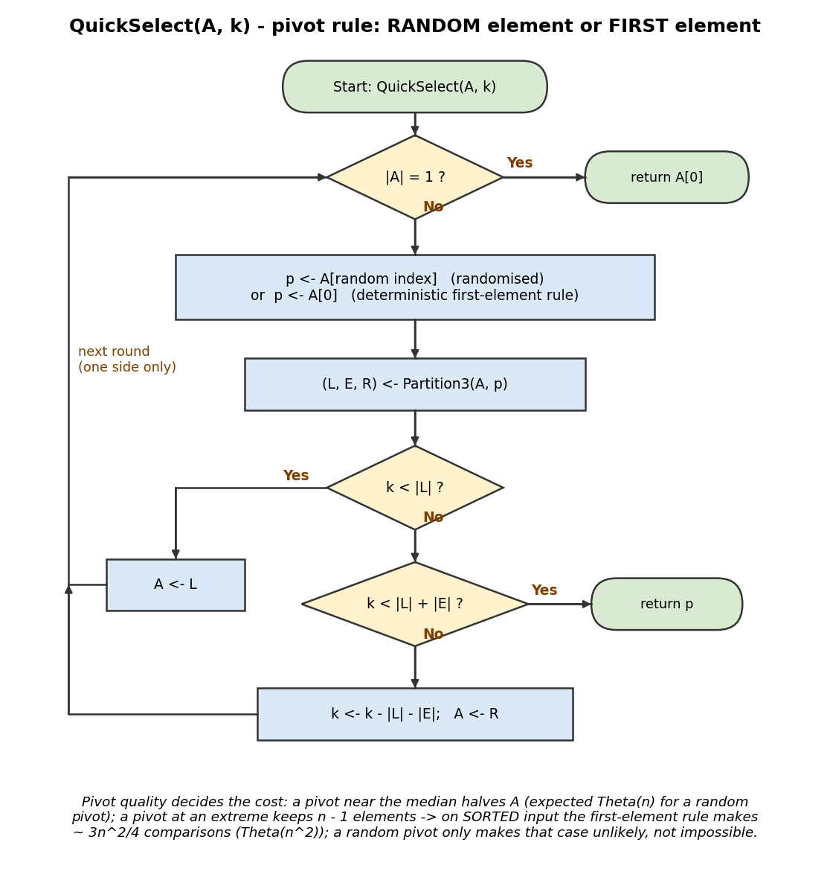
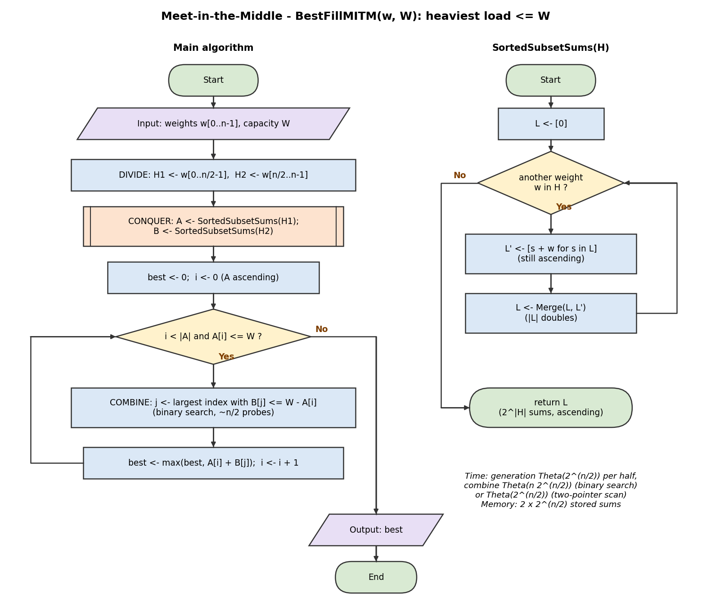

# Q6 – Advanced Divide-and-Conquer Mini-Investigations: Pseudocode and Flowcharts

Student A is the primary contributor for (a) Median of Medians, Student B for (b) Meet-in-the-Middle.
The flowcharts are drawn by `../Implementation_Code/q6_flowcharts.py`.

## (a) Median of Medians – deterministic selection (SLA reporting)

**Problem.** Return the k-th smallest of n delivery times (k = ⌊(n − 1)/2⌋ for the median, k = ⌈0.9n⌉ − 1 for the
90th percentile) with a worst-case linear bound.

| Step | What it does | Cost |
|---|---|---|
| **Divide** | Split the n values into ⌈n/5⌉ groups of 5; sort each group (≤ 10 comparisons) and take its median. | Θ(n) |
| **Conquer (1)** | Find the median of the ⌈n/5⌉ group medians **recursively** → pivot p. | T(⌈n/5⌉) |
| **Combine** | Partition all values into < p, = p, > p. At least half of the groups have a median ≤ p and contribute ≥ 3 values ≤ p, so ≥ 3n/10 − 6 values are ≤ p (and likewise ≥ p). | Θ(n) |
| **Conquer (2)** | Continue only in the part that contains rank k: at most 7n/10 + 6 values. | T(7n/10 + 6) |

```
Algorithm Select(A, n, k)                          // k-th smallest, 0-based, groups of g = 5
1.  if n <= 5 then sort A by insertion sort; return A[k]
2.  M = empty list
3.  for i = 0 step 5 to n-1 do                     // DIVIDE
4.      G = A[i .. min(i+4, n-1)];  InsertionSort(G)
5.      append G[floor((|G|-1)/2)] to M            // median of the group
6.  p = Select(M, |M|, floor((|M|-1)/2))           // CONQUER 1: median of medians
7.  (L, E, R) = Partition3(A, p)                   // COMBINE: < p, = p, > p
8.  if k < |L| then return Select(L, |L|, k)                      // CONQUER 2: one side only
9.  else if k < |L| + |E| then return p
10. else return Select(R, |R|, k - |L| - |E|)

Algorithm Partition3(A, p)
1. L = E = R = empty
2. for each x in A do
3.     if x < p then append x to L                 // 1 comparison
4.     else if x > p then append x to R            // 2 comparisons
5.     else append x to E                          // 2 comparisons
6. return (L, E, R)
```





Baselines: **SortThenPick** (merge sort, then A[k]: Θ(n log n)), **RandomisedQuickselect** (lines 2–6 replaced by
`p = A[random index]`: expected Θ(n), worst case Θ(n²)), **FirstPivotQuickselect** (`p = A[0]`: Θ(n²) on sorted input).

**Recurrence.** T(n) ≤ T(⌈n/5⌉) + T(7n/10 + 6) + cn. Substitution: assume T(m) ≤ dm for m < n; then
T(n) ≤ d(n/5 + 1) + d(7n/10 + 6) + cn = (9/10)dn + 7d + cn ≤ dn whenever dn/10 ≥ 7d + cn, e.g. d ≥ 20c and n ≥ 140 → T(n) = Θ(n).
Group size 3: T(n) ≤ T(n/3) + T(2n/3) + cn — the fractions add to 1, every level of the recursion tree costs cn, Θ(n log n).
Group size 7: T(n) ≤ T(n/7) + T(5n/7 + 8) + cn — fractions add to 6/7 < 1, Θ(n).

Decomposition diagram: `../Median_of_Medians/results/q6_mom_decomposition.png`. Pivot-quality evidence
(300 seeds of randomised QuickSelect, first-element pivot on sorted input, MoM kept fraction ≤ 7n/10 + 6):
`../Implementation_Code/q6_pivot_quality.py`.

## (b) Meet-in-the-Middle – payload packing

**Problem.** n parcels with weights w₀ … wₙ₋₁ (grams) and capacity W: maximise the total weight of a subset with total ≤ W.

| Step | What it does | Cost |
|---|---|---|
| **Divide** | Split the parcels into half 1 (first ⌊n/2⌋) and half 2 (the rest). | Θ(1) |
| **Conquer** | For each half, list all 2^(n/2) subset sums **in sorted order**: start from [0]; for each parcel w, merge L with L + w. | Θ(2^(n/2)) |
| **Combine** | For each sum a ≤ W of half 1, binary-search the largest sum b ≤ W − a of half 2; keep the best a + b. | Θ(2^(n/2) · n/2) |

```
Algorithm BestFillMITM(w, n, W)
1. H1 = w[0 .. floor(n/2)-1];  H2 = w[floor(n/2) .. n-1]          // DIVIDE
2. A = SortedSubsetSums(H1);  B = SortedSubsetSums(H2)             // CONQUER
3. best = 0
4. for each a in A in ascending order do                           // COMBINE
5.     if a > W then break                                         // all later a are larger
6.     j = largest index with B[j] <= W - a                         // binary search, ~log2|B| probes
7.     best = max(best, a + B[j])                                  // B[0] = 0 always qualifies
8. return best

Algorithm SortedSubsetSums(H)                                      // all 2^|H| sums, ascending
1. L = [0]
2. for each weight w in H do
3.     L' = [s + w for s in L]                                     // still sorted
4.     L = Merge(L, L')                                            // |L| doubles
5. return L

Algorithm BestFillBruteForce(w, n, W)                              // reference: Gray-code enumeration
1. best = 0; total = 0; mask = 0
2. for i = 1 to 2^n - 1 do
3.     b = index of the lowest set bit of i                        // parcel b changes status
4.     if parcel b in mask then total = total - w[b] else total = total + w[b]
5.     flip parcel b in mask
6.     if best < total <= W then best = total
7. return best
```



Improvement (also implemented): replace lines 4–7 by a **two-pointer** scan (i over A ascending, j over B descending:
if A[i] + B[j] ≤ W record it and i = i + 1, else j = j − 1) → combine step Θ(2^(n/2)).

**Complexity.** Brute force: 2ⁿ subsets, Θ(2ⁿ) time, Θ(n) memory. MITM: generation Σ 2ⁱ = Θ(2^(n/2)) additions and
merge comparisons per half; combine 2^(n/2) binary searches of ≈ n/2 probes → Θ(n · 2^(n/2)) time, Θ(2^(n/2)) memory.

**Time–memory trade-off variant** (`best_fill_mitm_split`, also implemented):

```
Algorithm BestFillSplit(w, n, W, k)                                // store k parcels, enumerate n - k
1. A = SortedSubsetSums(w[0 .. k-1])                               // memory: 2^k sums
2. best = largest A[j] <= W
3. for every subset S of w[k .. n-1] in Gray-code order do          // 2^(n-k) subsets, 1 addition each
4.     t = total(S)
5.     if t <= W then best = max(best, t + largest A[j] <= W - t)  // binary search, ~k probes
6. return best
```

Time ≈ 3·2ᵏ + k·2ⁿ⁻ᵏ operations, memory 2ᵏ sums (k = 0: brute force; k = n/2: balanced split).
Memory evidence: `../Implementation_Code/q6_mitm_memory.py`.

Decomposition diagram: `../Meet_in_the_Middle/results/q6_mitm_decomposition.png`.
