<!-- cover
institution: SIMATS ENGINEERING
department: Department of Computer Science and Engineering
course: CSA06 – Design and Analysis of Algorithms
assignment: ASSIGNMENT 4A – CO4
subtitle: Assignment 4 – Part I: Algorithmic Design through Pseudocode
coverage: CO4 – Solve optimization problems using Dynamic Programming and Greedy strategies
student_name: V. Vasudevan
register_number: 192425324
nature: Individual
duration: One Week
total_marks: 50
marks: T1 | Task 1: Algorithm Design Review – Diagnose and Repair Poor Pseudocode (1.1 2, 1.2 3, 1.3 1) | 6
marks: T2 | Task 2: From Business Requirement to Greedy Pseudocode – Job Sequencing with Deadlines (2.1 2, 2.2 1, 2.3 3, 2.4 1, 2.5 1) | 8
marks: T3 | Task 3: From Recurrence to Executable Logic – 0/1 Knapsack DP (3.1 1, 3.2 2, 3.3 4, 3.4 1, 3.5 1) | 9
marks: T4 | Task 4: Pseudocode Forensics – WordBreak Defect (4.1 2, 4.2 2, 4.3 2, 4.4 1) | 7
marks: T5 | Task 5: Same Graph, Different Algorithmic Reasoning – Dijkstra, Bellman-Ford, Floyd (5.1 3, 5.2 2, 5.3 2) | 7
marks: T6 | Task 6: Design Challenge – Energy-Aware Job Scheduling (Stages 1 2, 2 2, 3 2, 4 4, 5 1, 6 2) | 13
details: Course Outcome | CO4 – Solve optimization problems using Dynamic Programming and Greedy strategies
details: Nature of Assignment | Individual
details: Duration | One Week
details: Total Marks | 50
details: Submission Date |
-->

# CSA06 – Assignment 4A (CO4), Part I: Algorithmic Design through Pseudocode

### Problem Statement: Designing Greedy and Dynamic-Programming Algorithms before Implementing Them

Assignment 4A asks me to show that I can design an optimisation algorithm **before** any implementation exists, following the progression *Interpret the Problem → Identify the Decision/State → Design the Logic → Write Pseudocode → Trace → Challenge → Refine*. The six tasks are set in small engineering scenarios: a logistics company loading divisible packages (Task 1, review and repair of a junior engineer's fractional-loading pseudocode), a cloud-service company sequencing unit-time jobs with deadlines (Task 2, greedy design from a business requirement), a cargo-planning system selecting indivisible items (Task 3, 0/1 knapsack dynamic programming from state to pseudocode), a text-segmentation routine with a hidden logical defect (Task 4, pseudocode forensics on WordBreak), one directed weighted graph analysed with three different kinds of reasoning (Task 5, Dijkstra, Bellman-Ford and Floyd), and finally an unseen problem – energy-aware job scheduling in a cloud data centre – for which I had to choose the strategy myself (Task 6, the compulsory design challenge). The problem types are therefore greedy selection, greedy scheduling, dynamic programming over a capacity table, DP debugging by counter-example, single-source and all-pairs shortest paths, and weighted interval scheduling.

Every answer is given in the form the paper requires: precise, language-independent pseudocode in the style of the *SIMATS Engineering – Handbook for Algorithmic Pseudocode* (`ALGORITHM`, `INPUT:`, `OUTPUT:`, `BEGIN … END`, `←`, `FOR … TO … DO … END FOR`, `WHILE … DO … END WHILE`, `IF … THEN … ELSE … END IF`, `RETURN`, and only the permitted abstractions such as `SORT … in descending order of …` and `EXTRACT_MIN(Q)`), a **flowchart** of every algorithm I wrote, explanatory diagrams (slot timeline, DP tables with the reconstruction path, dependency diagram, state strip, graph with the shortest-path tree, Gantt charts) and **manual desk-check traces** laid out as *state → decision → update* tables.

**Evidence and reproducibility.** The traces in this report were worked out **by hand first**. Only afterwards, as required by the department's submission instructions, I implemented each pseudocode faithfully as a small Python program in `Source_Code/Task_1` … `Source_Code/Task_6` (complete listings in Appendix A). Each program prints the same trace table as my manual desk-check, so its execution-output screenshot, shown directly after each manual trace, is **verification** of the hand calculation – it is not the answer itself, and the Python code is not offered as pseudocode. Each task folder also has a test program that compares the algorithm with an independent reference (exhaustive search over all subsets or orders, a recursive segmentation checker, brute-force enumeration of simple paths) on the given instances, boundary cases and hundreds of seeded random instances; all 58 tests pass (Appendix D). The input data are CSV files next to the programs (Appendix C). Flowcharts and diagrams are drawn by `Report/Diagrams/draw_flowcharts.py` and `Report/Diagrams/draw_diagrams.py`; the diagram values are taken from the verification programs, so diagrams, traces and screenshots always agree.

Table 1: Test environment

| Item | Value |
|---|---|
| Processor | 13th Gen Intel Core i5-13420H (Intel64 Family 6 Model 186) |
| Memory | 16 GB RAM |
| Operating system | Windows 11 Home Single Language 10.0.26200 (64-bit) |
| Language | Python 3.13.11 (CPython, 64-bit), standard library only for every algorithm |
| Libraries | matplotlib 3.10.8 (flowcharts and diagrams only) |
| Random seed | 42 for every randomly generated test instance |
| Reference checks | exhaustive search (all subsets / all orders), recursive memoised segmentation, simple-path enumeration |

## Task 1 – Algorithm Design Review: Diagnose and Repair Poor Pseudocode [6 Marks]

> **Problem Context.** A logistics company wants to load packages into a delivery vehicle. Each package has a weight and value. Packages may be divided if necessary. The objective is to maximise the total value loaded without exceeding the vehicle capacity.
> A junior engineer proposes:
> `ALGORITHM LoadVehicle` / `BEGIN` / `Read packages` / `Arrange packages` / `Select the best package` / `WHILE vehicle has space DO` / `Add suitable package` / `END WHILE` / `Calculate value` / `RETURN result` / `END`

**Evidence Expected**

> A reasoned diagnosis, corrected pseudocode and concise justification of the design.

**Ans:**

The problem is the **fractional knapsack problem**: because packages may be divided, the optimum is obtained by a greedy rule – load packages in descending order of value per unit weight and cut only the last package that does not fit. The junior engineer's outline hides exactly the decisions that make this rule work. I first list its deficiencies (Task 1.1), then rewrite it as precise pseudocode with a flowchart and a desk-check on my own instance (Task 1.2), and finally defend why the rewrite is pseudocode (Task 1.3).

### Task 1.1 – Diagnose the Design [2 Marks]

> Identify at least five algorithmic deficiencies in the proposed pseudocode. Do not focus merely on formatting. Examine aspects such as: inputs and outputs; selection criterion; meaning of "best"; feasibility condition; handling of a package that does not completely fit; remaining capacity; termination condition; result construction. For each deficiency, explain briefly why another engineer could not reliably implement the algorithm as written.

I found eight algorithmic deficiencies (Table 2); each one leaves a decision open, so two engineers implementing the outline could produce different – and mostly wrong – programs.

Table 2: Deficiencies of the proposed LoadVehicle pseudocode

| # | Aspect | Deficiency in the proposed pseudocode | Why another engineer could not implement it reliably |
|---|---|---|---|
| 1 | Inputs and outputs | `ALGORITHM LoadVehicle` has no parameters and no `INPUT:`/`OUTPUT:`; "Read packages" does not say that each package has an id, weight and value, and the vehicle capacity C is never mentioned. | The implementer does not know what data the algorithm receives (is C an input? are weights integers?) or what it must hand back. |
| 2 | Selection criterion ("Arrange") | "Arrange packages" gives no ordering key and no direction. | Sorting by value, by weight or by value/weight gives different loads; for my instance (C = 50) value order gives 220, lightest-first gives 225 and value/weight gives the optimum 240. |
| 3 | Meaning of "best" | "Select the best package" does not define *best*, and it is executed **once, before the loop**, so the selected package is never used inside the loop. | "Best" could mean highest value, lightest, or highest value per kg; the single selection outside the loop has no defined role in the result. |
| 4 | Feasibility condition | "Add suitable package" never states when a package is suitable, i.e. the test weight ≤ remaining capacity. | Without an explicit test the program can overload the vehicle or skip packages that would fit. |
| 5 | Package that does not completely fit | There is no rule for a package heavier than the remaining space, although packages may be divided. | One engineer might skip it (losing value – the result becomes a 0/1 heuristic), another might load all of it (exceeding the capacity); the correct action – load the fraction remaining/weight – is missing. |
| 6 | Remaining capacity | No variable records the remaining capacity and nothing is subtracted after a package is added; "vehicle has space" is undefined. | The loop condition cannot be evaluated, and the total weight loaded cannot be controlled. |
| 7 | Termination condition | The loop stops only when the vehicle is full; it never stops when all packages have been considered, and no index moves through the packages. | If the total weight of all packages is below C the loop never ends (or re-adds the same package); termination is not guaranteed. |
| 8 | Result construction | "Calculate value" and "RETURN result" do not say which value (sum of value × fraction?) or what *result* is (total value only, or also which packages and which fractions were loaded). | The output is undefined; the loading plan – the thing the driver actually needs – is never built. |

Further minor gaps: no handling of the boundary cases C = 0, an empty package list or a package of weight 0 (division by zero in the ratio), and no tie-breaking rule. The repaired design below closes all of them (weights are required to be positive in the `INPUT:` contract).

### Task 1.2 – Repair the Design [3 Marks]

> Rewrite the algorithm as complete, precise and language-independent pseudocode. Your design must clearly expose the greedy-choice rule.

**Greedy-choice rule.** *At every step load the not-yet-considered package with the highest value per unit weight (value/weight); load all of it if it fits, otherwise load exactly the fraction that fills the remaining capacity and stop.* Sorting once by this ratio makes "the next package in the sorted order" the greedy choice.

```
ALGORITHM LoadVehicle(P, n, C)
INPUT:
    P – array P[1..n] of packages; P[k].id, P[k].weight (> 0), P[k].value (≥ 0)
    n – number of packages (n ≥ 0)
    C – capacity of the vehicle in kg (C ≥ 0)
OUTPUT:
    Load – list of pairs (package id, fraction loaded) with 0 < fraction ≤ 1
    TotalValue – maximum total value that can be loaded without exceeding C
BEGIN
    FOR k ← 1 TO n DO
        P[k].ratio ← P[k].value / P[k].weight        // value per kg of package k
    END FOR
    SORT P in descending order of ratio               // GREEDY CHOICE: best value per kg first
    Remaining ← C                                     // capacity still free
    TotalValue ← 0
    Load ← empty list
    i ← 1                                             // next package in greedy order
    WHILE Remaining > 0 AND i ≤ n DO                  // stop when full OR no package left
        IF P[i].weight ≤ Remaining THEN               // feasibility: whole package fits
            Fraction ← 1
        ELSE                                          // package does not completely fit
            Fraction ← Remaining / P[i].weight        // load only the part that fits
        END IF
        APPEND (P[i].id, Fraction) TO Load
        Remaining ← Remaining − Fraction × P[i].weight
        TotalValue ← TotalValue + Fraction × P[i].value
        i ← i + 1
    END WHILE
    RETURN Load, TotalValue
END
```

Figure 1 shows the same design as a flowchart: one decision controls termination (two conditions), one decision is the feasibility test, and the two branches differ only in the fraction loaded.

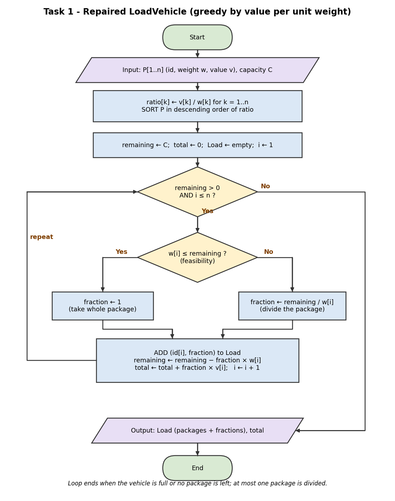

**How each deficiency is repaired.** (1) parameters and `INPUT:`/`OUTPUT:` contracts; (2)–(3) "best" = highest value/weight, applied through one `SORT`; (4) explicit test `P[i].weight ≤ Remaining`; (5) the `ELSE` branch loads `Remaining / P[i].weight`; (6) `Remaining` is initialised to C and decreased after every load; (7) the loop also stops when `i > n`, and `i` increases in every iteration, so at most n iterations run; (8) `Load` records every package and fraction and `TotalValue` is accumulated exactly. Because at most one package is cut (after a cut `Remaining = 0`), the load is optimal: any optimal solution can be exchanged, kilogram by kilogram, towards the ratio order without losing value. **Time:** Θ(n log n) for the sort plus Θ(n) for the loop; **space:** Θ(n) for the load list.

**Desk-check (my own instance, C = 50 kg).** Packages P1 (10 kg, 60), P2 (20 kg, 100), P3 (30 kg, 120), P4 (15 kg, 45); ratios 6, 5, 4 and 3, so the sorted order is P1, P2, P3, P4.

Table 3: Manual desk-check of LoadVehicle (state → decision → update)

| Iteration | Package (w, v, v/w) | Remaining before | Decision | Fraction | Remaining after | TotalValue |
|---|---|---|---|---|---|---|
| 1 | P1 (10, 60, 6.0) | 50 | 10 ≤ 50 → whole package | 1 | 40 | 60 |
| 2 | P2 (20, 100, 5.0) | 40 | 20 ≤ 40 → whole package | 1 | 20 | 160 |
| 3 | P3 (30, 120, 4.0) | 20 | 30 > 20 → divide | 20/30 = 0.667 | 0 | 160 + 80 = 240 |
| – | P4 (15, 45, 3.0) | 0 | loop ends: Remaining = 0 | – | – | 240 |

Result: Load = {(P1, 1), (P2, 1), (P3, 2/3)}, TotalValue = **240**, exactly 50 kg loaded. For comparison, the vague "best = highest value" reading would load P3, P2 (value 220) and "lightest first" would load P1, P4, P2 and 5 kg of P3 (value 225) – both feasible but worse, which shows why the ratio rule must be explicit.

**Verification by program (after the manual trace).** `load_vehicle.py` implements the pseudocode line by line (Figures 2–3); its output (Figure 4) reproduces Table 3 exactly. `test_load_vehicle.py` (Figure 5) additionally compares the greedy value with an exhaustive optimum over all n! loading orders for 300 random instances and checks the boundary cases C = 0, no packages and "everything fits".

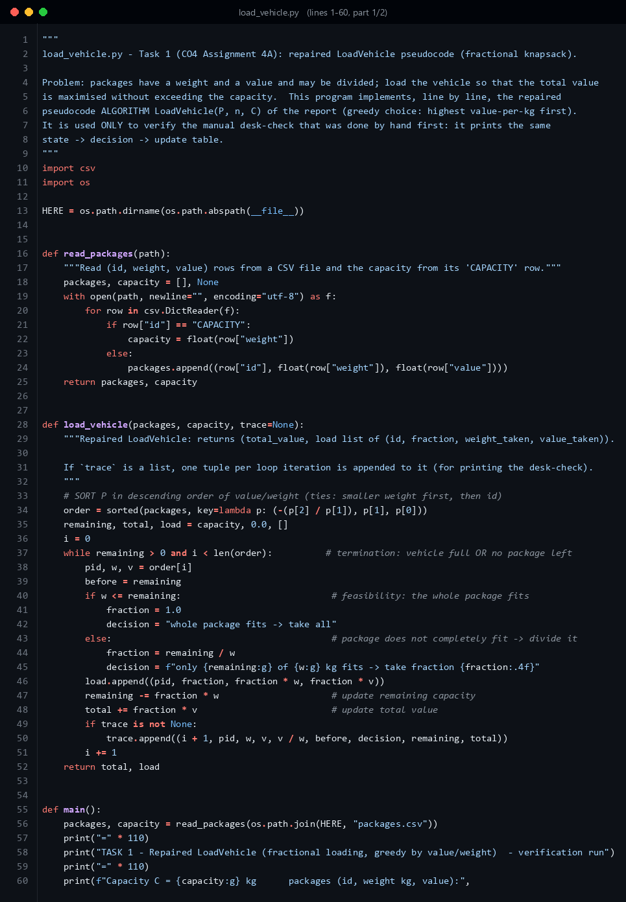

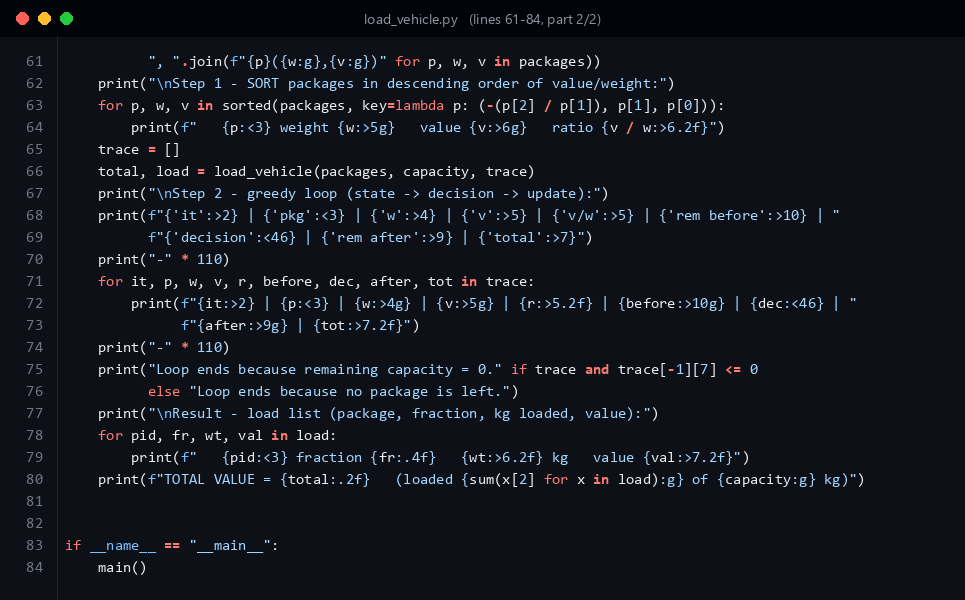

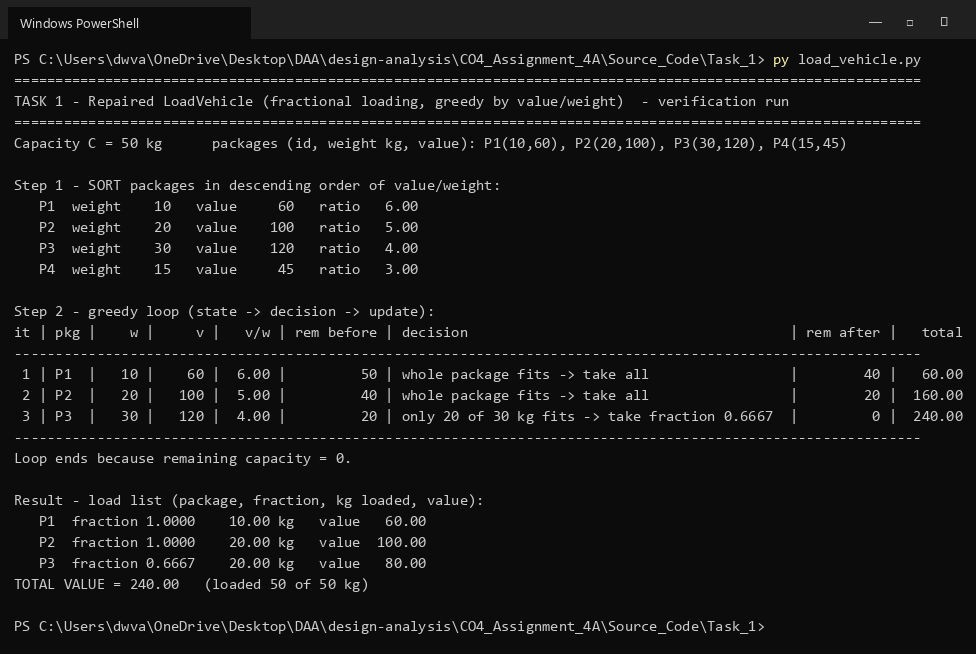

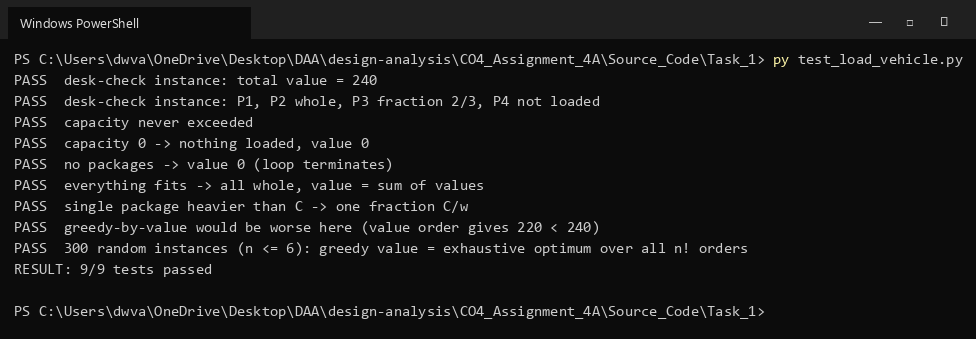

### Task 1.3 – Design Defence [1 Mark]

> In not more than 100 words, explain why your rewritten solution qualifies as pseudocode rather than programming code or informal English.

My rewritten LoadVehicle is pseudocode because it fixes every algorithmic decision (inputs, outputs, the value-per-kg greedy rule, the feasibility test, the fractional case, the capacity update and both termination conditions) while remaining independent of any programming language. It uses the handbook constructs ALGORITHM, INPUT/OUTPUT, BEGIN–END, ← assignment, WHILE and IF–THEN–ELSE and the permitted abstraction SORT, but contains no declarations, data types, library calls or compiler syntax. Unlike informal English, no step is vague: every variable is defined before use and every line is one operation a programmer can translate directly. *(91 words)*

## Task 2 – From Business Requirement to Greedy Pseudocode: Job Sequencing with Deadlines [8 Marks]

> **Problem Context.** A cloud-service company receives independent computational jobs. Each job requires one processing slot and has: Job ID | Deadline | Profit.
> A job earns its profit only when completed on or before its deadline. Only one job can be processed in each slot.
> The objective is to: **Maximise the total profit earned from jobs completed within their deadlines.**
> You are not provided with the algorithm.

**Evidence Expected**

> Problem model, greedy rule, complete pseudocode, decision trace and modified-case reasoning.

**Ans:**

I model the requirement precisely, propose the rule "most profitable job first, placed in the latest free slot on or before its deadline", write the pseudocode and flowchart, desk-check it on the given five jobs (result C, A, D with profit 180) and then change one input value and predict the effect before re-tracing.

### Task 2.1 – Model the Requirement [2 Marks]

> Before writing pseudocode, identify: Input; Output; Objective; Constraints; Decision to be made; Information required to determine whether a job can be scheduled.

Table 4: Model of the job-sequencing requirement

| Element | Precise statement |
|---|---|
| Input | n jobs; job k has an identifier id<sub>k</sub>, an integer deadline d<sub>k</sub> ≥ 1 (the last slot in which it may run) and a profit p<sub>k</sub> ≥ 0. Time is divided into unit slots 1, 2, 3, … |
| Output | A schedule Slot[1..m] (Slot[t] = the job run in slot t, or EMPTY), the set of accepted jobs, the rejected jobs and the total profit. m = min(n, max d<sub>k</sub>) slots are enough. |
| Objective | Maximise Σ p<sub>k</sub> over the accepted jobs. |
| Constraints | Each job needs exactly one slot and is run at most once; at most one job per slot; an accepted job k must occupy a slot t with 1 ≤ t ≤ d<sub>k</sub>. Jobs are independent (no precedence). |
| Decision to be made | For every job: accept or reject it, and if accepted, in which slot it is placed. |
| Information required for feasibility | The job's deadline d<sub>k</sub> and the occupancy of slots 1..d<sub>k</sub> (is at least one of them free?). A set of jobs is feasible iff, for every t, at most t of its jobs have deadline ≤ t. |

### Task 2.2 – Formulate a Greedy Hypothesis [1 Mark]

> State in one precise sentence the greedy-choice rule you propose. Briefly justify why this local decision appears capable of contributing to a globally good solution.

**Greedy rule:** *Consider the jobs in non-increasing order of profit, and accept a job if and only if some slot t ≤ its deadline is still free, placing it in the latest such free slot.*

**Justification.** (i) Taking the most profitable job first means that whenever a job must be rejected, every job that blocks it is at least as profitable, so the profit given up is the smallest possible (exchange argument: replacing a scheduled job by a cheaper competing job can never increase profit). (ii) Placing an accepted job as **late** as its deadline allows keeps the earlier slots free for jobs with tighter deadlines that come later in the profit order, so the local placement never removes an option that a later job could have used. (iii) The feasible job sets form a matroid (they satisfy the exchange property), and for matroids the greedy "most valuable compatible element first" rule is optimal – which my exhaustive checks below confirm.

### Task 2.3 – Design the Algorithm [3 Marks]

> Write a complete pseudocode for your proposed strategy. Your pseudocode must clearly expose: ordering/selection criterion; slot availability; feasibility check; job placement; profit update; final schedule; total profit.

```
ALGORITHM JobSequencing(J, n)
INPUT:
    J – array J[1..n] of jobs; J[k].id, J[k].deadline (integer ≥ 1), J[k].profit (≥ 0)
    n – number of jobs (n ≥ 0)
OUTPUT:
    Slot – array Slot[1..m]; Slot[t] = id of the job processed in slot t, or EMPTY
    Rejected – list of the ids of rejected jobs
    TotalProfit – total profit of the scheduled jobs
BEGIN
    SORT J in descending order of profit           // ordering criterion (ties: earlier deadline first)
    MaxD ← 0
    FOR k ← 1 TO n DO
        IF J[k].deadline > MaxD THEN
            MaxD ← J[k].deadline
        END IF
    END FOR
    m ← MIN(n, MaxD)                               // more than n slots are never needed
    FOR t ← 1 TO m DO
        Slot[t] ← EMPTY                            // slot availability: all slots free
    END FOR
    Rejected ← empty list
    TotalProfit ← 0
    FOR k ← 1 TO n DO                              // jobs in greedy order
        t ← MIN(J[k].deadline, m)                  // latest slot job k may use
        WHILE t ≥ 1 AND Slot[t] ≠ EMPTY DO         // feasibility check: search downwards
            t ← t − 1
        END WHILE
        IF t ≥ 1 THEN                              // a free slot on or before the deadline exists
            Slot[t] ← J[k].id                      // job placement (latest free slot)
            TotalProfit ← TotalProfit + J[k].profit    // profit update
        ELSE
            APPEND J[k].id TO Rejected             // no free slot ≤ deadline: job earns nothing
        END IF
    END FOR
    RETURN Slot, Rejected, TotalProfit             // final schedule and total profit
END
```

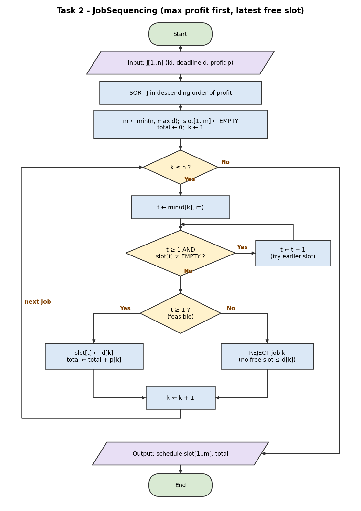

**Complexity.** Sorting costs Θ(n log n); each job scans at most m slots, so the placement phase is O(n·m) ⊆ O(n²) in the worst case and the whole algorithm is O(n²) time and Θ(n) space. *Refinement:* if n is large, the downward scan can be replaced by a disjoint-set "latest free slot" structure (FIND(t) returns the latest free slot ≤ t, which is then UNIONed with t − 1), giving O(n log n) overall without changing any decision.

### Task 2.4 – Desk-Check [1 Mark]

> Manually trace your algorithm using: A (deadline 2, profit 80), B (1, 35), C (2, 60), D (3, 40), E (1, 25). Show the important decisions and state changes, not merely the final answer.

**Preprocessing.** Sorted by profit: A 80 > C 60 > D 40 > B 35 > E 25. MaxD = 3, n = 5, so m = min(5, 3) = 3 and Slot[1..3] = [–, –, –], TotalProfit = 0.

Table 5: Manual desk-check of JobSequencing on the given instance

| Step | Job (d, p) | t = min(d, m) | Slots examined | Decision | Slot[1..3] after | TotalProfit |
|---|---|---|---|---|---|---|
| 1 | A (2, 80) | 2 | slot 2 free | accept → slot 2 | [–, A, –] | 80 |
| 2 | C (2, 60) | 2 | slot 2 busy, slot 1 free | accept → slot 1 | [C, A, –] | 140 |
| 3 | D (3, 40) | 3 | slot 3 free | accept → slot 3 | [C, A, D] | 180 |
| 4 | B (1, 35) | 1 | slot 1 busy → t = 0 | **reject** | [C, A, D] | 180 |
| 5 | E (1, 25) | 1 | slot 1 busy → t = 0 | **reject** | [C, A, D] | 180 |

**Final schedule:** slot 1 = C, slot 2 = A, slot 3 = D; rejected B and E; **total profit = 180**. The key decision is step 1: A is placed in slot 2, its latest allowed slot, not in slot 1. This keeps slot 1 – the only slot usable by deadline-1 jobs and the fall-back slot of C – free, so C fits into slot 1 at step 2. In general, placing a job earlier than necessary can block a later job with a tighter deadline; the latest-free-slot rule never wastes an early slot. Figure 7 (left) shows the final slot timeline.

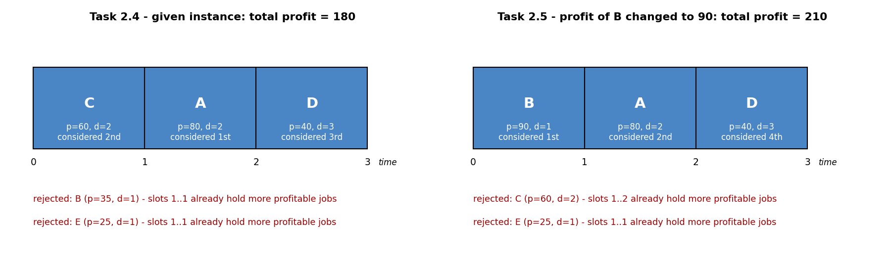

**Verification by program (after the manual trace).** `job_sequencing.py` (Figures 8–9) prints the same decision table (Figure 10, upper half). `test_job_sequencing.py` (Figure 11) confirms that 180 equals the exhaustive optimum over all 2⁵ = 32 job subsets and that the greedy profit equals the exhaustive optimum on 400 random instances.

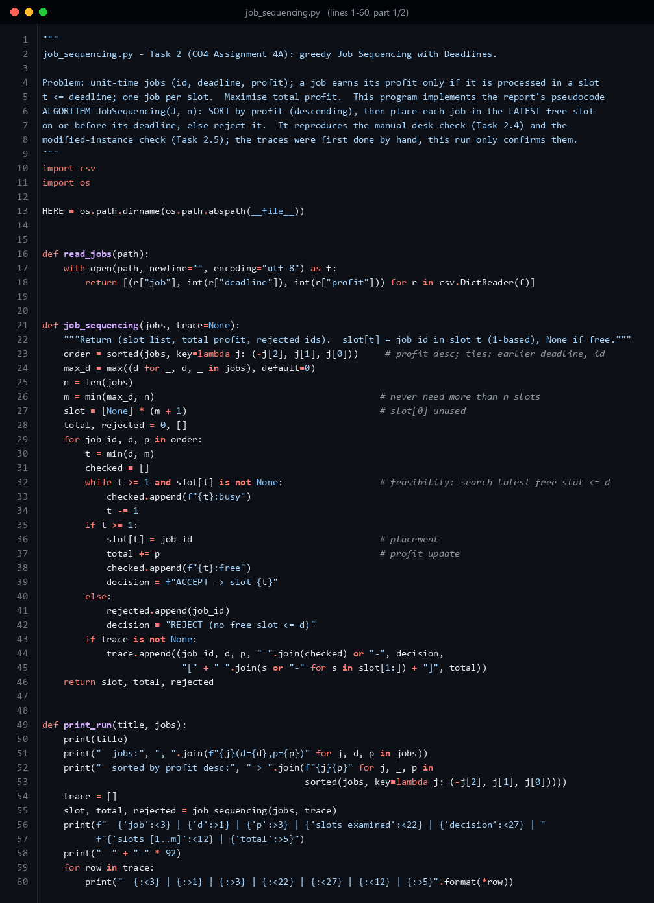

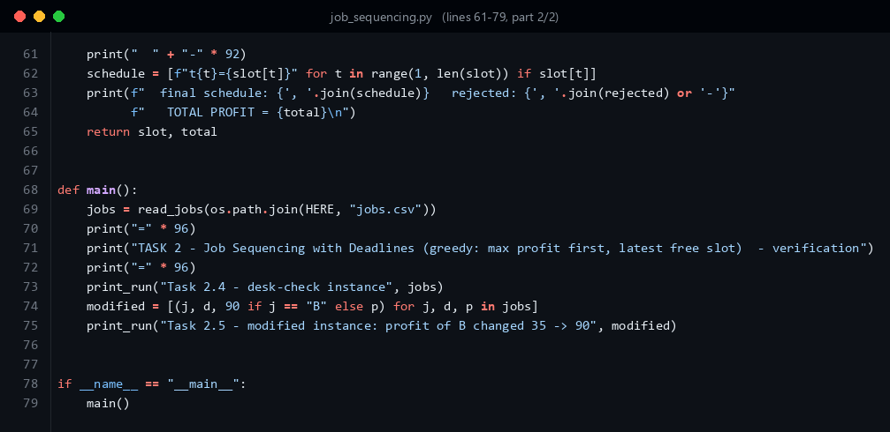

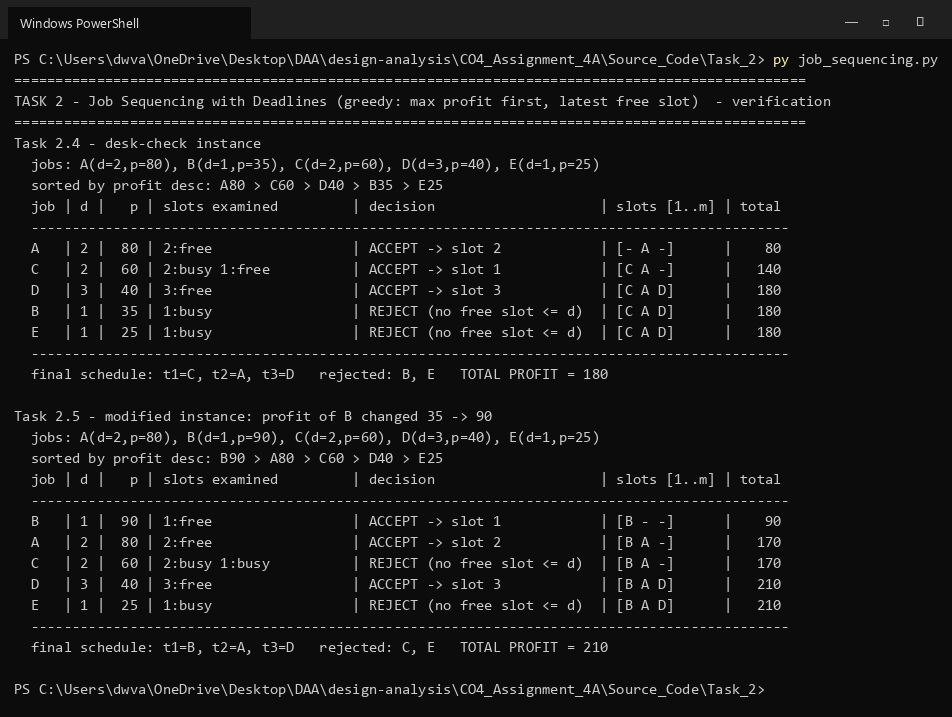

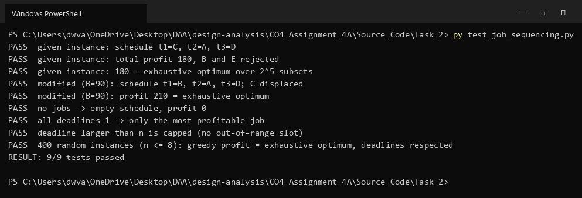

### Task 2.5 – Challenge Your Design [1 Mark]

> Change one input value in the given instance. Before tracing the algorithm again: predict whether the schedule will change; identify the decision you expect to be affected. Trace only the relevant decisions and determine whether your prediction was correct.

**Change:** the profit of job B is raised from 35 to **90** (all other values unchanged).

**Prediction (made before tracing).** B becomes the most profitable job, so it moves to the front of the order (B 90 > A 80 > C 60 > D 40 > E 25) and takes slot 1, its only possible slot. A still takes slot 2. The decision I expect to change is **C's**: C (deadline 2) will now find both slot 2 and slot 1 occupied and will be **rejected**, i.e. C is displaced by B. D is unaffected (slot 3) and E is still rejected. Predicted schedule B, A, D with profit 90 + 80 + 40 = **210**.

Table 6: Trace of the relevant decisions for the modified instance (B = 90)

| Step | Job (d, p) | Slots examined | Decision | Slot[1..3] after | TotalProfit |
|---|---|---|---|---|---|
| 1 | B (1, 90) | slot 1 free | accept → slot 1 | [B, –, –] | 90 |
| 2 | A (2, 80) | slot 2 free | accept → slot 2 | [B, A, –] | 170 |
| 3 | C (2, 60) | slot 2 busy, slot 1 busy | **reject** (changed decision) | [B, A, –] | 170 |
| 4 | D (3, 40) | slot 3 free | accept → slot 3 | [B, A, D] | 210 |
| 5 | E (1, 25) | slot 1 busy | reject | [B, A, D] | 210 |

**Outcome:** the schedule changed exactly as predicted – C was the affected decision, the new schedule is B, A, D and the profit rises to 210 (Figure 7 right, Figure 10 lower half). The test program confirms that 210 is the exhaustive optimum. The greedy rule adapted correctly: giving up C (60) for B (90) is a gain of 30. A contrasting change – e.g. raising E from 25 to 30 – would not change the schedule, because E would still be ranked last and its only slot is occupied by a more profitable job.

## Task 3 – From Recurrence to Executable Logic: Dynamic Programming – 0/1 Knapsack [9 Marks]

> **Problem Context.** A cargo-planning system must select items for a vehicle with limited carrying capacity. Each item has: Item ID | Weight | Value.
> Items are indivisible. An item must either be completely selected or completely rejected.
> The objective is to maximise total value without exceeding the vehicle capacity.

**Evidence Expected**

> State definition, recurrence with reasoning, complete pseudocode, solution-reconstruction logic, manual trace and dependency explanation.

**Ans:**

Because items are indivisible, the greedy ratio rule of Task 1 is no longer safe. On the given instance it happens to work (ratios Q 6.67, R 6.25, P 6.0, S 6.0 → Q + R = 45), but with capacity 6 it would take Q, find that R no longer fits, add P and stop at 32, whereas P + R = 37 is optimal (DP[4][6] = 37 in Table 7). I therefore build the solution from a DP state, a recurrence, a table-filling order and a reconstruction step.

### Task 3.1 – Define the State [1 Mark]

> Define precisely: DP[i][w]. Your definition must explain exactly what information the state represents.

**DP[i][w] = the maximum total value that can be obtained by selecting a subset of the first i items only (items 1, 2, …, i in the fixed input order – here P, Q, R, S) whose total weight does not exceed w,** for 0 ≤ i ≤ n and 0 ≤ w ≤ W (W = vehicle capacity).

- i says **which items may be used** (a prefix of the item list); w says **how much capacity is available** – it is an upper bound, not an exact weight.
- The state stores only the best **value**, not the set of items; the set is recovered afterwards by comparing DP[i][w] with DP[i − 1][w].
- The table has (n + 1) × (W + 1) entries and the answer to the whole problem is DP[n][W].

### Task 3.2 – Develop the Recurrence [2 Marks]

> Develop the recurrence considering: when the current item can be included; when it cannot be included; include versus exclude decision; boundary conditions. Explain the meaning of each term rather than merely writing the final recurrence.

Consider item i with weight wt<sub>i</sub> and value val<sub>i</sub>, and capacity w. An optimal subset of items 1..i either does not contain item i or contains it:

- **Exclude item i:** the best we can do is the best subset of items 1..i − 1 with the same capacity w → **DP[i − 1][w]**.
- **Include item i (only possible when wt<sub>i</sub> ≤ w):** item i contributes val<sub>i</sub> and uses wt<sub>i</sub> kg, so the remaining items 1..i − 1 must fit into the capacity left over, w − wt<sub>i</sub>, and should be chosen optimally → **val<sub>i</sub> + DP[i − 1][w − wt<sub>i</sub>]**. Using row i − 1 (not row i) guarantees that item i is used at most once – this is what makes it 0/1.

```
DP[i][w] = DP[i−1][w]                                          if wt_i > w   (item i cannot be included)
DP[i][w] = MAX( DP[i−1][w] ,  val_i + DP[i−1][w − wt_i] )      if wt_i ≤ w   (include versus exclude)
Boundary:  DP[0][w] = 0 for 0 ≤ w ≤ W    (no items → no value)
           DP[i][0] = 0 for 0 ≤ i ≤ n    (no capacity → nothing fits; all weights are positive)
```

The MAX is the **include versus exclude decision**: we keep whichever alternative gives more value. The recurrence is valid because of **optimal substructure** – if the optimal subset for (i, w) contains item i, its other items must form an optimal subset for (i − 1, w − wt<sub>i</sub>), otherwise replacing them by a better subset would improve the total. Sub-problems overlap (many (i, w) pairs need the same (i − 1, w′)), so each is computed once and stored.

### Task 3.3 – Translate the Recurrence into Pseudocode [4 Marks]

> Write complete pseudocode that: initialises the DP structure; computes states in a valid dependency order; performs the include/exclude decision; determines the optimum value; reconstructs the actual items selected. Returning only the optimum numerical value is insufficient.

```
ALGORITHM Knapsack01(Item, n, W)
INPUT:
    Item – array Item[1..n]; Item[i].id, Item[i].weight (positive integer), Item[i].value (≥ 0)
    n    – number of items (n ≥ 0)
    W    – capacity of the vehicle (non-negative integer)
OUTPUT:
    Best     – maximum total value with total weight ≤ W  (= DP[n][W])
    Selected – list of the ids of the items that achieve Best
BEGIN
    // 1. Initialise the DP structure DP[0..n][0..W] (boundary conditions)
    FOR w ← 0 TO W DO
        DP[0][w] ← 0                                    // no items available
    END FOR
    FOR i ← 0 TO n DO
        DP[i][0] ← 0                                    // no capacity available
    END FOR
    // 2. Compute the states row by row: row i uses only the completed row i − 1
    FOR i ← 1 TO n DO
        FOR w ← 1 TO W DO
            Exclude ← DP[i − 1][w]                      // best value without item i
            IF Item[i].weight ≤ w THEN                  // item i can be included
                Include ← Item[i].value + DP[i − 1][w − Item[i].weight]
                IF Include > Exclude THEN               // include/exclude decision
                    DP[i][w] ← Include
                ELSE
                    DP[i][w] ← Exclude
                END IF
            ELSE                                        // item i is heavier than w
                DP[i][w] ← Exclude
            END IF
        END FOR
    END FOR
    // 3. Optimum value
    Best ← DP[n][W]
    // 4. Reconstruct the selected items by walking back from DP[n][W]
    Selected ← empty list
    w ← W
    FOR i ← n DOWNTO 1 DO
        IF DP[i][w] ≠ DP[i − 1][w] THEN                // value changed: item i was included
            INSERT Item[i].id at the front of Selected
            w ← w − Item[i].weight                      // continue with the capacity left
        END IF                                          // else item i was excluded; w unchanged
    END FOR
    RETURN Best, Selected
END
```

**Why the reconstruction is correct.** If DP[i][w] = DP[i − 1][w], an optimal solution for (i, w) exists without item i, so we move up one row with the same w; otherwise the value could only have come from the include term, so item i is in the solution and the remaining capacity becomes w − wt<sub>i</sub>. Each step moves up one row, so the walk ends after n steps. **Complexity:** Θ(n·W) time and space for the table, Θ(n) for the reconstruction (pseudo-polynomial: it depends on the numeric value W).

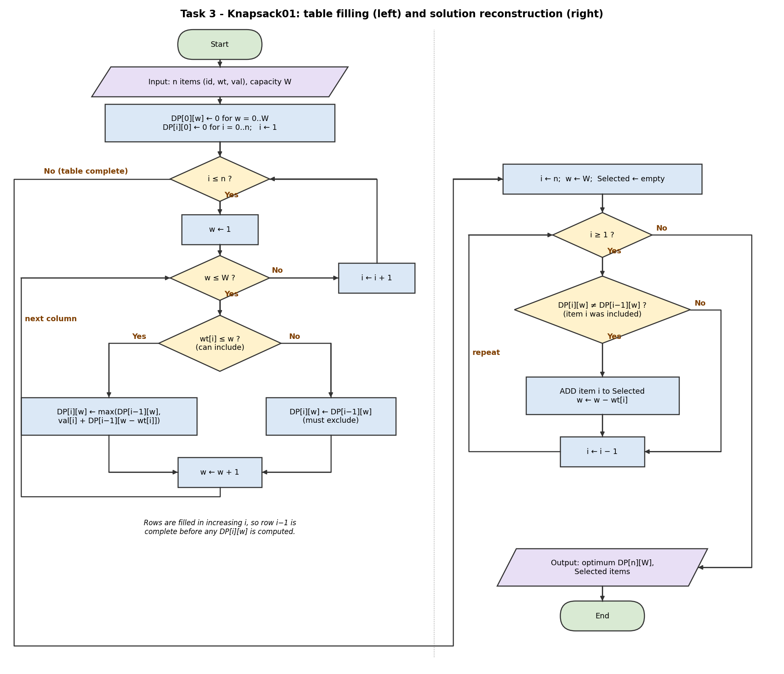

### Task 3.4 – Desk-Check [1 Mark]

> Use the following instance: P (weight 2, value 12), Q (3, 20), R (4, 25), S (5, 30); Vehicle Capacity = 7. Trace the important DP states that lead to the final solution. You are not required to reproduce unnecessary states if they do not contribute to your explanation.

I filled the table by hand row by row (the instance is small enough to show all 40 states; the states on the solution path are in bold).

Table 7: DP[i][w] for the given instance (W = 7); bold = states used by the reconstruction

| i (item, wt, val) | w = 0 | 1 | 2 | 3 | 4 | 5 | 6 | 7 |
|---|---|---|---|---|---|---|---|---|
| 0 (none) | **0** | 0 | 0 | 0 | 0 | 0 | 0 | 0 |
| 1 (P, 2, 12) | **0** | 0 | 12 | 12 | 12 | 12 | 12 | 12 |
| 2 (Q, 3, 20) | 0 | 0 | 12 | **20** | 20 | 32 | 32 | 32 |
| 3 (R, 4, 25) | 0 | 0 | 12 | 20 | 25 | 32 | 37 | **45** |
| 4 (S, 5, 30) | 0 | 0 | 12 | 20 | 25 | 32 | 37 | **45** |

Table 8: Important states and their include/exclude decisions

| State | Exclude term | Include term | Decision | Value |
|---|---|---|---|---|
| DP[1][2] | DP[0][2] = 0 | 12 + DP[0][0] = 12 | include P | 12 |
| DP[2][3] | DP[1][3] = 12 | 20 + DP[1][0] = 20 | include Q | 20 |
| DP[2][5] | DP[1][5] = 12 | 20 + DP[1][2] = 32 | include Q (P + Q) | 32 |
| DP[3][4] | DP[2][4] = 20 | 25 + DP[2][0] = 25 | include R | 25 |
| DP[3][6] | DP[2][6] = 32 | 25 + DP[2][2] = 37 | include R (P + R) | 37 |
| **DP[3][7]** | DP[2][7] = 32 | 25 + DP[2][3] = **45** | **include R (Q + R)** | 45 |
| DP[4][5] | DP[3][5] = 32 | 30 + DP[3][0] = 30 | exclude S | 32 |
| **DP[4][7]** | DP[3][7] = **45** | 30 + DP[3][2] = 42 | **exclude S** (P + S = 42 < 45) | 45 |

Table 9: Reconstruction walk from DP[4][7]

| i | w | DP[i][w] | DP[i − 1][w] | Decision | Next w |
|---|---|---|---|---|---|
| 4 (S) | 7 | 45 | 45 | equal → S excluded | 7 |
| 3 (R) | 7 | 45 | 32 | different → **R included** | 7 − 4 = 3 |
| 2 (Q) | 3 | 20 | 12 | different → **Q included** | 3 − 3 = 0 |
| 1 (P) | 0 | 0 | 0 | equal → P excluded | 0 |

**Result: optimum value 45 with items Q and R (total weight 3 + 4 = 7 ≤ 7).** The decisive comparison is DP[4][7]: including S (the most valuable single item) would give only 30 + 12 = 42, so S is rejected. Figure 13 highlights the path through the table.

![Figure 13: DP table with the reconstruction path DP[4][7] → DP[3][7] → DP[2][3] → DP[1][0] → DP[0][0] (red arrows = include)](Diagrams/dg_task3_dp_table_path.png)

**Verification by program (after the manual trace).** `knapsack_dp.py` (Figures 14–15) prints the identical table, key decisions and reconstruction (Figure 16) and checks all 2⁴ = 16 subsets by brute force (best = 45 with Q, R). `test_knapsack_dp.py` (Figure 17) compares DP with brute force on 400 random instances and checks that the reconstructed set is feasible and worth exactly DP[n][W].

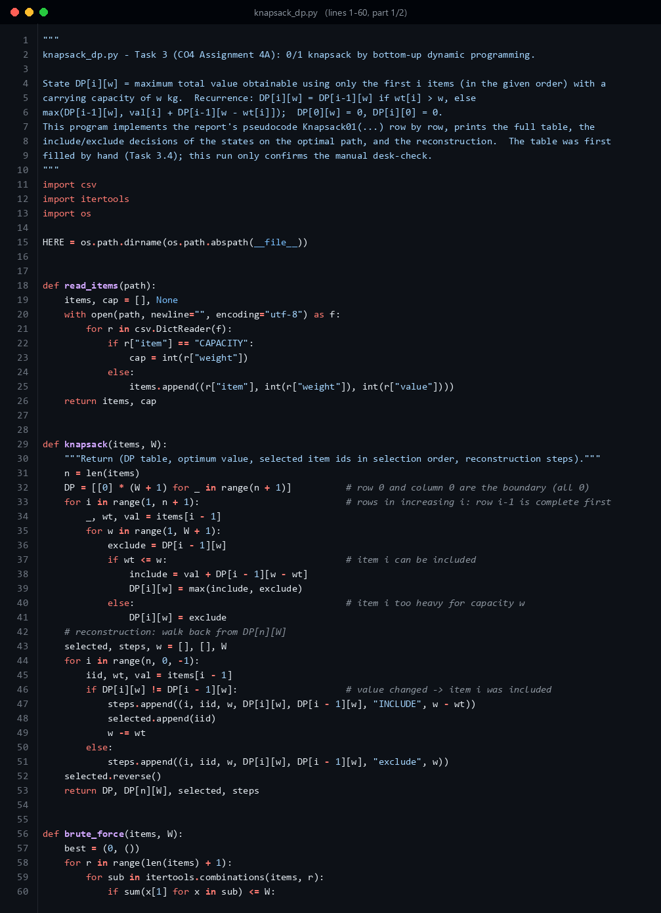

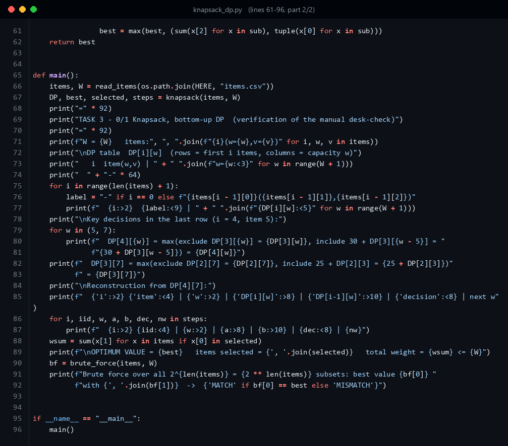

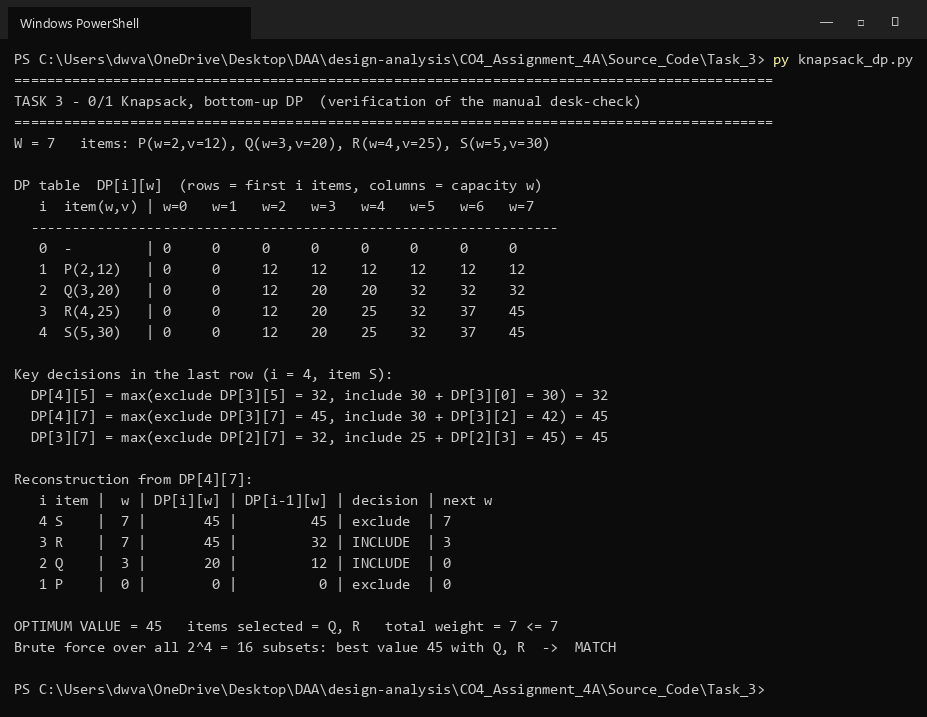

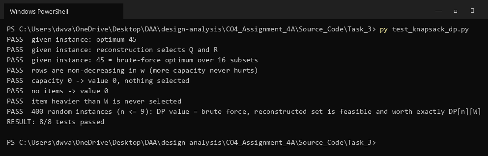

### Task 3.5 – Explain the Dependency [1 Mark]

> Explain: why must certain DP states be available before later states can be computed? Relate your explanation to your pseudocode processing order.

DP[i][w] is defined **in terms of two states of the previous row**: DP[i − 1][w] (exclude) and DP[i − 1][w − wt<sub>i</sub>] (include). It cannot be evaluated until both of those values are final, because the MAX compares them – a missing or still-provisional value would make the decision wrong. Figure 18 shows that both arrows come from row i − 1, from the same column or from a column to the left; no state depends on a state in its own row, in a later row or to its right.

My pseudocode respects this with its loop order: the boundary row 0 and column 0 are initialised first, then the **outer loop runs i = 1, 2, …, n**, so when row i is being filled, row i − 1 has been completely computed in the previous outer iteration (for every w, including w − wt<sub>i</sub>). The inner loop over w = 1..W can therefore run in any order within the row; I use increasing w. The reconstruction runs in the opposite direction (i = n down to 1) because it consumes the finished table. For example, DP[4][7] needs DP[3][7] = 45 and DP[3][2] = 12, which in turn needed DP[2][7], DP[2][3] and DP[2][2] – all available because row 3 was finished before row 4 started. (If the table were compressed to one row, w would have to run **downwards** for the same reason: DP[w − wt<sub>i</sub>] must still hold the row-(i − 1) value when DP[w] is updated.)

![Figure 18: Dependency diagram – DP[i][w] depends only on DP[i−1][w] and DP[i−1][w−wt[i]] in the completed previous row](Diagrams/dg_task3_dependency.png)

## Task 4 – Pseudocode Forensics: Find, Explain and Repair an Algorithmic Defect [7 Marks]

> **Problem Context.** The following pseudocode is intended to determine whether a string can be completely segmented into words contained in a dictionary.
> `ALGORITHM WordBreak(Text, Dictionary)` / `INPUT: Text – string of length n; Dictionary – collection of valid words` / `OUTPUT: TRUE if Text can be completely segmented, FALSE otherwise`
> `BEGIN` / `DP[0] ← TRUE` / `FOR i ← 1 TO n DO` / `DP[i] ← FALSE` / `FOR j ← 0 TO i − 1 DO` / `IF substring(Text, j, i) is in Dictionary THEN` / `DP[i] ← TRUE` / `BREAK` / `END IF` / `END FOR` / `END FOR` / `RETURN DP[n]` / `END`
> The pseudocode contains a logical defect.

**Evidence Expected**

> Exact defect, student-designed failing case, state trace, minimal correction and regression evidence.

**Ans:**

Throughout, DP[i] is meant to say "the prefix consisting of the first i characters of Text can be completely segmented", and substring(Text, j, i) denotes the characters in positions j + 1 … i (the last word of a split at j). I locate the incomplete decision, build a failing input, repair only that line, and run a regression check.

### Task 4.1 – Locate the Defect [2 Marks]

> Identify the exact decision that is incomplete. Explain why finding a substring in the dictionary is not, by itself, sufficient to establish that the prefix ending at that position can be segmented.

**The incomplete decision is the inner test**

```
IF substring(Text, j, i) is in Dictionary THEN
```

It checks only that the **last word** (characters j + 1 … i) is a dictionary word. A complete segmentation of the prefix 1..i that ends with this word also requires that **the part before it – the prefix 1..j – can itself be completely segmented**, i.e. DP[j] = TRUE. The condition DP[j] is never consulted: the algorithm computes DP[1], DP[2], … but never reads them, which is the tell-tale sign of the defect. Consequently the faulty DP[i] actually means "*some dictionary word ends at position i*", and DP[n] = TRUE whenever Text merely **ends** with a dictionary word, even if an unmatched fragment precedes it. A dictionary hit is necessary but not sufficient; segmentability of the prefix is a **two-part** condition: prefix 1..j segmentable **AND** word j + 1..i in the dictionary.

### Task 4.2 – Construct a Failing Input [2 Marks]

> Design your own: Text; Dictionary; for which the faulty algorithm can produce an incorrect result. Trace the relevant states and demonstrate where the first incorrect state occurs.

**Failing input:** Text = `catsdog` (n = 7), Dictionary = {`cat`, `dog`}. The correct answer is **FALSE**: after `cat` the letter `s` cannot start any dictionary word, so no complete segmentation exists. The faulty algorithm returns **TRUE**.

Table 10: Manual trace for Text = "catsdog", Dictionary = {cat, dog}

| i | Prefix | Faulty DP[i] (reason) | Correct DP[i] (reason) | Status |
|---|---|---|---|---|
| 0 | (empty) | TRUE (base case) | TRUE (base case) | correct |
| 1 | c | FALSE (no word ends at 1) | FALSE | correct |
| 2 | ca | FALSE | FALSE | correct |
| 3 | cat | TRUE ("cat" = substring(0, 3), j = 0) | TRUE (DP[0] = TRUE and "cat") | correct |
| 4 | cats | FALSE ("cats", "ats", "ts", "s" not words) | FALSE | correct |
| 5 | catsd | FALSE | FALSE | correct |
| 6 | catsdo | FALSE | FALSE | correct |
| 7 | catsdog | **TRUE** ("dog" = substring(4, 7), j = 4) | **FALSE** (only split with a word is j = 4, but DP[4] = FALSE) | **first incorrect state** |

The first incorrect state is **DP[7]**: the faulty test accepts the split j = 4 because `dog` is a word, ignoring that DP[4] = FALSE (`cats` cannot be segmented). Since DP[7] = DP[n], the wrong value is returned directly. Figure 19 shows the two state strips side by side.

![Figure 19: DP state strip for "catsdog" – faulty (top) versus corrected (bottom); the first wrong state DP[7] is red, the blocking state DP[4] is outlined](Diagrams/dg_task4_dp_strip.png)

### Task 4.3 – Repair the Algorithm [2 Marks]

> Correct only the required logic. Do not replace the entire algorithm with a new solution.

The **only** change is the inner condition (marked `◄ REPAIRED`); everything else, including the BREAK, is unchanged.

```
ALGORITHM WordBreak(Text, Dictionary)
INPUT:
    Text – string of length n
    Dictionary – collection of valid words
OUTPUT:
    TRUE if Text can be completely segmented
    FALSE otherwise
BEGIN
    DP[0] ← TRUE
    FOR i ← 1 TO n DO
        DP[i] ← FALSE
        FOR j ← 0 TO i - 1 DO
            IF DP[j] = TRUE AND substring(Text, j, i) is in Dictionary THEN     ◄ REPAIRED
                DP[i] ← TRUE
                BREAK
            END IF
        END FOR
    END FOR
    RETURN DP[n]
END
```

**Why this is sufficient.** Now DP[i] = TRUE exactly when there is a split point j with a segmentable prefix 1..j and a dictionary word j + 1..i, which is the definition of a segmentable prefix 1..i; by induction on i every DP[i] is correct. The BREAK remains valid because one witness j is enough. Testing DP[j] first also skips the (more expensive) dictionary look-up when the prefix is not segmentable. Complexity is unchanged: O(n²) substring look-ups. On the failing input the repaired test rejects j = 4 (DP[4] = FALSE), so DP[7] = FALSE and the algorithm returns FALSE (Table 10, "Correct" column). Figure 20 is the flowchart of the corrected algorithm with the repaired decision highlighted.

![Figure 20: Flowchart of the corrected WordBreak – the repaired decision (red outline) adds the condition DP[j] = TRUE](Diagrams/fc_task4_word_break_corrected.png)

### Task 4.4 – Regression Check [1 Mark]

> Provide one additional input for which the original algorithm already produced the correct result. Demonstrate that your correction preserves the correct behaviour.

**Regression input:** Text = `catdog` (n = 6), Dictionary = {`cat`, `dog`}; the correct answer is TRUE (`cat` + `dog`).

Table 11: Regression trace for Text = "catdog" – original and corrected versions

| i | Prefix | Original DP[i] | Corrected DP[i] (witness) |
|---|---|---|---|
| 0 | (empty) | TRUE | TRUE (base case) |
| 1–2 | c, ca | FALSE | FALSE |
| 3 | cat | TRUE ("cat", j = 0) | TRUE (DP[0] = TRUE and "cat") |
| 4–5 | catd, catdo | FALSE | FALSE |
| 6 | catdog | TRUE ("dog", j = 3) | TRUE (DP[3] = TRUE and "dog") |

Both versions return **TRUE**, and every intermediate state is identical: whenever the original found a word ending at i whose start j was already segmentable, the corrected condition holds as well, so correct TRUE results are preserved. I also checked a correct FALSE result: for `dogcatx` both versions return FALSE (no word ends at position 7), so the repair did not change correct negative answers either.

**Verification by program (after the manual traces).** `word_break.py` implements both versions (Figures 21–22) and prints the faulty and corrected DP arrays with the first wrong state marked (Figure 23). `test_word_break.py` (Figure 24) compares the corrected algorithm with an independent memoised recursive segmentation on 2000 random texts (all equal, and every intermediate DP[i] equals the reference for that prefix), while the faulty version is wrong on 480 of the same texts.

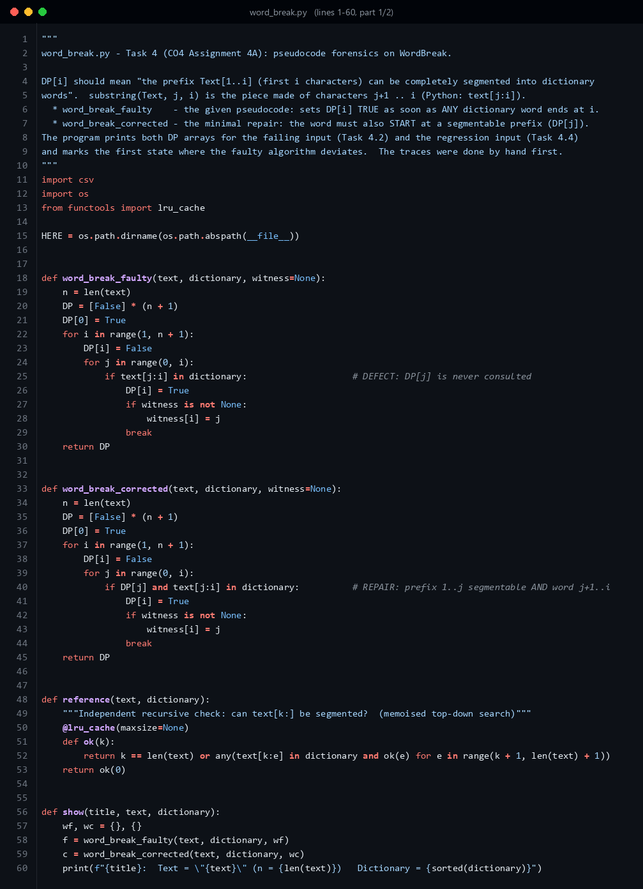

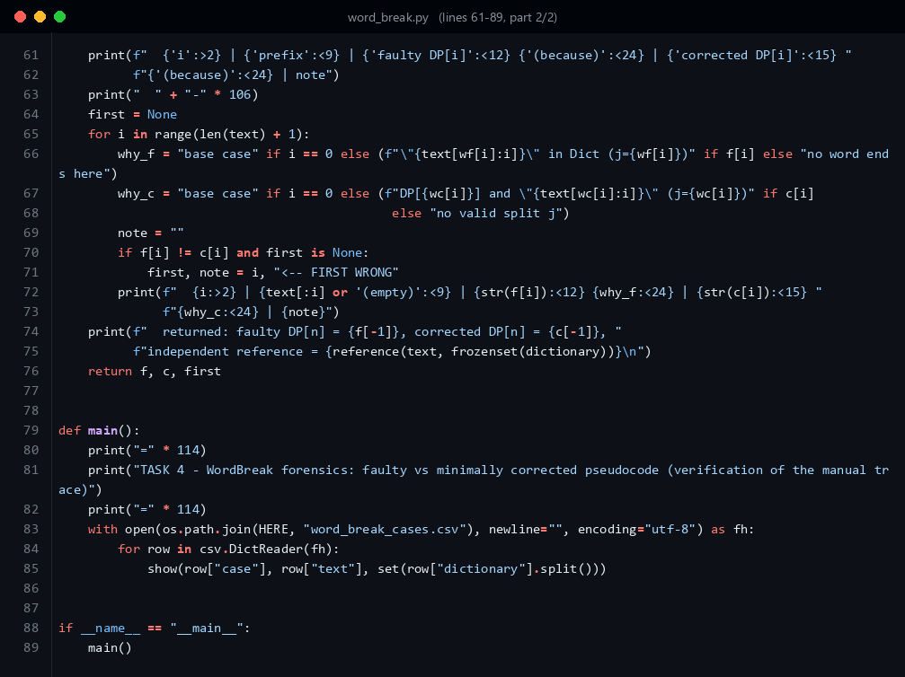

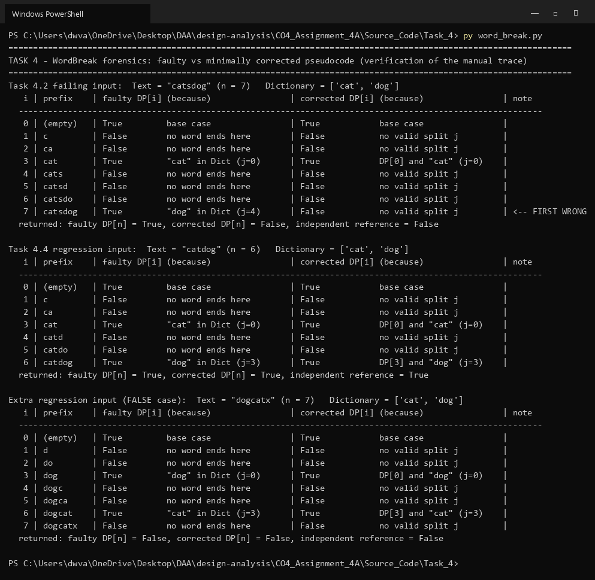

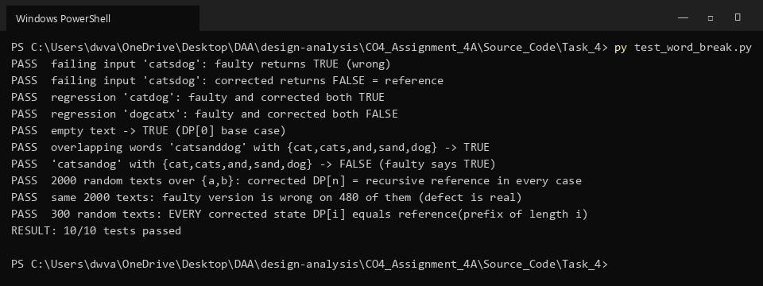

## Task 5 – Same Graph, Different Algorithmic Reasoning: Dijkstra, Bellman-Ford and Floyd [7 Marks]

> **Problem Context.** Consider the following directed weighted graph: A → B 4; A → C 7; B → C 2; B → D 6; C → D 1; D → E 3; C → E 8.

**Evidence Expected**

> Precise pseudocode, relaxation logic, analysis of the greedy assumption, Bellman-Ford reasoning and Floyd state/transition.

**Ans:**

Figure 25 draws the graph. I solve it three times: greedily from source A (Task 5.1), with repeated relaxation that tolerates negative weights (Task 5.2), and for all pairs with Floyd's DP (Task 5.3). All three give the same distances from A: B 4, C 6, D 7, E 10.

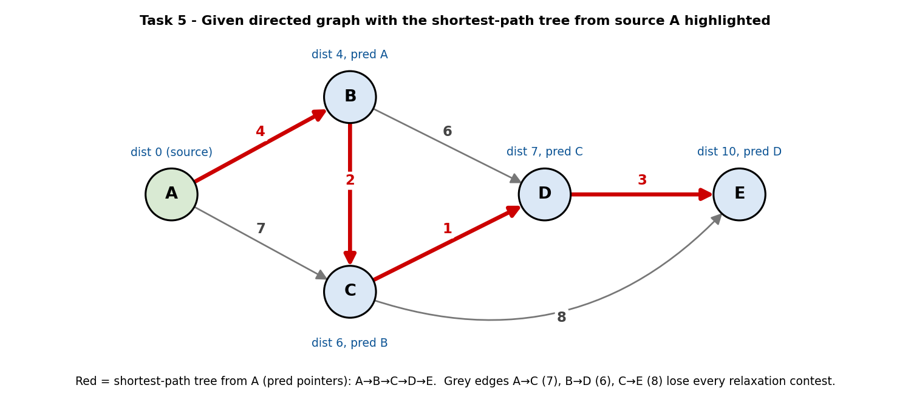

### Task 5.1 – Greedy Shortest-Path Design [3 Marks]

> Assume all edge weights are non-negative. Write pseudocode to determine shortest distances from source A using a greedy strategy. Your pseudocode must explicitly show: initialisation; selection of the next vertex; relaxation; distance update; predecessor update; termination. Writing "Apply Dijkstra's algorithm" is not sufficient.

**Greedy idea.** Keep a tentative distance for every vertex; repeatedly **commit** to the unsettled vertex with the smallest tentative distance (it cannot be improved later, because every other route to it would leave the settled region through a vertex that is at least as far away and then add non-negative edges), and relax its outgoing edges.

```
ALGORITHM GreedyShortestPaths(V, E, w, s)
INPUT:
    V – set of vertices;  E – set of directed edges (u, v) with weight w(u, v) ≥ 0
    s – source vertex
OUTPUT:
    dist[v] – length of a shortest path from s to v (∞ if v is unreachable)
    pred[v] – predecessor of v on that path (NIL for s and unreachable vertices)
BEGIN
    // Initialisation
    FOR each vertex v ∈ V DO
        dist[v] ← ∞
        pred[v] ← NIL
    END FOR
    dist[s] ← 0
    Q ← priority queue containing every v ∈ V, keyed by dist[v]
    Settled ← ∅
    WHILE Q is not empty DO
        u ← EXTRACT_MIN(Q)                        // selection: smallest tentative distance
        IF dist[u] = ∞ THEN
            BREAK                                 // all remaining vertices are unreachable
        END IF
        Settled ← Settled ∪ {u}                   // greedy commitment: dist[u] is final
        FOR each edge (u, v) ∈ E with v ∉ Settled DO
            IF dist[u] + w(u, v) < dist[v] THEN   // relaxation test
                dist[v] ← dist[u] + w(u, v)       // distance update
                pred[v] ← u                       // predecessor update
                DECREASE_KEY(Q, v, dist[v])
            END IF
        END FOR
    END WHILE                                     // termination: each vertex extracted once
    RETURN dist, pred
END
```

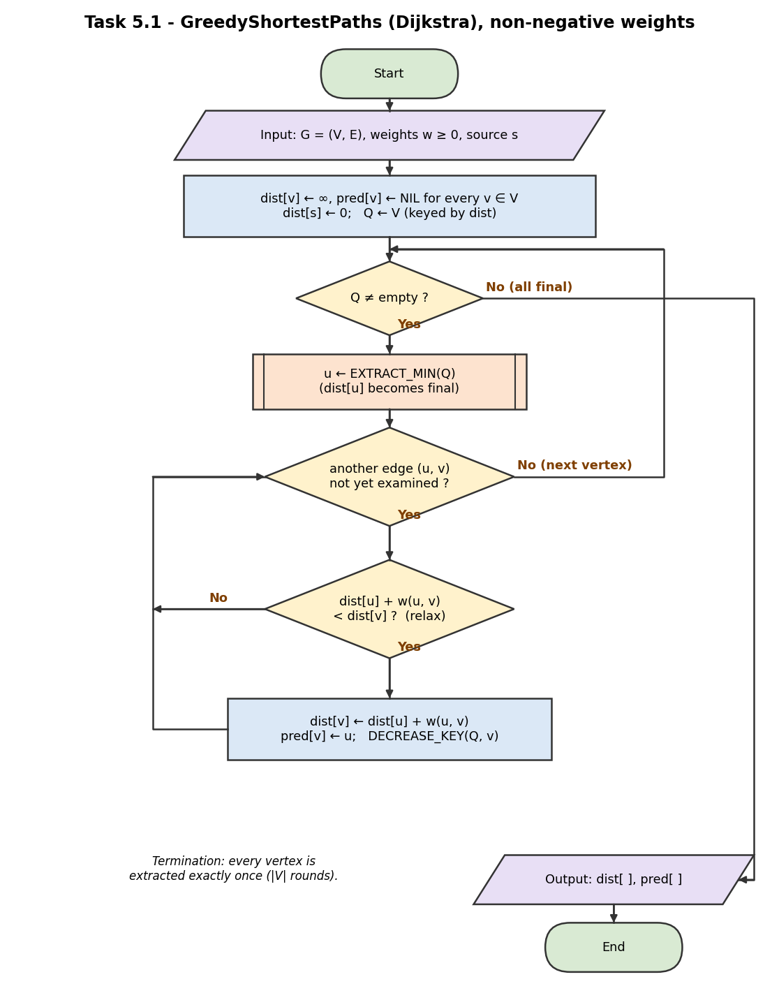

**Termination and cost.** Each vertex is extracted exactly once (|V| iterations) and each edge is relaxed at most once, so the loop ends; with a binary heap the time is O((|V| + |E|) log |V|), with an array O(|V|²).

**Manual trace from A** (ties broken alphabetically; "→" shows a successful relaxation):

Table 12: Manual trace of GreedyShortestPaths from source A

| Step | Extracted u (dist) | Relaxations of edges (u, v) | dist A, B, C, D, E after | pred changes |
|---|---|---|---|---|
| 0 | – (initialisation) | dist[A] = 0 | 0, ∞, ∞, ∞, ∞ | all NIL |
| 1 | A (0) | A→B: 0 + 4 = 4 < ∞ → 4; A→C: 0 + 7 = 7 < ∞ → 7 | 0, 4, 7, ∞, ∞ | B←A, C←A |
| 2 | B (4) | B→C: 4 + 2 = 6 < 7 → 6; B→D: 4 + 6 = 10 < ∞ → 10 | 0, 4, 6, 10, ∞ | C←B, D←B |
| 3 | C (6) | C→D: 6 + 1 = 7 < 10 → 7; C→E: 6 + 8 = 14 < ∞ → 14 | 0, 4, 6, 7, 14 | D←C, E←C |
| 4 | D (7) | D→E: 7 + 3 = 10 < 14 → 10 | 0, 4, 6, 7, 10 | E←D |
| 5 | E (10) | no outgoing edges; Q empty → terminate | 0, 4, 6, 7, 10 | – |

**Result:** dist B = 4 (A→B), C = 6 (A→B→C), D = 7 (A→B→C→D), E = 10 (A→B→C→D→E). The direct edges A→C (7), B→D (6) and C→E (8) each lost a relaxation contest, so the predecessor pointers form the chain shown in red in Figure 25.

### Task 5.2 – Change the Graph Assumption [2 Marks]

> The system must now support graphs containing negative-weight edges. Identify precisely which assumption or decision in your previous greedy reasoning can become unsafe. Using Bellman-Ford reasoning: write the core pseudocode required for repeated relaxation; explain why a single greedy commitment is no longer sufficient; state how a reachable negative-weight cycle can be detected.

**The unsafe decision** is the greedy commitment `Settled ← Settled ∪ {u}` immediately after `u ← EXTRACT_MIN(Q)`, i.e. the assumption *"the unsettled vertex with the smallest tentative distance already has its final shortest distance, because any other path to it must be at least as long"*. That argument relies on the fact that extending a path by an edge never makes it shorter (w ≥ 0). With a negative edge, a path that currently looks longer can become shorter **after** u has been settled, and Dijkstra never revisits u. Example (my own, scenario N1 in Figure 32): A→B 2, A→C 4, C→B −3. Dijkstra settles B with distance 2, then settles C (4) and finds that C→B gives 4 − 3 = 1, but B is already final – it returns 2 instead of the true 1 (path A→C→B).

**Bellman-Ford core (repeated relaxation):**

```
ALGORITHM BellmanFord(V, E, w, s)
INPUT:  V – vertices;  E – directed edges (u, v) with weight w(u, v) (may be negative);  s – source
OUTPUT: dist[ ], pred[ ], and NegCycle = TRUE if a negative cycle is reachable from s
BEGIN
    FOR each vertex v ∈ V DO
        dist[v] ← ∞
        pred[v] ← NIL
    END FOR
    dist[s] ← 0
    FOR k ← 1 TO |V| − 1 DO                       // a shortest simple path has ≤ |V| − 1 edges
        Changed ← FALSE
        FOR each edge (u, v) ∈ E DO               // relax EVERY edge in every pass
            IF dist[u] ≠ ∞ AND dist[u] + w(u, v) < dist[v] THEN
                dist[v] ← dist[u] + w(u, v)
                pred[v] ← u
                Changed ← TRUE
            END IF
        END FOR
        IF Changed = FALSE THEN
            BREAK                                 // no distance changed: converged early
        END IF
    END FOR
    NegCycle ← FALSE
    FOR each edge (u, v) ∈ E DO                   // one extra pass: detection
        IF dist[u] ≠ ∞ AND dist[u] + w(u, v) < dist[v] THEN
            NegCycle ← TRUE                       // still improvable → negative cycle
        END IF
    END FOR
    RETURN dist, pred, NegCycle
END
```

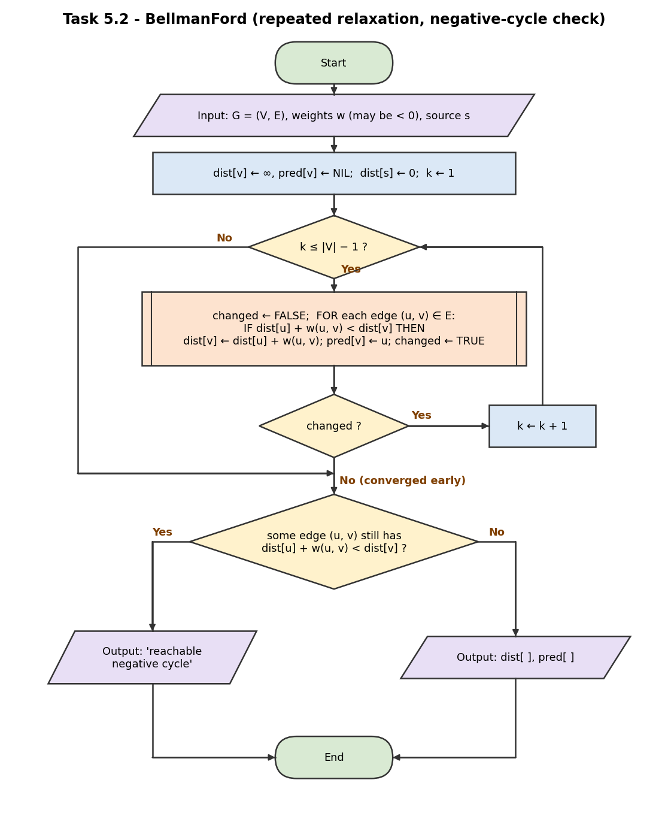

**Why one greedy commitment is not enough.** With negative weights no vertex can be declared final from local information, because a negative edge discovered later may still lower its distance. Bellman-Ford therefore makes **no permanent commitment**: it keeps all distances provisional and relaxes every edge again in each pass. Its invariant is: after pass k, dist[v] ≤ the length of the shortest path from s to v that uses at most k edges. A shortest path without cycles has at most |V| − 1 edges, so after |V| − 1 passes all distances are exact (provided no negative cycle is reachable). The cost is Θ(|V|·|E|) instead of O((|V| + |E|) log |V|).

**Negative-cycle detection.** After the |V| − 1 passes, relax every edge once more: if **any** edge (u, v) with dist[u] ≠ ∞ can still be improved (dist[u] + w(u, v) < dist[v]), a negative cycle is reachable from s (distances could decrease forever); otherwise all distances are final. Only reachable cycles are reported, because the test requires dist[u] ≠ ∞.

**Manual trace on the given graph** (edges relaxed in the listed order A→B, A→C, B→C, B→D, C→D, D→E, C→E): pass 1: B = 4, C = 7, then B→C lowers C to 6, B→D sets D = 10, C→D lowers D to 7, D→E sets E = 10, C→E gives 14 ≥ 10 (no change); pass 2: no edge changes anything → early stop; extra pass: no edge relaxable → no negative cycle. The distances equal those of Task 5.1. If I add the edge C→B with weight −4 (scenario N2), the cycle B→C→B has weight 2 − 4 = −2; the four passes keep lowering B, C, D and E, and in the extra pass B→C can still be relaxed, so the cycle is **detected** (Figure 32).

### Task 5.3 – Change the Requirement [2 Marks]

> The organisation now requires shortest paths between every pair of vertices. Define the meaning of: D(k)[i][j]. Then write the core state transition for Floyd's algorithm in pseudocode. Explain how the state interpretation differs from the single-source shortest-path approaches.

**Definition.** With the vertices numbered v<sub>1</sub> … v<sub>n</sub> (here A, B, C, D, E), **D(k)[i][j] is the length of a shortest path from v<sub>i</sub> to v<sub>j</sub> whose intermediate vertices (all vertices except the two end points) all belong to {v<sub>1</sub>, …, v<sub>k</sub>}**; ∞ if no such path exists. D(0) is the weight matrix (direct edges only, 0 on the diagonal) and D(n) contains the true all-pairs shortest distances.

**Transition.** A shortest i→j path allowed to use v<sub>1</sub>..v<sub>k</sub> either avoids v<sub>k</sub> (length D(k−1)[i][j]) or passes through v<sub>k</sub> once (length D(k−1)[i][k] + D(k−1)[k][j]):

```
ALGORITHM Floyd(W, n)
INPUT:  W[1..n][1..n] – W[i][i] = 0; W[i][j] = weight of edge i→j, ∞ if there is no edge
OUTPUT: D[1..n][1..n] – D[i][j] = shortest distance from i to j;  Next[ ][ ] for route recovery
BEGIN
    FOR i ← 1 TO n DO
        FOR j ← 1 TO n DO
            D[i][j] ← W[i][j]                                     // D(0)
            IF i ≠ j AND W[i][j] ≠ ∞ THEN
                Next[i][j] ← j
            ELSE
                Next[i][j] ← NIL
            END IF
        END FOR
    END FOR
    FOR k ← 1 TO n DO                         // allow v_k as an intermediate: D(k−1) → D(k)
        FOR i ← 1 TO n DO
            FOR j ← 1 TO n DO
                IF D[i][k] + D[k][j] < D[i][j] THEN               // D(k)[i][j] = MIN( D(k−1)[i][j],
                    D[i][j] ← D[i][k] + D[k][j]                   //   D(k−1)[i][k] + D(k−1)[k][j] )
                    Next[i][j] ← Next[i][k]
                END IF
            END FOR
        END FOR
    END FOR
    RETURN D, Next
END
```

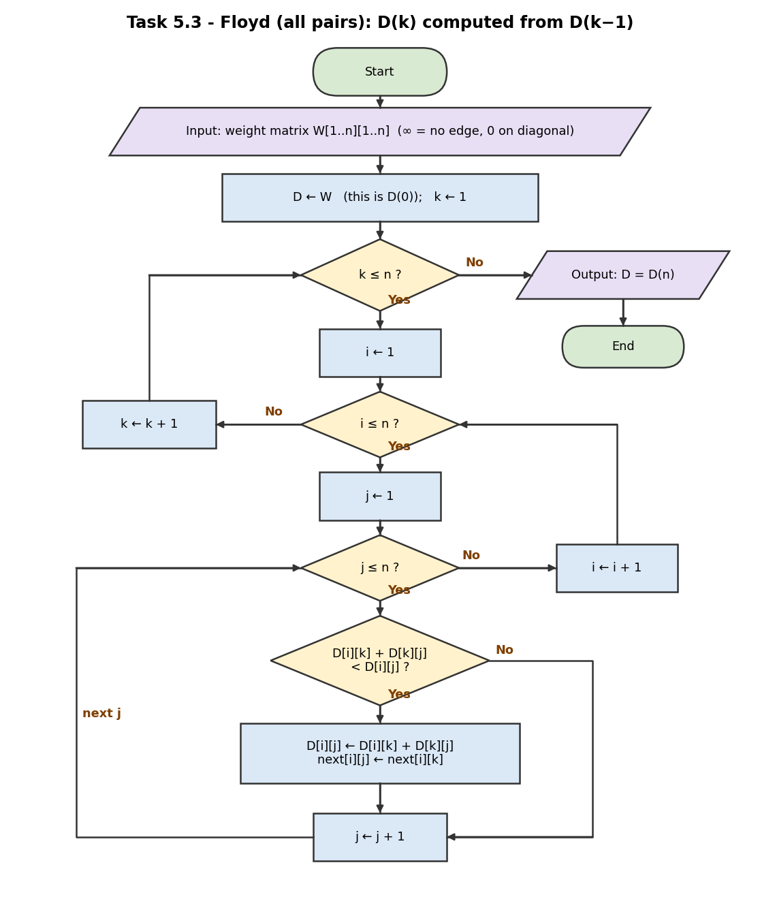

One matrix can be updated in place because row k and column k do not change during phase k (D[k][k] = 0 when there is no negative cycle). **Manual computation on the given graph:** phase k = A changes nothing (no edge enters A); k = B: A→C = min(7, 4 + 2) = 6, A→D = min(∞, 4 + 6) = 10; k = C: A→D = min(10, 6 + 1) = 7, A→E = 6 + 8 = 14, B→D = min(6, 2 + 1) = 3, B→E = 2 + 8 = 10; k = D: A→E = min(14, 7 + 3) = 10, B→E = min(10, 3 + 3) = 6, C→E = min(8, 1 + 3) = 4; k = E changes nothing (E has no outgoing edge).

Table 13: Final matrix D(5) (all-pairs shortest distances)

| from \ to | A | B | C | D | E |
|---|---|---|---|---|---|
| A | 0 | 4 | 6 | 7 | 10 |
| B | ∞ | 0 | 2 | 3 | 6 |
| C | ∞ | ∞ | 0 | 1 | 4 |
| D | ∞ | ∞ | ∞ | 0 | 3 |
| E | ∞ | ∞ | ∞ | ∞ | 0 |

Row A equals the single-source results of Tasks 5.1 and 5.2.

**How the state interpretation differs.** In the single-source methods the state is a one-dimensional array dist[v] for **one fixed source**: in Dijkstra dist[v] is the best distance found so far and becomes final once v is extracted (a greedy commitment); in Bellman-Ford dist[v] after pass k bounds the shortest path **with at most k edges** (progress is measured in number of edges). In Floyd the state is two-dimensional, D[i][j] for **every** source–destination pair, and the stage index k restricts **which vertices may be used as intermediates**, not how many edges are used or which vertex is settled. Floyd is a pure DP over vertices: D(k) is computed entirely from D(k−1), no entry is ever "final" before phase n, it works with negative edges (no negative cycles; D[i][i] < 0 would reveal one) and costs Θ(n³) time and Θ(n²) space – cheaper than running Bellman-Ford from every vertex on dense graphs, and simpler than repeated Dijkstra when negative edges may occur.

**Verification by program (after the manual traces).** `single_source.py` (Figures 29–31) runs Dijkstra and Bellman-Ford with the same trace layout and the two negative-weight scenarios (Figure 32); `floyd_all_pairs.py` (Figures 33–34) prints D(0) … D(5) with the improved entries marked (Figure 35). `test_shortest_paths.py` (Figure 36) cross-checks the three algorithms against brute-force enumeration of all simple paths on 200 random non-negative graphs and 200 random DAGs with negative edges.

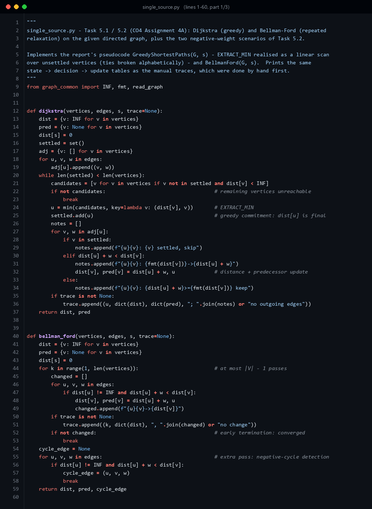

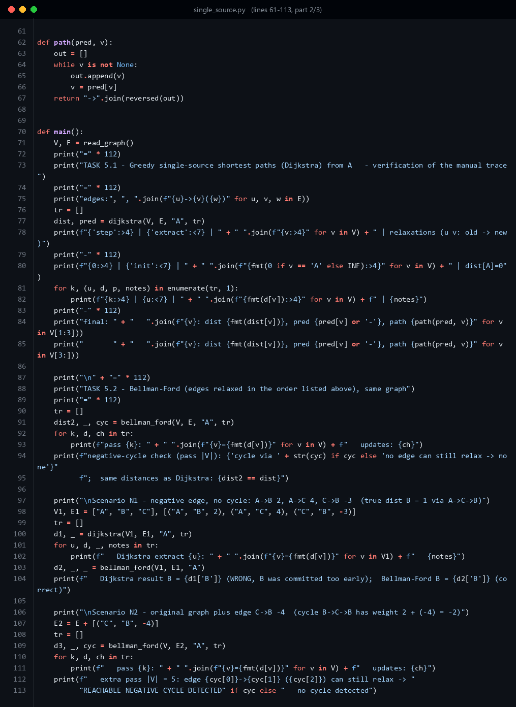


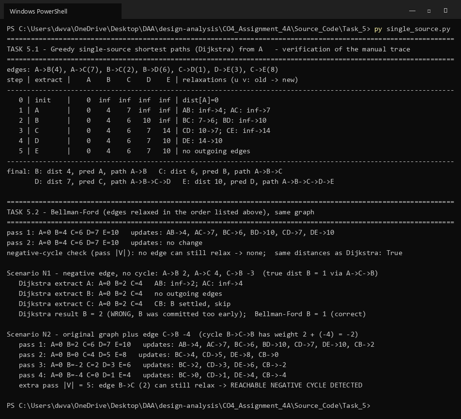

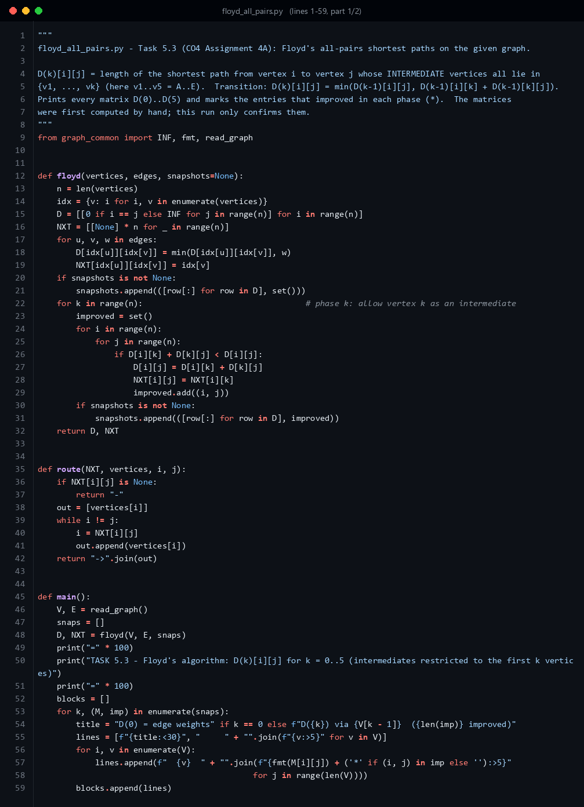

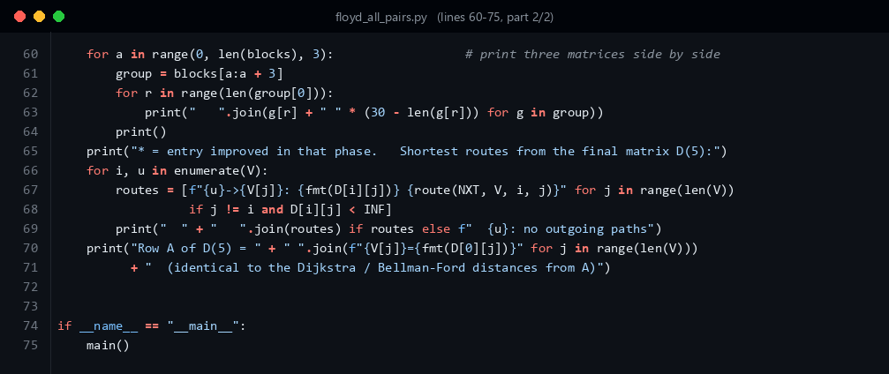

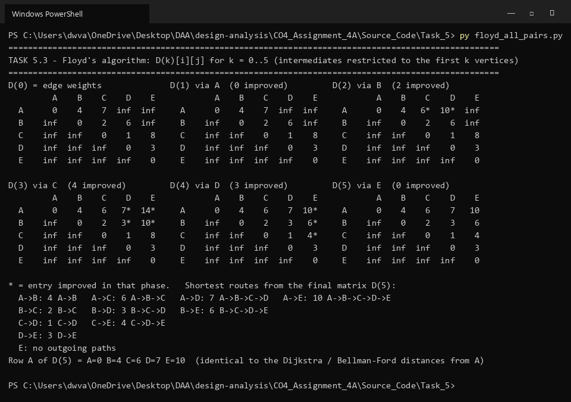

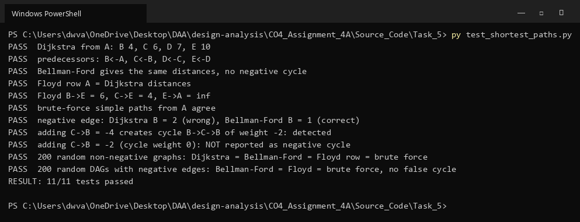

## Task 6 – Design Challenge: Energy-Aware Job Scheduling in a Cloud Data Centre [13 Marks]

> **Problem Context.** A cloud data centre operates a specialised energy-efficient computing server. During a maintenance window, several computational jobs are waiting to be processed. Each job has: a start time; a finish time; an energy-saving value representing the benefit obtained if that job is executed on the energy-efficient server.
> The server can execute only one job at a time. Therefore, jobs whose execution intervals overlap cannot both be selected.
> The objective is to: **Select a set of non-overlapping jobs that maximises the total energy-saving value.**
> You are not told which algorithm or algorithmic strategy to use. You must develop the solution from the problem requirements.
> **Job Data** (Job | Start Time | Finish Time | Energy-Saving Value): J1 1 3 20; J2 2 5 50; J3 4 6 30; J4 6 8 40; J5 5 9 60; J6 8 10 30; J7 9 11 50; J8 11 13 40.
> **Assumption:** If one job finishes at time t and another starts at time t, the two jobs are considered non-overlapping.

**Ans:**

I first formulate the requirement without naming an algorithm (Stage 1), then test the candidate strategies against counter-examples and choose dynamic programming over jobs sorted by finish time (Stage 2), define the state (Stage 3), write the complete pseudocode and flowchart (Stage 4), desk-check it on the eight jobs – **J2, J5, J7, J8 with total value 200** (Stage 5) – and finally attack my own design with an adversarial job set (Stage 6).

### Stage 1 – Interpret the Problem [2 Marks]

> From the requirement, clearly identify: Input; Output; Objective; Constraints; Decisions to be made. Do not identify an algorithm merely from the appearance of the problem. Formulate the computational requirement first.

**Evidence Expected**

> A precise abstraction of the scheduling problem.

Table 14: Abstraction of the energy-aware scheduling problem

| Element | Precise statement |
|---|---|
| Input | n jobs; job i has an identifier, a start time s<sub>i</sub>, a finish time f<sub>i</sub> with s<sub>i</sub> < f<sub>i</sub>, and an energy-saving value v<sub>i</sub> ≥ 0. Job i occupies the half-open interval [s<sub>i</sub>, f<sub>i</sub>) on the server. (Official instance: n = 8, as in the Job Data.) |
| Output | A set S of selected job identifiers (reported in time order) and the total value Σ<sub>i∈S</sub> v<sub>i</sub>. |
| Objective | Maximise Σ<sub>i∈S</sub> v<sub>i</sub>. |
| Constraints | (1) One server, one job at a time: any two selected jobs i ≠ k must be compatible, f<sub>i</sub> ≤ s<sub>k</sub> or f<sub>k</sub> ≤ s<sub>i</sub> (touching end points allowed by the assumption). (2) A job is either run completely in its fixed interval or not at all – it cannot be shifted, shortened or split. (3) Each job is selected at most once. |
| Decisions to be made | One binary decision per job: x<sub>i</sub> = 1 (run job i on the energy-efficient server) or x<sub>i</sub> = 0 (do not), subject to the compatibility constraint. |
| Size of the search space | 2<sup>n</sup> subsets (256 for n = 8), of which only the pairwise-compatible ones are feasible. |

The computational requirement is therefore: *among all pairwise-compatible subsets of n weighted intervals, find one of maximum total weight* – the weighted interval scheduling problem. Two features matter for the strategy: values and lengths are unrelated (a long job may be worth less than the short jobs it blocks), and the conflict structure is defined by time order.

### Stage 2 – Propose the Strategy [2 Marks]

> Consider possible ways of constructing the schedule. You may investigate strategies such as: selecting the job that finishes earliest; selecting the job with the highest energy-saving value; selecting the shortest-duration job; considering combinations of compatible jobs; any other strategy you believe is appropriate. Determine which algorithmic strategy you would use. Justify your choice based on the characteristics of the problem.
> **Important:** A strategy is not justified merely because it produces the correct answer for the given dataset. Explain why its decision-making principle is appropriate for the general problem.

**Evidence Expected**

> Reasoned strategy selection rather than only the name of an algorithm.

I evaluated six candidate strategies. Each greedy rule takes jobs in its own order and keeps a job if it is compatible with every job already kept; for each I built a small counter-example. The results on the official data and on the counter-examples were worked out by hand and confirmed by `compare_strategies.py` (Figure 39).

Table 15: Candidate strategies – principle, result on the official data, counter-example and verdict

| Strategy | Decision principle | Official data (optimum 200) | Counter-example [start, finish) = value | Verdict |
|---|---|---|---|---|
| Earliest finish time | keep the job that frees the server soonest | J1, J3, J4, J6, J8 = 160 | X1 [0,2) = 1, X2 [1,10) = 100: keeps X1 = 1, optimum 100 | ignores values – optimal only when all values are equal |
| Highest value first | keep the most valuable remaining job | J5, J2, J7, J8 = **200** | X1 [0,10) = 50, X2 [0,5) = 30, X3 [5,10) = 30: keeps X1 = 50, optimum 60 | correct on this data **by coincidence**, wrong in general – ignores the time a job blocks |
| Shortest duration first | keep the job that occupies the least time | J1, J3, J4, J6, J8 = 160 | X1 [4,6) = 10, X2 [0,5) = 40, X3 [5,10) = 40: keeps X1 = 10, optimum 80 | a short job can block two long valuable ones |
| Value per unit time (combination of value and duration) | keep the job with the highest v / (f − s) | J7, J4, J8, J2 = 180 | X1 [0,1) = 10, X2 [0,10) = 50: keeps X1 = 10, optimum 50 | density ignores how much total value the remaining time can still earn |
| All combinations of compatible jobs (exhaustive search) | try all 2<sup>n</sup> subsets, keep the best feasible one | 200 | never wrong | correct but Θ(2<sup>n</sup>·n): about 10<sup>30</sup> subsets for n = 100 |
| **Dynamic programming over jobs sorted by finish time (chosen)** | for each job decide include/exclude using the stored optimum of the jobs compatible with it | **200** | never wrong (argument below; 500 random checks) | correct and O(n log n) |

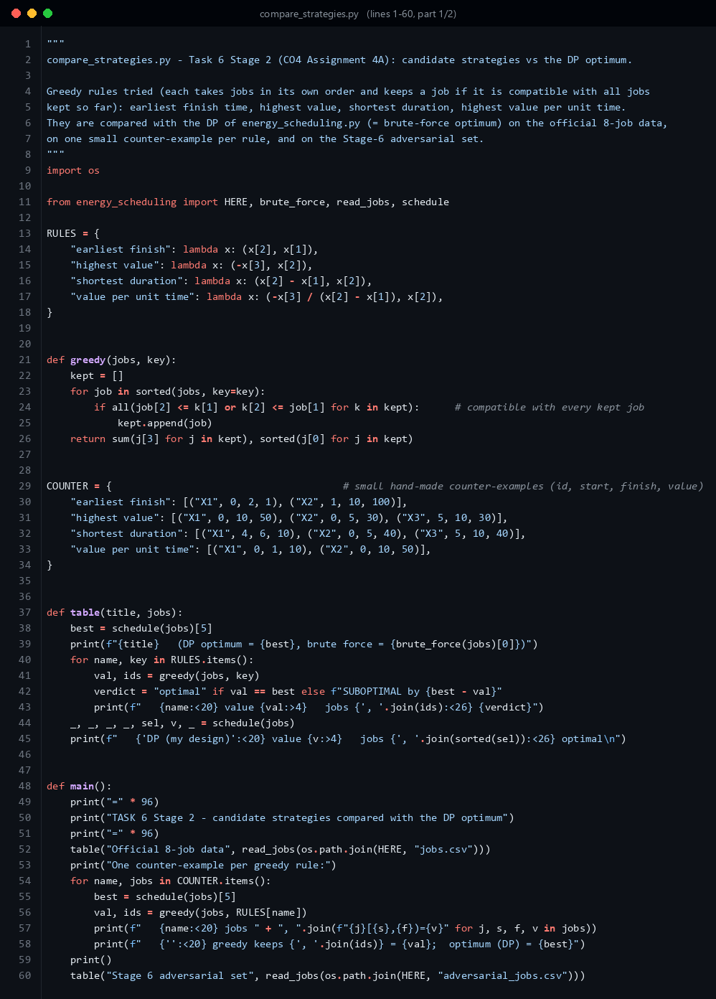

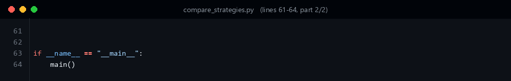

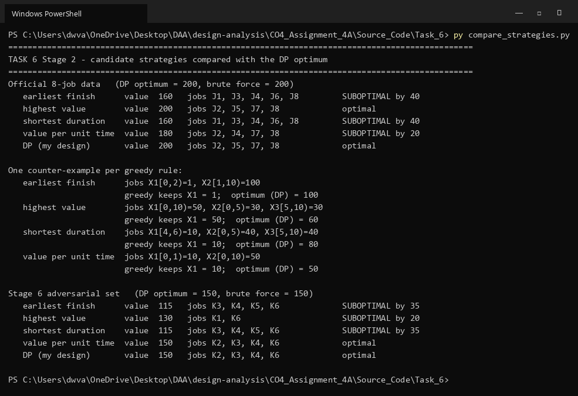

**Why the greedy rules fail in general.** A greedy rule commits to one job forever on the basis of a single local key. Here the true worth of selecting a job is its value **minus the best value that the jobs it overlaps could have earned** – an opportunity cost that depends on the whole remaining schedule, so no single key (finish time, value, duration or density) can measure it. Every rule therefore has an instance on which its irrevocable choice is wrong (Table 15); the fact that "highest value first" happens to give 200 on the official data does not justify it.

**Why dynamic programming is appropriate for the general problem.**

1. **Optimal substructure after sorting by finish time.** Number the jobs so that f<sub>1</sub> ≤ f<sub>2</sub> ≤ … ≤ f<sub>n</sub>, and let p(j) be the largest index i < j with f<sub>i</sub> ≤ s<sub>j</sub>. For the last job j there are only two possibilities: either j is in an optimal schedule – then the other selected jobs are all compatible with j and finish by s<sub>j</sub>, so they lie among jobs 1..p(j) and must form an optimal schedule of those jobs – or j is not in it, and the schedule is an optimal schedule of jobs 1..j − 1. The earlier jobs compatible with j always form a **prefix** 1..p(j) of the sorted order, so every sub-problem is "the best schedule of the first k jobs".
2. **Overlapping sub-problems.** The same prefixes are needed again and again (OPT(p(j)) and OPT(j − 1) for many j); plain recursion would recompute them exponentially often, while a table computes each of the n + 1 values once.
3. **No premature commitment.** For every job the DP compares *both* alternatives using exact optimal values of the remaining sub-problems, so it accounts for the opportunity cost that defeats the greedy rules – a tentative preference (e.g. for a long valuable job) is overturned automatically if a later state shows a better combination.
4. **Efficiency.** Sorting and computing p(j) by binary search take O(n log n); the table takes Θ(n). This is the decision principle I adopt.

### Stage 3 – Identify the Critical Information [2 Marks]

> Identify what information your algorithm must retain or use when making each decision. If your design retains information from earlier subproblems, clearly define: what a state represents; what decisions lead from one state to another; what smaller results are required to construct a larger result; base condition. (If your design makes an immediate selection, define the selection criterion, why the decision can be made at that stage, what information is required to determine feasibility and why the decision should not need to be reconsidered later.)

**Evidence Expected**

> A precise state formulation or decision rule consistent with your selected strategy.

My design retains information from earlier sub-problems, so I define the state formulation.

- **Ordering (precondition of the state).** Jobs are sorted by finish time (ties by start time); job j means the j-th job in this order.
- **What a state represents.** **OPT[j] = the maximum total energy-saving value obtainable from a set of mutually compatible jobs chosen only among jobs 1..j** (0 ≤ j ≤ n). The answer is OPT[n].
- **Compatibility information.** **p(j) = the largest index i < j with f<sub>i</sub> ≤ s<sub>j</sub>** (0 if none). Because the list is sorted by finish time, jobs 1..p(j) are exactly the earlier jobs compatible with j, and jobs p(j) + 1 .. j − 1 all overlap job j. Feasibility of selecting j together with an earlier schedule is thus decided by p(j) alone – no pairwise overlap test is needed during the DP.
- **Decisions leading from one state to another.** At state j there are two decisions: **include job j** → value v<sub>j</sub> + OPT[p(j)] (move to state p(j), skipping all overlapping jobs), or **exclude job j** → value OPT[j − 1] (move to state j − 1).
- **Smaller results required.** OPT[j] needs exactly two smaller results, **OPT[j − 1] and OPT[p(j)]**, both with smaller indices – so computing OPT in increasing j is a valid order: **OPT[j] = max(OPT[j − 1], v<sub>j</sub> + OPT[p(j)])**.
- **Base condition.** **OPT[0] = 0** (no job available, nothing earned).
- **Information retained for reporting.** Take[j] = TRUE if the include branch was strictly better; the reconstruction follows Take[ ] and p( ) backwards from j = n. (On a tie I exclude, which keeps the schedule with fewer jobs; both choices have the same value.)

For the official data the given order is already sorted by finish time – J1 (f 3), J2 (5), J3 (6), J4 (8), J5 (9), J6 (10), J7 (11), J8 (13) – and p = (0, 0, 1, 3, 2, 4, 5, 7), as derived in Stage 5.

### Stage 4 – Design Complete Pseudocode [4 Marks]

> Write complete, language-independent pseudocode conforming to the SIMATS Engineering Standard for Algorithmic Pseudocode. Your pseudocode must clearly show: input; required preprocessing, if any; initialisation; decision logic; state updates; handling of compatible/incompatible jobs; termination; reconstruction/reporting of the selected jobs; maximum total energy-saving value. Another competent programmer should be able to implement your algorithm directly from the pseudocode without clarification.

**Evidence Expected**

> Complete pseudocode representing the student's own algorithmic design.

```
ALGORITHM EnergyAwareSchedule(Job, n)
INPUT:
    Job – array Job[1..n]; Job[j].id, Job[j].start, Job[j].finish (start < finish), Job[j].value (≥ 0)
    n   – number of waiting jobs (n ≥ 0)
    // Job j occupies [start, finish); a job finishing at t and one starting at t do not overlap
OUTPUT:
    Selected – list of the ids of the chosen, mutually non-overlapping jobs, in time order
    BestValue – maximum total energy-saving value (= OPT[n])
BEGIN
    // ---- Preprocessing 1: order the jobs by finish time
    SORT Job in ascending order of finish (ties: ascending order of start)
    // ---- Preprocessing 2: p[j] = latest earlier job compatible with job j (0 if none)
    FOR j ← 1 TO n DO
        p[j] ← 0
        Low ← 1
        High ← j − 1
        WHILE Low ≤ High DO                              // binary search on Job[1..j−1].finish
            Mid ← ⌊(Low + High) / 2⌋
            IF Job[Mid].finish ≤ Job[j].start THEN       // compatible (touching allowed)
                p[j] ← Mid                               // candidate; look for a later one
                Low ← Mid + 1
            ELSE                                         // overlaps job j; look earlier
                High ← Mid − 1
            END IF
        END WHILE
    END FOR
    // ---- Initialisation (base condition)
    OPT[0] ← 0
    // ---- Decision logic and state updates in increasing j
    FOR j ← 1 TO n DO
        Include ← Job[j].value + OPT[p[j]]               // run job j; jobs p[j]+1..j−1 overlap it
        Exclude ← OPT[j − 1]                             // do not run job j
        IF Include > Exclude THEN
            OPT[j] ← Include
            Take[j] ← TRUE
        ELSE                                             // tie → exclude (fewer jobs, same value)
            OPT[j] ← Exclude
            Take[j] ← FALSE
        END IF
    END FOR
    BestValue ← OPT[n]
    // ---- Reconstruction of the selected jobs
    Selected ← empty list
    j ← n
    WHILE j > 0 DO                                       // terminates: j strictly decreases
        IF Take[j] = TRUE THEN
            INSERT Job[j].id at the front of Selected
            j ← p[j]                                     // skip every job incompatible with job j
        ELSE
            j ← j − 1
        END IF
    END WHILE
    RETURN Selected, BestValue
END
```

**How the requirements are met.** *Preprocessing:* sort + p[ ] by binary search (O(n log n)). *Initialisation:* OPT[0] = 0. *Decision logic / state updates:* the Include/Exclude comparison and the OPT[j], Take[j] assignments. *Compatible/incompatible jobs:* the compatible earlier jobs are exactly 1..p[j]; the incompatible ones (p[j] + 1..j − 1) are excluded from the include branch and skipped in the reconstruction by the jump j ← p[j]; the touching case is handled by "≤". *Termination:* all FOR loops are bounded, each binary search halves its range, and the reconstruction index strictly decreases (p[j] < j). *Reporting:* Selected in time order and BestValue. **Complexity:** O(n log n) time, Θ(n) space. Figure 40 shows the flowchart.

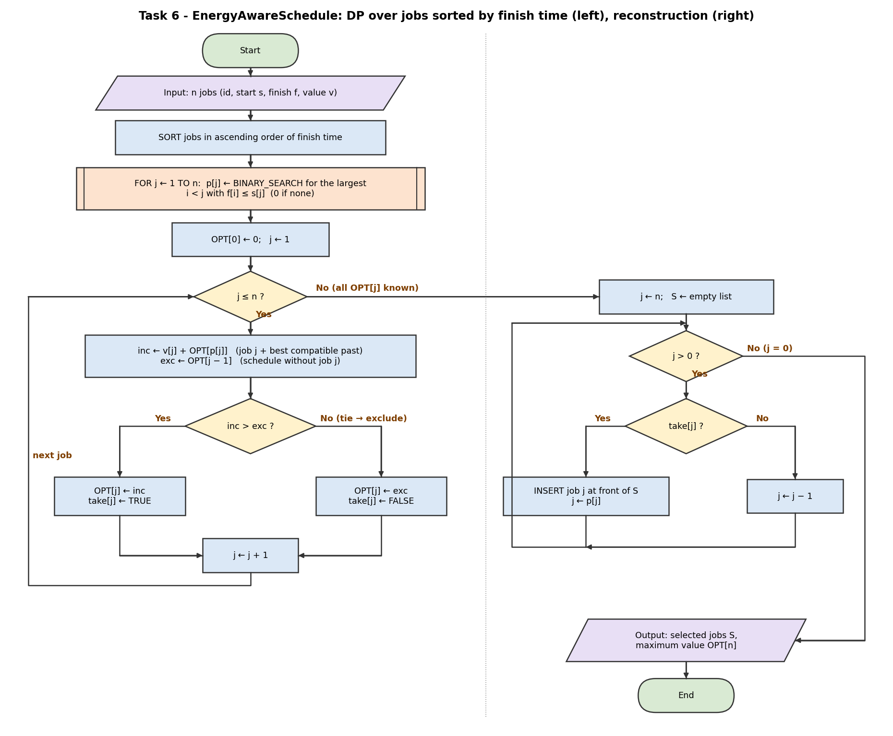

### Stage 5 – Desk-Check [1 Mark]

> Manually execute your algorithm using the eight-job dataset provided in the problem. Show the important: states → decisions → updates → selected jobs → final value. Report: jobs selected; total energy-saving value. Do not provide only the final answer. The decision process must be visible.

**Preprocessing (by hand).** The jobs are already in ascending finish order (3, 5, 6, 8, 9, 10, 11, 13). p(j) = last earlier job whose finish ≤ s<sub>j</sub>:

Table 16: Computation of p(j) for the official data

| j | Job [s, f), value | Earlier finishes compared with s<sub>j</sub> | p(j) |
|---|---|---|---|
| 1 | J1 [1, 3), v = 20 | no earlier job | 0 |
| 2 | J2 [2, 5), v = 50 | f1 = 3 > 2 | 0 |
| 3 | J3 [4, 6), v = 30 | f1 = 3 ≤ 4; f2 = 5 > 4 | 1 |
| 4 | J4 [6, 8), v = 40 | f3 = 6 ≤ 6 (touching) | 3 |
| 5 | J5 [5, 9), v = 60 | f2 = 5 ≤ 5 (touching); f3 = 6 > 5, f4 = 8 > 5 | 2 |
| 6 | J6 [8, 10), v = 30 | f4 = 8 ≤ 8 (touching); f5 = 9 > 8 | 4 |
| 7 | J7 [9, 11), v = 50 | f5 = 9 ≤ 9 (touching); f6 = 10 > 9 | 5 |
| 8 | J8 [11, 13), v = 40 | f7 = 11 ≤ 11 (touching) | 7 |

Table 17: DP desk-check – state → decision → update

| j (job) | Include = v<sub>j</sub> + OPT[p(j)] | Exclude = OPT[j − 1] | Decision | OPT[j] |
|---|---|---|---|---|
| 0 | – | – | base condition | 0 |
| 1 (J1) | 20 + OPT[0] = 20 | 0 | include | 20 |
| 2 (J2) | 50 + OPT[0] = 50 | 20 | include (J2 alone beats J1) | 50 |
| 3 (J3) | 30 + OPT[1] = 50 | 50 | tie → exclude | 50 |
| 4 (J4) | 40 + OPT[3] = 90 | 50 | include | 90 |
| 5 (J5) | 60 + OPT[2] = 110 | 90 | include | 110 |
| 6 (J6) | 30 + OPT[4] = 120 | 110 | include | 120 |
| 7 (J7) | 50 + OPT[5] = 160 | 120 | include | 160 |
| 8 (J8) | 40 + OPT[7] = 200 | 160 | include | **200** |

Note that Take[6] = TRUE (state 6 prefers J6 + the best of jobs 1..4), but state 7 builds on OPT[5], not OPT[6], so J6 will not appear in the final schedule – the DP keeps several partial schedules alive and the reconstruction picks the right one.

Table 18: Reconstruction from j = 8

| j | Take[j] | Action | Selected so far |
|---|---|---|---|
| 8 | TRUE (200 > 160) | select J8, jump to p(8) = 7 | J8 |
| 7 | TRUE (160 > 120) | select J7, jump to p(7) = 5 | J7, J8 |
| 5 | TRUE (110 > 90) | select J5, jump to p(5) = 2 | J5, J7, J8 |
| 2 | TRUE (50 > 20) | select J2, jump to p(2) = 0 | J2, J5, J7, J8 |
| 0 | – | stop | – |

**Result: jobs selected J2 [2, 5), J5 [5, 9), J7 [9, 11), J8 [11, 13); total energy-saving value = 50 + 60 + 50 + 40 = 200.** Consecutive selected jobs only touch at times 5, 9 and 11, which the assumption allows (Figure 41). Figure 42 shows the OPT values and the p(j) links followed by the reconstruction.

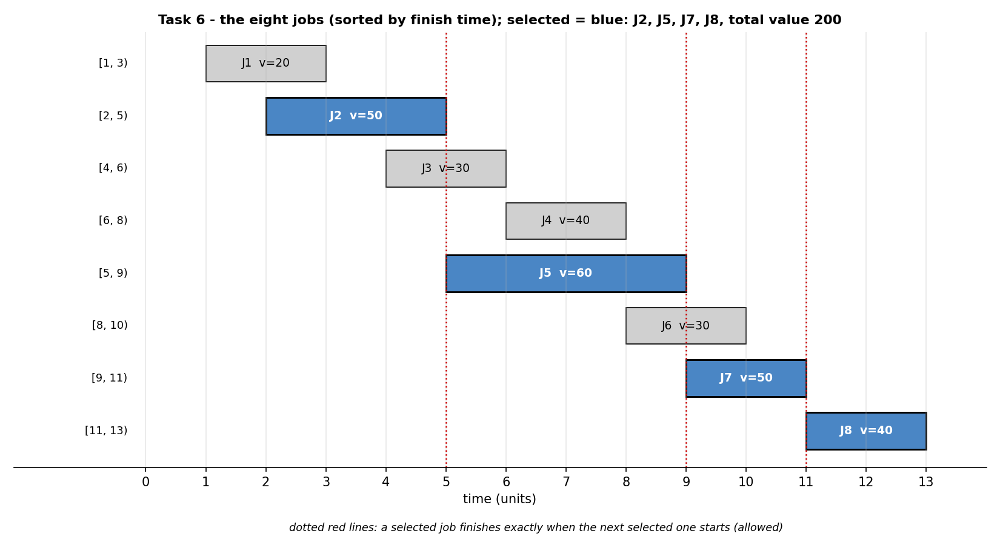

![Figure 42: OPT[j] table with the include links OPT[j] → OPT[p(j)]; red links and yellow states form the reconstruction path 8 → 7 → 5 → 2 → 0](Diagrams/dg_task6_opt_strip.png)

**Verification by program (after the manual trace).** `energy_scheduling.py` (Figures 43–44) prints the same p(j), include/exclude and reconstruction tables (Figure 45) and enumerates all 2⁸ = 256 subsets: the best feasible subset is J2, J5, J7, J8 with 200 – my desk-check is confirmed. `test_energy_scheduling.py` (Figure 46) checks p(j) and OPT for the official data, touching and overlapping boundary cases, equal finish times, the empty input and 500 random instances against brute force.

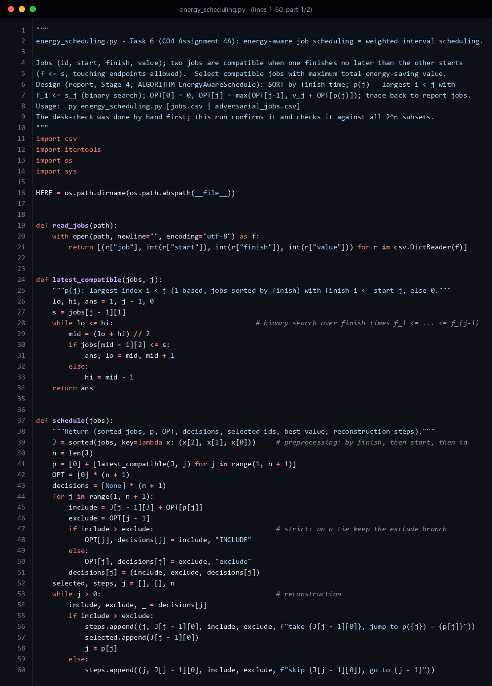

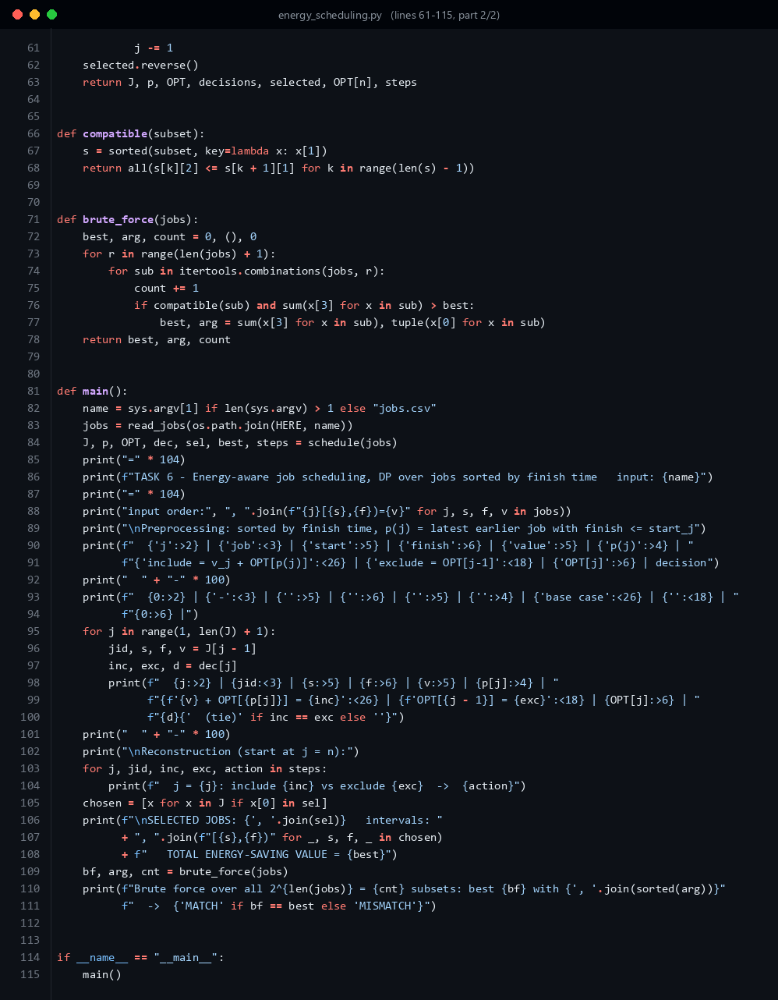

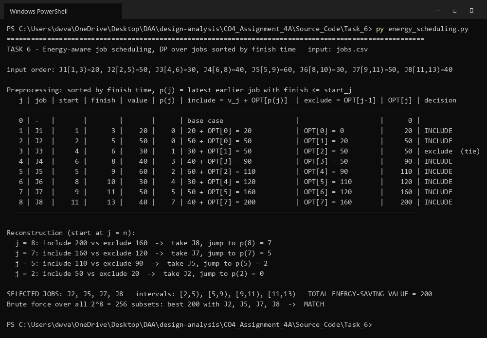

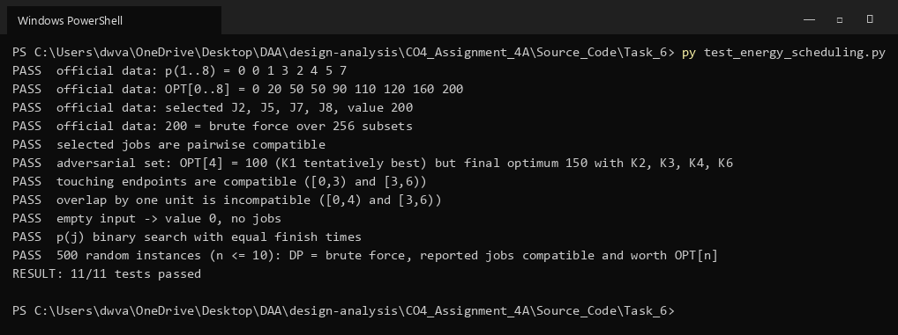

### Stage 6 – Attack Your Own Design [2 Marks]

> Construct a new set of at least five jobs specifically intended to challenge your algorithm. Your test should investigate whether a locally attractive decision can lead to a poor overall result. Before applying your algorithm: explain why you believe the constructed input is challenging; predict how your algorithm will behave. Then apply your algorithm and determine: whether it still produces the optimal result; which decision is critical; whether any assumption or decision rule in your design fails. If your algorithm continues to work correctly, explain why the adversarial input does not defeat it.

**Evidence Expected**

> A student-designed adversarial dataset, prediction, trace and conclusion.

**Adversarial dataset (6 jobs, given deliberately out of order):**

Table 19: Student-designed adversarial job set

| Job | Start | Finish | Value | Trap it sets |
|---|---|---|---|---|
| K1 | 0 | 10 | 100 | the single most valuable job, but it blocks the whole window [0, 10) |
| K2 | 0 | 3 | 40 | first link of a chain K2 → K3 → K4 worth 120 > 100 |
| K3 | 3 | 6 | 40 | touches K2 and K4 exactly (tests the "≤" compatibility rule) |
| K4 | 6 | 10 | 40 | same finish time as K1 (tests the sort tie and the p(j) search) |
| K5 | 1 | 2 | 5 | earliest-finishing and shortest job – locally attractive, nearly worthless, overlaps K2 |
| K6 | 10 | 12 | 30 | compatible with both K1 and K4 (its p(j) must point to the right one) |

**Why it is challenging.** It contains two locally attractive decisions that are globally poor: taking K1 (highest value) loses the 120 of K2 + K3 + K4, and taking K5 (earliest finish, shortest duration) kills K2. In addition, K1 and K4 tie on finish time, three pairs touch exactly, and the input is unsorted, so the sort, the tie handling and the binary search for p(j) are all exercised. When the DP processes K1 it will see that K1 alone (100) beats everything found so far (80) – exactly the moment at which a committing algorithm would lock in the wrong job.

**Prediction (before applying the algorithm).** Sorted order: K5 (f 2), K2 (3), K3 (6), K1 (10, start 0), K4 (10, start 6), K6 (12). I predicted p = (0, 0, 2, 0, 3, 5); OPT will rise to 80 after K3, **temporarily prefer K1 (OPT[4] = 100)**, but at K4 the include branch 40 + OPT[3] = 120 will overturn that preference, and K6 will add 30, giving **150 = K2 + K3 + K4 + K6**, which is optimal (K1 + K6 = 130, K5 + K3 + K4 + K6 = 115). The greedy rules should fail: earliest finish 115, highest value 130, shortest duration 115.

Table 20: Trace of EnergyAwareSchedule on the adversarial set

| j (job [s, f), v) | p(j) | Include | Exclude | Decision | OPT[j] |
|---|---|---|---|---|---|
| 1 (K5 [1, 2), 5) | 0 | 5 + 0 = 5 | 0 | include | 5 |
| 2 (K2 [0, 3), 40) | 0 | 40 + 0 = 40 | 5 | include (K2 beats K5) | 40 |
| 3 (K3 [3, 6), 40) | 2 | 40 + OPT[2] = 80 | 40 | include | 80 |
| 4 (K1 [0, 10), 100) | 0 | 100 + 0 = 100 | 80 | include – *tentative preference for K1* | 100 |
| 5 (K4 [6, 10), 40) | 3 | 40 + OPT[3] = 120 | 100 | **include – K1's preference overturned** | 120 |
| 6 (K6 [10, 12), 30) | 5 | 30 + OPT[5] = 150 | 120 | include | 150 |

Reconstruction: j = 6 take K6 → p = 5: take K4 → p = 3: take K3 → p = 2: take K2 → p = 0 stop. **Selected K2, K3, K4, K6, total value 150.** Figure 47 shows the schedule and Figure 48 the program confirmation (brute force over 2⁶ = 64 subsets: 150).

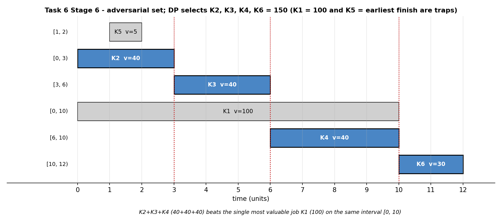

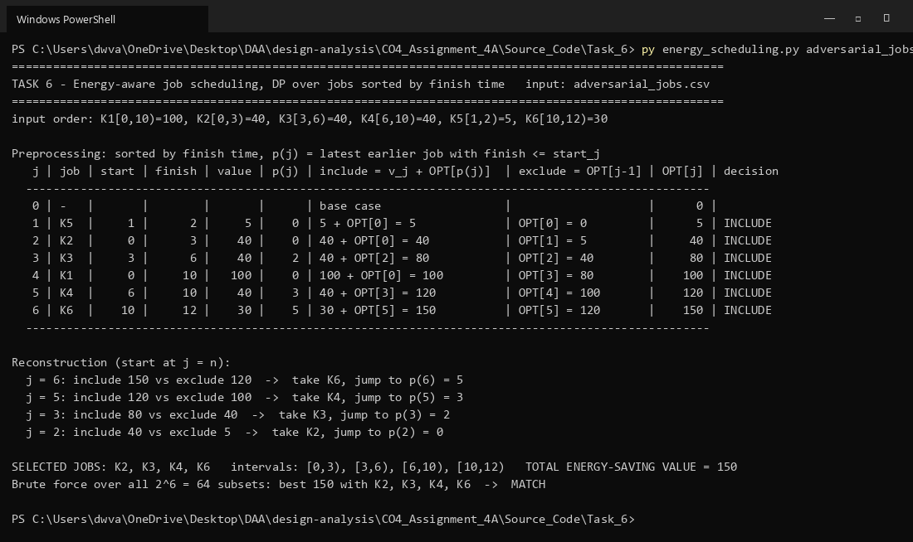

**Conclusion.**

- **Still optimal?** Yes – 150, equal to the brute-force optimum; my prediction was correct in every state. The greedy alternatives obtained 115 (earliest finish), 130 (highest value) and 115 (shortest duration) on the same input (Figure 39, last block); only value-density happens to succeed here, which again shows that success on one instance justifies nothing.
- **Critical decision.** State j = 5 (K4): Include = 40 + OPT[3] = 120 versus Exclude = OPT[4] = 100. Here the algorithm decides between "K1 alone" and "the chain K2 + K3 + K4". It is critical because OPT[4] = 100 had just favoured K1; a greedy design would have committed to K1 at that point and could never recover.
- **Does any assumption or rule fail?** No. The prefix property of p(j) survives the finish-time tie: a later job k > j always has f<sub>k</sub> ≥ f<sub>j</sub> > s<sub>j</sub>, so it can never be compatible with j from the left, and the binary search correctly returns p(K6) = 5 (K4, the last job with f ≤ 10). The touching pairs (K2–K3 at 3, K3–K4 at 6, K4–K6 at 10) are accepted by the "≤" test as the assumption requires; the unsorted input is handled by the preprocessing sort.
- **Why the adversarial input does not defeat it.** The locally attractive choices only influence *tentative* values. The DP never commits until the reconstruction; for every job it compares the exact optimal value of the best compatible prefix (OPT[p(j)]) with the exact optimum without the job (OPT[j − 1]). By induction on j, OPT[j] is optimal for jobs 1..j, so every trap is evaluated against all its alternatives – the opportunity cost that misleads greedy rules is built into the recurrence. The only way to "defeat" the design would be to violate its stated input contract (e.g. jobs with s ≥ f, or jobs that may be shifted in time), which would be a different problem.

### Summary of Findings

Table 21: Summary of the answers and their verification

| Task | Design produced | Manual result | Verified by |
|---|---|---|---|
| 1 | 8 deficiencies; repaired LoadVehicle (sort by value/weight, feasibility test, fractional last package, capacity + index termination) | own instance C = 50: P1, P2, 2/3 of P3 → 240 | `load_vehicle.py`; 300 random instances vs exhaustive n! orders (9/9 tests) |
| 2 | Model; rule "max profit first, latest free slot ≤ deadline"; JobSequencing | C, A, D → **180**; B = 90 displaces C → 210 (prediction correct) | `job_sequencing.py`; exhaustive 2ⁿ subsets on 400 instances (9/9) |
| 3 | DP[i][w] state, recurrence, Knapsack01 with reconstruction, dependency order | DP[4][7] = **45** with **Q, R** | `knapsack_dp.py`; brute force (16 subsets; 400 instances) (8/8) |
| 4 | Defect = missing `DP[j] = TRUE` in the inner IF; minimal one-line repair | "catsdog": first wrong state DP[7]; "catdog" regression TRUE | `word_break.py`; 2000 random texts vs recursive reference (10/10) |
| 5 | Dijkstra (greedy commitment), Bellman-Ford (V − 1 passes + detection pass), Floyd D(k) | from A: B 4, C 6, D 7, E 10; full D(5) | `single_source.py`, `floyd_all_pairs.py`; 400 random graphs vs simple-path brute force (11/11) |
| 6 | Weighted interval scheduling DP: sort by finish, p(j) by binary search, OPT[j] = max(OPT[j−1], v<sub>j</sub> + OPT[p(j)]), reconstruction | **J2, J5, J7, J8 = 200**; adversarial K-set → 150 (greedy rules 115–130) | `energy_scheduling.py`, `compare_strategies.py`; 256-subset brute force, 500 random instances (11/11) |

The main lesson of the assignment is the difference between a **greedy commitment** and a **stored decision**: the greedy designs of Tasks 1, 2 and 5.1 are correct only because an exchange argument guarantees that the local choice never has to be revised (divisible packages, unit jobs with deadlines, non-negative edges), whereas Tasks 3, 5.2/5.3 and 6 – indivisible items, negative edges, weighted intervals – need algorithms that keep every alternative open (DP tables, repeated relaxation) until the optimum is known. In every task the manual desk-check came first and the verification programs reproduced it exactly; all 58 automated tests pass.

<!-- pagebreak -->

### Appendix A – Complete Source Code (verification programs)

The programs below implement the pseudocode of the report one-to-one and were used only to verify the manual desk-checks.

#### Source_Code/Task_1/load_vehicle.py

```
"""
load_vehicle.py - Task 1 (CO4 Assignment 4A): repaired LoadVehicle pseudocode (fractional knapsack).

Problem: packages have a weight and a value and may be divided; load the vehicle so that the total value
is maximised without exceeding the capacity.  This program implements, line by line, the repaired
pseudocode ALGORITHM LoadVehicle(P, n, C) of the report (greedy choice: highest value-per-kg first).
It is used ONLY to verify the manual desk-check that was done by hand first: it prints the same
state -> decision -> update table.
"""
import csv
import os

HERE = os.path.dirname(os.path.abspath(__file__))


def read_packages(path):
    """Read (id, weight, value) rows from a CSV file and the capacity from its 'CAPACITY' row."""
    packages, capacity = [], None
    with open(path, newline="", encoding="utf-8") as f:
        for row in csv.DictReader(f):
            if row["id"] == "CAPACITY":
                capacity = float(row["weight"])
            else:
                packages.append((row["id"], float(row["weight"]), float(row["value"])))
    return packages, capacity


def load_vehicle(packages, capacity, trace=None):
    """Repaired LoadVehicle: returns (total_value, load list of (id, fraction, weight_taken, value_taken)).

    If `trace` is a list, one tuple per loop iteration is appended to it (for printing the desk-check).
    """
    # SORT P in descending order of value/weight (ties: smaller weight first, then id)
    order = sorted(packages, key=lambda p: (-(p[2] / p[1]), p[1], p[0]))
    remaining, total, load = capacity, 0.0, []
    i = 0
    while remaining > 0 and i < len(order):          # termination: vehicle full OR no package left
        pid, w, v = order[i]
        before = remaining
        if w <= remaining:                            # feasibility: the whole package fits
            fraction = 1.0
            decision = "whole package fits -> take all"
        else:                                         # package does not completely fit -> divide it
            fraction = remaining / w
            decision = f"only {remaining:g} of {w:g} kg fits -> take fraction {fraction:.4f}"
        load.append((pid, fraction, fraction * w, fraction * v))
        remaining -= fraction * w                     # update remaining capacity
        total += fraction * v                         # update total value
        if trace is not None:
            trace.append((i + 1, pid, w, v, v / w, before, decision, remaining, total))
        i += 1
    return total, load


def main():
    packages, capacity = read_packages(os.path.join(HERE, "packages.csv"))
    print("=" * 110)
    print("TASK 1 - Repaired LoadVehicle (fractional loading, greedy by value/weight)  - verification run")
    print("=" * 110)
    print(f"Capacity C = {capacity:g} kg      packages (id, weight kg, value):",
          ", ".join(f"{p}({w:g},{v:g})" for p, w, v in packages))
    print("\nStep 1 - SORT packages in descending order of value/weight:")
    for p, w, v in sorted(packages, key=lambda p: (-(p[2] / p[1]), p[1], p[0])):
        print(f"   {p:<3} weight {w:>5g}   value {v:>6g}   ratio {v / w:>6.2f}")
    trace = []
    total, load = load_vehicle(packages, capacity, trace)
    print("\nStep 2 - greedy loop (state -> decision -> update):")
    print(f"{'it':>2} | {'pkg':<3} | {'w':>4} | {'v':>5} | {'v/w':>5} | {'rem before':>10} | "
          f"{'decision':<46} | {'rem after':>9} | {'total':>7}")
    print("-" * 110)
    for it, p, w, v, r, before, dec, after, tot in trace:
        print(f"{it:>2} | {p:<3} | {w:>4g} | {v:>5g} | {r:>5.2f} | {before:>10g} | {dec:<46} | "
              f"{after:>9g} | {tot:>7.2f}")
    print("-" * 110)
    print("Loop ends because remaining capacity = 0." if trace and trace[-1][7] <= 0
          else "Loop ends because no package is left.")
    print("\nResult - load list (package, fraction, kg loaded, value):")
    for pid, fr, wt, val in load:
        print(f"   {pid:<3} fraction {fr:.4f}   {wt:>6.2f} kg   value {val:>7.2f}")
    print(f"TOTAL VALUE = {total:.2f}   (loaded {sum(x[2] for x in load):g} of {capacity:g} kg)")


if __name__ == "__main__":
    main()
```

#### Source_Code/Task_1/test_load_vehicle.py

```
"""
test_load_vehicle.py - checks the repaired LoadVehicle (Task 1) against an independent reference.

Reference: an optimal fractional loading always fills packages in SOME order, taking each whole until the
last one is cut.  Trying every order (n! permutations, n <= 6) and keeping the best value is therefore an
exhaustive optimum that does not use the value/weight rule.  Prints PASS/FAIL lines and a RESULT line.
"""
import itertools
import random

from load_vehicle import load_vehicle


def fill_in_order(order, capacity):
    """Value obtained by loading packages in the given order, cutting the last one."""
    remaining, total = capacity, 0.0
    for _, w, v in order:
        if remaining <= 0:
            break
        take = min(w, remaining)
        total += v * take / w
        remaining -= take
    return total


def brute_force(packages, capacity):
    return max((fill_in_order(p, capacity) for p in itertools.permutations(packages)), default=0.0)


def main():
    random.seed(42)
    passed = total = 0

    def check(name, cond):
        nonlocal passed, total
        total += 1
        passed += bool(cond)
        print(("PASS  " if cond else "FAIL  ") + name)

    given = [("P1", 10, 60), ("P2", 20, 100), ("P3", 30, 120), ("P4", 15, 45)]
    value, load = load_vehicle(given, 50)
    check("desk-check instance: total value = 240", abs(value - 240) < 1e-9)
    check("desk-check instance: P1, P2 whole, P3 fraction 2/3, P4 not loaded",
          [(p, round(f, 4)) for p, f, _, _ in load] == [("P1", 1.0), ("P2", 1.0), ("P3", 0.6667)])
    check("capacity never exceeded", sum(x[2] for x in load) <= 50 + 1e-9)
    check("capacity 0 -> nothing loaded, value 0", load_vehicle(given, 0) == (0.0, []))
    check("no packages -> value 0 (loop terminates)", load_vehicle([], 50) == (0.0, []))
    check("everything fits -> all whole, value = sum of values",
          abs(load_vehicle(given, 1000)[0] - 325) < 1e-9 and all(f == 1.0 for _, f, _, _ in
                                                                  load_vehicle(given, 1000)[1]))
    check("single package heavier than C -> one fraction C/w",
          abs(load_vehicle([("X", 80, 400)], 20)[0] - 100) < 1e-9)
    check("greedy-by-value would be worse here (value order gives 220 < 240)",
          fill_in_order(sorted(given, key=lambda p: -p[2]), 50) < value)
    bad = 0
    for _ in range(300):
        n = random.randint(1, 6)
        pk = [(f"X{i}", random.randint(1, 30), random.randint(1, 100)) for i in range(n)]
        cap = random.randint(0, 80)
        if abs(load_vehicle(pk, cap)[0] - brute_force(pk, cap)) > 1e-6:
            bad += 1
    check("300 random instances (n <= 6): greedy value = exhaustive optimum over all n! orders", bad == 0)
    print(f"RESULT: {passed}/{total} tests passed")


if __name__ == "__main__":
    main()
```

#### Source_Code/Task_2/job_sequencing.py

```
"""
job_sequencing.py - Task 2 (CO4 Assignment 4A): greedy Job Sequencing with Deadlines.

Problem: unit-time jobs (id, deadline, profit); a job earns its profit only if it is processed in a slot
t <= deadline; one job per slot.  Maximise total profit.  This program implements the report's pseudocode
ALGORITHM JobSequencing(J, n): SORT by profit (descending), then place each job in the LATEST free slot
on or before its deadline, else reject it.  It reproduces the manual desk-check (Task 2.4) and the
modified-instance check (Task 2.5); the traces were first done by hand, this run only confirms them.
"""
import csv
import os

HERE = os.path.dirname(os.path.abspath(__file__))


def read_jobs(path):
    with open(path, newline="", encoding="utf-8") as f:
        return [(r["job"], int(r["deadline"]), int(r["profit"])) for r in csv.DictReader(f)]


def job_sequencing(jobs, trace=None):
    """Return (slot list, total profit, rejected ids).  slot[t] = job id in slot t (1-based), None if free."""
    order = sorted(jobs, key=lambda j: (-j[2], j[1], j[0]))     # profit desc; ties: earlier deadline, id
    max_d = max((d for _, d, _ in jobs), default=0)
    n = len(jobs)
    m = min(max_d, n)                                          # never need more than n slots
    slot = [None] * (m + 1)                                    # slot[0] unused
    total, rejected = 0, []
    for job_id, d, p in order:
        t = min(d, m)
        checked = []
        while t >= 1 and slot[t] is not None:                  # feasibility: search latest free slot <= d
            checked.append(f"{t}:busy")
            t -= 1
        if t >= 1:
            slot[t] = job_id                                   # placement
            total += p                                         # profit update
            checked.append(f"{t}:free")
            decision = f"ACCEPT -> slot {t}"
        else:
            rejected.append(job_id)
            decision = "REJECT (no free slot <= d)"
        if trace is not None:
            trace.append((job_id, d, p, " ".join(checked) or "-", decision,
                          "[" + " ".join(s or "-" for s in slot[1:]) + "]", total))
    return slot, total, rejected


def print_run(title, jobs):
    print(title)
    print("  jobs:", ", ".join(f"{j}(d={d},p={p})" for j, d, p in jobs))
    print("  sorted by profit desc:", " > ".join(f"{j}{p}" for j, _, p in
                                                 sorted(jobs, key=lambda j: (-j[2], j[1], j[0]))))
    trace = []
    slot, total, rejected = job_sequencing(jobs, trace)
    print(f"  {'job':<3} | {'d':>1} | {'p':>3} | {'slots examined':<22} | {'decision':<27} | "
          f"{'slots [1..m]':<12} | {'total':>5}")
    print("  " + "-" * 92)
    for row in trace:
        print("  {:<3} | {:>1} | {:>3} | {:<22} | {:<27} | {:<12} | {:>5}".format(*row))
    print("  " + "-" * 92)
    schedule = [f"t{t}={slot[t]}" for t in range(1, len(slot)) if slot[t]]
    print(f"  final schedule: {', '.join(schedule)}   rejected: {', '.join(rejected) or '-'}"
          f"   TOTAL PROFIT = {total}\n")
    return slot, total


def main():
    jobs = read_jobs(os.path.join(HERE, "jobs.csv"))
    print("=" * 96)
    print("TASK 2 - Job Sequencing with Deadlines (greedy: max profit first, latest free slot)  - verification")
    print("=" * 96)
    print_run("Task 2.4 - desk-check instance", jobs)
    modified = [(j, d, 90 if j == "B" else p) for j, d, p in jobs]
    print_run("Task 2.5 - modified instance: profit of B changed 35 -> 90", modified)


if __name__ == "__main__":
    main()
```

#### Source_Code/Task_2/test_job_sequencing.py

```
"""
test_job_sequencing.py - checks the greedy JobSequencing (Task 2) against exhaustive search.

Reference: try all 2^n subsets; a subset is feasible iff for every t, at most t of its jobs have
deadline <= t (then sorting it by deadline gives a valid schedule).  Prints PASS/FAIL and RESULT.
"""
import itertools
import random

from job_sequencing import job_sequencing


def feasible(subset):
    ds = sorted(d for _, d, _ in subset)
    return all(ds[k] >= k + 1 for k in range(len(ds)))


def brute_force(jobs):
    best = 0
    for r in range(len(jobs) + 1):
        for sub in itertools.combinations(jobs, r):
            if feasible(sub):
                best = max(best, sum(p for _, _, p in sub))
    return best


def main():
    random.seed(42)
    passed = total = 0

    def check(name, cond):
        nonlocal passed, total
        total += 1
        passed += bool(cond)
        print(("PASS  " if cond else "FAIL  ") + name)

    jobs = [("A", 2, 80), ("B", 1, 35), ("C", 2, 60), ("D", 3, 40), ("E", 1, 25)]
    slot, profit, rej = job_sequencing(jobs)
    check("given instance: schedule t1=C, t2=A, t3=D", slot[1:] == ["C", "A", "D"])
    check("given instance: total profit 180, B and E rejected", profit == 180 and rej == ["B", "E"])
    check("given instance: 180 = exhaustive optimum over 2^5 subsets", brute_force(jobs) == 180)
    mod = [(j, d, 90 if j == "B" else p) for j, d, p in jobs]
    slot2, profit2, rej2 = job_sequencing(mod)
    check("modified (B=90): schedule t1=B, t2=A, t3=D; C displaced",
          slot2[1:] == ["B", "A", "D"] and "C" in rej2)
    check("modified (B=90): profit 210 = exhaustive optimum", profit2 == 210 == brute_force(mod))
    check("no jobs -> empty schedule, profit 0", job_sequencing([])[1] == 0)
    check("all deadlines 1 -> only the most profitable job", job_sequencing(
        [("X", 1, 5), ("Y", 1, 9), ("Z", 1, 7)])[0][1:] == ["Y"])
    check("deadline larger than n is capped (no out-of-range slot)",
          job_sequencing([("X", 100, 5), ("Y", 1, 3)])[1] == 8)
    bad = 0
    for _ in range(400):
        n = random.randint(1, 8)
        js = [(f"J{i}", random.randint(1, 5), random.randint(1, 100)) for i in range(n)]
        s, p, _ = job_sequencing(js)
        placed = [(t, x) for t, x in enumerate(s) if x]
        ok_deadlines = all(t <= dict((j, d) for j, d, _ in js)[x] for t, x in placed)
        if p != brute_force(js) or not ok_deadlines:
            bad += 1
    check("400 random instances (n <= 8): greedy profit = exhaustive optimum, deadlines respected", bad == 0)
    print(f"RESULT: {passed}/{total} tests passed")


if __name__ == "__main__":
    main()
```

#### Source_Code/Task_3/knapsack_dp.py

```
"""
knapsack_dp.py - Task 3 (CO4 Assignment 4A): 0/1 knapsack by bottom-up dynamic programming.

State DP[i][w] = maximum total value obtainable using only the first i items (in the given order) with a
carrying capacity of w kg.  Recurrence: DP[i][w] = DP[i-1][w] if wt[i] > w, else
max(DP[i-1][w], val[i] + DP[i-1][w - wt[i]]);  DP[0][w] = 0, DP[i][0] = 0.
This program implements the report's pseudocode Knapsack01(...) row by row, prints the full table, the
include/exclude decisions of the states on the optimal path, and the reconstruction.  The table was first
filled by hand (Task 3.4); this run only confirms the manual desk-check.
"""
import csv
import itertools
import os

HERE = os.path.dirname(os.path.abspath(__file__))


def read_items(path):
    items, cap = [], None
    with open(path, newline="", encoding="utf-8") as f:
        for r in csv.DictReader(f):
            if r["item"] == "CAPACITY":
                cap = int(r["weight"])
            else:
                items.append((r["item"], int(r["weight"]), int(r["value"])))
    return items, cap


def knapsack(items, W):
    """Return (DP table, optimum value, selected item ids in selection order, reconstruction steps)."""
    n = len(items)
    DP = [[0] * (W + 1) for _ in range(n + 1)]          # row 0 and column 0 are the boundary (all 0)
    for i in range(1, n + 1):                           # rows in increasing i: row i-1 is complete first
        _, wt, val = items[i - 1]
        for w in range(1, W + 1):
            exclude = DP[i - 1][w]
            if wt <= w:                                 # item i can be included
                include = val + DP[i - 1][w - wt]
                DP[i][w] = max(include, exclude)
            else:                                       # item i too heavy for capacity w
                DP[i][w] = exclude
    # reconstruction: walk back from DP[n][W]
    selected, steps, w = [], [], W
    for i in range(n, 0, -1):
        iid, wt, val = items[i - 1]
        if DP[i][w] != DP[i - 1][w]:                    # value changed -> item i was included
            steps.append((i, iid, w, DP[i][w], DP[i - 1][w], "INCLUDE", w - wt))
            selected.append(iid)
            w -= wt
        else:
            steps.append((i, iid, w, DP[i][w], DP[i - 1][w], "exclude", w))
    selected.reverse()
    return DP, DP[n][W], selected, steps


def brute_force(items, W):
    best = (0, ())
    for r in range(len(items) + 1):
        for sub in itertools.combinations(items, r):
            if sum(x[1] for x in sub) <= W:
                best = max(best, (sum(x[2] for x in sub), tuple(x[0] for x in sub)))
    return best


def main():
    items, W = read_items(os.path.join(HERE, "items.csv"))
    DP, best, selected, steps = knapsack(items, W)
    print("=" * 92)
    print("TASK 3 - 0/1 Knapsack, bottom-up DP  (verification of the manual desk-check)")
    print("=" * 92)
    print(f"W = {W}   items:", ", ".join(f"{i}(w={w},v={v})" for i, w, v in items))
    print("\nDP table  DP[i][w]  (rows = first i items, columns = capacity w)")
    print("   i  item(w,v) | " + " ".join(f"w={w:<3}" for w in range(W + 1)))
    print("  " + "-" * 64)
    for i in range(len(items) + 1):
        label = "-" if i == 0 else f"{items[i - 1][0]}({items[i - 1][1]},{items[i - 1][2]})"
        print(f"  {i:>2}  {label:<9} | " + " ".join(f"{DP[i][w]:<5}" for w in range(W + 1)))
    print("\nKey decisions in the last row (i = 4, item S):")
    for w in (5, 7):
        print(f"  DP[4][{w}] = max(exclude DP[3][{w}] = {DP[3][w]}, include 30 + DP[3][{w - 5}] = "
              f"{30 + DP[3][w - 5]}) = {DP[4][w]}")
    print(f"  DP[3][7] = max(exclude DP[2][7] = {DP[2][7]}, include 25 + DP[2][3] = {25 + DP[2][3]})"
          f" = {DP[3][7]}")
    print("\nReconstruction from DP[4][7]:")
    print(f"  {'i':>2} {'item':<4} | {'w':>2} | {'DP[i][w]':>8} | {'DP[i-1][w]':>10} | {'decision':<8} | next w")
    for i, iid, w, a, b, dec, nw in steps:
        print(f"  {i:>2} {iid:<4} | {w:>2} | {a:>8} | {b:>10} | {dec:<8} | {nw}")
    wsum = sum(x[1] for x in items if x[0] in selected)
    print(f"\nOPTIMUM VALUE = {best}   items selected = {', '.join(selected)}   total weight = {wsum} <= {W}")
    bf = brute_force(items, W)
    print(f"Brute force over all 2^{len(items)} = {2 ** len(items)} subsets: best value {bf[0]} "
          f"with {', '.join(bf[1])}  ->  {'MATCH' if bf[0] == best else 'MISMATCH'}")


if __name__ == "__main__":
    main()
```

#### Source_Code/Task_3/test_knapsack_dp.py

```
"""
test_knapsack_dp.py - checks the 0/1 knapsack DP (Task 3) against brute force over all subsets.
Prints PASS/FAIL lines and a RESULT line.
"""
import random

from knapsack_dp import brute_force, knapsack


def main():
    random.seed(42)
    passed = total = 0

    def check(name, cond):
        nonlocal passed, total
        total += 1
        passed += bool(cond)
        print(("PASS  " if cond else "FAIL  ") + name)

    items = [("P", 2, 12), ("Q", 3, 20), ("R", 4, 25), ("S", 5, 30)]
    DP, best, sel, _ = knapsack(items, 7)
    check("given instance: optimum 45", best == 45)
    check("given instance: reconstruction selects Q and R", sel == ["Q", "R"])
    check("given instance: 45 = brute-force optimum over 16 subsets", brute_force(items, 7)[0] == 45)
    check("rows are non-decreasing in w (more capacity never hurts)",
          all(DP[i][w] <= DP[i][w + 1] for i in range(5) for w in range(7)))
    check("capacity 0 -> value 0, nothing selected", knapsack(items, 0)[1:3] == (0, []))
    check("no items -> value 0", knapsack([], 10)[1] == 0)
    check("item heavier than W is never selected", knapsack([("X", 9, 100), ("Y", 1, 1)], 5)[2] == ["Y"])
    bad = 0
    for _ in range(400):
        n = random.randint(1, 9)
        its = [(f"I{i}", random.randint(1, 10), random.randint(1, 60)) for i in range(n)]
        W = random.randint(0, 25)
        _, b, s, _ = knapsack(its, W)
        chosen = [x for x in its if x[0] in s]
        if b != brute_force(its, W)[0] or sum(x[2] for x in chosen) != b or sum(x[1] for x in chosen) > W:
            bad += 1
    check("400 random instances (n <= 9): DP value = brute force, reconstructed set is feasible and "
          "worth exactly DP[n][W]", bad == 0)
    print(f"RESULT: {passed}/{total} tests passed")


if __name__ == "__main__":
    main()
```

#### Source_Code/Task_4/word_break.py

```
"""
word_break.py - Task 4 (CO4 Assignment 4A): pseudocode forensics on WordBreak.

DP[i] should mean "the prefix Text[1..i] (first i characters) can be completely segmented into dictionary
words".  substring(Text, j, i) is the piece made of characters j+1 .. i (Python: text[j:i]).
  * word_break_faulty    - the given pseudocode: sets DP[i] TRUE as soon as ANY dictionary word ends at i.
  * word_break_corrected - the minimal repair: the word must also START at a segmentable prefix (DP[j]).
The program prints both DP arrays for the failing input (Task 4.2) and the regression input (Task 4.4)
and marks the first state where the faulty algorithm deviates.  The traces were done by hand first.
"""
import csv
import os
from functools import lru_cache

HERE = os.path.dirname(os.path.abspath(__file__))


def word_break_faulty(text, dictionary, witness=None):
    n = len(text)
    DP = [False] * (n + 1)
    DP[0] = True
    for i in range(1, n + 1):
        DP[i] = False
        for j in range(0, i):
            if text[j:i] in dictionary:                    # DEFECT: DP[j] is never consulted
                DP[i] = True
                if witness is not None:
                    witness[i] = j
                break
    return DP


def word_break_corrected(text, dictionary, witness=None):
    n = len(text)
    DP = [False] * (n + 1)
    DP[0] = True
    for i in range(1, n + 1):
        DP[i] = False
        for j in range(0, i):
            if DP[j] and text[j:i] in dictionary:          # REPAIR: prefix 1..j segmentable AND word j+1..i
                DP[i] = True
                if witness is not None:
                    witness[i] = j
                break
    return DP


def reference(text, dictionary):
    """Independent recursive check: can text[k:] be segmented?  (memoised top-down search)"""
    @lru_cache(maxsize=None)
    def ok(k):
        return k == len(text) or any(text[k:e] in dictionary and ok(e) for e in range(k + 1, len(text) + 1))
    return ok(0)


def show(title, text, dictionary):
    wf, wc = {}, {}
    f = word_break_faulty(text, dictionary, wf)
    c = word_break_corrected(text, dictionary, wc)
    print(f"{title}:  Text = \"{text}\" (n = {len(text)})   Dictionary = {sorted(dictionary)}")
    print(f"  {'i':>2} | {'prefix':<9} | {'faulty DP[i]':<12} {'(because)':<24} | {'corrected DP[i]':<15} "
          f"{'(because)':<24} | note")
    print("  " + "-" * 106)
    first = None
    for i in range(len(text) + 1):
        why_f = "base case" if i == 0 else (f"\"{text[wf[i]:i]}\" in Dict (j={wf[i]})" if f[i] else "no word ends here")
        why_c = "base case" if i == 0 else (f"DP[{wc[i]}] and \"{text[wc[i]:i]}\" (j={wc[i]})" if c[i]
                                             else "no valid split j")
        note = ""
        if f[i] != c[i] and first is None:
            first, note = i, "<-- FIRST WRONG"
        print(f"  {i:>2} | {text[:i] or '(empty)':<9} | {str(f[i]):<12} {why_f:<24} | {str(c[i]):<15} "
              f"{why_c:<24} | {note}")
    print(f"  returned: faulty DP[n] = {f[-1]}, corrected DP[n] = {c[-1]}, "
          f"independent reference = {reference(text, frozenset(dictionary))}\n")
    return f, c, first


def main():
    print("=" * 114)
    print("TASK 4 - WordBreak forensics: faulty vs minimally corrected pseudocode (verification of the manual trace)")
    print("=" * 114)
    with open(os.path.join(HERE, "word_break_cases.csv"), newline="", encoding="utf-8") as fh:
        for row in csv.DictReader(fh):
            show(row["case"], row["text"], set(row["dictionary"].split()))


if __name__ == "__main__":
    main()
```

#### Source_Code/Task_4/test_word_break.py

```
"""
test_word_break.py - checks the corrected WordBreak (Task 4) against an independent recursive reference
and confirms the faulty version's defect.  Prints PASS/FAIL lines and a RESULT line.
"""
import random

from word_break import reference, word_break_corrected, word_break_faulty


def main():
    random.seed(42)
    passed = total = 0

    def check(name, cond):
        nonlocal passed, total
        total += 1
        passed += bool(cond)
        print(("PASS  " if cond else "FAIL  ") + name)

    d = {"cat", "dog"}
    check("failing input 'catsdog': faulty returns TRUE (wrong)", word_break_faulty("catsdog", d)[-1] is True)
    check("failing input 'catsdog': corrected returns FALSE = reference",
          word_break_corrected("catsdog", d)[-1] is False and reference("catsdog", frozenset(d)) is False)
    check("regression 'catdog': faulty and corrected both TRUE",
          word_break_faulty("catdog", d)[-1] and word_break_corrected("catdog", d)[-1])
    check("regression 'dogcatx': faulty and corrected both FALSE",
          not word_break_faulty("dogcatx", d)[-1] and not word_break_corrected("dogcatx", d)[-1])
    check("empty text -> TRUE (DP[0] base case)", word_break_corrected("", d)[-1] is True)
    check("overlapping words 'catsanddog' with {cat,cats,and,sand,dog} -> TRUE",
          word_break_corrected("catsanddog", {"cat", "cats", "and", "sand", "dog"})[-1])
    check("'catsandog' with {cat,cats,and,sand,dog} -> FALSE (faulty says TRUE)",
          not word_break_corrected("catsandog", {"cat", "cats", "and", "sand", "dog"})[-1]
          and word_break_faulty("catsandog", {"cat", "cats", "and", "sand", "dog"})[-1])
    bad_c = differ = 0
    for _ in range(2000):
        words = {"".join(random.choice("ab") for _ in range(random.randint(1, 3)))
                 for _ in range(random.randint(1, 4))}
        text = "".join(random.choice("ab") for _ in range(random.randint(0, 10)))
        ref = reference(text, frozenset(words))
        if word_break_corrected(text, words)[-1] != ref:
            bad_c += 1
        if word_break_faulty(text, words)[-1] != ref:
            differ += 1
    check("2000 random texts over {a,b}: corrected DP[n] = recursive reference in every case", bad_c == 0)
    check(f"same 2000 texts: faulty version is wrong on {differ} of them (defect is real)", differ > 0)
    bad_prefix = 0
    for _ in range(300):
        words = {"".join(random.choice("ab") for _ in range(random.randint(1, 3))) for _ in range(3)}
        text = "".join(random.choice("ab") for _ in range(8))
        dp = word_break_corrected(text, words)
        if any(dp[i] != reference(text[:i], frozenset(words)) for i in range(len(text) + 1)):
            bad_prefix += 1
    check("300 random texts: EVERY corrected state DP[i] equals reference(prefix of length i)", bad_prefix == 0)
    print(f"RESULT: {passed}/{total} tests passed")


if __name__ == "__main__":
    main()
```

#### Source_Code/Task_5/graph_common.py

```
"""graph_common.py - shared input reader for Task 5 (edge list CSV -> vertices, edges)."""
import csv
import os

HERE = os.path.dirname(os.path.abspath(__file__))
INF = float("inf")


def read_graph(name="graph.csv"):
    """Return (sorted vertex list, edge list [(u, v, w)] in file order)."""
    edges = []
    with open(os.path.join(HERE, name), newline="", encoding="utf-8") as f:
        for r in csv.DictReader(f):
            edges.append((r["from"], r["to"], int(r["weight"])))
    vertices = sorted({u for u, _, _ in edges} | {v for _, v, _ in edges})
    return vertices, edges


def fmt(x):
    return "inf" if x == INF else str(x)
```

#### Source_Code/Task_5/single_source.py

```
"""
single_source.py - Task 5.1 / 5.2 (CO4 Assignment 4A): Dijkstra (greedy) and Bellman-Ford (repeated
relaxation) on the given directed graph, plus the two negative-weight scenarios of Task 5.2.

Implements the report's pseudocode GreedyShortestPaths(G, s) - EXTRACT_MIN realised as a linear scan
over unsettled vertices (ties broken alphabetically) - and BellmanFord(G, s).  Prints the same
state -> decision -> update tables as the manual traces, which were done by hand first.
"""
from graph_common import INF, fmt, read_graph


def dijkstra(vertices, edges, s, trace=None):
    dist = {v: INF for v in vertices}
    pred = {v: None for v in vertices}
    dist[s] = 0
    settled = set()
    adj = {v: [] for v in vertices}
    for u, v, w in edges:
        adj[u].append((v, w))
    while len(settled) < len(vertices):
        candidates = [v for v in vertices if v not in settled and dist[v] < INF]
        if not candidates:                                    # remaining vertices unreachable
            break
        u = min(candidates, key=lambda v: (dist[v], v))       # EXTRACT_MIN
        settled.add(u)                                        # greedy commitment: dist[u] is final
        notes = []
        for v, w in adj[u]:
            if v in settled:
                notes.append(f"{u}{v}: {v} settled, skip")
            elif dist[u] + w < dist[v]:
                notes.append(f"{u}{v}: {fmt(dist[v])}->{dist[u] + w}")
                dist[v], pred[v] = dist[u] + w, u             # distance + predecessor update
            else:
                notes.append(f"{u}{v}: {dist[u] + w}>={fmt(dist[v])} keep")
        if trace is not None:
            trace.append((u, dict(dist), dict(pred), "; ".join(notes) or "no outgoing edges"))
    return dist, pred


def bellman_ford(vertices, edges, s, trace=None):
    dist = {v: INF for v in vertices}
    pred = {v: None for v in vertices}
    dist[s] = 0
    for k in range(1, len(vertices)):                         # at most |V| - 1 passes
        changed = []
        for u, v, w in edges:
            if dist[u] != INF and dist[u] + w < dist[v]:
                dist[v], pred[v] = dist[u] + w, u
                changed.append(f"{u}{v}->{dist[v]}")
        if trace is not None:
            trace.append((k, dict(dist), ", ".join(changed) or "no change"))
        if not changed:                                       # early termination: converged
            break
    cycle_edge = None
    for u, v, w in edges:                                     # extra pass: negative-cycle detection
        if dist[u] != INF and dist[u] + w < dist[v]:
            cycle_edge = (u, v, w)
            break
    return dist, pred, cycle_edge


def path(pred, v):
    out = []
    while v is not None:
        out.append(v)
        v = pred[v]
    return "->".join(reversed(out))


def main():
    V, E = read_graph()
    print("=" * 112)
    print("TASK 5.1 - Greedy single-source shortest paths (Dijkstra) from A   - verification of the manual trace")
    print("=" * 112)
    print("edges:", ", ".join(f"{u}->{v}({w})" for u, v, w in E))
    tr = []
    dist, pred = dijkstra(V, E, "A", tr)
    print(f"{'step':>4} | {'extract':<7} | " + " ".join(f"{v:>4}" for v in V) + " | relaxations (u v: old -> new)")
    print("-" * 112)
    print(f"{0:>4} | {'init':<7} | " + " ".join(f"{fmt(0 if v == 'A' else INF):>4}" for v in V) + " | dist[A]=0")
    for k, (u, d, p, notes) in enumerate(tr, 1):
        print(f"{k:>4} | {u:<7} | " + " ".join(f"{fmt(d[v]):>4}" for v in V) + f" | {notes}")
    print("-" * 112)
    print("final: " + "   ".join(f"{v}: dist {fmt(dist[v])}, pred {pred[v] or '-'}, path {path(pred, v)}" for v in V[1:3]))
    print("       " + "   ".join(f"{v}: dist {fmt(dist[v])}, pred {pred[v] or '-'}, path {path(pred, v)}" for v in V[3:]))

    print("\n" + "=" * 112)
    print("TASK 5.2 - Bellman-Ford (edges relaxed in the order listed above), same graph")
    print("=" * 112)
    tr = []
    dist2, _, cyc = bellman_ford(V, E, "A", tr)
    for k, d, ch in tr:
        print(f"pass {k}: " + " ".join(f"{v}={fmt(d[v])}" for v in V) + f"   updates: {ch}")
    print(f"negative-cycle check (pass |V|): {'cycle via ' + str(cyc) if cyc else 'no edge can still relax -> none'}"
          f";  same distances as Dijkstra: {dist2 == dist}")

    print("\nScenario N1 - negative edge, no cycle: A->B 2, A->C 4, C->B -3  (true dist B = 1 via A->C->B)")
    V1, E1 = ["A", "B", "C"], [("A", "B", 2), ("A", "C", 4), ("C", "B", -3)]
    tr = []
    d1, _ = dijkstra(V1, E1, "A", tr)
    for u, d, _, notes in tr:
        print(f"   Dijkstra extract {u}: " + " ".join(f"{v}={fmt(d[v])}" for v in V1) + f"   {notes}")
    d2, _, _ = bellman_ford(V1, E1, "A")
    print(f"   Dijkstra result B = {d1['B']} (WRONG, B was committed too early);  Bellman-Ford B = {d2['B']} (correct)")

    print("\nScenario N2 - original graph plus edge C->B -4  (cycle B->C->B has weight 2 + (-4) = -2)")
    E2 = E + [("C", "B", -4)]
    tr = []
    d3, _, cyc = bellman_ford(V, E2, "A", tr)
    for k, d, ch in tr:
        print(f"   pass {k}: " + " ".join(f"{v}={fmt(d[v])}" for v in V) + f"   updates: {ch}")
    print(f"   extra pass |V| = 5: edge {cyc[0]}->{cyc[1]} ({cyc[2]}) can still relax -> "
          "REACHABLE NEGATIVE CYCLE DETECTED" if cyc else "   no cycle detected")


if __name__ == "__main__":
    main()
```

#### Source_Code/Task_5/floyd_all_pairs.py

```
"""
floyd_all_pairs.py - Task 5.3 (CO4 Assignment 4A): Floyd's all-pairs shortest paths on the given graph.

D(k)[i][j] = length of the shortest path from vertex i to vertex j whose INTERMEDIATE vertices all lie in
{v1, ..., vk} (here v1..v5 = A..E).  Transition: D(k)[i][j] = min(D(k-1)[i][j], D(k-1)[i][k] + D(k-1)[k][j]).
Prints every matrix D(0)..D(5) and marks the entries that improved in each phase (*).  The matrices
were first computed by hand; this run only confirms them.
"""
from graph_common import INF, fmt, read_graph


def floyd(vertices, edges, snapshots=None):
    n = len(vertices)
    idx = {v: i for i, v in enumerate(vertices)}
    D = [[0 if i == j else INF for j in range(n)] for i in range(n)]
    NXT = [[None] * n for _ in range(n)]
    for u, v, w in edges:
        D[idx[u]][idx[v]] = min(D[idx[u]][idx[v]], w)
        NXT[idx[u]][idx[v]] = idx[v]
    if snapshots is not None:
        snapshots.append(([row[:] for row in D], set()))
    for k in range(n):                                  # phase k: allow vertex k as an intermediate
        improved = set()
        for i in range(n):
            for j in range(n):
                if D[i][k] + D[k][j] < D[i][j]:
                    D[i][j] = D[i][k] + D[k][j]
                    NXT[i][j] = NXT[i][k]
                    improved.add((i, j))
        if snapshots is not None:
            snapshots.append(([row[:] for row in D], improved))
    return D, NXT


def route(NXT, vertices, i, j):
    if NXT[i][j] is None:
        return "-"
    out = [vertices[i]]
    while i != j:
        i = NXT[i][j]
        out.append(vertices[i])
    return "->".join(out)


def main():
    V, E = read_graph()
    snaps = []
    D, NXT = floyd(V, E, snaps)
    print("=" * 100)
    print("TASK 5.3 - Floyd's algorithm: D(k)[i][j] for k = 0..5 (intermediates restricted to the first k vertices)")
    print("=" * 100)
    blocks = []
    for k, (M, imp) in enumerate(snaps):
        title = "D(0) = edge weights" if k == 0 else f"D({k}) via {V[k - 1]}  ({len(imp)} improved)"
        lines = [f"{title:<30}", "     " + "".join(f"{v:>5}" for v in V)]
        for i, v in enumerate(V):
            lines.append(f"  {v}  " + "".join(f"{fmt(M[i][j]) + ('*' if (i, j) in imp else ''):>5}"
                                             for j in range(len(V))))
        blocks.append(lines)
    for a in range(0, len(blocks), 3):                  # print three matrices side by side
        group = blocks[a:a + 3]
        for r in range(len(group[0])):
            print("   ".join(g[r] + " " * (30 - len(g[r])) for g in group))
        print()
    print("* = entry improved in that phase.   Shortest routes from the final matrix D(5):")
    for i, u in enumerate(V):
        routes = [f"{u}->{V[j]}: {fmt(D[i][j])} {route(NXT, V, i, j)}" for j in range(len(V))
                  if j != i and D[i][j] < INF]
        print("  " + "   ".join(routes) if routes else f"  {u}: no outgoing paths")
    print("Row A of D(5) = " + " ".join(f"{V[j]}={fmt(D[0][j])}" for j in range(len(V)))
          + "  (identical to the Dijkstra / Bellman-Ford distances from A)")


if __name__ == "__main__":
    main()
```

#### Source_Code/Task_5/test_shortest_paths.py

```
"""
test_shortest_paths.py - cross-checks Dijkstra, Bellman-Ford and Floyd (Task 5) on the given graph and on
random graphs.  Reference: Floyd vs Bellman-Ford vs Dijkstra agreement, and brute-force enumeration of all
simple paths on small graphs.  Prints PASS/FAIL lines and a RESULT line.
"""
import random

from floyd_all_pairs import floyd
from graph_common import INF, read_graph
from single_source import bellman_ford, dijkstra


def brute_simple_paths(vertices, edges, s):
    """Shortest simple-path length from s to every vertex by DFS over all simple paths."""
    adj = {v: [] for v in vertices}
    for u, v, w in edges:
        adj[u].append((v, w))
    best = {v: INF for v in vertices}

    def dfs(u, d, seen):
        best[u] = min(best[u], d)
        for v, w in adj[u]:
            if v not in seen:
                dfs(v, d + w, seen | {v})
    dfs(s, 0, {s})
    return best


def random_graph(n, m, lo, hi):
    V = [chr(65 + i) for i in range(n)]
    E = {}
    m = min(m, n * (n - 1))                      # cannot have more distinct directed edges than n(n-1)
    while len(E) < m:
        u, v = random.sample(V, 2)
        E[(u, v)] = random.randint(lo, hi)
    return V, [(u, v, w) for (u, v), w in E.items()]


def main():
    random.seed(42)
    passed = total = 0

    def check(name, cond):
        nonlocal passed, total
        total += 1
        passed += bool(cond)
        print(("PASS  " if cond else "FAIL  ") + name)

    V, E = read_graph()
    d, p = dijkstra(V, E, "A")
    check("Dijkstra from A: B 4, C 6, D 7, E 10", [d[v] for v in "BCDE"] == [4, 6, 7, 10])
    check("predecessors: B<-A, C<-B, D<-C, E<-D", [p[v] for v in "BCDE"] == ["A", "B", "C", "D"])
    bd, _, cyc = bellman_ford(V, E, "A")
    check("Bellman-Ford gives the same distances, no negative cycle", bd == d and cyc is None)
    D, _ = floyd(V, E)
    check("Floyd row A = Dijkstra distances", D[0] == [d[v] for v in V])
    check("Floyd B->E = 6, C->E = 4, E->A = inf", D[1][4] == 6 and D[2][4] == 4 and D[4][0] == INF)
    check("brute-force simple paths from A agree", brute_simple_paths(V, E, "A") == d)
    nd, _ = dijkstra(["A", "B", "C"], [("A", "B", 2), ("A", "C", 4), ("C", "B", -3)], "A")
    nb, _, _ = bellman_ford(["A", "B", "C"], [("A", "B", 2), ("A", "C", 4), ("C", "B", -3)], "A")
    check("negative edge: Dijkstra B = 2 (wrong), Bellman-Ford B = 1 (correct)", nd["B"] == 2 and nb["B"] == 1)
    _, _, cyc = bellman_ford(V, E + [("C", "B", -4)], "A")
    check("adding C->B = -4 creates cycle B->C->B of weight -2: detected", cyc is not None)
    _, _, cyc = bellman_ford(V, E + [("C", "B", -2)], "A")
    check("adding C->B = -2 (cycle weight 0): NOT reported as negative cycle", cyc is None)
    bad = 0
    for _ in range(200):
        Vr, Er = random_graph(random.randint(2, 7), random.randint(1, 15), 0, 20)
        s = Vr[0]
        dd, _ = dijkstra(Vr, Er, s)
        bb, _, _ = bellman_ford(Vr, Er, s)
        DD, _ = floyd(Vr, Er)
        if not (dd == bb == brute_simple_paths(Vr, Er, s) and DD[0] == [dd[v] for v in Vr]):
            bad += 1
    check("200 random non-negative graphs: Dijkstra = Bellman-Ford = Floyd row = brute force", bad == 0)
    bad = 0
    for _ in range(200):
        n = random.randint(2, 6)
        Vr = [chr(65 + i) for i in range(n)]
        Er = [(Vr[i], Vr[j], random.randint(-5, 10)) for i in range(n) for j in range(i + 1, n)
              if random.random() < 0.6]                            # DAG -> negative edges but no cycles
        bb, _, cyc = bellman_ford(Vr, Er, Vr[0])
        DD, _ = floyd(Vr, Er)
        if cyc is not None or bb != brute_simple_paths(Vr, Er, Vr[0]) or DD[0] != [bb[v] for v in Vr]:
            bad += 1
    check("200 random DAGs with negative edges: Bellman-Ford = Floyd = brute force, no false cycle", bad == 0)
    print(f"RESULT: {passed}/{total} tests passed")


if __name__ == "__main__":
    main()
```

#### Source_Code/Task_6/energy_scheduling.py

```
"""
energy_scheduling.py - Task 6 (CO4 Assignment 4A): energy-aware job scheduling = weighted interval scheduling.

Jobs (id, start, finish, value); two jobs are compatible when one finishes no later than the other starts
(f <= s, touching endpoints allowed).  Select compatible jobs with maximum total energy-saving value.
Design (report, Stage 4, ALGORITHM EnergyAwareSchedule): SORT by finish time; p(j) = largest i < j with
f_i <= s_j (binary search); OPT[0] = 0, OPT[j] = max(OPT[j-1], v_j + OPT[p(j)]); trace back to report jobs.
Usage:  py energy_scheduling.py [jobs.csv | adversarial_jobs.csv]
The desk-check was done by hand first; this run confirms it and checks it against all 2^n subsets.
"""
import csv
import itertools
import os
import sys

HERE = os.path.dirname(os.path.abspath(__file__))


def read_jobs(path):
    with open(path, newline="", encoding="utf-8") as f:
        return [(r["job"], int(r["start"]), int(r["finish"]), int(r["value"])) for r in csv.DictReader(f)]


def latest_compatible(jobs, j):
    """p(j): largest index i < j (1-based, jobs sorted by finish) with finish_i <= start_j, else 0."""
    lo, hi, ans = 1, j - 1, 0
    s = jobs[j - 1][1]
    while lo <= hi:                                   # binary search over finish times f_1 <= ... <= f_(j-1)
        mid = (lo + hi) // 2
        if jobs[mid - 1][2] <= s:
            ans, lo = mid, mid + 1
        else:
            hi = mid - 1
    return ans


def schedule(jobs):
    """Return (sorted jobs, p, OPT, decisions, selected ids, best value, reconstruction steps)."""
    J = sorted(jobs, key=lambda x: (x[2], x[1], x[0]))     # preprocessing: by finish, then start, then id
    n = len(J)
    p = [0] + [latest_compatible(J, j) for j in range(1, n + 1)]
    OPT = [0] * (n + 1)
    decisions = [None] * (n + 1)
    for j in range(1, n + 1):
        include = J[j - 1][3] + OPT[p[j]]
        exclude = OPT[j - 1]
        if include > exclude:                              # strict: on a tie keep the exclude branch
            OPT[j], decisions[j] = include, "INCLUDE"
        else:
            OPT[j], decisions[j] = exclude, "exclude"
        decisions[j] = (include, exclude, decisions[j])
    selected, steps, j = [], [], n
    while j > 0:                                           # reconstruction
        include, exclude, _ = decisions[j]
        if include > exclude:
            steps.append((j, J[j - 1][0], include, exclude, f"take {J[j - 1][0]}, jump to p({j}) = {p[j]}"))
            selected.append(J[j - 1][0])
            j = p[j]
        else:
            steps.append((j, J[j - 1][0], include, exclude, f"skip {J[j - 1][0]}, go to {j - 1}"))
            j -= 1
    selected.reverse()
    return J, p, OPT, decisions, selected, OPT[n], steps


def compatible(subset):
    s = sorted(subset, key=lambda x: x[1])
    return all(s[k][2] <= s[k + 1][1] for k in range(len(s) - 1))


def brute_force(jobs):
    best, arg, count = 0, (), 0
    for r in range(len(jobs) + 1):
        for sub in itertools.combinations(jobs, r):
            count += 1
            if compatible(sub) and sum(x[3] for x in sub) > best:
                best, arg = sum(x[3] for x in sub), tuple(x[0] for x in sub)
    return best, arg, count


def main():
    name = sys.argv[1] if len(sys.argv) > 1 else "jobs.csv"
    jobs = read_jobs(os.path.join(HERE, name))
    J, p, OPT, dec, sel, best, steps = schedule(jobs)
    print("=" * 104)
    print(f"TASK 6 - Energy-aware job scheduling, DP over jobs sorted by finish time   input: {name}")
    print("=" * 104)
    print("input order:", ", ".join(f"{j}[{s},{f})={v}" for j, s, f, v in jobs))
    print("\nPreprocessing: sorted by finish time, p(j) = latest earlier job with finish <= start_j")
    print(f"  {'j':>2} | {'job':<3} | {'start':>5} | {'finish':>6} | {'value':>5} | {'p(j)':>4} | "
          f"{'include = v_j + OPT[p(j)]':<26} | {'exclude = OPT[j-1]':<18} | {'OPT[j]':>6} | decision")
    print("  " + "-" * 100)
    print(f"  {0:>2} | {'-':<3} | {'':>5} | {'':>6} | {'':>5} | {'':>4} | {'base case':<26} | {'':<18} | "
          f"{0:>6} |")
    for j in range(1, len(J) + 1):
        jid, s, f, v = J[j - 1]
        inc, exc, d = dec[j]
        print(f"  {j:>2} | {jid:<3} | {s:>5} | {f:>6} | {v:>5} | {p[j]:>4} | "
              f"{f'{v} + OPT[{p[j]}] = {inc}':<26} | {f'OPT[{j - 1}] = {exc}':<18} | {OPT[j]:>6} | "
              f"{d}{'  (tie)' if inc == exc else ''}")
    print("  " + "-" * 100)
    print("\nReconstruction (start at j = n):")
    for j, jid, inc, exc, action in steps:
        print(f"  j = {j}: include {inc} vs exclude {exc}  ->  {action}")
    chosen = [x for x in J if x[0] in sel]
    print(f"\nSELECTED JOBS: {', '.join(sel)}   intervals: "
          + ", ".join(f"[{s},{f})" for _, s, f, _ in chosen)
          + f"   TOTAL ENERGY-SAVING VALUE = {best}")
    bf, arg, cnt = brute_force(jobs)
    print(f"Brute force over all 2^{len(jobs)} = {cnt} subsets: best {bf} with {', '.join(sorted(arg))}"
          f"  ->  {'MATCH' if bf == best else 'MISMATCH'}")


if __name__ == "__main__":
    main()
```

#### Source_Code/Task_6/compare_strategies.py

```
"""
compare_strategies.py - Task 6 Stage 2 (CO4 Assignment 4A): candidate strategies vs the DP optimum.

Greedy rules tried (each takes jobs in its own order and keeps a job if it is compatible with all jobs
kept so far): earliest finish time, highest value, shortest duration, highest value per unit time.
They are compared with the DP of energy_scheduling.py (= brute-force optimum) on the official 8-job data,
on one small counter-example per rule, and on the Stage-6 adversarial set.
"""
import os

from energy_scheduling import HERE, brute_force, read_jobs, schedule

RULES = {
    "earliest finish": lambda x: (x[2], x[1]),
    "highest value": lambda x: (-x[3], x[2]),
    "shortest duration": lambda x: (x[2] - x[1], x[2]),
    "value per unit time": lambda x: (-x[3] / (x[2] - x[1]), x[2]),
}


def greedy(jobs, key):
    kept = []
    for job in sorted(jobs, key=key):
        if all(job[2] <= k[1] or k[2] <= job[1] for k in kept):      # compatible with every kept job
            kept.append(job)
    return sum(j[3] for j in kept), sorted(j[0] for j in kept)


COUNTER = {                                       # small hand-made counter-examples (id, start, finish, value)
    "earliest finish": [("X1", 0, 2, 1), ("X2", 1, 10, 100)],
    "highest value": [("X1", 0, 10, 50), ("X2", 0, 5, 30), ("X3", 5, 10, 30)],
    "shortest duration": [("X1", 4, 6, 10), ("X2", 0, 5, 40), ("X3", 5, 10, 40)],
    "value per unit time": [("X1", 0, 1, 10), ("X2", 0, 10, 50)],
}


def table(title, jobs):
    best = schedule(jobs)[5]
    print(f"{title}   (DP optimum = {best}, brute force = {brute_force(jobs)[0]})")
    for name, key in RULES.items():
        val, ids = greedy(jobs, key)
        verdict = "optimal" if val == best else f"SUBOPTIMAL by {best - val}"
        print(f"   {name:<20} value {val:>4}   jobs {', '.join(ids):<26} {verdict}")
    _, _, _, _, sel, v, _ = schedule(jobs)
    print(f"   {'DP (my design)':<20} value {v:>4}   jobs {', '.join(sorted(sel)):<26} optimal\n")


def main():
    print("=" * 96)
    print("TASK 6 Stage 2 - candidate strategies compared with the DP optimum")
    print("=" * 96)
    table("Official 8-job data", read_jobs(os.path.join(HERE, "jobs.csv")))
    print("One counter-example per greedy rule:")
    for name, jobs in COUNTER.items():
        best = schedule(jobs)[5]
        val, ids = greedy(jobs, RULES[name])
        print(f"   {name:<20} jobs " + ", ".join(f"{j}[{s},{f})={v}" for j, s, f, v in jobs))
        print(f"   {'':<20} greedy keeps {', '.join(ids)} = {val};  optimum (DP) = {best}")
    print()
    table("Stage 6 adversarial set", read_jobs(os.path.join(HERE, "adversarial_jobs.csv")))


if __name__ == "__main__":
    main()
```

#### Source_Code/Task_6/test_energy_scheduling.py

```
"""
test_energy_scheduling.py - checks the weighted-interval-scheduling DP (Task 6) against brute force over
all 2^n subsets, plus boundary cases (touching endpoints, equal finish times, empty input).
Prints PASS/FAIL lines and a RESULT line.
"""
import os
import random

from energy_scheduling import HERE, brute_force, compatible, latest_compatible, read_jobs, schedule


def main():
    random.seed(42)
    passed = total = 0

    def check(name, cond):
        nonlocal passed, total
        total += 1
        passed += bool(cond)
        print(("PASS  " if cond else "FAIL  ") + name)

    jobs = read_jobs(os.path.join(HERE, "jobs.csv"))
    J, p, OPT, _, sel, best, _ = schedule(jobs)
    check("official data: p(1..8) = 0 0 1 3 2 4 5 7", p[1:] == [0, 0, 1, 3, 2, 4, 5, 7])
    check("official data: OPT[0..8] = 0 20 50 50 90 110 120 160 200", OPT == [0, 20, 50, 50, 90, 110, 120, 160, 200])
    check("official data: selected J2, J5, J7, J8, value 200", sel == ["J2", "J5", "J7", "J8"] and best == 200)
    check("official data: 200 = brute force over 256 subsets", brute_force(jobs)[0] == 200)
    check("selected jobs are pairwise compatible", compatible([x for x in J if x[0] in sel]))
    adv = read_jobs(os.path.join(HERE, "adversarial_jobs.csv"))
    _, _, OPTa, _, sela, besta, _ = schedule(adv)
    check("adversarial set: OPT[4] = 100 (K1 tentatively best) but final optimum 150 with K2, K3, K4, K6",
          OPTa[4] == 100 and besta == 150 and sela == ["K2", "K3", "K4", "K6"] and brute_force(adv)[0] == 150)
    check("touching endpoints are compatible ([0,3) and [3,6))", schedule([("a", 0, 3, 5), ("b", 3, 6, 5)])[5] == 10)
    check("overlap by one unit is incompatible ([0,4) and [3,6))", schedule([("a", 0, 4, 5), ("b", 3, 6, 7)])[5] == 7)
    check("empty input -> value 0, no jobs", schedule([])[4:6] == ([], 0))
    check("p(j) binary search with equal finish times",
          latest_compatible([("a", 0, 5, 1), ("b", 2, 5, 1), ("c", 5, 7, 1)], 3) == 2)
    bad = 0
    for _ in range(500):
        n = random.randint(1, 10)
        js = []
        for i in range(n):
            s = random.randint(0, 15)
            js.append((f"T{i}", s, s + random.randint(1, 6), random.randint(1, 60)))
        Jr, _, _, _, s_ids, b, _ = schedule(js)
        chosen = [x for x in Jr if x[0] in s_ids]
        if b != brute_force(js)[0] or not compatible(chosen) or sum(x[3] for x in chosen) != b:
            bad += 1
    check("500 random instances (n <= 10): DP = brute force, reported jobs compatible and worth OPT[n]", bad == 0)
    print(f"RESULT: {passed}/{total} tests passed")


if __name__ == "__main__":
    main()
```


### Appendix C – Input Data

#### Source_Code/Task_1/packages.csv

```
id,weight,value
P1,10,60
P2,20,100
P3,30,120
P4,15,45
CAPACITY,50,
```

#### Source_Code/Task_2/jobs.csv

```
job,deadline,profit
A,2,80
B,1,35
C,2,60
D,3,40
E,1,25
```

#### Source_Code/Task_3/items.csv

```
item,weight,value
P,2,12
Q,3,20
R,4,25
S,5,30
CAPACITY,7,
```

#### Source_Code/Task_4/word_break_cases.csv

```
case,text,dictionary
Task 4.2 failing input,catsdog,cat dog
Task 4.4 regression input,catdog,cat dog
Extra regression input (FALSE case),dogcatx,cat dog
```

#### Source_Code/Task_5/graph.csv

```
from,to,weight
A,B,4
A,C,7
B,C,2
B,D,6
C,D,1
D,E,3
C,E,8
```

#### Source_Code/Task_6/jobs.csv

```
job,start,finish,value
J1,1,3,20
J2,2,5,50
J3,4,6,30
J4,6,8,40
J5,5,9,60
J6,8,10,30
J7,9,11,50
J8,11,13,40
```

#### Source_Code/Task_6/adversarial_jobs.csv

```
job,start,finish,value
K1,0,10,100
K2,0,3,40
K3,3,6,40
K4,6,10,40
K5,1,2,5
K6,10,12,30
```


### Appendix D – Verification Test Results

Captured output of the six test programs (logs in `Source_Code/Task_N/results/`).

#### Task_1 – task1 test

```
PASS  desk-check instance: total value = 240
PASS  desk-check instance: P1, P2 whole, P3 fraction 2/3, P4 not loaded
PASS  capacity never exceeded
PASS  capacity 0 -> nothing loaded, value 0
PASS  no packages -> value 0 (loop terminates)
PASS  everything fits -> all whole, value = sum of values
PASS  single package heavier than C -> one fraction C/w
PASS  greedy-by-value would be worse here (value order gives 220 < 240)
PASS  300 random instances (n <= 6): greedy value = exhaustive optimum over all n! orders
RESULT: 9/9 tests passed
```

#### Task_2 – task2 test

```
PASS  given instance: schedule t1=C, t2=A, t3=D
PASS  given instance: total profit 180, B and E rejected
PASS  given instance: 180 = exhaustive optimum over 2^5 subsets
PASS  modified (B=90): schedule t1=B, t2=A, t3=D; C displaced
PASS  modified (B=90): profit 210 = exhaustive optimum
PASS  no jobs -> empty schedule, profit 0
PASS  all deadlines 1 -> only the most profitable job
PASS  deadline larger than n is capped (no out-of-range slot)
PASS  400 random instances (n <= 8): greedy profit = exhaustive optimum, deadlines respected
RESULT: 9/9 tests passed
```

#### Task_3 – task3 test

```
PASS  given instance: optimum 45
PASS  given instance: reconstruction selects Q and R
PASS  given instance: 45 = brute-force optimum over 16 subsets
PASS  rows are non-decreasing in w (more capacity never hurts)
PASS  capacity 0 -> value 0, nothing selected
PASS  no items -> value 0
PASS  item heavier than W is never selected
PASS  400 random instances (n <= 9): DP value = brute force, reconstructed set is feasible and worth exactly DP[n][W]
RESULT: 8/8 tests passed
```

#### Task_4 – task4 test

```
PASS  failing input 'catsdog': faulty returns TRUE (wrong)
PASS  failing input 'catsdog': corrected returns FALSE = reference
PASS  regression 'catdog': faulty and corrected both TRUE
PASS  regression 'dogcatx': faulty and corrected both FALSE
PASS  empty text -> TRUE (DP[0] base case)
PASS  overlapping words 'catsanddog' with {cat,cats,and,sand,dog} -> TRUE
PASS  'catsandog' with {cat,cats,and,sand,dog} -> FALSE (faulty says TRUE)
PASS  2000 random texts over {a,b}: corrected DP[n] = recursive reference in every case
PASS  same 2000 texts: faulty version is wrong on 480 of them (defect is real)
PASS  300 random texts: EVERY corrected state DP[i] equals reference(prefix of length i)
RESULT: 10/10 tests passed
```

#### Task_5 – task5 test

```
PASS  Dijkstra from A: B 4, C 6, D 7, E 10
PASS  predecessors: B<-A, C<-B, D<-C, E<-D
PASS  Bellman-Ford gives the same distances, no negative cycle
PASS  Floyd row A = Dijkstra distances
PASS  Floyd B->E = 6, C->E = 4, E->A = inf
PASS  brute-force simple paths from A agree
PASS  negative edge: Dijkstra B = 2 (wrong), Bellman-Ford B = 1 (correct)
PASS  adding C->B = -4 creates cycle B->C->B of weight -2: detected
PASS  adding C->B = -2 (cycle weight 0): NOT reported as negative cycle
PASS  200 random non-negative graphs: Dijkstra = Bellman-Ford = Floyd row = brute force
PASS  200 random DAGs with negative edges: Bellman-Ford = Floyd = brute force, no false cycle
RESULT: 11/11 tests passed
```

#### Task_6 – task6 test

```
PASS  official data: p(1..8) = 0 0 1 3 2 4 5 7
PASS  official data: OPT[0..8] = 0 20 50 50 90 110 120 160 200
PASS  official data: selected J2, J5, J7, J8, value 200
PASS  official data: 200 = brute force over 256 subsets
PASS  selected jobs are pairwise compatible
PASS  adversarial set: OPT[4] = 100 (K1 tentatively best) but final optimum 150 with K2, K3, K4, K6
PASS  touching endpoints are compatible ([0,3) and [3,6))
PASS  overlap by one unit is incompatible ([0,4) and [3,6))
PASS  empty input -> value 0, no jobs
PASS  p(j) binary search with equal finish times
PASS  500 random instances (n <= 10): DP = brute force, reported jobs compatible and worth OPT[n]
RESULT: 11/11 tests passed
```


### References

1. A. Levitin, *Introduction to the Design and Analysis of Algorithms*, 3rd ed., Pearson, 2012 – Ch. 8 (dynamic programming: knapsack, Warshall and Floyd) and Ch. 9 (greedy technique: Dijkstra).
2. T. H. Cormen, C. E. Leiserson, R. L. Rivest and C. Stein, *Introduction to Algorithms*, 4th ed., MIT Press, 2022 – Ch. 14–15 (dynamic programming, greedy algorithms, unit-task scheduling) and Ch. 22–23 (Bellman-Ford, Dijkstra, Floyd-Warshall).
3. J. Kleinberg and É. Tardos, *Algorithm Design*, Pearson, 2006 – §4.1 (interval scheduling), §6.1–6.2 (weighted interval scheduling), §6.4 (subset sums and knapsack).
4. E. Horowitz, S. Sahni and S. Rajasekaran, *Fundamentals of Computer Algorithms*, 2nd ed., Universities Press, 2008 – §4.2 (fractional knapsack), §4.4 (job sequencing with deadlines).
5. SIMATS Engineering, *Handbook for Algorithmic Pseudocode*, Department of Computer Science and Engineering (CSA06 course material).
6. CSA06 Assignment 4A question paper, *Assignment 4 – Part I: Algorithmic Design through Pseudocode*, SIMATS Engineering.
