<!-- cover
institution: SIMATS ENGINEERING
department: Department of Computer Science and Engineering
course: CSA06 – Design and Analysis of Algorithms
assignment: ASSIGNMENT 4A – CO4
subtitle: Dynamic Programming: Design, Traces and Analysis
coverage: CO4: Binomial Coefficient, 0/1 Knapsack, Warshall, Floyd and Optimal Binary Search Trees
student_name: V. Vasudevan
register_number: 192425324
nature: Individual
duration: 1 Week
total_marks: 50
marks: T1 | Task 1: Overlapping Sub-problems – Binomial Coefficient C(n, k) | 7
marks: T2 | Task 2: 0/1 Knapsack by Dynamic Programming – Drone Cargo Loading | 9
marks: T3 | Task 3: Warshall's Algorithm – Data-Centre Reachability | 7
marks: T4 | Task 4: Floyd's Algorithm – All-Pairs Shortest Routes | 9
marks: T5 | Task 5: Optimal Binary Search Tree – Keyword Lookup | 8
marks: T6 | Task 6: Day-4 Design Challenge – Large-Capacity Knapsack (A 2, B 2, C 2, D 1, E 1, F 2) | 10
details: CO4 Coverage | Dynamic Programming – overlapping sub-problems and the binomial coefficient, 0/1 knapsack (bottom-up, memory function, space optimisation), Warshall's algorithm, Floyd's algorithm and optimal binary search trees, with a compulsory Day-4 design challenge.
details: Nature of Assignment | Individual
details: Duration | 1 Week
details: Total Marks | 50
details: Submission Date |
-->

# CSA06 – Assignment 4A (CO4): Dynamic Programming – Design, Traces and Analysis

### Problem Statement: Dynamic Programming for Planning, Routing and Lookup Services

A logistics-and-services company is consolidating several small planning tools, each of which hides an optimisation or counting problem with **overlapping sub-problems** and **optimal substructure** – the two properties that make dynamic programming (DP) the right technique. The six tasks of this assignment are set in that company: a QA team counts combinatorial test configurations (Task 1, binomial coefficient), a delivery drone selects parcels (Task 2, 0/1 knapsack), operations checks which data centres can reach which (Task 3, Warshall's transitive closure), a courier plans travel-time and battery-energy routes (Task 4, Floyd's all-pairs shortest paths), a support chatbot looks up intent keywords (Task 5, optimal binary search tree), and finally the cargo planner of Task 2 receives a changed requirement that it cannot meet as designed (Task 6, the compulsory Day-4 Design Challenge). The problem types are therefore counting, combinatorial optimisation, graph closure, shortest paths, optimal search-structure construction and a memory-constrained redesign.

For every task I first analyse the problem, then state the DP formulation (state, recurrence, base cases, order of computation), write the pseudocode (also kept as `pseudocode.md` in each task folder), implement it with explicit operation counters, trace the tables by hand, derive the time and space complexity, test it with given, own and boundary cases, and measure how it grows.

**Evidence and reproducibility.** Every number in this report was produced by the programs in `Source_Code/Task_1` … `Source_Code/Task_6` (complete listings in Appendices A and B). Each task folder contains the main module (algorithms plus the manual-trace demo), an experiment script (CSV files plus a graph), a test script that prints `PASS`/`FAIL` lines, `pseudocode.md`, a `test_data/` folder with the input instances and test cases, and a `results/` folder with the captured console logs and CSV files (Appendix C). The execution screenshots are real console output rendered from those logs. Counted basic operations are the primary evidence; wall-clock times (median of 3 runs) are supporting evidence because other programs were running on the same machine. All 124 tests pass (Appendix D).

Table 1: Test environment

| Item | Value |
|---|---|
| Processor | 13th Gen Intel Core i5-13420H (Intel64 Family 6 Model 186) |
| Memory | 16 GB RAM |
| Operating system | Windows 11 Home Single Language 10.0.26200 (64-bit) |
| Language | Python 3.13.11 (CPython, 64-bit), standard library only for all algorithms |
| Libraries | matplotlib 3.10.8 (graphs only) |
| Random seed | 42 for every generated instance (7 and 3 for two extra test generators) |
| Timer | `time.perf_counter`, median of 3 runs (Task 6: one run per fresh process) |
| Memory measurement | `tracemalloc` peak (Task 2); peak private memory of a fresh child process via the Windows process API (Task 6) |

### Assumed question / scope

The six task statements of Assignment 4A were not available, so the tasks below are a **reconstruction**. The course outcome was confirmed as CO4 = *Dynamic Programming and Greedy technique* (Levitin, *Introduction to the Design and Analysis of Algorithms*, chapters 8–9); Assignment 4A covers **Dynamic Programming** (chapter 8) and Assignment 4B covers the Greedy technique. I wrote each task statement in the department's style (application context → what to design, trace, compute and test → evidence expected) and reproduce it in the shaded question box. The marks (7 + 9 + 7 + 9 + 8 + 10 = 50) are assumed. All instances (parcels, networks, keys and probabilities, the 32 MB memory budget of Task 6) are my own choices and live in the `test_data/` CSV files; if the official paper uses different data, changing those files and rerunning the programs regenerates every table, trace and graph.

## Task 1 – Overlapping Sub-problems: Binomial Coefficient C(n, k) [7 Marks]

> **Problem Context – Combinatorial Test Planning.** A QA team builds combinatorial test suites for a product with n feature flags. The number of different k-flag configurations is the binomial coefficient C(n, k), which satisfies C(n, k) = C(n − 1, k − 1) + C(n − 1, k) with C(n, 0) = C(n, n) = 1. A developer coded this recurrence directly as a recursive function, and the planner becomes unusable for n of about 30.
> **Your Challenge:** Explain why the direct recursion is slow and replace it with a dynamic-programming solution.
> - Identify the overlapping sub-problems and count the calls and additions made by the naive recursion (use Fibonacci as a warm-up).
> - Design a memoised (top-down) and a bottom-up (Pascal-table) solution, and trace the table for C(6, 3) by hand.
> - Derive the number of additions and the time and space complexity, and reduce the space to Θ(k).
> - Test with the given, your own and boundary cases.

**Evidence Expected**

> Problem analysis, pseudocode, instrumented implementation, a manual trace of the C(6, 3) table, operation counts compared with closed forms, test cases with expected and actual results, and a growth experiment with a graph.

**Ans:**

### 1. Problem analysis

The input is a pair of integers 0 ≤ k ≤ n and the output is C(n, k). The recurrence splits the k-subsets of {1, …, n} into those that contain item n (choose the other k − 1 from n − 1 items) and those that do not (choose all k from n − 1 items). Evaluated directly, every call makes two further calls until it reaches an edge of Pascal's triangle, where it returns 1. Because the leaves are the only places that contribute to the sum, the recursion tree of C(n, k) has exactly C(n, k) leaves – the running time is proportional to the *answer itself*, which for k = n/2 grows like 2ⁿ/√n. The same sub-problem C(i, j) is reached along many different paths (for example C(4, 2) is needed by both C(5, 2) and C(5, 3)), so the tree recomputes it again and again: these are the **overlapping sub-problems**. There are only (n + 1)(k + 1) distinct sub-problems, so storing each result once (DP) reduces the work to Θ(nk). The Fibonacci recurrence F(n) = F(n − 1) + F(n − 2) shows the same effect in one dimension and is used as a warm-up.

### 2. DP formulation

Table 2: DP formulation of C(n, k)

| Element | Definition |
|---|---|
| State | C[i][j] = C(i, j), the number of j-element subsets of an i-element set, 0 ≤ i ≤ n, 0 ≤ j ≤ min(i, k) |
| Recurrence | C[i][j] = C[i − 1][j − 1] + C[i − 1][j] for 0 < j < i |
| Base cases | C[i][0] = 1 and C[i][i] = 1 |
| Order of computation | rows i = 0 … n; inside a row j = 0 … min(i, k) (every cell needs only the previous row) |
| Answer | C[n][k]; only the last row is needed at the end, so one row of k + 1 cells suffices |

### 3. Pseudocode

```
Algorithm BinomNaive(n, k)
// Input: integers 0 <= k <= n      Output: C(n, k)
1. calls = calls + 1                                   // count
2. if k = 0 or k = n then return 1
3. additions = additions + 1                           // count
4. return BinomNaive(n-1, k-1) + BinomNaive(n-1, k)
```

```
Algorithm BinomMemo(i, j)
// memo[] is an initially empty dictionary shared by all calls
1. calls = calls + 1
2. if j = 0 or j = i then return 1
3. if (i, j) is in memo then return memo[(i, j)]       // overlapping sub-problem re-used
4. additions = additions + 1
5. memo[(i, j)] = BinomMemo(i-1, j-1) + BinomMemo(i-1, j)
6. return memo[(i, j)]
```

```
Algorithm Binomial(n, k)
// Levitin's bottom-up algorithm.  Input: integers n >= k >= 0   Output: C(n, k)
1. for i = 0 to n do
2.     for j = 0 to min(i, k) do
3.         if j = 0 or j = i then C[i][j] = 1
4.         else
5.             C[i][j] = C[i-1][j-1] + C[i-1][j]
6.             additions = additions + 1               // count
7. return C[n][k]
```

```
Algorithm BinomialOneRow(n, k)
1. row[0] = 1;  row[1..k] = 0                          // row 0 of Pascal's triangle
2. for i = 1 to n do
3.     for j = min(i, k) downto 1 do                    // downward: row[j-1] still holds C(i-1, j-1)
4.         if j = i then row[j] = 1
5.         else row[j] = row[j] + row[j-1]              // C(i,j) = C(i-1,j) + C(i-1,j-1)
6. return row[k]
```

```
Algorithm FibBottomUp(n)
1. if n < 2 then return n
2. prev = 0;  cur = 1
3. for i = 2 to n do (prev, cur) = (cur, prev + cur)   // one addition per i
4. return cur
```

### 4. Implementation

`binomial_dp.py` implements the four binomial algorithms and three Fibonacci versions exactly as in the pseudocode. Every function returns the value together with a dictionary of counters (calls, base returns, memo hits, additions, cells filled, cells stored), so the closed forms can be checked against counted operations. `_check()` rejects a negative or non-integer n and returns 0 for k < 0 or k > n (the same convention as `math.comb`). `binom_one_row()` optionally reduces every value modulo a prime p, which keeps the numbers word-sized. `main()` prints the manual-trace tables for C(6, 3).

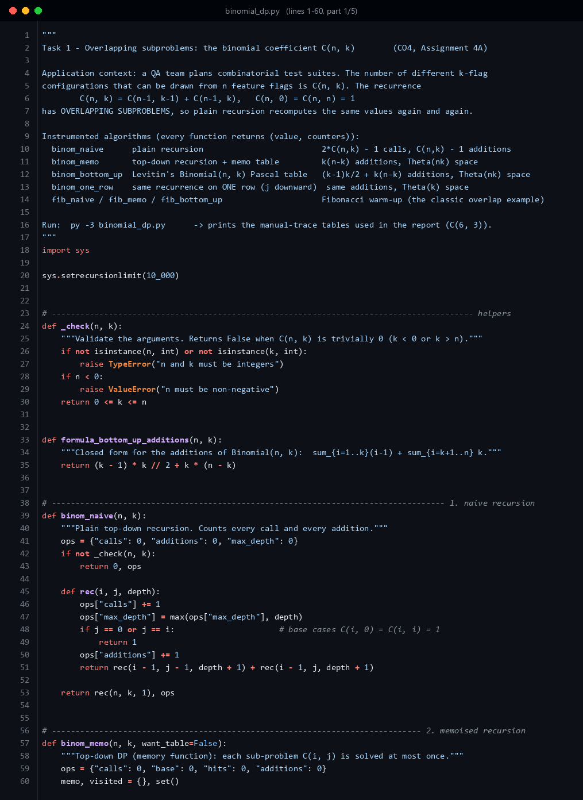

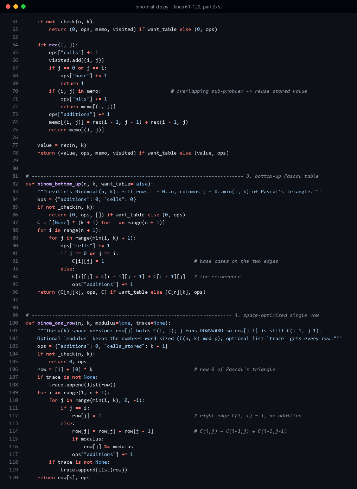

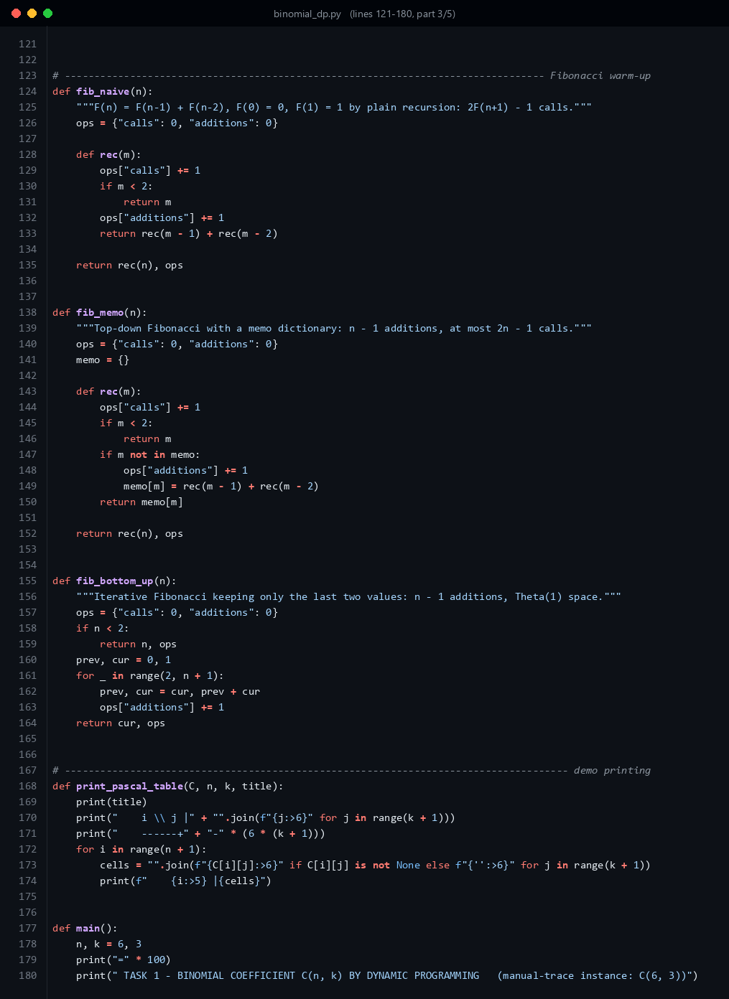

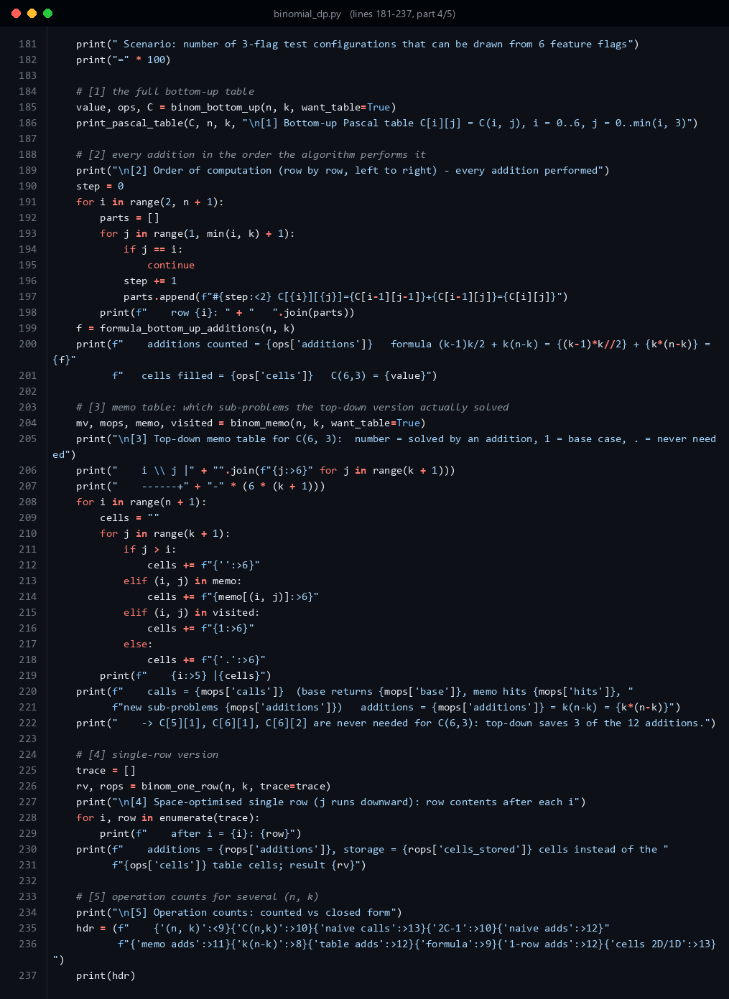

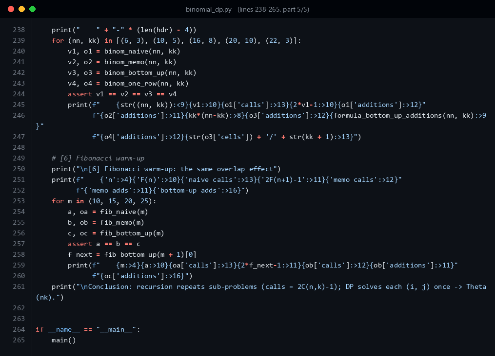

### 5. Manual trace of the table for C(6, 3)

Table 3: Bottom-up table C[i][j] for n = 6, k = 3 (blank = not part of the table since j > i)

| i \ j | 0 | 1 | 2 | 3 |
|---|---|---|---|---|
| 0 | 1 |  |  |  |
| 1 | 1 | 1 |  |  |
| 2 | 1 | 2 | 1 |  |
| 3 | 1 | 3 | 3 | 1 |
| 4 | 1 | 4 | 6 | 4 |
| 5 | 1 | 5 | 10 | 10 |
| 6 | 1 | 6 | 15 | **20** |

I filled the table row by row, exactly in the algorithm's order:

1. **Rows 0 and 1** contain only edge cells: C[0][0] = C[1][0] = C[1][1] = 1 (base cases, no addition).
2. **Row 2:** C[2][0] = 1; addition #1: C[2][1] = C[1][0] + C[1][1] = 1 + 1 = 2; C[2][2] = 1.
3. **Row 3:** #2 C[3][1] = C[2][0] + C[2][1] = 1 + 2 = 3; #3 C[3][2] = C[2][1] + C[2][2] = 2 + 1 = 3; C[3][3] = 1.
4. **Row 4** (from now on only j ≤ k = 3 is kept): #4 C[4][1] = 1 + 3 = 4; #5 C[4][2] = 3 + 3 = 6; #6 C[4][3] = 3 + 1 = 4.
5. **Row 5:** #7 C[5][1] = 1 + 4 = 5; #8 C[5][2] = 4 + 6 = 10; #9 C[5][3] = 6 + 4 = 10.
6. **Row 6:** #10 C[6][1] = 1 + 5 = 6; #11 C[6][2] = 5 + 10 = 15; #12 C[6][3] = 10 + 10 = **20**.

So 12 additions fill 22 cells and C(6, 3) = 20 – there are 20 different 3-flag configurations of 6 flags. The program's section [2] prints the same 12 additions in the same order (Figure 6).

**Memoised (top-down) trace.** The memo version starts at C(6, 3) and only descends into what it needs. It made 19 calls: 9 calls created a new sub-problem (one addition each), 4 calls were memo hits (C[4][2] is requested by both C[5][2] and C[5][3], C[3][2] by C[4][2] and C[4][3], C[3][1] by C[4][1] and C[4][2], C[2][1] by C[3][1] and C[3][2]) and 6 calls returned a base value. Table 4 marks the cells it never touched.

Table 4: Cells solved by the memoised version for C(6, 3) (number = solved by an addition, 1 = base case reached, · = never needed)

| i \ j | 0 | 1 | 2 | 3 |
|---|---|---|---|---|
| 0 | · |  |  |  |
| 1 | 1 | 1 |  |  |
| 2 | 1 | 2 | 1 |  |
| 3 | 1 | 3 | 3 | 1 |
| 4 | · | 4 | 6 | 4 |
| 5 | · | · | 10 | 10 |
| 6 | · | · | · | 20 |

C[5][1], C[6][1] and C[6][2] are not on any path from C(6, 3) to the edges, so top-down needs only 9 = k(n − k) additions instead of 12.

**Single-row trace.** With j running downward, the row after each i is [1,0,0,0] → [1,1,0,0] → [1,2,1,0] → [1,3,3,1] → [1,4,6,4] → [1,5,10,10] → [1,6,15,20]: the same 12 additions, but only 4 stored cells instead of 22. Running j upward would be wrong: row[j − 1] would already hold C(i, j − 1) instead of C(i − 1, j − 1).

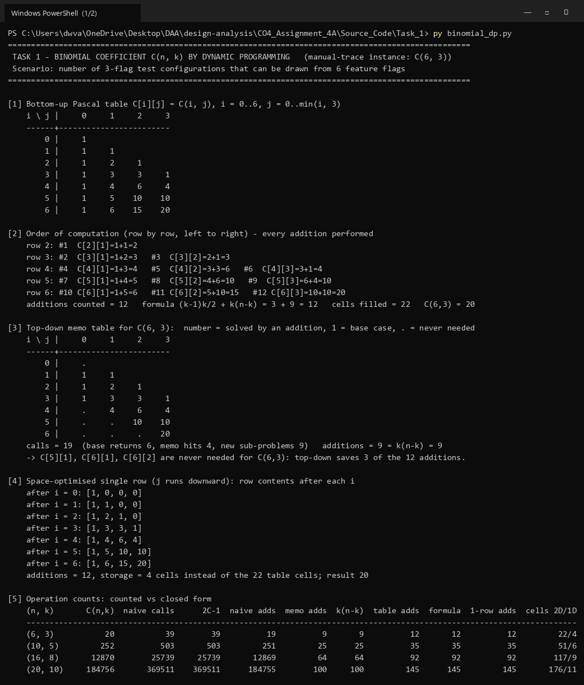

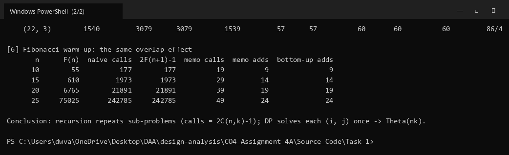

### 6. Calculations and complexity

**Naive recursion.** Let A(n, k) be its additions. A(n, k) = A(n − 1, k − 1) + A(n − 1, k) + 1 for 0 < k < n and A = 0 on the edges. Substituting A = C − 1 gives (C(n−1, k−1) − 1) + (C(n−1, k) − 1) + 1 = C(n, k) − 1, and the edges satisfy 1 − 1 = 0, so **A(n, k) = C(n, k) − 1**. The recursion tree is a full binary tree with C(n, k) leaves, hence C(n, k) − 1 internal nodes and **2C(n, k) − 1 calls**. For C(6, 3): 39 calls and 19 additions. For k = n/2, C(n, n/2) ≈ 2ⁿ·√(2/(πn)), so the time is Θ(2ⁿ/√n) – exponential – while the recursion depth is only n. The Fibonacci warm-up obeys the same law: 2F(n + 1) − 1 calls, e.g. 242,785 calls for F(25) against 24 additions bottom-up.

**Bottom-up table.** Row i ≤ k performs i − 1 additions, row i > k performs k additions:

A(n, k) = Σ<sub>i=1..k</sub> (i − 1) + Σ<sub>i=k+1..n</sub> k = (k − 1)k/2 + k(n − k) ∈ **Θ(nk)**.

For C(6, 3): (2·3)/2 + 3·3 = 3 + 9 = **12**. The table fills Σ<sub>i=0..n</sub> (min(i, k) + 1) = (k + 1)(k + 2)/2 + (n − k)(k + 1) = 10 + 12 = 22 cells, so the space is **Θ(nk)**.

**Memoised version.** The sub-problems reachable from (n, k) are (n − a − b, k − a) with 0 ≤ a ≤ k and 0 ≤ b ≤ n − k; the non-edge ones have a < k and b < n − k, so it performs exactly **k(n − k)** additions (9 for C(6, 3)), plus Θ(nk) memo space and a Θ(n) recursion stack.

**Single row.** Same (k − 1)k/2 + k(n − k) additions, but **Θ(k)** space (k + 1 cells). Because C(n, k) = C(n, n − k), any version should use k' = min(k, n − k); this also removes the memo version's advantage when k is close to n.

Table 5: Counted operations vs closed forms (section [5] of the output in Figure 6 and Figure 7; the 1-D row stores k + 1 cells)

| (n, k) pair | C(n, k) value | naive calls | formula 2C − 1 | memo adds | formula k(n − k) | table adds | (k−1)k/2 + k(n−k) |
|---|---|---|---|---|---|---|---|
| (6, 3) | 20 | 39 | 39 | 9 | 9 | 12 | 12 |
| (10, 5) | 252 | 503 | 503 | 25 | 25 | 35 | 35 |
| (16, 8) | 12,870 | 25,739 | 25,739 | 64 | 64 | 92 | 92 |
| (20, 10) | 184,756 | 369,511 | 369,511 | 100 | 100 | 145 | 145 |
| (22, 3) | 1,540 | 3,079 | 3,079 | 57 | 57 | 60 | 60 |

Every counted value equals its closed form.

### 7. Test cases

`test_binomial.py` reads `test_data/binomial_test_cases.csv` and runs every algorithm on each case (the naive recursion only where C(n, k) is small), comparing with the expected value and with `math.comb`.

Table 6: Test cases for Task 1 (Case = id and category; every test passed)

| Case | Input | Expected | Actual – result |
|---|---|---|---|
| T1 given | C(6, 3), manual-trace instance | 20 | 20 (4 agree) – PASS |
| T2 given | C(10, 5) | 252 | 252 (4 agree) – PASS |
| T3 own | C(52, 5), poker hands | 2,598,960 | 2,598,960 – PASS |
| T4 own | C(20, 10) | 184,756 | 184,756 – PASS |
| T5 own | C(40, 20) | 137,846,528,820 | identical – PASS |
| T6 own | C(100, 50), a 30-digit value | ≈ 1.0089 × 10²⁹ (exact) | identical – PASS |
| T7 boundary | C(0, 0) | 1 | 1 – PASS |
| T8–T9 boundary | C(5, 0), C(5, 5) | 1, 1 | 1, 1 – PASS |
| T10–T11 boundary | C(30, 1), C(30, 29) | 30, 30 | 30, 30 – PASS |
| T12–T13 boundary | C(7, 8), C(7, −1) | 0, 0 | 0, 0 – PASS |
| P1 property | 300 random (n, k) vs math.comb | equal | equal – PASS |
| P2–P3 property | symmetry; Pascal's rule | hold | hold – PASS |
| P4–P6 property | call and addition counts vs closed forms | exact | exact – PASS |
| P7–P8 property | C(1000, 500) mod p; k + 1 stored cells | match | match – PASS |
| P9–P10 invalid | n = −1; n = 5.0 | ValueError; TypeError | raised – PASS |
| P11–P12 property | Fibonacci: values agree; 2F(n+1) − 1 calls | exact | exact – PASS |

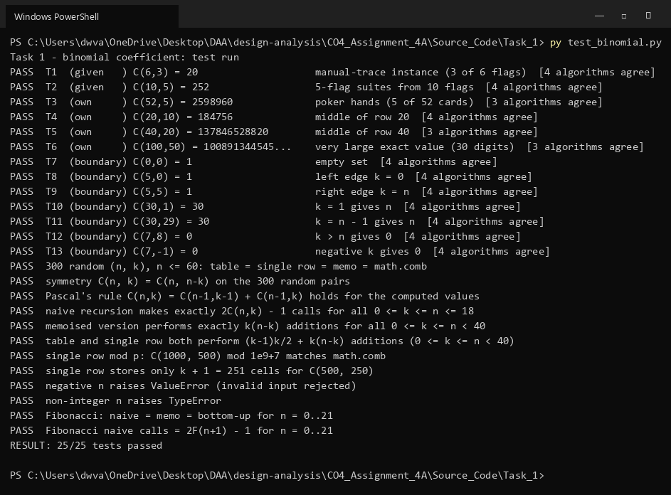

### 8. Experimental results

`binomial_experiments.py` measured the growth in two ranges (Figure 9, Figure 10).

Table 7: Naive vs memoised vs bottom-up, k = n/2, median of 3 runs (results/binomial_E1.csv)

| n (k = n/2) | C(n, n/2) value | naive rec. calls | memo adds | table adds | naive time (ms) | memo time (ms) | table time (ms) |
|---|---|---|---|---|---|---|---|
| 12 | 924 | 1,847 | 36 | 51 | 0.35 | 0.025 | 0.012 |
| 16 | 12,870 | 25,739 | 64 | 92 | 4.83 | 0.094 | 0.037 |
| 20 | 184,756 | 369,511 | 100 | 145 | 105.40 | 0.251 | 0.035 |
| 22 | 705,432 | 1,410,863 | 121 | 176 | 334.76 | 0.079 | 0.032 |
| 24 | 2,704,156 | 5,408,311 | 144 | 210 | 1,048.53 | 0.103 | 0.039 |

Table 8: Bottom-up versions for large n, k = n/2, median of 3 runs (results/binomial_E2.csv; additions = formula in every row)

| n (k = n/2) | table size n·k | additions counted | digits of C | 2-D table (s) | one row (s) | one row mod p (s) |
|---|---|---|---|---|---|---|
| 200 | 20,000 | 14,950 | 59 | 0.0026 | 0.0014 | 0.0020 |
| 400 | 80,000 | 59,900 | 120 | 0.0109 | 0.0058 | 0.0081 |
| 800 | 320,000 | 239,800 | 240 | 0.0514 | 0.0239 | 0.0312 |
| 1600 | 1,280,000 | 959,600 | 480 | 0.2383 | 0.1112 | 0.1384 |
| 3200 | 5,120,000 | 3,839,200 | 962 | 1.1364 | 0.5151 | 0.5598 |

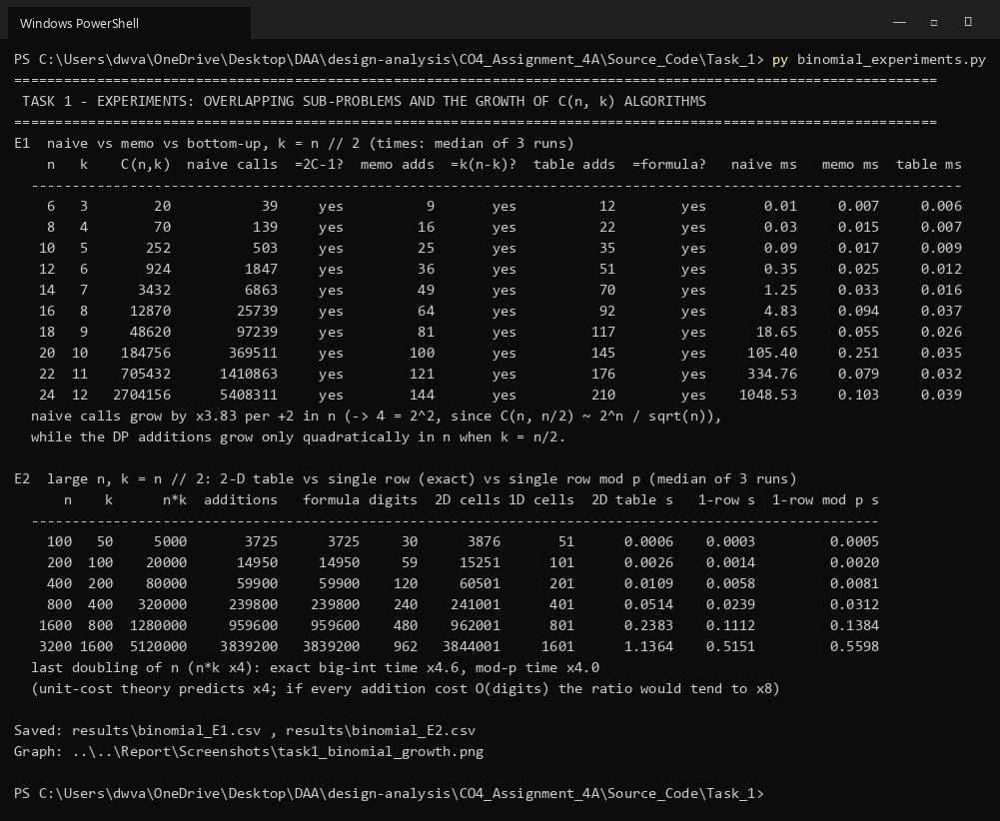

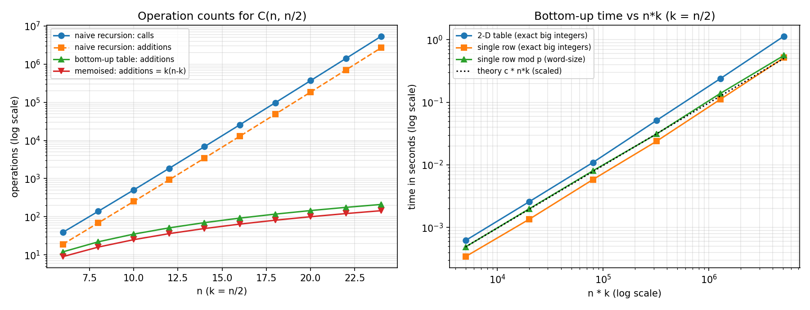

### 9. Analysis and conclusion

- **Theory vs experiment.** The naive call count grew by ×3.83 for every +2 in n (theory: ratio → 4 = 2², since C(n, n/2) ~ 2ⁿ/√n), and at n = 24 the naive recursion needed 1,048.53 ms against 0.039 ms for the table – about 27,000 times slower for the same answer. The DP addition counts lie on a gentle quadratic curve in the left panel of Figure 10.
- **Θ(nk) confirmed.** In E2 each doubling of n multiplies n·k by 4; the measured time of the single row grew by ×4.6 at the last step and the mod-p version by ×4.0, so the points follow the c·n·k line. If every big-integer addition cost Θ(digits) the ratio would approach 8; it does not, because numbers of at most 962 digits are added in a few machine operations and the interpreter's per-step overhead dominates. The unit-cost assumption is therefore realistic in this range.
- **Space.** The single row stores 1,601 cells instead of 3,844,001 at n = 3200 and is also about twice as fast (no row lists to allocate, fewer index operations).
- **Recommendation.** Use the bottom-up single-row algorithm with k' = min(k, n − k) (Θ(nk') time, Θ(k') space); use the memoised version only when very few cells are needed. Never use the plain recursion: its cost equals the size of the answer.

## Task 2 – 0/1 Knapsack by Dynamic Programming: Drone Cargo Loading [9 Marks]

> **Problem Context – Same-Day Drone Delivery.** A delivery drone can lift at most W = 10 kg. Five parcels are waiting (`test_data/cargo_parcels.csv`): P1 (5 kg, value 50), P2 (4 kg, 38), P3 (3 kg, 27), P4 (2 kg, 17) and P5 (6 kg, 55), values in hundreds of rupees. A parcel is either loaded completely or left for the next trip.
> **Your Challenge:** Select the load of maximum total value whose weight does not exceed W.
> - Formulate the problem as a dynamic program (state, recurrence, base cases, order of computation) and write pseudocode.
> - Fill the complete table for the given instance by hand and recover the chosen parcels by backtracking.
> - Implement the memory-function (top-down) version and show which cells it actually computes.
> - Reduce the memory to a single row and explain what is lost.
> - Verify against brute force and measure how the cost grows with n·W.

**Evidence Expected**

> DP formulation, pseudocode, full table trace with backtracking, memory-function table, single-row version, verification against exhaustive search, test cases, timing over growing n·W and complexity analysis.

**Ans:**

### 1. Problem analysis

Input: n parcels with integer weights wᵢ > 0 and values vᵢ ≥ 0, and an integer capacity W ≥ 0. Output: a subset S with Σ<sub>i∈S</sub> wᵢ ≤ W and maximum Σ<sub>i∈S</sub> vᵢ. There are 2ⁿ subsets, so exhaustive search is exponential. The problem has **optimal substructure**: if parcel n is in an optimal load for capacity j, the rest is an optimal load of parcels 1..n − 1 for capacity j − wₙ; if not, the load is optimal for parcels 1..n − 1 and capacity j. The sub-problems "first i parcels, capacity j" overlap heavily (different decisions on earlier parcels lead to the same remaining capacity), and there are only (n + 1)(W + 1) of them. A greedy rule (best value/weight first) is tempting but wrong for the 0/1 version: here it loads P1 and P2 (9 kg, value 88) and cannot use the last kilogram.

### 2. DP formulation

Table 9: DP formulation of the 0/1 knapsack (Levitin 8.2)

| Element | Definition |
|---|---|
| State | F[i][j] = maximum value from the first i parcels with payload limit j kg |
| Recurrence | F[i][j] = F[i − 1][j] if j < wᵢ; otherwise F[i][j] = max(F[i − 1][j], vᵢ + F[i − 1][j − wᵢ]) |
| Base cases | F[0][j] = 0 for all j (no parcels); F[i][0] = 0 for all i (no payload) |
| Order of computation | rows i = 1 … n, inside a row j = 1 … W (only row i − 1 is read) |
| Answer | F[n][W]; parcels recovered by walking back from F[n][W]: parcel i is loaded iff F[i][j] ≠ F[i − 1][j] |

### 3. Pseudocode

```
Algorithm KnapsackBottomUp(w[1..n], v[1..n], W)
1. for j = 0 to W do F[0][j] = 0
2. for i = 0 to n do F[i][0] = 0
3. for i = 1 to n do
4.     for j = 1 to W do                                    // one cell = one basic step (count)
5.         if j < w[i] then F[i][j] = F[i-1][j]
6.         else F[i][j] = max(F[i-1][j], v[i] + F[i-1][j - w[i]])
7. return F[n][W]
```

```
Algorithm Backtrack(F, w[1..n], W)
1. j = W;  S = empty set
2. for i = n downto 1 do
3.     if F[i][j] != F[i-1][j] then S = S + {i};  j = j - w[i]
4. return S
```

```
Algorithm MFKnapsack(i, j)
// F[0][*] = F[*][0] = 0, every other cell initialised to -1 ("not computed")
1. if F[i][j] < 0 then
2.     if j < w[i] then value = MFKnapsack(i-1, j)
3.     else value = max(MFKnapsack(i-1, j), v[i] + MFKnapsack(i-1, j - w[i]))
4.     F[i][j] = value                                      // count computed cells
5. return F[i][j]
```

```
Algorithm KnapsackOneRow(w[1..n], v[1..n], W)
1. for j = 0 to W do best[j] = 0
2. for i = 1 to n do
3.     for j = W downto w[i] do                             // downward: best[j - w[i]] is still row i-1
4.         best[j] = max(best[j], v[i] + best[j - w[i]])
5. return best[W]
```

```
Algorithm KnapsackBrute(i, weight, value)
1. if i = n then
2.     if weight <= W and value > best then best = value   // one subset examined (count)
3.     return
4. KnapsackBrute(i+1, weight, value)                       // parcel i+1 left behind
5. KnapsackBrute(i+1, weight + w[i+1], value + v[i+1])     // parcel i+1 loaded
```

### 4. Implementation

`knapsack_dp.py` reads the instance from `test_data/cargo_parcels.csv` and implements the bottom-up table (`knapsack_bottom_up`, counting cells, comparisons and "take" decisions), `backtrack_items`, Levitin's memory function (`knapsack_memory_function`, which returns the table with −1 in never-computed cells), the Θ(W)-space single row (`knapsack_one_row`), exhaustive search (`knapsack_brute_force`) and the greedy heuristic (`greedy_by_ratio`). A parcel is loaded only when it is *strictly* better (`take > F[i−1][j]`), so ties keep the earlier load. Invalid input (negative W, non-positive weight, negative value, length mismatch) raises `ValueError`.

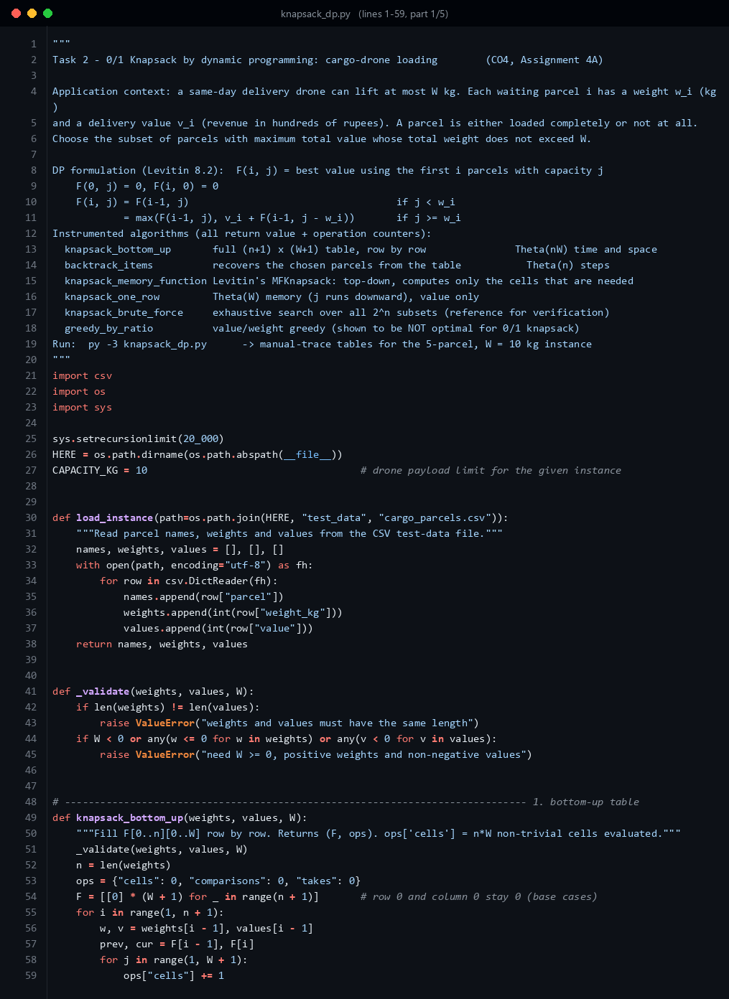

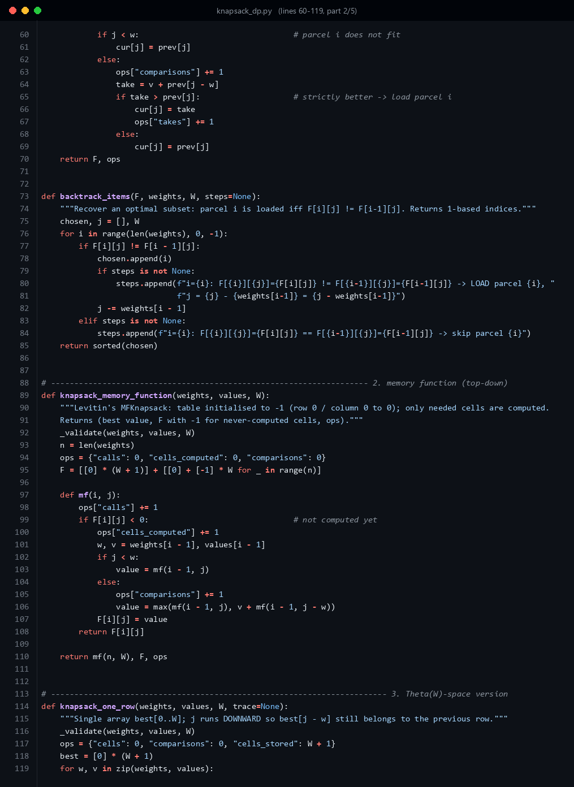

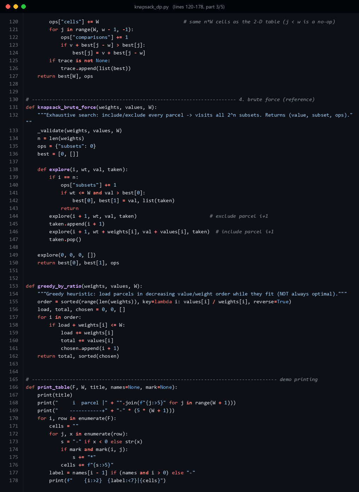

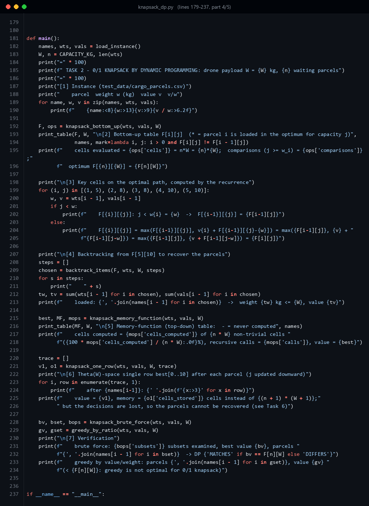


### 5. Manual trace: the full table, backtracking and the memory function

Table 10: Bottom-up table F[i][j] for W = 10 (* = parcel i is loaded in the optimum for capacity j, i.e. F[i][j] > F[i − 1][j])

| i (parcel, w, v) | 0 | 1 | 2 | 3 | 4 | 5 | 6 | 7 | 8 | 9 | 10 |
|---|---|---|---|---|---|---|---|---|---|---|---|
| 0 (none) | 0 | 0 | 0 | 0 | 0 | 0 | 0 | 0 | 0 | 0 | 0 |
| 1 (P1, 5, 50) | 0 | 0 | 0 | 0 | 0 | 50* | 50* | 50* | 50* | 50* | 50* |
| 2 (P2, 4, 38) | 0 | 0 | 0 | 0 | 38* | 50 | 50 | 50 | 50 | 88* | 88* |
| 3 (P3, 3, 27) | 0 | 0 | 0 | 27* | 38 | 50 | 50 | 65* | 77* | 88 | 88 |
| 4 (P4, 2, 17) | 0 | 0 | 17* | 27 | 38 | 50 | 55* | 67* | 77 | 88 | **94*** |
| 5 (P5, 6, 55) | 0 | 0 | 17 | 27 | 38 | 50 | 55 | 67 | 77 | 88 | **94** |

Row by row (each cell = max(skip, take) where skip = F[i − 1][j] and take = vᵢ + F[i − 1][j − wᵢ]):

1. **Row 1 (P1, 5 kg, 50):** for j < 5 the parcel does not fit, F = 0; for j ≥ 5, max(0, 50 + 0) = 50.
2. **Row 2 (P2, 4 kg, 38):** j = 4: max(0, 38 + F[1][0] = 38) = 38*. j = 5…8: max(50, 38 + 0) = 50 (skip). j = 9: max(50, 38 + F[1][5] = 88) = 88*; j = 10: 88*.
3. **Row 3 (P3, 3 kg, 27):** j = 3: 27*; j = 4: max(38, 27) = 38; j = 5, 6: max(50, 27 + 0 or 27) = 50; j = 7: max(50, 27 + F[2][4] = 65) = 65*; j = 8: max(50, 27 + F[2][5] = 77) = 77*; j = 9: max(88, 27 + 50) = 88; j = 10: max(88, 27 + F[2][7] = 77) = 88.
4. **Row 4 (P4, 2 kg, 17):** j = 2: 17*; j = 3: max(27, 17) = 27; j = 4: max(38, 17 + 0) = 38; j = 5: max(50, 17 + 27) = 50; j = 6: max(50, 17 + 38 = 55) = 55*; j = 7: max(65, 17 + 50 = 67) = 67*; j = 8: max(77, 17 + 50) = 77; j = 9: max(88, 17 + 65 = 82) = 88; j = 10: max(88, 17 + F[3][8] = 94) = **94***.
5. **Row 5 (P5, 6 kg, 55):** j = 6: max(55, 55 + 0) = 55 (a tie, so P5 is not taken); j = 7: max(67, 55 + 0) = 67; j = 8: max(77, 55 + 17 = 72) = 77; j = 9: max(88, 55 + 27 = 82) = 88; j = 10: max(94, 55 + F[4][4] = 93) = **94**. P5 never improves a cell.

**Backtracking from F[5][10] = 94** (section [4] of Figure 16):

1. i = 5: F[5][10] = 94 = F[4][10] → P5 is not loaded.
2. i = 4: F[4][10] = 94 ≠ F[3][10] = 88 → **load P4**, j = 10 − 2 = 8.
3. i = 3: F[3][8] = 77 ≠ F[2][8] = 50 → **load P3**, j = 8 − 3 = 5.
4. i = 2: F[2][5] = 50 = F[1][5] → P2 is not loaded.
5. i = 1: F[1][5] = 50 ≠ F[0][5] = 0 → **load P1**, j = 0.

Optimal load: **P1, P3, P4** = 5 + 3 + 2 = 10 kg, value 50 + 27 + 17 = **94**. The runner-up P2 + P5 (10 kg, 93) shows how close the alternatives are; the greedy ratio rule gives only 88.

Table 11: Memory-function table (− = never computed)

| i | 0 | 1 | 2 | 3 | 4 | 5 | 6 | 7 | 8 | 9 | 10 |
|---|---|---|---|---|---|---|---|---|---|---|---|
| 0 | 0 | 0 | 0 | 0 | 0 | 0 | 0 | 0 | 0 | 0 | 0 |
| 1 (P1) | 0 | 0 | 0 | 0 | 0 | 50 | 50 | 50 | 50 | − | 50 |
| 2 (P2) | 0 | 0 | 0 | − | 38 | 50 | − | 50 | 50 | − | 88 |
| 3 (P3) | 0 | − | 0 | − | 38 | − | − | − | 77 | − | 88 |
| 4 (P4) | 0 | − | − | − | 38 | − | − | − | − | − | 94 |
| 5 (P5) | 0 | − | − | − | − | − | − | − | − | − | 94 |

The memory function starts from F[5][10] and asks only for F[4][10] and F[4][4]; those ask for F[3][10], F[3][8], F[3][4], F[3][2], and so on. It computed **23 of the 50** non-trivial cells (46 %) with 40 recursive calls, and every computed cell equals the bottom-up value.

**Single row.** best[0..10] after each parcel equals rows 1–5 of Table 10 (section [6] of Figure 16); the final best[10] = 94 needs only 11 cells instead of 66, but the take/skip decisions of rows 1–4 are overwritten, so the parcels **cannot be recovered** – the starting point of Task 6.

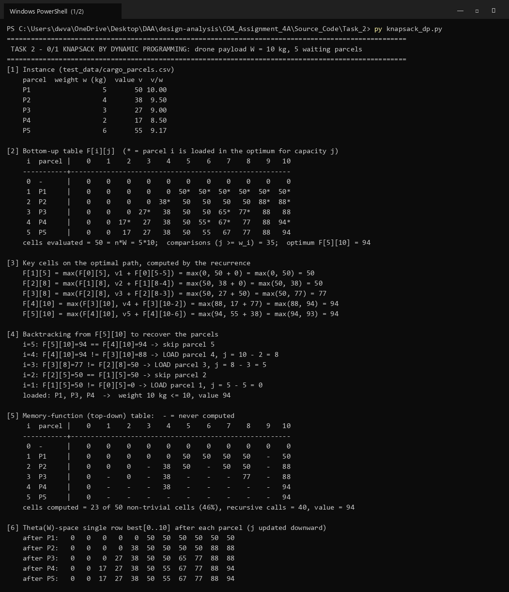

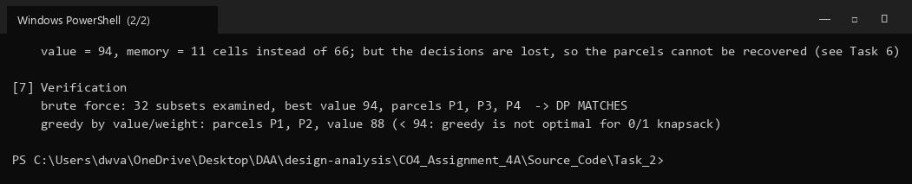

### 6. Calculations and complexity

- **Cells:** Σ<sub>i=1..n</sub> Σ<sub>j=1..W</sub> 1 = nW = 5 × 10 = **50** evaluations (counted: 50). Comparisons happen only when j ≥ wᵢ: Σ (W − wᵢ + 1) = 6 + 7 + 8 + 9 + 5 = **35** (counted: 35). Each cell is O(1), so T(n, W) = **Θ(nW)** and the table needs (n + 1)(W + 1) = 66 cells, **Θ(nW)** space.
- **Backtracking:** one comparison per parcel, **Θ(n)**.
- **Memory function:** at most nW cells, each computed once, so O(nW) time, Θ(nW) space plus an O(n) recursion stack; it computes fewer cells when the weights are large relative to W.
- **Single row:** Σ (W − wᵢ + 1) ≤ nW updates, **Θ(W)** space.
- **Brute force:** 2ⁿ subsets (32 here), Θ(2ⁿ) leaves of the include/exclude tree.
- **Pseudo-polynomial.** Θ(nW) is polynomial in the *value* of W, but W is written with only b = ⌈log₂(W + 1)⌉ bits, so the time is Θ(n·2ᵇ) – exponential in the input length. Doubling the weight resolution doubles both time and memory; Task 6 shows the consequence.

### 7. Test cases

Table 12: Test cases for Task 2 (`test_data/knapsack_test_cases.csv` plus property tests; every test passed)

| Case | Input | Expected | Actual – result |
|---|---|---|---|
| K1 given | drone instance, W = 10 | 94, parcels {1, 3, 4} | 94, [1, 3, 4] – PASS |
| K2 given | Levitin's instance, W = 5 | 37, items {1, 2, 4} | 37, [1, 2, 4] – PASS |
| K3 own | tie {3, 3} vs {6}, W = 6 | 20 | 20, [1, 2] – PASS |
| K4 own | small parcels beat a big one | 30, {1, 2, 3} | 30, [1, 2, 3] – PASS |
| K5 own | a big parcel beats small ones | 35, {4} | 35, [4] – PASS |
| K6 own | duplicate parcels | 15 | 15, [1, 2, 3] – PASS |
| K7 boundary | no parcels | 0 | 0, [] – PASS |
| K8 boundary | capacity W = 0 | 0 | 0, [] – PASS |
| K9 boundary | every parcel heavier than W | 0 | 0, [] – PASS |
| K10 boundary | all parcels fit | 6, all parcels | 6, [1, 2, 3] – PASS |
| K11–K12 boundary | single parcel: exact fit / too heavy | 9 / 0 | 9 / 0 – PASS |
| K13 boundary | zero-value parcel present | 8, {2} | 8, [2] – PASS |
| P1–P2 property | 300 random instances vs brute force | equal; sets optimal | equal – PASS |
| P3–P5 property | 50 cells; MF 23 cells; greedy 88 < 94 | exact | exact – PASS |
| P6 property | 20 random: both bottom-up versions n·W cells | exact | exact – PASS |
| P7–P10 invalid | W < 0, zero weight, length mismatch, negative value | ValueError | raised – PASS |

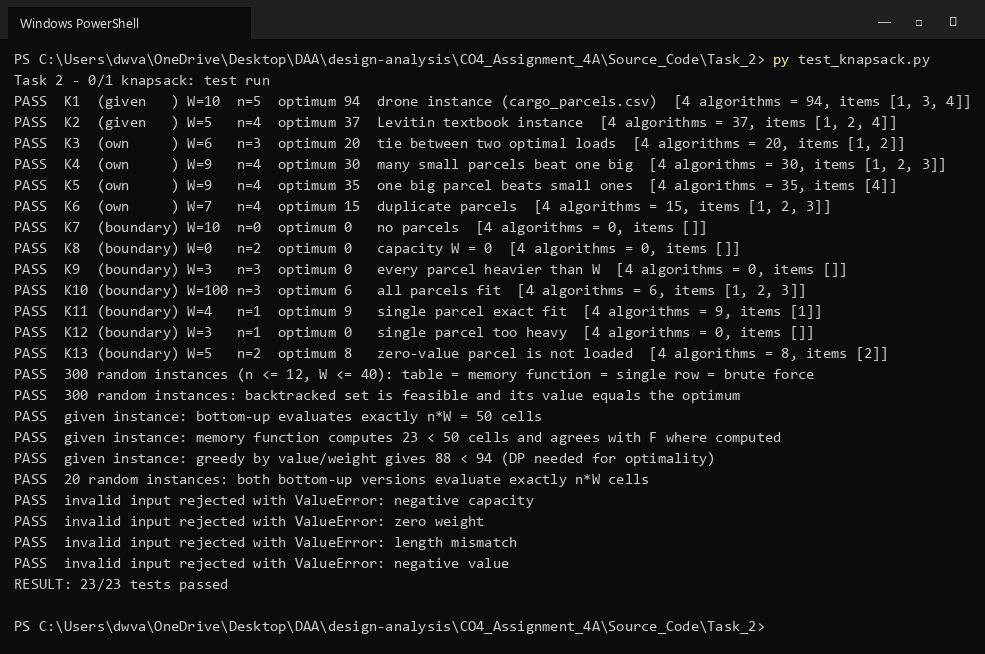

### 8. Experimental results

Table 13: Time vs table size n·W, median of 3 runs (results/knapsack_E1.csv; MF = memory function)

| parcels n | capacity W | cells n·W | table (s) | one row (s) | MF time (s) | MF cells (%) | table MB |
|---|---|---|---|---|---|---|---|
| 25 | 1000 | 25,000 | 0.0038 | 0.0023 | 0.0057 | 13,216 (52.9) | 0.52 |
| 25 | 4000 | 100,000 | 0.0196 | 0.0101 | 0.0201 | 43,618 (43.6) | 2.22 |
| 50 | 4000 | 200,000 | 0.0319 | 0.0218 | 0.0632 | 134,949 (67.5) | 4.36 |
| 100 | 1000 | 100,000 | 0.0173 | 0.0102 | 0.0383 | 76,843 (76.8) | 1.81 |
| 100 | 4000 | 400,000 | 0.0709 | 0.0430 | 0.1784 | 308,319 (77.1) | 9.34 |
| 200 | 1000 | 200,000 | 0.0455 | 0.0282 | 0.1109 | 155,999 (78.0) | 3.52 |
| 200 | 2000 | 400,000 | 0.0776 | 0.0449 | 0.2088 | 307,743 (76.9) | 7.53 |
| 200 | 4000 | 800,000 | 0.1576 | 0.1140 | 0.4356 | 631,132 (78.9) | 17.12 |

Table 14: Brute force vs DP (results/knapsack_E2.csv)

| parcels n | capacity W | subsets 2ⁿ | brute force (s) | DP cells | DP time (s) | same optimum |
|---|---|---|---|---|---|---|
| 12 | 90 | 4,096 | 0.0017 | 1,080 | 0.00019 | yes |
| 16 | 121 | 65,536 | 0.0179 | 1,936 | 0.00032 | yes |
| 18 | 134 | 262,144 | 0.0832 | 2,412 | 0.00041 | yes |
| 20 | 108 | 1,048,576 | 0.3921 | 2,160 | 0.00038 | yes |

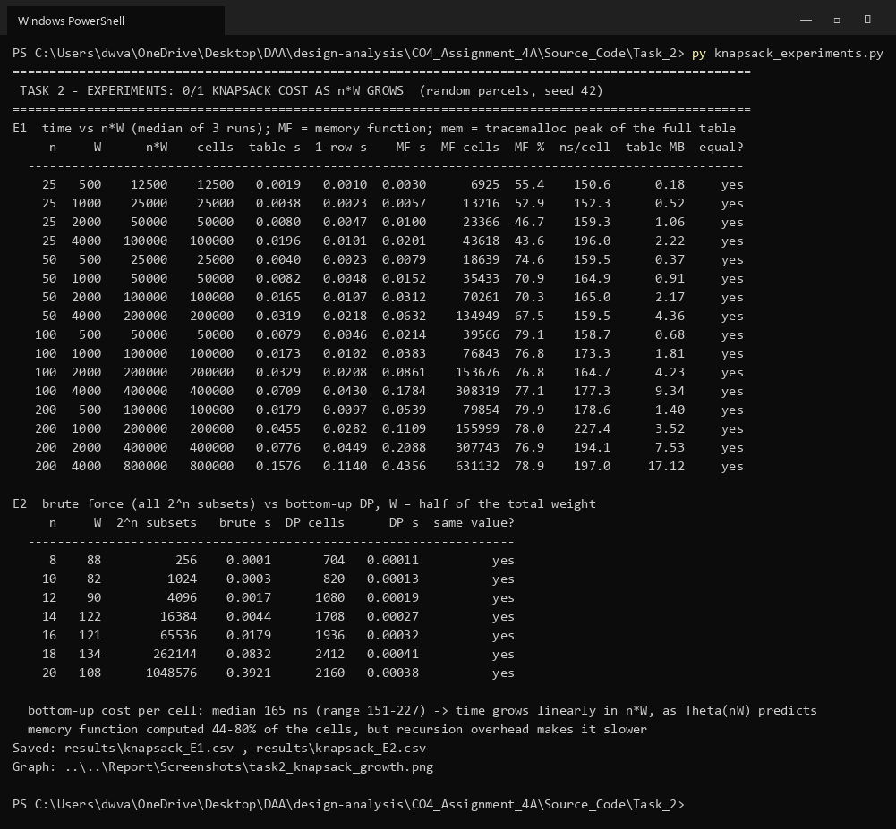

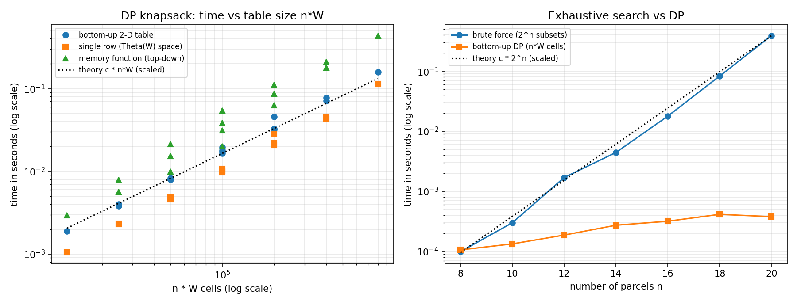

### 9. Analysis and conclusion

- **Θ(nW) confirmed.** Across all 16 configurations (12,500 to 800,000 cells) the bottom-up table cost a median of 165 ns per cell (range 151–227 ns), so the time is a constant times n·W, and the points lie on the c·n·W line of Figure 20. The memory of the full table also grows linearly: 17.12 MB for 201 × 4001 = 804,201 cells, i.e. **22.3 bytes per cell** in Python – the figure used for the Task 6 prediction.
- **Memory function.** It computed only 44–80 % of the cells, but each computed cell costs a recursive call, so it was 1.0–3.0 times *slower* than the table (0.4356 s vs 0.1576 s at n = 200, W = 4000). It pays off only when a small fraction of the table is needed (large weights, as in the 46 % of the drone instance).
- **Single row.** Fastest (0.1140 s at 800,000 cells) and Θ(W) memory, but it cannot report the parcels.
- **Brute force.** The subsets quadruple per +2 parcels and the time followed (×4.6, ×4.7); at n = 20 exhaustive search took 0.3921 s for 1,048,576 subsets, while DP needed 2,160 cells and 0.38 ms – the DP is about 1,000 times faster and the gap doubles with every added parcel.
- **Recommendation.** Use the bottom-up table with backtracking when n·W fits in memory (it gives the parcels); use the single row when only the best value is needed; never use greedy ratios for the 0/1 problem.

## Task 3 – Warshall's Algorithm: Data-Centre Reachability [7 Marks]

> **Problem Context – Data-Centre Replication.** Five data centres – A Chennai, B Bengaluru, C Hyderabad, D Mumbai and E Pune – replicate data over one-way links (`test_data/network_links.csv`): A→C, B→A, C→B, C→D, D→E and E→D. The operations team must know, for every ordered pair of centres, whether data written at the first can eventually reach the second through a chain of links.
> **Your Challenge:** Compute the reachability relation with dynamic programming.
> - Model reachability as the transitive closure of the link digraph and state Warshall's recurrence.
> - Trace the matrices R(0), R(1), …, R(5) by hand and explain where every new 1 comes from.
> - Derive the time and space complexity and check it experimentally.
> - Test with cycles, disconnected networks, self-loops and boundary cases.

**Evidence Expected**

> DP formulation, pseudocode, the traced matrices R(0)–R(5), an implementation verified against a graph search, Θ(n³) analysis with measured growth, and test cases with expected and actual results.

**Ans:**

### 1. Problem analysis

Input: the n × n adjacency matrix A of a digraph (A[i][j] = 1 if there is a link i → j). Output: the transitive closure R with R[i][j] = 1 iff there is a directed path of length ≥ 1 from i to j. A path can be long and can pass through many vertices, so checking every possible path is exponential. Warshall's idea is to restrict which vertices may be used *in the middle* of a path and to allow one more vertex per step: a path that may use intermediate vertices {1, …, k} either does not use k at all, or it splits at its (single, if the path is simple) visit to k into two paths that use only {1, …, k − 1}. These smaller questions are shared by all pairs (i, j) – overlapping sub-problems – and there are only n · n² of them.

### 2. DP formulation

Table 15: DP formulation of Warshall's algorithm (Levitin 8.4)

| Element | Definition |
|---|---|
| State | R(k)[i][j] = 1 iff there is a path i → j whose intermediate vertices are all among the first k vertices |
| Recurrence | R(k)[i][j] = R(k−1)[i][j] or (R(k−1)[i][k] and R(k−1)[k][j]) |
| Base case | R(0) = A (paths without intermediate vertices are the links themselves) |
| Order of computation | k = 1 … n outer loop; all (i, j) inside. Row k and column k do not change in iteration k, so one matrix can be updated in place |
| Answer | R(n), the transitive closure |

### 3. Pseudocode

```
Algorithm Warshall(A[1..n, 1..n])
// Input: adjacency matrix A of a digraph      Output: transitive closure R
1. R = A                                                   // R(0)
2. for k = 1 to n do
3.     for i = 1 to n do
4.         for j = 1 to n do                               // inner step (count): n^3 in total
5.             R[i][j] = R[i][j] or (R[i][k] and R[k][j])
6. return R                                                // R(n)
```

```
Algorithm WarshallRowSkip(A)
1. R = A
2. for k = 1 to n do
3.     for i = 1 to n do
4.         if R[i][k] = 1 then                             // otherwise row i cannot change in this iteration
5.             for j = 1 to n do R[i][j] = R[i][j] or R[k][j]
6. return R
```

```
Algorithm WarshallBitset(A)
1. for i = 1 to n do row[i] = bit mask of the 1s in A[i]
2. for k = 1 to n do
3.     for i = 1 to n do
4.         if bit k of row[i] = 1 then row[i] = row[i] OR row[k]   // one word-parallel row OR (count)
5. return the bits of row[1..n]
```

```
Algorithm ClosureBFS(A)          // reference for verification
1. for s = 1 to n do
2.     queue = direct successors of s;  mark them reachable from s
3.     while queue not empty do
4.         u = dequeue();  for each successor t of u not yet marked: mark t, enqueue t
5. return the marks as matrix R
```

### 4. Implementation

`warshall_closure.py` loads the links, builds the adjacency matrix and implements `warshall` (Levitin's triple loop, counting inner steps and the new 1s added per k, optionally storing the snapshots R(0)…R(n)), `warshall_row_skip`, `warshall_bitset` (rows are Python integers, so `row_i |= row_k` processes a whole row at once) and `closure_bfs` as the independent reference. The input matrix is copied, never modified, and a non-square matrix raises `ValueError`.

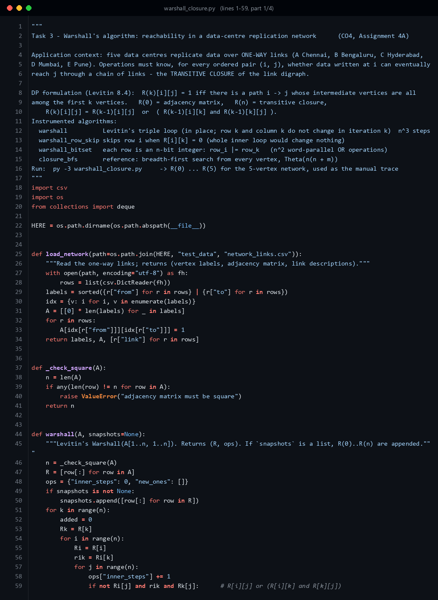

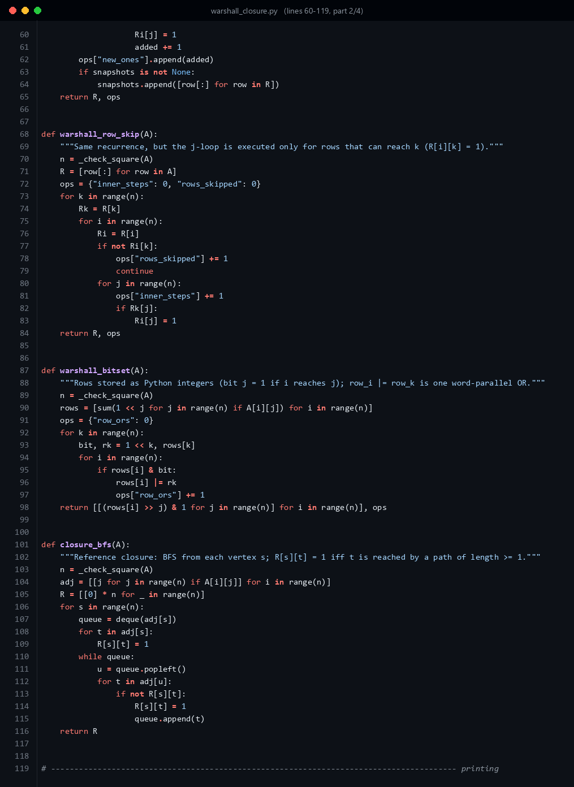

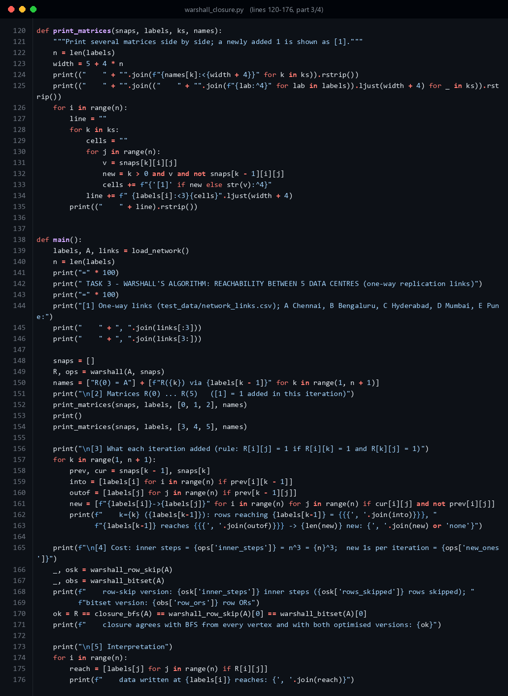

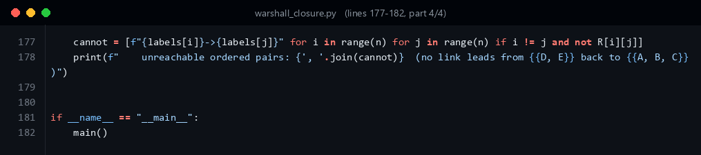

### 5. Manual trace: R(0) … R(5)

Vertex order A, B, C, D, E (k = 1 … 5). In iteration k, a row i gains row k's 1s exactly when R[i][k] = 1. New 1s are shown in **bold**.

Table 16: R(0) = adjacency matrix

| R(0) | A | B | C | D | E |
|---|---|---|---|---|---|
| A | 0 | 0 | 1 | 0 | 0 |
| B | 1 | 0 | 0 | 0 | 0 |
| C | 0 | 1 | 0 | 1 | 0 |
| D | 0 | 0 | 0 | 0 | 1 |
| E | 0 | 0 | 0 | 1 | 0 |

**k = 1 (via A).** Column A has a 1 only in row B (B → A), and row A = {C}. So B gains C: B → A → C. **1 new 1.**

Table 17: R(1)

| R(1) | A | B | C | D | E |
|---|---|---|---|---|---|
| A | 0 | 0 | 1 | 0 | 0 |
| B | 1 | 0 | **1** | 0 | 0 |
| C | 0 | 1 | 0 | 1 | 0 |
| D | 0 | 0 | 0 | 0 | 1 |
| E | 0 | 0 | 0 | 1 | 0 |

**k = 2 (via B).** Column B has a 1 only in row C (C → B); row B = {A, C}. C gains A (C → B → A) and C (C → B → A → C, a cycle back to itself). **2 new 1s.**

Table 18: R(2)

| R(2) | A | B | C | D | E |
|---|---|---|---|---|---|
| A | 0 | 0 | 1 | 0 | 0 |
| B | 1 | 0 | 1 | 0 | 0 |
| C | **1** | 1 | **1** | 1 | 0 |
| D | 0 | 0 | 0 | 0 | 1 |
| E | 0 | 0 | 0 | 1 | 0 |

**k = 3 (via C).** Column C has 1s in rows A, B and C; row C = {A, B, C, D}. Row A gains A, B, D; row B gains B, D; row C already has them. **5 new 1s** – the cycle A → C → B → A is now complete.

Table 19: R(3)

| R(3) | A | B | C | D | E |
|---|---|---|---|---|---|
| A | **1** | **1** | 1 | **1** | 0 |
| B | 1 | **1** | 1 | **1** | 0 |
| C | 1 | 1 | 1 | 1 | 0 |
| D | 0 | 0 | 0 | 0 | 1 |
| E | 0 | 0 | 0 | 1 | 0 |

**k = 4 (via D).** Column D has 1s in rows A, B, C and E; row D = {E}. Rows A, B, C gain E, and row E gains E (E → D → E). **4 new 1s.**

Table 20: R(4)

| R(4) | A | B | C | D | E |
|---|---|---|---|---|---|
| A | 1 | 1 | 1 | 1 | **1** |
| B | 1 | 1 | 1 | 1 | **1** |
| C | 1 | 1 | 1 | 1 | **1** |
| D | 0 | 0 | 0 | 0 | 1 |
| E | 0 | 0 | 0 | 1 | **1** |

**k = 5 (via E).** Column E has 1s in every row; row E = {D, E}. Only D is missing something: D gains D (D → E → D). **1 new 1.**

Table 21: R(5) = transitive closure

| R(5) | A | B | C | D | E |
|---|---|---|---|---|---|
| A | 1 | 1 | 1 | 1 | 1 |
| B | 1 | 1 | 1 | 1 | 1 |
| C | 1 | 1 | 1 | 1 | 1 |
| D | 0 | 0 | 0 | **1** | 1 |
| E | 0 | 0 | 0 | 1 | 1 |

**Interpretation.** Data written in Chennai, Bengaluru or Hyderabad reaches every centre; data written in Mumbai or Pune reaches only Mumbai and Pune. The six unreachable pairs D→A, D→B, D→C, E→A, E→B, E→C reveal a missing link from the western region {D, E} back to the southern ring {A, B, C} – a replication gap the operations team must fix (one link such as D → A would make the closure all-ones).

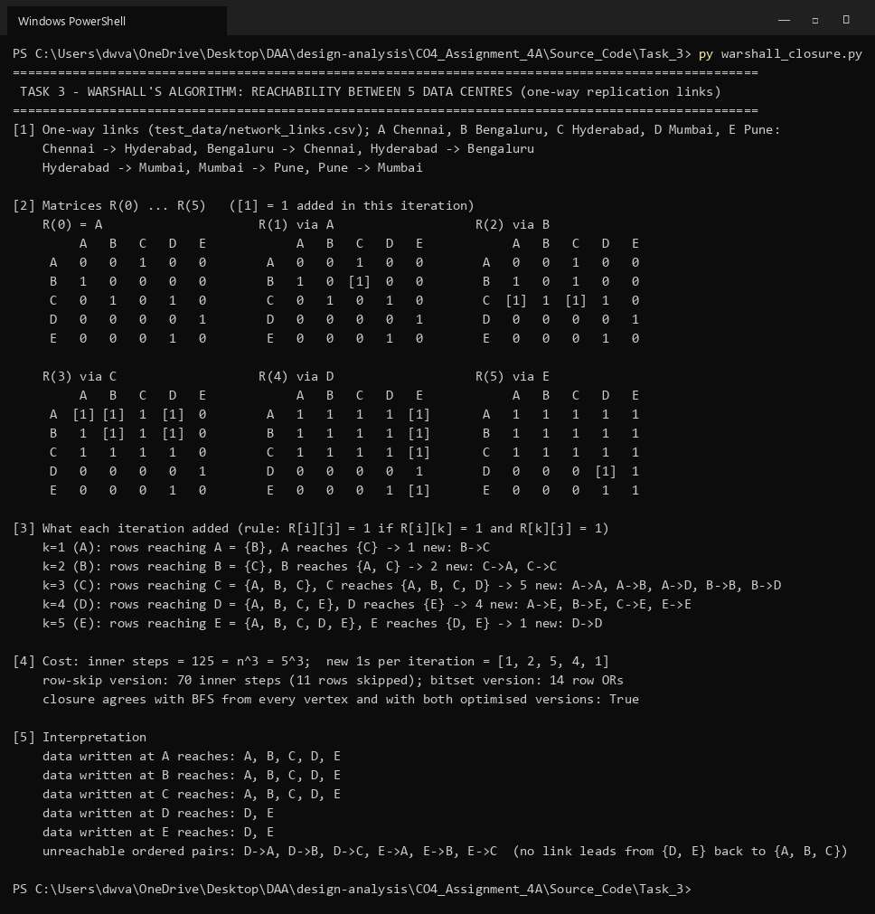

### 6. Calculations and complexity

The innermost statement executes once for every (k, i, j): C(n) = Σ<sub>k=1..n</sub> Σ<sub>i=1..n</sub> Σ<sub>j=1..n</sub> 1 = n³. For n = 5 that is **125** inner steps (counted: 125), adding 1 + 2 + 5 + 4 + 1 = 13 new 1s to the 6 links, giving 19 ones in R(5). Time **Θ(n³)** regardless of the input; space **Θ(n²)** (one matrix, updated in place). The row-skip version executes the j-loop only for rows with R[i][k] = 1: here 70 inner steps (11 of 25 row visits skipped); its worst case is still n³ (a dense graph), but sparse graphs gain a lot. The bitset version performs at most n² row ORs (14 here), each processing a whole row in about n/64 machine operations: Θ(n³/64). The BFS reference costs Θ(n(n + m)) for m links, which is better than Θ(n³) on sparse graphs.

### 7. Test cases

Table 22: Test cases for Task 3 (`test_data/warshall_test_graphs.csv`, expected closures derived by hand; every test passed)

| Case | Graph | Expected closure | Actual (4 versions) – result |
|---|---|---|---|
| W1 given | data-centre network | 19 ones; rows D, E = 00011 | identical – PASS |
| W2 own | directed 4-cycle | all ones (16) | identical – PASS |
| W3 own | chain 0→1→2→3 (DAG) | strict upper triangle (6) | identical – PASS |
| W4 own | two disconnected components | block structure (7 ones) | identical – PASS |
| W5 own | self-loops only (0 and 2) | diagonal 1, 0, 1 | identical – PASS |
| W6 own | hub with three out-links | only row 0 (3 ones) | identical – PASS |
| W7 own | complete digraph, no loops | all ones incl. diagonal | identical – PASS |
| W8 boundary | three vertices, no edges | zero matrix | identical – PASS |
| W9–W10 boundary | one vertex without / with loop | 0 / 1 | identical – PASS |
| W11 boundary | empty graph (n = 0) | empty matrix | identical – PASS |
| P1–P3 property | R(0) = A; R(k−1) ≤ R(k); 1s per k | [1, 2, 5, 4, 1]; 125 steps | exact – PASS |
| P4–P6 property | 200 random digraphs vs BFS | equal; n³ steps; transitive | hold – PASS |
| P7–P8 robustness | input unchanged; non-square input | ValueError for non-square | hold – PASS |

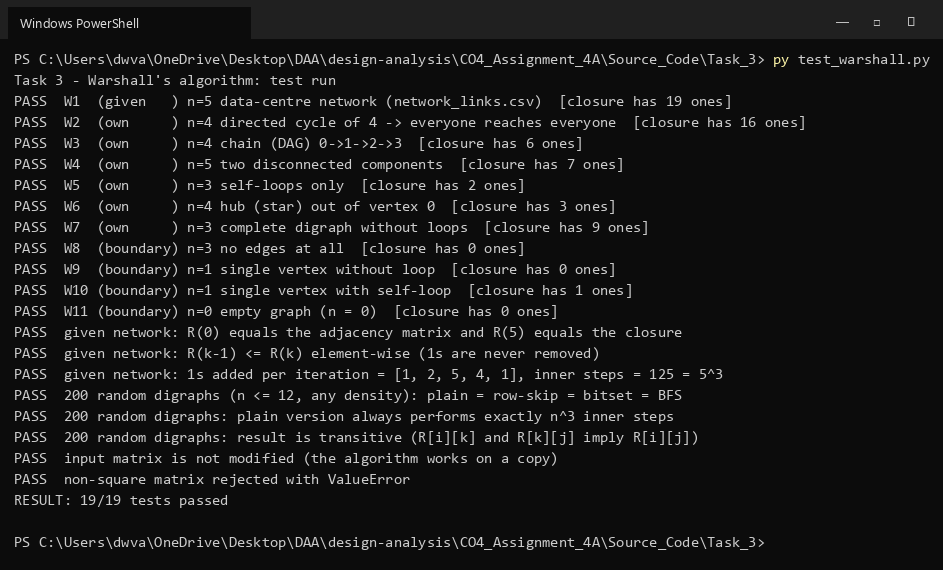

### 8. Experimental results

Table 23: Warshall on random digraphs, median of 3 runs (results/warshall_growth.csv; p·n = average out-degree; all four versions agreed)

| vertices n (p·n) | closure ones | plain steps = n³ | row-skip steps | bitset ORs | plain (s) | row-skip (s) | bitset (s) | BFS time (s) |
|---|---|---|---|---|---|---|---|---|
| 40 (3.0) | 1,521 | 64,000 | 32,400 | 810 | 0.004 | 0.0021 | 0.0003 | 0.0003 |
| 80 (3.0) | 5,401 | 512,000 | 184,560 | 2,307 | 0.033 | 0.0122 | 0.0011 | 0.0010 |
| 160 (3.0) | 22,495 | 4,096,000 | 1,452,800 | 9,080 | 0.259 | 0.0921 | 0.0047 | 0.0046 |
| 320 (3.0) | 89,106 | 32,768,000 | 13,550,720 | 42,346 | 2.168 | 0.9176 | 0.0230 | 0.0203 |
| 320 (1.5) | 35,550 | 32,768,000 | 2,379,200 | 7,435 | 2.519 | 0.1571 | 0.0157 | 0.0080 |

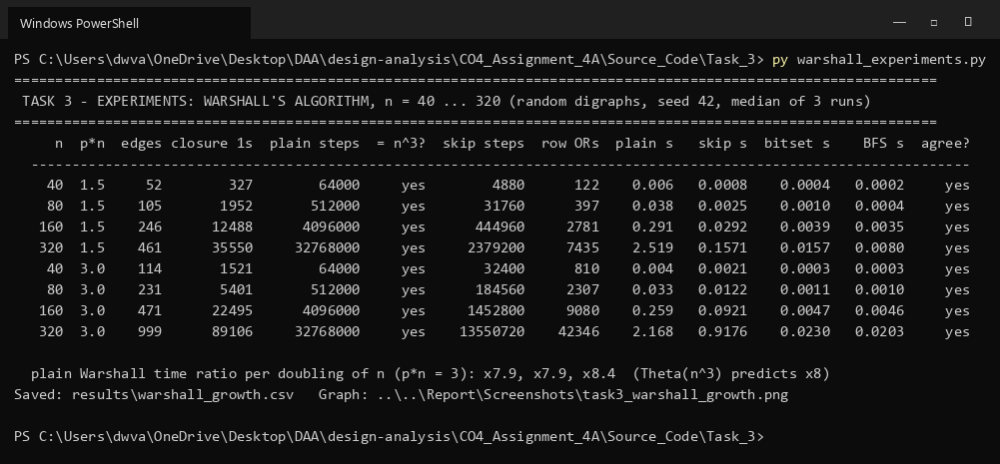

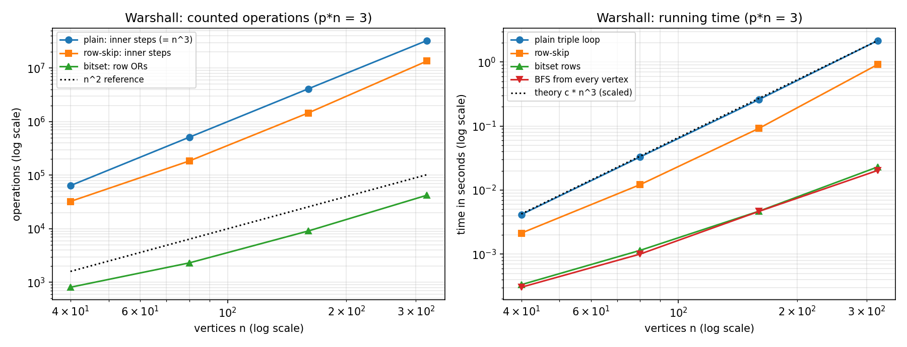

### 9. Analysis and conclusion

- **Θ(n³) confirmed.** The plain version always performed exactly n³ inner steps (all 8 configurations; the program prints "= n³? yes" for each, Figure 27), and its time grew by ×7.9, ×7.9 and ×8.4 per doubling of n – the predicted factor 2³ = 8. The time does not depend on the graph: 2.168 s (dense) vs 2.519 s (sparse) at n = 320.
- **Optimisations.** Skipping rows with R[i][k] = 0 removed 49–64 % of the steps on the denser graphs (59 % at n = 320) and 93 % on the sparse graph at n = 320 (only 2,379,200 of 32,768,000 executed) – the same Θ(n³) worst case but a much smaller constant. Bitset rows were about 94 times faster than the plain loop at n = 320 (0.0230 s vs 2.168 s) because each row OR handles 320 entries at once.
- **Recommendation.** For the operations dashboard (tens of centres) plain Warshall is instant and its matrix form is easy to audit. For large networks use the bitset form, or BFS/DFS from every vertex when the graph is sparse (0.0080 s at n = 320, p·n = 1.5).

## Task 4 – Floyd's Algorithm: All-Pairs Shortest Routes [9 Marks]

> **Problem Context – City Courier Routing.** A city courier serves five sites – A Depot, B Central Market, C General Hospital, D Tech Park and E Railway Station – linked by one-way streets with travel times in minutes (`test_data/road_network.csv`). Its electric vans also need the battery energy of every route; downhill streets recover energy through regenerative braking, so some energy weights are negative (`test_data/ev_energy_network.csv`).
> **Your Challenge:** Compute the best route between every pair of sites with dynamic programming.
> - Formulate the all-pairs shortest-path DP and trace the matrices D(0), D(1), …, D(5) for the travel-time network.
> - Maintain a predecessor matrix and reconstruct the actual routes.
> - Show that negative streets are handled when there is no negative cycle, and detect a negative cycle (caused by a mistyped value) as a failure case.
> - Analyse the time and space complexity and verify it experimentally.

**Evidence Expected**

> DP formulation, pseudocode, traced distance matrices, predecessor matrix and reconstructed routes, the negative-edge and negative-cycle cases, verification against an independent algorithm, test cases, Θ(n³) analysis and measured growth.

**Ans:**

### 1. Problem analysis

Input: an n × n weight matrix W (W[i][i] = 0, W[i][j] = street weight, ∞ if there is no street). Output: the matrix D of shortest path lengths for all ordered pairs, plus enough information to list each route. Running a single-source algorithm n times is one option; Floyd's algorithm instead applies Warshall's idea to *lengths*: a shortest i → j path that may use intermediate vertices {1, …, k} either avoids k, or consists of a shortest i → k path and a shortest k → j path that use only {1, …, k − 1} (optimal substructure). This holds as long as no cycle has negative total weight, because then a shortest path never needs to repeat a vertex. Negative *edges* are therefore allowed; a negative *cycle* makes "shortest" undefined (going round it again always lowers the cost) and must be detected. Dijkstra's greedy rule (finalise the closest unfinished vertex) fails with negative edges – shown below.

### 2. DP formulation

Table 24: DP formulation of Floyd's algorithm (Levitin 8.4)

| Element | Definition |
|---|---|
| State | D(k)[i][j] = length of the shortest i → j path whose intermediate vertices are all among the first k vertices |
| Recurrence | D(k)[i][j] = min( D(k−1)[i][j], D(k−1)[i][k] + D(k−1)[k][j] ) |
| Base case | D(0) = W |
| Order of computation | k = 1 … n outer loop, all (i, j) inside; row k and column k do not change in iteration k (D[k][k] = 0), so one matrix suffices |
| Path information | P[i][j] = vertex just before j on the best i → j path; P[i][j] = i for a direct street; when k improves (i, j), P[i][j] = P[k][j] |
| Failure test | D(n)[v][v] < 0 for some v ⇔ a negative cycle passes through v |

### 3. Pseudocode

```
Algorithm Floyd(W[1..n, 1..n])
// Output: distance matrix D and predecessor matrix P
1. D = W
2. for i = 1 to n do for j = 1 to n do
3.     P[i][j] = i if (i != j and W[i][j] < inf) else NIL
4. for k = 1 to n do
5.     for i = 1 to n do
6.         for j = 1 to n do                                   // one comparison (count): n^3 in total
7.             if D[i][k] + D[k][j] < D[i][j] then
8.                 D[i][j] = D[i][k] + D[k][j]                 // improvement (count)
9.                 P[i][j] = P[k][j]                           // last hop of the k -> j part
10. return D, P
```

```
Algorithm ReconstructPath(P, i, j)
1. if i = j then return [i]
2. if P[i][j] = NIL then return []                             // j unreachable from i
3. path = [j];  v = j
4. while v != i do  v = P[i][v];  insert v at the front of path
5. return path
```

```
Algorithm NegativeCycleReport(D)
1. Bad = { v : D[v][v] < 0 }                                   // v lies on a negative cycle
2. Unbounded = { (i, j) : some v in Bad with D[i][v] < inf and D[v][j] < inf }
3. if Bad is not empty then report "negative cycle - distances undefined" and reject the data
```

```
Algorithm BellmanFord(W, s)        // independent reference, allows negative edges
1. dist[v] = inf for all v;  dist[s] = 0
2. repeat n - 1 times: for each street (u, v): dist[v] = min(dist[v], dist[u] + W[u][v])
3. if some street can still be relaxed then report a negative cycle
4. return dist
```

### 4. Implementation

`floyd_shortest_paths.py` loads the three networks from CSV, and implements `floyd` (with the predecessor matrix, counting comparisons and improvements per k, and optionally storing each D(k) with the set of improved cells), `reconstruct_path`, `path_cost`, `negative_cycle_report`, the reference `bellman_ford`, and a heap-based `dijkstra` used only to demonstrate the failure of the greedy rule with negative weights. Integer weights and `float('inf')` for missing streets keep the arithmetic exact.

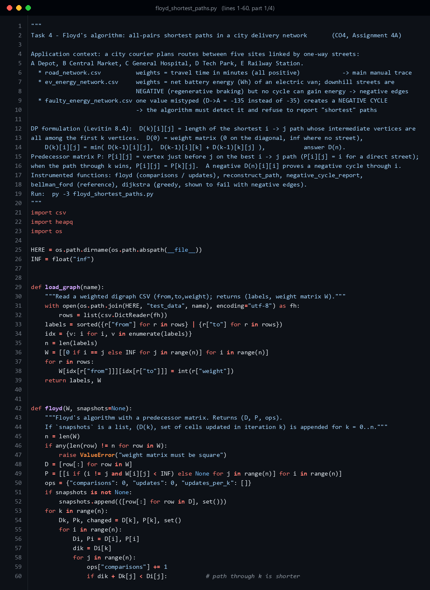

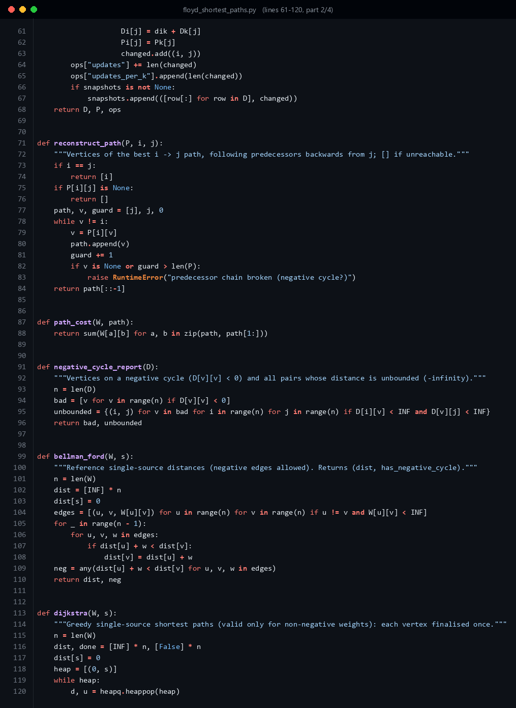

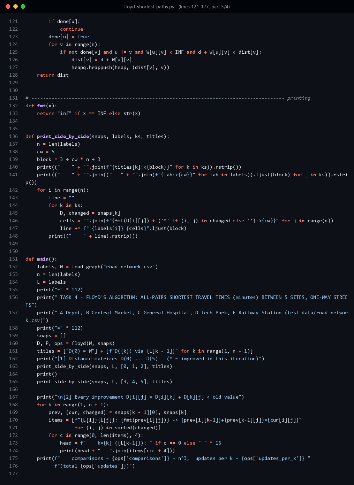

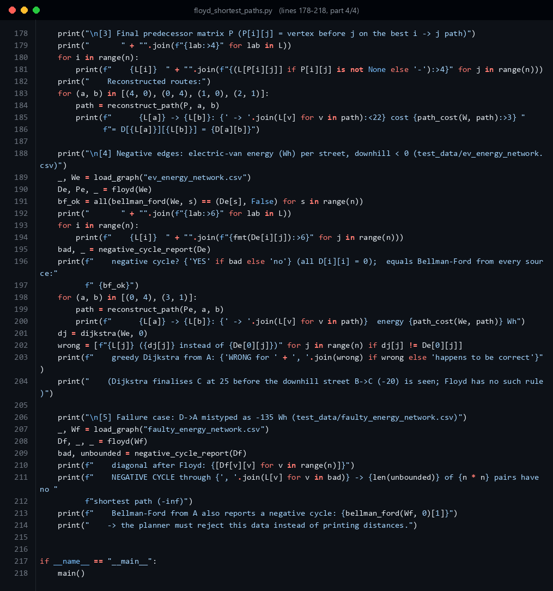

### 5. Manual trace: D(0) … D(5) for the travel-time network

Streets: A→B 4, A→C 11, B→C 5, B→D 9, C→D 2, C→E 7, D→E 3, D→A 6, E→B 4. Improved entries are in **bold**; in iteration k a cell can improve only if row i reaches k and k reaches j.

Table 25: D(0) = W (minutes)

| D(0) | A | B | C | D | E |
|---|---|---|---|---|---|
| A | 0 | 4 | 11 | ∞ | ∞ |
| B | ∞ | 0 | 5 | 9 | ∞ |
| C | ∞ | ∞ | 0 | 2 | 7 |
| D | 6 | ∞ | ∞ | 0 | 3 |
| E | ∞ | 4 | ∞ | ∞ | 0 |

**k = 1 (via A).** Only D reaches A (6). D[D][B] = min(∞, 6 + 4) = **10**; D[D][C] = min(∞, 6 + 11) = **17**. 2 improvements.

Table 26: D(1)

| D(1) | A | B | C | D | E |
|---|---|---|---|---|---|
| A | 0 | 4 | 11 | ∞ | ∞ |
| B | ∞ | 0 | 5 | 9 | ∞ |
| C | ∞ | ∞ | 0 | 2 | 7 |
| D | 6 | **10** | **17** | 0 | 3 |
| E | ∞ | 4 | ∞ | ∞ | 0 |

**k = 2 (via B).** A, D and E reach B (4, 10, 4); B reaches C (5) and D (9). A→C: min(11, 4 + 5) = **9**; A→D: min(∞, 4 + 9) = **13**; D→C: min(17, 10 + 5) = **15**; E→C: min(∞, 4 + 5) = **9**; E→D: min(∞, 4 + 9) = **13**. D→D stays 0 (10 + 9 > 0). 5 improvements.

Table 27: D(2)

| D(2) | A | B | C | D | E |
|---|---|---|---|---|---|
| A | 0 | 4 | **9** | **13** | ∞ |
| B | ∞ | 0 | 5 | 9 | ∞ |
| C | ∞ | ∞ | 0 | 2 | 7 |
| D | 6 | 10 | **15** | 0 | 3 |
| E | ∞ | 4 | **9** | **13** | 0 |

**k = 3 (via C).** C reaches D (2) and E (7). A→D: min(13, 9 + 2) = **11**; A→E: min(∞, 9 + 7) = **16**; B→D: min(9, 5 + 2) = **7**; B→E: min(∞, 5 + 7) = **12**; E→D: min(13, 9 + 2) = **11**. D→D, D→E unchanged (15 + 2 > 0, 15 + 7 > 3). 5 improvements.

Table 28: D(3)

| D(3) | A | B | C | D | E |
|---|---|---|---|---|---|
| A | 0 | 4 | 9 | **11** | **16** |
| B | ∞ | 0 | 5 | **7** | **12** |
| C | ∞ | ∞ | 0 | 2 | 7 |
| D | 6 | 10 | 15 | 0 | 3 |
| E | ∞ | 4 | 9 | **11** | 0 |

**k = 4 (via D).** Every site now reaches D (A 11, B 7, C 2, E 11) and D reaches A 6, B 10, C 15, E 3. A→E: min(16, 11 + 3) = **14**; B→A: min(∞, 7 + 6) = **13**; B→E: min(12, 7 + 3) = **10**; C→A: min(∞, 2 + 6) = **8**; C→B: min(∞, 2 + 10) = **12**; C→E: min(7, 2 + 3) = **5**; E→A: min(∞, 11 + 6) = **17**. 7 improvements – the largest step, because D is the hub that leads back to the depot.

Table 29: D(4)

| D(4) | A | B | C | D | E |
|---|---|---|---|---|---|
| A | 0 | 4 | 9 | 11 | **14** |
| B | **13** | 0 | 5 | 7 | **10** |
| C | **8** | **12** | 0 | 2 | **5** |
| D | 6 | 10 | 15 | 0 | 3 |
| E | **17** | 4 | 9 | 11 | 0 |

**k = 5 (via E).** E reaches B in 4, C in 9. C→B: min(12, 5 + 4) = **9**; D→B: min(10, 3 + 4) = **7**; D→C: min(15, 3 + 9) = **12**. 3 improvements; in total 2 + 5 + 5 + 7 + 3 = 22.

Table 30: D(5) – shortest travel times (minutes)

| D(5) | A | B | C | D | E |
|---|---|---|---|---|---|
| A | 0 | 4 | 9 | 11 | 14 |
| B | 13 | 0 | 5 | 7 | 10 |
| C | 8 | **9** | 0 | 2 | 5 |
| D | 6 | **7** | **12** | 0 | 3 |
| E | 17 | 4 | 9 | 11 | 0 |

Table 31: Final predecessor matrix P (vertex before j on the best i → j route)

| P | A | B | C | D | E |
|---|---|---|---|---|---|
| A | – | A | B | C | D |
| B | D | – | B | C | D |
| C | D | E | – | C | D |
| D | D | E | B | – | D |
| E | D | E | B | C | – |

**Route reconstruction.** E → A: P[E][A] = D, P[E][D] = C, P[E][C] = B, P[E][B] = E, so the route is **E → B → C → D → A** with 4 + 5 + 2 + 6 = 17 minutes = D[E][A]. Likewise A → E = A → B → C → D → E (4 + 5 + 2 + 3 = 14), B → A = B → C → D → A (13) and C → B = C → D → E → B (2 + 3 + 4 = 9). Every route is a chain of real streets whose cost equals the D entry.

**Negative streets (EV energy, Wh).** Same street layout with energies A→B 30, A→C 25, B→C −20, B→D 50, C→D 40, C→E −10, D→E 25, D→A −35, E→B 45 (every cycle has non-negative total, e.g. A→B→C→D→A = 30 − 20 + 40 − 35 = 15). Floyd gives the matrix of Table 32, all diagonal entries are 0 (no negative cycle) and every row equals Bellman–Ford from that source. Example routes: A → E = A → B → C → E with 30 − 20 − 10 = **0 Wh**, and D → B = D → A → B with −35 + 30 = **−5 Wh** (the van gains energy). Dijkstra from A is **wrong** for C (25 instead of 10), D (65 instead of 50) and E (15 instead of 0): it finalises C at 25 through the direct street before discovering the downhill street B → C (−20); Floyd has no "finalise" step and is unaffected.

Table 32: Shortest energy (Wh) between all sites, with downhill (negative) streets

| D(5) | A | B | C | D | E |
|---|---|---|---|---|---|
| A | 0 | 30 | 10 | 50 | 0 |
| B | −15 | 0 | −20 | 20 | −30 |
| C | 5 | 35 | 0 | 40 | −10 |
| D | −35 | −5 | −25 | 0 | −35 |
| E | 30 | 45 | 25 | 65 | 0 |

**Failure case – negative cycle.** In `faulty_energy_network.csv` the value D→A was mistyped as −135. Then D → A → B → C → D costs −135 + 30 − 20 + 40 = −85 < 0. After Floyd the diagonal is [−240, −240, −240, −325, −310]: all five sites lie on a negative cycle, all 25 pairs are unbounded (−∞), and Bellman–Ford from A independently reports a negative cycle. The program therefore **rejects the data** instead of printing meaningless "shortest" energies.

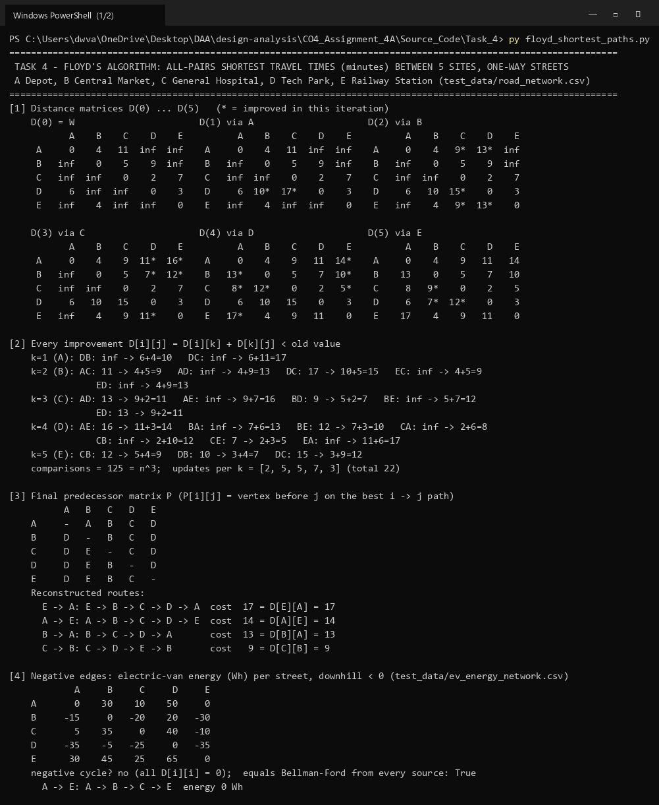

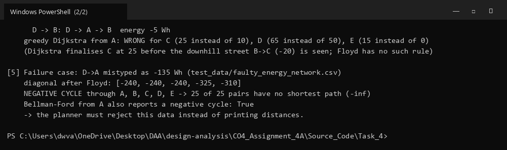

### 6. Calculations and complexity

The comparison in line 7 runs once per (k, i, j): C(n) = Σ<sub>k=1..n</sub> Σ<sub>i=1..n</sub> Σ<sub>j=1..n</sub> 1 = **n³** = 125 for n = 5 (counted: 125, with 22 improvements). Time **Θ(n³)** for every input (the number of improvements only changes the number of assignments, never the comparisons). Space **Θ(n²)**: D and P (2 × 25 cells here); keeping all D(k) would need Θ(n³) and is unnecessary because iteration k never changes row or column k. Path reconstruction is O(n) per pair (at most n − 1 hops); the negative-cycle test is Θ(n) for the diagonal plus O(n³) to mark unbounded pairs. Bellman–Ford costs Θ(nm) per source, n·Θ(nm) for all sources – worse than Floyd for dense graphs.

### 7. Test cases

Table 33: Test cases for Task 4 (`test_data/floyd_test_cases.csv`, hand-derived distance matrices; every test passed)

| Case | Network | Expected | Actual – result |
|---|---|---|---|
| F1 given | travel-time network | D(5) of Table 30 | identical, paths valid – PASS |
| F2 given | EV energy network (negative streets) | Table 32; no negative cycle | identical – PASS |
| F3 given | faulty EV network (D→A = −135) | negative cycle | detected (5 vertices) – PASS |
| F4 own | route 0→1→2 (1 + 1) vs street 0→2 (5) | D[0][2] = 2 | 2 – PASS |
| F5 own | unreachable vertices | ∞ entries, empty paths | identical – PASS |
| F6 own | zero-weight cycle | all 0, no negative cycle | identical – PASS |
| F7 own | negative street, no negative cycle | D[0][1] = 5 − 3 = 2 | 2 – PASS |
| F8 boundary | two-vertex cycle 2 + (−3) | negative cycle | detected (2 vertices) – PASS |
| F9 boundary | negative self-loop | negative cycle | detected (1 vertex) – PASS |
| F10–F11 boundary | single vertex; empty network | D = (0); empty | identical – PASS |
| P1–P2 property | route E→A; improvements per k | E-B-C-D-A, 17; [2, 5, 5, 7, 3] | exact – PASS |
| P3–P4 property | 200 random networks, negative streets | = Bellman–Ford; valid paths | hold – PASS |
| P5 property | 200 random, negative cycles possible | same verdict as Bellman–Ford | equal (15 cycles) – PASS |
| P6–P7 robustness | input unchanged; non-square input | ValueError for non-square | hold – PASS |

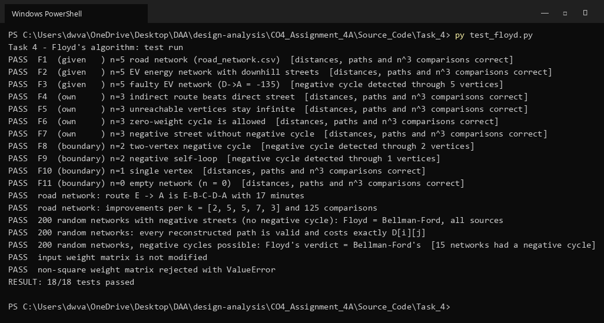

### 8. Experimental results

Negative-weight networks were generated with vertex potentials h: w′(u, v) = w(u, v) + h(u) − h(v). Around any cycle the h terms cancel, so every cycle keeps its original positive cost – many negative streets, provably no negative cycle.

Table 34: Floyd on random street networks (≈ 4n streets), median of 3 runs (results/floyd_growth.csv; every result matched Bellman–Ford from 3 sources)

| street weights | vertices (n) | streets (negative) | comparisons = n³ | updated cells | updates / n³ | time (s) |
|---|---|---|---|---|---|---|
| positive | 40 | 148 (0) | 64,000 | 3,899 | 0.0609 | 0.006 |
| positive | 80 | 308 (0) | 512,000 | 18,067 | 0.0353 | 0.047 |
| positive | 160 | 628 (0) | 4,096,000 | 95,257 | 0.0233 | 0.376 |
| positive | 320 | 1,267 (0) | 32,768,000 | 470,970 | 0.0144 | 3.050 |
| with negative | 160 | 633 (172) | 4,096,000 | 106,574 | 0.0260 | 0.360 |
| with negative | 320 | 1,271 (316) | 32,768,000 | 478,797 | 0.0146 | 2.960 |

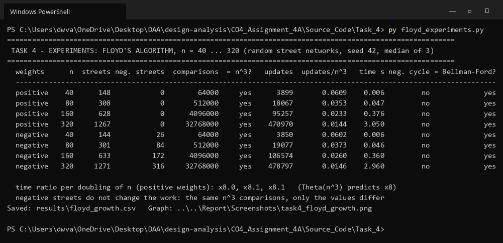

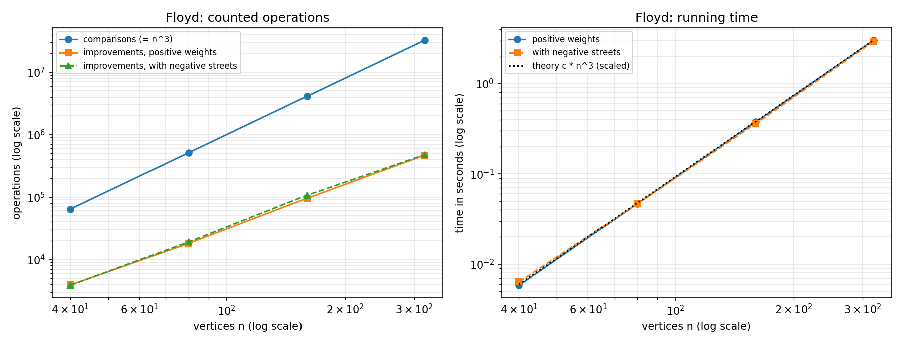

### 9. Analysis and conclusion

- **Θ(n³) confirmed.** Comparisons equalled n³ in every run and the time grew by ×8.0, ×8.1 and ×8.1 per doubling of n – exactly the predicted 2³. The improvements are a vanishing fraction of the work (6.1 % of n³ at n = 40, 1.4 % at n = 320), so the cost is dominated by comparisons, not by updates.
- **Negative streets cost nothing extra.** With 316 negative streets the time (2.960 s) and the comparisons were the same as with positive weights (3.050 s), and all results matched Bellman–Ford; only a negative *cycle* breaks the method, and the diagonal test catches it.
- **Recommendation.** For the courier's few dozen sites, Floyd with a predecessor matrix is the right tool: one Θ(n³) run gives every route, handles regenerative (negative) energy correctly where Dijkstra fails, and the D[v][v] < 0 check protects against data-entry errors. For thousands of sites with non-negative weights, repeated Dijkstra with a heap (O(n·m log n)) would be faster on sparse road graphs.

## Task 5 – Optimal Binary Search Tree: Chatbot Keyword Lookup [8 Marks]

> **Problem Context – Support-Chatbot Keyword Lookup.** A customer-support chatbot maps every message to one of four intent keywords stored in a binary search tree in alphabetical order: billing < login < refund < shipping. Last month's logs give their access probabilities: 0.35, 0.10, 0.25 and 0.30 (`test_data/intent_keywords.csv`).
> **Your Challenge:** Build the BST that minimises the average number of key comparisons per lookup.
> - Formulate the optimal-BST dynamic program and compute the main table C and the root table R by hand.
> - Construct the optimal tree from R and compute its average cost.
> - Compare it with a balanced BST (and with the "most probable key at the root" heuristic).
> - Derive the Θ(n³) complexity and discuss Knuth's Θ(n²) improvement.

**Evidence Expected**

> DP formulation, pseudocode, the traced C and R tables with the computation of every entry, the optimal tree and its cost, the comparison with other BSTs, verification, test cases and measured growth of both algorithms.

**Ans:**

### 1. Problem analysis

Input: keys a₁ < … < aₙ with access probabilities p₁, …, pₙ (only successful searches, as in Levitin). Output: a BST over these keys with minimum average cost Σ pₖ · depth(aₖ), where the root has depth 1 (one comparison). The number of BSTs on n keys is the Catalan number C(2n, n)/(n + 1) – 14 for n = 4, about 4ⁿ/n<sup>1.5</sup> in general – so exhaustive search is hopeless for large n. The problem has optimal substructure: if aₖ is the root of an optimal tree for aᵢ…aⱼ, its left subtree must be an optimal tree for aᵢ…aₖ₋₁ and its right subtree for aₖ₊₁…aⱼ (otherwise swapping in a better subtree would lower the cost). Making aₖ the root pushes every key of the range one level deeper, which adds exactly Σ pₛ over the range. Sub-ranges (i, j) are shared by many candidate roots – overlapping sub-problems – and there are only n(n + 1)/2 of them.

### 2. DP formulation

Table 35: DP formulation of the optimal BST (Levitin 8.3)

| Element | Definition |
|---|---|
| State | C[i][j] = smallest average number of comparisons for a BST on keys aᵢ … aⱼ; R[i][j] = its root |
| Recurrence | C[i][j] = min<sub>i ≤ k ≤ j</sub> { C[i][k − 1] + C[k + 1][j] } + Σ<sub>s=i..j</sub> pₛ for 1 ≤ i < j ≤ n |
| Base cases | C[i][i − 1] = 0 (empty tree), C[i][i] = pᵢ, R[i][i] = i |
| Order of computation | by diagonals d = j − i = 1, 2, …, n − 1 (every C on the right-hand side belongs to a shorter range) |
| Answer | C[1][n]; the tree is rebuilt from R[1][n] recursively |

The probabilities are stored as integer counts per 100 lookups (35, 10, 25, 30), so all arithmetic is exact and C/100 is the average cost.

### 3. Pseudocode

```
Algorithm OptimalBST(P[1..n])
// Output: average cost C[1][n] and root table R
1. for i = 1 to n do
2.     C[i][i-1] = 0;  C[i][i] = P[i];  R[i][i] = i
3. C[n+1][n] = 0
4. for d = 1 to n-1 do                                     // diagonal count
5.     for i = 1 to n-d do
6.         j = i + d;  minval = inf
7.         for k = i to j do                               // root candidate (count)
8.             if C[i][k-1] + C[k+1][j] < minval then
9.                 minval = C[i][k-1] + C[k+1][j];  kmin = k
10.        R[i][j] = kmin
11.        C[i][j] = minval + (prefix[j] - prefix[i-1])    // sum P[i..j] in O(1) with prefix sums
12. return C[1][n], R
```

```
Algorithm BuildTree(R, i, j)
1. if i > j then return NIL
2. k = R[i][j]
3. return node(key a_k, left = BuildTree(R, i, k-1), right = BuildTree(R, k+1, j))
```

```
Algorithm OptimalBSTKnuth(P[1..n])
// identical to OptimalBST except line 7:
7'.        for k = R[i][j-1] to R[i+1][j] do               // optimal roots are monotone (Knuth)
```

```
Algorithm BalancedBST(i, j)                // comparison tree: median key as root, ignores probabilities
1. if i > j then return NIL
2. k = floor((i + j) / 2);  return node(a_k, BalancedBST(i, k-1), BalancedBST(k+1, j))
```

### 4. Implementation

`optimal_bst.py` implements `optimal_bst` (Levitin's algorithm with prefix sums; it counts the root candidates examined and can record every candidate for the trace), `optimal_bst_knuth`, `build_tree`, `depths_of` and `tree_cost`, the two comparison trees (`balanced_depths`, `greedy_depths`) and an exhaustive generator `all_bsts` that enumerates all Catalan(n) trees to verify the optimum. Negative frequencies raise `ValueError`.

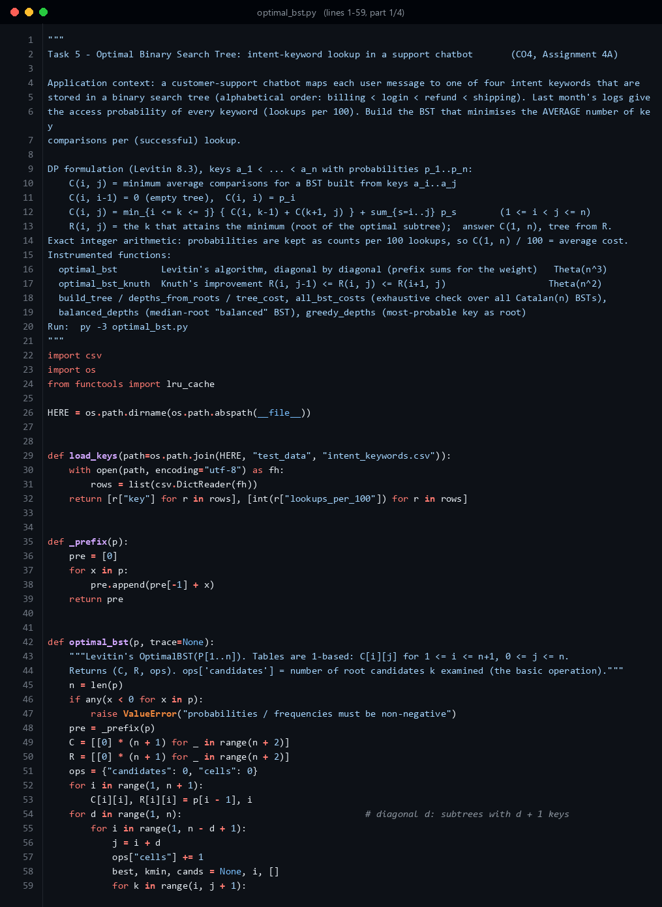

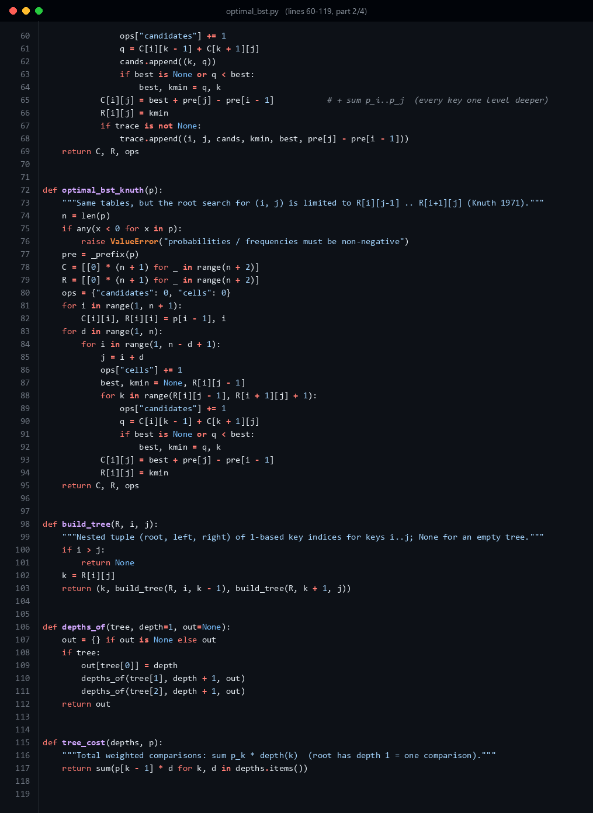

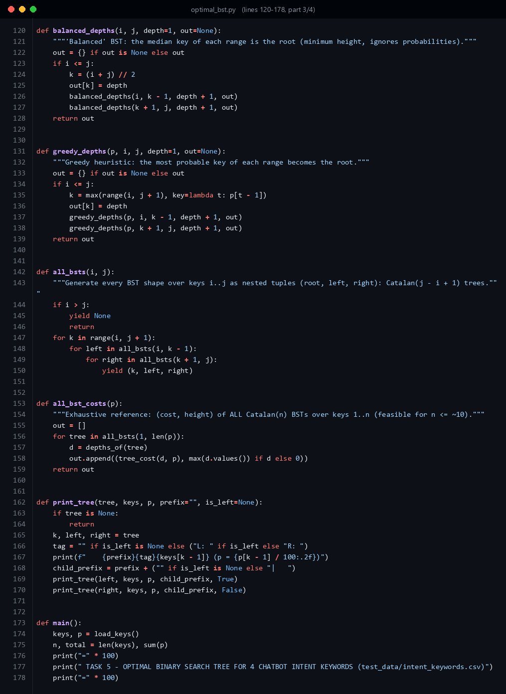

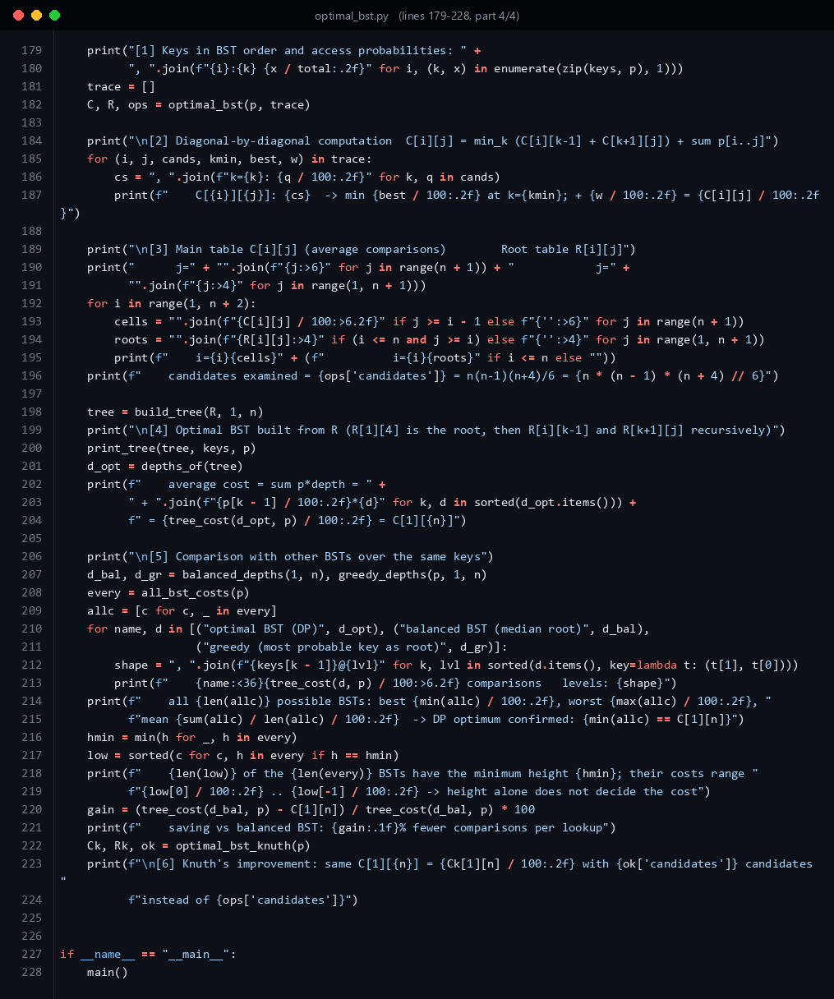

### 5. Manual trace: tables C and R

Keys 1 billing (0.35), 2 login (0.10), 3 refund (0.25), 4 shipping (0.30). Initial diagonals: C[1][1] = 0.35, C[2][2] = 0.10, C[3][3] = 0.25, C[4][4] = 0.30, all C[i][i − 1] = 0.

Table 36: Computation of every entry, diagonal by diagonal

| Table entry | k candidates: C[i][k−1] + C[k+1][j] | min (root) | + sum p(i..j) | C[i][j] value |
|---|---|---|---|---|
| C[1][2] | k=1: 0 + 0.10 = 0.10; k=2: 0.35 + 0 = 0.35 | 0.10 (k = 1) | 0.45 | **0.55** |
| C[2][3] | k=2: 0 + 0.25 = 0.25; k=3: 0.10 + 0 = 0.10 | 0.10 (k = 3) | 0.35 | **0.45** |
| C[3][4] | k=3: 0 + 0.30 = 0.30; k=4: 0.25 + 0 = 0.25 | 0.25 (k = 4) | 0.55 | **0.80** |
| C[1][3] | k=1: 0 + 0.45 = 0.45; k=2: 0.35 + 0.25 = 0.60; k=3: 0.55 + 0 = 0.55 | 0.45 (k = 1) | 0.70 | **1.15** |
| C[2][4] | k=2: 0 + 0.80 = 0.80; k=3: 0.10 + 0.30 = 0.40; k=4: 0.45 + 0 = 0.45 | 0.40 (k = 3) | 0.65 | **1.05** |
| C[1][4] | k=1: 0 + 1.05 = 1.05; k=2: 0.35 + 0.80 = 1.15; k=3: 0.55 + 0.30 = 0.85; k=4: 1.15 + 0 = 1.15 | 0.85 (k = 3) | 1.00 | **1.85** |

Table 37: Main table C[i][j] (average comparisons)

| i \ j | 0 | 1 | 2 | 3 | 4 |
|---|---|---|---|---|---|
| 1 | 0 | 0.35 | 0.55 | 1.15 | **1.85** |
| 2 |  | 0 | 0.10 | 0.45 | 1.05 |
| 3 |  |  | 0 | 0.25 | 0.80 |
| 4 |  |  |  | 0 | 0.30 |
| 5 |  |  |  |  | 0 |

Table 38: Root table R[i][j]

| i \ j | 1 | 2 | 3 | 4 |
|---|---|---|---|---|
| 1 | 1 | 1 | 1 | **3** |
| 2 |  | 2 | 3 | 3 |
| 3 |  |  | 3 | 4 |
| 4 |  |  |  | 4 |

**Tree construction.** R[1][4] = 3, so **refund** is the root. Its left subtree holds keys 1..2 with root R[1][2] = 1 (**billing**), whose right subtree is key 2..2 (**login**); its right subtree holds key 4..4 (**shipping**):

```
                refund (0.25)                 depth 1
               /             \
     billing (0.35)       shipping (0.30)     depth 2
               \
           login (0.10)                       depth 3
```

Average cost = 0.25·1 + 0.35·2 + 0.30·2 + 0.10·3 = 0.25 + 0.70 + 0.60 + 0.30 = **1.85 comparisons** = C[1][4]. Interestingly the root is *not* the most probable key (billing, 0.35): placing billing at the root would push both refund and shipping one level deeper.

**Comparison with other BSTs.** The balanced BST built by the usual median rule has root login (k = ⌊(1 + 4)/2⌋ = 2), billing and refund at depth 2 and shipping at depth 3: 0.10·1 + 0.35·2 + 0.25·2 + 0.30·3 = **2.20**. The greedy tree (most probable key of each range at the root) is a chain billing → shipping → refund → login: 0.35·1 + 0.30·2 + 0.25·3 + 0.10·4 = **2.10**. Enumerating all 14 BSTs gives costs from 1.85 to 2.50 (mean 2.23), so the DP optimum is confirmed. Six of the 14 trees have the minimum height 3, with costs from 1.85 to 2.30 – height alone does not decide the cost. The optimal tree saves (2.20 − 1.85)/2.20 = **15.9 %** of the comparisons of the balanced tree.

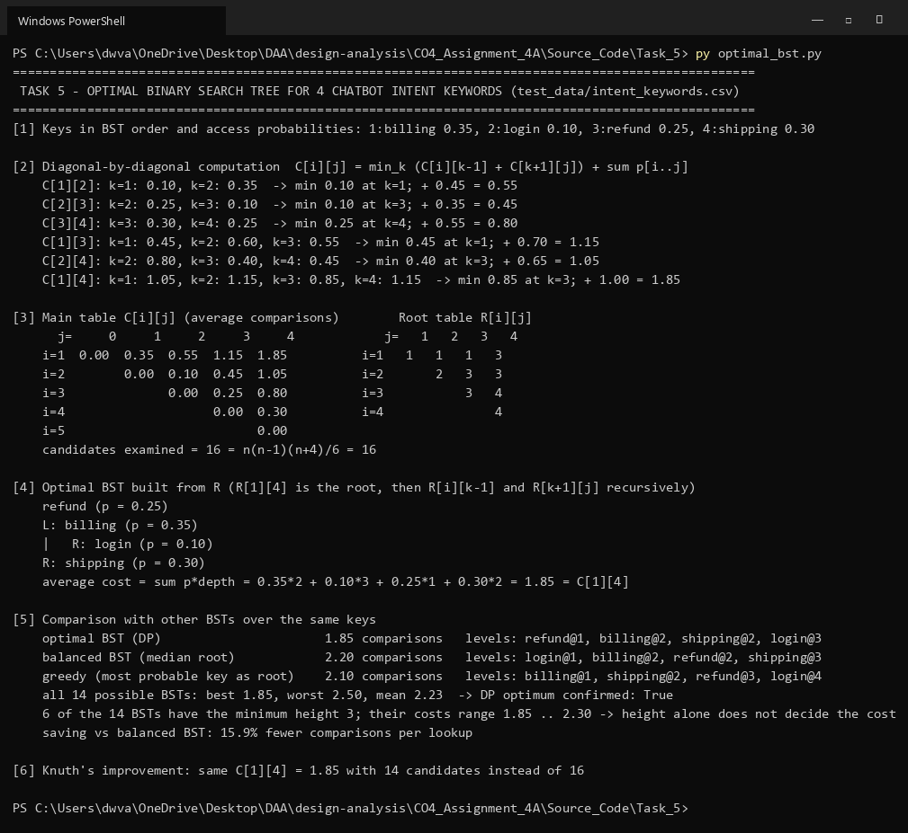

### 6. Calculations and complexity

The basic operation is the evaluation of one root candidate (line 8). Diagonal d contains n − d cells, each with d + 1 candidates:

C(n) = Σ<sub>d=1..n−1</sub> (n − d)(d + 1) = n·Σd + n(n − 1) − Σd² − Σd = (n − 1)·n(n − 1)/2 + n(n − 1) − (n − 1)n(2n − 1)/6 = **n(n − 1)(n + 4)/6** ∈ **Θ(n³)**

(sums over d = 1 … n − 1). For n = 4: 4·3·8/6 = **16** candidates (counted: 16). With prefix sums the Σ p term costs O(1); without them (Levitin's pseudocode sums inside the cell) it adds another Θ(n³) term. Space: two (n + 2) × (n + 1) tables, **Θ(n²)**. Building the tree from R is Θ(n).

**Knuth's improvement.** Knuth (1971) proved that optimal roots are monotone, R[i][j − 1] ≤ R[i][j] ≤ R[i + 1][j], so the k-loop can be restricted to that range. For a fixed diagonal d the work telescopes: Σ<sub>i</sub> (R[i + 1][i + d] − R[i][i + d − 1] + 1) = R[n − d + 1][n] − R[1][d] + (n − d) ≤ 2n, so each diagonal costs O(n) and the whole table **Θ(n²)**. For the chatbot keys it examined 14 candidates instead of 16; the difference grows quickly with n (Table 40).

### 7. Test cases

Table 39: Test cases for Task 5 (`test_data/obst_test_cases.csv`; costs = total weighted comparisons per 100 lookups; every test passed)

| Case | Keys and frequencies | Expected cost, root | Actual – result |
|---|---|---|---|
| O1 given | chatbot keys 35, 10, 25, 30 | 185, root 3 (refund) | 185, 3 – PASS |
| O2 given | Levitin's A–D: 10, 20, 40, 30 | 170, root 3 (C) | 170, 3 – PASS |
| O3 own | 7 equally likely keys | 17 = 1 + 2·2 + 4·3, root 4 | 17, 4 – PASS |
| O4 own | one dominant key: 1, 1, 90, 1, 1 | 100, root 3 | 100, 3 – PASS |
| O5 own | two keys 20, 80 | 120 = 80·1 + 20·2, root 2 | 120, 2 – PASS |
| O6 boundary | single key (7) | 7, root 1 | 7, 1 – PASS |
| O7 boundary | zero-probability keys 0, 50, 0 | 50, root 2 | 50, 2 – PASS |
| O8 boundary | empty key set | 0 | 0 – PASS |
| P1–P2 property | R table of the trace; 1.85 vs 2.20 | exact | exact – PASS |
| P3–P4 property | 200 random vs all Catalan(n) BSTs | DP = minimum; tree cost = C | equal – PASS |
| P5–P6 property | 100 random up to n = 60 vs Knuth | same optimum; n(n−1)(n+4)/6 | hold – PASS |
| P7 invalid | negative frequency | ValueError | raised – PASS |

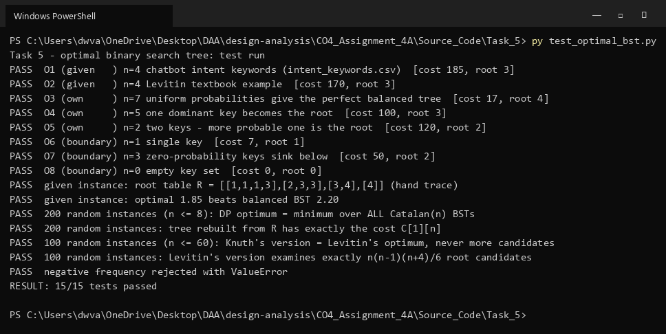

### 8. Experimental results

Keys received skewed (Zipf-like) access counts: the r-th most popular key gets about 1000/r lookups, in random key order (seed 42).

Table 40: Levitin's Θ(n³) algorithm vs Knuth's Θ(n²) version, median of 3 runs (results/obst_growth.csv; Levitin's count equals n(n − 1)(n + 4)/6 and both versions gave the same optimum in every row)

| n (keys) | Levitin cand. | Knuth cand. | Knuth / n² | Levitin (s) | Knuth (s) | optimal tree | balanced tree | greedy tree |
|---|---|---|---|---|---|---|---|---|
| 25 | 2,900 | 619 | 0.99 | 0.0005 | 0.0002 | 3.041 | 3.751 | 3.139 |
| 50 | 22,050 | 2,619 | 1.05 | 0.0038 | 0.0007 | 3.561 | 5.142 | 3.956 |
| 100 | 171,600 | 9,392 | 0.94 | 0.0318 | 0.0027 | 3.972 | 5.693 | 4.491 |
| 200 | 1,353,200 | 35,368 | 0.88 | 0.2321 | 0.0124 | 4.388 | 6.788 | 4.790 |
| 400 | 10,746,400 | 166,046 | 1.04 | 1.9207 | 0.0466 | 5.022 | 7.917 | 5.698 |

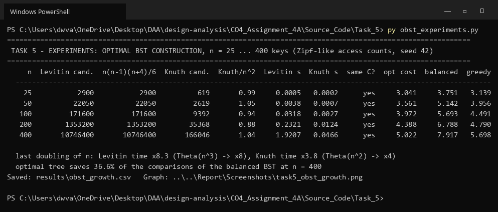

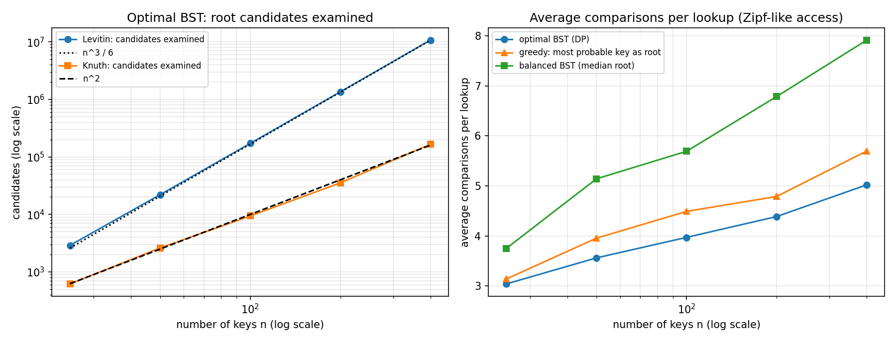

### 9. Analysis and conclusion

- **Θ(n³) and Θ(n²) confirmed.** Levitin's candidate count matched n(n − 1)(n + 4)/6 exactly at every n and its time grew ×8.3 at the last doubling; Knuth's count stayed between 0.88n² and 1.05n² and its time grew ×3.8 (theory ×4). At n = 400 Knuth's version examined 65 times fewer candidates (166,046 vs 10,746,400) and ran 41 times faster (0.0466 s vs 1.9207 s) while producing exactly the same optimal cost in all 5 runs.
- **Value of the optimal tree.** With skewed access the optimal tree needs 5.022 comparisons per lookup at n = 400, the greedy tree 5.698 and the balanced tree 7.917 – the DP saves 36.6 % compared with the balanced tree; for the 4 chatbot keys the saving is 15.9 %.
- **Recommendation.** Rebuild the chatbot's keyword tree from the monthly log with the DP (Knuth's version for large vocabularies, Θ(n²)); a self-balancing BST is the better choice only when the probabilities are unknown or change constantly, because it ignores them.

## Task 6 – Day-4 Design Challenge: Large-Capacity Knapsack with Item Recovery [10 Marks]

> **Problem Context – Changed Requirement for the Task 2 Planner.** The drone planner of Task 2 is reused by an air-cargo feeder service. It must now choose among n = 200 consignments for a payload of W = 100,000 kg at 1 kg resolution, and it must still report **which** consignments to load. The planner runs in a container in which the solver may use at most **32 MB** of memory. The instance is `test_data/large_instance_n200_W100000.csv` (generated with seed 42: weights 104–4,985 kg, total 490,907 kg = 4.9 × W).
> **Your Challenge:** Analyse the impact of the change, evaluate the original design, redesign it, predict the behaviour of the redesign, implement it and validate it with evidence.

**Ans:**

### A. Analyse the Impact of the Changed Requirement [2 Marks]

> Quantify what the new n and W do to the time and the memory of the Task 2 design, and identify which resource becomes the bottleneck.

**Ans:**

The DP formulation does not change (F[i][j] = max(F[i − 1][j], vᵢ + F[i − 1][j − wᵢ])), but the table size explodes because the time and the memory of the Task 2 design are both proportional to n·W:

Table 41: Impact of the new requirement on the Task 2 design

| Quantity | Task 2 drone instance | New requirement | Factor |
|---|---|---|---|
| items n, capacity W | 5, 10 kg | 200, 100,000 kg | ×40, ×10,000 |
| table cells (n + 1)(W + 1) | 66 | 20,100,201 | ×304,548 |
| cell evaluations n·W | 50 | 20,000,000 | ×400,000 |
| time at 165 ns per cell (Task 2 measurement) | 8 µs | ≈ 3.3 s | fine |
| memory as 4-byte integers | 264 B | 20,100,201 × 4 B = 76.7 MB | 2.4 × budget |
| memory as 8-byte integers | 528 B | 153.4 MB | 4.8 × budget |
| memory as Python lists (22.3 B per cell, Task 2) | 1.5 KB | ≈ 427 MB | 13 × budget |

**Conclusion of the impact analysis.** About 3 seconds of computation is acceptable for a loading plan, so **time is not the problem – memory is**: every representation of the full table exceeds the 32 MB budget. The cause is the pseudo-polynomial nature of the DP: W = 100,000 needs only 17 bits to write down, but the table has one column for every kilogram. The requirement to *report the consignments* is what forces the full table in Task 2, because backtracking needs the earlier rows.

### B. Evaluate the Original Design [2 Marks]

> Decide, with evidence, whether the original table, the memory function or the single-row version of Task 2 can meet the new requirement.

**Ans:**

I ran the original Task 2 code unchanged on the full instance in a fresh process: it found the optimum 128,890 (58 consignments, 99,988 kg) in 3.46 s but its peak private memory was **396.7 MB – 12.4 times the budget** (Figure 51). The experiment E1 (Table 45) shows that it stays within 32 MB only up to W = 12,500 kg (29.5 MB), i.e. only if the weight unit were coarsened to 8 kg.

Table 42: Evaluation of the candidate designs for n = 200, W = 100,000 kg, 32 MB

| Design | Time | Memory | Reports items? | Verdict |
|---|---|---|---|---|
| Task 2 table + backtracking | Θ(nW); 3.46 s | Θ(nW); 396.7 MB | yes | violates 32 MB |
| memory function (top-down) | O(nW); 1–3× slower | Θ(nW) table + stack | yes | violates 32 MB |
| single value row | Θ(nW) | Θ(W); 100,001 values | no | fails item report |
| 1-byte decisions + one row | Θ(nW) | 19.2 MB + row | yes | fits, 1.7× headroom |
| brute force | 2²⁰⁰ subsets | Θ(n) | yes | infeasible |
| greedy by value/weight | Θ(n log n) | Θ(n) | yes | not optimal (88 < 94) |

The original design is correct and fast enough, but it stores far more than it needs: backtracking only asks the *yes/no* question "is F[i][j] ≠ F[i − 1][j]?" for one cell per row. A redesign must keep the Θ(nW) time but must not keep Θ(nW) *values*.

### C. Redesign [2 Marks]

> Propose a dynamic-programming design that meets the memory limit and still recovers the chosen consignments. Justify its correctness and give its pseudocode and cost.

**Ans:**

I designed two variants and a planner that chooses between them.

**R1 – one value row + one decision bit per cell.** Process the items with the single-row recurrence of Task 2 (j downward), and whenever item i improves capacity j set the bit keep[i][j] = 1. Since F[i][j] ≥ F[i − 1][j] always, "F[i][j] ≠ F[i − 1][j]" is the same as "F[i][j] > F[i − 1][j]", which is exactly the moment the in-place update fires. Therefore keep[i][j] answers the backtracking question, and walking back from (n, W) with these bits recovers **exactly the same consignments as the Task 2 table**. Memory: one row of W + 1 values plus n(W + 1) bits = 0.76 MB + 2.38 MB = 3.1 MB with 8-byte values. Time Θ(nW), one pass.

**R2 – Hirschberg-style divide and conquer.** Split the items into two halves L and R and compute their value rows FL[0..cap] and FR[0..cap] with the single-row method (Θ(cap) memory each). If S* is an optimal load and c₁ is the weight it takes from L, then value(S*) ≤ FL[c₁] + FR[cap − c₁] ≤ max<sub>c</sub> (FL[c] + FR[cap − c]); the maximum is also achievable (combine an optimal load of L with capacity c* and one of R with capacity cap − c*), so the best split c* gives the optimum. Recurse on (L, c*) and (R, cap − c*), freeing both rows first; a single item is loaded if it fits. Memory **Θ(W) independent of n** (two rows at a time, recursion depth ⌈log₂ n⌉ + 1). Cost: at recursion level ℓ the subproblems contain n/2^ℓ items each and their capacities add up to at most W (capacities are split, never copied), so level ℓ evaluates at most nW/2^ℓ cells; summing over all levels gives **≤ 2nW** cells – still Θ(nW).

```
Algorithm KnapsackBitPacked(w[1..n], v[1..n], W)
1. for j = 0 to W do best[j] = 0                           // one value row, Theta(W)
2. for i = 1 to n do
3.     keep[i] = all-zero bit string of length W + 1
4.     for j = W downto w[i] do                            // downward: best[j - w[i]] is still row i-1
5.         if v[i] + best[j - w[i]] > best[j] then
6.             best[j] = v[i] + best[j - w[i]];  keep[i][j] = 1
7. S = empty set;  j = W
8. for i = n downto 1 do                                   // Task 2 backtracking, reading bits
9.     if keep[i][j] = 1 then S = S + {i};  j = j - w[i]
10. return best[W], S
```

```
Algorithm SolveDC(lo, hi, cap)                            // R2; S is a global result set
1. if lo >= hi or cap = 0 then return
2. if hi - lo = 1 then
3.     if w[lo] <= cap and v[lo] > 0 then S = S + {lo}
4.     return
5. mid = floor((lo + hi) / 2)
6. L = ValueRow(lo..mid-1, cap);  R = ValueRow(mid..hi-1, cap)    // single-row DP, Theta(cap) memory each
7. c* = argmax over c = 0..cap of L[c] + R[cap - c]        // best capacity split
8. free L and R
9. SolveDC(lo, mid, c*);  SolveDC(mid, hi, cap - c*)
```

```
Algorithm PlanLoad(w, v, W, budget)
1. if predicted memory of R1 (one row + n(W+1) bits) <= budget then return KnapsackBitPacked(w, v, W)
2. else if predicted memory of R2 (two rows) <= budget then return SolveDC(0, n, W)
3. else refuse and recommend a coarser weight unit (e.g. 10 kg, i.e. W / 10)
```

R1 is simpler and does half the work of R2, so it is preferred whenever its n·W bits fit; R2 is the fallback for many items, because its memory does not depend on n.

### D. Predict [1 Mark]

> Before running the new code, predict its operation counts, time and memory and compare them with the original design.

**Ans:**

All predictions were made from formulas and the Task 2 measurements, before running the new code; `large_knapsack.py` prints the memory predictions first (section [2] of Figure 51).

Table 43: Predictions for n = 200, W = 100,000 kg

| Quantity | Original table | R1 bit-packed | R2 divide and conquer |
|---|---|---|---|
| cells evaluated | n·W = 20,000,000 | Σ(W − wᵢ + 1) = 200 × 100,001 − 490,907 = **19,509,293** | between nW and 2nW, close to 2 × R1 (≈ 37 million) |
| time | 20 M × 165 ns ≈ 3.3 s | ≤ 19.5 M × 142 ns (Task 2 single row) ≈ 2.8 s | ≈ 1.9 × R1 |
| memory, 8-byte model | 153.4 MB | 3.1 MB | 1.5 MB |
| memory in Python | 22.3 B × 20.1 M ≈ 427 MB | 36 B × 100,001 + bits ≈ 6.0 MB | 2 × 3.4 MB ≈ 6.9 MB |
| growth with n (W fixed) | linear | slow (only the bits grow) | none |
| meets 32 MB? | no | yes | yes |

### E. Implement [1 Mark]

> Implement the redesign with operation counters and a fair measurement of memory.

**Ans:**

`large_knapsack.py` generates and saves the instance, predicts the memory (`predict_memory_mb`), and implements `knapsack_bitpacked` (R1: a `bytearray` of flags per item, packed into a Python integer with one bit per capacity; cells and improvements counted per row), `knapsack_divide_conquer` (R2 with `_value_row`, counting cells and split checks and recording the recursion depth), `choose_design`/`plan_load` (the decision rule) and the measurement harness. To measure memory the way a container limit sees it, every design runs in a **fresh child process** (`measure_in_child`), which reports the optimum, the items, the cells, the time and the peak private memory after solving minus the private memory just before solving (an upper bound of the solver's own peak; start-up slack 0.0 MB). The original design is imported unchanged from `Task_2/knapsack_dp.py`.

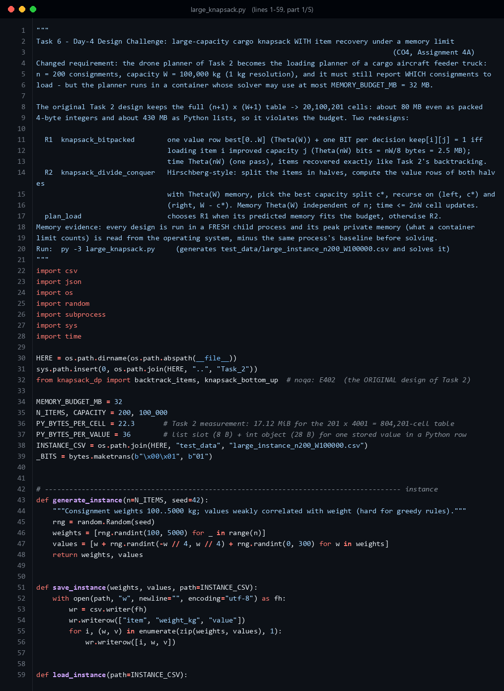

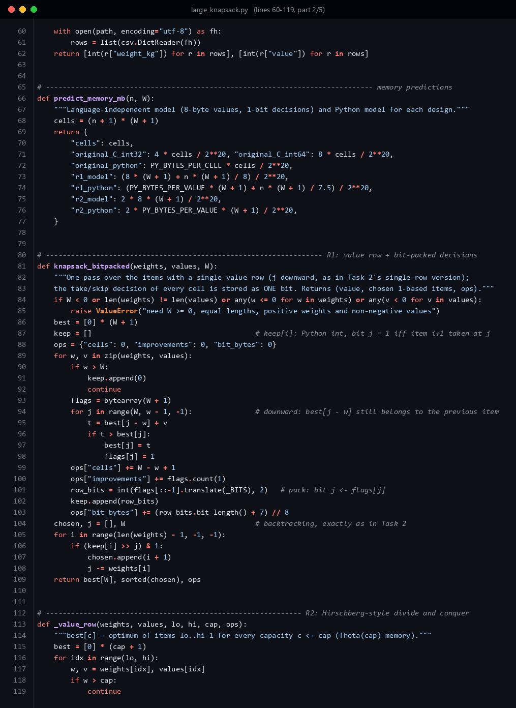

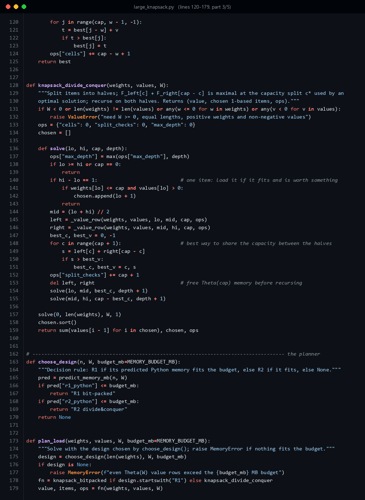

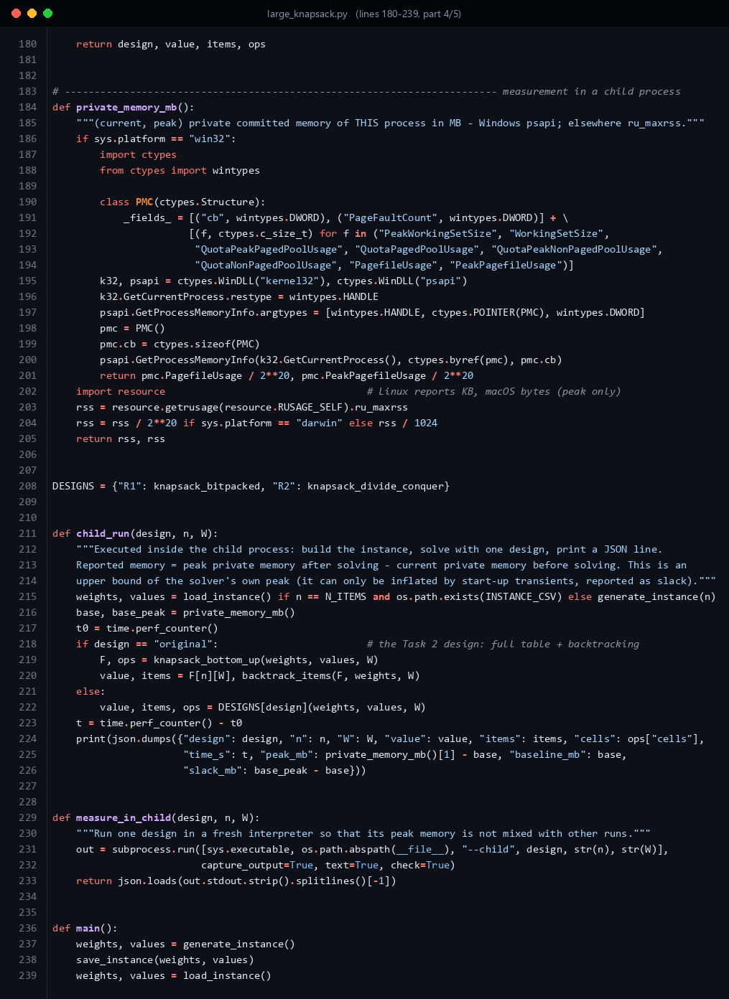

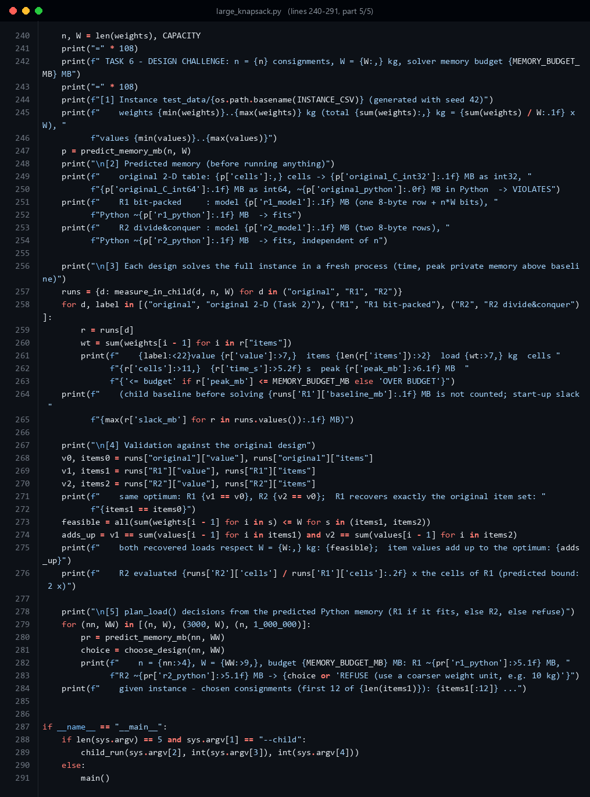

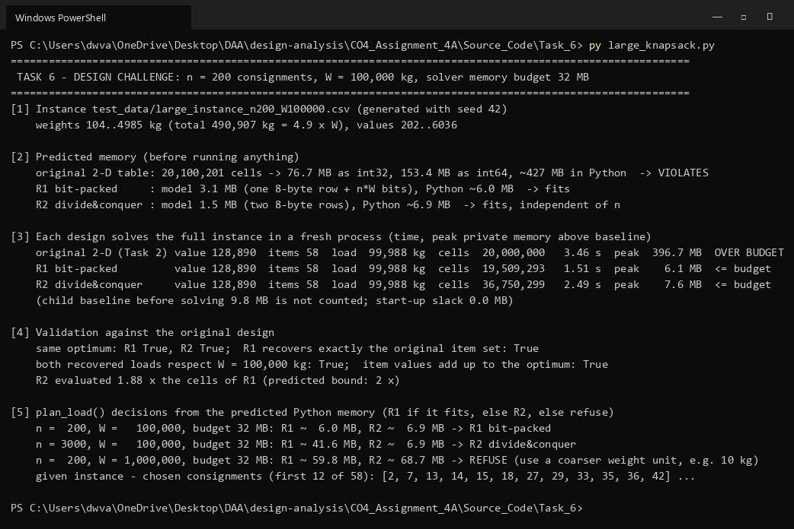

### F. Validate with Evidence [2 Marks]

> Compare the predictions with measurements, verify the correctness of the redesign against the original design, and give a justified final recommendation.

**Ans:**

Table 44: Predicted vs measured on the full instance (results/large_knapsack_log.txt)

| Quantity | Predicted | Measured | Comment |
|---|---|---|---|
| optimum (all designs) | identical | 128,890 – 58 consignments, 99,988 kg ≤ 100,000 kg | R1 items = original items exactly |
| original: cells / time / memory | 20,000,000 / ≈ 3.3 s / ≈ 427 MB | 20,000,000 / 3.46 s / **396.7 MB** | over budget, as predicted (memory 7 % below the estimate) |
| R1: cells / time / memory | 19,509,293 / ≤ 2.8 s / ≈ 6.0 MB | 19,509,293 / 1.51 s / **6.1 MB** | cells exact; faster because counters are per row |
| R2: cells / time / memory | ≈ 1.9 × R1 / ≈ 1.9 × R1 / ≈ 6.9 MB | 36,750,299 (1.88 × R1) / 2.49 s / **7.6 MB** | within the 2nW bound |

Table 45: E1 – growing capacity, n = 200, one fresh process per run (results/large_knapsack_E1.csv; all three designs found the same optimum)

| capacity W (kg) | optimum value | original: MB / s | R1: MB / s | R2: MB / s | cells orig. / R1 / R2 (M) |
|---|---|---|---|---|---|
| 12,500 | 18,785 | 29.5 / 0.50 | 0.2 / 0.13 | 1.2 / 0.24 | 2.50 / 2.01 / 3.12 |
| 25,000 | 35,143 | 67.6 / 0.87 | 1.5 / 0.30 | 1.4 / 0.58 | 5.00 / 4.51 / 7.87 |
| 50,000 | 67,158 | 161.3 / 2.49 | 2.4 / 0.76 | 3.8 / 1.23 | 10.00 / 9.51 / 17.26 |
| 100,000 | 128,890 | 396.7 / 3.98 | 6.0 / 1.61 | 7.5 / 2.73 | 20.00 / 19.51 / 36.75 |

Table 46: E2 – growing number of consignments, W = 100,000 kg (results/large_knapsack_E2.csv; pred. = predicted from 22.3 bytes per cell, not run)

| n (items) | optimum value | original MB | R1: MB / s | R2: MB / s | cells R1 / R2 (M) | R2 / R1 cells |
|---|---|---|---|---|---|---|
| 50 | 110,835 | 162.4 | 4.9 / 0.42 | 7.5 / 0.88 | 4.88 / 9.21 | 1.89 |
| 100 | 122,591 | 234.8 | 5.5 / 0.74 | 7.5 / 1.29 | 9.76 / 18.39 | 1.88 |
| 200 | 128,890 | 396.7 | 6.0 / 1.61 | 7.5 / 2.73 | 19.51 / 36.75 | 1.88 |
| 400 | 133,545 | ≈ 853 (pred.) | 6.8 / 3.16 | 7.5 / 5.03 | 39.01 / 73.60 | 1.89 |
| 800 | 140,879 | ≈ 1,703 (pred.) | 7.9 / 5.65 | 7.5 / 10.38 | 77.95 / 146.28 | 1.88 |


Table 47: Test cases for Task 6 (`test_data/large_knapsack_test_cases.csv` plus property tests; every test passed)

| Case | Input | Expected | Actual (R1 and R2) – result |
|---|---|---|---|
| L1–L2 given | Task 2 drone instance; Levitin's instance | 94; 37 | 94 [1, 3, 4]; 37 [1, 2, 4] – PASS |
| L3–L4 own | odd number of items; optimum uses the split point | 30; 14 | 30; 14 – PASS |
| L5–L10 boundary | no items, W = 0, all too heavy, all fit, exact fit, zero values | 0, 0, 0, 6, 9, 8 | identical – PASS |
| P1–P3 property | 300 random instances vs Task 2 and brute force | same optimum; same R1 items | hold – PASS |
| P4–P7 property | n = 200, W = 5,000: optimum, cell counts, bits | 7,753; ≤ 2nW; ≤ n(W+1)/8 B | hold – PASS |
| P8 property | 30 random instances: R2 within 2nW | hold | hold – PASS |
| P9–P11 planner | (200, 10⁵) → R1; (3,000, 10⁵) → R2; W = 10⁶ | R1; R2; MemoryError | as expected – PASS |
| P12–P14 robustness | zero weight (R1, R2); seed-42 instance file | ValueError; identical file | hold – PASS |


**Evaluation of the evidence.**

1. **Correctness.** On the full instance all three designs returned 128,890; R1 recovered exactly the 58 consignments of the original table, and R2's set is feasible and adds up to the optimum. In all 8 experiment configurations and in 300 random instances (checked against brute force) the optimum agreed.
2. **Memory.** The original table's memory grew linearly with W (29.5 → 396.7 MB, 12.3 → 20.7 bytes per cell as more cells hold newly created integers) and with n (162.4 → 396.7 MB). R1 stayed at 6.0–6.1 MB on the target instance – **65 times less than the original and 5 times below the budget** – and grew only from 4.9 to 7.9 MB when n went from 50 to 800, because only the bits depend on n. R2 used 7.5 MB for every n, confirming Θ(W) memory; it overtakes R1 at about n = 800. The prediction for the original (≈ 427 MB) was 7 % pessimistic; the R1 and R2 predictions were within 0.7 MB. (Values below 1 MB, such as R1 at W = 12,500, are within the allocator's reuse of freed memory and should not be over-interpreted.)
3. **Time and operations.** R1's cell count matched the prediction exactly, and R2 evaluated 1.88–1.89 times the cells of R1, inside the proved 2nW bound. R1 was 2.3 times faster than the original (1.51 s vs 3.46 s); part of that gain comes from implementation details (the Task 2 code updates dictionary counters inside its inner loop and allocates a new row per item, R1 counts once per row), so the fair comparison is the cell count – 19.5 M vs 20.0 M, essentially equal.
4. **Decision rule.** With 32 MB the planner selects R1 for the target (≈ 6.0 MB predicted), switches to R2 for 3,000 consignments (R1 ≈ 41.6 MB > 32 MB, R2 ≈ 6.9 MB), and refuses W = 1,000,000 kg (even two Python rows need ≈ 68.7 MB), advising a 10 kg weight unit instead.

**Final recommendation.** Replace the Task 2 table with **R1 (one value row + bit-packed decisions)** behind `plan_load()`: it gives the same optimal and identical consignment list, runs in Θ(nW) time with one pass (1.5 s), and needs Θ(W + nW/8) memory (6.1 MB of the 32 MB). Keep **R2 (Hirschberg-style divide and conquer)** as the automatic fallback when the number of consignments makes the decision bits too large, since its memory is Θ(W) regardless of n at the price of at most twice the work. In a compiled implementation with 8-byte values the same designs would need only 3.1 MB and 1.5 MB.

### Summary of Findings

Table 48: Summary of findings for Assignment 4A

| Task no. | Problem (technique) | Time | Space | Key evidence |
|---|---|---|---|---|
| 1 | binomial coefficient | Θ(nk) | Θ(k) (one row) | DP 27,000× faster at n = 24 |
| 2 | 0/1 knapsack (drone) | Θ(nW) | Θ(nW) or Θ(W) | optimum 94; 165 ns per cell |
| 3 | Warshall closure | Θ(n³) | Θ(n²) | ×7.9–8.4 per doubling of n |
| 4 | Floyd all-pairs routes | Θ(n³) | Θ(n²) | negative cycle detected |
| 5 | optimal BST (chatbot) | Θ(n³); Knuth Θ(n²) | Θ(n²) | 1.85 vs 2.20 (−15.9 %) |
| 6 | knapsack, W = 100,000 | Θ(nW) | Θ(W + nW/8) | 396.7 MB → 6.1 MB, same optimum |

Across the six tasks the same pattern held: once the recurrence, the base cases and a valid order of computation are fixed, every DP turns an exponential search into a polynomial (or pseudo-polynomial) table computation, the counted operations match the closed forms exactly, and the measured times follow the predicted growth. The table itself then becomes the resource to engineer – by keeping one row (Tasks 1 and 2), updating in place (Tasks 3 and 4), restricting the search range (Knuth, Task 5) or storing only decisions (Task 6).

<!-- pagebreak -->

### Appendix A – Complete Source Code: algorithm modules and test programs

Each task folder `Source_Code/Task_N/` contains the main module (algorithms and the manual-trace demo) and its test program. The experiment programs that produce the CSV files and graphs are in Appendix B.

#### Task_1/binomial_dp.py

```
"""
Task 1 - Overlapping subproblems: the binomial coefficient C(n, k)        (CO4, Assignment 4A)

Application context: a QA team plans combinatorial test suites. The number of different k-flag
configurations that can be drawn from n feature flags is C(n, k). The recurrence
        C(n, k) = C(n-1, k-1) + C(n-1, k),   C(n, 0) = C(n, n) = 1
has OVERLAPPING SUBPROBLEMS, so plain recursion recomputes the same values again and again.

Instrumented algorithms (every function returns (value, counters)):
  binom_naive      plain recursion                         2*C(n,k) - 1 calls, C(n,k) - 1 additions
  binom_memo       top-down recursion + memo table         k(n-k) additions, Theta(nk) space
  binom_bottom_up  Levitin's Binomial(n, k) Pascal table   (k-1)k/2 + k(n-k) additions, Theta(nk) space
  binom_one_row    same recurrence on ONE row (j downward)  same additions, Theta(k) space
  fib_naive / fib_memo / fib_bottom_up                     Fibonacci warm-up (the classic overlap example)

Run:  py -3 binomial_dp.py      -> prints the manual-trace tables used in the report (C(6, 3)).
"""
import sys

sys.setrecursionlimit(10_000)


# ----------------------------------------------------------------------------------------- helpers
def _check(n, k):
    """Validate the arguments. Returns False when C(n, k) is trivially 0 (k < 0 or k > n)."""
    if not isinstance(n, int) or not isinstance(k, int):
        raise TypeError("n and k must be integers")
    if n < 0:
        raise ValueError("n must be non-negative")
    return 0 <= k <= n


def formula_bottom_up_additions(n, k):
    """Closed form for the additions of Binomial(n, k):  sum_{i=1..k}(i-1) + sum_{i=k+1..n} k."""
    return (k - 1) * k // 2 + k * (n - k)


# ----------------------------------------------------------------------------------- 1. naive recursion
def binom_naive(n, k):
    """Plain top-down recursion. Counts every call and every addition."""
    ops = {"calls": 0, "additions": 0, "max_depth": 0}
    if not _check(n, k):
        return 0, ops

    def rec(i, j, depth):
        ops["calls"] += 1
        ops["max_depth"] = max(ops["max_depth"], depth)
        if j == 0 or j == i:                      # base cases C(i, 0) = C(i, i) = 1
            return 1
        ops["additions"] += 1
        return rec(i - 1, j - 1, depth + 1) + rec(i - 1, j, depth + 1)

    return rec(n, k, 1), ops


# ------------------------------------------------------------------------------ 2. memoised recursion
def binom_memo(n, k, want_table=False):
    """Top-down DP (memory function): each sub-problem C(i, j) is solved at most once."""
    ops = {"calls": 0, "base": 0, "hits": 0, "additions": 0}
    memo, visited = {}, set()
    if not _check(n, k):
        return (0, ops, memo, visited) if want_table else (0, ops)

    def rec(i, j):
        ops["calls"] += 1
        visited.add((i, j))
        if j == 0 or j == i:
            ops["base"] += 1
            return 1
        if (i, j) in memo:                        # overlapping sub-problem -> reuse stored value
            ops["hits"] += 1
            return memo[(i, j)]
        ops["additions"] += 1
        memo[(i, j)] = rec(i - 1, j - 1) + rec(i - 1, j)
        return memo[(i, j)]

    value = rec(n, k)
    return (value, ops, memo, visited) if want_table else (value, ops)


# ------------------------------------------------------------------------- 3. bottom-up Pascal table
def binom_bottom_up(n, k, want_table=False):
    """Levitin's Binomial(n, k): fill rows i = 0..n, columns j = 0..min(i, k) of Pascal's triangle."""
    ops = {"additions": 0, "cells": 0}
    if not _check(n, k):
        return (0, ops, []) if want_table else (0, ops)
    C = [[None] * (k + 1) for _ in range(n + 1)]
    for i in range(n + 1):
        for j in range(min(i, k) + 1):
            ops["cells"] += 1
            if j == 0 or j == i:
                C[i][j] = 1                               # base cases on the two edges
            else:
                C[i][j] = C[i - 1][j - 1] + C[i - 1][j]   # the recurrence
                ops["additions"] += 1
    return (C[n][k], ops, C) if want_table else (C[n][k], ops)


# --------------------------------------------------------------------- 4. space-optimised single row
def binom_one_row(n, k, modulus=None, trace=None):
    """Theta(k)-space version: row[j] holds C(i, j); j runs DOWNWARD so row[j-1] is still C(i-1, j-1).
    Optional `modulus` keeps the numbers word-sized (C(n, k) mod p); optional list `trace` gets every row."""
    ops = {"additions": 0, "cells_stored": k + 1}
    if not _check(n, k):
        return 0, ops
    row = [1] + [0] * k                                   # row 0 of Pascal's triangle
    if trace is not None:
        trace.append(list(row))
    for i in range(1, n + 1):
        for j in range(min(i, k), 0, -1):
            if j == i:
                row[j] = 1                                # right edge C(i, i) = 1, no addition
            else:
                row[j] = row[j] + row[j - 1]              # C(i,j) = C(i-1,j) + C(i-1,j-1)
                if modulus:
                    row[j] %= modulus
                ops["additions"] += 1
        if trace is not None:
            trace.append(list(row))
    return row[k], ops


# --------------------------------------------------------------------------------- Fibonacci warm-up
def fib_naive(n):
    """F(n) = F(n-1) + F(n-2), F(0) = 0, F(1) = 1 by plain recursion: 2F(n+1) - 1 calls."""
    ops = {"calls": 0, "additions": 0}

    def rec(m):
        ops["calls"] += 1
        if m < 2:
            return m
        ops["additions"] += 1
        return rec(m - 1) + rec(m - 2)

    return rec(n), ops


def fib_memo(n):
    """Top-down Fibonacci with a memo dictionary: n - 1 additions, at most 2n - 1 calls."""
    ops = {"calls": 0, "additions": 0}
    memo = {}

    def rec(m):
        ops["calls"] += 1
        if m < 2:
            return m
        if m not in memo:
            ops["additions"] += 1
            memo[m] = rec(m - 1) + rec(m - 2)
        return memo[m]

    return rec(n), ops


def fib_bottom_up(n):
    """Iterative Fibonacci keeping only the last two values: n - 1 additions, Theta(1) space."""
    ops = {"calls": 0, "additions": 0}
    if n < 2:
        return n, ops
    prev, cur = 0, 1
    for _ in range(2, n + 1):
        prev, cur = cur, prev + cur
        ops["additions"] += 1
    return cur, ops


# ------------------------------------------------------------------------------------- demo printing
def print_pascal_table(C, n, k, title):
    print(title)
    print("    i \\ j |" + "".join(f"{j:>6}" for j in range(k + 1)))
    print("    ------+" + "-" * (6 * (k + 1)))
    for i in range(n + 1):
        cells = "".join(f"{C[i][j]:>6}" if C[i][j] is not None else f"{'':>6}" for j in range(k + 1))
        print(f"    {i:>5} |{cells}")


def main():
    n, k = 6, 3
    print("=" * 100)
    print(" TASK 1 - BINOMIAL COEFFICIENT C(n, k) BY DYNAMIC PROGRAMMING   (manual-trace instance: C(6, 3))")
    print(" Scenario: number of 3-flag test configurations that can be drawn from 6 feature flags")
    print("=" * 100)

    # [1] the full bottom-up table
    value, ops, C = binom_bottom_up(n, k, want_table=True)
    print_pascal_table(C, n, k, "\n[1] Bottom-up Pascal table C[i][j] = C(i, j), i = 0..6, j = 0..min(i, 3)")

    # [2] every addition in the order the algorithm performs it
    print("\n[2] Order of computation (row by row, left to right) - every addition performed")
    step = 0
    for i in range(2, n + 1):
        parts = []
        for j in range(1, min(i, k) + 1):
            if j == i:
                continue
            step += 1
            parts.append(f"#{step:<2} C[{i}][{j}]={C[i-1][j-1]}+{C[i-1][j]}={C[i][j]}")
        print(f"    row {i}: " + "   ".join(parts))
    f = formula_bottom_up_additions(n, k)
    print(f"    additions counted = {ops['additions']}   formula (k-1)k/2 + k(n-k) = {(k-1)*k//2} + {k*(n-k)} = {f}"
          f"   cells filled = {ops['cells']}   C(6,3) = {value}")

    # [3] memo table: which sub-problems the top-down version actually solved
    mv, mops, memo, visited = binom_memo(n, k, want_table=True)
    print("\n[3] Top-down memo table for C(6, 3):  number = solved by an addition, 1 = base case, . = never needed")
    print("    i \\ j |" + "".join(f"{j:>6}" for j in range(k + 1)))
    print("    ------+" + "-" * (6 * (k + 1)))
    for i in range(n + 1):
        cells = ""
        for j in range(k + 1):
            if j > i:
                cells += f"{'':>6}"
            elif (i, j) in memo:
                cells += f"{memo[(i, j)]:>6}"
            elif (i, j) in visited:
                cells += f"{1:>6}"
            else:
                cells += f"{'.':>6}"
        print(f"    {i:>5} |{cells}")
    print(f"    calls = {mops['calls']}  (base returns {mops['base']}, memo hits {mops['hits']}, "
          f"new sub-problems {mops['additions']})   additions = {mops['additions']} = k(n-k) = {k*(n-k)}")
    print("    -> C[5][1], C[6][1], C[6][2] are never needed for C(6,3): top-down saves 3 of the 12 additions.")

    # [4] single-row version
    trace = []
    rv, rops = binom_one_row(n, k, trace=trace)
    print("\n[4] Space-optimised single row (j runs downward): row contents after each i")
    for i, row in enumerate(trace):
        print(f"    after i = {i}: {row}")
    print(f"    additions = {rops['additions']}, storage = {rops['cells_stored']} cells instead of the "
          f"{ops['cells']} table cells; result {rv}")

    # [5] operation counts for several (n, k)
    print("\n[5] Operation counts: counted vs closed form")
    hdr = (f"    {'(n, k)':<9}{'C(n,k)':>10}{'naive calls':>13}{'2C-1':>10}{'naive adds':>12}"
           f"{'memo adds':>11}{'k(n-k)':>8}{'table adds':>12}{'formula':>9}{'1-row adds':>12}{'cells 2D/1D':>13}")
    print(hdr)
    print("    " + "-" * (len(hdr) - 4))
    for (nn, kk) in [(6, 3), (10, 5), (16, 8), (20, 10), (22, 3)]:
        v1, o1 = binom_naive(nn, kk)
        v2, o2 = binom_memo(nn, kk)
        v3, o3 = binom_bottom_up(nn, kk)
        v4, o4 = binom_one_row(nn, kk)
        assert v1 == v2 == v3 == v4
        print(f"    {str((nn, kk)):<9}{v1:>10}{o1['calls']:>13}{2*v1-1:>10}{o1['additions']:>12}"
              f"{o2['additions']:>11}{kk*(nn-kk):>8}{o3['additions']:>12}{formula_bottom_up_additions(nn, kk):>9}"
              f"{o4['additions']:>12}{str(o3['cells']) + '/' + str(kk + 1):>13}")

    # [6] Fibonacci warm-up
    print("\n[6] Fibonacci warm-up: the same overlap effect")
    print(f"    {'n':>4}{'F(n)':>10}{'naive calls':>13}{'2F(n+1)-1':>11}{'memo calls':>12}"
          f"{'memo adds':>11}{'bottom-up adds':>16}")
    for m in (10, 15, 20, 25):
        a, oa = fib_naive(m)
        b, ob = fib_memo(m)
        c, oc = fib_bottom_up(m)
        assert a == b == c
        f_next = fib_bottom_up(m + 1)[0]
        print(f"    {m:>4}{a:>10}{oa['calls']:>13}{2*f_next-1:>11}{ob['calls']:>12}{ob['additions']:>11}"
              f"{oc['additions']:>16}")
    print("\nConclusion: recursion repeats sub-problems (calls = 2C(n,k)-1); DP solves each (i, j) once -> Theta(nk).")


if __name__ == "__main__":
    main()
```

#### Task_1/test_binomial.py

```
"""
Task 1 - test suite for binomial_dp.py.

* Table-driven cases from test_data/binomial_test_cases.csv (given + own + boundary cases): every algorithm must
  return the expected value, which is also cross-checked against the reference math.comb.
* Property tests: symmetry, Pascal's rule, 300 random (n, k) pairs vs math.comb, counted operations equal the
  closed forms, error handling, Fibonacci warm-up.
Prints PASS/FAIL lines and a final "RESULT: k/k tests passed".   Run:  py -3 test_binomial.py
"""
import csv
import math
import os
import random

from binomial_dp import (binom_bottom_up, binom_memo, binom_naive, binom_one_row, fib_bottom_up,
                         fib_memo, fib_naive, formula_bottom_up_additions)

HERE = os.path.dirname(os.path.abspath(__file__))
results = []


def check(name, condition, detail=""):
    results.append(bool(condition))
    print(f"{'PASS' if condition else 'FAIL'}  {name}" + (f"  [{detail}]" if detail else ""))


def table_cases():
    with open(os.path.join(HERE, "test_data", "binomial_test_cases.csv"), encoding="utf-8") as fh:
        for row in csv.DictReader(fh):
            n, k, exp = int(row["n"]), int(row["k"]), int(row["expected"])
            got = [binom_memo(n, k)[0], binom_bottom_up(n, k)[0], binom_one_row(n, k)[0]]
            if row["run_naive"] == "yes":
                got.append(binom_naive(n, k)[0])
            ok = all(g == exp for g in got) and exp == math.comb(n, max(k, 0)) * (k >= 0)
            shown = str(exp) if len(str(exp)) <= 15 else str(exp)[:12] + "..."
            label = f"C({n},{k}) = {shown}"
            check(f"{row['case_id']:<4}({row['category']:<8}) {label:<30} {row['description']}", ok,
                  f"{len(got)} algorithms agree")


def property_tests():
    random.seed(42)
    pairs = [(n, random.randint(0, n)) for n in (random.randint(0, 60) for _ in range(300))]
    ok = all(binom_bottom_up(n, k)[0] == binom_one_row(n, k)[0] == binom_memo(n, k)[0] == math.comb(n, k)
             for n, k in pairs)
    check("300 random (n, k), n <= 60: table = single row = memo = math.comb", ok)
    ok = all(binom_bottom_up(n, k)[0] == binom_bottom_up(n, n - k)[0] for n, k in pairs)
    check("symmetry C(n, k) = C(n, n-k) on the 300 random pairs", ok)
    ok = all(binom_one_row(n, k)[0] == binom_one_row(n - 1, k - 1)[0] + binom_one_row(n - 1, k)[0]
             for n, k in pairs if 0 < k < n)
    check("Pascal's rule C(n,k) = C(n-1,k-1) + C(n-1,k) holds for the computed values", ok)
    ok = all(binom_naive(n, k)[1]["calls"] == 2 * math.comb(n, k) - 1 for n in range(0, 19) for k in range(n + 1))
    check("naive recursion makes exactly 2C(n,k) - 1 calls for all 0 <= k <= n <= 18", ok)
    ok = all(binom_memo(n, k)[1]["additions"] == k * (n - k) for n in range(0, 40) for k in range(n + 1))
    check("memoised version performs exactly k(n-k) additions for all 0 <= k <= n < 40", ok)
    ok = all(binom_bottom_up(n, k)[1]["additions"] == binom_one_row(n, k)[1]["additions"]
             == formula_bottom_up_additions(n, k) for n in range(0, 40) for k in range(n + 1))
    check("table and single row both perform (k-1)k/2 + k(n-k) additions (0 <= k <= n < 40)", ok)
    ok = binom_one_row(1000, 500, modulus=1_000_000_007)[0] == math.comb(1000, 500) % 1_000_000_007
    check("single row mod p: C(1000, 500) mod 1e9+7 matches math.comb", ok)
    ok = binom_one_row(500, 250)[1]["cells_stored"] == 251
    check("single row stores only k + 1 = 251 cells for C(500, 250)", ok)
    try:
        binom_bottom_up(-1, 0)
        ok = False
    except ValueError:
        ok = True
    check("negative n raises ValueError (invalid input rejected)", ok)
    try:
        binom_one_row(5.0, 2)
        ok = False
    except TypeError:
        ok = True
    check("non-integer n raises TypeError", ok)
    ok = all(fib_naive(m)[0] == fib_memo(m)[0] == fib_bottom_up(m)[0] for m in range(0, 22))
    check("Fibonacci: naive = memo = bottom-up for n = 0..21", ok)
    ok = all(fib_naive(m)[1]["calls"] == 2 * fib_bottom_up(m + 1)[0] - 1 for m in range(0, 22))
    check("Fibonacci naive calls = 2F(n+1) - 1 for n = 0..21", ok)


def main():
    print("Task 1 - binomial coefficient: test run")
    table_cases()
    property_tests()
    print(f"RESULT: {sum(results)}/{len(results)} tests passed")


if __name__ == "__main__":
    main()
```

#### Task_2/knapsack_dp.py

```
"""
Task 2 - 0/1 Knapsack by dynamic programming: cargo-drone loading        (CO4, Assignment 4A)

Application context: a same-day delivery drone can lift at most W kg. Each waiting parcel i has a weight w_i (kg)
and a delivery value v_i (revenue in hundreds of rupees). A parcel is either loaded completely or not at all.
Choose the subset of parcels with maximum total value whose total weight does not exceed W.

DP formulation (Levitin 8.2):  F(i, j) = best value using the first i parcels with capacity j
    F(0, j) = 0, F(i, 0) = 0
    F(i, j) = F(i-1, j)                                   if j < w_i
            = max(F(i-1, j), v_i + F(i-1, j - w_i))       if j >= w_i
Instrumented algorithms (all return value + operation counters):
  knapsack_bottom_up       full (n+1) x (W+1) table, row by row               Theta(nW) time and space
  backtrack_items          recovers the chosen parcels from the table           Theta(n) steps
  knapsack_memory_function Levitin's MFKnapsack: top-down, computes only the cells that are needed
  knapsack_one_row         Theta(W) memory (j runs downward), value only
  knapsack_brute_force     exhaustive search over all 2^n subsets (reference for verification)
  greedy_by_ratio          value/weight greedy (shown to be NOT optimal for 0/1 knapsack)
Run:  py -3 knapsack_dp.py      -> manual-trace tables for the 5-parcel, W = 10 kg instance
"""
import csv
import os
import sys

sys.setrecursionlimit(20_000)
HERE = os.path.dirname(os.path.abspath(__file__))
CAPACITY_KG = 10                                    # drone payload limit for the given instance


def load_instance(path=os.path.join(HERE, "test_data", "cargo_parcels.csv")):
    """Read parcel names, weights and values from the CSV test-data file."""
    names, weights, values = [], [], []
    with open(path, encoding="utf-8") as fh:
        for row in csv.DictReader(fh):
            names.append(row["parcel"])
            weights.append(int(row["weight_kg"]))
            values.append(int(row["value"]))
    return names, weights, values


def _validate(weights, values, W):
    if len(weights) != len(values):
        raise ValueError("weights and values must have the same length")
    if W < 0 or any(w <= 0 for w in weights) or any(v < 0 for v in values):
        raise ValueError("need W >= 0, positive weights and non-negative values")


# ------------------------------------------------------------------------------ 1. bottom-up table
def knapsack_bottom_up(weights, values, W):
    """Fill F[0..n][0..W] row by row. Returns (F, ops). ops['cells'] = n*W non-trivial cells evaluated."""
    _validate(weights, values, W)
    n = len(weights)
    ops = {"cells": 0, "comparisons": 0, "takes": 0}
    F = [[0] * (W + 1) for _ in range(n + 1)]       # row 0 and column 0 stay 0 (base cases)
    for i in range(1, n + 1):
        w, v = weights[i - 1], values[i - 1]
        prev, cur = F[i - 1], F[i]
        for j in range(1, W + 1):
            ops["cells"] += 1
            if j < w:                                 # parcel i does not fit
                cur[j] = prev[j]
            else:
                ops["comparisons"] += 1
                take = v + prev[j - w]
                if take > prev[j]:                    # strictly better -> load parcel i
                    cur[j] = take
                    ops["takes"] += 1
                else:
                    cur[j] = prev[j]
    return F, ops


def backtrack_items(F, weights, W, steps=None):
    """Recover an optimal subset: parcel i is loaded iff F[i][j] != F[i-1][j]. Returns 1-based indices."""
    chosen, j = [], W
    for i in range(len(weights), 0, -1):
        if F[i][j] != F[i - 1][j]:
            chosen.append(i)
            if steps is not None:
                steps.append(f"i={i}: F[{i}][{j}]={F[i][j]} != F[{i-1}][{j}]={F[i-1][j]} -> LOAD parcel {i}, "
                             f"j = {j} - {weights[i-1]} = {j - weights[i-1]}")
            j -= weights[i - 1]
        elif steps is not None:
            steps.append(f"i={i}: F[{i}][{j}]={F[i][j]} == F[{i-1}][{j}]={F[i-1][j]} -> skip parcel {i}")
    return sorted(chosen)


# -------------------------------------------------------------------- 2. memory function (top-down)
def knapsack_memory_function(weights, values, W):
    """Levitin's MFKnapsack: table initialised to -1 (row 0 / column 0 to 0); only needed cells are computed.
    Returns (best value, F with -1 for never-computed cells, ops)."""
    _validate(weights, values, W)
    n = len(weights)
    ops = {"calls": 0, "cells_computed": 0, "comparisons": 0}
    F = [[0] * (W + 1)] + [[0] + [-1] * W for _ in range(n)]

    def mf(i, j):
        ops["calls"] += 1
        if F[i][j] < 0:                               # not computed yet
            ops["cells_computed"] += 1
            w, v = weights[i - 1], values[i - 1]
            if j < w:
                value = mf(i - 1, j)
            else:
                ops["comparisons"] += 1
                value = max(mf(i - 1, j), v + mf(i - 1, j - w))
            F[i][j] = value
        return F[i][j]

    return mf(n, W), F, ops


# ------------------------------------------------------------------------ 3. Theta(W)-space version
def knapsack_one_row(weights, values, W, trace=None):
    """Single array best[0..W]; j runs DOWNWARD so best[j - w] still belongs to the previous row."""
    _validate(weights, values, W)
    ops = {"cells": 0, "comparisons": 0, "cells_stored": W + 1}
    best = [0] * (W + 1)
    for w, v in zip(weights, values):
        ops["cells"] += W                             # same n*W cells as the 2-D table (j < w is a no-op)
        for j in range(W, w - 1, -1):
            ops["comparisons"] += 1
            if v + best[j - w] > best[j]:
                best[j] = v + best[j - w]
        if trace is not None:
            trace.append(list(best))
    return best[W], ops


# ---------------------------------------------------------------------- 4. brute force (reference)
def knapsack_brute_force(weights, values, W):
    """Exhaustive search: include/exclude every parcel -> visits all 2^n subsets. Returns (value, subset, ops)."""
    _validate(weights, values, W)
    n = len(weights)
    ops = {"subsets": 0}
    best = [0, []]

    def explore(i, wt, val, taken):
        if i == n:
            ops["subsets"] += 1
            if wt <= W and val > best[0]:
                best[0], best[1] = val, list(taken)
            return
        explore(i + 1, wt, val, taken)                         # exclude parcel i+1
        taken.append(i + 1)
        explore(i + 1, wt + weights[i], val + values[i], taken)  # include parcel i+1
        taken.pop()

    explore(0, 0, 0, [])
    return best[0], best[1], ops


def greedy_by_ratio(weights, values, W):
    """Greedy heuristic: load parcels in decreasing value/weight order while they fit (NOT always optimal)."""
    order = sorted(range(len(weights)), key=lambda i: values[i] / weights[i], reverse=True)
    load, total, chosen = 0, 0, []
    for i in order:
        if load + weights[i] <= W:
            load += weights[i]
            total += values[i]
            chosen.append(i + 1)
    return total, sorted(chosen)


# ------------------------------------------------------------------------------------ demo printing
def print_table(F, W, title, names=None, mark=None):
    print(title)
    print("     i  parcel |" + "".join(f"{j:>5}" for j in range(W + 1)))
    print("    -----------+" + "-" * (5 * (W + 1)))
    for i, row in enumerate(F):
        cells = ""
        for j, x in enumerate(row):
            s = "-" if x < 0 else str(x)
            if mark and mark(i, j):
                s += "*"
            cells += f"{s:>5}"
        label = names[i - 1] if (names and i > 0) else "-"
        print(f"    {i:>2}  {label:<7}|{cells}")


def main():
    names, wts, vals = load_instance()
    W, n = CAPACITY_KG, len(wts)
    print("=" * 100)
    print(f" TASK 2 - 0/1 KNAPSACK BY DYNAMIC PROGRAMMING: drone payload W = {W} kg, {n} waiting parcels")
    print("=" * 100)
    print("[1] Instance (test_data/cargo_parcels.csv)")
    print("    parcel  weight w (kg)  value v  v/w")
    for name, w, v in zip(names, wts, vals):
        print(f"    {name:<8}{w:>13}{v:>9}{v / w:>6.2f}")

    F, ops = knapsack_bottom_up(wts, vals, W)
    print_table(F, W, "\n[2] Bottom-up table F[i][j]  (* = parcel i is loaded in the optimum for capacity j)",
                names, mark=lambda i, j: i > 0 and F[i][j] != F[i - 1][j])
    print(f"    cells evaluated = {ops['cells']} = n*W = {n}*{W};  comparisons (j >= w_i) = {ops['comparisons']};"
          f"  optimum F[{n}][{W}] = {F[n][W]}")

    print("\n[3] Key cells on the optimal path, computed by the recurrence")
    for (i, j) in [(1, 5), (2, 8), (3, 8), (4, 10), (5, 10)]:
        w, v = wts[i - 1], vals[i - 1]
        if j < w:
            print(f"    F[{i}][{j}]: j < w{i} = {w}  ->  F[{i-1}][{j}] = {F[i-1][j]}")
        else:
            print(f"    F[{i}][{j}] = max(F[{i-1}][{j}], v{i} + F[{i-1}][{j}-{w}]) = max({F[i-1][j]}, {v} + "
                  f"{F[i-1][j-w]}) = max({F[i-1][j]}, {v + F[i-1][j-w]}) = {F[i][j]}")

    print("\n[4] Backtracking from F[5][10] to recover the parcels")
    steps = []
    chosen = backtrack_items(F, wts, W, steps)
    for s in steps:
        print("    " + s)
    tw, tv = sum(wts[i - 1] for i in chosen), sum(vals[i - 1] for i in chosen)
    print(f"    loaded: {', '.join(names[i - 1] for i in chosen)}  ->  weight {tw} kg <= {W}, value {tv}")

    best, MF, mops = knapsack_memory_function(wts, vals, W)
    print_table(MF, W, "\n[5] Memory-function (top-down) table:  - = never computed", names)
    print(f"    cells computed = {mops['cells_computed']} of {n * W} non-trivial cells "
          f"({100 * mops['cells_computed'] / (n * W):.0f}%), recursive calls = {mops['calls']}, value = {best}")

    trace = []
    v1, o1 = knapsack_one_row(wts, vals, W, trace)
    print("\n[6] Theta(W)-space single row best[0..10] after each parcel (j updated downward)")
    for i, row in enumerate(trace, 1):
        print(f"    after {names[i-1]}: {' '.join(f'{x:>3}' for x in row)}")
    print(f"    value = {v1}, memory = {o1['cells_stored']} cells instead of {(n + 1) * (W + 1)};"
          " but the decisions are lost, so the parcels cannot be recovered (see Task 6)")

    bv, bset, bops = knapsack_brute_force(wts, vals, W)
    gv, gset = greedy_by_ratio(wts, vals, W)
    print("\n[7] Verification")
    print(f"    brute force: {bops['subsets']} subsets examined, best value {bv}, parcels "
          f"{', '.join(names[i - 1] for i in bset)}  -> DP {'MATCHES' if bv == F[n][W] else 'DIFFERS'}")
    print(f"    greedy by value/weight: parcels {', '.join(names[i - 1] for i in gset)}, value {gv} "
          f"(< {F[n][W]}: greedy is not optimal for 0/1 knapsack)")


if __name__ == "__main__":
    main()
```

#### Task_2/test_knapsack.py

```
"""
Task 2 - test suite for knapsack_dp.py.

* Table-driven cases from test_data/knapsack_test_cases.csv (given + own + boundary): bottom-up table,
  memory function, single row and brute force must all return the expected optimum; the backtracked parcel set
  must be feasible, reach the optimum and (where the optimum is unique) equal the expected set.
* 300 random instances checked against brute force, operation-count properties, invalid-input handling.
Prints PASS/FAIL lines and "RESULT: k/k tests passed".   Run:  py -3 test_knapsack.py
"""
import csv
import os
import random

from knapsack_dp import (backtrack_items, greedy_by_ratio, knapsack_bottom_up, knapsack_brute_force,
                         knapsack_memory_function, knapsack_one_row, load_instance)

HERE = os.path.dirname(os.path.abspath(__file__))
results = []


def check(name, condition, detail=""):
    results.append(bool(condition))
    print(f"{'PASS' if condition else 'FAIL'}  {name}" + (f"  [{detail}]" if detail else ""))


def ints(field):
    return [int(x) for x in field.split(";")] if field else []


def solve_all(wts, vals, W):
    """Run every algorithm; return (values found, backtracked set, table F)."""
    F, _ = knapsack_bottom_up(wts, vals, W)
    chosen = backtrack_items(F, wts, W)
    found = [F[len(wts)][W], knapsack_memory_function(wts, vals, W)[0], knapsack_one_row(wts, vals, W)[0],
             knapsack_brute_force(wts, vals, W)[0]]
    return found, chosen, F


def table_cases():
    with open(os.path.join(HERE, "test_data", "knapsack_test_cases.csv"), encoding="utf-8") as fh:
        for row in csv.DictReader(fh):
            W, wts, vals = int(row["W"]), ints(row["weights"]), ints(row["values"])
            exp = int(row["expected_value"])
            found, chosen, _ = solve_all(wts, vals, W)
            feasible = sum(wts[i - 1] for i in chosen) <= W and sum(vals[i - 1] for i in chosen) == exp
            set_ok = (not row["expected_items"]) or chosen == ints(row["expected_items"])
            ok = all(f == exp for f in found) and feasible and set_ok
            check(f"{row['case_id']:<4}({row['category']:<8}) W={W:<3} n={len(wts):<2} optimum {exp:<3} "
                  f"{row['description']}", ok, f"4 algorithms = {found[0]}, items {chosen}")


def property_tests():
    rng = random.Random(42)
    all_ok, sets_ok = True, True
    for _ in range(300):
        n, W = rng.randint(1, 12), rng.randint(0, 40)
        wts = [rng.randint(1, 15) for _ in range(n)]
        vals = [rng.randint(0, 30) for _ in range(n)]
        found, chosen, _ = solve_all(wts, vals, W)
        all_ok &= len(set(found)) == 1
        sets_ok &= sum(wts[i - 1] for i in chosen) <= W and sum(vals[i - 1] for i in chosen) == found[0]
    check("300 random instances (n <= 12, W <= 40): table = memory function = single row = brute force", all_ok)
    check("300 random instances: backtracked set is feasible and its value equals the optimum", sets_ok)

    names, wts, vals = load_instance()
    F, ops = knapsack_bottom_up(wts, vals, 10)
    check("given instance: bottom-up evaluates exactly n*W = 50 cells", ops["cells"] == 50)
    _, MF, mops = knapsack_memory_function(wts, vals, 10)
    check("given instance: memory function computes 23 < 50 cells and agrees with F where computed",
          mops["cells_computed"] == 23 and all(MF[i][j] in (-1, F[i][j]) for i in range(6) for j in range(11)))
    gv, _ = greedy_by_ratio(wts, vals, 10)
    check("given instance: greedy by value/weight gives 88 < 94 (DP needed for optimality)", gv == 88 < F[5][10])
    rng2 = random.Random(7)
    ok = True
    for _ in range(20):
        n, W = rng2.randint(5, 30), rng2.randint(10, 200)
        w = [rng2.randint(1, 40) for _ in range(n)]
        v = [rng2.randint(1, 50) for _ in range(n)]
        ok &= knapsack_one_row(w, v, W)[1]["cells"] == knapsack_bottom_up(w, v, W)[1]["cells"] == n * W
    check("20 random instances: both bottom-up versions evaluate exactly n*W cells", ok)

    for label, args in [("negative capacity", ([1], [1], -1)), ("zero weight", ([0, 2], [3, 4], 5)),
                        ("length mismatch", ([1, 2], [3], 5)), ("negative value", ([1], [-2], 5))]:
        try:
            knapsack_bottom_up(*args)
            ok = False
        except ValueError:
            ok = True
        check(f"invalid input rejected with ValueError: {label}", ok)


def main():
    print("Task 2 - 0/1 knapsack: test run")
    table_cases()
    property_tests()
    print(f"RESULT: {sum(results)}/{len(results)} tests passed")


if __name__ == "__main__":
    main()
```

#### Task_3/warshall_closure.py

```
"""
Task 3 - Warshall's algorithm: reachability in a data-centre replication network      (CO4, Assignment 4A)

Application context: five data centres replicate data over ONE-WAY links (A Chennai, B Bengaluru, C Hyderabad,
D Mumbai, E Pune). Operations must know, for every ordered pair (i, j), whether data written at i can eventually
reach j through a chain of links - the TRANSITIVE CLOSURE of the link digraph.

DP formulation (Levitin 8.4):  R(k)[i][j] = 1 iff there is a path i -> j whose intermediate vertices are all
among the first k vertices.   R(0) = adjacency matrix,   R(n) = transitive closure,
    R(k)[i][j] = R(k-1)[i][j]  or  ( R(k-1)[i][k] and R(k-1)[k][j] ).
Instrumented algorithms:
  warshall          Levitin's triple loop (in place; row k and column k do not change in iteration k)  n^3 steps
  warshall_row_skip skips row i when R[i][k] = 0 (whole inner loop would change nothing)
  warshall_bitset   each row is an n-bit integer: row_i |= row_k   (n^2 word-parallel OR operations)
  closure_bfs       reference: breadth-first search from every vertex, Theta(n(n + m))
Run:  py -3 warshall_closure.py     -> R(0) ... R(5) for the 5-vertex network, used as the manual trace
"""
import csv
import os
from collections import deque

HERE = os.path.dirname(os.path.abspath(__file__))


def load_network(path=os.path.join(HERE, "test_data", "network_links.csv")):
    """Read the one-way links; returns (vertex labels, adjacency matrix, link descriptions)."""
    with open(path, encoding="utf-8") as fh:
        rows = list(csv.DictReader(fh))
    labels = sorted({r["from"] for r in rows} | {r["to"] for r in rows})
    idx = {v: i for i, v in enumerate(labels)}
    A = [[0] * len(labels) for _ in labels]
    for r in rows:
        A[idx[r["from"]]][idx[r["to"]]] = 1
    return labels, A, [r["link"] for r in rows]


def _check_square(A):
    n = len(A)
    if any(len(row) != n for row in A):
        raise ValueError("adjacency matrix must be square")
    return n


def warshall(A, snapshots=None):
    """Levitin's Warshall(A[1..n, 1..n]). Returns (R, ops). If `snapshots` is a list, R(0)..R(n) are appended."""
    n = _check_square(A)
    R = [row[:] for row in A]
    ops = {"inner_steps": 0, "new_ones": []}
    if snapshots is not None:
        snapshots.append([row[:] for row in R])
    for k in range(n):
        added = 0
        Rk = R[k]
        for i in range(n):
            Ri = R[i]
            rik = Ri[k]
            for j in range(n):
                ops["inner_steps"] += 1
                if not Ri[j] and rik and Rk[j]:      # R[i][j] or (R[i][k] and R[k][j])
                    Ri[j] = 1
                    added += 1
        ops["new_ones"].append(added)
        if snapshots is not None:
            snapshots.append([row[:] for row in R])
    return R, ops


def warshall_row_skip(A):
    """Same recurrence, but the j-loop is executed only for rows that can reach k (R[i][k] = 1)."""
    n = _check_square(A)
    R = [row[:] for row in A]
    ops = {"inner_steps": 0, "rows_skipped": 0}
    for k in range(n):
        Rk = R[k]
        for i in range(n):
            Ri = R[i]
            if not Ri[k]:
                ops["rows_skipped"] += 1
                continue
            for j in range(n):
                ops["inner_steps"] += 1
                if Rk[j]:
                    Ri[j] = 1
    return R, ops


def warshall_bitset(A):
    """Rows stored as Python integers (bit j = 1 if i reaches j); row_i |= row_k is one word-parallel OR."""
    n = _check_square(A)
    rows = [sum(1 << j for j in range(n) if A[i][j]) for i in range(n)]
    ops = {"row_ors": 0}
    for k in range(n):
        bit, rk = 1 << k, rows[k]
        for i in range(n):
            if rows[i] & bit:
                rows[i] |= rk
                ops["row_ors"] += 1
    return [[(rows[i] >> j) & 1 for j in range(n)] for i in range(n)], ops


def closure_bfs(A):
    """Reference closure: BFS from each vertex s; R[s][t] = 1 iff t is reached by a path of length >= 1."""
    n = _check_square(A)
    adj = [[j for j in range(n) if A[i][j]] for i in range(n)]
    R = [[0] * n for _ in range(n)]
    for s in range(n):
        queue = deque(adj[s])
        for t in adj[s]:
            R[s][t] = 1
        while queue:
            u = queue.popleft()
            for t in adj[u]:
                if not R[s][t]:
                    R[s][t] = 1
                    queue.append(t)
    return R


# --------------------------------------------------------------------------------------- printing
def print_matrices(snaps, labels, ks, names):
    """Print several matrices side by side; a newly added 1 is shown as [1]."""
    n = len(labels)
    width = 5 + 4 * n
    print(("    " + "".join(f"{names[k]:<{width + 4}}" for k in ks)).rstrip())
    print(("    " + "".join(("    " + "".join(f"{lab:^4}" for lab in labels)).ljust(width + 4) for _ in ks)).rstrip())
    for i in range(n):
        line = ""
        for k in ks:
            cells = ""
            for j in range(n):
                v = snaps[k][i][j]
                new = k > 0 and v and not snaps[k - 1][i][j]
                cells += f"{'[1]' if new else str(v):^4}"
            line += f" {labels[i]:<3}{cells}".ljust(width + 4)
        print(("    " + line).rstrip())


def main():
    labels, A, links = load_network()
    n = len(labels)
    print("=" * 100)
    print(" TASK 3 - WARSHALL'S ALGORITHM: REACHABILITY BETWEEN 5 DATA CENTRES (one-way replication links)")
    print("=" * 100)
    print("[1] One-way links (test_data/network_links.csv); A Chennai, B Bengaluru, C Hyderabad, D Mumbai, E Pune:")
    print("    " + ", ".join(links[:3]))
    print("    " + ", ".join(links[3:]))

    snaps = []
    R, ops = warshall(A, snaps)
    names = ["R(0) = A"] + [f"R({k}) via {labels[k - 1]}" for k in range(1, n + 1)]
    print("\n[2] Matrices R(0) ... R(5)   ([1] = 1 added in this iteration)")
    print_matrices(snaps, labels, [0, 1, 2], names)
    print()
    print_matrices(snaps, labels, [3, 4, 5], names)

    print("\n[3] What each iteration added (rule: R[i][j] = 1 if R[i][k] = 1 and R[k][j] = 1)")
    for k in range(1, n + 1):
        prev, cur = snaps[k - 1], snaps[k]
        into = [labels[i] for i in range(n) if prev[i][k - 1]]
        outof = [labels[j] for j in range(n) if prev[k - 1][j]]
        new = [f"{labels[i]}->{labels[j]}" for i in range(n) for j in range(n) if cur[i][j] and not prev[i][j]]
        print(f"    k={k} ({labels[k-1]}): rows reaching {labels[k-1]} = {{{', '.join(into)}}}, "
              f"{labels[k-1]} reaches {{{', '.join(outof)}}} -> {len(new)} new: {', '.join(new) or 'none'}")

    print(f"\n[4] Cost: inner steps = {ops['inner_steps']} = n^3 = {n}^3;  new 1s per iteration = {ops['new_ones']}")
    _, osk = warshall_row_skip(A)
    _, obs = warshall_bitset(A)
    print(f"    row-skip version: {osk['inner_steps']} inner steps ({osk['rows_skipped']} rows skipped); "
          f"bitset version: {obs['row_ors']} row ORs")
    ok = R == closure_bfs(A) == warshall_row_skip(A)[0] == warshall_bitset(A)[0]
    print(f"    closure agrees with BFS from every vertex and with both optimised versions: {ok}")

    print("\n[5] Interpretation")
    for i in range(n):
        reach = [labels[j] for j in range(n) if R[i][j]]
        print(f"    data written at {labels[i]} reaches: {', '.join(reach)}")
    cannot = [f"{labels[i]}->{labels[j]}" for i in range(n) for j in range(n) if i != j and not R[i][j]]
    print(f"    unreachable ordered pairs: {', '.join(cannot)}  (no link leads from {{D, E}} back to {{A, B, C}})")


if __name__ == "__main__":
    main()
```

#### Task_3/test_warshall.py

```
"""
Task 3 - test suite for warshall_closure.py.

* Table-driven graphs from test_data/warshall_test_graphs.csv (given + own + boundary cases) with hand-derived
  expected closures: plain, row-skip and bitset Warshall and the BFS reference must all produce them.
* 200 random digraphs vs BFS, operation-count properties, closure properties, invalid input.
Prints PASS/FAIL lines and "RESULT: k/k tests passed".   Run:  py -3 test_warshall.py
"""
import csv
import os
import random

from warshall_closure import closure_bfs, load_network, warshall, warshall_bitset, warshall_row_skip

HERE = os.path.dirname(os.path.abspath(__file__))
results = []


def check(name, condition, detail=""):
    results.append(bool(condition))
    print(f"{'PASS' if condition else 'FAIL'}  {name}" + (f"  [{detail}]" if detail else ""))


def build(n, edges):
    A = [[0] * n for _ in range(n)]
    for e in filter(None, edges.split(";")):
        i, j = map(int, e.split("-"))
        A[i][j] = 1
    return A


def table_cases():
    with open(os.path.join(HERE, "test_data", "warshall_test_graphs.csv"), encoding="utf-8") as fh:
        for row in csv.DictReader(fh):
            n = int(row["n"])
            A = build(n, row["edges"])
            expected = [[int(c) for c in r] for r in row["expected_closure"].split("/")] if n else []
            outs = [warshall(A)[0], warshall_row_skip(A)[0], warshall_bitset(A)[0], closure_bfs(A)]
            ok = all(o == expected for o in outs)
            check(f"{row['case_id']:<4}({row['category']:<8}) n={n} {row['description']}", ok,
                  f"closure has {sum(map(sum, expected))} ones")


def property_tests():
    labels, A, _ = load_network()
    snaps = []
    R, ops = warshall(A, snaps)
    check("given network: R(0) equals the adjacency matrix and R(5) equals the closure", snaps[0] == A and
          snaps[-1] == R and len(snaps) == 6)
    check("given network: R(k-1) <= R(k) element-wise (1s are never removed)",
          all(snaps[k - 1][i][j] <= snaps[k][i][j] for k in range(1, 6) for i in range(5) for j in range(5)))
    check("given network: 1s added per iteration = [1, 2, 5, 4, 1], inner steps = 125 = 5^3",
          ops["new_ones"] == [1, 2, 5, 4, 1] and ops["inner_steps"] == 125)
    rng = random.Random(42)
    agree, steps_ok, trans_ok = True, True, True
    for _ in range(200):
        n = rng.randint(1, 12)
        p = rng.random()
        G = [[1 if rng.random() < p else 0 for _ in range(n)] for _ in range(n)]
        R1, o1 = warshall(G)
        agree &= R1 == warshall_row_skip(G)[0] == warshall_bitset(G)[0] == closure_bfs(G)
        steps_ok &= o1["inner_steps"] == n ** 3
        trans_ok &= all(not (R1[i][k] and R1[k][j]) or R1[i][j]
                        for i in range(n) for j in range(n) for k in range(n))
    check("200 random digraphs (n <= 12, any density): plain = row-skip = bitset = BFS", agree)
    check("200 random digraphs: plain version always performs exactly n^3 inner steps", steps_ok)
    check("200 random digraphs: result is transitive (R[i][k] and R[k][j] imply R[i][j])", trans_ok)
    G = [[0, 1], [1, 0]]
    warshall(G)
    check("input matrix is not modified (the algorithm works on a copy)", G == [[0, 1], [1, 0]])
    try:
        warshall([[0, 1], [0]])
        ok = False
    except ValueError:
        ok = True
    check("non-square matrix rejected with ValueError", ok)


def main():
    print("Task 3 - Warshall's algorithm: test run")
    table_cases()
    property_tests()
    print(f"RESULT: {sum(results)}/{len(results)} tests passed")


if __name__ == "__main__":
    main()
```

#### Task_4/floyd_shortest_paths.py

```
"""
Task 4 - Floyd's algorithm: all-pairs shortest paths in a city delivery network       (CO4, Assignment 4A)

Application context: a city courier plans routes between five sites linked by one-way streets:
A Depot, B Central Market, C General Hospital, D Tech Park, E Railway Station.
  * road_network.csv          weights = travel time in minutes (all positive)            -> main manual trace
  * ev_energy_network.csv     weights = net battery energy (Wh) of an electric van; downhill streets are
                              NEGATIVE (regenerative braking) but no cycle can gain energy -> negative edges
  * faulty_energy_network.csv one value mistyped (D->A = -135 instead of -35) creates a NEGATIVE CYCLE
                              -> the algorithm must detect it and refuse to report "shortest" paths

DP formulation (Levitin 8.4):  D(k)[i][j] = length of the shortest i -> j path whose intermediate vertices are
all among the first k vertices.  D(0) = weight matrix (0 on the diagonal, inf where no street),
    D(k)[i][j] = min( D(k-1)[i][j],  D(k-1)[i][k] + D(k-1)[k][j] ),           answer D(n).
Predecessor matrix P: P[i][j] = vertex just before j on the best i -> j path (P[i][j] = i for a direct street);
when the path through k wins, P[i][j] = P[k][j].  A negative D(n)[i][i] proves a negative cycle through i.
Instrumented functions: floyd (comparisons / updates), reconstruct_path, negative_cycle_report,
bellman_ford (reference), dijkstra (greedy, shown to fail with negative edges).
Run:  py -3 floyd_shortest_paths.py
"""
import csv
import heapq
import os

HERE = os.path.dirname(os.path.abspath(__file__))
INF = float("inf")


def load_graph(name):
    """Read a weighted digraph CSV (from,to,weight); returns (labels, weight matrix W)."""
    with open(os.path.join(HERE, "test_data", name), encoding="utf-8") as fh:
        rows = list(csv.DictReader(fh))
    labels = sorted({r["from"] for r in rows} | {r["to"] for r in rows})
    idx = {v: i for i, v in enumerate(labels)}
    n = len(labels)
    W = [[0 if i == j else INF for j in range(n)] for i in range(n)]
    for r in rows:
        W[idx[r["from"]]][idx[r["to"]]] = int(r["weight"])
    return labels, W


def floyd(W, snapshots=None):
    """Floyd's algorithm with a predecessor matrix. Returns (D, P, ops).
    If `snapshots` is a list, (D(k), set of cells updated in iteration k) is appended for k = 0..n."""
    n = len(W)
    if any(len(row) != n for row in W):
        raise ValueError("weight matrix must be square")
    D = [row[:] for row in W]
    P = [[i if (i != j and W[i][j] < INF) else None for j in range(n)] for i in range(n)]
    ops = {"comparisons": 0, "updates": 0, "updates_per_k": []}
    if snapshots is not None:
        snapshots.append(([row[:] for row in D], set()))
    for k in range(n):
        Dk, Pk, changed = D[k], P[k], set()
        for i in range(n):
            Di, Pi = D[i], P[i]
            dik = Di[k]
            for j in range(n):
                ops["comparisons"] += 1
                if dik + Dk[j] < Di[j]:           # path through k is shorter
                    Di[j] = dik + Dk[j]
                    Pi[j] = Pk[j]
                    changed.add((i, j))
        ops["updates"] += len(changed)
        ops["updates_per_k"].append(len(changed))
        if snapshots is not None:
            snapshots.append(([row[:] for row in D], changed))
    return D, P, ops


def reconstruct_path(P, i, j):
    """Vertices of the best i -> j path, following predecessors backwards from j; [] if unreachable."""
    if i == j:
        return [i]
    if P[i][j] is None:
        return []
    path, v, guard = [j], j, 0
    while v != i:
        v = P[i][v]
        path.append(v)
        guard += 1
        if v is None or guard > len(P):
            raise RuntimeError("predecessor chain broken (negative cycle?)")
    return path[::-1]


def path_cost(W, path):
    return sum(W[a][b] for a, b in zip(path, path[1:]))


def negative_cycle_report(D):
    """Vertices on a negative cycle (D[v][v] < 0) and all pairs whose distance is unbounded (-infinity)."""
    n = len(D)
    bad = [v for v in range(n) if D[v][v] < 0]
    unbounded = {(i, j) for v in bad for i in range(n) for j in range(n) if D[i][v] < INF and D[v][j] < INF}
    return bad, unbounded


def bellman_ford(W, s):
    """Reference single-source distances (negative edges allowed). Returns (dist, has_negative_cycle)."""
    n = len(W)
    dist = [INF] * n
    dist[s] = 0
    edges = [(u, v, W[u][v]) for u in range(n) for v in range(n) if u != v and W[u][v] < INF]
    for _ in range(n - 1):
        for u, v, w in edges:
            if dist[u] + w < dist[v]:
                dist[v] = dist[u] + w
    neg = any(dist[u] + w < dist[v] for u, v, w in edges)
    return dist, neg


def dijkstra(W, s):
    """Greedy single-source shortest paths (valid only for non-negative weights): each vertex finalised once."""
    n = len(W)
    dist, done = [INF] * n, [False] * n
    dist[s] = 0
    heap = [(0, s)]
    while heap:
        d, u = heapq.heappop(heap)
        if done[u]:
            continue
        done[u] = True
        for v in range(n):
            if not done[v] and u != v and W[u][v] < INF and d + W[u][v] < dist[v]:
                dist[v] = d + W[u][v]
                heapq.heappush(heap, (dist[v], v))
    return dist


# ---------------------------------------------------------------------------------------- printing
def fmt(x):
    return "inf" if x == INF else str(x)


def print_side_by_side(snaps, labels, ks, titles):
    n = len(labels)
    cw = 5
    block = 3 + cw * n + 3
    print(("    " + "".join(f"{titles[k]:<{block}}" for k in ks)).rstrip())
    print(("    " + "".join(("   " + "".join(f"{lab:>{cw}}" for lab in labels)).ljust(block) for _ in ks)).rstrip())
    for i in range(n):
        line = ""
        for k in ks:
            D, changed = snaps[k]
            cells = "".join(f"{fmt(D[i][j]) + ('*' if (i, j) in changed else ''):>{cw}}" for j in range(n))
            line += f" {labels[i]} {cells}".ljust(block)
        print(("    " + line).rstrip())


def main():
    labels, W = load_graph("road_network.csv")
    n = len(labels)
    L = labels
    print("=" * 112)
    print(" TASK 4 - FLOYD'S ALGORITHM: ALL-PAIRS SHORTEST TRAVEL TIMES (minutes) BETWEEN 5 SITES, ONE-WAY STREETS")
    print(" A Depot, B Central Market, C General Hospital, D Tech Park, E Railway Station (test_data/road_network.csv)")
    print("=" * 112)
    snaps = []
    D, P, ops = floyd(W, snaps)
    titles = ["D(0) = W"] + [f"D({k}) via {L[k - 1]}" for k in range(1, n + 1)]
    print("[1] Distance matrices D(0) ... D(5)   (* = improved in this iteration)")
    print_side_by_side(snaps, L, [0, 1, 2], titles)
    print()
    print_side_by_side(snaps, L, [3, 4, 5], titles)

    print("\n[2] Every improvement D[i][j] = D[i][k] + D[k][j] < old value")
    for k in range(1, n + 1):
        prev, (cur, changed) = snaps[k - 1][0], snaps[k]
        items = [f"{L[i]}{L[j]}: {fmt(prev[i][j])} -> {prev[i][k-1]}+{prev[k-1][j]}={cur[i][j]}"
                 for (i, j) in sorted(changed)]
        for c in range(0, len(items), 4):
            head = f"    k={k} ({L[k-1]}): " if c == 0 else " " * 16
            print(head + "   ".join(items[c:c + 4]))
    print(f"    comparisons = {ops['comparisons']} = n^3;  updates per k = {ops['updates_per_k']} "
          f"(total {ops['updates']})")

    print("\n[3] Final predecessor matrix P (P[i][j] = vertex before j on the best i -> j path)")
    print("       " + "".join(f"{lab:>4}" for lab in L))
    for i in range(n):
        print(f"    {L[i]}  " + "".join(f"{(L[P[i][j]] if P[i][j] is not None else '-'):>4}" for j in range(n)))
    print("    Reconstructed routes:")
    for (a, b) in [(4, 0), (0, 4), (1, 0), (2, 1)]:
        path = reconstruct_path(P, a, b)
        print(f"      {L[a]} -> {L[b]}: {' -> '.join(L[v] for v in path):<22} cost {path_cost(W, path):>3} "
              f"= D[{L[a]}][{L[b]}] = {D[a][b]}")

    print("\n[4] Negative edges: electric-van energy (Wh) per street, downhill < 0 (test_data/ev_energy_network.csv)")
    _, We = load_graph("ev_energy_network.csv")
    De, Pe, _ = floyd(We)
    bf_ok = all(bellman_ford(We, s) == (De[s], False) for s in range(n))
    print("       " + "".join(f"{lab:>6}" for lab in L))
    for i in range(n):
        print(f"    {L[i]}  " + "".join(f"{fmt(De[i][j]):>6}" for j in range(n)))
    bad, _ = negative_cycle_report(De)
    print(f"    negative cycle? {'YES' if bad else 'no'} (all D[i][i] = 0);  equals Bellman-Ford from every source:"
          f" {bf_ok}")
    for (a, b) in [(0, 4), (3, 1)]:
        path = reconstruct_path(Pe, a, b)
        print(f"      {L[a]} -> {L[b]}: {' -> '.join(L[v] for v in path)}  energy {path_cost(We, path)} Wh")
    dj = dijkstra(We, 0)
    wrong = [f"{L[j]} ({dj[j]} instead of {De[0][j]})" for j in range(n) if dj[j] != De[0][j]]
    print(f"    greedy Dijkstra from A: {'WRONG for ' + ', '.join(wrong) if wrong else 'happens to be correct'}")
    print("    (Dijkstra finalises C at 25 before the downhill street B->C (-20) is seen; Floyd has no such rule)")

    print("\n[5] Failure case: D->A mistyped as -135 Wh (test_data/faulty_energy_network.csv)")
    _, Wf = load_graph("faulty_energy_network.csv")
    Df, _, _ = floyd(Wf)
    bad, unbounded = negative_cycle_report(Df)
    print(f"    diagonal after Floyd: {[Df[v][v] for v in range(n)]}")
    print(f"    NEGATIVE CYCLE through {', '.join(L[v] for v in bad)} -> {len(unbounded)} of {n * n} pairs have no "
          f"shortest path (-inf)")
    print(f"    Bellman-Ford from A also reports a negative cycle: {bellman_ford(Wf, 0)[1]}")
    print("    -> the planner must reject this data instead of printing distances.")


if __name__ == "__main__":
    main()
```

#### Task_4/test_floyd.py

```
"""
Task 4 - test suite for floyd_shortest_paths.py.

* Table-driven networks from test_data/floyd_test_cases.csv (given + own + boundary) with hand-derived distance
  matrices or the expected negative-cycle verdict.
* Path reconstruction: every reconstructed path is a real street sequence whose cost equals D[i][j].
* 200 random networks with negative streets but no negative cycle vs Bellman-Ford from every source;
  200 random networks, negative cycles possible: Floyd's verdict = Bellman-Ford's verdict.
Prints PASS/FAIL lines and "RESULT: k/k tests passed".   Run:  py -3 test_floyd.py
"""
import csv
import os
import random

from floyd_shortest_paths import (INF, bellman_ford, floyd, load_graph, negative_cycle_report, path_cost,
                                  reconstruct_path)

HERE = os.path.dirname(os.path.abspath(__file__))
results = []


def check(name, condition, detail=""):
    results.append(bool(condition))
    print(f"{'PASS' if condition else 'FAIL'}  {name}" + (f"  [{detail}]" if detail else ""))


def build(n, edges):
    W = [[0 if i == j else INF for j in range(n)] for i in range(n)]
    for e in filter(None, edges.split(";")):
        uv, w = e.split(":")
        u, v = map(int, uv.split("-"))
        W[u][v] = int(w)
    return W


def has_negative_cycle_bf(W):
    """Bellman-Ford from a virtual source joined to every vertex with weight 0."""
    n = len(W)
    dist = [0] * n
    edges = [(u, v, W[u][v]) for u in range(n) for v in range(n) if W[u][v] < INF and (u != v or W[u][v] < 0)]
    for _ in range(n):
        for u, v, w in edges:
            if dist[u] + w < dist[v]:
                dist[v] = dist[u] + w
    return any(dist[u] + w < dist[v] for u, v, w in edges)


def paths_valid(W, D, P):
    n = len(W)
    for i in range(n):
        for j in range(n):
            path = reconstruct_path(P, i, j)
            if D[i][j] == INF:
                if path:
                    return False
            elif path[0] != i or path[-1] != j or path_cost(W, path) != D[i][j]:
                return False
    return True


def table_cases():
    with open(os.path.join(HERE, "test_data", "floyd_test_cases.csv"), encoding="utf-8") as fh:
        for row in csv.DictReader(fh):
            n = int(row["n"])
            W = build(n, row["edges"])
            D, P, ops = floyd(W)
            bad, _ = negative_cycle_report(D)
            if row["negative_cycle"] == "yes":
                ok = bool(bad) and has_negative_cycle_bf(W)
                detail = f"negative cycle detected through {len(bad)} vertices"
            else:
                exp = [[INF if x == "i" else int(x) for x in r.split()] for r in row["expected_distances"].split("/")] \
                    if n else []
                ok = D == exp and not bad and paths_valid(W, D, P) and ops["comparisons"] == n ** 3
                detail = "distances, paths and n^3 comparisons correct"
            check(f"{row['case_id']:<4}({row['category']:<8}) n={n} {row['description']}", ok, detail)


def potential_network(n, rng):
    W = [[0 if i == j else INF for j in range(n)] for i in range(n)]
    for _ in range(rng.randint(0, n * n)):
        u, v = rng.randrange(n), rng.randrange(n)
        if u != v:
            W[u][v] = rng.randint(0, 20)
    h = [rng.randint(0, 30) for _ in range(n)]
    return [[W[u][v] + h[u] - h[v] if (u != v and W[u][v] < INF) else W[u][v] for v in range(n)] for u in range(n)]


def property_tests():
    labels, W = load_graph("road_network.csv")
    D, P, ops = floyd(W)
    check("road network: route E -> A is E-B-C-D-A with 17 minutes",
          reconstruct_path(P, 4, 0) == [4, 1, 2, 3, 0] and D[4][0] == 17)
    check("road network: improvements per k = [2, 5, 5, 7, 3] and 125 comparisons",
          ops["updates_per_k"] == [2, 5, 5, 7, 3] and ops["comparisons"] == 125)
    rng = random.Random(42)
    ok_bf, ok_paths = True, True
    for _ in range(200):
        n = rng.randint(1, 9)
        Wr = potential_network(n, rng)
        Dr, Pr, _ = floyd(Wr)
        ok_bf &= all(bellman_ford(Wr, s) == (Dr[s], False) for s in range(n))
        ok_paths &= paths_valid(Wr, Dr, Pr)
    check("200 random networks with negative streets (no negative cycle): Floyd = Bellman-Ford, all sources", ok_bf)
    check("200 random networks: every reconstructed path is valid and costs exactly D[i][j]", ok_paths)
    agree, cycles = True, 0
    for _ in range(200):
        n = rng.randint(1, 7)
        Wr = [[0 if i == j else INF for j in range(n)] for i in range(n)]
        for _ in range(rng.randint(0, 2 * n)):
            u, v = rng.randrange(n), rng.randrange(n)
            if u != v:
                Wr[u][v] = rng.randint(-10, 20)
        verdict = bool(negative_cycle_report(floyd(Wr)[0])[0])
        cycles += verdict
        agree &= verdict == has_negative_cycle_bf(Wr)
    check("200 random networks, negative cycles possible: Floyd's verdict = Bellman-Ford's", agree,
          f"{cycles} networks had a negative cycle")
    Wc = [[0, 3], [INF, 0]]
    floyd(Wc)
    check("input weight matrix is not modified", Wc == [[0, 3], [INF, 0]])
    try:
        floyd([[0, 1], [1]])
        ok = False
    except ValueError:
        ok = True
    check("non-square weight matrix rejected with ValueError", ok)


def main():
    print("Task 4 - Floyd's algorithm: test run")
    table_cases()
    property_tests()
    print(f"RESULT: {sum(results)}/{len(results)} tests passed")


if __name__ == "__main__":
    main()
```

#### Task_5/optimal_bst.py

```
"""
Task 5 - Optimal Binary Search Tree: intent-keyword lookup in a support chatbot       (CO4, Assignment 4A)

Application context: a customer-support chatbot maps each user message to one of four intent keywords that are
stored in a binary search tree (alphabetical order: billing < login < refund < shipping). Last month's logs give
the access probability of every keyword (lookups per 100). Build the BST that minimises the AVERAGE number of key
comparisons per (successful) lookup.

DP formulation (Levitin 8.3), keys a_1 < ... < a_n with probabilities p_1..p_n:
    C(i, j) = minimum average comparisons for a BST built from keys a_i..a_j
    C(i, i-1) = 0 (empty tree),  C(i, i) = p_i
    C(i, j) = min_{i <= k <= j} { C(i, k-1) + C(k+1, j) } + sum_{s=i..j} p_s        (1 <= i < j <= n)
    R(i, j) = the k that attains the minimum (root of the optimal subtree);  answer C(1, n), tree from R.
Exact integer arithmetic: probabilities are kept as counts per 100 lookups, so C(1, n) / 100 = average cost.
Instrumented functions:
  optimal_bst        Levitin's algorithm, diagonal by diagonal (prefix sums for the weight)   Theta(n^3)
  optimal_bst_knuth  Knuth's improvement R(i, j-1) <= R(i, j) <= R(i+1, j)                   Theta(n^2)
  build_tree / depths_from_roots / tree_cost, all_bst_costs (exhaustive check over all Catalan(n) BSTs),
  balanced_depths (median-root "balanced" BST), greedy_depths (most-probable key as root)
Run:  py -3 optimal_bst.py
"""
import csv
import os
from functools import lru_cache

HERE = os.path.dirname(os.path.abspath(__file__))


def load_keys(path=os.path.join(HERE, "test_data", "intent_keywords.csv")):
    with open(path, encoding="utf-8") as fh:
        rows = list(csv.DictReader(fh))
    return [r["key"] for r in rows], [int(r["lookups_per_100"]) for r in rows]


def _prefix(p):
    pre = [0]
    for x in p:
        pre.append(pre[-1] + x)
    return pre


def optimal_bst(p, trace=None):
    """Levitin's OptimalBST(P[1..n]). Tables are 1-based: C[i][j] for 1 <= i <= n+1, 0 <= j <= n.
    Returns (C, R, ops). ops['candidates'] = number of root candidates k examined (the basic operation)."""
    n = len(p)
    if any(x < 0 for x in p):
        raise ValueError("probabilities / frequencies must be non-negative")
    pre = _prefix(p)
    C = [[0] * (n + 1) for _ in range(n + 2)]
    R = [[0] * (n + 1) for _ in range(n + 2)]
    ops = {"candidates": 0, "cells": 0}
    for i in range(1, n + 1):
        C[i][i], R[i][i] = p[i - 1], i
    for d in range(1, n):                                  # diagonal d: subtrees with d + 1 keys
        for i in range(1, n - d + 1):
            j = i + d
            ops["cells"] += 1
            best, kmin, cands = None, i, []
            for k in range(i, j + 1):
                ops["candidates"] += 1
                q = C[i][k - 1] + C[k + 1][j]
                cands.append((k, q))
                if best is None or q < best:
                    best, kmin = q, k
            C[i][j] = best + pre[j] - pre[i - 1]           # + sum p_i..p_j  (every key one level deeper)
            R[i][j] = kmin
            if trace is not None:
                trace.append((i, j, cands, kmin, best, pre[j] - pre[i - 1]))
    return C, R, ops


def optimal_bst_knuth(p):
    """Same tables, but the root search for (i, j) is limited to R[i][j-1] .. R[i+1][j] (Knuth 1971)."""
    n = len(p)
    if any(x < 0 for x in p):
        raise ValueError("probabilities / frequencies must be non-negative")
    pre = _prefix(p)
    C = [[0] * (n + 1) for _ in range(n + 2)]
    R = [[0] * (n + 1) for _ in range(n + 2)]
    ops = {"candidates": 0, "cells": 0}
    for i in range(1, n + 1):
        C[i][i], R[i][i] = p[i - 1], i
    for d in range(1, n):
        for i in range(1, n - d + 1):
            j = i + d
            ops["cells"] += 1
            best, kmin = None, R[i][j - 1]
            for k in range(R[i][j - 1], R[i + 1][j] + 1):
                ops["candidates"] += 1
                q = C[i][k - 1] + C[k + 1][j]
                if best is None or q < best:
                    best, kmin = q, k
            C[i][j] = best + pre[j] - pre[i - 1]
            R[i][j] = kmin
    return C, R, ops


def build_tree(R, i, j):
    """Nested tuple (root, left, right) of 1-based key indices for keys i..j; None for an empty tree."""
    if i > j:
        return None
    k = R[i][j]
    return (k, build_tree(R, i, k - 1), build_tree(R, k + 1, j))


def depths_of(tree, depth=1, out=None):
    out = {} if out is None else out
    if tree:
        out[tree[0]] = depth
        depths_of(tree[1], depth + 1, out)
        depths_of(tree[2], depth + 1, out)
    return out


def tree_cost(depths, p):
    """Total weighted comparisons: sum p_k * depth(k)  (root has depth 1 = one comparison)."""
    return sum(p[k - 1] * d for k, d in depths.items())


def balanced_depths(i, j, depth=1, out=None):
    """'Balanced' BST: the median key of each range is the root (minimum height, ignores probabilities)."""
    out = {} if out is None else out
    if i <= j:
        k = (i + j) // 2
        out[k] = depth
        balanced_depths(i, k - 1, depth + 1, out)
        balanced_depths(k + 1, j, depth + 1, out)
    return out


def greedy_depths(p, i, j, depth=1, out=None):
    """Greedy heuristic: the most probable key of each range becomes the root."""
    out = {} if out is None else out
    if i <= j:
        k = max(range(i, j + 1), key=lambda t: p[t - 1])
        out[k] = depth
        greedy_depths(p, i, k - 1, depth + 1, out)
        greedy_depths(p, k + 1, j, depth + 1, out)
    return out


def all_bsts(i, j):
    """Generate every BST shape over keys i..j as nested tuples (root, left, right): Catalan(j - i + 1) trees."""
    if i > j:
        yield None
        return
    for k in range(i, j + 1):
        for left in all_bsts(i, k - 1):
            for right in all_bsts(k + 1, j):
                yield (k, left, right)


def all_bst_costs(p):
    """Exhaustive reference: (cost, height) of ALL Catalan(n) BSTs over keys 1..n (feasible for n <= ~10)."""
    out = []
    for tree in all_bsts(1, len(p)):
        d = depths_of(tree)
        out.append((tree_cost(d, p), max(d.values()) if d else 0))
    return out


def print_tree(tree, keys, p, prefix="", is_left=None):
    if tree is None:
        return
    k, left, right = tree
    tag = "" if is_left is None else ("L: " if is_left else "R: ")
    print(f"    {prefix}{tag}{keys[k - 1]} (p = {p[k - 1] / 100:.2f})")
    child_prefix = prefix + ("" if is_left is None else "|   ")
    print_tree(left, keys, p, child_prefix, True)
    print_tree(right, keys, p, child_prefix, False)


def main():
    keys, p = load_keys()
    n, total = len(keys), sum(p)
    print("=" * 100)
    print(" TASK 5 - OPTIMAL BINARY SEARCH TREE FOR 4 CHATBOT INTENT KEYWORDS (test_data/intent_keywords.csv)")
    print("=" * 100)
    print("[1] Keys in BST order and access probabilities: " +
          ", ".join(f"{i}:{k} {x / total:.2f}" for i, (k, x) in enumerate(zip(keys, p), 1)))
    trace = []
    C, R, ops = optimal_bst(p, trace)

    print("\n[2] Diagonal-by-diagonal computation  C[i][j] = min_k (C[i][k-1] + C[k+1][j]) + sum p[i..j]")
    for (i, j, cands, kmin, best, w) in trace:
        cs = ", ".join(f"k={k}: {q / 100:.2f}" for k, q in cands)
        print(f"    C[{i}][{j}]: {cs}  -> min {best / 100:.2f} at k={kmin}; + {w / 100:.2f} = {C[i][j] / 100:.2f}")

    print("\n[3] Main table C[i][j] (average comparisons)        Root table R[i][j]")
    print("      j=" + "".join(f"{j:>6}" for j in range(n + 1)) + "            j=" +
          "".join(f"{j:>4}" for j in range(1, n + 1)))
    for i in range(1, n + 2):
        cells = "".join(f"{C[i][j] / 100:>6.2f}" if j >= i - 1 else f"{'':>6}" for j in range(n + 1))
        roots = "".join(f"{R[i][j]:>4}" if (i <= n and j >= i) else f"{'':>4}" for j in range(1, n + 1))
        print(f"    i={i}{cells}" + (f"          i={i}{roots}" if i <= n else ""))
    print(f"    candidates examined = {ops['candidates']} = n(n-1)(n+4)/6 = {n * (n - 1) * (n + 4) // 6}")

    tree = build_tree(R, 1, n)
    print("\n[4] Optimal BST built from R (R[1][4] is the root, then R[i][k-1] and R[k+1][j] recursively)")
    print_tree(tree, keys, p)
    d_opt = depths_of(tree)
    print(f"    average cost = sum p*depth = " +
          " + ".join(f"{p[k - 1] / 100:.2f}*{d}" for k, d in sorted(d_opt.items())) +
          f" = {tree_cost(d_opt, p) / 100:.2f} = C[1][{n}]")

    print("\n[5] Comparison with other BSTs over the same keys")
    d_bal, d_gr = balanced_depths(1, n), greedy_depths(p, 1, n)
    every = all_bst_costs(p)
    allc = [c for c, _ in every]
    for name, d in [("optimal BST (DP)", d_opt), ("balanced BST (median root)", d_bal),
                    ("greedy (most probable key as root)", d_gr)]:
        shape = ", ".join(f"{keys[k - 1]}@{lvl}" for k, lvl in sorted(d.items(), key=lambda t: (t[1], t[0])))
        print(f"    {name:<36}{tree_cost(d, p) / 100:>6.2f} comparisons   levels: {shape}")
    print(f"    all {len(allc)} possible BSTs: best {min(allc) / 100:.2f}, worst {max(allc) / 100:.2f}, "
          f"mean {sum(allc) / len(allc) / 100:.2f}  -> DP optimum confirmed: {min(allc) == C[1][n]}")
    hmin = min(h for _, h in every)
    low = sorted(c for c, h in every if h == hmin)
    print(f"    {len(low)} of the {len(every)} BSTs have the minimum height {hmin}; their costs range "
          f"{low[0] / 100:.2f} .. {low[-1] / 100:.2f} -> height alone does not decide the cost")
    gain = (tree_cost(d_bal, p) - C[1][n]) / tree_cost(d_bal, p) * 100
    print(f"    saving vs balanced BST: {gain:.1f}% fewer comparisons per lookup")
    Ck, Rk, ok = optimal_bst_knuth(p)
    print(f"\n[6] Knuth's improvement: same C[1][{n}] = {Ck[1][n] / 100:.2f} with {ok['candidates']} candidates "
          f"instead of {ops['candidates']}")


if __name__ == "__main__":
    main()
```

#### Task_5/test_optimal_bst.py

```
"""
Task 5 - test suite for optimal_bst.py.

* Table-driven cases from test_data/obst_test_cases.csv (given + own + boundary) with hand-derived optimal costs
  (total weighted comparisons) and roots.
* 200 random instances (n <= 8) vs exhaustive search over all Catalan(n) BSTs; tree rebuilt from R has cost C(1, n);
  Knuth's version gives the same optimum on 100 random instances up to n = 60; candidate counts; invalid input.
Prints PASS/FAIL lines and "RESULT: k/k tests passed".   Run:  py -3 test_optimal_bst.py
"""
import csv
import os
import random

from optimal_bst import (all_bst_costs, balanced_depths, build_tree, depths_of, load_keys, optimal_bst,
                         optimal_bst_knuth, tree_cost)

HERE = os.path.dirname(os.path.abspath(__file__))
results = []


def check(name, condition, detail=""):
    results.append(bool(condition))
    print(f"{'PASS' if condition else 'FAIL'}  {name}" + (f"  [{detail}]" if detail else ""))


def table_cases():
    with open(os.path.join(HERE, "test_data", "obst_test_cases.csv"), encoding="utf-8") as fh:
        for row in csv.DictReader(fh):
            p = [int(x) for x in row["frequencies"].split(";")] if row["frequencies"] else []
            n = len(p)
            C, R, _ = optimal_bst(p)
            Ck, _, _ = optimal_bst_knuth(p)
            cost = C[1][n] if n else 0
            root = R[1][n] if n else 0
            tree_ok = (not n) or tree_cost(depths_of(build_tree(R, 1, n)), p) == cost
            ok = cost == int(row["expected_cost"]) and root == int(row["expected_root"]) and tree_ok \
                and (not n or Ck[1][n] == cost)
            check(f"{row['case_id']:<3}({row['category']:<8}) n={n} {row['description']}", ok,
                  f"cost {cost}, root {root}")


def property_tests():
    keys, p = load_keys()
    C, R, ops = optimal_bst(p)
    check("given instance: root table R = [[1,1,1,3],[2,3,3],[3,4],[4]] (hand trace)",
          [R[1][1:5], R[2][2:5], R[3][3:5], R[4][4:5]] == [[1, 1, 1, 3], [2, 3, 3], [3, 4], [4]])
    check("given instance: optimal 1.85 beats balanced BST 2.20",
          C[1][4] == 185 and tree_cost(balanced_depths(1, 4), p) == 220)
    rng = random.Random(42)
    ok_ex, ok_tree = True, True
    for _ in range(200):
        n = rng.randint(1, 8)
        q = [rng.randint(0, 50) for _ in range(n)]
        Cq, Rq, _ = optimal_bst(q)
        ok_ex &= Cq[1][n] == min(c for c, _ in all_bst_costs(q))
        ok_tree &= tree_cost(depths_of(build_tree(Rq, 1, n)), q) == Cq[1][n]
    check("200 random instances (n <= 8): DP optimum = minimum over ALL Catalan(n) BSTs", ok_ex)
    check("200 random instances: tree rebuilt from R has exactly the cost C[1][n]", ok_tree)
    ok_k, ok_cnt = True, True
    for _ in range(100):
        n = rng.randint(1, 60)
        q = [rng.randint(0, 100) for _ in range(n)]
        Cq, _, oq = optimal_bst(q)
        Ck, _, ok = optimal_bst_knuth(q)
        ok_k &= Cq[1][n] == Ck[1][n] and ok["candidates"] <= oq["candidates"]
        ok_cnt &= oq["candidates"] == n * (n - 1) * (n + 4) // 6
    check("100 random instances (n <= 60): Knuth's version = Levitin's optimum, never more candidates", ok_k)
    check("100 random instances: Levitin's version examines exactly n(n-1)(n+4)/6 root candidates", ok_cnt)
    try:
        optimal_bst([3, -1, 2])
        ok = False
    except ValueError:
        ok = True
    check("negative frequency rejected with ValueError", ok)


def main():
    print("Task 5 - optimal binary search tree: test run")
    table_cases()
    property_tests()
    print(f"RESULT: {sum(results)}/{len(results)} tests passed")


if __name__ == "__main__":
    main()
```

#### Task_6/large_knapsack.py

```
"""
Task 6 - Day-4 Design Challenge: large-capacity cargo knapsack WITH item recovery under a memory limit
                                                                                       (CO4, Assignment 4A)
Changed requirement: the drone planner of Task 2 becomes the loading planner of a cargo aircraft feeder truck:
n = 200 consignments, capacity W = 100,000 kg (1 kg resolution), and it must still report WHICH consignments to
load - but the planner runs in a container whose solver may use at most MEMORY_BUDGET_MB = 32 MB.

The original Task 2 design keeps the full (n+1) x (W+1) table -> 20,100,201 cells: about 80 MB even as packed
4-byte integers and about 430 MB as Python lists, so it violates the budget. Two redesigns:

  R1  knapsack_bitpacked        one value row best[0..W] (Theta(W)) + one BIT per decision keep[i][j] = 1 iff
                                loading item i improved capacity j (Theta(nW) bits = nW/8 bytes = 2.5 MB);
                                time Theta(nW) (one pass), items recovered exactly like Task 2's backtracking.
  R2  knapsack_divide_conquer   Hirschberg-style: split the items in halves, compute the value rows of both halves
                                with Theta(W) memory, pick the best capacity split c*, recurse on (left, c*) and
                                (right, W - c*). Memory Theta(W) independent of n; time <= 2nW cell updates.
  plan_load                     chooses R1 when its predicted memory fits the budget, otherwise R2.
Memory evidence: every design is run in a FRESH child process and its peak private memory (what a container
limit counts) is read from the operating system, minus the same process's baseline before solving.
Run:  py -3 large_knapsack.py     (generates test_data/large_instance_n200_W100000.csv and solves it)
"""
import csv
import json
import os
import random
import subprocess
import sys
import time

HERE = os.path.dirname(os.path.abspath(__file__))
sys.path.insert(0, os.path.join(HERE, "..", "Task_2"))
from knapsack_dp import backtrack_items, knapsack_bottom_up  # noqa: E402  (the ORIGINAL design of Task 2)

MEMORY_BUDGET_MB = 32
N_ITEMS, CAPACITY = 200, 100_000
PY_BYTES_PER_CELL = 22.3       # Task 2 measurement: 17.12 MiB for the 201 x 4001 = 804,201-cell table
PY_BYTES_PER_VALUE = 36        # list slot (8 B) + int object (28 B) for one stored value in a Python row
INSTANCE_CSV = os.path.join(HERE, "test_data", "large_instance_n200_W100000.csv")
_BITS = bytes.maketrans(b"\x00\x01", b"01")


# --------------------------------------------------------------------------------------- instance
def generate_instance(n=N_ITEMS, seed=42):
    """Consignment weights 100..5000 kg; values weakly correlated with weight (hard for greedy rules)."""
    rng = random.Random(seed)
    weights = [rng.randint(100, 5000) for _ in range(n)]
    values = [w + rng.randint(-w // 4, w // 4) + rng.randint(0, 300) for w in weights]
    return weights, values


def save_instance(weights, values, path=INSTANCE_CSV):
    with open(path, "w", newline="", encoding="utf-8") as fh:
        wr = csv.writer(fh)
        wr.writerow(["item", "weight_kg", "value"])
        for i, (w, v) in enumerate(zip(weights, values), 1):
            wr.writerow([i, w, v])


def load_instance(path=INSTANCE_CSV):
    with open(path, encoding="utf-8") as fh:
        rows = list(csv.DictReader(fh))
    return [int(r["weight_kg"]) for r in rows], [int(r["value"]) for r in rows]


# ------------------------------------------------------------------------------ memory predictions
def predict_memory_mb(n, W):
    """Language-independent model (8-byte values, 1-bit decisions) and Python model for each design."""
    cells = (n + 1) * (W + 1)
    return {
        "cells": cells,
        "original_C_int32": 4 * cells / 2**20, "original_C_int64": 8 * cells / 2**20,
        "original_python": PY_BYTES_PER_CELL * cells / 2**20,
        "r1_model": (8 * (W + 1) + n * (W + 1) / 8) / 2**20,
        "r1_python": (PY_BYTES_PER_VALUE * (W + 1) + n * (W + 1) / 7.5) / 2**20,
        "r2_model": 2 * 8 * (W + 1) / 2**20,
        "r2_python": 2 * PY_BYTES_PER_VALUE * (W + 1) / 2**20,
    }


# ------------------------------------------------------------------ R1: value row + bit-packed decisions
def knapsack_bitpacked(weights, values, W):
    """One pass over the items with a single value row (j downward, as in Task 2's single-row version);
    the take/skip decision of every cell is stored as ONE bit. Returns (value, chosen 1-based items, ops)."""
    if W < 0 or len(weights) != len(values) or any(w <= 0 for w in weights) or any(v < 0 for v in values):
        raise ValueError("need W >= 0, equal lengths, positive weights and non-negative values")
    best = [0] * (W + 1)
    keep = []                                       # keep[i]: Python int, bit j = 1 iff item i+1 taken at j
    ops = {"cells": 0, "improvements": 0, "bit_bytes": 0}
    for w, v in zip(weights, values):
        if w > W:
            keep.append(0)
            continue
        flags = bytearray(W + 1)
        for j in range(W, w - 1, -1):               # downward: best[j - w] still belongs to the previous item
            t = best[j - w] + v
            if t > best[j]:
                best[j] = t
                flags[j] = 1
        ops["cells"] += W - w + 1
        ops["improvements"] += flags.count(1)
        row_bits = int(flags[::-1].translate(_BITS), 2)   # pack: bit j <- flags[j]
        keep.append(row_bits)
        ops["bit_bytes"] += (row_bits.bit_length() + 7) // 8
    chosen, j = [], W                               # backtracking, exactly as in Task 2
    for i in range(len(weights) - 1, -1, -1):
        if (keep[i] >> j) & 1:
            chosen.append(i + 1)
            j -= weights[i]
    return best[W], sorted(chosen), ops


# ------------------------------------------------------------- R2: Hirschberg-style divide and conquer
def _value_row(weights, values, lo, hi, cap, ops):
    """best[c] = optimum of items lo..hi-1 for every capacity c <= cap (Theta(cap) memory)."""
    best = [0] * (cap + 1)
    for idx in range(lo, hi):
        w, v = weights[idx], values[idx]
        if w > cap:
            continue
        for j in range(cap, w - 1, -1):
            t = best[j - w] + v
            if t > best[j]:
                best[j] = t
        ops["cells"] += cap - w + 1
    return best


def knapsack_divide_conquer(weights, values, W):
    """Split items into halves; F_left[c] + F_right[cap - c] is maximal at the capacity split c* used by an
    optimal solution; recurse on both halves. Returns (value, chosen 1-based items, ops)."""
    if W < 0 or len(weights) != len(values) or any(w <= 0 for w in weights) or any(v < 0 for v in values):
        raise ValueError("need W >= 0, equal lengths, positive weights and non-negative values")
    ops = {"cells": 0, "split_checks": 0, "max_depth": 0}
    chosen = []

    def solve(lo, hi, cap, depth):
        ops["max_depth"] = max(ops["max_depth"], depth)
        if lo >= hi or cap == 0:
            return
        if hi - lo == 1:                            # one item: load it if it fits and is worth something
            if weights[lo] <= cap and values[lo] > 0:
                chosen.append(lo + 1)
            return
        mid = (lo + hi) // 2
        left = _value_row(weights, values, lo, mid, cap, ops)
        right = _value_row(weights, values, mid, hi, cap, ops)
        best_c, best_v = 0, -1
        for c in range(cap + 1):                    # best way to share the capacity between the halves
            s = left[c] + right[cap - c]
            if s > best_v:
                best_c, best_v = c, s
        ops["split_checks"] += cap + 1
        del left, right                             # free Theta(cap) memory before recursing
        solve(lo, mid, best_c, depth + 1)
        solve(mid, hi, cap - best_c, depth + 1)

    solve(0, len(weights), W, 1)
    chosen.sort()
    return sum(values[i - 1] for i in chosen), chosen, ops


# ------------------------------------------------------------------------------------- the planner
def choose_design(n, W, budget_mb=MEMORY_BUDGET_MB):
    """Decision rule: R1 if its predicted Python memory fits the budget, else R2 if it fits, else None."""
    pred = predict_memory_mb(n, W)
    if pred["r1_python"] <= budget_mb:
        return "R1 bit-packed"
    if pred["r2_python"] <= budget_mb:
        return "R2 divide&conquer"
    return None


def plan_load(weights, values, W, budget_mb=MEMORY_BUDGET_MB):
    """Solve with the design chosen by choose_design(); raise MemoryError if nothing fits the budget."""
    design = choose_design(len(weights), W, budget_mb)
    if design is None:
        raise MemoryError(f"even Theta(W) value rows exceed the {budget_mb} MB budget")
    fn = knapsack_bitpacked if design.startswith("R1") else knapsack_divide_conquer
    value, items, ops = fn(weights, values, W)
    return design, value, items, ops


# ------------------------------------------------------------------------- measurement in a child process
def private_memory_mb():
    """(current, peak) private committed memory of THIS process in MB - Windows psapi; elsewhere ru_maxrss."""
    if sys.platform == "win32":
        import ctypes
        from ctypes import wintypes

        class PMC(ctypes.Structure):
            _fields_ = [("cb", wintypes.DWORD), ("PageFaultCount", wintypes.DWORD)] + \
                       [(f, ctypes.c_size_t) for f in ("PeakWorkingSetSize", "WorkingSetSize",
                        "QuotaPeakPagedPoolUsage", "QuotaPagedPoolUsage", "QuotaPeakNonPagedPoolUsage",
                        "QuotaNonPagedPoolUsage", "PagefileUsage", "PeakPagefileUsage")]
        k32, psapi = ctypes.WinDLL("kernel32"), ctypes.WinDLL("psapi")
        k32.GetCurrentProcess.restype = wintypes.HANDLE
        psapi.GetProcessMemoryInfo.argtypes = [wintypes.HANDLE, ctypes.POINTER(PMC), wintypes.DWORD]
        pmc = PMC()
        pmc.cb = ctypes.sizeof(PMC)
        psapi.GetProcessMemoryInfo(k32.GetCurrentProcess(), ctypes.byref(pmc), pmc.cb)
        return pmc.PagefileUsage / 2**20, pmc.PeakPagefileUsage / 2**20
    import resource                                  # Linux reports KB, macOS bytes (peak only)
    rss = resource.getrusage(resource.RUSAGE_SELF).ru_maxrss
    rss = rss / 2**20 if sys.platform == "darwin" else rss / 1024
    return rss, rss


DESIGNS = {"R1": knapsack_bitpacked, "R2": knapsack_divide_conquer}


def child_run(design, n, W):
    """Executed inside the child process: build the instance, solve with one design, print a JSON line.
    Reported memory = peak private memory after solving - current private memory before solving. This is an
    upper bound of the solver's own peak (it can only be inflated by start-up transients, reported as slack)."""
    weights, values = load_instance() if n == N_ITEMS and os.path.exists(INSTANCE_CSV) else generate_instance(n)
    base, base_peak = private_memory_mb()
    t0 = time.perf_counter()
    if design == "original":                         # the Task 2 design: full table + backtracking
        F, ops = knapsack_bottom_up(weights, values, W)
        value, items = F[n][W], backtrack_items(F, weights, W)
    else:
        value, items, ops = DESIGNS[design](weights, values, W)
    t = time.perf_counter() - t0
    print(json.dumps({"design": design, "n": n, "W": W, "value": value, "items": items, "cells": ops["cells"],
                      "time_s": t, "peak_mb": private_memory_mb()[1] - base, "baseline_mb": base,
                      "slack_mb": base_peak - base}))


def measure_in_child(design, n, W):
    """Run one design in a fresh interpreter so that its peak memory is not mixed with other runs."""
    out = subprocess.run([sys.executable, os.path.abspath(__file__), "--child", design, str(n), str(W)],
                         capture_output=True, text=True, check=True)
    return json.loads(out.stdout.strip().splitlines()[-1])


def main():
    weights, values = generate_instance()
    save_instance(weights, values)
    weights, values = load_instance()
    n, W = len(weights), CAPACITY
    print("=" * 108)
    print(f" TASK 6 - DESIGN CHALLENGE: n = {n} consignments, W = {W:,} kg, solver memory budget {MEMORY_BUDGET_MB} MB")
    print("=" * 108)
    print(f"[1] Instance test_data/{os.path.basename(INSTANCE_CSV)} (generated with seed 42)")
    print(f"    weights {min(weights)}..{max(weights)} kg (total {sum(weights):,} kg = {sum(weights) / W:.1f} x W), "
          f"values {min(values)}..{max(values)}")
    p = predict_memory_mb(n, W)
    print("\n[2] Predicted memory (before running anything)")
    print(f"    original 2-D table: {p['cells']:,} cells -> {p['original_C_int32']:.1f} MB as int32, "
          f"{p['original_C_int64']:.1f} MB as int64, ~{p['original_python']:.0f} MB in Python  -> VIOLATES")
    print(f"    R1 bit-packed     : model {p['r1_model']:.1f} MB (one 8-byte row + n*W bits), "
          f"Python ~{p['r1_python']:.1f} MB  -> fits")
    print(f"    R2 divide&conquer : model {p['r2_model']:.1f} MB (two 8-byte rows), "
          f"Python ~{p['r2_python']:.1f} MB  -> fits, independent of n")

    print("\n[3] Each design solves the full instance in a fresh process (time, peak private memory above baseline)")
    runs = {d: measure_in_child(d, n, W) for d in ("original", "R1", "R2")}
    for d, label in [("original", "original 2-D (Task 2)"), ("R1", "R1 bit-packed"), ("R2", "R2 divide&conquer")]:
        r = runs[d]
        wt = sum(weights[i - 1] for i in r["items"])
        print(f"    {label:<22}value {r['value']:>7,}  items {len(r['items']):>2}  load {wt:>7,} kg  cells "
              f"{r['cells']:>11,}  {r['time_s']:>5.2f} s  peak {r['peak_mb']:>6.1f} MB  "
              f"{'<= budget' if r['peak_mb'] <= MEMORY_BUDGET_MB else 'OVER BUDGET'}")
    print(f"    (child baseline before solving {runs['R1']['baseline_mb']:.1f} MB is not counted; start-up slack "
          f"{max(r['slack_mb'] for r in runs.values()):.1f} MB)")

    print("\n[4] Validation against the original design")
    v0, items0 = runs["original"]["value"], runs["original"]["items"]
    v1, items1 = runs["R1"]["value"], runs["R1"]["items"]
    v2, items2 = runs["R2"]["value"], runs["R2"]["items"]
    print(f"    same optimum: R1 {v1 == v0}, R2 {v2 == v0};  R1 recovers exactly the original item set: "
          f"{items1 == items0}")
    feasible = all(sum(weights[i - 1] for i in s) <= W for s in (items1, items2))
    adds_up = v1 == sum(values[i - 1] for i in items1) and v2 == sum(values[i - 1] for i in items2)
    print(f"    both recovered loads respect W = {W:,} kg: {feasible};  item values add up to the optimum: {adds_up}")
    print(f"    R2 evaluated {runs['R2']['cells'] / runs['R1']['cells']:.2f} x the cells of R1 (predicted bound: 2 x)")

    print("\n[5] plan_load() decisions from the predicted Python memory (R1 if it fits, else R2, else refuse)")
    for (nn, WW) in [(n, W), (3000, W), (n, 1_000_000)]:
        pr = predict_memory_mb(nn, WW)
        choice = choose_design(nn, WW)
        print(f"    n = {nn:>4}, W = {WW:>9,}, budget {MEMORY_BUDGET_MB} MB: R1 ~{pr['r1_python']:>5.1f} MB, "
              f"R2 ~{pr['r2_python']:>5.1f} MB -> {choice or 'REFUSE (use a coarser weight unit, e.g. 10 kg)'}")
    print(f"    given instance - chosen consignments (first 12 of {len(items1)}): {items1[:12]} ...")


if __name__ == "__main__":
    if len(sys.argv) == 5 and sys.argv[1] == "--child":
        child_run(sys.argv[2], int(sys.argv[3]), int(sys.argv[4]))
    else:
        main()
```

#### Task_6/test_large_knapsack.py

```
"""
Task 6 - test suite for large_knapsack.py (redesigned planner).

* Table-driven cases (test_data/large_knapsack_test_cases.csv): R1 and R2 return the hand-derived optimum and a
  feasible item set whose values add up to it.
* 300 random small instances: R1 = R2 = Task 2 table = brute force; R1 recovers exactly the Task 2 item set.
* A medium instance (n = 200, W = 5,000): R1 = R2 = original; cell-count bounds (R1 = sum of (W - w + 1),
  R2 <= 2nW); R1's stored decision bits <= n(W + 1)/8 bytes plus object headers.
* Planner decisions, invalid input, reproducible instance file.
Prints PASS/FAIL lines and "RESULT: k/k tests passed".   Run:  py -3 test_large_knapsack.py
"""
import csv
import os
import random
import sys

from large_knapsack import (INSTANCE_CSV, choose_design, generate_instance, knapsack_bitpacked,
                            knapsack_divide_conquer, load_instance, plan_load)

HERE = os.path.dirname(os.path.abspath(__file__))
sys.path.insert(0, os.path.join(HERE, "..", "Task_2"))
from knapsack_dp import backtrack_items, knapsack_bottom_up, knapsack_brute_force  # noqa: E402

results = []


def check(name, condition, detail=""):
    results.append(bool(condition))
    print(f"{'PASS' if condition else 'FAIL'}  {name}" + (f"  [{detail}]" if detail else ""))


def ints(field):
    return [int(x) for x in field.split(";")] if field else []


def consistent(weights, values, W, value, items):
    return sum(weights[i - 1] for i in items) <= W and sum(values[i - 1] for i in items) == value


def table_cases():
    with open(os.path.join(HERE, "test_data", "large_knapsack_test_cases.csv"), encoding="utf-8") as fh:
        for row in csv.DictReader(fh):
            W, w, v, exp = int(row["W"]), ints(row["weights"]), ints(row["values"]), int(row["expected_value"])
            v1, s1, _ = knapsack_bitpacked(w, v, W)
            v2, s2, _ = knapsack_divide_conquer(w, v, W)
            ok = v1 == v2 == exp and consistent(w, v, W, v1, s1) and consistent(w, v, W, v2, s2)
            check(f"{row['case_id']:<4}({row['category']:<8}) W={W:<3} n={len(w)} {row['description']}", ok,
                  f"R1 {v1} {s1}, R2 {v2} {s2}")


def property_tests():
    rng = random.Random(42)
    ok_val, ok_set, ok_r2 = True, True, True
    for _ in range(300):
        n, W = rng.randint(1, 12), rng.randint(0, 50)
        w = [rng.randint(1, 15) for _ in range(n)]
        v = [rng.randint(0, 30) for _ in range(n)]
        F, _ = knapsack_bottom_up(w, v, W)
        v1, s1, _ = knapsack_bitpacked(w, v, W)
        v2, s2, _ = knapsack_divide_conquer(w, v, W)
        ok_val &= v1 == v2 == F[n][W] == knapsack_brute_force(w, v, W)[0]
        ok_set &= s1 == backtrack_items(F, w, W)
        ok_r2 &= consistent(w, v, W, v2, s2)
    check("300 random instances: R1 = R2 = Task 2 table = brute force (optimum value)", ok_val)
    check("300 random instances: R1 recovers exactly the item set of Task 2's backtracking", ok_set)
    check("300 random instances: R2's item set is feasible and its values add up to the optimum", ok_r2)

    w, v = generate_instance(200, seed=7)
    W = 5_000
    F, _ = knapsack_bottom_up(w, v, W)
    v1, s1, o1 = knapsack_bitpacked(w, v, W)
    v2, s2, o2 = knapsack_divide_conquer(w, v, W)
    check("medium instance (n = 200, W = 5,000): R1 = R2 = original optimum, R1 items = original items",
          v1 == v2 == F[200][W] and s1 == backtrack_items(F, w, W), f"optimum {v1}")
    check("medium instance: R1 evaluates exactly sum over items of (W - w_i + 1) cells",
          o1["cells"] == sum(W - x + 1 for x in w if x <= W))
    check("medium instance: R2 evaluates at most 2nW cells", o2["cells"] <= 2 * 200 * W,
          f"{o2['cells']:,} <= {2 * 200 * W:,}")
    check("medium instance: R1 stores at most n(W+1)/8 bytes of decision bits",
          o1["bit_bytes"] <= 200 * (W + 1) / 8, f"{o1['bit_bytes']:,} bytes")
    rng2 = random.Random(3)
    ok = True
    for _ in range(30):
        n, W = rng2.randint(2, 40), rng2.randint(1, 400)
        ww = [rng2.randint(1, 60) for _ in range(n)]
        vv = [rng2.randint(1, 60) for _ in range(n)]
        ok &= knapsack_divide_conquer(ww, vv, W)[2]["cells"] <= 2 * n * W
    check("30 random instances: R2 never exceeds the 2nW cell bound", ok)

    check("planner: n = 200, W = 100,000, 32 MB -> R1", choose_design(200, 100_000, 32) == "R1 bit-packed")
    check("planner: n = 3,000, W = 100,000, 32 MB -> R2", choose_design(3000, 100_000, 32) == "R2 divide&conquer")
    try:
        plan_load([5] * 200, [7] * 200, 1_000_000, 32)
        ok = False
    except MemoryError:
        ok = True
    check("planner: W = 1,000,000 under 32 MB is refused with MemoryError", ok)
    for fn in (knapsack_bitpacked, knapsack_divide_conquer):
        try:
            fn([1, 0], [2, 3], 5)
            ok = False
        except ValueError:
            ok = True
        check(f"{fn.__name__}: zero weight rejected with ValueError", ok)
    w_file, v_file = load_instance(INSTANCE_CSV)
    check("instance file has 200 consignments and is reproduced exactly by seed 42",
          (w_file, v_file) == generate_instance(200, seed=42) and len(w_file) == 200)


def main():
    print("Task 6 - large-capacity knapsack redesign: test run")
    table_cases()
    property_tests()
    print(f"RESULT: {sum(results)}/{len(results)} tests passed")


if __name__ == "__main__":
    main()
```

### Appendix B – Graph Scripts: experiment programs

Each experiment program measures operation counts and times, writes its CSV files to `results/` and saves its graph to `Report/Screenshots/`.

#### Task_1/binomial_experiments.py

```
"""
Task 1 - experiments: growth of the four binomial-coefficient algorithms.

E1  n = 6..24 (k = n // 2): naive calls vs 2C(n,k)-1, memo additions vs k(n-k), table additions vs
    (k-1)k/2 + k(n-k), and wall-clock times (median of 3 runs).
E2  n = 100..1600 (k = n // 2): bottom-up table vs single row (exact big integers) vs single row mod p,
    additions vs closed form, stored cells, times (median of 3) -> shows the Theta(nk) growth and the big-integer
    effect (C(n, n/2) has about 0.3n decimal digits, so one "addition" is no longer O(1)).
Outputs: results/binomial_E1.csv, results/binomial_E2.csv, ../../Report/Screenshots/task1_binomial_growth.png
Run:  py -3 binomial_experiments.py
"""
import csv
import os
import statistics
import time

import matplotlib
matplotlib.use("Agg")
import matplotlib.pyplot as plt  # noqa: E402

from binomial_dp import (binom_bottom_up, binom_memo, binom_naive, binom_one_row,  # noqa: E402
                         formula_bottom_up_additions)

HERE = os.path.dirname(os.path.abspath(__file__))
RESULTS = os.path.join(HERE, "results")
SHOTS = os.path.normpath(os.path.join(HERE, "..", "..", "Report", "Screenshots"))
MOD = 1_000_000_007


def timed(fn, *args, repeats=3, **kw):
    """Median wall-clock time (seconds) of `repeats` runs; also returns the last result."""
    times, res = [], None
    for _ in range(repeats):
        t0 = time.perf_counter()
        res = fn(*args, **kw)
        times.append(time.perf_counter() - t0)
    return statistics.median(times), res


def experiment_1():
    rows = []
    print("E1  naive vs memo vs bottom-up, k = n // 2 (times: median of 3 runs)")
    hdr = (f"  {'n':>3}{'k':>4}{'C(n,k)':>10}{'naive calls':>13}{'=2C-1?':>8}{'memo adds':>11}{'=k(n-k)?':>10}"
           f"{'table adds':>12}{'=formula?':>11}{'naive ms':>11}{'memo ms':>10}{'table ms':>10}")
    print(hdr)
    print("  " + "-" * (len(hdr) - 2))
    for n in range(6, 25, 2):
        k = n // 2
        t_naive, (v1, o1) = timed(binom_naive, n, k)
        t_memo, (v2, o2) = timed(binom_memo, n, k)
        t_tab, (v3, o3) = timed(binom_bottom_up, n, k)
        assert v1 == v2 == v3
        ok1 = o1["calls"] == 2 * v1 - 1
        ok2 = o2["additions"] == k * (n - k)
        ok3 = o3["additions"] == formula_bottom_up_additions(n, k)
        rows.append({"n": n, "k": k, "C": v1, "naive_calls": o1["calls"], "naive_additions": o1["additions"],
                     "memo_calls": o2["calls"], "memo_additions": o2["additions"],
                     "table_additions": o3["additions"], "naive_s": t_naive, "memo_s": t_memo, "table_s": t_tab})
        print(f"  {n:>3}{k:>4}{v1:>10}{o1['calls']:>13}{'yes' if ok1 else 'NO':>8}{o2['additions']:>11}"
              f"{'yes' if ok2 else 'NO':>10}{o3['additions']:>12}{'yes' if ok3 else 'NO':>11}"
              f"{t_naive*1e3:>11.2f}{t_memo*1e3:>10.3f}{t_tab*1e3:>10.3f}")
    r = rows[-1]["naive_calls"] / rows[-2]["naive_calls"]
    print(f"  naive calls grow by x{r:.2f} per +2 in n (-> 4 = 2^2, since C(n, n/2) ~ 2^n / sqrt(n)),")
    print("  while the DP additions grow only quadratically in n when k = n/2.")
    return rows


def experiment_2():
    rows = []
    print("\nE2  large n, k = n // 2: 2-D table vs single row (exact) vs single row mod p (median of 3 runs)")
    hdr = (f"  {'n':>5}{'k':>5}{'n*k':>9}{'additions':>11}{'formula':>10}{'digits':>7}{'2D cells':>10}"
           f"{'1D cells':>9}{'2D table s':>12}{'1-row s':>10}{'1-row mod p s':>15}")
    print(hdr)
    print("  " + "-" * (len(hdr) - 2))
    for n in (100, 200, 400, 800, 1600, 3200):
        k = n // 2
        t2d, (v2d, o2d) = timed(binom_bottom_up, n, k)
        t1d, (v1d, o1d) = timed(binom_one_row, n, k)
        tmod, (vmod, omod) = timed(binom_one_row, n, k, modulus=MOD)
        assert v2d == v1d and vmod == v1d % MOD
        assert o2d["additions"] == o1d["additions"] == omod["additions"] == formula_bottom_up_additions(n, k)
        rows.append({"n": n, "k": k, "nk": n * k, "additions": o1d["additions"], "digits": len(str(v1d)),
                     "cells_2d": o2d["cells"], "cells_1d": o1d["cells_stored"],
                     "table_s": t2d, "one_row_s": t1d, "one_row_mod_s": tmod})
        print(f"  {n:>5}{k:>5}{n*k:>9}{o1d['additions']:>11}{formula_bottom_up_additions(n, k):>10}"
              f"{len(str(v1d)):>7}{o2d['cells']:>10}{o1d['cells_stored']:>9}{t2d:>12.4f}{t1d:>10.4f}{tmod:>15.4f}")
    g_exact = rows[-1]["one_row_s"] / rows[-2]["one_row_s"]
    g_mod = rows[-1]["one_row_mod_s"] / rows[-2]["one_row_mod_s"]
    print(f"  last doubling of n (n*k x4): exact big-int time x{g_exact:.1f}, mod-p time x{g_mod:.1f}")
    print("  (unit-cost theory predicts x4; if every addition cost O(digits) the ratio would tend to x8)")
    return rows


def save_csv(rows, name):
    path = os.path.join(RESULTS, name)
    with open(path, "w", newline="", encoding="utf-8") as fh:
        w = csv.DictWriter(fh, fieldnames=list(rows[0].keys()))
        w.writeheader()
        w.writerows(rows)
    return path


def plot(e1, e2):
    fig, (ax1, ax2) = plt.subplots(1, 2, figsize=(12, 4.6))
    n1 = [r["n"] for r in e1]
    ax1.semilogy(n1, [r["naive_calls"] for r in e1], "o-", label="naive recursion: calls")
    ax1.semilogy(n1, [r["naive_additions"] for r in e1], "s--", label="naive recursion: additions")
    ax1.semilogy(n1, [r["table_additions"] for r in e1], "^-", label="bottom-up table: additions")
    ax1.semilogy(n1, [r["memo_additions"] for r in e1], "v-", label="memoised: additions = k(n-k)")
    ax1.set_title("Operation counts for C(n, n/2)")
    ax1.set_xlabel("n (k = n/2)")
    ax1.set_ylabel("operations (log scale)")
    ax1.grid(True, which="both", alpha=0.3)
    ax1.legend(fontsize=8)

    nk = [r["nk"] for r in e2]
    ax2.loglog(nk, [r["table_s"] for r in e2], "o-", label="2-D table (exact big integers)")
    ax2.loglog(nk, [r["one_row_s"] for r in e2], "s-", label="single row (exact big integers)")
    ax2.loglog(nk, [r["one_row_mod_s"] for r in e2], "^-", label="single row mod p (word-size)")
    scale = e2[0]["one_row_mod_s"] / nk[0]
    ax2.loglog(nk, [scale * x for x in nk], "k:", label="theory c * n*k (scaled)")
    ax2.set_title("Bottom-up time vs n*k (k = n/2)")
    ax2.set_xlabel("n * k (log scale)")
    ax2.set_ylabel("time in seconds (log scale)")
    ax2.grid(True, which="both", alpha=0.3)
    ax2.legend(fontsize=8)
    fig.tight_layout()
    path = os.path.join(SHOTS, "task1_binomial_growth.png")
    fig.savefig(path, dpi=150)
    plt.close(fig)
    return path


def main():
    os.makedirs(RESULTS, exist_ok=True)
    os.makedirs(SHOTS, exist_ok=True)
    print("=" * 112)
    print(" TASK 1 - EXPERIMENTS: OVERLAPPING SUB-PROBLEMS AND THE GROWTH OF C(n, k) ALGORITHMS")
    print("=" * 112)
    e1 = experiment_1()
    e2 = experiment_2()
    print("\nSaved:", os.path.relpath(save_csv(e1, "binomial_E1.csv"), HERE), ",",
          os.path.relpath(save_csv(e2, "binomial_E2.csv"), HERE))
    print("Graph:", os.path.relpath(plot(e1, e2), HERE))


if __name__ == "__main__":
    main()
```

#### Task_2/knapsack_experiments.py

```
"""
Task 2 - experiments: cost of the 0/1 knapsack algorithms as n*W grows.

E1  n in {25, 50, 100, 200} x W in {500, 1000, 2000, 4000} (random parcels, seed 42): cells evaluated (= n*W),
    times of the bottom-up table, the single-row version and the memory function (median of 3), fraction of
    cells the memory function actually computes, and Python memory of the full table (tracemalloc peak).
E2  brute force (2^n subsets) vs bottom-up DP for n = 8..20, W = half the total weight.
Outputs: results/knapsack_E1.csv, results/knapsack_E2.csv, ../../Report/Screenshots/task2_knapsack_growth.png
Run:  py -3 knapsack_experiments.py
"""
import csv
import os
import random
import statistics
import time
import tracemalloc

import matplotlib
matplotlib.use("Agg")
import matplotlib.pyplot as plt  # noqa: E402

from knapsack_dp import (knapsack_bottom_up, knapsack_brute_force, knapsack_memory_function,  # noqa: E402
                         knapsack_one_row)

HERE = os.path.dirname(os.path.abspath(__file__))
RESULTS = os.path.join(HERE, "results")
SHOTS = os.path.normpath(os.path.join(HERE, "..", "..", "Report", "Screenshots"))


def random_instance(n, W, rng):
    """Weights spread so that about 40 % of the parcels fit; values weakly correlated with weights."""
    hi = max(2, 4 * W // n)
    weights = [rng.randint(max(1, W // n), hi) for _ in range(n)]
    values = [max(1, w + rng.randint(-w // 3, w // 3)) for w in weights]
    return weights, values


def median_time(fn, *args, repeats=3):
    times, res = [], None
    for _ in range(repeats):
        t0 = time.perf_counter()
        res = fn(*args)
        times.append(time.perf_counter() - t0)
    return statistics.median(times), res


def table_memory_mb(weights, values, W):
    tracemalloc.start()
    knapsack_bottom_up(weights, values, W)
    peak = tracemalloc.get_traced_memory()[1]
    tracemalloc.stop()
    return peak / 2**20


def experiment_1(rng):
    rows = []
    print("E1  time vs n*W (median of 3 runs); MF = memory function; mem = tracemalloc peak of the full table")
    hdr = (f"  {'n':>4}{'W':>6}{'n*W':>9}{'cells':>9}{'table s':>9}{'1-row s':>9}{'MF s':>8}{'MF cells':>10}"
           f"{'MF %':>6}{'ns/cell':>9}{'table MB':>10}{'equal?':>8}")
    print(hdr)
    print("  " + "-" * (len(hdr) - 2))
    for n in (25, 50, 100, 200):
        for W in (500, 1000, 2000, 4000):
            wts, vals = random_instance(n, W, rng)
            t2d, (F, o2d) = median_time(knapsack_bottom_up, wts, vals, W)
            t1d, (v1d, o1d) = median_time(knapsack_one_row, wts, vals, W)
            tmf, (vmf, _, omf) = median_time(knapsack_memory_function, wts, vals, W)
            mem = table_memory_mb(wts, vals, W)
            same = F[n][W] == v1d == vmf
            rows.append({"n": n, "W": W, "nW": n * W, "cells": o2d["cells"], "table_s": t2d, "one_row_s": t1d,
                         "mf_s": tmf, "mf_cells": omf["cells_computed"],
                         "mf_fraction": omf["cells_computed"] / (n * W), "table_MB": mem, "value": F[n][W]})
            print(f"  {n:>4}{W:>6}{n * W:>9}{o2d['cells']:>9}{t2d:>9.4f}{t1d:>9.4f}{tmf:>8.4f}"
                  f"{omf['cells_computed']:>10}{100 * omf['cells_computed'] / (n * W):>6.1f}"
                  f"{1e9 * t2d / (n * W):>9.1f}{mem:>10.2f}{'yes' if same else 'NO':>8}")
    return rows


def experiment_2(rng):
    rows = []
    print("\nE2  brute force (all 2^n subsets) vs bottom-up DP, W = half of the total weight")
    hdr = f"  {'n':>4}{'W':>6}{'2^n subsets':>13}{'brute s':>10}{'DP cells':>10}{'DP s':>10}{'same value?':>13}"
    print(hdr)
    print("  " + "-" * (len(hdr) - 2))
    for n in range(8, 21, 2):
        wts = [rng.randint(1, 30) for _ in range(n)]
        vals = [rng.randint(1, 40) for _ in range(n)]
        W = sum(wts) // 2
        tbf, (vbf, _, obf) = median_time(knapsack_brute_force, wts, vals, W, repeats=1)
        tdp, (F, odp) = median_time(knapsack_bottom_up, wts, vals, W)
        rows.append({"n": n, "W": W, "subsets": obf["subsets"], "brute_s": tbf, "dp_cells": odp["cells"],
                     "dp_s": tdp, "value": vbf})
        print(f"  {n:>4}{W:>6}{obf['subsets']:>13}{tbf:>10.4f}{odp['cells']:>10}{tdp:>10.5f}"
              f"{'yes' if vbf == F[n][W] else 'NO':>13}")
    return rows


def save_csv(rows, name):
    path = os.path.join(RESULTS, name)
    with open(path, "w", newline="", encoding="utf-8") as fh:
        w = csv.DictWriter(fh, fieldnames=list(rows[0].keys()))
        w.writeheader()
        w.writerows(rows)
    return path


def plot(e1, e2):
    fig, (ax1, ax2) = plt.subplots(1, 2, figsize=(12, 4.6))
    e1s = sorted(e1, key=lambda r: r["nW"])
    x = [r["nW"] for r in e1s]
    ax1.loglog(x, [r["table_s"] for r in e1s], "o", label="bottom-up 2-D table")
    ax1.loglog(x, [r["one_row_s"] for r in e1s], "s", label="single row (Theta(W) space)")
    ax1.loglog(x, [r["mf_s"] for r in e1s], "^", label="memory function (top-down)")
    c = statistics.median(r["table_s"] / r["nW"] for r in e1s)
    ax1.loglog([x[0], x[-1]], [c * x[0], c * x[-1]], "k:", label="theory c * n*W (scaled)")
    ax1.set_title("DP knapsack: time vs table size n*W")
    ax1.set_xlabel("n * W cells (log scale)")
    ax1.set_ylabel("time in seconds (log scale)")
    ax1.grid(True, which="both", alpha=0.3)
    ax1.legend(fontsize=8)

    n2 = [r["n"] for r in e2]
    ax2.semilogy(n2, [r["brute_s"] for r in e2], "o-", label="brute force (2^n subsets)")
    ax2.semilogy(n2, [r["dp_s"] for r in e2], "s-", label="bottom-up DP (n*W cells)")
    c2 = e2[-1]["brute_s"] / 2 ** n2[-1]
    ax2.semilogy(n2, [c2 * 2 ** n for n in n2], "k:", label="theory c * 2^n (scaled)")
    ax2.set_title("Exhaustive search vs DP")
    ax2.set_xlabel("number of parcels n")
    ax2.set_ylabel("time in seconds (log scale)")
    ax2.grid(True, which="both", alpha=0.3)
    ax2.legend(fontsize=8)
    fig.tight_layout()
    path = os.path.join(SHOTS, "task2_knapsack_growth.png")
    fig.savefig(path, dpi=150)
    plt.close(fig)
    return path


def main():
    os.makedirs(RESULTS, exist_ok=True)
    os.makedirs(SHOTS, exist_ok=True)
    rng = random.Random(42)
    print("=" * 100)
    print(" TASK 2 - EXPERIMENTS: 0/1 KNAPSACK COST AS n*W GROWS  (random parcels, seed 42)")
    print("=" * 100)
    e1 = experiment_1(rng)
    e2 = experiment_2(rng)
    ns = [r["table_s"] * 1e9 / r["nW"] for r in e1]
    print(f"\n  bottom-up cost per cell: median {statistics.median(ns):.0f} ns (range {min(ns):.0f}-{max(ns):.0f})"
          " -> time grows linearly in n*W, as Theta(nW) predicts")
    print(f"  memory function computed {min(r['mf_fraction'] for r in e1) * 100:.0f}-"
          f"{max(r['mf_fraction'] for r in e1) * 100:.0f}% of the cells, but recursion overhead makes it slower")
    print("Saved:", os.path.relpath(save_csv(e1, "knapsack_E1.csv"), HERE), ",",
          os.path.relpath(save_csv(e2, "knapsack_E2.csv"), HERE))
    print("Graph:", os.path.relpath(plot(e1, e2), HERE))


if __name__ == "__main__":
    main()
```

#### Task_3/warshall_experiments.py

```
"""
Task 3 - experiments: growth of Warshall's algorithm with the number of vertices n.

Random digraphs (seed 42) with n = 40, 80, 160, 320 and edge probability 1.5/n (sparse, partly reachable) and
3/n (denser): inner steps of the plain triple loop (always n^3), inner steps of the row-skip version, row ORs of the
bitset version, times of all three (median of 3) and of the BFS reference; every closure is cross-checked.
Outputs: results/warshall_growth.csv, ../../Report/Screenshots/task3_warshall_growth.png
Run:  py -3 warshall_experiments.py
"""
import csv
import os
import random
import statistics
import time

import matplotlib
matplotlib.use("Agg")
import matplotlib.pyplot as plt  # noqa: E402

from warshall_closure import closure_bfs, warshall, warshall_bitset, warshall_row_skip  # noqa: E402

HERE = os.path.dirname(os.path.abspath(__file__))
RESULTS = os.path.join(HERE, "results")
SHOTS = os.path.normpath(os.path.join(HERE, "..", "..", "Report", "Screenshots"))


def random_digraph(n, p, rng):
    return [[1 if (i != j and rng.random() < p) else 0 for j in range(n)] for i in range(n)]


def median_time(fn, A, repeats=3):
    times, res = [], None
    for _ in range(repeats):
        t0 = time.perf_counter()
        res = fn(A)
        times.append(time.perf_counter() - t0)
    return statistics.median(times), res


def main():
    os.makedirs(RESULTS, exist_ok=True)
    os.makedirs(SHOTS, exist_ok=True)
    rng = random.Random(42)
    rows = []
    print("=" * 112)
    print(" TASK 3 - EXPERIMENTS: WARSHALL'S ALGORITHM, n = 40 ... 320 (random digraphs, seed 42, median of 3 runs)")
    print("=" * 112)
    hdr = (f"  {'n':>4}{'p*n':>5}{'edges':>7}{'closure 1s':>11}{'plain steps':>13}{'= n^3?':>8}{'skip steps':>12}"
           f"{'row ORs':>9}{'plain s':>9}{'skip s':>9}{'bitset s':>10}{'BFS s':>9}{'agree?':>8}")
    print(hdr)
    print("  " + "-" * (len(hdr) - 2))
    for c in (1.5, 3.0):
        for n in (40, 80, 160, 320):
            A = random_digraph(n, c / n, rng)
            edges = sum(map(sum, A))
            tp, (R, op) = median_time(warshall, A)
            ts, (Rs, osk) = median_time(warshall_row_skip, A)
            tb, (Rb, ob) = median_time(warshall_bitset, A)
            tq, Rq = median_time(closure_bfs, A)
            agree = R == Rs == Rb == Rq
            ones = sum(map(sum, R))
            rows.append({"n": n, "edge_factor": c, "edges": edges, "closure_ones": ones,
                         "plain_steps": op["inner_steps"], "skip_steps": osk["inner_steps"], "row_ors": ob["row_ors"],
                         "plain_s": tp, "skip_s": ts, "bitset_s": tb, "bfs_s": tq})
            print(f"  {n:>4}{c:>5}{edges:>7}{ones:>11}{op['inner_steps']:>13}"
                  f"{'yes' if op['inner_steps'] == n ** 3 else 'NO':>8}{osk['inner_steps']:>12}{ob['row_ors']:>9}"
                  f"{tp:>9.3f}{ts:>9.4f}{tb:>10.4f}{tq:>9.4f}{'yes' if agree else 'NO':>8}")
    dense = [r for r in rows if r["edge_factor"] == 3.0]
    g = [dense[i + 1]["plain_s"] / dense[i]["plain_s"] for i in range(len(dense) - 1)]
    print(f"\n  plain Warshall time ratio per doubling of n (p*n = 3): {', '.join(f'x{x:.1f}' for x in g)}"
          "  (Theta(n^3) predicts x8)")
    path = os.path.join(RESULTS, "warshall_growth.csv")
    with open(path, "w", newline="", encoding="utf-8") as fh:
        w = csv.DictWriter(fh, fieldnames=list(rows[0].keys()))
        w.writeheader()
        w.writerows(rows)

    fig, (ax1, ax2) = plt.subplots(1, 2, figsize=(12, 4.6))
    ns = [r["n"] for r in dense]
    ax1.loglog(ns, [r["plain_steps"] for r in dense], "o-", label="plain: inner steps (= n^3)")
    ax1.loglog(ns, [r["skip_steps"] for r in dense], "s-", label="row-skip: inner steps")
    ax1.loglog(ns, [r["row_ors"] for r in dense], "^-", label="bitset: row ORs")
    ax1.loglog(ns, [n ** 2 for n in ns], "k:", label="n^2 reference")
    ax1.set_title("Warshall: counted operations (p*n = 3)")
    ax1.set_xlabel("vertices n (log scale)")
    ax1.set_ylabel("operations (log scale)")
    ax1.grid(True, which="both", alpha=0.3)
    ax1.legend(fontsize=8)
    ax2.loglog(ns, [r["plain_s"] for r in dense], "o-", label="plain triple loop")
    ax2.loglog(ns, [r["skip_s"] for r in dense], "s-", label="row-skip")
    ax2.loglog(ns, [r["bitset_s"] for r in dense], "^-", label="bitset rows")
    ax2.loglog(ns, [r["bfs_s"] for r in dense], "v-", label="BFS from every vertex")
    c3 = dense[-1]["plain_s"] / ns[-1] ** 3
    ax2.loglog(ns, [c3 * n ** 3 for n in ns], "k:", label="theory c * n^3 (scaled)")
    ax2.set_title("Warshall: running time (p*n = 3)")
    ax2.set_xlabel("vertices n (log scale)")
    ax2.set_ylabel("time in seconds (log scale)")
    ax2.grid(True, which="both", alpha=0.3)
    ax2.legend(fontsize=8)
    fig.tight_layout()
    gpath = os.path.join(SHOTS, "task3_warshall_growth.png")
    fig.savefig(gpath, dpi=150)
    plt.close(fig)
    print("Saved:", os.path.relpath(path, HERE), "  Graph:", os.path.relpath(gpath, HERE))


if __name__ == "__main__":
    main()
```

#### Task_4/floyd_experiments.py

```
"""
Task 4 - experiments: growth of Floyd's algorithm with the number of vertices n.

Random street networks (seed 42), n = 40, 80, 160, 320, about 4n streets. Two weight models:
  "positive" : travel times 1..100
  "negative" : the same streets re-weighted with vertex potentials h, w'(u,v) = w(u,v) + h(u) - h(v); this creates
               many negative streets but provably no negative cycle (every cycle keeps its original, positive cost)
Measured: comparisons (always n^3), improvements (updates), time (median of 3), negative edges, and agreement
with Bellman-Ford from 3 random sources. Outputs: results/floyd_growth.csv, ../../Report/Screenshots/task4_floyd_growth.png
Run:  py -3 floyd_experiments.py
"""
import csv
import os
import random
import statistics
import time

import matplotlib
matplotlib.use("Agg")
import matplotlib.pyplot as plt  # noqa: E402

from floyd_shortest_paths import INF, bellman_ford, floyd, negative_cycle_report  # noqa: E402

HERE = os.path.dirname(os.path.abspath(__file__))
RESULTS = os.path.join(HERE, "results")
SHOTS = os.path.normpath(os.path.join(HERE, "..", "..", "Report", "Screenshots"))


def random_network(n, rng, negative):
    W = [[0 if i == j else INF for j in range(n)] for i in range(n)]
    order = list(range(n))
    rng.shuffle(order)
    for a, b in zip(order, order[1:] + order[:1]):          # a Hamiltonian cycle keeps it strongly connected
        W[a][b] = rng.randint(1, 100)
    for _ in range(3 * n):
        u, v = rng.randrange(n), rng.randrange(n)
        if u != v:
            W[u][v] = rng.randint(1, 100)
    if negative:
        h = [rng.randint(0, 150) for _ in range(n)]
        W = [[W[u][v] + h[u] - h[v] if (u != v and W[u][v] < INF) else W[u][v] for v in range(n)] for u in range(n)]
    return W


def main():
    os.makedirs(RESULTS, exist_ok=True)
    os.makedirs(SHOTS, exist_ok=True)
    rng = random.Random(42)
    rows = []
    print("=" * 108)
    print(" TASK 4 - EXPERIMENTS: FLOYD'S ALGORITHM, n = 40 ... 320 (random street networks, seed 42, median of 3)")
    print("=" * 108)
    hdr = (f"  {'weights':<9}{'n':>5}{'streets':>9}{'neg. streets':>13}{'comparisons':>13}{'= n^3?':>8}"
           f"{'updates':>10}{'updates/n^3':>13}{'time s':>9}{'neg. cycle':>11}{'= Bellman-Ford?':>16}")
    print(hdr)
    print("  " + "-" * (len(hdr) - 2))
    for model in ("positive", "negative"):
        for n in (40, 80, 160, 320):
            W = random_network(n, rng, model == "negative")
            m = sum(1 for u in range(n) for v in range(n) if u != v and W[u][v] < INF)
            neg = sum(1 for u in range(n) for v in range(n) if u != v and W[u][v] < 0)
            times = []
            for _ in range(3):
                t0 = time.perf_counter()
                D, P, ops = floyd(W)
                times.append(time.perf_counter() - t0)
            t = statistics.median(times)
            bad, _ = negative_cycle_report(D)
            sources = rng.sample(range(n), 3)
            agree = all(bellman_ford(W, s) == (D[s], False) for s in sources)
            rows.append({"weights": model, "n": n, "streets": m, "negative_streets": neg,
                         "comparisons": ops["comparisons"], "updates": ops["updates"], "time_s": t,
                         "negative_cycle": bool(bad), "bellman_ford_agrees": agree})
            print(f"  {model:<9}{n:>5}{m:>9}{neg:>13}{ops['comparisons']:>13}"
                  f"{'yes' if ops['comparisons'] == n ** 3 else 'NO':>8}{ops['updates']:>10}"
                  f"{ops['updates'] / n ** 3:>13.4f}{t:>9.3f}{'yes' if bad else 'no':>11}{'yes' if agree else 'NO':>16}")
    pos = [r for r in rows if r["weights"] == "positive"]
    g = [pos[i + 1]["time_s"] / pos[i]["time_s"] for i in range(len(pos) - 1)]
    print(f"\n  time ratio per doubling of n (positive weights): {', '.join(f'x{x:.1f}' for x in g)}"
          "   (Theta(n^3) predicts x8)")
    print("  negative streets do not change the work: the same n^3 comparisons, only the values differ")
    path = os.path.join(RESULTS, "floyd_growth.csv")
    with open(path, "w", newline="", encoding="utf-8") as fh:
        w = csv.DictWriter(fh, fieldnames=list(rows[0].keys()))
        w.writeheader()
        w.writerows(rows)

    fig, (ax1, ax2) = plt.subplots(1, 2, figsize=(12, 4.6))
    ns = [r["n"] for r in pos]
    negr = [r for r in rows if r["weights"] == "negative"]
    ax1.loglog(ns, [r["comparisons"] for r in pos], "o-", label="comparisons (= n^3)")
    ax1.loglog(ns, [r["updates"] for r in pos], "s-", label="improvements, positive weights")
    ax1.loglog(ns, [r["updates"] for r in negr], "^--", label="improvements, with negative streets")
    ax1.set_title("Floyd: counted operations")
    ax1.set_xlabel("vertices n (log scale)")
    ax1.set_ylabel("operations (log scale)")
    ax1.grid(True, which="both", alpha=0.3)
    ax1.legend(fontsize=8)
    ax2.loglog(ns, [r["time_s"] for r in pos], "o-", label="positive weights")
    ax2.loglog(ns, [r["time_s"] for r in negr], "s--", label="with negative streets")
    c3 = pos[-1]["time_s"] / ns[-1] ** 3
    ax2.loglog(ns, [c3 * n ** 3 for n in ns], "k:", label="theory c * n^3 (scaled)")
    ax2.set_title("Floyd: running time")
    ax2.set_xlabel("vertices n (log scale)")
    ax2.set_ylabel("time in seconds (log scale)")
    ax2.grid(True, which="both", alpha=0.3)
    ax2.legend(fontsize=8)
    fig.tight_layout()
    gpath = os.path.join(SHOTS, "task4_floyd_growth.png")
    fig.savefig(gpath, dpi=150)
    plt.close(fig)
    print("Saved:", os.path.relpath(path, HERE), "  Graph:", os.path.relpath(gpath, HERE))


if __name__ == "__main__":
    main()
```

#### Task_5/obst_experiments.py

```
"""
Task 5 - experiments: cost of building the optimal BST, Levitin's Theta(n^3) algorithm vs Knuth's Theta(n^2).

Random access counts (seed 42) for n = 25, 50, 100, 200, 400 keys: root candidates examined (Levitin's count is
exactly n(n-1)(n+4)/6), Knuth's candidates, times (median of 3), and the average lookup cost of the optimal tree
vs the balanced (median-root) BST and the greedy (most-probable-root) BST on skewed (Zipf-like) frequencies.
Outputs: results/obst_growth.csv, ../../Report/Screenshots/task5_obst_growth.png
Run:  py -3 obst_experiments.py
"""
import csv
import os
import random
import statistics
import sys
import time

import matplotlib
matplotlib.use("Agg")
import matplotlib.pyplot as plt  # noqa: E402

from optimal_bst import balanced_depths, greedy_depths, optimal_bst, optimal_bst_knuth, tree_cost  # noqa: E402

sys.setrecursionlimit(10_000)
HERE = os.path.dirname(os.path.abspath(__file__))
RESULTS = os.path.join(HERE, "results")
SHOTS = os.path.normpath(os.path.join(HERE, "..", "..", "Report", "Screenshots"))


def zipf_counts(n, rng):
    """Skewed access counts: the r-th most popular key gets ~1000/r lookups; popularity order is random."""
    counts = [max(1, round(1000 / r)) for r in range(1, n + 1)]
    rng.shuffle(counts)
    return counts


def median_time(fn, p, repeats=3):
    times, res = [], None
    for _ in range(repeats):
        t0 = time.perf_counter()
        res = fn(p)
        times.append(time.perf_counter() - t0)
    return statistics.median(times), res


def main():
    os.makedirs(RESULTS, exist_ok=True)
    os.makedirs(SHOTS, exist_ok=True)
    rng = random.Random(42)
    rows = []
    print("=" * 112)
    print(" TASK 5 - EXPERIMENTS: OPTIMAL BST CONSTRUCTION, n = 25 ... 400 keys (Zipf-like access counts, seed 42)")
    print("=" * 112)
    hdr = (f"  {'n':>4}{'Levitin cand.':>15}{'n(n-1)(n+4)/6':>15}{'Knuth cand.':>13}{'Knuth/n^2':>11}"
           f"{'Levitin s':>11}{'Knuth s':>9}{'same C?':>9}{'opt cost':>10}{'balanced':>10}{'greedy':>8}")
    print(hdr)
    print("  " + "-" * (len(hdr) - 2))
    for n in (25, 50, 100, 200, 400):
        p = zipf_counts(n, rng)
        tl, (C, R, ol) = median_time(optimal_bst, p)
        tk, (Ck, Rk, ok) = median_time(optimal_bst_knuth, p)
        total = sum(p)
        opt = C[1][n] / total
        bal = tree_cost(balanced_depths(1, n), p) / total
        gre = tree_cost(greedy_depths(p, 1, n), p) / total
        formula = n * (n - 1) * (n + 4) // 6
        rows.append({"n": n, "levitin_candidates": ol["candidates"], "formula": formula,
                     "knuth_candidates": ok["candidates"], "levitin_s": tl, "knuth_s": tk,
                     "opt_cost": opt, "balanced_cost": bal, "greedy_cost": gre})
        print(f"  {n:>4}{ol['candidates']:>15}{formula:>15}{ok['candidates']:>13}{ok['candidates'] / n ** 2:>11.2f}"
              f"{tl:>11.4f}{tk:>9.4f}{'yes' if C[1][n] == Ck[1][n] else 'NO':>9}{opt:>10.3f}{bal:>10.3f}{gre:>8.3f}")
    gl = rows[-1]["levitin_s"] / rows[-2]["levitin_s"]
    gk = rows[-1]["knuth_s"] / rows[-2]["knuth_s"]
    print(f"\n  last doubling of n: Levitin time x{gl:.1f} (Theta(n^3) -> x8), Knuth time x{gk:.1f} (Theta(n^2) -> x4)")
    print(f"  optimal tree saves {100 * (1 - rows[-1]['opt_cost'] / rows[-1]['balanced_cost']):.1f}% of the comparisons"
          f" of the balanced BST at n = {rows[-1]['n']}")
    path = os.path.join(RESULTS, "obst_growth.csv")
    with open(path, "w", newline="", encoding="utf-8") as fh:
        w = csv.DictWriter(fh, fieldnames=list(rows[0].keys()))
        w.writeheader()
        w.writerows(rows)

    fig, (ax1, ax2) = plt.subplots(1, 2, figsize=(12, 4.6))
    ns = [r["n"] for r in rows]
    ax1.loglog(ns, [r["levitin_candidates"] for r in rows], "o-", label="Levitin: candidates examined")
    ax1.loglog(ns, [n ** 3 / 6 for n in ns], "k:", label="n^3 / 6")
    ax1.loglog(ns, [r["knuth_candidates"] for r in rows], "s-", label="Knuth: candidates examined")
    ax1.loglog(ns, [n ** 2 for n in ns], "k--", label="n^2")
    ax1.set_title("Optimal BST: root candidates examined")
    ax1.set_xlabel("number of keys n (log scale)")
    ax1.set_ylabel("candidates (log scale)")
    ax1.grid(True, which="both", alpha=0.3)
    ax1.legend(fontsize=8)
    ax2.plot(ns, [r["opt_cost"] for r in rows], "o-", label="optimal BST (DP)")
    ax2.plot(ns, [r["greedy_cost"] for r in rows], "^-", label="greedy: most probable key as root")
    ax2.plot(ns, [r["balanced_cost"] for r in rows], "s-", label="balanced BST (median root)")
    ax2.set_xscale("log")
    ax2.set_title("Average comparisons per lookup (Zipf-like access)")
    ax2.set_xlabel("number of keys n (log scale)")
    ax2.set_ylabel("average comparisons per lookup")
    ax2.grid(True, which="both", alpha=0.3)
    ax2.legend(fontsize=8)
    fig.tight_layout()
    gpath = os.path.join(SHOTS, "task5_obst_growth.png")
    fig.savefig(gpath, dpi=150)
    plt.close(fig)
    print("Saved:", os.path.relpath(path, HERE), "  Graph:", os.path.relpath(gpath, HERE))


if __name__ == "__main__":
    main()
```

#### Task_6/large_knapsack_experiments.py

```
"""
Task 6 - experiments: does the redesign keep its promises as W and n grow?

Every configuration runs in a FRESH child process (large_knapsack.measure_in_child) that reports the optimum,
the recovered items, the cells evaluated, the time and the peak private memory above its baseline.
E1  n = 200, W = 12,500 / 25,000 / 50,000 / 100,000 : original (Task 2 table), R1 (bit-packed), R2 (divide&conquer)
E2  W = 100,000, n = 50 / 100 / 200 / 400 / 800      : R1 and R2 (original only for n <= 200: n = 400 would need
                                                       ~0.8 GB and is reported from the measured bytes per cell)
Outputs: results/large_knapsack_E1.csv, results/large_knapsack_E2.csv,
         ../../Report/Screenshots/task6_large_knapsack.png
Run:  py -3 large_knapsack_experiments.py
"""
import csv
import os

import matplotlib
matplotlib.use("Agg")
import matplotlib.pyplot as plt  # noqa: E402

from large_knapsack import (CAPACITY, MEMORY_BUDGET_MB, N_ITEMS, PY_BYTES_PER_CELL, generate_instance,  # noqa: E402
                            measure_in_child, predict_memory_mb, save_instance)

HERE = os.path.dirname(os.path.abspath(__file__))
RESULTS = os.path.join(HERE, "results")
SHOTS = os.path.normpath(os.path.join(HERE, "..", "..", "Report", "Screenshots"))


def row_of(r, n, W):
    return {"design": r["design"], "n": n, "W": W, "value": r["value"], "items": len(r["items"]),
            "cells": r["cells"], "time_s": round(r["time_s"], 4), "peak_mb": round(r["peak_mb"], 2)}


def print_row(r, ok):
    print(f"  {r['design']:<9}{r['n']:>5}{r['W']:>9,}{r['value']:>10,}{r['items']:>7}{r['cells']:>13,}"
          f"{r['time_s']:>9.2f}{r['peak_mb']:>10.1f}{'yes' if r['peak_mb'] <= MEMORY_BUDGET_MB else 'NO':>10}"
          f"{ok:>11}")


HEADER = (f"  {'design':<9}{'n':>5}{'W':>9}{'optimum':>10}{'items':>7}{'cells':>13}{'time s':>9}{'peak MB':>10}"
          f"{'<= 32 MB':>10}{'same opt?':>11}")


def experiment_1():
    print(f"E1  n = {N_ITEMS}, growing capacity W (one fresh process per run)")
    print(HEADER)
    print("  " + "-" * (len(HEADER) - 2))
    rows = []
    for W in (12_500, 25_000, 50_000, 100_000):
        res = {d: measure_in_child(d, N_ITEMS, W) for d in ("original", "R1", "R2")}
        same = "yes" if res["original"]["value"] == res["R1"]["value"] == res["R2"]["value"] else "NO"
        for d in ("original", "R1", "R2"):
            r = row_of(res[d], N_ITEMS, W)
            rows.append(r)
            print_row(r, same)
    return rows


def experiment_2(e1):
    print(f"\nE2  W = {CAPACITY:,}, growing number of items n (original only where it is affordable)")
    print(HEADER)
    print("  " + "-" * (len(HEADER) - 2))
    rows = []
    for n in (50, 100, 200, 400, 800):
        designs = ("original", "R1", "R2") if n <= 200 else ("R1", "R2")
        if n == N_ITEMS:                               # identical runs already done in E1
            res = {r["design"]: r for r in e1 if r["W"] == CAPACITY}
            got = [res[d] for d in designs]
        else:
            got = [row_of(measure_in_child(d, n, CAPACITY), n, CAPACITY) for d in designs]
        same = "yes" if len({g["value"] for g in got}) == 1 else "NO"
        for r in got:
            rows.append(dict(r))
            print_row(r, same)
        if n > 200:
            pred = predict_memory_mb(n, CAPACITY)["original_python"]
            print(f"  {'original':<9}{n:>5}{CAPACITY:>9,}    not run - predicted {pred:,.0f} MB "
                  f"from {PY_BYTES_PER_CELL} bytes/cell")
    return rows


def save_csv(rows, name):
    path = os.path.join(RESULTS, name)
    with open(path, "w", newline="", encoding="utf-8") as fh:
        w = csv.DictWriter(fh, fieldnames=list(rows[0].keys()))
        w.writeheader()
        w.writerows(rows)
    return path


def plot(e1, e2):
    fig, axes = plt.subplots(1, 3, figsize=(16, 4.8))
    styles = {"original": ("o-", "original 2-D table (Task 2)"), "R1": ("s-", "R1 bit-packed decisions"),
              "R2": ("^-", "R2 divide & conquer")}
    ax = axes[0]
    for d, (st, lab) in styles.items():
        pts = [r for r in e1 if r["design"] == d]
        ax.loglog([r["W"] for r in pts], [r["peak_mb"] for r in pts], st, label=lab)
    ax.axhline(MEMORY_BUDGET_MB, color="red", ls="--", label=f"budget {MEMORY_BUDGET_MB} MB")
    ax.set_title(f"Peak memory vs capacity (n = {N_ITEMS})")
    ax.set_xlabel("capacity W in kg (log scale)")
    ax.set_ylabel("peak private memory in MB (log scale)")
    ax.grid(True, which="both", alpha=0.3)
    ax.legend(fontsize=8)

    ax = axes[1]
    for d, (st, lab) in styles.items():
        pts = [r for r in e2 if r["design"] == d]
        ax.plot([r["n"] for r in pts], [r["peak_mb"] for r in pts], st, label=lab + " (measured)")
    ns = sorted({r["n"] for r in e2})
    ax.plot(ns, [predict_memory_mb(n, CAPACITY)["original_python"] for n in ns], "k:",
            label=f"original, predicted {PY_BYTES_PER_CELL} B/cell")
    ax.axhline(MEMORY_BUDGET_MB, color="red", ls="--", label=f"budget {MEMORY_BUDGET_MB} MB")
    ax.set_yscale("log")
    ax.set_title(f"Peak memory vs number of items (W = {CAPACITY:,})")
    ax.set_xlabel("number of consignments n")
    ax.set_ylabel("peak private memory in MB (log scale)")
    ax.grid(True, which="both", alpha=0.3)
    ax.legend(fontsize=7)

    ax = axes[2]
    for d, (st, lab) in styles.items():
        pts = [r for r in e1 if r["design"] == d]
        ax.plot([r["W"] for r in pts], [r["cells"] / 1e6 for r in pts], st, label=lab)
    ax.plot([r["W"] for r in e1 if r["design"] == "R1"], [2 * N_ITEMS * r["W"] / 1e6 for r in e1
                                                           if r["design"] == "R1"], "k:", label="bound 2nW")
    ax.set_title(f"Cells evaluated vs capacity (n = {N_ITEMS})")
    ax.set_xlabel("capacity W in kg")
    ax.set_ylabel("cells evaluated (millions)")
    ax.grid(True, alpha=0.3)
    ax.legend(fontsize=8)
    fig.tight_layout()
    path = os.path.join(SHOTS, "task6_large_knapsack.png")
    fig.savefig(path, dpi=150)
    plt.close(fig)
    return path


def main():
    os.makedirs(RESULTS, exist_ok=True)
    os.makedirs(SHOTS, exist_ok=True)
    save_instance(*generate_instance())
    print("=" * 112)
    print(" TASK 6 - EXPERIMENTS: ORIGINAL TABLE vs R1 (bit-packed) vs R2 (divide & conquer) UNDER A 32 MB BUDGET")
    print("=" * 112)
    e1 = experiment_1()
    e2 = experiment_2(e1)
    o = [r for r in e1 if r["design"] == "original"]
    per_cell = [r["peak_mb"] * 2**20 / ((N_ITEMS + 1) * (r["W"] + 1)) for r in o]
    print(f"\n  original table: {', '.join(f'{b:.1f}' for b in per_cell)} bytes per cell -> memory grows as Theta(nW)")
    r1 = [r for r in e2 if r["design"] == "R1"]
    r2 = [r for r in e2 if r["design"] == "R2"]
    print(f"  R1 memory n = {r1[0]['n']} -> {r1[-1]['n']}: {r1[0]['peak_mb']:.1f} -> {r1[-1]['peak_mb']:.1f} MB "
          f"(grows with the n*W bits);  R2: {r2[0]['peak_mb']:.1f} -> {r2[-1]['peak_mb']:.1f} MB (Theta(W) only)")
    ratio = [b["cells"] / a["cells"] for a, b in zip(r1, r2)]
    print(f"  R2 / R1 cells: {', '.join(f'{x:.2f}' for x in ratio)}  (bound 2)")
    print("Saved:", os.path.relpath(save_csv(e1, "large_knapsack_E1.csv"), HERE), ",",
          os.path.relpath(save_csv(e2, "large_knapsack_E2.csv"), HERE))
    print("Graph:", os.path.relpath(plot(e1, e2), HERE))


if __name__ == "__main__":
    main()
```

### Appendix C – Raw Experimental Data

All files below are complete except `large_instance_n200_W100000.csv`, of which the first 40 of 200 data rows are shown (the full file is in `Source_Code/Task_6/test_data/` and is regenerated by seed 42).

#### Task_1/results/binomial_E1.csv

```
n,k,C,naive_calls,naive_additions,memo_calls,memo_additions,table_additions,naive_s,memo_s,table_s
6,3,20,39,19,19,9,12,9.800000043469481e-06,7.300000106624793e-06,5.599999894911889e-06
8,4,70,139,69,33,16,22,2.6100000468431972e-05,1.5300000086426735e-05,6.8999997893115506e-06
10,5,252,503,251,51,25,35,9.409999984200113e-05,1.700000029813964e-05,9.299999874201603e-06
12,6,924,1847,923,73,36,51,0.0003462999993644189,2.480000057403231e-05,1.249999968422344e-05
14,7,3432,6863,3431,99,49,70,0.0012504999995144317,3.329999981360743e-05,1.5900000107649248e-05
16,8,12870,25739,12869,129,64,92,0.004826299999876937,9.409999984200113e-05,3.730000025825575e-05
18,9,48620,97239,48619,163,81,117,0.0186533000005511,5.510000028152717e-05,2.6400000024295878e-05
20,10,184756,369511,184755,201,100,145,0.105399000000034,0.00025120000009337673,3.460000061750179e-05
22,11,705432,1410863,705431,243,121,176,0.3347585999999865,7.860000005166512e-05,3.170000036334386e-05
24,12,2704156,5408311,2704155,289,144,210,1.0485287000001335,0.00010349999956815736,3.899999956047395e-05
```

#### Task_1/results/binomial_E2.csv

```
n,k,nk,additions,digits,cells_2d,cells_1d,table_s,one_row_s,one_row_mod_s
100,50,5000,3725,30,3876,51,0.0006207000005815644,0.0003434999998717103,0.0004907000002276618
200,100,20000,14950,59,15251,101,0.002586200000223471,0.0013564999999289284,0.0019897000001947163
400,200,80000,59900,120,60501,201,0.010936300000139454,0.005839700000251469,0.008053600000494043
800,400,320000,239800,240,241001,401,0.05138950000036857,0.02390709999963292,0.031207300000460236
1600,800,1280000,959600,480,962001,801,0.23831939999945462,0.11122030000024097,0.1383863000000929
3200,1600,5120000,3839200,962,3844001,1601,1.1363891999999396,0.5151431999993292,0.5597637000000759
```

#### Task_2/results/knapsack_E1.csv

```
n,W,nW,cells,table_s,one_row_s,mf_s,mf_cells,mf_fraction,table_MB,value
25,500,12500,12500,0.0018827999992936384,0.001047100000505452,0.0029504000003726105,6925,0.554,0.17588043212890625,590
25,1000,25000,25000,0.003807799999776762,0.0023187999995570863,0.005683500000486674,13216,0.52864,0.5238189697265625,1192
25,2000,50000,50000,0.00796470000022964,0.004698800000369374,0.009962699999960023,23366,0.46732,1.0558547973632812,2272
25,4000,100000,100000,0.019602100000156497,0.010139600000002247,0.02014379999945959,43618,0.43618,2.2245712280273438,4769
50,500,25000,25000,0.003988299999946321,0.002314400000614114,0.007862200000090525,18639,0.74556,0.36527252197265625,584
50,1000,50000,50000,0.008246499999586376,0.004824799999369134,0.015224300000227231,35433,0.70866,0.9080123901367188,1192
50,2000,100000,100000,0.016496799999913492,0.010701600000174949,0.031239599999935308,70261,0.70261,2.1724624633789062,2294
50,4000,200000,200000,0.03190139999969688,0.02181120000022929,0.06323429999974906,134949,0.674745,4.357414245605469,4707
100,500,50000,50000,0.007936500000141677,0.004566599999634491,0.021393199999693024,39566,0.79132,0.6844863891601562,598
100,1000,100000,100000,0.01733169999988604,0.010224399999970046,0.038302899999507645,76843,0.76843,1.8074417114257812,1209
100,2000,200000,200000,0.03293469999971421,0.02076149999993504,0.08613100000002305,153676,0.76838,4.22918701171875,2432
100,4000,400000,400000,0.07092560000000958,0.04297009999936563,0.17841570000018692,308319,0.7707975,9.336624145507812,4880
200,500,100000,100000,0.01786309999988589,0.00970210000014049,0.053923800000120536,79854,0.79854,1.4033203125,613
200,1000,200000,200000,0.0454834000001938,0.028181900000163296,0.11089739999988524,155999,0.779995,3.5168914794921875,1220
200,2000,400000,400000,0.07763470000008965,0.04492610000033892,0.2087723000004189,307743,0.7693575,7.53485107421875,2416
200,4000,800000,800000,0.15762610000001587,0.1140190000005532,0.43560840000009193,631132,0.788915,17.124893188476562,4847
```

#### Task_2/results/knapsack_E2.csv

```
n,W,subsets,brute_s,dp_cells,dp_s,value
8,88,256,9.90999997156905e-05,704,0.00010569999994913815,107
10,82,1024,0.00029989999984536553,820,0.00013310000031196978,142
12,90,4096,0.0016985000002023298,1080,0.00018650000038178405,169
14,122,16384,0.004445999999916239,1708,0.00027219999992667,198
16,121,65536,0.017912600000272505,1936,0.0003171999996993691,289
18,134,262144,0.08316159999958472,2412,0.0004129999997530831,211
20,108,1048576,0.39213629999994737,2160,0.0003774999995584949,335
```

#### Task_3/results/warshall_growth.csv

```
n,edge_factor,edges,closure_ones,plain_steps,skip_steps,row_ors,plain_s,skip_s,bitset_s,bfs_s
40,1.5,52,327,64000,4880,122,0.005799200000183191,0.000765799999498995,0.00043170000026293565,0.00016060000052675605
80,1.5,105,1952,512000,31760,397,0.03797080000003916,0.0024686000006113318,0.0009719999998196727,0.0004453999999896041
160,1.5,246,12488,4096000,444960,2781,0.2907046000000264,0.029178699999647506,0.003859299999930954,0.003465200000391633
320,1.5,461,35550,32768000,2379200,7435,2.5188937000002625,0.15708320000067033,0.01567700000032346,0.007983499999681953
40,3.0,114,1521,64000,32400,810,0.004140500000175962,0.002126200000020617,0.0003330999998070183,0.0003036999996766099
80,3.0,231,5401,512000,184560,2307,0.03290960000049381,0.012163100000179838,0.0011437000002842979,0.0010012000002461718
160,3.0,471,22495,4096000,1452800,9080,0.25918240000009973,0.09207729999980074,0.0046818000000712345,0.004649699999390577
320,3.0,999,89106,32768000,13550720,42346,2.1684718000005887,0.9176411999997072,0.023017100000288337,0.020306200000050012
```

#### Task_4/results/floyd_growth.csv

```
weights,n,streets,negative_streets,comparisons,updates,time_s,negative_cycle,bellman_ford_agrees
positive,40,148,0,64000,3899,0.00581880000027013,False,True
positive,80,308,0,512000,18067,0.046669700000165903,False,True
positive,160,628,0,4096000,95257,0.3764248999996198,False,True
positive,320,1267,0,32768000,470970,3.05035609999959,False,True
negative,40,144,26,64000,3850,0.0063473999998677755,False,True
negative,80,301,84,512000,19077,0.04649349999999686,False,True
negative,160,633,172,4096000,106574,0.3601017999999385,False,True
negative,320,1271,316,32768000,478797,2.9603945000008025,False,True
```

#### Task_5/results/obst_growth.csv

```
n,levitin_candidates,formula,knuth_candidates,levitin_s,knuth_s,opt_cost,balanced_cost,greedy_cost
25,2900,2900,619,0.0005314999998518033,0.00016289999985019676,3.0411425576519915,3.75104821802935,3.1391509433962264
50,22050,22050,2619,0.0037558000003627967,0.0006613999994442565,3.5612630642650656,5.141872359350678,3.955525906159662
100,171600,171600,9392,0.03181120000044757,0.0026680999999371124,3.971648987463838,5.692960462873674,4.49122468659595
200,1353200,1353200,35368,0.2321436000001995,0.01240369999959512,4.388151174668028,6.787708546135512,4.789921688798093
400,10746400,10746400,166046,1.9207358000003296,0.046604000000115775,5.022340425531915,7.917477203647416,5.698480243161094
```

#### Task_6/results/large_knapsack_E1.csv

```
design,n,W,value,items,cells,time_s,peak_mb
original,200,12500,18785,20,2500000,0.5026,29.51
R1,200,12500,18785,20,2009293,0.1334,0.25
R2,200,12500,18785,20,3124412,0.2384,1.2
original,200,25000,35143,26,5000000,0.8719,67.62
R1,200,25000,35143,26,4509293,0.2987,1.52
R2,200,25000,35143,26,7867343,0.5752,1.39
original,200,50000,67158,37,10000000,2.4885,161.3
R1,200,50000,67158,37,9509293,0.758,2.36
R2,200,50000,67158,37,17263160,1.2302,3.78
original,200,100000,128890,58,20000000,3.9794,396.73
R1,200,100000,128890,58,19509293,1.6081,5.97
R2,200,100000,128890,58,36750299,2.7321,7.55
```

#### Task_6/results/large_knapsack_E2.csv

```
design,n,W,value,items,cells,time_s,peak_mb
original,50,100000,110835,45,5000000,1.1788,162.39
R1,50,100000,110835,45,4884093,0.4237,4.92
R2,50,100000,110835,45,9208021,0.8781,7.55
original,100,100000,122591,50,10000000,1.9131,234.83
R1,100,100000,122591,50,9762530,0.7406,5.54
R2,100,100000,122591,50,18390318,1.2924,7.55
original,200,100000,128890,58,20000000,3.9794,396.73
R1,200,100000,128890,58,19509293,1.6081,5.97
R2,200,100000,128890,58,36750299,2.7321,7.55
R1,400,100000,133545,75,39012477,3.1603,6.85
R2,400,100000,133545,75,73597157,5.0328,7.55
R1,800,100000,140879,114,77951035,5.647,7.91
R2,800,100000,140879,114,146277695,10.3809,7.55
```

#### Input instances (test_data)

#### Task_2/test_data/cargo_parcels.csv

```
parcel,weight_kg,value
P1,5,50
P2,4,38
P3,3,27
P4,2,17
P5,6,55
```

#### Task_3/test_data/network_links.csv

```
from,to,link
A,C,Chennai -> Hyderabad
B,A,Bengaluru -> Chennai
C,B,Hyderabad -> Bengaluru
C,D,Hyderabad -> Mumbai
D,E,Mumbai -> Pune
E,D,Pune -> Mumbai
```

#### Task_4/test_data/road_network.csv

```
from,to,weight
A,B,4
A,C,11
B,C,5
B,D,9
C,D,2
C,E,7
D,E,3
D,A,6
E,B,4
```

#### Task_4/test_data/ev_energy_network.csv

```
from,to,weight
A,B,30
A,C,25
B,C,-20
B,D,50
C,D,40
C,E,-10
D,E,25
D,A,-35
E,B,45
```

#### Task_4/test_data/faulty_energy_network.csv

```
from,to,weight
A,B,30
A,C,25
B,C,-20
B,D,50
C,D,40
C,E,-10
D,E,25
D,A,-135
E,B,45
```

#### Task_5/test_data/intent_keywords.csv

```
key,lookups_per_100
billing,35
login,10
refund,25
shipping,30
```

#### Task_6/test_data/large_instance_n200_W100000.csv

```
item,weight_kg,value
1,1012,1143
2,304,547
3,2353,2478
4,2106,2141
5,1928,2278
6,1243,1422
7,939,1325
8,4567,4252
9,812,878
10,4937,5369
11,3556,3747
12,360,333
13,344,479
14,867,1195
15,1891,2292
16,2005,1855
17,4239,4232
18,317,422
19,4697,5343
20,1728,1817
21,4564,4484
22,3536,3840
23,1905,1553
24,3779,4445
25,4927,3802
26,2378,2352
27,153,414
28,1407,1656
29,3562,4646
30,2887,2369
31,2376,2559
32,1373,1563
33,1863,2431
34,2857,2942
35,937,1342
36,859,1231
37,3212,2823
38,892,931
39,3040,2695
40,2917,3328
... (160 more rows)
```

### Appendix D – Test Results

Captured output of the six test programs (`py -3 test_*.py`); together 124 of 124 tests passed.

#### Task_1/results/test_binomial_log.txt

```
Task 1 - binomial coefficient: test run
PASS  T1  (given   ) C(6,3) = 20                    manual-trace instance (3 of 6 flags)  [4 algorithms agree]
PASS  T2  (given   ) C(10,5) = 252                  5-flag suites from 10 flags  [4 algorithms agree]
PASS  T3  (own     ) C(52,5) = 2598960              poker hands (5 of 52 cards)  [3 algorithms agree]
PASS  T4  (own     ) C(20,10) = 184756              middle of row 20  [4 algorithms agree]
PASS  T5  (own     ) C(40,20) = 137846528820        middle of row 40  [3 algorithms agree]
PASS  T6  (own     ) C(100,50) = 100891344545...    very large exact value (30 digits)  [3 algorithms agree]
PASS  T7  (boundary) C(0,0) = 1                     empty set  [4 algorithms agree]
PASS  T8  (boundary) C(5,0) = 1                     left edge k = 0  [4 algorithms agree]
PASS  T9  (boundary) C(5,5) = 1                     right edge k = n  [4 algorithms agree]
PASS  T10 (boundary) C(30,1) = 30                   k = 1 gives n  [4 algorithms agree]
PASS  T11 (boundary) C(30,29) = 30                  k = n - 1 gives n  [4 algorithms agree]
PASS  T12 (boundary) C(7,8) = 0                     k > n gives 0  [4 algorithms agree]
PASS  T13 (boundary) C(7,-1) = 0                    negative k gives 0  [4 algorithms agree]
PASS  300 random (n, k), n <= 60: table = single row = memo = math.comb
PASS  symmetry C(n, k) = C(n, n-k) on the 300 random pairs
PASS  Pascal's rule C(n,k) = C(n-1,k-1) + C(n-1,k) holds for the computed values
PASS  naive recursion makes exactly 2C(n,k) - 1 calls for all 0 <= k <= n <= 18
PASS  memoised version performs exactly k(n-k) additions for all 0 <= k <= n < 40
PASS  table and single row both perform (k-1)k/2 + k(n-k) additions (0 <= k <= n < 40)
PASS  single row mod p: C(1000, 500) mod 1e9+7 matches math.comb
PASS  single row stores only k + 1 = 251 cells for C(500, 250)
PASS  negative n raises ValueError (invalid input rejected)
PASS  non-integer n raises TypeError
PASS  Fibonacci: naive = memo = bottom-up for n = 0..21
PASS  Fibonacci naive calls = 2F(n+1) - 1 for n = 0..21
RESULT: 25/25 tests passed
```

#### Task_2/results/test_knapsack_log.txt

```
Task 2 - 0/1 knapsack: test run
PASS  K1  (given   ) W=10  n=5  optimum 94  drone instance (cargo_parcels.csv)  [4 algorithms = 94, items [1, 3, 4]]
PASS  K2  (given   ) W=5   n=4  optimum 37  Levitin textbook instance  [4 algorithms = 37, items [1, 2, 4]]
PASS  K3  (own     ) W=6   n=3  optimum 20  tie between two optimal loads  [4 algorithms = 20, items [1, 2]]
PASS  K4  (own     ) W=9   n=4  optimum 30  many small parcels beat one big  [4 algorithms = 30, items [1, 2, 3]]
PASS  K5  (own     ) W=9   n=4  optimum 35  one big parcel beats small ones  [4 algorithms = 35, items [4]]
PASS  K6  (own     ) W=7   n=4  optimum 15  duplicate parcels  [4 algorithms = 15, items [1, 2, 3]]
PASS  K7  (boundary) W=10  n=0  optimum 0   no parcels  [4 algorithms = 0, items []]
PASS  K8  (boundary) W=0   n=2  optimum 0   capacity W = 0  [4 algorithms = 0, items []]
PASS  K9  (boundary) W=3   n=3  optimum 0   every parcel heavier than W  [4 algorithms = 0, items []]
PASS  K10 (boundary) W=100 n=3  optimum 6   all parcels fit  [4 algorithms = 6, items [1, 2, 3]]
PASS  K11 (boundary) W=4   n=1  optimum 9   single parcel exact fit  [4 algorithms = 9, items [1]]
PASS  K12 (boundary) W=3   n=1  optimum 0   single parcel too heavy  [4 algorithms = 0, items []]
PASS  K13 (boundary) W=5   n=2  optimum 8   zero-value parcel is not loaded  [4 algorithms = 8, items [2]]
PASS  300 random instances (n <= 12, W <= 40): table = memory function = single row = brute force
PASS  300 random instances: backtracked set is feasible and its value equals the optimum
PASS  given instance: bottom-up evaluates exactly n*W = 50 cells
PASS  given instance: memory function computes 23 < 50 cells and agrees with F where computed
PASS  given instance: greedy by value/weight gives 88 < 94 (DP needed for optimality)
PASS  20 random instances: both bottom-up versions evaluate exactly n*W cells
PASS  invalid input rejected with ValueError: negative capacity
PASS  invalid input rejected with ValueError: zero weight
PASS  invalid input rejected with ValueError: length mismatch
PASS  invalid input rejected with ValueError: negative value
RESULT: 23/23 tests passed
```

#### Task_3/results/test_warshall_log.txt

```
Task 3 - Warshall's algorithm: test run
PASS  W1  (given   ) n=5 data-centre network (network_links.csv)  [closure has 19 ones]
PASS  W2  (own     ) n=4 directed cycle of 4 -> everyone reaches everyone  [closure has 16 ones]
PASS  W3  (own     ) n=4 chain (DAG) 0->1->2->3  [closure has 6 ones]
PASS  W4  (own     ) n=5 two disconnected components  [closure has 7 ones]
PASS  W5  (own     ) n=3 self-loops only  [closure has 2 ones]
PASS  W6  (own     ) n=4 hub (star) out of vertex 0  [closure has 3 ones]
PASS  W7  (own     ) n=3 complete digraph without loops  [closure has 9 ones]
PASS  W8  (boundary) n=3 no edges at all  [closure has 0 ones]
PASS  W9  (boundary) n=1 single vertex without loop  [closure has 0 ones]
PASS  W10 (boundary) n=1 single vertex with self-loop  [closure has 1 ones]
PASS  W11 (boundary) n=0 empty graph (n = 0)  [closure has 0 ones]
PASS  given network: R(0) equals the adjacency matrix and R(5) equals the closure
PASS  given network: R(k-1) <= R(k) element-wise (1s are never removed)
PASS  given network: 1s added per iteration = [1, 2, 5, 4, 1], inner steps = 125 = 5^3
PASS  200 random digraphs (n <= 12, any density): plain = row-skip = bitset = BFS
PASS  200 random digraphs: plain version always performs exactly n^3 inner steps
PASS  200 random digraphs: result is transitive (R[i][k] and R[k][j] imply R[i][j])
PASS  input matrix is not modified (the algorithm works on a copy)
PASS  non-square matrix rejected with ValueError
RESULT: 19/19 tests passed
```

#### Task_4/results/test_floyd_log.txt

```
Task 4 - Floyd's algorithm: test run
PASS  F1  (given   ) n=5 road network (road_network.csv)  [distances, paths and n^3 comparisons correct]
PASS  F2  (given   ) n=5 EV energy network with downhill streets  [distances, paths and n^3 comparisons correct]
PASS  F3  (given   ) n=5 faulty EV network (D->A = -135)  [negative cycle detected through 5 vertices]
PASS  F4  (own     ) n=3 indirect route beats direct street  [distances, paths and n^3 comparisons correct]
PASS  F5  (own     ) n=3 unreachable vertices stay infinite  [distances, paths and n^3 comparisons correct]
PASS  F6  (own     ) n=3 zero-weight cycle is allowed  [distances, paths and n^3 comparisons correct]
PASS  F7  (own     ) n=3 negative street without negative cycle  [distances, paths and n^3 comparisons correct]
PASS  F8  (boundary) n=2 two-vertex negative cycle  [negative cycle detected through 2 vertices]
PASS  F9  (boundary) n=2 negative self-loop  [negative cycle detected through 1 vertices]
PASS  F10 (boundary) n=1 single vertex  [distances, paths and n^3 comparisons correct]
PASS  F11 (boundary) n=0 empty network (n = 0)  [distances, paths and n^3 comparisons correct]
PASS  road network: route E -> A is E-B-C-D-A with 17 minutes
PASS  road network: improvements per k = [2, 5, 5, 7, 3] and 125 comparisons
PASS  200 random networks with negative streets (no negative cycle): Floyd = Bellman-Ford, all sources
PASS  200 random networks: every reconstructed path is valid and costs exactly D[i][j]
PASS  200 random networks, negative cycles possible: Floyd's verdict = Bellman-Ford's  [15 networks had a negative cycle]
PASS  input weight matrix is not modified
PASS  non-square weight matrix rejected with ValueError
RESULT: 18/18 tests passed
```

#### Task_5/results/test_optimal_bst_log.txt

```
Task 5 - optimal binary search tree: test run
PASS  O1 (given   ) n=4 chatbot intent keywords (intent_keywords.csv)  [cost 185, root 3]
PASS  O2 (given   ) n=4 Levitin textbook example  [cost 170, root 3]
PASS  O3 (own     ) n=7 uniform probabilities give the perfect balanced tree  [cost 17, root 4]
PASS  O4 (own     ) n=5 one dominant key becomes the root  [cost 100, root 3]
PASS  O5 (own     ) n=2 two keys - more probable one is the root  [cost 120, root 2]
PASS  O6 (boundary) n=1 single key  [cost 7, root 1]
PASS  O7 (boundary) n=3 zero-probability keys sink below  [cost 50, root 2]
PASS  O8 (boundary) n=0 empty key set  [cost 0, root 0]
PASS  given instance: root table R = [[1,1,1,3],[2,3,3],[3,4],[4]] (hand trace)
PASS  given instance: optimal 1.85 beats balanced BST 2.20
PASS  200 random instances (n <= 8): DP optimum = minimum over ALL Catalan(n) BSTs
PASS  200 random instances: tree rebuilt from R has exactly the cost C[1][n]
PASS  100 random instances (n <= 60): Knuth's version = Levitin's optimum, never more candidates
PASS  100 random instances: Levitin's version examines exactly n(n-1)(n+4)/6 root candidates
PASS  negative frequency rejected with ValueError
RESULT: 15/15 tests passed
```

#### Task_6/results/test_large_knapsack_log.txt

```
Task 6 - large-capacity knapsack redesign: test run
PASS  L1  (given   ) W=10  n=5 Task 2 drone instance must still work  [R1 94 [1, 3, 4], R2 94 [1, 3, 4]]
PASS  L2  (given   ) W=5   n=4 Levitin textbook instance  [R1 37 [1, 2, 4], R2 37 [1, 2, 4]]
PASS  L3  (own     ) W=9   n=5 odd number of items (uneven split)  [R1 30 [1, 2, 3], R2 30 [1, 2, 3]]
PASS  L4  (own     ) W=8   n=4 best load uses the item at the split point  [R1 14 [3, 4], R2 14 [3, 4]]
PASS  L5  (boundary) W=10  n=0 no items  [R1 0 [], R2 0 []]
PASS  L6  (boundary) W=0   n=2 capacity W = 0  [R1 0 [], R2 0 []]
PASS  L7  (boundary) W=3   n=3 every item heavier than W  [R1 0 [], R2 0 []]
PASS  L8  (boundary) W=100 n=3 all items fit  [R1 6 [1, 2, 3], R2 6 [1, 2, 3]]
PASS  L9  (boundary) W=4   n=1 single item exact fit  [R1 9 [1], R2 9 [1]]
PASS  L10 (boundary) W=5   n=3 zero-value items are not loaded  [R1 8 [2], R2 8 [2]]
PASS  300 random instances: R1 = R2 = Task 2 table = brute force (optimum value)
PASS  300 random instances: R1 recovers exactly the item set of Task 2's backtracking
PASS  300 random instances: R2's item set is feasible and its values add up to the optimum
PASS  medium instance (n = 200, W = 5,000): R1 = R2 = original optimum, R1 items = original items  [optimum 7753]
PASS  medium instance: R1 evaluates exactly sum over items of (W - w_i + 1) cells
PASS  medium instance: R2 evaluates at most 2nW cells  [713,079 <= 2,000,000]
PASS  medium instance: R1 stores at most n(W+1)/8 bytes of decision bits  [17,786 bytes]
PASS  30 random instances: R2 never exceeds the 2nW cell bound
PASS  planner: n = 200, W = 100,000, 32 MB -> R1
PASS  planner: n = 3,000, W = 100,000, 32 MB -> R2
PASS  planner: W = 1,000,000 under 32 MB is refused with MemoryError
PASS  knapsack_bitpacked: zero weight rejected with ValueError
PASS  knapsack_divide_conquer: zero weight rejected with ValueError
PASS  instance file has 200 consignments and is reproduced exactly by seed 42
RESULT: 24/24 tests passed
```

### References

1. A. Levitin, *Introduction to the Design and Analysis of Algorithms*, 3rd ed., Pearson, 2012 – Chapter 8: 8.1 Computing a binomial coefficient, 8.2 The knapsack problem and memory functions, 8.3 Optimal binary search trees, 8.4 Warshall's and Floyd's algorithms.
2. T. H. Cormen, C. E. Leiserson, R. L. Rivest and C. Stein, *Introduction to Algorithms*, 3rd ed., MIT Press, 2009 – Chapter 15 (Dynamic programming) and Chapter 25 (All-pairs shortest paths).
3. S. Warshall, "A theorem on Boolean matrices", *Journal of the ACM*, 9(1), 11–12, 1962.
4. R. W. Floyd, "Algorithm 97: Shortest path", *Communications of the ACM*, 5(6), 345, 1962.
5. D. E. Knuth, "Optimum binary search trees", *Acta Informatica*, 1, 14–25, 1971.
6. D. S. Hirschberg, "A linear space algorithm for computing maximal common subsequences", *Communications of the ACM*, 18(6), 341–343, 1975.
7. Python Software Foundation, *Python 3.13 documentation* – `time.perf_counter`, `tracemalloc`, `subprocess`; Microsoft, *GetProcessMemoryInfo (psapi.h)* documentation.
