<!-- cover
institution: SIMATS ENGINEERING
department: Department of Computer Science and Engineering
course: CSA06 – Design and Analysis of Algorithms
assignment: ASSIGNMENT 4B – CO4
subtitle: Greedy Technique: Testing, Debugging, Optimisation and Validation
coverage: CO4: Activity Selection, Fractional Knapsack and Coin Change, Huffman Coding, Prim and Kruskal MST, Dijkstra's Algorithm
student_name: V. Vasudevan
register_number: 192425324
nature: Individual
duration: 1 Week
total_marks: 50
marks: T1 | Activity Selection – Briefing-Room Booking | 7
marks: T2 | Fractional / 0-1 Knapsack and Coin Change | 8
marks: T3 | Huffman Coding of SOC Event Logs | 8
marks: T4 | Prim and Kruskal MST – Fibre Backbone | 9
marks: T5 | Dijkstra's Algorithm – Ambulance Routing | 8
marks: T6 | Day-4 Design Challenge – Test, Debug, Optimise & Validate (A 2, B 3, C 2, D 2, E 1) | 10
details: CO4 Coverage | Greedy technique – Activity Selection, Fractional Knapsack (with the 0/1 failure case), Coin Change, Huffman Coding, Prim's and Kruskal's Minimum Spanning Tree algorithms and Dijkstra's Single-Source Shortest Paths algorithm, with testing, debugging, optimisation and validation.
details: Nature of Assignment | Individual
details: Duration | 1 Week
details: Total Marks | 50
details: Submission Date |
-->

# CSA06 – Assignment 4B (CO4): Greedy Technique – Testing, Debugging, Optimisation and Validation

### Problem Statement: City Emergency Operations Centre – Greedy Decisions Under Time Pressure

The city's Emergency Operations Centre (EOC) coordinates the police, fire, health and utility agencies during floods, fires and large events. Every day it must take many small optimisation decisions quickly: which agency briefings fit into its single briefing room, what a relief truck should carry, how the Security Operations Centre (SOC) can store its event logs compactly, how the city's emergency sites should be joined by a fibre backbone, and which route an ambulance should take. Each of these decisions can be made by a **greedy algorithm** – an algorithm that builds the answer step by step and at every step takes the choice that looks best now, never revising it. The assignment asks when such a locally best choice is also globally optimal, how to prove it, how to show by counter-example when it is not, and how to test, debug, optimise and validate greedy implementations.

#### How the CO4 (greedy) tasks are set in this scenario

Table 1: The six tasks of Assignment 4B in the EOC scenario

| Task no. | Greedy technique | EOC task |
|---|---|---|
| 1 | Activity selection (earliest finish time) | Accept the maximum number of booking requests for the single briefing room |
| 2 | Fractional knapsack, greedy 0/1 knapsack, coin change | Load a relief truck with divisible supplies and indivisible equipment; pay relief cash with the fewest notes |
| 3 | Huffman coding | Compress the SOC event stream and decode it exactly |
| 4 | Prim and Kruskal minimum spanning tree | Connect the emergency sites with the shortest total fibre trench |
| 5 | Dijkstra's single-source shortest paths | Fastest ambulance route from the City Hospital to every junction |
| 6 | Day-4 Design Challenge (Dijkstra / A*) | Test, debug, optimise and validate a teammate's route service for 100,000 junctions with nightly weight updates |

**Problem types identified:** Task 1 is a scheduling (interval) problem; Task 2 is a resource-allocation (packing) problem and a change-making problem; Task 3 is an optimal prefix-code (encoding) problem; Task 4 is a graph connectivity (minimum spanning tree) problem; Tasks 5 and 6 are graph shortest-path problems. All are **optimisation problems with a greedy-choice candidate**; the analysis of each task decides whether the greedy-choice property and optimal substructure hold (Tasks 1, 2a, 3, 4, 5) or fail (0/1 knapsack, non-canonical coin systems, negative edge weights).

**Evidence and reproducibility.** Every number in this report is produced by the programs in `Source_Code/Task_1` … `Task_6` (listed in Appendices A and B), and every table or graph has its raw CSV in `results/` (Appendix C). The algorithm cores are hand-written pure Python with explicit **operation counters** (comparisons, heap operations, relaxations, union–find pointer hops, road scans); the counts are the primary evidence and wall-clock times are supporting evidence, because other jobs ran on the machine at the same time. All test cases (given, student-designed, boundary, failure and large-scale) are stored as JSON catalogues in `Test_Cases/` and executed by `run_all_tests.py`, which reports **RESULT: 101/101 tests passed** (Appendix D). Test case IDs use G = given in the task statement, S = student-designed, B = boundary, F = failure / invalid input, L = large-scale and D = defect regression.

Table 2: Test environment

| Item | Value |
|---|---|
| Processor | 13th Gen Intel Core i5-13420H (Intel64 Family 6 Model 186), 12 logical processors |
| Memory | 16 GB |
| Operating system | Windows 11 Home Single Language 10.0.26200 (64-bit) |
| Language | Python 3.13.11 (CPython, 64-bit), run with `py -3` |
| Libraries | Standard library only; all heaps, sorts and union–find structures are hand-written (`heapq` appears only in the teammate's Task 6 code and its intermediate debug versions); matplotlib 3.10.8 for graphs |
| Random seed | 42 (each random test case states its own seed) |
| Timer | `time.perf_counter()`; best of 3 runs where stated, otherwise a single run |

### Assumed question / scope

The six task statements of Assignment 4B were **not provided**; only the submission instructions were. CO4 is *Dynamic Programming and Greedy technique*; Assignment 4A covers dynamic programming and this Assignment 4B covers the **greedy technique**. I therefore **reconstructed** the six tasks in the department's usual style (problem context → challenge → evidence expected), including the "given" test cases each statement supplies, and reproduce each reconstructed statement in the shaded question box before its answer. The assumptions are:

- six tasks worth 7, 8, 8, 9, 8 and 10 marks (total 50), Task 6 being the Day-4 Design Challenge with parts A–E;
- each task requires problem analysis, the greedy-choice / optimal-substructure argument (or why it fails), pseudocode before implementation, an implementation with operation counts, printed intermediate steps, given + student-designed + boundary + failure test cases, debugging notes, optimisation with performance comparisons, complexity analysis and explanations of the algorithmic decisions;
- the "given" test cases and the faulty program of Task 6 are part of the reconstructed statements.

If the official paper differs, the task statements can be replaced and the programs, test catalogues and measured evidence re-used.

## Task 1 – Booking the Briefing Room: Activity Selection [7 Marks]

> **Problem Context – Briefing-Room Booking.** The EOC has one briefing room. Every morning the agencies submit booking requests, each with a start and a finish time. The room can host one session at a time, and a session that ends at 10:00 is compatible with one that starts at 10:00. The duty officer wants to accept as many requests as possible.
> **Your Challenge:** Design a greedy algorithm that accepts the maximum number of mutually compatible requests.
> - Identify the greedy choice and prove, using an exchange argument, that it always leads to an optimal schedule.
> - Show with counter-examples that other "natural" greedy rules (earliest start, shortest duration, fewest conflicts) are not optimal.
> - Write the pseudocode before implementing; implement the algorithm and print the intermediate decisions.
> - Test with the given test cases and with your own boundary and failure cases; verify against an exact method.
> - Compare your design with a straightforward un-optimised implementation for growing numbers of requests.
> **Given test cases:** G1 – the 11 requests of one day (`given_G1_bookings.csv`, Table 3); G2 – four requests P1 09:00–10:00, P2 10:00–11:00, P3 11:00–12:00, P4 09:30–10:30 (touching sessions).

**Evidence Expected**

> Greedy-choice and optimal-substructure argument, pseudocode, implementation with step-by-step output, counter-examples for the other rules, test cases with expected and actual results, a performance comparison and a complexity analysis.

**Ans:**

### 1. Problem analysis

Each request is a half-open interval [s, f): it occupies the room from s up to, but not including, f. Two requests are compatible when one finishes no later than the other starts (f₁ ≤ s₂ or f₂ ≤ s₁); with half-open intervals the "ends at 10:00 / starts at 10:00" rule of the statement is exactly this test. We want a largest set of pairwise compatible requests. An exhaustive search would try all 2ⁿ subsets; the greedy algorithm needs no search and no table: **sort by finish time and scan once**.

Input validation is part of the problem: a request whose finish is not after its start (including a zero-length request) and a duplicated request ID are rejected with a `ValueError`, because such a booking cannot be honoured and would otherwise silently distort the schedule.

### 2. Greedy-choice property and optimal substructure

**Greedy choice:** among all requests, accept the one that **finishes first**; then repeat on the requests that start at or after its finish.

**Greedy-choice property (exchange argument).** Let g be a request with the earliest finish time and let O = {o₁, o₂, …, o<sub>k</sub>} be any optimal schedule, sorted by finish time. Because g finishes first of all requests, f(g) ≤ f(o₁). Replace o₁ by g: O′ = (O − {o₁}) ∪ {g}. Every other oᵢ (i ≥ 2) starts at or after f(o₁) ≥ f(g), so g is compatible with all of them and |O′| = |O| = k. Hence **some optimal schedule contains g**: taking g first never loses optimality.

**Optimal substructure.** After g is accepted, the requests that can still be used are exactly R′ = {r : s(r) ≥ f(g)}. If S′ is an optimal schedule of R′, then {g} ∪ S′ is optimal for the whole problem: if a larger schedule existed, then by the exchange argument there would be one of the same size containing g, and removing g would leave a schedule of R′ larger than S′ – a contradiction. Applying the two properties repeatedly (induction on the number of accepted requests) proves that the earliest-finish-time (EFT) greedy is optimal.

An equivalent "greedy stays ahead" view: if g₁, g₂, … are the greedy choices and o₁, o₂, … any compatible schedule (both in finish order), then f(gᵢ) ≤ f(oᵢ) for every i, so the greedy schedule can never run out of room earlier than any other schedule.

### 3. Pseudocode

The pseudocode was written before the implementation (`Source_Code/Task_1/pseudocode.md`).

```
Algorithm SelectEFT(R, n)                         // R[1..n] = requests (id, s, f)
1. for each request r in R do
2.     if r.f <= r.s then error "finish must be after start"
3. sort R by finish time (ties: earlier start first)          // Theta(n log n) comparisons
4. A = empty list;  last = -infinity
5. for i = 1 to n do                                          // one scan, n compatibility checks
6.     if R[i].s >= last then                                 // greedy choice: first compatible finisher
7.         append R[i] to A;  last = R[i].f
8. return A

Algorithm SelectNaive(R, n)                       // un-optimised version, for comparison
1. A = empty list;  last = -infinity;  P = R
2. repeat
3.     best = the request r in P with r.s >= last and the smallest r.f   // full scan of P every round
4.     if best = none then return A
5.     append best to A;  last = best.f;  P = { r in P : r.s >= last }

Algorithm OptimumDP(R, n)                         // exact reference (unit-weight interval scheduling)
1. sort R by finish;  OPT[0] = 0
2. for j = 1 to n do  p = #{ i < j : R[i].f <= R[j].s };  OPT[j] = max(OPT[j-1], 1 + OPT[p])
3. return OPT[n]
```

The other rules (earliest start, shortest duration, fewest conflicts, latest start) share one generic routine `select_by_key`: sort by the rule's key and accept a request if it overlaps no accepted request. A brute-force routine that checks all 2ⁿ subsets certifies the small cases.

### 4. Implementation

`activity_selection.py` implements the pseudocode with a hand-written merge sort that counts every key comparison (`sort_comparisons`) and a counter for the compatibility checks of the scan. It also contains the four alternative rules, the naive re-scanning version, the brute-force and DP references and the demonstration program.

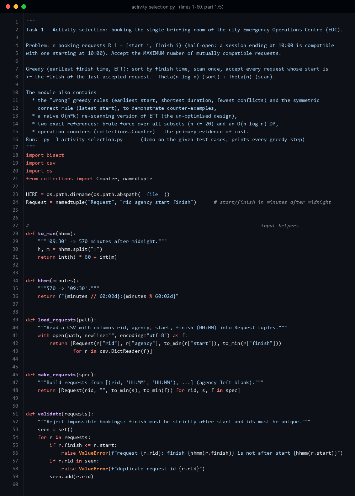

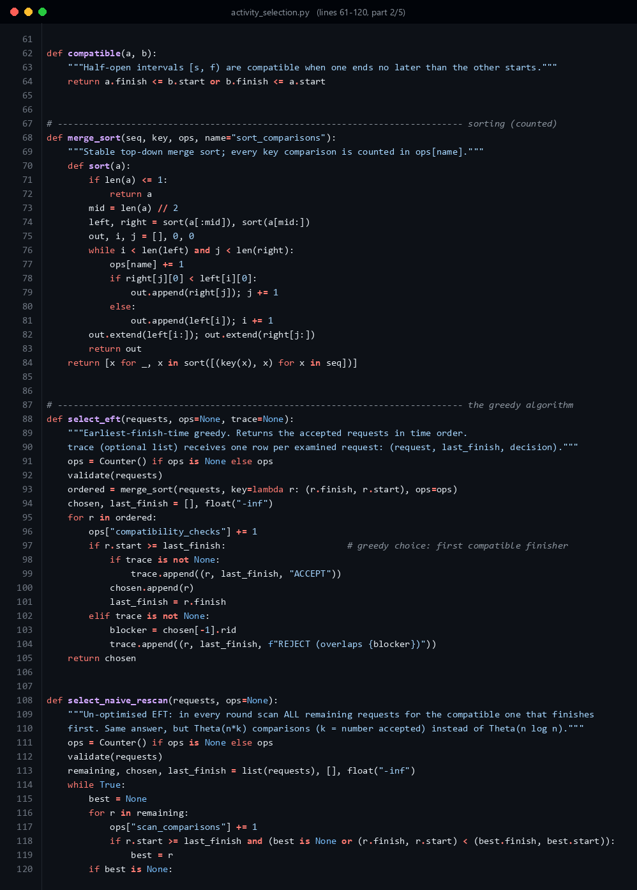

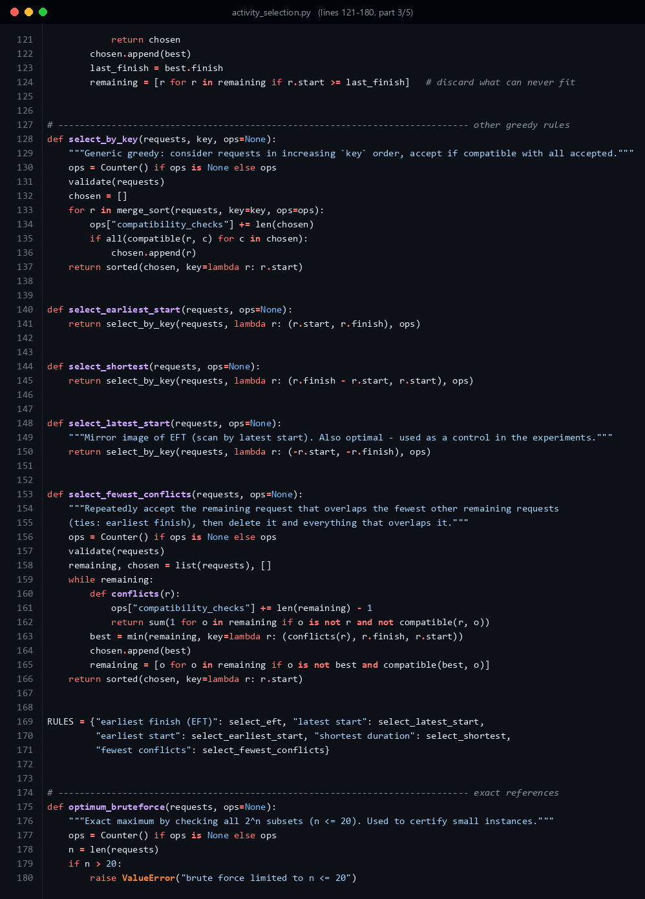

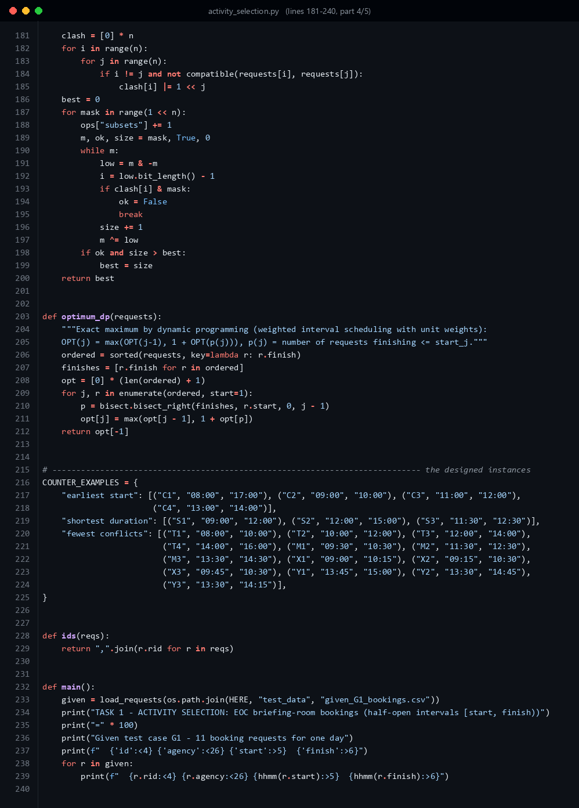

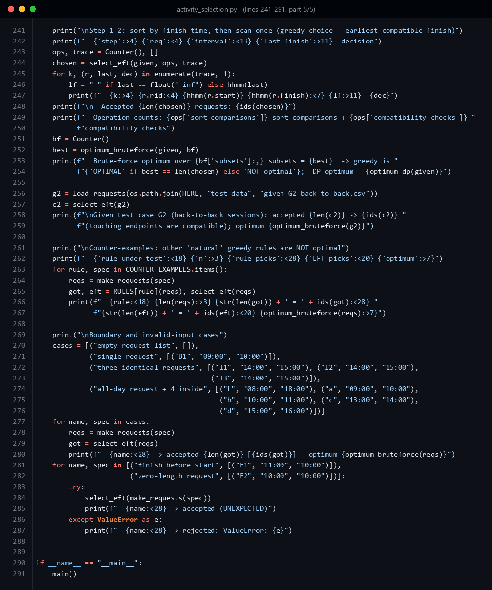

### 5. Input data and intermediate algorithmic steps

Table 3: Given test case G1 – booking requests in submission order (test_data/given_G1_bookings.csv)

| rid | agency | start | finish |
|---|---|---|---|
| R1 | Electricity board | 10:30 | 12:30 |
| R2 | Police control room | 08:30 | 10:00 |
| R3 | Municipal corporation | 12:00 | 14:00 |
| R4 | Civil defence volunteers | 09:00 | 15:00 |
| R5 | Traffic police | 10:30 | 11:30 |
| R6 | Health department | 08:00 | 11:00 |
| R7 | Meteorology office | 14:00 | 16:00 |
| R8 | Fire and Rescue | 09:30 | 10:30 |
| R9 | Water supply board | 11:00 | 13:00 |
| R10 | Coast guard | 12:00 | 13:30 |
| R11 | Disaster response force | 09:30 | 12:30 |

The program prints every step of the greedy scan: the requests in finish-time order, the finish time of the last accepted request and the decision with its reason.

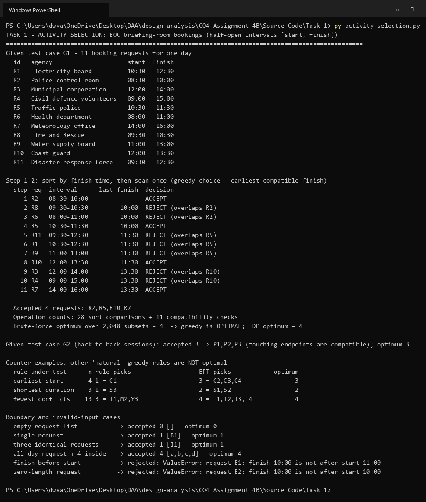

Table 4: Greedy scan of G1 (from the output in Figure 6)

| Step | Request | Interval | Last finish | Decision |
|---|---|---|---|---|
| 1 | R2 | 08:30–10:00 | – | ACCEPT |
| 2 | R8 | 09:30–10:30 | 10:00 | REJECT (overlaps R2) |
| 3 | R6 | 08:00–11:00 | 10:00 | REJECT (overlaps R2) |
| 4 | R5 | 10:30–11:30 | 10:00 | ACCEPT |
| 5–7 | R11, R1, R9 | all start before 11:30 | 11:30 | REJECT (overlap R5) |
| 8 | R10 | 12:00–13:30 | 11:30 | ACCEPT |
| 9–10 | R3, R4 | both start before 13:30 | 13:30 | REJECT (overlap R10) |
| 11 | R7 | 14:00–16:00 | 13:30 | ACCEPT |

The greedy accepts **4 requests (R2, R5, R10, R7)** with 28 sort comparisons and 11 compatibility checks. The brute force over all 2¹¹ = 2,048 subsets and the DP both give the optimum 4, so the greedy schedule is optimal. For G2 the greedy accepts P1, P2 and P3 (touching sessions are compatible; P4 overlaps P1 and P2), again equal to the optimum 3.

### 6. Why the other greedy rules fail – counter-examples

I designed one small instance per rule in which the rule's first choice blocks better options (output in Figure 6):

Table 5: Counter-examples for the other greedy rules (student-designed cases S1–S3)

| Rule | Designed instance | Rule accepts | EFT accepts | Optimum | Why the rule fails |
|---|---|---|---|---|---|
| Earliest start | all-day exercise C1 08:00–17:00 + three 1-hour briefings | 1 (C1) | 3 | 3 | the earliest request may be very long and block everything |
| Shortest duration | S1 09:00–12:00, S2 12:00–15:00, S3 11:30–12:30 | 1 (S3) | 2 | 2 | a short request may overlap two compatible long ones |
| Fewest conflicts | 13 requests: T1–T4 back-to-back plus overlapping groups around 10:00 and 14:00 | 3 | 4 | 4 | M2 11:30–12:30 has only 2 conflicts and is chosen first, but it destroys T2 and T3 |

To see how often the rules fail in practice I generated 2,000 random days of 12 requests each and compared every rule with the exact optimum (the DP, itself certified by brute force on the first 200 days):

Table 6: How often each greedy rule is optimal on 2,000 random days (results/task1_rule_comparison.csv)

| rule | optimal_days | pct_optimal | mean_ratio | worst_ratio |
|---|---|---|---|---|
| earliest finish (EFT) | 2000 | 100.0 | 1.0 | 1.0 |
| latest start | 2000 | 100.0 | 1.0 | 1.0 |
| earliest start | 1179 | 58.95 | 0.8904 | 0.4 |
| shortest duration | 1888 | 94.4 | 0.9869 | 0.6667 |
| fewest conflicts | 1999 | 99.95 | 0.9999 | 0.8 |

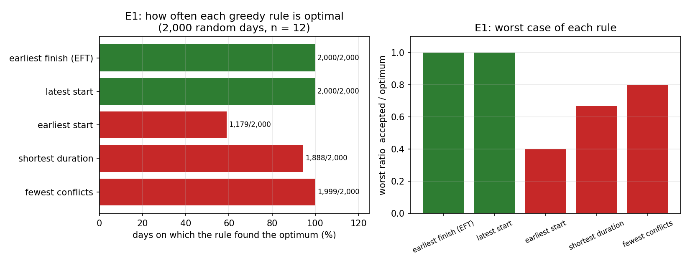

EFT and its mirror image (latest start, scanning backwards) were optimal on all 2,000 days, as the proof predicts. Earliest start was optimal on only 59.0 % of the days and fell to 40 % of the optimum in the worst case. Shortest duration (94.4 %) and fewest conflicts (1,999 of 2,000 days) look good on random data, which is exactly why a proof is needed: a rule that is "almost always right" still fails on the designed inputs of Table 5.

### 7. Test cases: given, student-designed, boundary and failure

Table 7: Task 1 test cases executed by `run_all_tests.py` (Test_Cases/task1_test_cases.json)

| Test case | Expected | Actual | Test result |
|---|---|---|---|
| **G1** 11 requests of one day | count: 4, selected: R2, R5, R10, … | 4 R2, R5, R10, R7 | PASS |
| **G2** touching sessions are compatible | count: 3, selected: P1, P2, P3 | 3 P1, P2, P3 | PASS |
| **S1** all-day exercise blocks earliest-start rule | rule_count: 1, eft_count: 3, opti… | rule 1, EFT 3, opt 3 | PASS |
| **S2** short session straddling two long ones | rule_count: 1, eft_count: 2, opti… | rule 1, EFT 2, opt 2 | PASS |
| **S3** 13-request trap for the fewest-conflicts rule | rule_count: 3, eft_count: 4, opti… | rule 3, EFT 4, opt 4 | PASS |
| **S4** EFT = brute-force optimum on 500 random days | all_equal: True | 500/500 equal | PASS |
| **S5** naive re-scan EFT = sort-once EFT = DP on 200… | all_equal: True | 200/200 equal | PASS |
| **S6** mirror rule (latest start) is also optimal on… | count: 4 | 4 | PASS |
| **B1** no requests | count: 0 | 0  | PASS |
| **B2** a single request | count: 1 | 1 B1 | PASS |
| **B3** three identical requests | count: 1 | 1 I1 | PASS |
| **B4** all requests disjoint | count: 5 | 5 D1, D2, D3, D4, D5 | PASS |
| **B5** all-day request with four requests inside | count: 4 | 4 a, b, c, d | PASS |
| **B6** equal finish times, unsorted input | count: 2 | 2 E3, E4 | PASS |
| **B7** 100,000 requests: EFT = DP optimum | all_equal: True | EFT 25,304 = DP 25,304 | PASS |
| **F1** finish before start | ValueError | ValueError | PASS |
| **F2** zero-length request | ValueError | ValueError | PASS |
| **F3** duplicate request id | ValueError | ValueError | PASS |

Boundary decisions: an empty list returns an empty schedule; identical requests are mutually incompatible, so exactly one is accepted; equal finish times are broken by the earlier start, which does not change the count; the large case (100,000 requests) checks that the greedy and the DP agree at scale. Failure cases are rejected with a clear `ValueError` instead of producing a schedule.

### 8. Optimisation and performance comparison

The straightforward implementation of "repeatedly take the compatible request that finishes first" scans all remaining requests in every round (`select_naive_rescan`), Θ(n·k) comparisons for k accepted requests. The optimised design sorts once and scans once. I measured both on booking terms whose length grows with n, so that k also grows with n (k ≈ n/4):

Table 8: Sort-once EFT vs naive re-scan (results/task1_scaling.csv)

| n | accepted_k | eft_total | n_log2_n | eft_ms | naive_comparisons | naive_ms | optimum_dp |
|---|---|---|---|---|---|---|---|
| 1000 | 249 | 9698 | 9966 | 4.07 | 123332 | 55.5 | 249 |
| 2000 | 509 | 21375 | 21932 | 7.21 | 516285 | 222.8 | 509 |
| 4000 | 1014 | 46766 | 47863 | 15.27 | 2041509 | 691.6 | 1014 |
| 8000 | 2035 | 101747 | 103726 | 34.94 | 8136309 | 2787.2 | 2035 |
| 16000 | 4066 | 219373 | 223453 | 75.08 |  |  | 4066 |
| 32000 | 8088 | 470586 | 478905 | 175.24 |  |  | 8088 |
| 64000 | 16308 | 1005029 | 1021810 | 406.35 |  |  | 16308 |

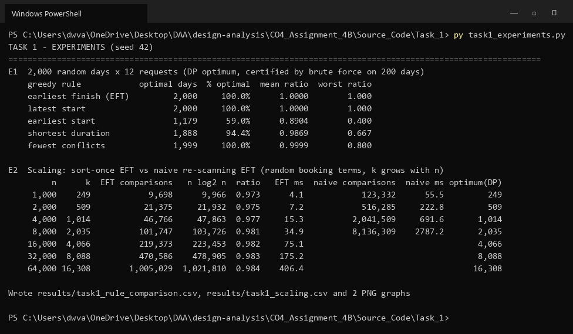

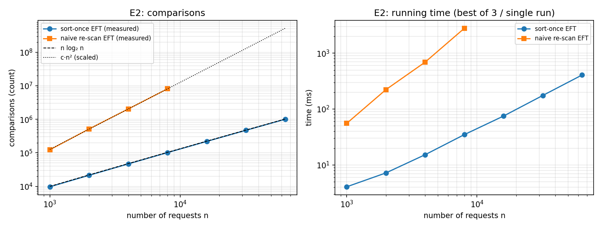

**Theory against experiment.** The sort-once EFT made 0.973–0.984 × n log₂ n comparisons at every size (merge sort makes slightly fewer than n log₂ n comparisons, plus exactly n compatibility checks), and doubling n multiplied the count by 2.1–2.2 – the signature of Θ(n log n). The naive version grew by a factor of about 4 per doubling (123,332 → 516,285 → 2,041,509 → 8,136,309), i.e. Θ(n²) because k ≈ n/4. At n = 8,000 it needed **80× more comparisons** (8,136,309 against 101,747) and 2,787 ms against 35 ms; at n = 64,000 the sort-once version still needs only about one million comparisons (0.41 s). Every run returned the DP optimum.

### 9. Complexity analysis and algorithmic decisions

- **Time:** validation Θ(n) + merge sort Θ(n log n) (≤ n log₂ n comparisons) + scan Θ(n) = **Θ(n log n)**; if the requests already arrive sorted by finish time the scan alone is Θ(n). The naive version is Θ(n·k), up to Θ(n²). **Space:** Θ(n) for the sorted copy.
- **Sort by finish, not by start or length:** only the finish time has the exchange property proved in section 2; the counter-examples show that the other keys fail.
- **Half-open intervals** make back-to-back sessions compatible exactly as the statement requires, and reduce the compatibility test to the single comparison `s ≥ last`.
- **Stable merge sort with counted comparisons** instead of the built-in sort, so that the Θ(n log n) claim is measured, not assumed.
- **Validation before scheduling** (finish after start, unique IDs) turns impossible bookings into explicit errors.


## Task 2 – Loading the Relief Truck and Paying Relief Cash: Knapsack and Coin Change [8 Marks]

> **Problem Context – Flood Relief Logistics.** A relief truck can carry W = 1,000 kg. Divisible supplies (drinking water, rice, medical supplies, diesel …) can be loaded in any quantity; each has a weight and a relief-priority value. Some loads are indivisible equipment (generators, tents, satellite phones …) that must be taken whole or not at all. At the relief cash counters, compensation is paid in Indian rupee notes and coins, and the cashier wants to hand over as few pieces as possible.
> **Your Challenge:**
> - Design a greedy algorithm for the divisible supplies and prove that it is optimal.
> - Show, with a counter-example and with an exact method (dynamic programming or brute force), that the same greedy idea fails for indivisible equipment; propose a safeguard.
> - Design a greedy change-making algorithm; show for which coin systems it is optimal and give a coin system and amount for which it fails.
> - Print the greedy steps, test with the given and your own boundary and failure cases, optimise the implementation and compare the alternatives.
> **Given test cases:** G1 – the seven divisible supplies of `given_G1_relief_supplies.csv`, W = 1,000 kg; G2 – the textbook 0/1 instance W = 50, (w, v) = (10, 60), (20, 100), (30, 120); G3 – the six equipment items of `given_G3_relief_equipment.csv`, W = 1,000 kg; G4 – Rs 289 in the rupee system {1, 2, 5, 10, 20, 50, 100, 200, 500}; G5 – amount 6 with coins {1, 3, 4}.

**Evidence Expected**

> Optimality proof for the fractional case, failure evidence for the 0/1 case and for a non-canonical coin system, pseudocode, implementation with intermediate steps, test cases, an optimisation with measured comparisons and a complexity analysis.

**Ans:**

### 1. Problem analysis

Three related problems share one greedy idea – *take the best-looking unit first*:

- **Fractional knapsack:** choose fractions xᵢ ∈ [0, 1] to maximise Σ xᵢvᵢ subject to Σ xᵢwᵢ ≤ W. The natural greedy key is the **value density** dᵢ = vᵢ / wᵢ (priority points per kg).
- **0/1 knapsack:** the same, but xᵢ ∈ {0, 1}. Greedy by density (or by value, or lightest first) is fast but may leave capacity unused that only a different combination could fill.
- **Coin change:** pay amount A with the fewest coins from denominations c₁ < … < c<sub>m</sub> (unlimited supply). The greedy takes the largest coin that fits, repeatedly.

Densities are computed with exact rational arithmetic (`fractions.Fraction`) so that ties and fractional loads are exact; invalid input (weight ≤ 0, negative value or capacity, a coin ≤ 0) raises `ValueError`.

### 2. Greedy-choice property and optimal substructure – where they hold and where they fail

**Fractional knapsack – optimal (exchange argument).** Sort the items so that d₁ ≥ d₂ ≥ … ≥ d<sub>n</sub>; the greedy solution is x = (1, …, 1, x<sub>j</sub>, 0, …, 0). Let x* be any optimal solution and let i be the first item with x*ᵢ < xᵢ. Because the greedy fills the truck completely (unless everything fits, when greedy takes everything and is trivially optimal), x* must carry some weight ε > 0 of a later item k > i with x*<sub>k</sub> > x<sub>k</sub>. Moving ε kg from item k to item i keeps the weight unchanged and changes the value by ε(dᵢ − d<sub>k</sub>) ≥ 0. Repeating such moves turns x* into x without ever lowering the value, so value(x) ≥ value(x*): the greedy is optimal. **Optimal substructure:** after loading the densest item (fully, or the fraction that fits) the rest is a fractional knapsack with capacity W − wᵢ on the remaining items, and an optimal solution of it completes an optimal solution of the whole.

**0/1 knapsack – the greedy-choice property fails.** The exchange step above moves a *fraction* ε of an item; with indivisible items the move is impossible, and a high-density light item can block a heavy item that would fill the truck exactly. G2 is the textbook counter-example: greedy by density takes (10, 60) and (20, 100) = **160**, while (20, 100) + (30, 120) = **220** is optimal. The optimal-substructure property still holds (that is why DP works), but the greedy choice is not safe.

**Coin change – depends on the coin system.** For a *canonical* system the largest coin is always part of some optimal solution; for others it is not: with {1, 3, 4} and A = 6 the greedy pays 4 + 1 + 1 (3 coins) while 3 + 3 (2 coins) is optimal. Kozen and Zaks (1994) proved that if a counter-example exists, the smallest one is below c<sub>m−1</sub> + c<sub>m</sub>; so a system can be **certified canonical by checking all amounts up to that bound** against DP. For the rupee system the bound is 200 + 500 = 700 and no counter-example exists, so greedy change-making is optimal for every rupee amount.

### 3. Pseudocode

```
Algorithm FractionalKnapsack(I, n, W)             // I[i] = (w_i, v_i)
1. sort I by density v_i / w_i, largest first                // Theta(n log n)
2. room = W;  value = 0
3. for i = 1 to n while room > 0 do
4.     x = min(1, room / I[i].w)                              // greedy choice: densest item first
5.     value = value + x * I[i].v;  room = room - x * I[i].w
6. return value                                               // at most one item is fractional

Algorithm FractionalKnapsackHeap(I, n, W)         // optimisation when only k << n items fit
1. build a max-heap H of I keyed by density (bottom-up)       // <= 2n comparisons
2. room = W;  value = 0
3. while room > 0 and H not empty do
4.     it = ExtractMax(H);  x = min(1, room / it.w)           // O(log n), only k times
5.     value = value + x * it.v;  room = room - x * it.w
6. return value                                               // Theta(n + k log n)

Algorithm Knapsack01DP(I, n, W)                   // exact reference, Theta(nW)
1. B[0][c] = 0 for c = 0..W
2. for i = 1 to n do for c = 0 to W do
3.     B[i][c] = B[i-1][c];  if I[i].w <= c then B[i][c] = max(B[i][c], B[i-1][c - I[i].w] + I[i].v)
4. return B[n][W]

Algorithm GreedyChange(C, m, A)
1. for each coin c in C, largest first do  k = floor(A / c);  take k coins c;  A = A - k*c
2. if A > 0 then return FAILURE  else return the coins taken

Algorithm SmallestCounterExample(C, m)            // C sorted increasing
1. for a = 1 to C[m-1] + C[m] do
2.     if |GreedyChange(C, m, a)| > DPChange(C, m, a) then return a
3. return none                                                // canonical
```

The greedy 0/1 variants (`greedy_01` with rule density / value / lightest) take an item if it still fits and continue scanning. The safeguard `greedy_01_half_approx` returns the better of greedy-by-density and the single most valuable item that fits.

### 4. Implementation

`knapsack_coin_change.py` contains all algorithms above; merge sort and the heap count key comparisons, the DPs count table cells and steps.

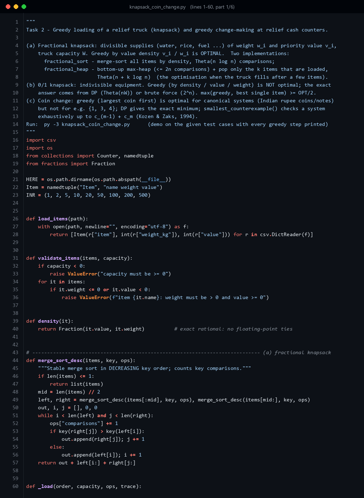

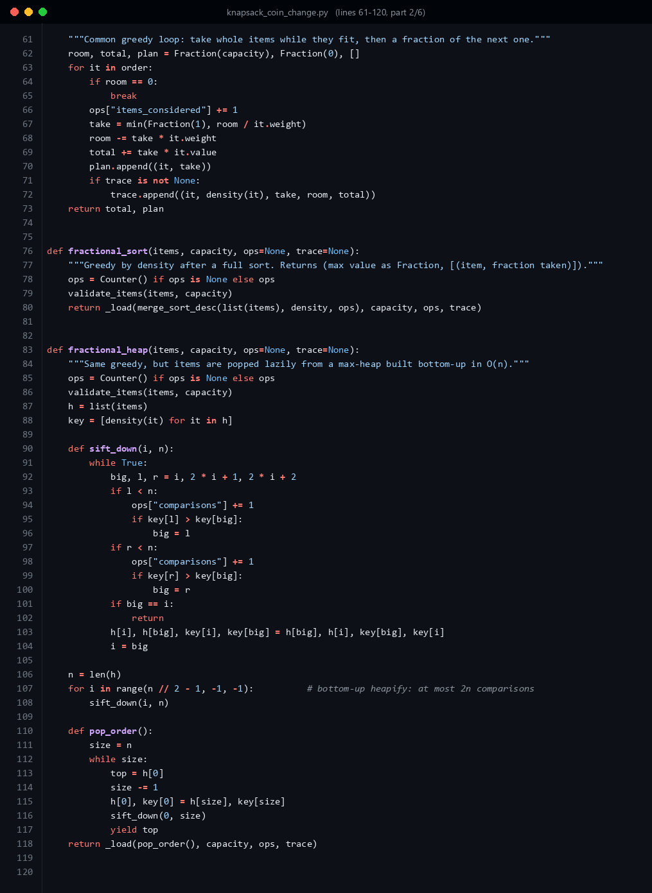

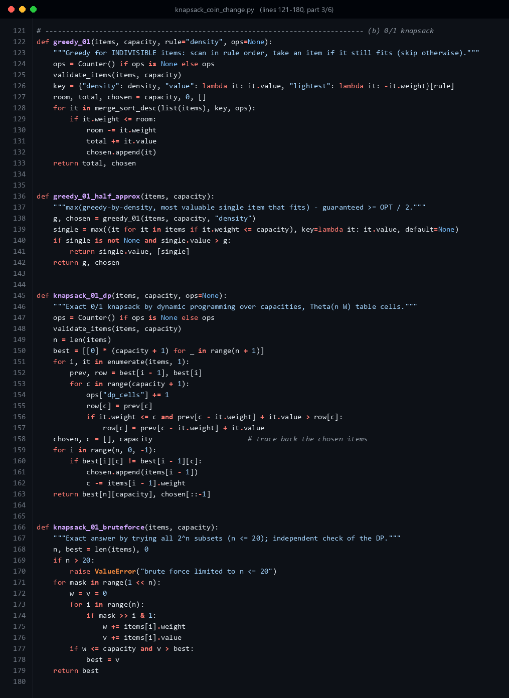

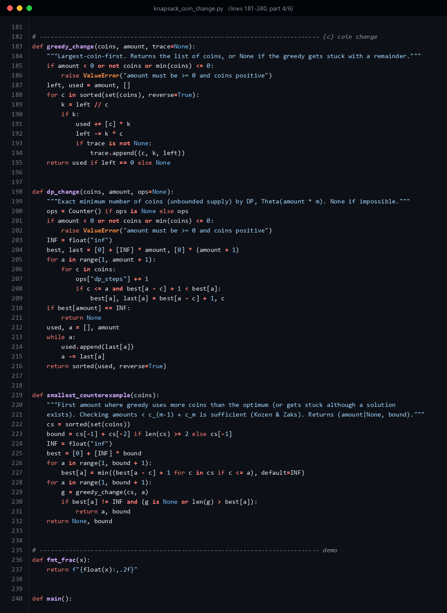

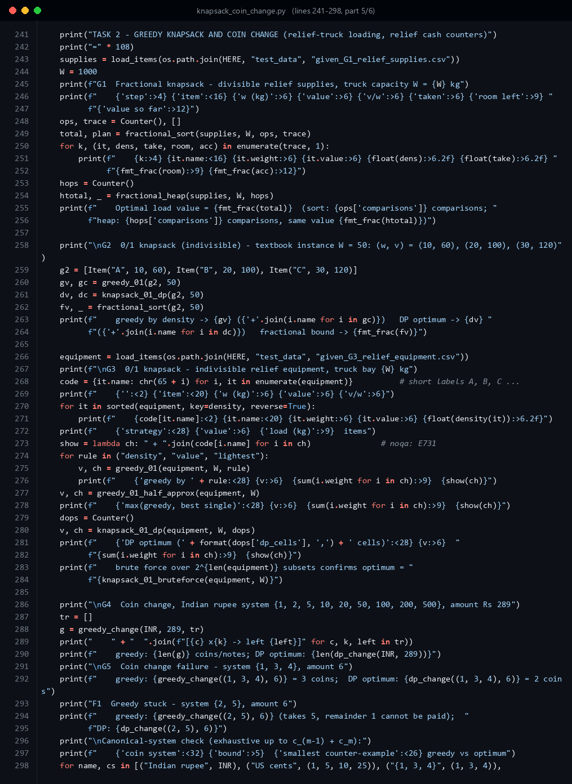

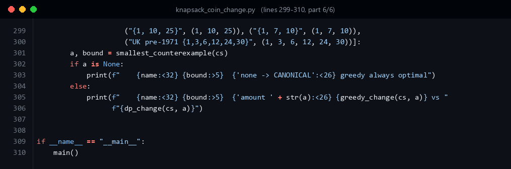

### 5. Input data and intermediate algorithmic steps

Table 9: Given input data – divisible supplies G1 and indivisible equipment G3 (test_data/*.csv)

| Given case | Item | Weight (kg) | Value (priority points) | Density v/w |
|---|---|---|---|---|
| G1 | Drinking water / Rice / Medical supplies / Baby food | 400 / 500 / 100 / 80 | 2,000 / 1,500 / 1,200 / 800 | 5.0 / 3.0 / 12.0 / 10.0 |
| G1 | Blankets / Diesel / Lentils | 300 / 200 / 250 | 600 / 900 / 875 | 2.0 / 4.5 / 3.5 |
| G3 | A Satellite phone kit / B Medical cot set / C Trauma kits | 50 / 150 / 50 | 250 / 675 / 225 | 5.0 / 4.5 / 4.5 |
| G3 | D Field kitchen / E Lighting tower / F Generator 10 kVA | 150 / 100 / 600 | 525 / 300 / 1,800 | 3.5 / 3.0 / 3.0 |

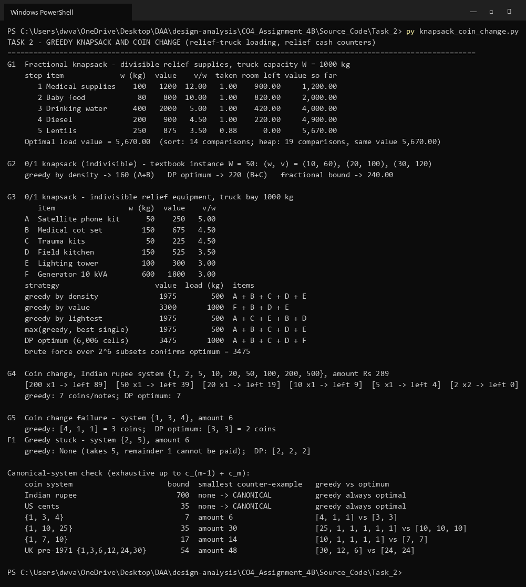

**Intermediate steps (G1).** In density order the greedy loads medical supplies (12.0), baby food (10.0), drinking water (5.0) and diesel (4.5) completely – 780 kg and 4,900 points – and then 220 of the 250 kg of lentils (fraction 0.88, 770 points). The load value is **5,670 points**, the truck is exactly full, and only the last item is fractional, as the proof predicts. The heap version gives the same 5,670 (14 vs 19 comparisons on this tiny input).

**0/1 failure (G2, G3).** On G3 greedy by density loads A, B, C, D and E (500 kg, **1,975 points**) and then cannot fit the 600 kg generator – half of the truck travels empty. Greedy by value takes the generator first (3,300), still not optimal. The DP (6,006 table cells) and brute force (2⁶ subsets) both find **3,475** = A + B + C + D + F (exactly 1,000 kg). On G2 greedy gives 160, DP 220, and the fractional bound is 240.

**Coin change (G4, G5).** Rs 289 = 200 + 50 + 20 + 10 + 5 + 2 + 2 – 7 pieces, equal to the DP minimum. With {1, 3, 4} the greedy pays 6 = 4 + 1 + 1 (3 coins) while DP pays 3 + 3 (2 coins). Failure case F1: with coins {2, 5} the greedy takes 5 and is stuck with 1, although 2 + 2 + 2 exists – my implementation reports the failure (`None`) instead of a wrong answer.

### 6. Test cases

Table 10: Task 2 test cases executed by `run_all_tests.py` (Test_Cases/task2_test_cases.json)

| Test case | Expected | Actual | Test result |
|---|---|---|---|
| **G1** divisible supplies, W = 1000 kg (sort and hea… | 5670 | sort 5670, heap 5670 | PASS |
| **G2** textbook 0/1 instance: greedy fails | greedy_density: 160, optimum: 220… | greedy_density: 160, optimum: 220… | PASS |
| **G3** indivisible equipment: greedy leaves the gene… | greedy_density: 1975, greedy_valu… | greedy_density: 1975, greedy_valu… | PASS |
| **G4** Indian rupee system, Rs 289 | greedy: 7, optimum: 7 | greedy 7, optimum 7 | PASS |
| **G5** non-canonical system 1, 3, 4 | greedy: 3, optimum: 2 | greedy 3, optimum 2 | PASS |
| **S1** sort = heap value; fractional >= 0/1 optimum … | all_ok: True | 200/200 ok | PASS |
| **S2** 0/1 DP = brute force on 200 random instances | all_ok: True | 200/200 equal | PASS |
| **S3** max(greedy, best single) >= OPT/2; pathologic… | pathological: 100, all_ok: True | pathological 100, 500/500 >= OPT/2 | PASS |
| **S4** smallest counter-example of five coin systems | 1 10 25: 30, 1 7 10: 14, 1 3 6 12… | 1 10 25: 30, 1 7 10: 14, 1 3 6 12… | PASS |
| **B1** zero capacity | 0 | sort 0, heap 0 | PASS |
| **B2** no items | 0 | sort 0, heap 0 | PASS |
| **B3** everything fits | 80 | sort 80, heap 80 | PASS |
| **B4** single item larger than the truck | 250 | sort 250, heap 250 | PASS |
| **B5** amount 0 | greedy: 0, optimum: 0 | greedy 0, optimum 0 | PASS |
| **B6** all densities equal (ties) | 100 | sort 100, heap 100 | PASS |
| **F1** greedy gets stuck although 2+2+2 exists | greedy: None, optimum: 3 | greedy None, optimum 3 | PASS |
| **F2** amount that cannot be paid at all | greedy: None, optimum: None | greedy None, optimum None | PASS |
| **F3** negative weight | ValueError | ValueError | PASS |
| **F4** negative capacity | ValueError | ValueError | PASS |
| **F5** coin of value 0 | ValueError | ValueError | PASS |

The student-designed case S3 also contains a pathological instance – a 1 kg item worth 2 and a 100 kg item worth 100 in a 100 kg truck: greedy by density takes the light item and then nothing else fits (value 2, 2 % of the optimum 100); the safeguard max(greedy, best single item) returns 100. This safeguard is guaranteed to reach at least OPT/2, because the fractional optimum is at most the greedy prefix plus the first item that does not fit, and each of those is at most max(greedy, best single).

### 7. How often does greedy fail? (experiment E1 and E3)

Table 11: Greedy strategies on 2,000 random 0/1 instances per class, n = 15, W = 40 % of the total weight (results/task2_01_greedy_quality.csv)

| instance_class | strategy | pct_optimal | mean_ratio | worst_ratio | mean_greedy_comparisons | mean_dp_cells |
|---|---|---|---|---|---|---|
| uncorrelated | greedy by density | 56.0 | 0.9882 | 0.8879 | 41.7 | 4573 |
| uncorrelated | greedy by value | 32.5 | 0.944 | 0.5962 | 41.7 | 4573 |
| uncorrelated | greedy by lightest | 2.8 | 0.8457 | 0.3695 | 41.7 | 4573 |
| uncorrelated | max(density, best single) | 56.0 | 0.9882 | 0.8879 | 41.7 | 4573 |
| correlated | greedy by density | 9.8 | 0.9271 | 0.8078 | 41.7 | 4556 |
| correlated | greedy by value | 0.0 | 0.8787 | 0.7222 | 41.7 | 4556 |
| correlated | greedy by lightest | 9.8 | 0.9271 | 0.8078 | 41.7 | 4556 |
| correlated | max(density, best single) | 9.8 | 0.9271 | 0.8078 | 41.7 | 4556 |

Table 12: Greedy change-making against DP for every amount 1–1,000 (results/task2_03_coin_systems.csv)

| system | coins | non_optimal | share_pct | max_extra_coins | greedy_coins_total | optimal_coins_total |
|---|---|---|---|---|---|---|
| Indian rupee | 1 2 5 10 20 50 100 200 500 | 0 | 0.0 | 0 | 5102 | 5102 |
| US cents | 1 5 10 25 | 0 | 0.0 | 0 | 22740 | 22740 |
| {1, 3, 4} | 1 3 4 | 249 | 24.9 | 1 | 125750 | 125501 |
| {1, 10, 25} | 1 10 25 | 390 | 39.0 | 3 | 24340 | 23170 |
| {1, 7, 10} | 1 7 10 | 297 | 29.7 | 3 | 52300 | 51409 |
| UK pre-1971 | 1 3 6 12 24 30 | 192 | 19.2 | 1 | 18698 | 18506 |

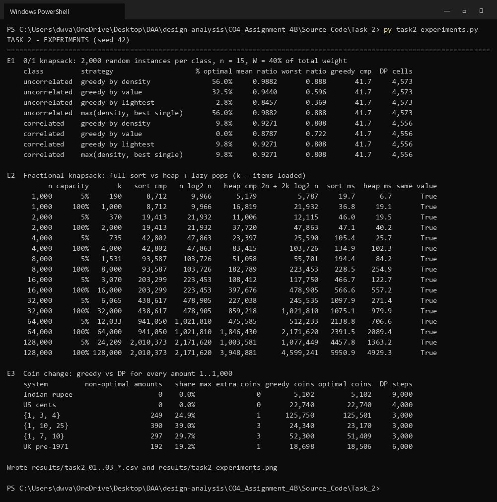

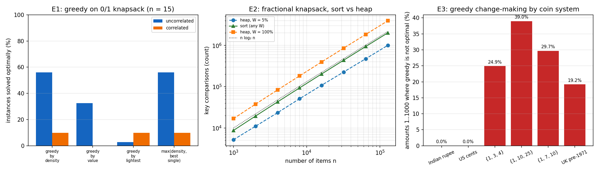

Greedy by density was optimal on only 56.0 % of the uncorrelated instances and 9.8 % of the correlated ones (value = weight + 10, where all densities are similar and only the packing matters), with a worst case of 0.888 and 0.808 of the optimum; greedy by value and lightest-first are worse. The greedy costs about 42 comparisons per instance against about 4,570 DP cells, so greedy is a fast heuristic for 0/1 loading, not an exact method. For coins, the two canonical systems (rupee, US cents) were optimal for all 1,000 amounts, as the Kozen–Zaks check predicts, while the non-canonical systems were sub-optimal on 19–39 % of the amounts, by up to 3 coins.

### 8. Optimisation – full sort against heap with lazy extraction (experiment E2)

The sort-based greedy always sorts all n items, Θ(n log n), although a small truck is full after k ≪ n items. A bottom-up max-heap costs at most 2n comparisons to build and each extraction about 2 log₂ n, so only Θ(n + k log n) comparisons are needed.

Table 13: Fractional knapsack – sort vs heap, capacity 5 % and 100 % of the total stock (results/task2_02_fractional_sort_vs_heap.csv)

| n | capacity_share | k_loaded | sort_comparisons | heap_comparisons | heap_bound | sort_ms | heap_ms | same_value |
|---|---|---|---|---|---|---|---|---|
| 1000 | 0.05 | 190 | 8712 | 5179 | 5787 | 19.7 | 6.7 | True |
| 1000 | 1.0 | 1000 | 8712 | 16819 | 21932 | 36.8 | 19.1 | True |
| 2000 | 0.05 | 370 | 19413 | 11006 | 12115 | 46.0 | 19.5 | True |
| 2000 | 1.0 | 2000 | 19413 | 37720 | 47863 | 47.1 | 40.2 | True |
| 4000 | 0.05 | 735 | 42802 | 23397 | 25590 | 105.4 | 25.7 | True |
| 4000 | 1.0 | 4000 | 42802 | 83415 | 103726 | 134.9 | 102.3 | True |
| 8000 | 0.05 | 1531 | 93587 | 51058 | 55701 | 194.4 | 84.2 | True |
| 8000 | 1.0 | 8000 | 93587 | 182789 | 223453 | 228.5 | 254.9 | True |
| 16000 | 0.05 | 3070 | 203299 | 108412 | 117750 | 466.7 | 122.7 | True |
| 16000 | 1.0 | 16000 | 203299 | 397676 | 478905 | 566.6 | 557.2 | True |
| 32000 | 0.05 | 6065 | 438617 | 227038 | 245535 | 1097.9 | 271.4 | True |
| 32000 | 1.0 | 32000 | 438617 | 859218 | 1021810 | 1075.1 | 979.9 | True |
| 64000 | 0.05 | 12033 | 941050 | 475585 | 512233 | 2138.8 | 706.6 | True |
| 64000 | 1.0 | 64000 | 941050 | 1846430 | 2171620 | 2391.5 | 2089.4 | True |
| 128000 | 0.05 | 24209 | 2010373 | 1003581 | 1077449 | 4457.8 | 1363.2 | True |
| 128000 | 1.0 | 128000 | 2010373 | 3948881 | 4599241 | 5950.9 | 4929.3 | True |

With a small truck (5 %, k ≈ 0.19n) the heap needed only **0.50–0.59× the comparisons** of the sort at every size (1,003,581 against 2,010,373 at n = 128,000), always below its bound 2n + 2k log₂ n, and was 3–4× faster (1.36 s against 4.46 s). When everything fits (k = n) the heap performs a full heapsort and needs about 2× the comparisons of merge sort, so it is no longer worth it. **Decision:** use the heap when the truck takes a small share of the stock (the usual relief situation), the sort otherwise; both always gave the same value.

### 9. Complexity analysis and algorithmic decisions

Table 14: Complexity of the Task 2 algorithms

| Algorithm | Time | Space | Optimal? |
|---|---|---|---|
| Fractional knapsack, sort | Θ(n log n) | Θ(n) | yes (proof in section 2) |
| Fractional knapsack, heap | Θ(n + k log n) | Θ(n) | yes |
| Greedy 0/1 (any rule) | Θ(n log n) | Θ(n) | no – heuristic; with the single-item safeguard ≥ OPT/2 |
| 0/1 DP | Θ(nW) (pseudo-polynomial) | Θ(nW) | yes |
| Greedy change | Θ(m log m + m) | Θ(m) | only for canonical systems |
| DP change | Θ(A·m) | Θ(A) | yes |
| Canonical check | Θ((c<sub>m−1</sub> + c<sub>m</sub>)·m) | Θ(c<sub>m</sub>) | exact certificate |

Decisions: exact `Fraction` arithmetic for densities and loads (no floating-point ties); the greedy 0/1 continues scanning after an item does not fit (it never does worse than stopping); the change-maker returns `None` when it gets stuck instead of a wrong amount; and the rupee system was certified canonical by the Kozen–Zaks bound, so the counters may safely use the greedy, whereas a token system such as {1, 3, 4} must use DP.

## Task 3 – Compressing SOC Event Logs: Huffman Coding [8 Marks]

> **Problem Context – Security Operations Centre (SOC) Log Storage.** Every security event in the city's SOC log carries an event-type symbol (L = login success, F = failed login, W = firewall drop, D = DNS query, S = port scan, M = malware alert, …). Storing each symbol with a fixed-length code wastes space, because some events are far more frequent than others. The SOC wants a variable-length prefix code that minimises the total number of bits and can be decoded exactly.
> **Your Challenge:**
> - Apply Huffman's greedy algorithm; justify why merging the two least frequent trees is safe.
> - Build the tree step by step, printing the priority-queue state before every merge, and derive the code table.
> - Compare the average code length with the fixed-length code and with the entropy; verify encode/decode round trips.
> - Explain how ties are handled, and test boundary cases (one symbol, two symbols, equal frequencies, skewed frequencies) and failure cases (corrupted or truncated bitstreams, unknown symbols).
> - Optimise the construction and compare the alternatives experimentally.
> **Given test cases:** G1 – daily frequencies (thousands of events): L 45, F 13, W 12, D 16, S 9, M 5; G2 – tie case a 1, b 1, c 2, d 2.

**Evidence Expected**

> Greedy-choice justification, pseudocode, step-by-step tree construction, code table with average length, round-trip validation, tie handling, boundary and failure tests, construction-cost comparison and complexity analysis.

**Ans:**

### 1. Problem analysis

A prefix code assigns each symbol s a bit string; no code word is a prefix of another, so a bitstream can be decoded left to right without separators. Every prefix code is a binary tree with the symbols at the leaves, and the cost of a code is B(T) = Σ f(s) · depth<sub>T</sub>(s), the total number of bits. We need the tree with the minimum B(T). A fixed-length code for m symbols uses ⌈log₂ m⌉ bits per symbol; the entropy H = −Σ pᵢ log₂ pᵢ is the lower bound for any symbol-by-symbol code, and Huffman's code satisfies H ≤ L < H + 1 (L = average length).

### 2. Greedy-choice property and optimal substructure

**Greedy choice:** merge the two trees with the smallest frequencies into a new tree whose frequency is their sum.

**Greedy-choice property.** Let x and y be the two least frequent symbols. Take any optimal tree T and two sibling leaves a, b at maximum depth. Swapping x with a and y with b cannot increase the cost: for the swap of x and a the cost changes by (f(a) − f(x))·(depth(x) − depth(a)) ≤ 0, because f(x) ≤ f(a) and depth(a) ≥ depth(x); the same holds for y and b. So there is an optimal tree in which **x and y are siblings at the deepest level** – merging them first is safe.

**Optimal substructure.** Replace x and y by one new symbol z with f(z) = f(x) + f(y). For the tree T′ of the reduced alphabet and the tree T obtained by expanding z into the pair x, y: B(T) = B(T′) + f(x) + f(y). The added term does not depend on T′, so T is optimal exactly when T′ is optimal for the reduced alphabet. Induction on the number of symbols (m − 1 merges) proves that Huffman's algorithm produces an optimal prefix code.

### 3. Pseudocode

```
Algorithm Huffman(F, m)                           // F = {symbol: frequency}, m symbols
1. if m = 0 or some frequency <= 0 then error
2. Q = empty min-heap ordered by (frequency, tie key)
3. for each symbol s do Insert(Q, leaf(s, F[s]))
4. while |Q| > 1 do                                           // m - 1 merges
5.     x = ExtractMin(Q);  y = ExtractMin(Q)                  // greedy choice: two least frequent trees
6.     z = new node(freq = x.freq + y.freq, left = x, right = y)
7.     Insert(Q, z)
8. return ExtractMin(Q)                                       // Theta(m log m)
// tie key 'fifo' = creation order (older node first: minimum variance); 'lifo' = newest node first

Algorithm Decode(bits, root)
1. node = root;  out = empty
2. for each bit b do
3.     if b not in {0, 1} then error
4.     node = (b = 0) ? node.left : node.right
5.     if node is a leaf then append node.symbol to out;  node = root
6. if node != root then error "truncated code word";  return out

Algorithm HuffmanTwoQueues(F sorted increasing)   // Theta(m) after sorting
1. Q1 = sorted leaves;  Q2 = empty
2. while |Q1| + |Q2| > 1 do
3.     a = the smaller front of Q1 / Q2 (dequeue);  b = the smaller front of Q1 / Q2 (dequeue)
4.     enqueue a + b at the back of Q2                       // merged sums arrive in sorted order
```

A one-symbol alphabet gets the 1-bit code `0` (an empty code word could not be counted or decoded). The naive Θ(m²) version (`huffman_naive`) finds the two minima by linear scans.

### 4. Implementation

`huffman_coding.py` contains the counted binary heap, the three constructions, code generation, encoder/decoder with error detection, and the demonstration.

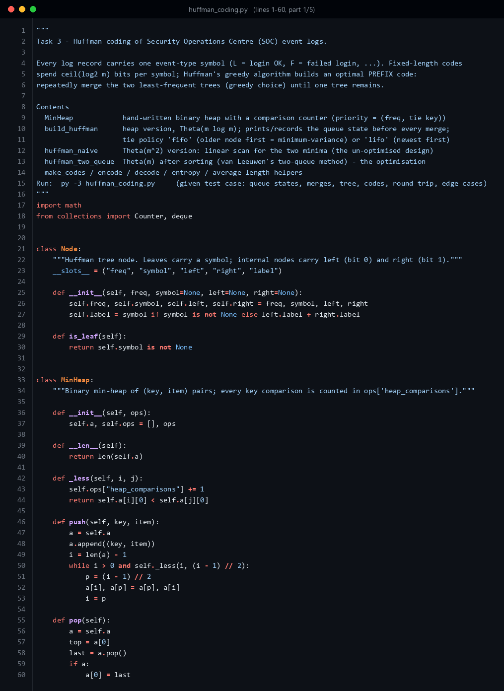

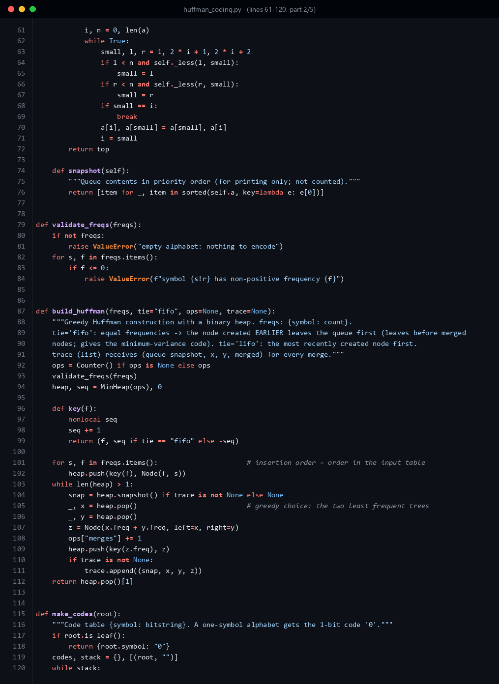

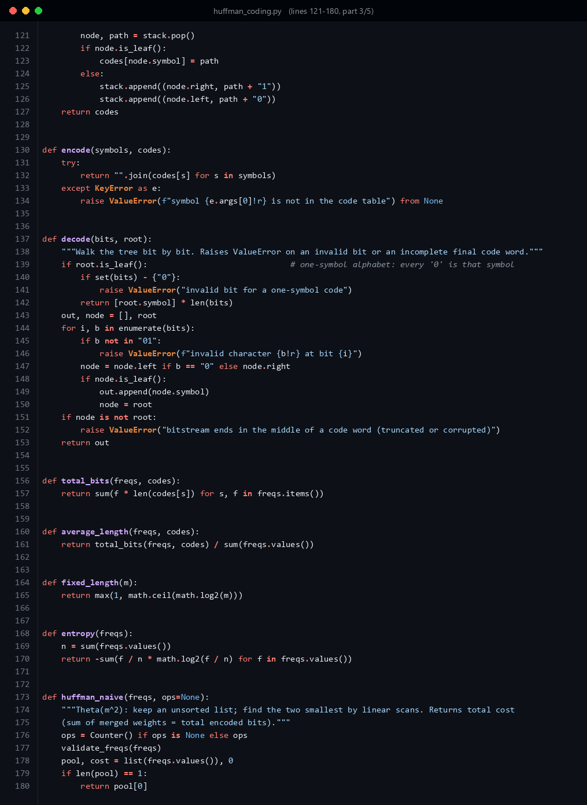

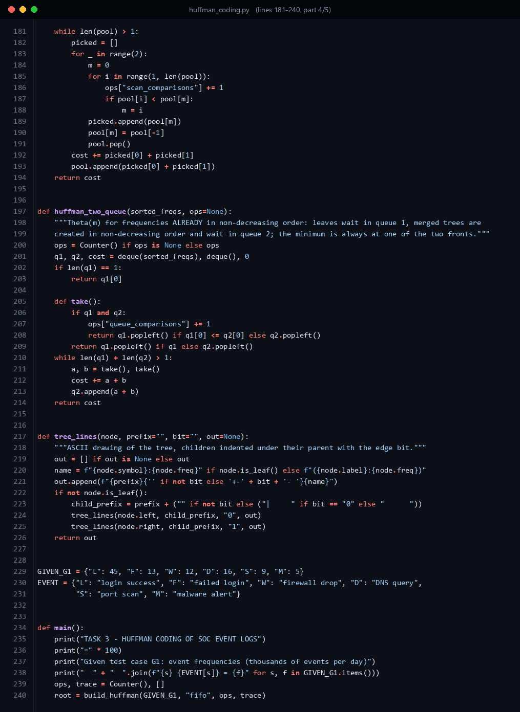

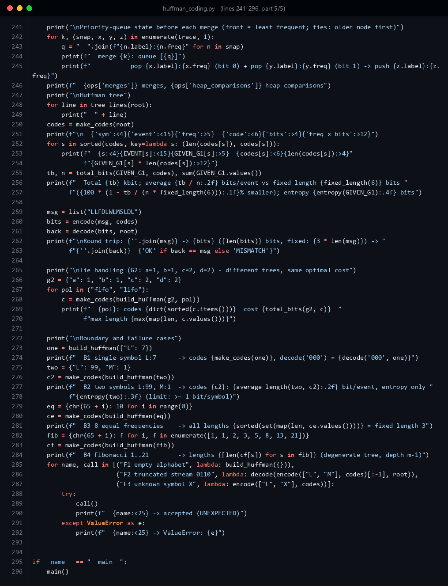

### 5. Input data and intermediate algorithmic steps (given case G1)

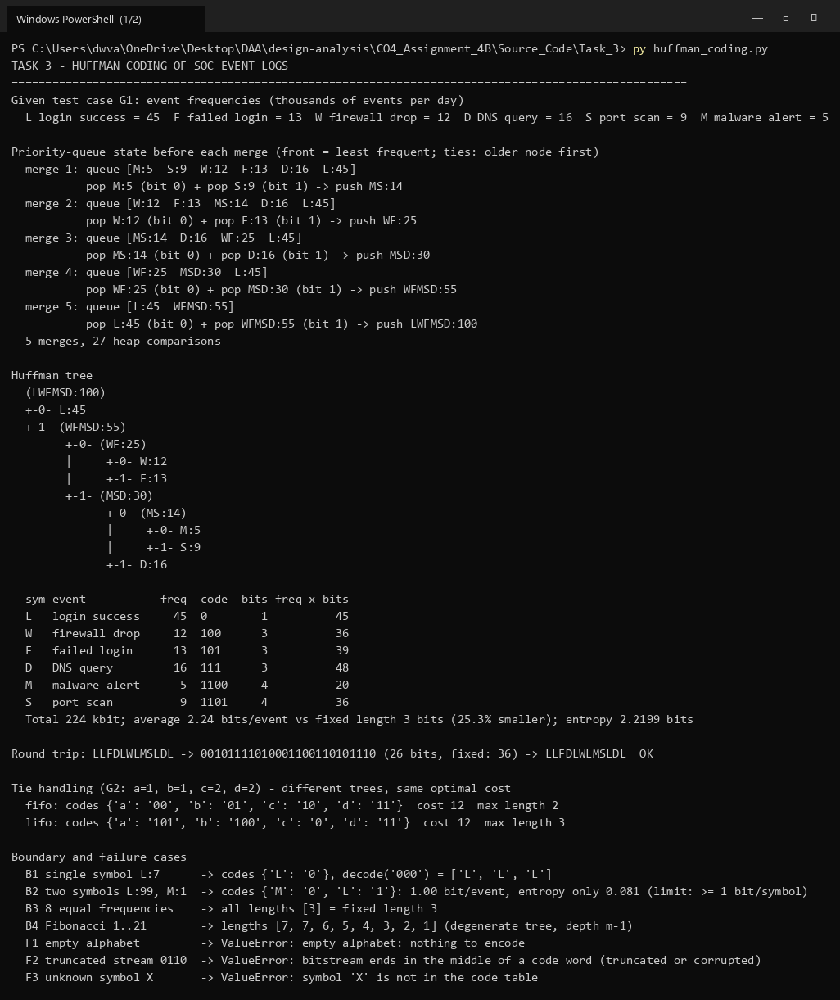


Table 15: Priority-queue states and merges for G1 (front = least frequent; ties: older node first)

| Merge | Queue before the merge | Popped (bit 0) + popped (bit 1) | Pushed |
|---|---|---|---|
| 1 | M:5, S:9, W:12, F:13, D:16, L:45 | M:5 + S:9 | MS:14 |
| 2 | W:12, F:13, MS:14, D:16, L:45 | W:12 + F:13 | WF:25 |
| 3 | MS:14, D:16, WF:25, L:45 | MS:14 + D:16 | MSD:30 |
| 4 | WF:25, MSD:30, L:45 | WF:25 + MSD:30 | WFMSD:55 |
| 5 | L:45, WFMSD:55 | L:45 + WFMSD:55 | root:100 |

Table 16: Huffman code for the SOC events of G1

| Symbol | Event | Frequency (k) | Code | Bits | Frequency × bits |
|---|---|---|---|---|---|
| L | login success | 45 | 0 | 1 | 45 |
| W | firewall drop | 12 | 100 | 3 | 36 |
| F | failed login | 13 | 101 | 3 | 39 |
| D | DNS query | 16 | 111 | 3 | 48 |
| M | malware alert | 5 | 1100 | 4 | 20 |
| S | port scan | 9 | 1101 | 4 | 36 |
| **Total** | | **100** | | | **224** |

The code needs **224 kbit per day = 2.24 bits/event**, against 3 bits/event for the fixed-length code: **25.3 % smaller**. The entropy is 2.2199 bits, so the code is within 0.02 bits (99.1 %) of the theoretical limit. The construction used 5 merges and 27 heap comparisons. The round trip encodes the 12-event message LLFDLWLMSLDL into 26 bits (fixed length: 36) and decodes it back exactly.

**Tie handling (G2).** With a 1, b 1, c 2, d 2 the queue holds three trees of frequency 2 after the first merge. The *fifo* policy (older node first) merges c and d and gives four 2-bit codes; the *lifo* policy (newest node first) gives lengths 1, 2, 3, 3. Both cost **12 bits**, so ties never affect optimality, but fifo gives the **minimum maximum code length** (2 instead of 3) and the smallest variance, which keeps decoding tables small and worst-case decoding latency low. I therefore use fifo, implemented by a creation-sequence number as the second heap key, which also makes the output deterministic.

### 6. Test cases

Table 17: Task 3 test cases executed by `run_all_tests.py` (Test_Cases/task3_test_cases.json)

| Test case | Expected | Actual | Test result |
|---|---|---|---|
| **G1** SOC event frequencies (thousands) | total_bits: 224, lengths: L: 1, W… | bits 224, lengths L: 1, W: 3, F: … | PASS |
| **G2** ties: fifo and lifo give different trees, sam… | fifo_cost: 12, lifo_cost: 12, fif… | fifo_cost: 12, fifo_max_len: 2, l… | PASS |
| **S1** encode then decode a message | bits: 26 | 26 bits, decoded LLFDLWLMSLDL | PASS |
| **S2** heap = naive O(m^2) = two-queue cost; prefix-… | all_ok: True | 200/200 ok | PASS |
| **S3** Kraft sum = 1 and H <= L < H + 1 | all_ok: True | 200/200 ok | PASS |
| **S4** synthetic SOC stream: beats 4-bit fixed code,… | all_ok: True | 3.045 bits/event < 4, round trip … | PASS |
| **B1** single symbol gets the 1-bit code 0 | total_bits: 7, lengths: L: 1 | bits 7, lengths L: 1 | PASS |
| **B2** two symbols | total_bits: 100, lengths: L: 1, M… | bits 100, lengths M: 1, L: 1 | PASS |
| **B3** 8 equal frequencies = fixed 3-bit code | total_bits: 240 | bits 240, lengths A: 3, B: 3, C: … | PASS |
| **B4** Fibonacci frequencies: depth m - 1 | max_length: 7 | bits 132, lengths H: 1, G: 2, F: … | PASS |
| **F1** empty alphabet | ValueError | ValueError | PASS |
| **F2** truncated bitstream | ValueError | ValueError | PASS |
| **F3** symbol not in the code table | ValueError | ValueError | PASS |
| **F4** zero frequency | ValueError | ValueError | PASS |
| **F5** invalid character in bitstream | ValueError | ValueError | PASS |

Boundary findings: one symbol → code `0`, one bit per event; two symbols → one bit each, even when the frequencies are 99 : 1 – the entropy is then only 0.081 bits, which shows the **limit of symbol-by-symbol coding** (Huffman never uses less than 1 bit per symbol; block or arithmetic coding would be needed for such skewed streams); eight equal frequencies → exactly the fixed 3-bit code; Fibonacci frequencies → a degenerate tree of depth m − 1. Failure findings: an empty or zero-frequency alphabet is rejected, a truncated bitstream (`0110` = L followed by an incomplete code word) and an invalid character are detected by the decoder, and encoding an unknown event type raises an error instead of producing an undecodable stream.

### 7. Experiments – compression of a SOC stream and code quality

I generated a 100,000-event SOC stream with 12 event types and Zipf-like frequencies, and its 100,000-line text log (sample in `test_data/soc_events_sample.log`).

Table 18: Huffman compression of the synthetic SOC stream (results/task3_01_soc_compression.csv)

| encoding | symbols | alphabet | avg_bits | fixed_bits_per_symbol | saving_pct | entropy | round_trip_ok |
|---|---|---|---|---|---|---|---|
| event symbols (one per record) | 100000 | 12 | 3.0408 | 4 | 23.98 | 2.9768 | True |
| characters of the text log | 4857309 | 44 | 4.6207 | 8 | 42.24 | 4.5919 | True |

Table 19: Code quality for four frequency shapes, m = 16 (results/task3_02_frequency_shapes.csv)

| shape | entropy | huffman_avg | fixed | redundancy | max_length | bound_ok |
|---|---|---|---|---|---|---|
| uniform | 4.0 | 4.0 | 4 | 0.0 | 4 | True |
| Zipf (1/k) | 3.4032 | 3.4332 | 4 | 0.03 | 6 | True |
| geometric (1/2^k) | 1.9997 | 1.9997 | 4 | 0.0 | 15 | True |
| Fibonacci | 2.5067 | 2.6113 | 4 | 0.1046 | 15 | True |

Event-level coding saved **24.0 %** against the 4-bit fixed code (3.041 bits against the entropy 2.977); character-level coding of the text log saved 42.2 % against 8-bit ASCII. Both round trips were exact. The redundancy L − H was 0 for the uniform and geometric (dyadic) shapes, 0.03 for Zipf and 0.105 for Fibonacci, always inside the bound H ≤ L < H + 1; the geometric and Fibonacci shapes produced code words of length 15, showing that the maximum code length can approach m − 1.

### 8. Optimisation – three ways to build the tree

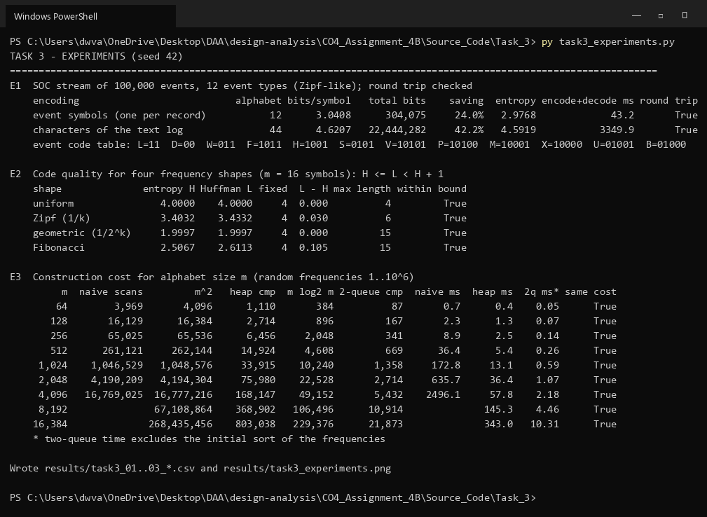

Table 20: Construction cost for alphabet size m (results/task3_03_construction_cost.csv)

| m | naive_scan_comparisons | m_squared | heap_comparisons | m_log2_m | two_queue_comparisons | naive_ms | heap_ms | two_queue_ms | same_cost |
|---|---|---|---|---|---|---|---|---|---|
| 64 | 3969 | 4096 | 1110 | 384 | 87 | 0.7 | 0.4 | 0.05 | True |
| 128 | 16129 | 16384 | 2714 | 896 | 167 | 2.3 | 1.3 | 0.07 | True |
| 256 | 65025 | 65536 | 6456 | 2048 | 341 | 8.9 | 2.5 | 0.14 | True |
| 512 | 261121 | 262144 | 14924 | 4608 | 669 | 36.4 | 5.4 | 0.26 | True |
| 1024 | 1046529 | 1048576 | 33915 | 10240 | 1358 | 172.8 | 13.1 | 0.59 | True |
| 2048 | 4190209 | 4194304 | 75980 | 22528 | 2714 | 635.7 | 36.4 | 1.07 | True |
| 4096 | 16769025 | 16777216 | 168147 | 49152 | 5432 | 2496.1 | 57.8 | 2.18 | True |
| 8192 |  | 67108864 | 368902 | 106496 | 10914 |  | 145.3 | 4.46 | True |
| 16384 |  | 268435456 | 803038 | 229376 | 21873 |  | 343.0 | 10.31 | True |

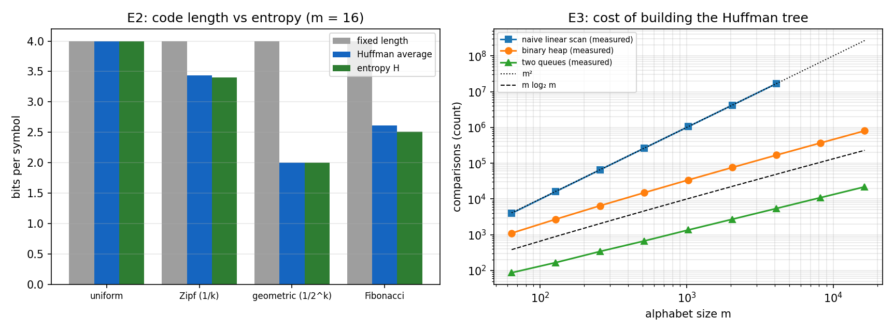

The naive construction made almost exactly m² comparisons (16,769,025 at m = 4,096 – each of the m − 1 merges scans the pool twice) and took 2.5 s; the heap needed 168,147 comparisons (≈ 3.4 m log₂ m, because each merge performs two extract-min operations of about 2 log₂ m comparisons and one insert) and 58 ms; the two-queue method needed only 5,432 comparisons (≈ 1.3 m) and 2.2 ms once the frequencies are sorted. All three produced exactly the same total cost at every size. **Decision:** the heap version is the general-purpose design (frequencies arrive unsorted, Θ(m log m) overall); when the frequencies are already sorted – for example from a counting pass over a small fixed alphabet – the two-queue method makes the construction linear.

### 9. Complexity analysis and algorithmic decisions

- **Construction:** m inserts + (m − 1) × (2 extract-min + 1 insert) on a heap of at most m trees → **Θ(m log m)**; naive Θ(m²); two queues Θ(m) after an O(m log m) sort. **Codes:** Θ(m) tree walk. **Encoding/decoding:** Θ(N + total bits) = Θ(N·L) for N events. **Space:** Θ(m) for the tree plus the output.
- **Heap key (frequency, creation number):** deterministic results and minimum-variance codes under ties.
- **Bit 0 = first popped (lighter) subtree,** so the code table is reproducible and matches the printed tree.
- **Decoder validation** (invalid characters, truncated final code word) and **encoder validation** (unknown symbols) turn corrupted logs into explicit errors rather than silently wrong events – important for security logs.


## Task 4 – Connecting the Emergency Sites: Prim and Kruskal Minimum Spanning Tree [9 Marks]

> **Problem Context – City Fibre Backbone.** The EOC wants to connect its nine emergency sites (EOC, Fire HQ, City Hospital, Police HQ, Water Works, Power Substation, Metro Control, University Data Centre, Traffic Control) by a fibre network. The candidate routes and their trench lengths (in units of 100 m) are known; any connected network is acceptable, and the total trench length must be as small as possible.
> **Your Challenge:**
> - Justify why both Prim's and Kruskal's greedy choices produce a minimum spanning tree (cut property).
> - Implement Prim with a binary heap and Kruskal with union–find (union by rank and path compression); print the intermediate steps – edges chosen and rejected, cycle checks – and verify that both give the same total weight.
> - Compare the two algorithms on sparse and dense networks and evaluate the union–find optimisations.
> - Test boundary cases and the failure case of a disconnected network (some sites cannot be reached), and explain what each algorithm returns.
> **Given test case:** G1 – the 14 candidate routes of `given_G1_fibre_network.csv` (Table 21); expected total 37 (3.7 km).

**Evidence Expected**

> Cut-property argument, pseudocode, implementations with step-by-step output, verification of equal weights, sparse/dense performance comparison with graphs, union–find evaluation, boundary and disconnected-graph tests, complexity analysis.

**Ans:**

### 1. Problem analysis

The sites and routes form a connected, undirected, weighted graph G = (V, E). A spanning tree connects all |V| sites with exactly |V| − 1 routes and no cycle; a minimum spanning tree (MST) has the smallest total weight. There can be very many spanning trees (662 for the given 9-site network), so enumeration is only a reference for small graphs. Both greedy algorithms add one lightest "safe" edge at a time: **Prim** grows a single tree from a root and always adds the lightest edge leaving the tree; **Kruskal** scans all edges in increasing weight and adds an edge whenever it joins two different components (union–find detects cycles).

### 2. Greedy-choice property (cut property) and optimal substructure

**Cut property.** For any cut (S, V − S), a lightest edge e = (u, v) crossing the cut belongs to some MST. *Proof (exchange):* let T be an MST without e. Adding e to T creates a cycle; the cycle crosses the cut at e and at least at one other edge e′ of T. Since e is a lightest crossing edge, w(e) ≤ w(e′), and T′ = T + e − e′ is a spanning tree with w(T′) ≤ w(T), hence also an MST, and it contains e.

- **Prim** applies the cut property to the cut (tree, rest) at every step.
- **Kruskal** applies it to the cut that separates the component of u from everything else: the current edge is the lightest edge leaving that component, because all lighter edges were already examined and either accepted or found to lie inside a component.

**Optimal substructure.** If edge e = (u, v) is in an MST T, contracting u and v into one vertex gives a graph G/e whose MSTs are exactly T − e plus e; so after a safe choice the remaining problem is again an MST problem on a smaller graph. Induction over the |V| − 1 choices proves both algorithms optimal. With distinct weights the MST is unique; with equal weights several MSTs can exist (the given network has **2**), all with the same total.

Negative weights do not break either algorithm (only the order of the weights matters), which is a test case below.

### 3. Pseudocode

```
Algorithm PrimHeap(G, r)
1. for each v in V do key[v] = infinity;  parent[v] = nil;  inTree[v] = false
2. key[r] = 0;  Q = indexed min-heap containing r
3. while Q not empty do
4.     u = ExtractMin(Q);  inTree[u] = true                   // lightest edge crossing the cut
5.     if parent[u] != nil then add edge (parent[u], u) to T
6.     for each (v, w) adjacent to u do
7.         if not inTree[v] and w < key[v] then
8.             key[v] = w;  parent[v] = u
9.             if v in Q then DecreaseKey(Q, v, w) else Insert(Q, v, w)
10. return T                                                  // |T| < |V| - 1  =>  disconnected

Algorithm Kruskal(G)
1. sort E by weight;  MakeSet(v) for every v;  T = empty
2. for each edge (u, v, w) in sorted order while |T| < |V| - 1 do
3.     ru = Find(u);  rv = Find(v)
4.     if ru != rv then add (u, v, w) to T;  Union(ru, rv)     // joins two components
5.     else reject (u, v, w)                                   // it would close a cycle
6. return T                                                   // a spanning forest if G is disconnected

Algorithm Find(x)                                 // with path compression
1. root = x;  while parent[root] != root do root = parent[root]
2. while parent[x] != root do next = parent[x];  parent[x] = root;  x = next
3. return root

Algorithm Union(a, b)                             // a, b roots; union by rank
1. if rank[a] < rank[b] then swap a, b
2. parent[b] = a;  if rank[a] = rank[b] then rank[a] = rank[a] + 1
```

`prim_array` (the O(V²) version for dense graphs) replaces the heap by a linear scan of the key array, exactly as in `PrimArray` of `pseudocode.md`.

### 4. Implementation

`mst_prim_kruskal.py`: indexed heap with counted comparisons and decrease-keys, both Prim variants, union–find in three modes (`naive`, `rank`, `rank+compress`) with counted find calls and pointer hops, Kruskal with early stop after |V| − 1 edges, the brute-force reference and a cut-property checker.

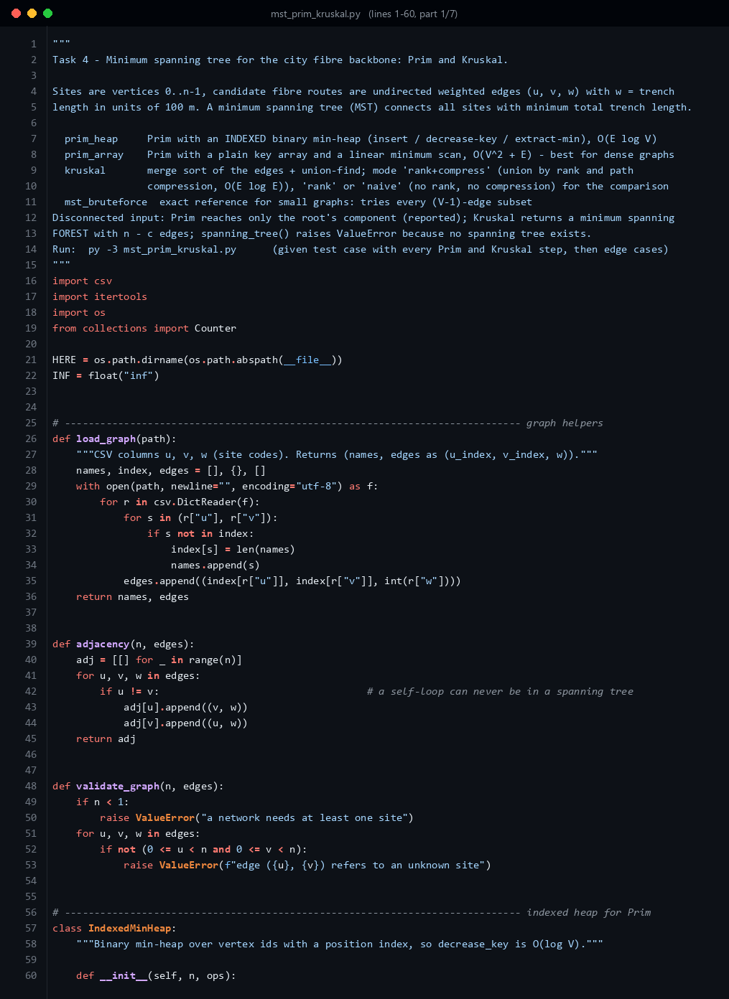

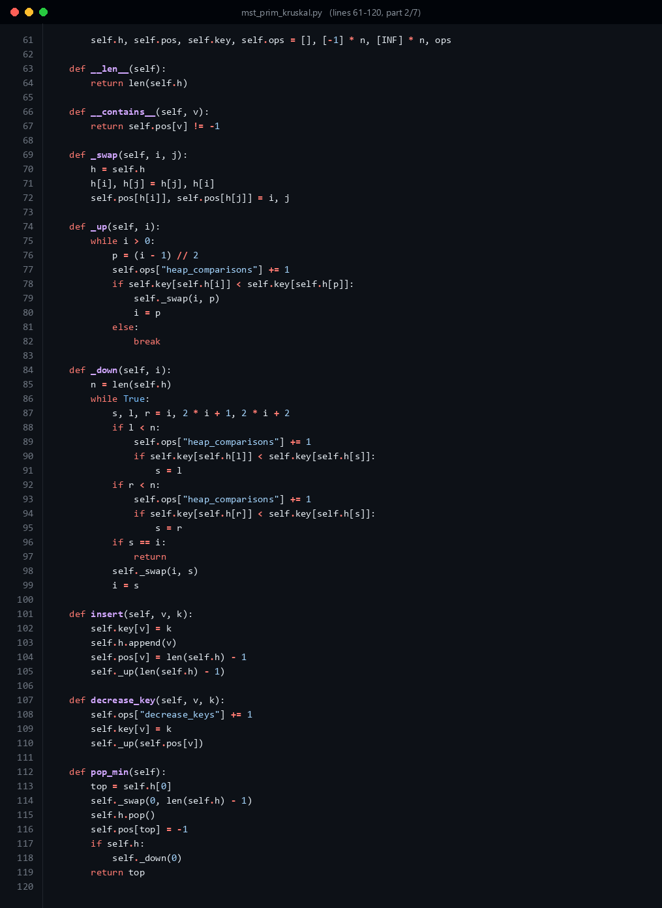

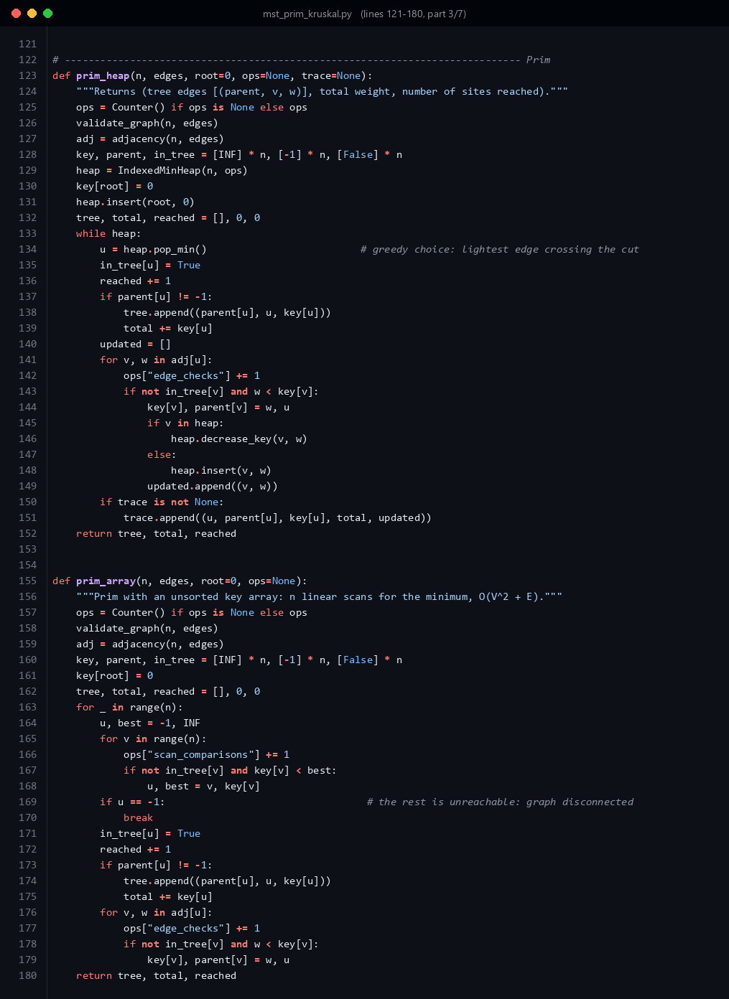

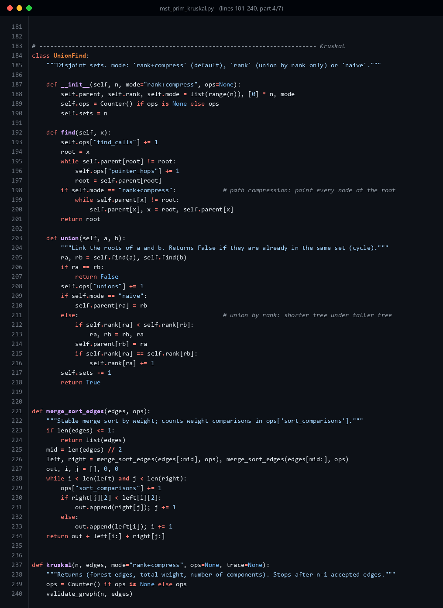

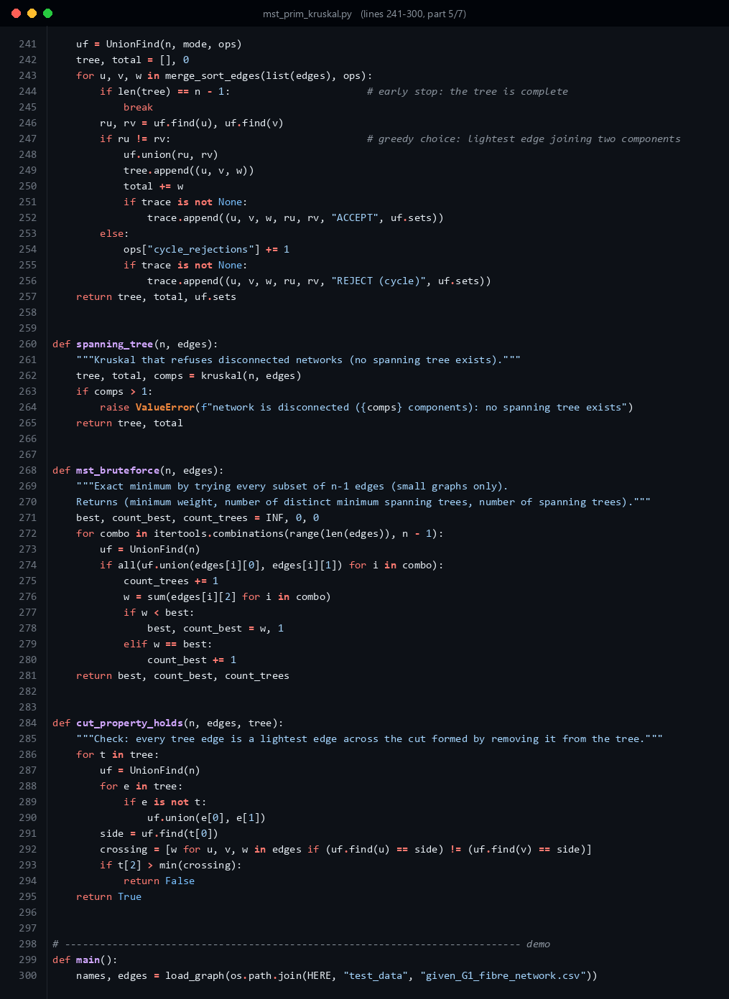

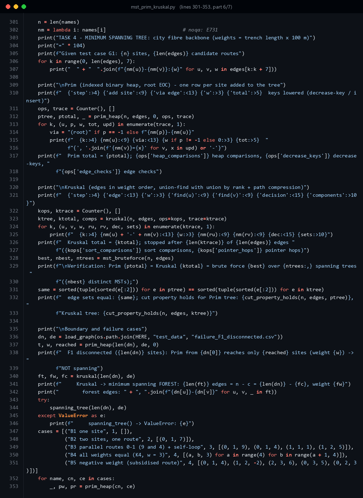

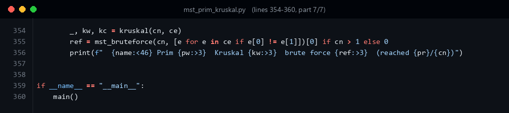

### 5. Input data and intermediate algorithmic steps

Table 21: Given test case G1 – candidate fibre routes (test_data/given_G1_fibre_network.csv; weight = trench length × 100 m)

| Route | w | Route | w | Route | w |
|---|---|---|---|---|---|
| EOC–FIRE | 4 | HOSP–POWER | 4 | POWER–METRO | 2 |
| EOC–UNIV | 8 | HOSP–TRAFFIC | 2 | METRO–UNIV | 1 |
| FIRE–HOSP | 8 | POLICE–WATER | 9 | METRO–TRAFFIC | 6 |
| FIRE–UNIV | 11 | POLICE–POWER | 14 | UNIV–TRAFFIC | 7 |
| HOSP–POLICE | 7 | WATER–POWER | 10 | | |

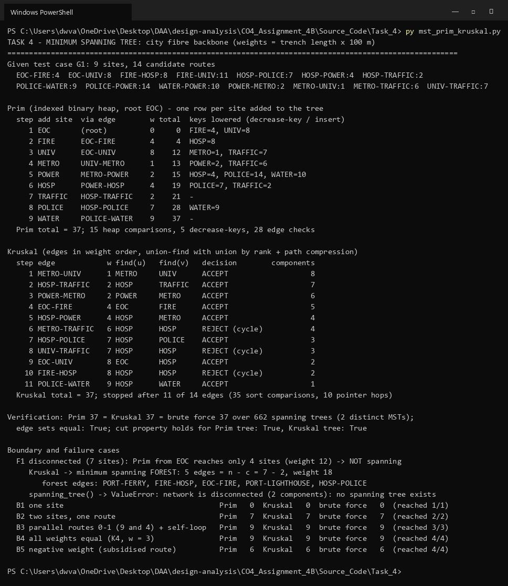

**Prim (root EOC).** The sites join in the order EOC, FIRE (4), UNIV (8), METRO (1), POWER (2), HOSP (4), TRAFFIC (2), POLICE (7), WATER (9); the output shows after every step which keys were lowered, e.g. adding POWER lowers HOSP from 8 to 4 and inserts POLICE = 14 and WATER = 10, and adding HOSP lowers POLICE to 7 and TRAFFIC to 2. Total **37** with 15 heap comparisons, 5 decrease-keys and 28 edge checks (each undirected route is checked from both ends).

**Kruskal.** The 14 routes are examined in weight order; for each one the program prints the two roots returned by Find. METRO–TRAFFIC (6), UNIV–TRAFFIC (7) and FIRE–HOSP (8) are **rejected** because both ends already have the root HOSP (they would close a cycle). After POLICE–WATER the tree has 8 = |V| − 1 edges and the algorithm stops after 11 of the 14 routes. Total **37**, with 35 sort comparisons and only 10 pointer hops thanks to path compression.

**Verification.** Prim = Kruskal = brute force = 37 over all 662 spanning trees; there are 2 distinct MSTs (EOC–UNIV and FIRE–HOSP both weigh 8 and are interchangeable); both programs happen to choose EOC–UNIV, so even the edge sets agree; the cut-property checker confirms that every tree edge is a lightest edge across its cut. The backbone needs **3.7 km** of trench instead of the 9.3 km of all 14 candidate routes.

### 6. Test cases, including the disconnected network

Table 22: Task 4 test cases executed by `run_all_tests.py` (Test_Cases/task4_test_cases.json)

| Test case | Expected | Actual | Test result |
|---|---|---|---|
| **G1** 9 sites, 14 candidate routes | weight: 37, edges: 8, distinct_ms… | Prim 37/37, Kruskal 37, 8 edges | PASS |
| **S1** Prim(heap) = Prim(array) = Kruskal = brute fo… | all_ok: True | 150/150 equal | PASS |
| **S2** naive / rank / rank+compress union-find give … | all_ok: True | 100/100 equal | PASS |
| **S3** every tree edge is a lightest edge across its… | all_ok: True | True | PASS |
| **S4** 3,000 sites: Prim(heap) = Prim(array) = Krusk… | all_ok: True | weights (10633, 10633, 10633) | PASS |
| **B1** one site | weight: 0, edges: 0 | Prim 0/0, Kruskal 0, 0 edges | PASS |
| **B2** two sites, one route | weight: 7, edges: 1 | Prim 7/7, Kruskal 7, 1 edges | PASS |
| **B3** parallel routes and a self-loop | weight: 9, edges: 2 | Prim 9/9, Kruskal 9, 2 edges | PASS |
| **B4** all weights equal | weight: 9, edges: 3 | Prim 9/9, Kruskal 9, 3 edges | PASS |
| **B5** negative (subsidised) route | weight: 6, edges: 3 | Prim 6/6, Kruskal 6, 3 edges | PASS |
| **F1** two components: Prim partial, Kruskal forest,… | prim_reached: 4, forest_edges: 5,… | prim_reached: 4, forest_edges: 5,… | PASS |
| **F2** route to an unknown site | ValueError | ValueError | PASS |
| **F3** network without sites | ValueError | ValueError | PASS |

**Failure case F1 – disconnected network.** The island sites PORT, FERRY and LIGHTHOUSE have no route to the mainland. Prim from EOC reaches only 4 of the 7 sites (weight 12) – it cannot see the other component at all, so I report "not spanning" by comparing the number of reached sites with |V|. Kruskal returns a **minimum spanning forest** with n − c = 7 − 2 = 5 edges (weight 18), one tree per component, and `spanning_tree()` raises `ValueError: network is disconnected (2 components)`. This is the correct engineering response: a spanning tree does not exist, but the forest shows exactly which link is missing. Boundary cases: one site (empty tree), parallel routes (the lighter one is used), a self-loop (ignored – Kruskal rejects it as a cycle), all-equal weights (any spanning tree is minimum: 3 × 3 = 9) and a negative (subsidised) route.

### 7. Performance comparison – sparse against dense networks

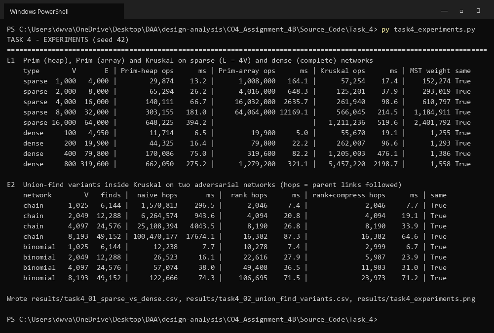

Table 23: Prim (heap), Prim (array) and Kruskal on random connected networks (results/task4_01_sparse_vs_dense.csv; ops = counted comparisons + edge checks, or sort comparisons + finds + hops)

| type | V | E | prim_heap_ops | prim_heap_ms | prim_array_ops | prim_array_ms | kruskal_ops | kruskal_ms | mst_weight | same_weight |
|---|---|---|---|---|---|---|---|---|---|---|
| sparse | 1000 | 4000 | 29874 | 13.2 | 1008000 | 164.1 | 57254 | 17.4 | 152274 | True |
| sparse | 2000 | 8000 | 65294 | 26.2 | 4016000 | 648.3 | 125201 | 37.9 | 293019 | True |
| sparse | 4000 | 16000 | 140111 | 66.7 | 16032000 | 2635.7 | 261940 | 98.6 | 610797 | True |
| sparse | 8000 | 32000 | 303155 | 181.0 | 64064000 | 12169.1 | 566045 | 214.5 | 1184911 | True |
| sparse | 16000 | 64000 | 648225 | 394.2 |  |  | 1211236 | 519.6 | 2401792 | True |
| dense | 100 | 4950 | 11714 | 6.5 | 19900 | 5.0 | 55670 | 19.1 | 1255 | True |
| dense | 200 | 19900 | 44325 | 16.4 | 79800 | 22.2 | 262007 | 96.6 | 1293 | True |
| dense | 400 | 79800 | 170086 | 75.0 | 319600 | 82.2 | 1205003 | 476.1 | 1386 | True |
| dense | 800 | 319600 | 662050 | 275.2 | 1279200 | 321.1 | 5457220 | 2198.7 | 1558 | True |

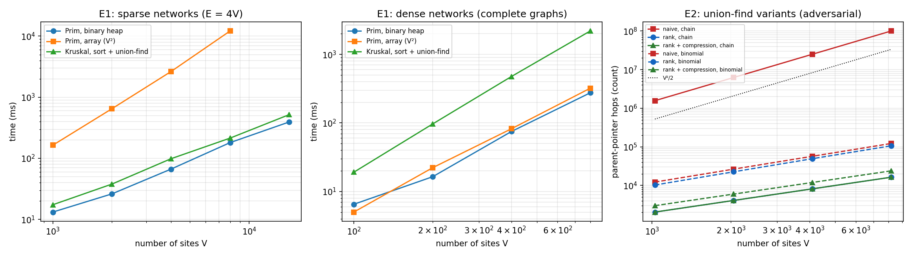

**Sparse networks (E = 4V – road-like).** Prim with the heap was fastest (394 ms at V = 16,000), Kruskal close behind (520 ms, dominated by sorting 64,000 edges), while the array version needs V² scans: 64 million scans and 12.2 s at V = 8,000 – about 67× slower than the heap version. **Dense networks (complete graphs, E = V(V − 1)/2).** Kruskal becomes the slowest (2.2 s at V = 800) because it must sort all 319,600 edges, Θ(E log E). The array version now needs only about 2× the operations of the heap version (1.28 M against 0.66 M) and its time is close (321 against 275 ms): theory says O(V²) beats O(E log V) on dense graphs, but with random weights the heap version performs far fewer decrease-keys than the E log V worst case, so in practice both Prim variants are similar and both are much better than Kruskal. All three always produced the same weight.

### 8. Optimisation – union by rank and path compression

Table 24: Union–find variants inside Kruskal (results/task4_02_union_find_variants.csv)

| network | V | finds | naive_hops | naive_ms | rank_hops | rank_ms | rank_compress_hops | rank_compress_ms | same_weight |
|---|---|---|---|---|---|---|---|---|---|
| chain | 1025 | 6144 | 1570813 | 296.5 | 2046 | 7.4 | 2046 | 7.7 | True |
| chain | 2049 | 12288 | 6264574 | 943.6 | 4094 | 20.8 | 4094 | 19.1 | True |
| chain | 4097 | 24576 | 25108394 | 4043.5 | 8190 | 26.8 | 8190 | 33.9 | True |
| chain | 8193 | 49152 | 100470177 | 17674.1 | 16382 | 87.3 | 16382 | 64.6 | True |
| binomial | 1025 | 6144 | 12238 | 7.7 | 10278 | 7.4 | 2999 | 6.7 | True |
| binomial | 2049 | 12288 | 26523 | 16.1 | 22616 | 27.9 | 5987 | 23.9 | True |
| binomial | 4097 | 24576 | 57074 | 38.0 | 49408 | 36.5 | 11983 | 31.0 | True |
| binomial | 8193 | 49152 | 122666 | 74.3 | 106695 | 71.5 | 23973 | 71.2 | True |

On the *chain* network (cheap routes 0–1–2–…, then routes back to site 0) the naive union links root under root and builds one long path; every later Find walks it, giving **100,470,177 pointer hops** at V = 8,193 – Θ(V²), 17.7 s. Union by rank keeps every tree shallow: 16,382 hops (6,000× fewer), 87 ms. On the *binomial* network (unions of equal-sized trees, where even union by rank reaches depth log₂ V) path compression additionally cut the hops from 106,695 to **23,973** (4.5× fewer): after one Find every node on the path points directly to the root. Together the two optimisations make each operation almost constant (amortised O(α(V))), so Kruskal's cost is dominated by the sort.

### 9. Complexity analysis and algorithmic decisions

Table 25: Complexity of the MST implementations

| Algorithm | Time | Best for | Measured evidence |
|---|---|---|---|
| Prim, indexed binary heap | O(E log V) | sparse networks | fastest on E = 4V |
| Prim, array | Θ(V² + E) | dense networks | exactly V² scans (640,000 at V = 800) |
| Kruskal, sort + union–find (rank + compression) | Θ(E log E) + O(E α(V)) | sparse, or edges already sorted | sort dominates; 10 hops on G1 |
| Kruskal with naive union–find | O(E·V) worst case | – | Θ(V²) hops on the chain network |

Decisions: Prim uses an **indexed** heap (position array) so that decrease-key is O(log V) instead of inserting duplicates; Kruskal **stops after |V| − 1 accepted edges** (it examined only 11 of 14 routes on G1); self-loops are dropped and parallel routes need no special handling; disconnected input is never silently returned as a "tree" – Prim reports the reached count and `spanning_tree()` raises an error, while Kruskal's forest is available for planning the missing links. For the city backbone (a sparse, road-like network) I recommend **Prim with the binary heap**, with Kruskal as an equally correct alternative when the routes arrive already sorted by cost.

## Task 5 – Routing the Ambulances: Dijkstra's Algorithm [8 Marks]

> **Problem Context – Ambulance Dispatch.** Ambulances leave the City Hospital (H). The road network is a directed graph: each road segment has a travel time in minutes, and some streets are one-way. The dispatcher needs the fastest time and the route from H to every junction.
> **Your Challenge:**
> - Apply Dijkstra's greedy algorithm and justify why settling the closest unsettled junction is safe.
> - Print a step table (distance, predecessor and settled status of every junction after every iteration) and reconstruct the routes.
> - Implement both the array version O(V²) and the binary-heap version O((V + E) log V); compare them with measured operation counts and times on sparse and dense networks.
> - Show what happens with a negative edge weight: demonstrate the wrong answer, explain it and compare with Bellman–Ford.
> - Test boundary cases (single junction, unreachable junction, zero-time roads, source = destination).
> **Given test case:** G1 – the road network of `given_G1_road_network.csv` (Table 26); expected fastest times from H: A 3, B 2, C 8, D 11, E 10, F 17, G 19 minutes.

**Evidence Expected**

> Greedy-choice justification, pseudocode, step table, reconstructed routes, implementation of both versions with operation counts and a performance comparison, the negative-edge failure case with explanation, boundary tests and complexity analysis.

**Ans:**

### 1. Problem analysis

This is the single-source shortest-path problem with non-negative weights. Dijkstra keeps a tentative distance dist[v] for every junction and a set of *settled* junctions whose distance is final. In each round it settles the unsettled junction with the smallest tentative distance (the greedy choice) and **relaxes** its outgoing roads: if dist[u] + w(u, v) < dist[v], the route through u is better, so dist[v] and prev[v] are updated. The routes are read back from prev[]. Weights must be non-negative; my implementation checks this and raises `ValueError` for a negative weight (an unsafe mode exists only to demonstrate the failure).

### 2. Greedy-choice property and optimal substructure

**Optimal substructure.** Every sub-path of a shortest path is itself a shortest path (otherwise replacing it by a shorter one would shorten the whole path). Hence a shortest route to v consists of a shortest route to its predecessor plus one road – which is exactly what prev[] records.

**Greedy choice (why settling the closest junction is safe).** Let u be the unsettled junction with the smallest dist[u], and suppose some route P from H to u were shorter than dist[u]. P starts in the settled set, so it leaves the settled set for the first time on some road (x, y) with x settled and y unsettled. When x was settled, (x, y) was relaxed, so dist[y] ≤ dist[x] + w(x, y) = length of P up to y. Because **all weights are non-negative**, the rest of P from y to u has length ≥ 0, so length(P) ≥ dist[y] ≥ dist[u] (u was chosen as the minimum) – a contradiction. Therefore dist[u] is final when u is settled.

**Where it fails.** The step "the rest of P has length ≥ 0" is the only place where non-negativity is used; with a negative road the remainder of P can be negative, and a settled junction may later turn out to have a shorter route (failure case F1 below).

### 3. Pseudocode

```
Algorithm DijkstraArray(G, s)                     // O(V^2 + E)
1. dist[v] = infinity, prev[v] = nil, done[v] = false for every v;  dist[s] = 0
2. repeat |V| times
3.     u = the unsettled vertex with the smallest dist (linear scan)   // greedy choice
4.     if dist[u] = infinity then stop                         // the rest is unreachable
5.     done[u] = true
6.     for each road (u, v, w) do
7.         if not done[v] and dist[u] + w < dist[v] then dist[v] = dist[u] + w;  prev[v] = u

Algorithm DijkstraHeap(G, s, target = none)       // O((V + E) log V), lazy deletion
1. if some w < 0 then error
2. dist[v] = infinity for all v;  dist[s] = 0;  H = min-heap {(0, s)}
3. while H not empty do
4.     (d, u) = ExtractMin(H)
5.     if done[u] or d > dist[u] then continue                 // stale entry: skip
6.     done[u] = true;  if u = target then stop               // early exit for one destination
7.     for each road (u, v, w) do
8.         if not done[v] and d + w < dist[v] then dist[v] = d + w;  prev[v] = u;  Insert(H, (dist[v], v))

Algorithm PathTo(prev, s, t)
1. if dist[t] = infinity then return none
2. P = [t];  while last(P) != s do append prev[last(P)];  return reverse(P)

Algorithm BellmanFord(G, s)                       // reference: negative weights allowed, O(VE)
1. dist[s] = 0, others infinity;  repeat |V| - 1 times: relax every road
2. if some road can still be relaxed then report a negative cycle
```

### 4. Implementation

`dijkstra_routing.py` contains both Dijkstra versions with counters (scan comparisons, heap comparisons, pushes, pops, stale pops, relaxations), Bellman–Ford, route reconstruction and the demonstration.

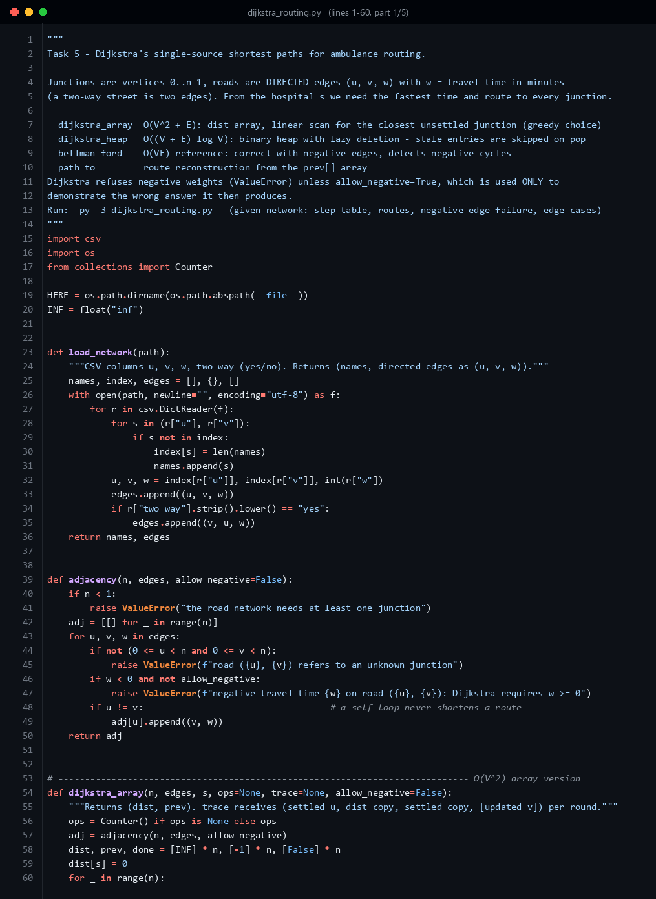

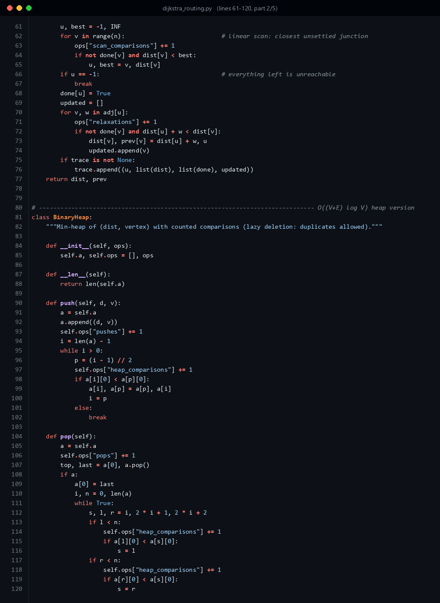

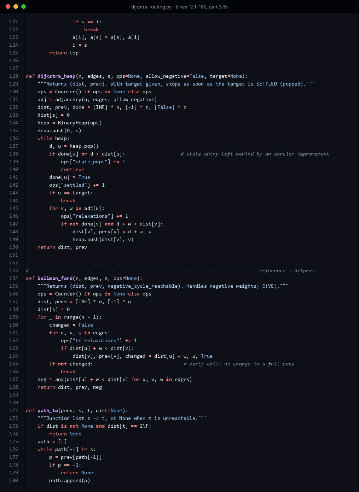

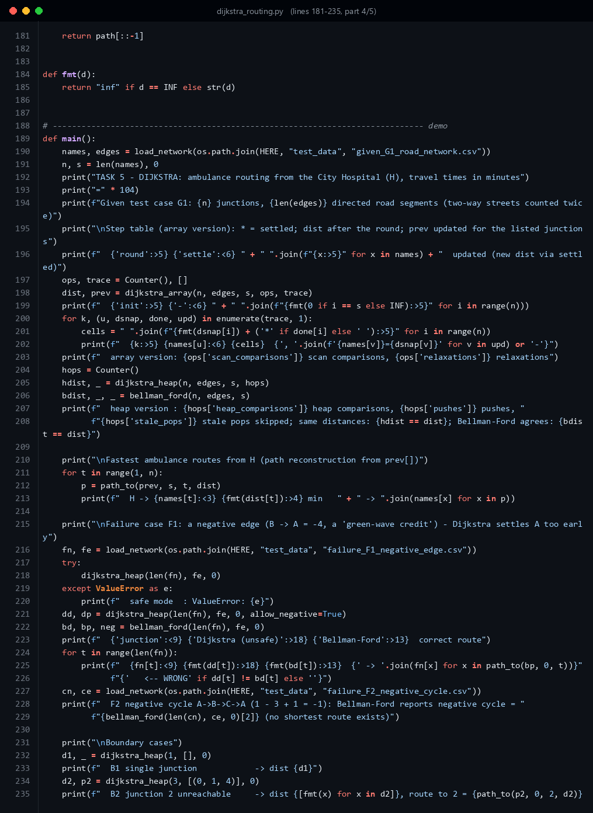

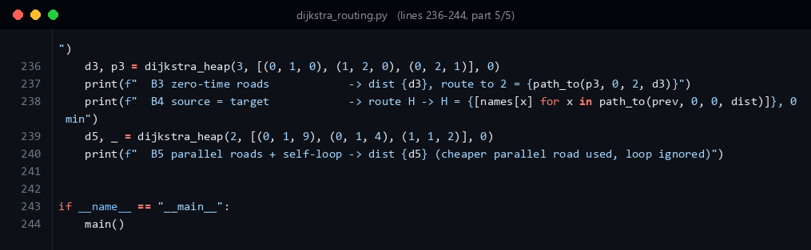

### 5. Input data, step table and routes

Table 26: Given test case G1 – road segments (test_data/given_G1_road_network.csv; minutes; two-way streets are two directed edges)

| Road | min | Two-way | Road | min | Two-way | Road | min | Two-way |
|---|---|---|---|---|---|---|---|---|
| H–A | 4 | yes | B–C | 8 | yes | D–F | 6 | yes |
| H–B | 2 | yes | B–D | 10 | yes | E–F | 8 | yes |
| B–A | 1 | yes | C–D | 3 | yes | F→G | 2 | no |
| A–C | 5 | yes | C–E | 2 | yes | G→E | 3 | no |
| | | | | | | D→G | 9 | no |

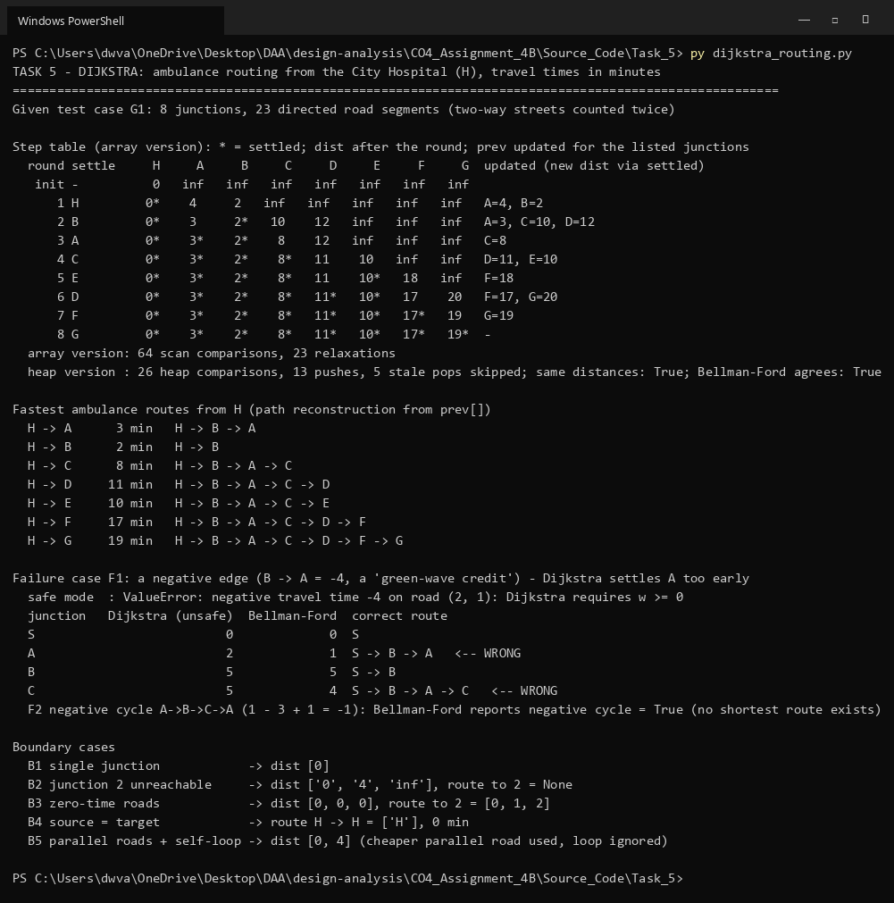

Table 27: Step table of the array version for G1 (* = settled; values after the round)

| Round | Settle | H | A | B | C | D | E | F | G | Updated |
|---|---|---|---|---|---|---|---|---|---|---|
| init | – | 0 | ∞ | ∞ | ∞ | ∞ | ∞ | ∞ | ∞ | – |
| 1 | H | 0* | 4 | 2 | ∞ | ∞ | ∞ | ∞ | ∞ | A = 4, B = 2 |
| 2 | B | 0* | 3 | 2* | 10 | 12 | ∞ | ∞ | ∞ | A = 3, C = 10, D = 12 |
| 3 | A | 0* | 3* | 2* | 8 | 12 | ∞ | ∞ | ∞ | C = 8 |
| 4 | C | 0* | 3* | 2* | 8* | 11 | 10 | ∞ | ∞ | D = 11, E = 10 |
| 5 | E | 0* | 3* | 2* | 8* | 11 | 10* | 18 | ∞ | F = 18 |
| 6 | D | 0* | 3* | 2* | 8* | 11* | 10* | 17 | 20 | F = 17, G = 20 |
| 7 | F | 0* | 3* | 2* | 8* | 11* | 10* | 17* | 19 | G = 19 |
| 8 | G | 0* | 3* | 2* | 8* | 11* | 10* | 17* | 19* | – |

The table shows the greedy at work: A is first reached directly in 4 minutes but improved to 3 via B before it is settled; D improves from 12 (via B) to 11 (via C); F and G are improved twice. The reconstructed routes are H→B→A (3), H→B (2), H→B→A→C (8), H→B→A→C→D (11), H→B→A→C→E (10), H→B→A→C→D→F (17) and H→B→A→C→D→F→G (19 min) – exactly the expected times of the statement. The array version used 64 scan comparisons (8 × 8) and 23 relaxations; the heap version used 26 heap comparisons, 13 pushes and skipped 5 stale entries (the superseded entries A = 4, C = 10, D = 12, F = 18 and G = 20); Bellman–Ford gives the same distances.

### 6. Failure case – a negative edge weight

Suppose a "green-wave credit" is modelled as a negative travel time: S→A 2, S→B 5, **B→A −4**, A→C 3 (`failure_F1_negative_edge.csv`). In safe mode my Dijkstra refuses the input (`ValueError`). In unsafe mode it settles A with 2 in round 2, because A is the closest unsettled junction, and C with 5 via A; when B is settled (dist 5) the road B→A would give 5 − 4 = 1, but A is already final and is not reopened.

Table 28: Negative-edge failure – Dijkstra (unsafe mode) against Bellman–Ford

| Junction | Dijkstra (unsafe) | Bellman–Ford | Correct route |
|---|---|---|---|
| S | 0 | 0 | S |
| A | **2 (wrong)** | 1 | S → B → A |
| B | 5 | 5 | S → B |
| C | **5 (wrong)** | 4 | S → B → A → C |

The error is exactly the step of the proof that needed w ≥ 0: the remainder S→B→A of the true route is shorter than the part already settled. Bellman–Ford relaxes all roads |V| − 1 times, so it does not depend on the order of settling and gives the correct answer in O(VE); it also detects negative cycles (F2: A→B→C→A with weight 1 − 3 + 1 = −1 is reported, because no shortest route exists). **Decision:** travel times are physically non-negative, so the service validates the weights and keeps Dijkstra; if negative costs were ever needed, Bellman–Ford (or Johnson's re-weighting) must be used instead.

### 7. Test cases

Table 29: Task 5 test cases executed by `run_all_tests.py` (Test_Cases/task5_test_cases.json)

| Test case | Expected | Actual | Test result |
|---|---|---|---|
| **G1** 8 junctions: distances from H (array and heap) | H: 0, A: 3, B: 2, C: 8, D: 11, E:… | H: 0, A: 3, B: 2, C: 8, D: 11, E:… | PASS |
| **G2** route H -> G | time: 19, path: H, B, A, C, D, F,… | 19 H-B-A-C-D-F-G | PASS |
| **S1** array = heap = Bellman-Ford, routes consistent | all_ok: True | 300/300 equal | PASS |
| **S2** early exit at target = full run for that targ… | all_ok: True | 100/100 equal | PASS |
| **S3** pops = pushes = settled + stale on G1 | all_ok: True | pushes 13, settled 8, stale 5 | PASS |
| **B1** single junction | dist: 0 | dist 0 | PASS |
| **B2** unreachable junction | dist: 0, 4, inf, path: None | dist 0, 4, inf | PASS |
| **B3** zero-time roads | dist: 0, 0, 0, path: 0, 1, 2 | dist 0, 0, 0 | PASS |
| **B4** parallel roads, self-loop, source = target | dist: 0, 4, path: 0 | dist 0, 4 | PASS |
| **F1** negative edge: safe mode refuses, unsafe mode… | error: ValueError, unsafe: A: 2, … | error: ValueError, unsafe: A: 2, … | PASS |
| **F2** negative cycle detected by Bellman-Ford | negative_cycle: True | negative cycle True | PASS |
| **F3** road to an unknown junction | ValueError | ValueError | PASS |

The student-designed case S1 compares the array version, the heap version and Bellman–Ford on 300 random networks with zero-weight roads, parallel roads and unreachable junctions (533 unreachable pairs, all reported as ∞ with no route); every reconstructed route was checked to have exactly the reported length. S2 confirms that the early exit at a target gives the same distance as a full run, and S3 checks the heap accounting (pops = pushes = settled + stale).

### 8. Optimisation – array against binary heap

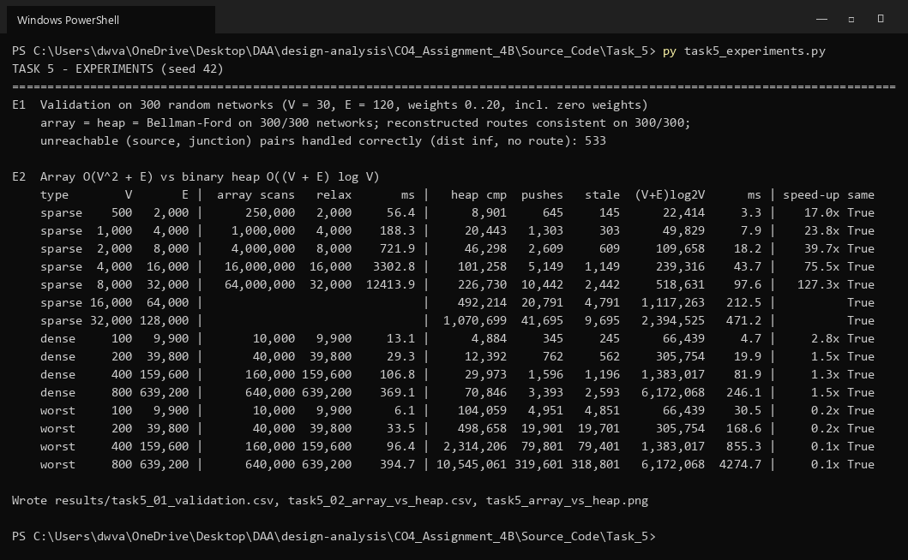

Table 30: Array O(V² + E) against binary heap O((V + E) log V) (results/task5_02_array_vs_heap.csv)

| type | V | E | array_scan_comparisons | array_ms | heap_comparisons | heap_pushes | heap_stale_pops | heap_ms | speedup |
|---|---|---|---|---|---|---|---|---|---|
| sparse | 500 | 2000 | 250000 | 56.4 | 8901 | 645 | 145 | 3.3 | 17.0 |
| sparse | 1000 | 4000 | 1000000 | 188.3 | 20443 | 1303 | 303 | 7.9 | 23.8 |
| sparse | 2000 | 8000 | 4000000 | 721.9 | 46298 | 2609 | 609 | 18.2 | 39.7 |
| sparse | 4000 | 16000 | 16000000 | 3302.8 | 101258 | 5149 | 1149 | 43.7 | 75.5 |
| sparse | 8000 | 32000 | 64000000 | 12413.9 | 226730 | 10442 | 2442 | 97.6 | 127.3 |
| sparse | 16000 | 64000 |  |  | 492214 | 20791 | 4791 | 212.5 |  |
| sparse | 32000 | 128000 |  |  | 1070699 | 41695 | 9695 | 471.2 |  |
| dense | 100 | 9900 | 10000 | 13.1 | 4884 | 345 | 245 | 4.7 | 2.8 |
| dense | 200 | 39800 | 40000 | 29.3 | 12392 | 762 | 562 | 19.9 | 1.5 |
| dense | 400 | 159600 | 160000 | 106.8 | 29973 | 1596 | 1196 | 81.9 | 1.3 |
| dense | 800 | 639200 | 640000 | 369.1 | 70846 | 3393 | 2593 | 246.1 | 1.5 |
| worst | 100 | 9900 | 10000 | 6.1 | 104059 | 4951 | 4851 | 30.5 | 0.2 |
| worst | 200 | 39800 | 40000 | 33.5 | 498658 | 19901 | 19701 | 168.6 | 0.2 |
| worst | 400 | 159600 | 160000 | 96.4 | 2314206 | 79801 | 79401 | 855.3 | 0.1 |
| worst | 800 | 639200 | 640000 | 394.7 | 10545061 | 319601 | 318801 | 4274.7 | 0.1 |

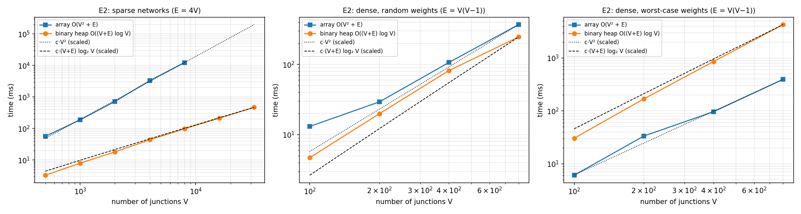

- **Sparse road-like networks (E = 4V):** the array version always makes exactly V² scan comparisons (64,000,000 at V = 8,000, 12.4 s), the heap version about 28 V comparisons (226,730, 98 ms) – **127× faster** at V = 8,000, and the advantage grows with V. The heap version handled 32,000 junctions in 0.47 s.
- **Dense networks with random weights:** only a few thousand pushes happen (3,393 at V = 800 for 639,200 roads), so the heap version stays 1.3–2.8× faster even though theory favours the array.
- **Dense networks with worst-case weights:** I constructed weights w(u, v) = 2(v − u) − 1 for which every relaxation improves a distance. Now the heap receives V²/2 pushes (319,601 at V = 800) and 10.5 million comparisons, and the **array version is 10× faster** (0.39 s against 4.27 s) – the theoretical O(V²) against O(E log V) comparison made visible.

**Decision:** road networks are sparse (a junction has 2–6 roads), so the ambulance service uses the **binary-heap version**; the array version would only be preferable for small, very dense graphs.

### 9. Complexity analysis and algorithmic decisions

- **Array version:** V rounds × V scan comparisons + E relaxations = **Θ(V² + E)**, space Θ(V).
- **Heap version (lazy deletion):** at most E + 1 pushes and pops, each O(log E) = O(log V) → **O((V + E) log V)**, space O(V + E) for the heap entries. Lazy deletion replaces decrease-key by a push and an explicit stale-entry check (`d > dist[u]`), which keeps the heap simple; the stale entries are counted (2,442 of 10,442 pushes at V = 8,000).
- **Early exit** when only one destination matters (used in Task 6) stops as soon as the target is settled.
- **Validation:** negative weights and unknown junctions raise errors; unreachable junctions are reported as ∞ with no route instead of a crash.


## Task 6 – Day-4 Design Challenge: Test, Debug, Optimise and Validate the Route Service [10 Marks]

> **Problem Context – The Route Service Must Scale.** A teammate wrote the ambulance route service `given_faulty_route_service.py` (Dijkstra with a heap) that the dispatch desk uses with the network of Task 5. The city is now integrating the whole metropolitan region: the network grows to **100,000 junctions** (about 380,000 one-way road segments), and **every night** the traffic department sends a feed that replaces the travel times of thousands of roads, using the code −1 for a closed road. Dispatchers already report wrong routes, routes printed backwards and occasional crashes.
> **Your Challenge:** You are not permitted simply to replace the service with a different textbook program. Work from the given code: test it with the given and your own test cases, debug it systematically (reproduce → isolate → fix → re-test), optimise it for the changed requirement, validate it on large inputs and defend the final design with evidence.
> **Given test cases** (network of Task 5, times in minutes): T6-G1 H→G = 19 via H-B-A-C-D-F-G; T6-G2 H→A = 3 via H-B-A; T6-G3 after the feed closes C–D in both directions, H→D = 12 via H-B-D; T6-G4 after the feed re-times C–E to 9 min, H→E = 17 via H-B-A-C-E.

The given code is reproduced unchanged in Figures 46–47 (and Appendix A); line numbers below refer to these figures.

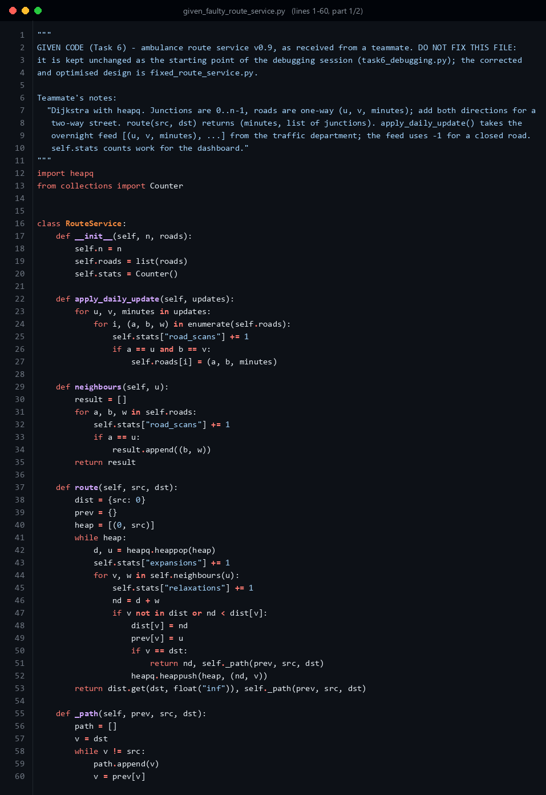


### A. Test the Given Implementation [2 Marks]

> Run the given implementation on the given test cases and on test cases of your own, including boundary and failure cases. Record the expected and the actual result of every case.

**Evidence Expected**

> A test catalogue (given, student-designed, boundary, failure) with expected against actual results and the observed failure symptoms.

**Ans:**

I wrote the Task 6 test catalogue `Test_Cases/task6_test_cases.json` before reading the code in detail: the four given cases, six student-designed cases (stale-entry trap network RI, source = destination, zero-time roads, close-and-reopen in one feed, work bounds on a 900-junction grid, A* after a feed), four boundary cases (one-junction network, junction without incoming roads, unknown junction, feed record for a non-existent road), three failure cases (negative feed value −5, all roads into D closed, negative initial travel time) and one large-scale case (100,000 junctions with a nightly feed). `task6_debugging.py` runs every case against any version of the service; a **watchdog** counter stops a search after 20·V + 100 expansions so that a runaway loop becomes a recorded failure instead of a hang.

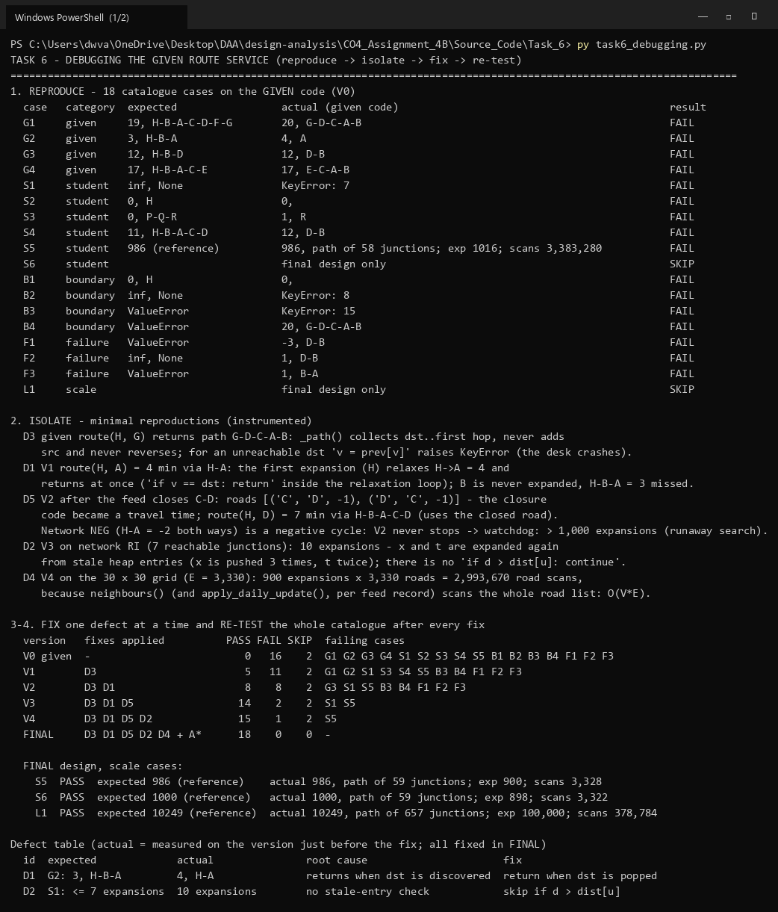

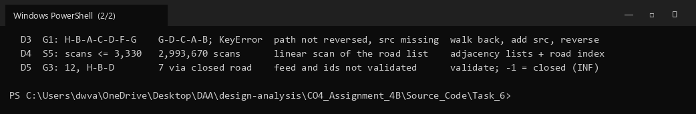

Table 31: The catalogue on the GIVEN code (V0) – expected against actual (part 1 of the output above)

| Test case | Expected | Actual (given code) | Result on the given code |
|---|---|---|---|
| G1 | 19, H-B-A-C-D-F-G | 20, G-D-C-A-B | FAIL |
| G2 | 3, H-B-A | 4, A | FAIL |
| G3 | 12, H-B-D | 12, D-B | FAIL |
| G4 | 17, H-B-A-C-E | 17, E-C-A-B | FAIL |
| S1 | ∞, no route (≤ 7 expansions) | KeyError: 7 (crash) | FAIL |
| S2 | 0, H | 0, empty path | FAIL |
| S3 | 0, P-Q-R | 1, R | FAIL |
| S4 | 11, H-B-A-C-D | 12, D-B | FAIL |
| S5 | 986 (reference), ≤ 900 expansions, ≤ 3,330 road scans | 986, 1,016 expansions, 3,383,280 road scans | FAIL |
| S6 | A* = reference | needs coordinates (final design only) | SKIP |
| B1 | 0, H | 0, empty path | FAIL |
| B2 | ∞, no route | KeyError: 8 (crash) | FAIL |
| B3 | ValueError | KeyError: 15 (crash) | FAIL |
| B4 | ValueError | update silently ignored, 20 | FAIL |
| F1 | ValueError | −3, D-B (negative time accepted) | FAIL |
| F2 | ∞, no route | 1, D-B (closed roads used) | FAIL |
| F3 | ValueError | 1, B-A (negative network accepted) | FAIL |
| L1 | reference on 100,000 junctions | not run: estimated hours (part D) | SKIP |

**Result: 0 of 16 runnable cases pass.** The symptoms fall into five groups: (1) **wrong travel times** (G1 20 instead of 19, G2 4 instead of 3, S3, S4); (2) **every route printed backwards without the hospital**; (3) **crashes** (`KeyError`) whenever the destination cannot be reached or does not exist; (4) **invalid feed records accepted silently** – a negative time, a −1 closure and a record for a non-existent road – producing impossible answers such as −3 minutes; (5) **excessive work**: 1,016 expansions for 900 junctions and 3.4 million road scans for a network of only 3,330 roads.

### B. Debug Systematically [3 Marks]

> For every failure: reproduce it, isolate the defect with a minimal input and instrumentation, identify the root cause in the code, fix one defect at a time and re-test the whole catalogue after each fix. Present a defect table with expected against actual results.

**Evidence Expected**

> Minimal reproductions, root causes located in the code, a defect table, and regression evidence after every fix.

**Ans:**

**Isolation (part 2 of the output).** For every symptom group I built the smallest input that shows it and added instrumentation (traces of the heap pops, the stats counters, the watchdog):

- **D3 – broken path reconstruction (lines 55–61).** `_path()` appends dst, its predecessor, … up to the first hop, **never appends the source and never reverses** the list, so route(H, G) is printed G-D-C-A-B. For an unreachable destination `prev[v]` does not exist and `v = prev[v]` raises `KeyError` – the crash of S1, B2, B3. For src = dst it returns an empty path.
- **D1 – early return on discovery (lines 50–51).** `if v == dst: return` sits inside the relaxation loop: the search stops the first time dst is *discovered*, not when it is *settled*. Minimal repro G2: the first expansion (H) relaxes H→A = 4 and returns at once; B (2 min) is never expanded, so H-B-A = 3 is missed. This violates the greedy-choice argument of Task 5 – a tentative distance is not final.
- **D5 – feed and identifiers not validated (lines 22–27, 17–20).** `apply_daily_update` copies every record into the road list: the closure code −1 becomes a travel time of −1 minute (after closing C–D, route(H, D) = 7 minutes *through the closed road*), other negative values and records for non-existent roads are accepted or silently ignored, and unknown junction IDs are not rejected. A negative initial time (network NEG, H–A = −2 both ways) creates a negative cycle: once D1 was fixed, the search never terminated and the watchdog stopped it after 1,000 expansions.
- **D2 – stale heap entries expanded again (lines 41–44).** After a pop there is no check whether the popped distance is still current. On network RI (junction x is improved three times, t twice) the service performed **10 expansions for 7 reachable junctions**: x and t were expanded again from their stale entries.
- **D4 – linear scans of the road list (lines 29–35 and 23–27).** `neighbours(u)` scans all E roads for every expanded junction, and every feed record scans the whole list again. On the 30 × 30 grid: 900 expansions × 3,330 roads = **2,993,670 road scans**, Θ(V·E) per query and Θ(|U|·E) per feed.

**Fix order and regression.** I fixed one defect at a time, in an order that removes masking first: D3 (its wrong paths made every path check fail and hid the other defects), D1 (wrong answers), D5 (invalid input, including the negative cycle that D1 had been masking), D2 (wasted work) and D4 (scalability). Each intermediate version is a small subclass of the given class in `task6_debugging.py`, so every fix is visible in isolation, and the **whole catalogue** was re-run after each fix:

Table 32: Re-testing the whole catalogue after every fix (part 3 of the output)

| Version | Fixes applied | PASS / FAIL / SKIP | Still failing |
|---|---|---|---|
| V0 (given) | – | 0 / 16 / 2 | all 16 runnable cases |
| V1 | D3 | 5 / 11 / 2 | G1 G2 S1 S3 S4 S5 B3 B4 F1 F2 F3 |
| V2 | D3, D1 | 8 / 8 / 2 | G3 S1 S5 B3 B4 F1 F2 F3 |
| V3 | D3, D1, D5 | 14 / 2 / 2 | S1 S5 |
| V4 | D3, D1, D5, D2 | 15 / 1 / 2 | S5 |
| FINAL | D3, D1, D5, D2, D4 + A* | **18** / **0** / 0 | – |

The pass count never decreased (no regression), and each fix made exactly the cases of its defect pass. One observation is worth recording: fixing D1 exposed a hidden infinite loop on the negative network F3 (the early return had been masking it), which the watchdog turned into a clean failure until D5 rejected the invalid network.

Table 33: Defect table (actual = measured on the version just before the fix; all fixed in FINAL)

| Defect (given lines) | Expected (test case) | Actual | Root cause | Fix (FINAL) |
|---|---|---|---|---|
| **D1** (lines 50–51) | G2: 3 min, H-B-A | 4 min, H-A | returns when dst is first discovered | return only when dst is popped (settled) |
| **D2** (lines 41–44) | S1: ≤ 7 expansions | 10 expansions | no stale-entry check after a pop | skip entries with d > dist[u] |
| **D3** (lines 55–61) | G1: H-B-A-C-D-F-G | G-D-C-A-B; KeyError if unreachable | path not reversed, source missing, prev[] lookup without check | walk back, add src, reverse; (∞, None) if unreachable |
| **D4** (lines 23–35) | S5: ≤ 3,330 road scans | 2,993,670 road scans | whole road list scanned per expansion and per feed record | adjacency lists + (u, v) road index |
| **D5** (lines 17–27) | G3: 12 min, H-B-D | 7 min via the closed road | feed, network and IDs not validated; −1 used as a time | validate atomically; −1 = closed (∞); reject other negatives and unknown roads / junctions |

The harness re-checks this table on every run (cases T6-D1 … T6-D5 in Appendix D): the version just before each fix must still fail its case and FINAL must pass it.

Table 34: Task 6 catalogue and defect regressions on the FINAL design, executed by `run_all_tests.py` (Test_Cases/task6_test_cases.json)

| Test case | Expected | Actual | Test result |
|---|---|---|---|
| **G1** fastest route H -> G | 19, H-B-A-C-D-F-G | 19, H-B-A-C-D-F-G | PASS |
| **G2** direct road H-A (4) is slower than H-B-A (3) | 3, H-B-A | 3, H-B-A | PASS |
| **G3** feed closes C-D in both directions (-1 = clos… | 12, H-B-D | 12, H-B-D | PASS |
| **G4** feed re-times C-E to 9 min | 17, H-B-A-C-E | 17, H-B-A-C-E | PASS |
| **S1** unreachable target, every junction must be ex… | inf, None | inf, None; exp 7 | PASS |
| **S2** source = destination | 0, H | 0, H | PASS |
| **S3** zero-time roads are legal | 0, P-Q-R | 0, P-Q-R | PASS |
| **S4** a road closed and re-opened in the same feed | 11, H-B-A-C-D | 11, H-B-A-C-D | PASS |
| **S5** work bounds on 900 junctions: expansions <= V… | 986 (reference) | 986, path of 59 junctions; exp 90… | PASS |
| **S6** A* after a daily feed returns the reference (… | 1000 (reference) | 1000, path of 59 junctions | PASS |
| **B1** one-junction network | 0, H | 0, H | PASS |
| **B2** junction with no incoming road | inf, None | inf, None | PASS |
| **B3** query for a junction that does not exist | ValueError | ValueError: unknown junction 15 | PASS |
| **B4** feed record for a road that does not exist | ValueError | ValueError: update for unknown ro… | PASS |
| **F1** negative travel time that is not the closure … | ValueError | ValueError: invalid travel time -… | PASS |
| **F2** every road into D closed | inf, None | inf, None | PASS |
| **F3** network with a negative initial travel time | ValueError | ValueError: road (0, 1) has negat… | PASS |
| **L1** 100,000 junctions + nightly feed: Dijkstra an… | 10249 (reference) | 10249, path of 657 junctions | PASS |
| **D1** defect D1: V1 fails G2, FINAL passes | FAIL before fix, PASS after | V1: FAIL, FINAL: PASS | PASS |
| **D2** defect D2: V3 fails S1, FINAL passes | FAIL before fix, PASS after | V3: FAIL, FINAL: PASS | PASS |
| **D3** defect D3: V0 given fails G1, FINAL passes | FAIL before fix, PASS after | V0 given: FAIL, FINAL: PASS | PASS |
| **D4** defect D4: V4 fails S5, FINAL passes | FAIL before fix, PASS after | V4: FAIL, FINAL: PASS | PASS |
| **D5** defect D5: V2 fails G3, FINAL passes | FAIL before fix, PASS after | V2: FAIL, FINAL: PASS | PASS |

### C. Optimise for the Changed Requirement [2 Marks]

> Identify which parts of the corrected design cannot cope with 100,000 junctions and nightly updates, redesign them, and predict the effect before measuring.

**Evidence Expected**

> A diagnosis of the remaining bottleneck, a redesigned strategy with pseudocode and implementation, and a testable prediction.

**Ans:**

**Diagnosis.** After D1, D2, D3 and D5 were fixed (V4) the answers were correct, but the data structure was still the teammate's flat road list: each expansion scans all E roads (Θ(V·E) per query) and each feed record rebuilds the list (Θ(|U|·E) per night). With V = 100,000, E ≈ 379,000 and |U| ≈ 21,000 feed records this is of the order of 10¹⁰ road scans per day – hours of computation for a service that must answer while an ambulance is waiting.

**Objectives (measurable).** (1) Correct on every catalogue case; (2) a single route query on 100,000 junctions in **under 1 s** on this machine; (3) the nightly rebuild and feed in **a few seconds at most**; (4) an invalid feed is rejected **atomically**, leaving the network unchanged.

**Redesign (`fixed_route_service.py`).**

- **Adjacency lists**, built once per night in O(V + E), so an expansion touches only the roads of its own junction (FIX D4); a **road index** {(u, v) → entry} applies each feed record in O(1); a closed road gets weight ∞ (it is never relaxed and can be reopened by a later record).
- **Dijkstra with a hand-written binary heap and lazy deletion**, skipping stale entries (FIX D2) and stopping when the destination is settled (FIX D1); unreachable → (∞, None) (FIX D3).
- **Goal-directed search** (A\*) when coordinates are known: the heap key is g + h(v) with h(v) = straight-line distance to the destination × the smallest seconds-per-km of any open road. Because no road can be faster than that, h never overestimates (admissible) and is consistent, so the first time the destination is popped its time is optimal. The calibration is recomputed after every feed in O(E), so it stays valid when travel times change.
- **Validation** of the network, the feed (whole feed first, then apply) and the query IDs (FIX D5).

```
Algorithm Route(src, dst, method)                 // FINAL design (full pseudocode: Task_6/pseudocode.md)
1. if src or dst unknown then error                           // D5
2. h(v) = 0 for Dijkstra;  h(v) = straightKm(v, dst) * minSecPerKm for A*
3. dist = {src: 0};  prev = {};  H = min-heap {(h(src), 0, src)}
4. while H not empty do
5.     (f, g, u) = ExtractMin(H)
6.     if g > dist[u] then continue                           // D2: skip stale entries
7.     if u = dst then return g, Path(prev, src, dst)          // D1: stop when dst is SETTLED
8.     for each [v, t] in adj[u] do                           // D4: only u's own roads
9.         if g + t < dist.get(v, infinity) then dist[v] = g + t;  prev[v] = u;  Insert(H, (g + t + h(v), g + t, v))
10. return infinity, none                                      // D3: unreachable is an answer, not a crash
```

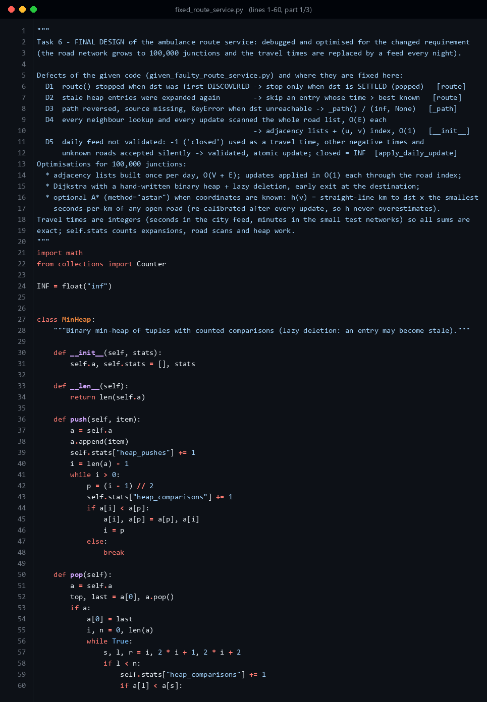

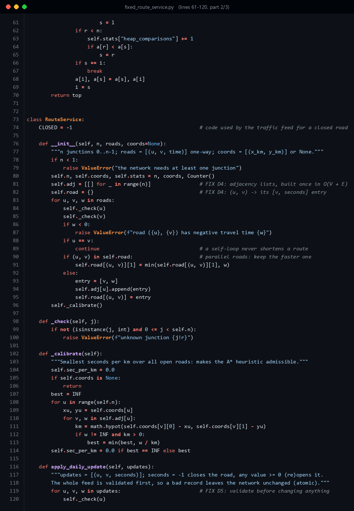

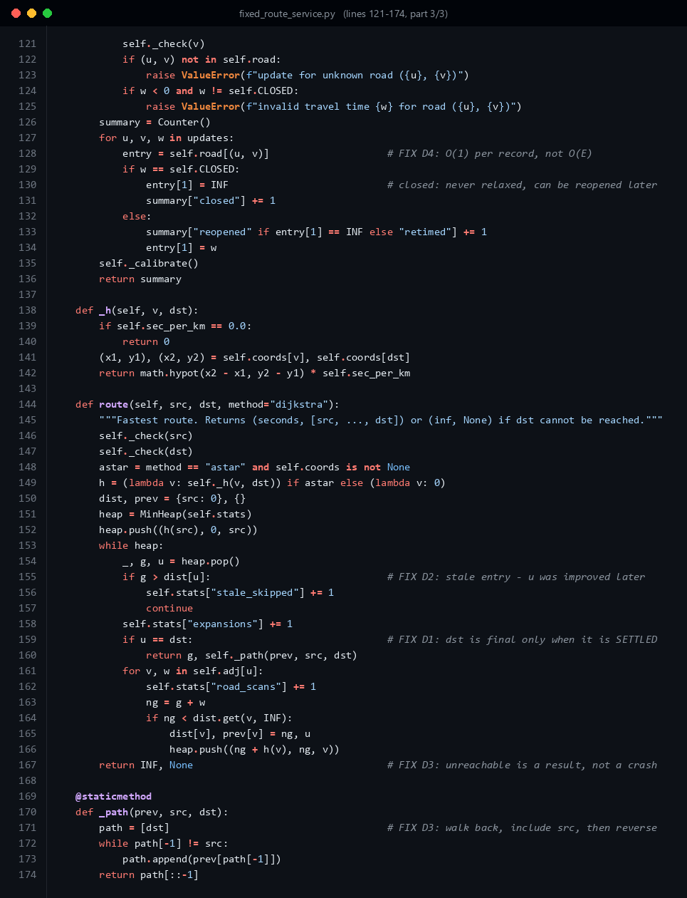

**Prediction (made before running the scale experiments).** Each road is scanned at most once per query, so the road scans per query fall from ≈ V·E to ≤ E – about **V times fewer** (≈ 2,500× on a 2,500-junction grid); the feed cost falls from |U|·E to |U|; one query on 100,000 junctions should then take a few hundred milliseconds in Python (the Task 5 heap version needed 0.47 s for 32,000 junctions with a full run). A\* should settle roughly **half** as many junctions for random origin–destination pairs on a grid (an ellipse around the straight line instead of a disc around the source), but almost nothing for corner-to-corner queries, where the ellipse covers the whole city.

### D. Validate on Large Inputs [2 Marks]

> Validate the final design on large networks, including 100,000 junctions with a nightly feed, against an independent reference, and compare it with the corrected teammate design.

**Evidence Expected**

> Comparable experimental evidence for the corrected original and the final design, and correctness evidence at scale.

**Ans:**

All networks are city grids generated by `city_network.py` (0.2 km blocks, 5 % of the streets missing, arterial roads at 60 km/h, other streets 20–40 km/h, a congestion factor per direction, integer seconds) with a nightly feed that re-times about 5 % of the roads and closes 0.5 % (the 193-record feed of the 30 × 30 grid used by case S6 is stored in `Task_6/test_data/sample_feed_grid30.csv`). Every answer of the final design is compared with **Task 5's full Dijkstra** run on the same road list with the feed applied (closed roads removed) – an independent implementation – including the length of the returned route.


Table 35: Corrected teammate design (V4, road list) against the final design, feed + corner-to-corner query (results/task6_01_list_vs_adjacency.csv)

| V | E | feed_records | v4_feed_scans | v4_route_scans | v4_ms | final_feed_ops | final_route_scans | final_ms | same_time |
|---|---|---|---|---|---|---|---|---|---|
| 100 | 350 | 17 | 5935 | 34452 | 5.5 | 17 | 348 | 0.45 | True |
| 400 | 1462 | 87 | 126611 | 578151 | 108.4 | 87 | 1460 | 2.01 | True |
| 900 | 3330 | 193 | 640193 | 2973892 | 475.6 | 193 | 3328 | 4.8 | True |
| 1600 | 5888 | 323 | 1895520 | 9355749 | 1490.5 | 323 | 5886 | 9.0 | True |
| 2500 | 9306 | 515 | 4777031 | 23108253 | 3931.7 | 515 | 9304 | 14.83 | True |

Table 36: Final design at scale – nightly build and feed, 10 random queries per size, validated against Task 5 (results/task6_02_final_at_scale.csv)

| V | E | feed_records | build_ms | feed_ms | dijkstra_expansions_median | dijkstra_ms_median | astar_expansions_median | astar_ms_median | astar_saving_pct | full_sssp_ms_median | valid |
|---|---|---|---|---|---|---|---|---|---|---|---|
| 10000 | 37548 | 2074 | 49.4 | 18.8 | 4846.0 | 30.7 | 2394.5 | 15.5 | 31.2 | 65.3 | 10 |
| 25600 | 96566 | 5276 | 109.3 | 28.3 | 17009.0 | 128.4 | 7554.5 | 69.2 | 45.2 | 195.7 | 10 |
| 50000 | 189274 | 10334 | 251.1 | 67.2 | 21576.0 | 166.4 | 11705.5 | 91.5 | 47.9 | 424.7 | 10 |
| 100000 | 378786 | 20754 | 506.3 | 117.2 | 59188.0 | 562.7 | 23149.5 | 210.5 | 44.7 | 933.3 | 10 |


- **Prediction against measurement (Table 35).** At 2,500 junctions the corrected teammate design needed 4,777,031 feed scans and 23,108,253 route scans (3.9 s); the final design needed 515 feed operations and 9,304 road scans (15 ms): **2,484× fewer road scans**, as predicted (≈ V), and the same travel time on every network. The final design's road scans stayed just below E at every size (each road scanned at most once).
- **Correctness at scale (Table 36).** On 10,000, 25,600, 50,000 and 100,000 junctions with the nightly feed, all 40 random queries returned exactly the reference time and a valid route of exactly that length, with both Dijkstra and A\*. The catalogue case L1 (corner-to-corner on 100,000 junctions, 10,249 s of travel along 657 junctions) also matches the reference.
- **Performance at 100,000 junctions.** Nightly rebuild 0.51 s, feed (20,754 records) 0.12 s, median query **0.56 s with Dijkstra** (59,188 expansions) and 0.21 s with A\* (23,150 expansions, 44.7 % fewer); a full single-source run takes 0.93 s. A\* saved 31–48 % of the expansions for random pairs, close to the predicted half; for the corner-to-corner query of L1 both settled all 100,000 junctions, as predicted.
- **Extrapolation of the teammate's data structure (E3, 141 ns per road scan measured).** One feed (20,754 × 378,786 = 7.9 × 10⁹ scans) plus one median query (59,188 × 378,786 = 2.2 × 10¹⁰ scans) would take about **1.2 hours**, against **1.19 s** for rebuild + feed + median query in the final design.

### E. Defend the Final Design [1 Mark]

> Evaluate whether the redesign meets the requirement, discuss the trade-offs and the situations in which a simpler design is sufficient, and state your final engineering conclusion.

**Evidence Expected**

> A critical, evidence-based evaluation and a defensible conclusion.

**Ans:**

**Objectives met.** (1) All 18 catalogue cases and the 5 defect regressions pass (Appendix D). (2) Median query on 100,000 junctions: 0.56 s (Dijkstra) and 0.21 s (A\*) – under 1 s ✓. (3) Nightly rebuild + feed: 0.63 s ✓. (4) An invalid feed record raises `ValueError` before anything is changed (cases B4, F1) ✓. The improvement is about **3,600×** for a day's work (1.2 h → 1.19 s) and grows linearly with the size of the network.

**Trade-offs.** The adjacency lists and the road index use O(V + E) extra memory (about 380,000 index entries), and the code is longer than the teammate's 60 lines. A\* needs junction coordinates and a recalibration after every feed; its heuristic is weak (the fastest arterial road sets the bound), so it saves about 45 %, not an order of magnitude, and nothing on corner-to-corner trips. Integer seconds were chosen so that all sums are exact and the validation can demand exact equality.

**When a simpler design is enough.** For a network of a few hundred junctions the road-list scans of V4 still answer in about 0.1 s (108 ms for 400 junctions including the feed), so the data-structure change matters only at city scale – but the correctness fixes D1, D3 and D5 are needed at every size; the given code is never acceptable as it stands.

**Further options considered.** Bidirectional Dijkstra or landmark-based A\* (ALT) would reduce the expansions further; contraction hierarchies answer queries in milliseconds but need a preprocessing step that would have to be repeated after every nightly feed, which adds complexity the current requirement does not need.

**Conclusion.** The final design keeps the teammate's algorithmic idea – Dijkstra's greedy choice – but makes it **correct** (settle before stopping, skip stale entries, reconstruct paths properly, validate the feed) and **scalable** (adjacency lists, O(1) feed updates, early exit and A\*). It meets the changed requirement with a wide margin, and the test catalogue together with the harness protects it against the same defects returning.

### Summary of Findings

Table 37: Summary of the six greedy investigations

| Task no. | Greedy technique | Main evidence-based finding |
|---|---|---|
| 1 | Activity selection (earliest finish) | Optimal by exchange argument; optimal on all 2,000 random days and 500 brute-force checks; earliest start (59 %), shortest duration and fewest conflicts fail on designed counter-examples; sort-once EFT ≈ 0.98 n log₂ n comparisons, 80× fewer than the naive re-scan at n = 8,000 |
| 2 | Fractional / 0-1 knapsack, coin change | Fractional greedy optimal (5,670 points on G1); greedy 0/1 only 1,975 vs DP 3,475 on G3 and optimal on 56 % / 9.8 % of random instances; heap version halves the comparisons when the truck takes 5 % of the stock; rupee system certified canonical, {1, 3, 4}, {1, 10, 25}, {1, 7, 10} not |
| 3 | Huffman coding | 2.24 bits/event vs 3 (−25.3 %), within 0.02 bits of the entropy; 24 % saving on a 100,000-event SOC stream with exact round trips; ties change the tree (max length 2 vs 3) but never the cost; naive m², heap ≈ 3.4 m log₂ m, two queues ≈ 1.3 m comparisons |
| 4 | Prim and Kruskal MST | Both 37 (= brute force, 2 distinct MSTs) with step traces; Prim-heap fastest on sparse networks, Kruskal slowest on dense ones (sorting E); union by rank + path compression cut pointer hops from 100 M to 16 k; disconnected network → spanning forest and an explicit error |
| 5 | Dijkstra | Step table and routes match the given times; heap 127× faster than the array on sparse networks, array 10× faster on worst-case dense networks; negative edge gives wrong answers (A 2 vs 1), Bellman–Ford correct and detects negative cycles |
| 6 | Debugging and scaling Dijkstra | Five defects isolated and fixed one at a time (0 → 18 of 18 cases, no regressions); final design answers on 100,000 junctions in 0.56 s (A* 0.21 s) vs ≈ 1.2 h estimated for the teammate's data structure; validated against an independent reference at every size |

All 101 test cases of the six tasks – 16 given, 27 student-designed, 30 boundary, 22 failure, 1 large-scale and 5 defect regressions – pass in one run of the harness (Figures 55–57); the complete log is Appendix D.


<!-- pagebreak -->

### Appendix A – Complete Source Code: algorithm modules, debugging session and test harness

All programs are in `Source_Code/Task_N/` (Python 3.13, standard library; matplotlib only for graphs). The given faulty file is reproduced unchanged. The test harness is in `Test_Cases/`.

#### Source_Code/Task_1/activity_selection.py

```
"""
Task 1 - Activity selection: booking the single briefing room of the city Emergency Operations Centre (EOC).

Problem: n booking requests R_i = [start_i, finish_i) (half-open: a session ending at 10:00 is compatible
with one starting at 10:00). Accept the MAXIMUM number of mutually compatible requests.

Greedy (earliest finish time, EFT): sort by finish time, scan once, accept every request whose start is
>= the finish of the last accepted request.  Theta(n log n) (sort) + Theta(n) (scan).

The module also contains
  * the "wrong" greedy rules (earliest start, shortest duration, fewest conflicts) and the symmetric
    correct rule (latest start), to demonstrate counter-examples,
  * a naive O(n*k) re-scanning version of EFT (the un-optimised design),
  * two exact references: brute force over all subsets (n <= 20) and an O(n log n) DP,
  * operation counters (collections.Counter) - the primary evidence of cost.
Run:  py -3 activity_selection.py      (demo on the given test cases, prints every greedy step)
"""
import bisect
import csv
import os
from collections import Counter, namedtuple

HERE = os.path.dirname(os.path.abspath(__file__))
Request = namedtuple("Request", "rid agency start finish")      # start/finish in minutes after midnight


# ----------------------------------------------------------------------------- input helpers
def to_min(hhmm):
    """'09:30' -> 570 minutes after midnight."""
    h, m = hhmm.split(":")
    return int(h) * 60 + int(m)


def hhmm(minutes):
    """570 -> '09:30'."""
    return f"{minutes // 60:02d}:{minutes % 60:02d}"


def load_requests(path):
    """Read a CSV with columns rid, agency, start, finish (HH:MM) into Request tuples."""
    with open(path, newline="", encoding="utf-8") as f:
        return [Request(r["rid"], r["agency"], to_min(r["start"]), to_min(r["finish"]))
                for r in csv.DictReader(f)]


def make_requests(spec):
    """Build requests from [(rid, 'HH:MM', 'HH:MM'), ...] (agency left blank)."""
    return [Request(rid, "", to_min(s), to_min(f)) for rid, s, f in spec]


def validate(requests):
    """Reject impossible bookings: finish must be strictly after start and ids must be unique."""
    seen = set()
    for r in requests:
        if r.finish <= r.start:
            raise ValueError(f"request {r.rid}: finish {hhmm(r.finish)} is not after start {hhmm(r.start)}")
        if r.rid in seen:
            raise ValueError(f"duplicate request id {r.rid}")
        seen.add(r.rid)


def compatible(a, b):
    """Half-open intervals [s, f) are compatible when one ends no later than the other starts."""
    return a.finish <= b.start or b.finish <= a.start


# ----------------------------------------------------------------------------- sorting (counted)
def merge_sort(seq, key, ops, name="sort_comparisons"):
    """Stable top-down merge sort; every key comparison is counted in ops[name]."""
    def sort(a):
        if len(a) <= 1:
            return a
        mid = len(a) // 2
        left, right = sort(a[:mid]), sort(a[mid:])
        out, i, j = [], 0, 0
        while i < len(left) and j < len(right):
            ops[name] += 1
            if right[j][0] < left[i][0]:
                out.append(right[j]); j += 1
            else:
                out.append(left[i]); i += 1
        out.extend(left[i:]); out.extend(right[j:])
        return out
    return [x for _, x in sort([(key(x), x) for x in seq])]


# ----------------------------------------------------------------------------- the greedy algorithm
def select_eft(requests, ops=None, trace=None):
    """Earliest-finish-time greedy. Returns the accepted requests in time order.
    trace (optional list) receives one row per examined request: (request, last_finish, decision)."""
    ops = Counter() if ops is None else ops
    validate(requests)
    ordered = merge_sort(requests, key=lambda r: (r.finish, r.start), ops=ops)
    chosen, last_finish = [], float("-inf")
    for r in ordered:
        ops["compatibility_checks"] += 1
        if r.start >= last_finish:                       # greedy choice: first compatible finisher
            if trace is not None:
                trace.append((r, last_finish, "ACCEPT"))
            chosen.append(r)
            last_finish = r.finish
        elif trace is not None:
            blocker = chosen[-1].rid
            trace.append((r, last_finish, f"REJECT (overlaps {blocker})"))
    return chosen


def select_naive_rescan(requests, ops=None):
    """Un-optimised EFT: in every round scan ALL remaining requests for the compatible one that finishes
    first. Same answer, but Theta(n*k) comparisons (k = number accepted) instead of Theta(n log n)."""
    ops = Counter() if ops is None else ops
    validate(requests)
    remaining, chosen, last_finish = list(requests), [], float("-inf")
    while True:
        best = None
        for r in remaining:
            ops["scan_comparisons"] += 1
            if r.start >= last_finish and (best is None or (r.finish, r.start) < (best.finish, best.start)):
                best = r
        if best is None:
            return chosen
        chosen.append(best)
        last_finish = best.finish
        remaining = [r for r in remaining if r.start >= last_finish]   # discard what can never fit


# ----------------------------------------------------------------------------- other greedy rules
def select_by_key(requests, key, ops=None):
    """Generic greedy: consider requests in increasing `key` order, accept if compatible with all accepted."""
    ops = Counter() if ops is None else ops
    validate(requests)
    chosen = []
    for r in merge_sort(requests, key=key, ops=ops):
        ops["compatibility_checks"] += len(chosen)
        if all(compatible(r, c) for c in chosen):
            chosen.append(r)
    return sorted(chosen, key=lambda r: r.start)


def select_earliest_start(requests, ops=None):
    return select_by_key(requests, lambda r: (r.start, r.finish), ops)


def select_shortest(requests, ops=None):
    return select_by_key(requests, lambda r: (r.finish - r.start, r.start), ops)


def select_latest_start(requests, ops=None):
    """Mirror image of EFT (scan by latest start). Also optimal - used as a control in the experiments."""
    return select_by_key(requests, lambda r: (-r.start, -r.finish), ops)


def select_fewest_conflicts(requests, ops=None):
    """Repeatedly accept the remaining request that overlaps the fewest other remaining requests
    (ties: earliest finish), then delete it and everything that overlaps it."""
    ops = Counter() if ops is None else ops
    validate(requests)
    remaining, chosen = list(requests), []
    while remaining:
        def conflicts(r):
            ops["compatibility_checks"] += len(remaining) - 1
            return sum(1 for o in remaining if o is not r and not compatible(r, o))
        best = min(remaining, key=lambda r: (conflicts(r), r.finish, r.start))
        chosen.append(best)
        remaining = [o for o in remaining if o is not best and compatible(best, o)]
    return sorted(chosen, key=lambda r: r.start)


RULES = {"earliest finish (EFT)": select_eft, "latest start": select_latest_start,
         "earliest start": select_earliest_start, "shortest duration": select_shortest,
         "fewest conflicts": select_fewest_conflicts}


# ----------------------------------------------------------------------------- exact references
def optimum_bruteforce(requests, ops=None):
    """Exact maximum by checking all 2^n subsets (n <= 20). Used to certify small instances."""
    ops = Counter() if ops is None else ops
    n = len(requests)
    if n > 20:
        raise ValueError("brute force limited to n <= 20")
    clash = [0] * n
    for i in range(n):
        for j in range(n):
            if i != j and not compatible(requests[i], requests[j]):
                clash[i] |= 1 << j
    best = 0
    for mask in range(1 << n):
        ops["subsets"] += 1
        m, ok, size = mask, True, 0
        while m:
            low = m & -m
            i = low.bit_length() - 1
            if clash[i] & mask:
                ok = False
                break
            size += 1
            m ^= low
        if ok and size > best:
            best = size
    return best


def optimum_dp(requests):
    """Exact maximum by dynamic programming (weighted interval scheduling with unit weights):
    OPT(j) = max(OPT(j-1), 1 + OPT(p(j))), p(j) = number of requests finishing <= start_j."""
    ordered = sorted(requests, key=lambda r: r.finish)
    finishes = [r.finish for r in ordered]
    opt = [0] * (len(ordered) + 1)
    for j, r in enumerate(ordered, start=1):
        p = bisect.bisect_right(finishes, r.start, 0, j - 1)
        opt[j] = max(opt[j - 1], 1 + opt[p])
    return opt[-1]


# ----------------------------------------------------------------------------- the designed instances
COUNTER_EXAMPLES = {
    "earliest start": [("C1", "08:00", "17:00"), ("C2", "09:00", "10:00"), ("C3", "11:00", "12:00"),
                       ("C4", "13:00", "14:00")],
    "shortest duration": [("S1", "09:00", "12:00"), ("S2", "12:00", "15:00"), ("S3", "11:30", "12:30")],
    "fewest conflicts": [("T1", "08:00", "10:00"), ("T2", "10:00", "12:00"), ("T3", "12:00", "14:00"),
                         ("T4", "14:00", "16:00"), ("M1", "09:30", "10:30"), ("M2", "11:30", "12:30"),
                         ("M3", "13:30", "14:30"), ("X1", "09:00", "10:15"), ("X2", "09:15", "10:30"),
                         ("X3", "09:45", "10:30"), ("Y1", "13:45", "15:00"), ("Y2", "13:30", "14:45"),
                         ("Y3", "13:30", "14:15")],
}


def ids(reqs):
    return ",".join(r.rid for r in reqs)


def main():
    given = load_requests(os.path.join(HERE, "test_data", "given_G1_bookings.csv"))
    print("TASK 1 - ACTIVITY SELECTION: EOC briefing-room bookings (half-open intervals [start, finish))")
    print("=" * 100)
    print("Given test case G1 - 11 booking requests for one day")
    print(f"  {'id':<4} {'agency':<26} {'start':>5}  {'finish':>6}")
    for r in given:
        print(f"  {r.rid:<4} {r.agency:<26} {hhmm(r.start):>5}  {hhmm(r.finish):>6}")

    print("\nStep 1-2: sort by finish time, then scan once (greedy choice = earliest compatible finish)")
    print(f"  {'step':>4} {'req':<4} {'interval':<13} {'last finish':>11}  decision")
    ops, trace = Counter(), []
    chosen = select_eft(given, ops, trace)
    for k, (r, last, dec) in enumerate(trace, 1):
        lf = "-" if last == float("-inf") else hhmm(last)
        print(f"  {k:>4} {r.rid:<4} {hhmm(r.start)}-{hhmm(r.finish):<7} {lf:>11}  {dec}")
    print(f"\n  Accepted {len(chosen)} requests: {ids(chosen)}")
    print(f"  Operation counts: {ops['sort_comparisons']} sort comparisons + {ops['compatibility_checks']} "
          f"compatibility checks")
    bf = Counter()
    best = optimum_bruteforce(given, bf)
    print(f"  Brute-force optimum over {bf['subsets']:,} subsets = {best}  -> greedy is "
          f"{'OPTIMAL' if best == len(chosen) else 'NOT optimal'};  DP optimum = {optimum_dp(given)}")

    g2 = load_requests(os.path.join(HERE, "test_data", "given_G2_back_to_back.csv"))
    c2 = select_eft(g2)
    print(f"\nGiven test case G2 (back-to-back sessions): accepted {len(c2)} -> {ids(c2)} "
          f"(touching endpoints are compatible); optimum {optimum_bruteforce(g2)}")

    print("\nCounter-examples: other 'natural' greedy rules are NOT optimal")
    print(f"  {'rule under test':<18} {'n':>3} {'rule picks':<28} {'EFT picks':<20} {'optimum':>7}")
    for rule, spec in COUNTER_EXAMPLES.items():
        reqs = make_requests(spec)
        got, eft = RULES[rule](reqs), select_eft(reqs)
        print(f"  {rule:<18} {len(reqs):>3} {str(len(got)) + ' = ' + ids(got):<28} "
              f"{str(len(eft)) + ' = ' + ids(eft):<20} {optimum_bruteforce(reqs):>7}")

    print("\nBoundary and invalid-input cases")
    cases = [("empty request list", []),
             ("single request", [("B1", "09:00", "10:00")]),
             ("three identical requests", [("I1", "14:00", "15:00"), ("I2", "14:00", "15:00"),
                                           ("I3", "14:00", "15:00")]),
             ("all-day request + 4 inside", [("L", "08:00", "18:00"), ("a", "09:00", "10:00"),
                                             ("b", "10:00", "11:00"), ("c", "13:00", "14:00"),
                                             ("d", "15:00", "16:00")])]
    for name, spec in cases:
        reqs = make_requests(spec)
        got = select_eft(reqs)
        print(f"  {name:<28} -> accepted {len(got)} [{ids(got)}]   optimum {optimum_bruteforce(reqs)}")
    for name, spec in [("finish before start", [("E1", "11:00", "10:00")]),
                       ("zero-length request", [("E2", "10:00", "10:00")])]:
        try:
            select_eft(make_requests(spec))
            print(f"  {name:<28} -> accepted (UNEXPECTED)")
        except ValueError as e:
            print(f"  {name:<28} -> rejected: ValueError: {e}")


if __name__ == "__main__":
    main()
```

#### Source_Code/Task_2/knapsack_coin_change.py

```
"""
Task 2 - Greedy loading of a relief truck (knapsack) and greedy change-making at relief cash counters.

(a) Fractional knapsack: divisible supplies (water, rice, fuel ...) of weight w_i and priority value v_i,
    truck capacity W. Greedy by value density v_i / w_i is OPTIMAL.  Two implementations:
      fractional_sort - merge-sort all items by density, Theta(n log n) comparisons;
      fractional_heap - bottom-up max-heap (<= 2n comparisons) + pop only the k items that are loaded,
                        Theta(n + k log n)  (the optimisation when the truck fills after a few items).
(b) 0/1 knapsack: indivisible equipment. Greedy (by density / value / weight) is NOT optimal; the exact
    answer comes from DP (Theta(nW)) or brute force (2^n). max(greedy, best single item) >= OPT/2.
(c) Coin change: greedy (largest coin first) is optimal for canonical systems (Indian rupee coins/notes)
    but not for e.g. {1, 3, 4}; DP gives the exact minimum; smallest_counterexample() checks a system
    exhaustively up to c_(m-1) + c_m (Kozen & Zaks, 1994).
Run:  py -3 knapsack_coin_change.py      (demo on the given test cases with every greedy step printed)
"""
import csv
import os
from collections import Counter, namedtuple
from fractions import Fraction

HERE = os.path.dirname(os.path.abspath(__file__))
Item = namedtuple("Item", "name weight value")
INR = (1, 2, 5, 10, 20, 50, 100, 200, 500)


def load_items(path):
    with open(path, newline="", encoding="utf-8") as f:
        return [Item(r["item"], int(r["weight_kg"]), int(r["value"])) for r in csv.DictReader(f)]


def validate_items(items, capacity):
    if capacity < 0:
        raise ValueError("capacity must be >= 0")
    for it in items:
        if it.weight <= 0 or it.value < 0:
            raise ValueError(f"item {it.name}: weight must be > 0 and value >= 0")


def density(it):
    return Fraction(it.value, it.weight)          # exact rational: no floating-point ties


# ----------------------------------------------------------------------------- (a) fractional knapsack
def merge_sort_desc(items, key, ops):
    """Stable merge sort in DECREASING key order; counts key comparisons."""
    if len(items) <= 1:
        return list(items)
    mid = len(items) // 2
    left, right = merge_sort_desc(items[:mid], key, ops), merge_sort_desc(items[mid:], key, ops)
    out, i, j = [], 0, 0
    while i < len(left) and j < len(right):
        ops["comparisons"] += 1
        if key(right[j]) > key(left[i]):
            out.append(right[j]); j += 1
        else:
            out.append(left[i]); i += 1
    return out + left[i:] + right[j:]


def _load(order, capacity, ops, trace):
    """Common greedy loop: take whole items while they fit, then a fraction of the next one."""
    room, total, plan = Fraction(capacity), Fraction(0), []
    for it in order:
        if room == 0:
            break
        ops["items_considered"] += 1
        take = min(Fraction(1), room / it.weight)
        room -= take * it.weight
        total += take * it.value
        plan.append((it, take))
        if trace is not None:
            trace.append((it, density(it), take, room, total))
    return total, plan


def fractional_sort(items, capacity, ops=None, trace=None):
    """Greedy by density after a full sort. Returns (max value as Fraction, [(item, fraction taken)])."""
    ops = Counter() if ops is None else ops
    validate_items(items, capacity)
    return _load(merge_sort_desc(list(items), density, ops), capacity, ops, trace)


def fractional_heap(items, capacity, ops=None, trace=None):
    """Same greedy, but items are popped lazily from a max-heap built bottom-up in O(n)."""
    ops = Counter() if ops is None else ops
    validate_items(items, capacity)
    h = list(items)
    key = [density(it) for it in h]

    def sift_down(i, n):
        while True:
            big, l, r = i, 2 * i + 1, 2 * i + 2
            if l < n:
                ops["comparisons"] += 1
                if key[l] > key[big]:
                    big = l
            if r < n:
                ops["comparisons"] += 1
                if key[r] > key[big]:
                    big = r
            if big == i:
                return
            h[i], h[big], key[i], key[big] = h[big], h[i], key[big], key[i]
            i = big

    n = len(h)
    for i in range(n // 2 - 1, -1, -1):          # bottom-up heapify: at most 2n comparisons
        sift_down(i, n)

    def pop_order():
        size = n
        while size:
            top = h[0]
            size -= 1
            h[0], key[0] = h[size], key[size]
            sift_down(0, size)
            yield top
    return _load(pop_order(), capacity, ops, trace)


# ----------------------------------------------------------------------------- (b) 0/1 knapsack
def greedy_01(items, capacity, rule="density", ops=None):
    """Greedy for INDIVISIBLE items: scan in rule order, take an item if it still fits (skip otherwise)."""
    ops = Counter() if ops is None else ops
    validate_items(items, capacity)
    key = {"density": density, "value": lambda it: it.value, "lightest": lambda it: -it.weight}[rule]
    room, total, chosen = capacity, 0, []
    for it in merge_sort_desc(list(items), key, ops):
        if it.weight <= room:
            room -= it.weight
            total += it.value
            chosen.append(it)
    return total, chosen


def greedy_01_half_approx(items, capacity):
    """max(greedy-by-density, most valuable single item that fits) - guaranteed >= OPT / 2."""
    g, chosen = greedy_01(items, capacity, "density")
    single = max((it for it in items if it.weight <= capacity), key=lambda it: it.value, default=None)
    if single is not None and single.value > g:
        return single.value, [single]
    return g, chosen


def knapsack_01_dp(items, capacity, ops=None):
    """Exact 0/1 knapsack by dynamic programming over capacities, Theta(n W) table cells."""
    ops = Counter() if ops is None else ops
    validate_items(items, capacity)
    n = len(items)
    best = [[0] * (capacity + 1) for _ in range(n + 1)]
    for i, it in enumerate(items, 1):
        prev, row = best[i - 1], best[i]
        for c in range(capacity + 1):
            ops["dp_cells"] += 1
            row[c] = prev[c]
            if it.weight <= c and prev[c - it.weight] + it.value > row[c]:
                row[c] = prev[c - it.weight] + it.value
    chosen, c = [], capacity                       # trace back the chosen items
    for i in range(n, 0, -1):
        if best[i][c] != best[i - 1][c]:
            chosen.append(items[i - 1])
            c -= items[i - 1].weight
    return best[n][capacity], chosen[::-1]


def knapsack_01_bruteforce(items, capacity):
    """Exact answer by trying all 2^n subsets (n <= 20); independent check of the DP."""
    n, best = len(items), 0
    if n > 20:
        raise ValueError("brute force limited to n <= 20")
    for mask in range(1 << n):
        w = v = 0
        for i in range(n):
            if mask >> i & 1:
                w += items[i].weight
                v += items[i].value
        if w <= capacity and v > best:
            best = v
    return best


# ----------------------------------------------------------------------------- (c) coin change
def greedy_change(coins, amount, trace=None):
    """Largest-coin-first. Returns the list of coins, or None if the greedy gets stuck with a remainder."""
    if amount < 0 or not coins or min(coins) <= 0:
        raise ValueError("amount must be >= 0 and coins positive")
    left, used = amount, []
    for c in sorted(set(coins), reverse=True):
        k = left // c
        if k:
            used += [c] * k
            left -= k * c
            if trace is not None:
                trace.append((c, k, left))
    return used if left == 0 else None


def dp_change(coins, amount, ops=None):
    """Exact minimum number of coins (unbounded supply) by DP, Theta(amount * m). None if impossible."""
    ops = Counter() if ops is None else ops
    if amount < 0 or not coins or min(coins) <= 0:
        raise ValueError("amount must be >= 0 and coins positive")
    INF = float("inf")
    best, last = [0] + [INF] * amount, [0] * (amount + 1)
    for a in range(1, amount + 1):
        for c in coins:
            ops["dp_steps"] += 1
            if c <= a and best[a - c] + 1 < best[a]:
                best[a], last[a] = best[a - c] + 1, c
    if best[amount] == INF:
        return None
    used, a = [], amount
    while a:
        used.append(last[a])
        a -= last[a]
    return sorted(used, reverse=True)


def smallest_counterexample(coins):
    """First amount where greedy uses more coins than the optimum (or gets stuck although a solution
    exists). Checking amounts < c_(m-1) + c_m is sufficient (Kozen & Zaks). Returns (amount|None, bound)."""
    cs = sorted(set(coins))
    bound = cs[-1] + cs[-2] if len(cs) >= 2 else cs[-1]
    INF = float("inf")
    best = [0] + [INF] * bound
    for a in range(1, bound + 1):
        best[a] = min((best[a - c] + 1 for c in cs if c <= a), default=INF)
    for a in range(1, bound + 1):
        g = greedy_change(cs, a)
        if best[a] != INF and (g is None or len(g) > best[a]):
            return a, bound
    return None, bound


# ----------------------------------------------------------------------------- demo
def fmt_frac(x):
    return f"{float(x):,.2f}"


def main():
    print("TASK 2 - GREEDY KNAPSACK AND COIN CHANGE (relief-truck loading, relief cash counters)")
    print("=" * 108)
    supplies = load_items(os.path.join(HERE, "test_data", "given_G1_relief_supplies.csv"))
    W = 1000
    print(f"G1  Fractional knapsack - divisible relief supplies, truck capacity W = {W} kg")
    print(f"    {'step':>4} {'item':<16} {'w (kg)':>6} {'value':>6} {'v/w':>6} {'taken':>6} {'room left':>9} "
          f"{'value so far':>12}")
    ops, trace = Counter(), []
    total, plan = fractional_sort(supplies, W, ops, trace)
    for k, (it, dens, take, room, acc) in enumerate(trace, 1):
        print(f"    {k:>4} {it.name:<16} {it.weight:>6} {it.value:>6} {float(dens):>6.2f} {float(take):>6.2f} "
              f"{fmt_frac(room):>9} {fmt_frac(acc):>12}")
    hops = Counter()
    htotal, _ = fractional_heap(supplies, W, hops)
    print(f"    Optimal load value = {fmt_frac(total)}  (sort: {ops['comparisons']} comparisons; "
          f"heap: {hops['comparisons']} comparisons, same value {fmt_frac(htotal)})")

    print("\nG2  0/1 knapsack (indivisible) - textbook instance W = 50: (w, v) = (10, 60), (20, 100), (30, 120)")
    g2 = [Item("A", 10, 60), Item("B", 20, 100), Item("C", 30, 120)]
    gv, gc = greedy_01(g2, 50)
    dv, dc = knapsack_01_dp(g2, 50)
    fv, _ = fractional_sort(g2, 50)
    print(f"    greedy by density -> {gv} ({'+'.join(i.name for i in gc)})   DP optimum -> {dv} "
          f"({'+'.join(i.name for i in dc)})   fractional bound -> {fmt_frac(fv)}")

    equipment = load_items(os.path.join(HERE, "test_data", "given_G3_relief_equipment.csv"))
    print(f"\nG3  0/1 knapsack - indivisible relief equipment, truck bay {W} kg")
    code = {it.name: chr(65 + i) for i, it in enumerate(equipment)}          # short labels A, B, C ...
    print(f"    {'':<2} {'item':<20} {'w (kg)':>6} {'value':>6} {'v/w':>6}")
    for it in sorted(equipment, key=density, reverse=True):
        print(f"    {code[it.name]:<2} {it.name:<20} {it.weight:>6} {it.value:>6} {float(density(it)):>6.2f}")
    print(f"    {'strategy':<28} {'value':>6}  {'load (kg)':>9}  items")
    show = lambda ch: " + ".join(code[i.name] for i in ch)               # noqa: E731
    for rule in ("density", "value", "lightest"):
        v, ch = greedy_01(equipment, W, rule)
        print(f"    {'greedy by ' + rule:<28} {v:>6}  {sum(i.weight for i in ch):>9}  {show(ch)}")
    v, ch = greedy_01_half_approx(equipment, W)
    print(f"    {'max(greedy, best single)':<28} {v:>6}  {sum(i.weight for i in ch):>9}  {show(ch)}")
    dops = Counter()
    v, ch = knapsack_01_dp(equipment, W, dops)
    print(f"    {'DP optimum (' + format(dops['dp_cells'], ',') + ' cells)':<28} {v:>6}  "
          f"{sum(i.weight for i in ch):>9}  {show(ch)}")
    print(f"    brute force over 2^{len(equipment)} subsets confirms optimum = "
          f"{knapsack_01_bruteforce(equipment, W)}")

    print("\nG4  Coin change, Indian rupee system {1, 2, 5, 10, 20, 50, 100, 200, 500}, amount Rs 289")
    tr = []
    g = greedy_change(INR, 289, tr)
    print("    " + "  ".join(f"[{c} x{k} -> left {left}]" for c, k, left in tr))
    print(f"    greedy: {len(g)} coins/notes; DP optimum: {len(dp_change(INR, 289))}")
    print("\nG5  Coin change failure - system {1, 3, 4}, amount 6")
    print(f"    greedy: {greedy_change((1, 3, 4), 6)} = 3 coins;  DP optimum: {dp_change((1, 3, 4), 6)} = 2 coins")
    print("F1  Greedy stuck - system {2, 5}, amount 6")
    print(f"    greedy: {greedy_change((2, 5), 6)} (takes 5, remainder 1 cannot be paid);  "
          f"DP: {dp_change((2, 5), 6)}")
    print("\nCanonical-system check (exhaustive up to c_(m-1) + c_m):")
    print(f"    {'coin system':<32} {'bound':>5}  {'smallest counter-example':<26} greedy vs optimum")
    for name, cs in [("Indian rupee", INR), ("US cents", (1, 5, 10, 25)), ("{1, 3, 4}", (1, 3, 4)),
                     ("{1, 10, 25}", (1, 10, 25)), ("{1, 7, 10}", (1, 7, 10)),
                     ("UK pre-1971 {1,3,6,12,24,30}", (1, 3, 6, 12, 24, 30))]:
        a, bound = smallest_counterexample(cs)
        if a is None:
            print(f"    {name:<32} {bound:>5}  {'none -> CANONICAL':<26} greedy always optimal")
        else:
            print(f"    {name:<32} {bound:>5}  {'amount ' + str(a):<26} {greedy_change(cs, a)} vs "
                  f"{dp_change(cs, a)}")


if __name__ == "__main__":
    main()
```

#### Source_Code/Task_3/huffman_coding.py

```
"""
Task 3 - Huffman coding of Security Operations Centre (SOC) event logs.

Every log record carries one event-type symbol (L = login OK, F = failed login, ...). Fixed-length codes
spend ceil(log2 m) bits per symbol; Huffman's greedy algorithm builds an optimal PREFIX code:
repeatedly merge the two least-frequent trees (greedy choice) until one tree remains.

Contents
  MinHeap            hand-written binary heap with a comparison counter (priority = (freq, tie key))
  build_huffman      heap version, Theta(m log m); prints/records the queue state before every merge;
                     tie policy 'fifo' (older node first = minimum-variance) or 'lifo' (newest first)
  huffman_naive      Theta(m^2) version: linear scan for the two minima (the un-optimised design)
  huffman_two_queue  Theta(m) after sorting (van Leeuwen's two-queue method) - the optimisation
  make_codes / encode / decode / entropy / average length helpers
Run:  py -3 huffman_coding.py     (given test case: queue states, merges, tree, codes, round trip, edge cases)
"""
import math
from collections import Counter, deque


class Node:
    """Huffman tree node. Leaves carry a symbol; internal nodes carry left (bit 0) and right (bit 1)."""
    __slots__ = ("freq", "symbol", "left", "right", "label")

    def __init__(self, freq, symbol=None, left=None, right=None):
        self.freq, self.symbol, self.left, self.right = freq, symbol, left, right
        self.label = symbol if symbol is not None else left.label + right.label

    def is_leaf(self):
        return self.symbol is not None


class MinHeap:
    """Binary min-heap of (key, item) pairs; every key comparison is counted in ops['heap_comparisons']."""

    def __init__(self, ops):
        self.a, self.ops = [], ops

    def __len__(self):
        return len(self.a)

    def _less(self, i, j):
        self.ops["heap_comparisons"] += 1
        return self.a[i][0] < self.a[j][0]

    def push(self, key, item):
        a = self.a
        a.append((key, item))
        i = len(a) - 1
        while i > 0 and self._less(i, (i - 1) // 2):
            p = (i - 1) // 2
            a[i], a[p] = a[p], a[i]
            i = p

    def pop(self):
        a = self.a
        top = a[0]
        last = a.pop()
        if a:
            a[0] = last
            i, n = 0, len(a)
            while True:
                small, l, r = i, 2 * i + 1, 2 * i + 2
                if l < n and self._less(l, small):
                    small = l
                if r < n and self._less(r, small):
                    small = r
                if small == i:
                    break
                a[i], a[small] = a[small], a[i]
                i = small
        return top

    def snapshot(self):
        """Queue contents in priority order (for printing only; not counted)."""
        return [item for _, item in sorted(self.a, key=lambda e: e[0])]


def validate_freqs(freqs):
    if not freqs:
        raise ValueError("empty alphabet: nothing to encode")
    for s, f in freqs.items():
        if f <= 0:
            raise ValueError(f"symbol {s!r} has non-positive frequency {f}")


def build_huffman(freqs, tie="fifo", ops=None, trace=None):
    """Greedy Huffman construction with a binary heap. freqs: {symbol: count}.
    tie='fifo': equal frequencies -> the node created EARLIER leaves the queue first (leaves before merged
    nodes; gives the minimum-variance code). tie='lifo': the most recently created node first.
    trace (list) receives (queue snapshot, x, y, merged) for every merge."""
    ops = Counter() if ops is None else ops
    validate_freqs(freqs)
    heap, seq = MinHeap(ops), 0

    def key(f):
        nonlocal seq
        seq += 1
        return (f, seq if tie == "fifo" else -seq)

    for s, f in freqs.items():                      # insertion order = order in the input table
        heap.push(key(f), Node(f, s))
    while len(heap) > 1:
        snap = heap.snapshot() if trace is not None else None
        _, x = heap.pop()                           # greedy choice: the two least frequent trees
        _, y = heap.pop()
        z = Node(x.freq + y.freq, left=x, right=y)
        ops["merges"] += 1
        heap.push(key(z.freq), z)
        if trace is not None:
            trace.append((snap, x, y, z))
    return heap.pop()[1]


def make_codes(root):
    """Code table {symbol: bitstring}. A one-symbol alphabet gets the 1-bit code '0'."""
    if root.is_leaf():
        return {root.symbol: "0"}
    codes, stack = {}, [(root, "")]
    while stack:
        node, path = stack.pop()
        if node.is_leaf():
            codes[node.symbol] = path
        else:
            stack.append((node.right, path + "1"))
            stack.append((node.left, path + "0"))
    return codes


def encode(symbols, codes):
    try:
        return "".join(codes[s] for s in symbols)
    except KeyError as e:
        raise ValueError(f"symbol {e.args[0]!r} is not in the code table") from None


def decode(bits, root):
    """Walk the tree bit by bit. Raises ValueError on an invalid bit or an incomplete final code word."""
    if root.is_leaf():                              # one-symbol alphabet: every '0' is that symbol
        if set(bits) - {"0"}:
            raise ValueError("invalid bit for a one-symbol code")
        return [root.symbol] * len(bits)
    out, node = [], root
    for i, b in enumerate(bits):
        if b not in "01":
            raise ValueError(f"invalid character {b!r} at bit {i}")
        node = node.left if b == "0" else node.right
        if node.is_leaf():
            out.append(node.symbol)
            node = root
    if node is not root:
        raise ValueError("bitstream ends in the middle of a code word (truncated or corrupted)")
    return out


def total_bits(freqs, codes):
    return sum(f * len(codes[s]) for s, f in freqs.items())


def average_length(freqs, codes):
    return total_bits(freqs, codes) / sum(freqs.values())


def fixed_length(m):
    return max(1, math.ceil(math.log2(m)))


def entropy(freqs):
    n = sum(freqs.values())
    return -sum(f / n * math.log2(f / n) for f in freqs.values())


def huffman_naive(freqs, ops=None):
    """Theta(m^2): keep an unsorted list; find the two smallest by linear scans. Returns total cost
    (sum of merged weights = total encoded bits)."""
    ops = Counter() if ops is None else ops
    validate_freqs(freqs)
    pool, cost = list(freqs.values()), 0
    if len(pool) == 1:
        return pool[0]
    while len(pool) > 1:
        picked = []
        for _ in range(2):
            m = 0
            for i in range(1, len(pool)):
                ops["scan_comparisons"] += 1
                if pool[i] < pool[m]:
                    m = i
            picked.append(pool[m])
            pool[m] = pool[-1]
            pool.pop()
        cost += picked[0] + picked[1]
        pool.append(picked[0] + picked[1])
    return cost


def huffman_two_queue(sorted_freqs, ops=None):
    """Theta(m) for frequencies ALREADY in non-decreasing order: leaves wait in queue 1, merged trees are
    created in non-decreasing order and wait in queue 2; the minimum is always at one of the two fronts."""
    ops = Counter() if ops is None else ops
    q1, q2, cost = deque(sorted_freqs), deque(), 0
    if len(q1) == 1:
        return q1[0]

    def take():
        if q1 and q2:
            ops["queue_comparisons"] += 1
            return q1.popleft() if q1[0] <= q2[0] else q2.popleft()
        return q1.popleft() if q1 else q2.popleft()
    while len(q1) + len(q2) > 1:
        a, b = take(), take()
        cost += a + b
        q2.append(a + b)
    return cost


def tree_lines(node, prefix="", bit="", out=None):
    """ASCII drawing of the tree, children indented under their parent with the edge bit."""
    out = [] if out is None else out
    name = f"{node.symbol}:{node.freq}" if node.is_leaf() else f"({node.label}:{node.freq})"
    out.append(f"{prefix}{'' if not bit else '+-' + bit + '- '}{name}")
    if not node.is_leaf():
        child_prefix = prefix + ("" if not bit else ("|     " if bit == "0" else "      "))
        tree_lines(node.left, child_prefix, "0", out)
        tree_lines(node.right, child_prefix, "1", out)
    return out


GIVEN_G1 = {"L": 45, "F": 13, "W": 12, "D": 16, "S": 9, "M": 5}
EVENT = {"L": "login success", "F": "failed login", "W": "firewall drop", "D": "DNS query",
         "S": "port scan", "M": "malware alert"}


def main():
    print("TASK 3 - HUFFMAN CODING OF SOC EVENT LOGS")
    print("=" * 100)
    print("Given test case G1: event frequencies (thousands of events per day)")
    print("  " + "  ".join(f"{s} {EVENT[s]} = {f}" for s, f in GIVEN_G1.items()))
    ops, trace = Counter(), []
    root = build_huffman(GIVEN_G1, "fifo", ops, trace)
    print("\nPriority-queue state before each merge (front = least frequent; ties: older node first)")
    for k, (snap, x, y, z) in enumerate(trace, 1):
        q = "  ".join(f"{n.label}:{n.freq}" for n in snap)
        print(f"  merge {k}: queue [{q}]")
        print(f"           pop {x.label}:{x.freq} (bit 0) + pop {y.label}:{y.freq} (bit 1) -> push {z.label}:{z.freq}")
    print(f"  {ops['merges']} merges, {ops['heap_comparisons']} heap comparisons")
    print("\nHuffman tree")
    for line in tree_lines(root):
        print("  " + line)
    codes = make_codes(root)
    print(f"\n  {'sym':<4}{'event':<15}{'freq':>5}  {'code':<6}{'bits':>4}{'freq x bits':>12}")
    for s in sorted(codes, key=lambda s: (len(codes[s]), codes[s])):
        print(f"  {s:<4}{EVENT[s]:<15}{GIVEN_G1[s]:>5}  {codes[s]:<6}{len(codes[s]):>4}"
              f"{GIVEN_G1[s] * len(codes[s]):>12}")
    tb, n = total_bits(GIVEN_G1, codes), sum(GIVEN_G1.values())
    print(f"  Total {tb} kbit; average {tb / n:.2f} bits/event vs fixed length {fixed_length(6)} bits "
          f"({100 * (1 - tb / (n * fixed_length(6))):.1f}% smaller); entropy {entropy(GIVEN_G1):.4f} bits")

    msg = list("LLFDLWLMSLDL")
    bits = encode(msg, codes)
    back = decode(bits, root)
    print(f"\nRound trip: {''.join(msg)} -> {bits} ({len(bits)} bits, fixed: {3 * len(msg)}) -> "
          f"{''.join(back)}  {'OK' if back == msg else 'MISMATCH'}")

    print("\nTie handling (G2: a=1, b=1, c=2, d=2) - different trees, same optimal cost")
    g2 = {"a": 1, "b": 1, "c": 2, "d": 2}
    for pol in ("fifo", "lifo"):
        c = make_codes(build_huffman(g2, pol))
        print(f"  {pol}: codes {dict(sorted(c.items()))}  cost {total_bits(g2, c)}  "
              f"max length {max(map(len, c.values()))}")

    print("\nBoundary and failure cases")
    one = build_huffman({"L": 7})
    print(f"  B1 single symbol L:7      -> codes {make_codes(one)}, decode('000') = {decode('000', one)}")
    two = {"L": 99, "M": 1}
    c2 = make_codes(build_huffman(two))
    print(f"  B2 two symbols L:99, M:1  -> codes {c2}: {average_length(two, c2):.2f} bit/event, entropy only "
          f"{entropy(two):.3f} (limit: >= 1 bit/symbol)")
    eq = {chr(65 + i): 10 for i in range(8)}
    ce = make_codes(build_huffman(eq))
    print(f"  B3 8 equal frequencies    -> all lengths {sorted(set(map(len, ce.values())))} = fixed length 3")
    fib = {chr(65 + i): f for i, f in enumerate([1, 1, 2, 3, 5, 8, 13, 21])}
    cf = make_codes(build_huffman(fib))
    print(f"  B4 Fibonacci 1..21        -> lengths {[len(cf[s]) for s in fib]} (degenerate tree, depth m-1)")
    for name, call in [("F1 empty alphabet", lambda: build_huffman({})),
                       ("F2 truncated stream 0110", lambda: decode(encode(["L", "M"], codes)[:-1], root)),
                       ("F3 unknown symbol X", lambda: encode(["L", "X"], codes))]:
        try:
            call()
            print(f"  {name:<25} -> accepted (UNEXPECTED)")
        except ValueError as e:
            print(f"  {name:<25} -> ValueError: {e}")


if __name__ == "__main__":
    main()
```

#### Source_Code/Task_4/mst_prim_kruskal.py

```
"""
Task 4 - Minimum spanning tree for the city fibre backbone: Prim and Kruskal.

Sites are vertices 0..n-1, candidate fibre routes are undirected weighted edges (u, v, w) with w = trench
length in units of 100 m. A minimum spanning tree (MST) connects all sites with minimum total trench length.

  prim_heap     Prim with an INDEXED binary min-heap (insert / decrease-key / extract-min), O(E log V)
  prim_array    Prim with a plain key array and a linear minimum scan, O(V^2 + E) - best for dense graphs
  kruskal       merge sort of the edges + union-find; mode 'rank+compress' (union by rank and path
                compression, O(E log E)), 'rank' or 'naive' (no rank, no compression) for the comparison
  mst_bruteforce  exact reference for small graphs: tries every (V-1)-edge subset
Disconnected input: Prim reaches only the root's component (reported); Kruskal returns a minimum spanning
FOREST with n - c edges; spanning_tree() raises ValueError because no spanning tree exists.
Run:  py -3 mst_prim_kruskal.py      (given test case with every Prim and Kruskal step, then edge cases)
"""
import csv
import itertools
import os
from collections import Counter

HERE = os.path.dirname(os.path.abspath(__file__))
INF = float("inf")


# ----------------------------------------------------------------------------- graph helpers
def load_graph(path):
    """CSV columns u, v, w (site codes). Returns (names, edges as (u_index, v_index, w))."""
    names, index, edges = [], {}, []
    with open(path, newline="", encoding="utf-8") as f:
        for r in csv.DictReader(f):
            for s in (r["u"], r["v"]):
                if s not in index:
                    index[s] = len(names)
                    names.append(s)
            edges.append((index[r["u"]], index[r["v"]], int(r["w"])))
    return names, edges


def adjacency(n, edges):
    adj = [[] for _ in range(n)]
    for u, v, w in edges:
        if u != v:                                   # a self-loop can never be in a spanning tree
            adj[u].append((v, w))
            adj[v].append((u, w))
    return adj


def validate_graph(n, edges):
    if n < 1:
        raise ValueError("a network needs at least one site")
    for u, v, w in edges:
        if not (0 <= u < n and 0 <= v < n):
            raise ValueError(f"edge ({u}, {v}) refers to an unknown site")


# ----------------------------------------------------------------------------- indexed heap for Prim
class IndexedMinHeap:
    """Binary min-heap over vertex ids with a position index, so decrease_key is O(log V)."""

    def __init__(self, n, ops):
        self.h, self.pos, self.key, self.ops = [], [-1] * n, [INF] * n, ops

    def __len__(self):
        return len(self.h)

    def __contains__(self, v):
        return self.pos[v] != -1

    def _swap(self, i, j):
        h = self.h
        h[i], h[j] = h[j], h[i]
        self.pos[h[i]], self.pos[h[j]] = i, j

    def _up(self, i):
        while i > 0:
            p = (i - 1) // 2
            self.ops["heap_comparisons"] += 1
            if self.key[self.h[i]] < self.key[self.h[p]]:
                self._swap(i, p)
                i = p
            else:
                break

    def _down(self, i):
        n = len(self.h)
        while True:
            s, l, r = i, 2 * i + 1, 2 * i + 2
            if l < n:
                self.ops["heap_comparisons"] += 1
                if self.key[self.h[l]] < self.key[self.h[s]]:
                    s = l
            if r < n:
                self.ops["heap_comparisons"] += 1
                if self.key[self.h[r]] < self.key[self.h[s]]:
                    s = r
            if s == i:
                return
            self._swap(i, s)
            i = s

    def insert(self, v, k):
        self.key[v] = k
        self.h.append(v)
        self.pos[v] = len(self.h) - 1
        self._up(len(self.h) - 1)

    def decrease_key(self, v, k):
        self.ops["decrease_keys"] += 1
        self.key[v] = k
        self._up(self.pos[v])

    def pop_min(self):
        top = self.h[0]
        self._swap(0, len(self.h) - 1)
        self.h.pop()
        self.pos[top] = -1
        if self.h:
            self._down(0)
        return top


# ----------------------------------------------------------------------------- Prim
def prim_heap(n, edges, root=0, ops=None, trace=None):
    """Returns (tree edges [(parent, v, w)], total weight, number of sites reached)."""
    ops = Counter() if ops is None else ops
    validate_graph(n, edges)
    adj = adjacency(n, edges)
    key, parent, in_tree = [INF] * n, [-1] * n, [False] * n
    heap = IndexedMinHeap(n, ops)
    key[root] = 0
    heap.insert(root, 0)
    tree, total, reached = [], 0, 0
    while heap:
        u = heap.pop_min()                          # greedy choice: lightest edge crossing the cut
        in_tree[u] = True
        reached += 1
        if parent[u] != -1:
            tree.append((parent[u], u, key[u]))
            total += key[u]
        updated = []
        for v, w in adj[u]:
            ops["edge_checks"] += 1
            if not in_tree[v] and w < key[v]:
                key[v], parent[v] = w, u
                if v in heap:
                    heap.decrease_key(v, w)
                else:
                    heap.insert(v, w)
                updated.append((v, w))
        if trace is not None:
            trace.append((u, parent[u], key[u], total, updated))
    return tree, total, reached


def prim_array(n, edges, root=0, ops=None):
    """Prim with an unsorted key array: n linear scans for the minimum, O(V^2 + E)."""
    ops = Counter() if ops is None else ops
    validate_graph(n, edges)
    adj = adjacency(n, edges)
    key, parent, in_tree = [INF] * n, [-1] * n, [False] * n
    key[root] = 0
    tree, total, reached = [], 0, 0
    for _ in range(n):
        u, best = -1, INF
        for v in range(n):
            ops["scan_comparisons"] += 1
            if not in_tree[v] and key[v] < best:
                u, best = v, key[v]
        if u == -1:                                  # the rest is unreachable: graph disconnected
            break
        in_tree[u] = True
        reached += 1
        if parent[u] != -1:
            tree.append((parent[u], u, key[u]))
            total += key[u]
        for v, w in adj[u]:
            ops["edge_checks"] += 1
            if not in_tree[v] and w < key[v]:
                key[v], parent[v] = w, u
    return tree, total, reached


# ----------------------------------------------------------------------------- Kruskal
class UnionFind:
    """Disjoint sets. mode: 'rank+compress' (default), 'rank' (union by rank only) or 'naive'."""

    def __init__(self, n, mode="rank+compress", ops=None):
        self.parent, self.rank, self.mode = list(range(n)), [0] * n, mode
        self.ops = Counter() if ops is None else ops
        self.sets = n

    def find(self, x):
        self.ops["find_calls"] += 1
        root = x
        while self.parent[root] != root:
            self.ops["pointer_hops"] += 1
            root = self.parent[root]
        if self.mode == "rank+compress":             # path compression: point every node at the root
            while self.parent[x] != root:
                self.parent[x], x = root, self.parent[x]
        return root

    def union(self, a, b):
        """Link the roots of a and b. Returns False if they are already in the same set (cycle)."""
        ra, rb = self.find(a), self.find(b)
        if ra == rb:
            return False
        self.ops["unions"] += 1
        if self.mode == "naive":
            self.parent[ra] = rb
        else:                                        # union by rank: shorter tree under taller tree
            if self.rank[ra] < self.rank[rb]:
                ra, rb = rb, ra
            self.parent[rb] = ra
            if self.rank[ra] == self.rank[rb]:
                self.rank[ra] += 1
        self.sets -= 1
        return True


def merge_sort_edges(edges, ops):
    """Stable merge sort by weight; counts weight comparisons in ops['sort_comparisons']."""
    if len(edges) <= 1:
        return list(edges)
    mid = len(edges) // 2
    left, right = merge_sort_edges(edges[:mid], ops), merge_sort_edges(edges[mid:], ops)
    out, i, j = [], 0, 0
    while i < len(left) and j < len(right):
        ops["sort_comparisons"] += 1
        if right[j][2] < left[i][2]:
            out.append(right[j]); j += 1
        else:
            out.append(left[i]); i += 1
    return out + left[i:] + right[j:]


def kruskal(n, edges, mode="rank+compress", ops=None, trace=None):
    """Returns (forest edges, total weight, number of components). Stops after n-1 accepted edges."""
    ops = Counter() if ops is None else ops
    validate_graph(n, edges)
    uf = UnionFind(n, mode, ops)
    tree, total = [], 0
    for u, v, w in merge_sort_edges(list(edges), ops):
        if len(tree) == n - 1:                       # early stop: the tree is complete
            break
        ru, rv = uf.find(u), uf.find(v)
        if ru != rv:                                 # greedy choice: lightest edge joining two components
            uf.union(ru, rv)
            tree.append((u, v, w))
            total += w
            if trace is not None:
                trace.append((u, v, w, ru, rv, "ACCEPT", uf.sets))
        else:
            ops["cycle_rejections"] += 1
            if trace is not None:
                trace.append((u, v, w, ru, rv, "REJECT (cycle)", uf.sets))
    return tree, total, uf.sets


def spanning_tree(n, edges):
    """Kruskal that refuses disconnected networks (no spanning tree exists)."""
    tree, total, comps = kruskal(n, edges)
    if comps > 1:
        raise ValueError(f"network is disconnected ({comps} components): no spanning tree exists")
    return tree, total


def mst_bruteforce(n, edges):
    """Exact minimum by trying every subset of n-1 edges (small graphs only).
    Returns (minimum weight, number of distinct minimum spanning trees, number of spanning trees)."""
    best, count_best, count_trees = INF, 0, 0
    for combo in itertools.combinations(range(len(edges)), n - 1):
        uf = UnionFind(n)
        if all(uf.union(edges[i][0], edges[i][1]) for i in combo):
            count_trees += 1
            w = sum(edges[i][2] for i in combo)
            if w < best:
                best, count_best = w, 1
            elif w == best:
                count_best += 1
    return best, count_best, count_trees


def cut_property_holds(n, edges, tree):
    """Check: every tree edge is a lightest edge across the cut formed by removing it from the tree."""
    for t in tree:
        uf = UnionFind(n)
        for e in tree:
            if e is not t:
                uf.union(e[0], e[1])
        side = uf.find(t[0])
        crossing = [w for u, v, w in edges if (uf.find(u) == side) != (uf.find(v) == side)]
        if t[2] > min(crossing):
            return False
    return True


# ----------------------------------------------------------------------------- demo
def main():
    names, edges = load_graph(os.path.join(HERE, "test_data", "given_G1_fibre_network.csv"))
    n = len(names)
    nm = lambda i: names[i]                          # noqa: E731
    print("TASK 4 - MINIMUM SPANNING TREE: city fibre backbone (weights = trench length x 100 m)")
    print("=" * 104)
    print(f"Given test case G1: {n} sites, {len(edges)} candidate routes")
    for k in range(0, len(edges), 7):
        print("  " + "  ".join(f"{nm(u)}-{nm(v)}:{w}" for u, v, w in edges[k:k + 7]))

    print("\nPrim (indexed binary heap, root EOC) - one row per site added to the tree")
    print(f"  {'step':>4} {'add site':<9} {'via edge':<13} {'w':>3} {'total':>5}  keys lowered (decrease-key / insert)")
    ops, trace = Counter(), []
    ptree, ptotal, _ = prim_heap(n, edges, 0, ops, trace)
    for k, (u, p, w, tot, upd) in enumerate(trace, 1):
        via = "(root)" if p == -1 else f"{nm(p)}-{nm(u)}"
        print(f"  {k:>4} {nm(u):<9} {via:<13} {w if p != -1 else 0:>3} {tot:>5}  "
              f"{', '.join(f'{nm(v)}={x}' for v, x in upd) or '-'}")
    print(f"  Prim total = {ptotal}; {ops['heap_comparisons']} heap comparisons, {ops['decrease_keys']} decrease-keys, "
          f"{ops['edge_checks']} edge checks")

    print("\nKruskal (edges in weight order, union-find with union by rank + path compression)")
    print(f"  {'step':>4} {'edge':<13} {'w':>3} {'find(u)':<9} {'find(v)':<9} {'decision':<15} {'components':>10}")
    kops, ktrace = Counter(), []
    ktree, ktotal, comps = kruskal(n, edges, ops=kops, trace=ktrace)
    for k, (u, v, w, ru, rv, dec, sets) in enumerate(ktrace, 1):
        print(f"  {k:>4} {nm(u) + '-' + nm(v):<13} {w:>3} {nm(ru):<9} {nm(rv):<9} {dec:<15} {sets:>10}")
    print(f"  Kruskal total = {ktotal}; stopped after {len(ktrace)} of {len(edges)} edges "
          f"({kops['sort_comparisons']} sort comparisons, {kops['pointer_hops']} pointer hops)")
    best, nbest, ntrees = mst_bruteforce(n, edges)
    print(f"\nVerification: Prim {ptotal} = Kruskal {ktotal} = brute force {best} over {ntrees:,} spanning trees "
          f"({nbest} distinct MSTs);")
    same = sorted(tuple(sorted(e[:2])) for e in ptree) == sorted(tuple(sorted(e[:2])) for e in ktree)
    print(f"  edge sets equal: {same}; cut property holds for Prim tree: {cut_property_holds(n, edges, ptree)}, "
          f"Kruskal tree: {cut_property_holds(n, edges, ktree)}")

    print("\nBoundary and failure cases")
    dn, de = load_graph(os.path.join(HERE, "test_data", "failure_F1_disconnected.csv"))
    t, w, reached = prim_heap(len(dn), de, 0)
    print(f"  F1 disconnected ({len(dn)} sites): Prim from {dn[0]} reaches only {reached} sites (weight {w}) -> "
          f"NOT spanning")
    ft, fw, fc = kruskal(len(dn), de)
    print(f"     Kruskal -> minimum spanning FOREST: {len(ft)} edges = n - c = {len(dn)} - {fc}, weight {fw}")
    print("        forest edges: " + ", ".join(f"{dn[u]}-{dn[v]}" for u, v, _ in ft))
    try:
        spanning_tree(len(dn), de)
    except ValueError as e:
        print(f"     spanning_tree() -> ValueError: {e}")
    cases = [("B1 one site", 1, []),
             ("B2 two sites, one route", 2, [(0, 1, 7)]),
             ("B3 parallel routes 0-1 (9 and 4) + self-loop", 3, [(0, 1, 9), (0, 1, 4), (1, 1, 1), (1, 2, 5)]),
             ("B4 all weights equal (K4, w = 3)", 4, [(a, b, 3) for a in range(4) for b in range(a + 1, 4)]),
             ("B5 negative weight (subsidised route)", 4, [(0, 1, 4), (1, 2, -2), (2, 3, 6), (0, 3, 5), (0, 2, 3)])]
    for name, cn, ce in cases:
        _, pw, pr = prim_heap(cn, ce)
        _, kw, kc = kruskal(cn, ce)
        ref = mst_bruteforce(cn, [e for e in ce if e[0] != e[1]])[0] if cn > 1 else 0
        print(f"  {name:<46} Prim {pw:>3}  Kruskal {kw:>3}  brute force {ref:>3}  (reached {pr}/{cn})")


if __name__ == "__main__":
    main()
```

#### Source_Code/Task_5/dijkstra_routing.py

```
"""
Task 5 - Dijkstra's single-source shortest paths for ambulance routing.

Junctions are vertices 0..n-1, roads are DIRECTED edges (u, v, w) with w = travel time in minutes
(a two-way street is two edges). From the hospital s we need the fastest time and route to every junction.

  dijkstra_array  O(V^2 + E): dist array, linear scan for the closest unsettled junction (greedy choice)
  dijkstra_heap   O((V + E) log V): binary heap with lazy deletion - stale entries are skipped on pop
  bellman_ford    O(VE) reference: correct with negative edges, detects negative cycles
  path_to         route reconstruction from the prev[] array
Dijkstra refuses negative weights (ValueError) unless allow_negative=True, which is used ONLY to
demonstrate the wrong answer it then produces.
Run:  py -3 dijkstra_routing.py   (given network: step table, routes, negative-edge failure, edge cases)
"""
import csv
import os
from collections import Counter

HERE = os.path.dirname(os.path.abspath(__file__))
INF = float("inf")


def load_network(path):
    """CSV columns u, v, w, two_way (yes/no). Returns (names, directed edges as (u, v, w))."""
    names, index, edges = [], {}, []
    with open(path, newline="", encoding="utf-8") as f:
        for r in csv.DictReader(f):
            for s in (r["u"], r["v"]):
                if s not in index:
                    index[s] = len(names)
                    names.append(s)
            u, v, w = index[r["u"]], index[r["v"]], int(r["w"])
            edges.append((u, v, w))
            if r["two_way"].strip().lower() == "yes":
                edges.append((v, u, w))
    return names, edges


def adjacency(n, edges, allow_negative=False):
    if n < 1:
        raise ValueError("the road network needs at least one junction")
    adj = [[] for _ in range(n)]
    for u, v, w in edges:
        if not (0 <= u < n and 0 <= v < n):
            raise ValueError(f"road ({u}, {v}) refers to an unknown junction")
        if w < 0 and not allow_negative:
            raise ValueError(f"negative travel time {w} on road ({u}, {v}): Dijkstra requires w >= 0")
        if u != v:                                   # a self-loop never shortens a route
            adj[u].append((v, w))
    return adj


# ----------------------------------------------------------------------------- O(V^2) array version
def dijkstra_array(n, edges, s, ops=None, trace=None, allow_negative=False):
    """Returns (dist, prev). trace receives (settled u, dist copy, settled copy, [updated v]) per round."""
    ops = Counter() if ops is None else ops
    adj = adjacency(n, edges, allow_negative)
    dist, prev, done = [INF] * n, [-1] * n, [False] * n
    dist[s] = 0
    for _ in range(n):
        u, best = -1, INF
        for v in range(n):                           # linear scan: closest unsettled junction
            ops["scan_comparisons"] += 1
            if not done[v] and dist[v] < best:
                u, best = v, dist[v]
        if u == -1:                                  # everything left is unreachable
            break
        done[u] = True
        updated = []
        for v, w in adj[u]:
            ops["relaxations"] += 1
            if not done[v] and dist[u] + w < dist[v]:
                dist[v], prev[v] = dist[u] + w, u
                updated.append(v)
        if trace is not None:
            trace.append((u, list(dist), list(done), updated))
    return dist, prev


# ----------------------------------------------------------------------------- O((V+E) log V) heap version
class BinaryHeap:
    """Min-heap of (dist, vertex) with counted comparisons (lazy deletion: duplicates allowed)."""

    def __init__(self, ops):
        self.a, self.ops = [], ops

    def __len__(self):
        return len(self.a)

    def push(self, d, v):
        a = self.a
        a.append((d, v))
        self.ops["pushes"] += 1
        i = len(a) - 1
        while i > 0:
            p = (i - 1) // 2
            self.ops["heap_comparisons"] += 1
            if a[i][0] < a[p][0]:
                a[i], a[p] = a[p], a[i]
                i = p
            else:
                break

    def pop(self):
        a = self.a
        self.ops["pops"] += 1
        top, last = a[0], a.pop()
        if a:
            a[0] = last
            i, n = 0, len(a)
            while True:
                s, l, r = i, 2 * i + 1, 2 * i + 2
                if l < n:
                    self.ops["heap_comparisons"] += 1
                    if a[l][0] < a[s][0]:
                        s = l
                if r < n:
                    self.ops["heap_comparisons"] += 1
                    if a[r][0] < a[s][0]:
                        s = r
                if s == i:
                    break
                a[i], a[s] = a[s], a[i]
                i = s
        return top


def dijkstra_heap(n, edges, s, ops=None, allow_negative=False, target=None):
    """Returns (dist, prev). With target given, stops as soon as the target is SETTLED (popped)."""
    ops = Counter() if ops is None else ops
    adj = adjacency(n, edges, allow_negative)
    dist, prev, done = [INF] * n, [-1] * n, [False] * n
    dist[s] = 0
    heap = BinaryHeap(ops)
    heap.push(0, s)
    while heap:
        d, u = heap.pop()
        if done[u] or d > dist[u]:                   # stale entry left behind by an earlier improvement
            ops["stale_pops"] += 1
            continue
        done[u] = True
        ops["settled"] += 1
        if u == target:
            break
        for v, w in adj[u]:
            ops["relaxations"] += 1
            if not done[v] and d + w < dist[v]:
                dist[v], prev[v] = d + w, u
                heap.push(dist[v], v)
    return dist, prev


# ----------------------------------------------------------------------------- reference + helpers
def bellman_ford(n, edges, s, ops=None):
    """Returns (dist, prev, negative_cycle_reachable). Handles negative weights; O(VE)."""
    ops = Counter() if ops is None else ops
    dist, prev = [INF] * n, [-1] * n
    dist[s] = 0
    for _ in range(n - 1):
        changed = False
        for u, v, w in edges:
            ops["bf_relaxations"] += 1
            if dist[u] + w < dist[v]:
                dist[v], prev[v], changed = dist[u] + w, u, True
        if not changed:                               # early exit: no change in a full pass
            break
    neg = any(dist[u] + w < dist[v] for u, v, w in edges)
    return dist, prev, neg


def path_to(prev, s, t, dist=None):
    """Junction list s -> t, or None when t is unreachable."""
    if dist is not None and dist[t] == INF:
        return None
    path = [t]
    while path[-1] != s:
        p = prev[path[-1]]
        if p == -1:
            return None
        path.append(p)
    return path[::-1]


def fmt(d):
    return "inf" if d == INF else str(d)


# ----------------------------------------------------------------------------- demo
def main():
    names, edges = load_network(os.path.join(HERE, "test_data", "given_G1_road_network.csv"))
    n, s = len(names), 0
    print("TASK 5 - DIJKSTRA: ambulance routing from the City Hospital (H), travel times in minutes")
    print("=" * 104)
    print(f"Given test case G1: {n} junctions, {len(edges)} directed road segments (two-way streets counted twice)")
    print("\nStep table (array version): * = settled; dist after the round; prev updated for the listed junctions")
    print(f"  {'round':>5} {'settle':<6} " + " ".join(f"{x:>5}" for x in names) + "  updated (new dist via settled)")
    ops, trace = Counter(), []
    dist, prev = dijkstra_array(n, edges, s, ops, trace)
    print(f"  {'init':>5} {'-':<6} " + " ".join(f"{fmt(0 if i == s else INF):>5}" for i in range(n)))
    for k, (u, dsnap, done, upd) in enumerate(trace, 1):
        cells = " ".join(f"{fmt(dsnap[i]) + ('*' if done[i] else ' '):>5}" for i in range(n))
        print(f"  {k:>5} {names[u]:<6} {cells}  {', '.join(f'{names[v]}={dsnap[v]}' for v in upd) or '-'}")
    print(f"  array version: {ops['scan_comparisons']} scan comparisons, {ops['relaxations']} relaxations")
    hops = Counter()
    hdist, _ = dijkstra_heap(n, edges, s, hops)
    bdist, _, _ = bellman_ford(n, edges, s)
    print(f"  heap version : {hops['heap_comparisons']} heap comparisons, {hops['pushes']} pushes, "
          f"{hops['stale_pops']} stale pops skipped; same distances: {hdist == dist}; Bellman-Ford agrees: {bdist == dist}")

    print("\nFastest ambulance routes from H (path reconstruction from prev[])")
    for t in range(1, n):
        p = path_to(prev, s, t, dist)
        print(f"  H -> {names[t]:<3} {fmt(dist[t]):>4} min   " + " -> ".join(names[x] for x in p))

    print("\nFailure case F1: a negative edge (B -> A = -4, a 'green-wave credit') - Dijkstra settles A too early")
    fn, fe = load_network(os.path.join(HERE, "test_data", "failure_F1_negative_edge.csv"))
    try:
        dijkstra_heap(len(fn), fe, 0)
    except ValueError as e:
        print(f"  safe mode  : ValueError: {e}")
    dd, dp = dijkstra_heap(len(fn), fe, 0, allow_negative=True)
    bd, bp, neg = bellman_ford(len(fn), fe, 0)
    print(f"  {'junction':<9} {'Dijkstra (unsafe)':>18} {'Bellman-Ford':>13}  correct route")
    for t in range(len(fn)):
        print(f"  {fn[t]:<9} {fmt(dd[t]):>18} {fmt(bd[t]):>13}  {' -> '.join(fn[x] for x in path_to(bp, 0, t))}"
              f"{'   <-- WRONG' if dd[t] != bd[t] else ''}")
    cn, ce = load_network(os.path.join(HERE, "test_data", "failure_F2_negative_cycle.csv"))
    print(f"  F2 negative cycle A->B->C->A (1 - 3 + 1 = -1): Bellman-Ford reports negative cycle = "
          f"{bellman_ford(len(cn), ce, 0)[2]} (no shortest route exists)")

    print("\nBoundary cases")
    d1, _ = dijkstra_heap(1, [], 0)
    print(f"  B1 single junction            -> dist {d1}")
    d2, p2 = dijkstra_heap(3, [(0, 1, 4)], 0)
    print(f"  B2 junction 2 unreachable     -> dist {[fmt(x) for x in d2]}, route to 2 = {path_to(p2, 0, 2, d2)}")
    d3, p3 = dijkstra_heap(3, [(0, 1, 0), (1, 2, 0), (0, 2, 1)], 0)
    print(f"  B3 zero-time roads            -> dist {d3}, route to 2 = {path_to(p3, 0, 2, d3)}")
    print(f"  B4 source = target            -> route H -> H = {[names[x] for x in path_to(prev, 0, 0, dist)]}, 0 min")
    d5, _ = dijkstra_heap(2, [(0, 1, 9), (0, 1, 4), (1, 1, 2)], 0)
    print(f"  B5 parallel roads + self-loop -> dist {d5} (cheaper parallel road used, loop ignored)")


if __name__ == "__main__":
    main()
```

#### Source_Code/Task_6/given_faulty_route_service.py

```
"""
GIVEN CODE (Task 6) - ambulance route service v0.9, as received from a teammate. DO NOT FIX THIS FILE:
it is kept unchanged as the starting point of the debugging session (task6_debugging.py); the corrected
and optimised design is fixed_route_service.py.

Teammate's notes:
  "Dijkstra with heapq. Junctions are 0..n-1, roads are one-way (u, v, minutes); add both directions for a
   two-way street. route(src, dst) returns (minutes, list of junctions). apply_daily_update() takes the
   overnight feed [(u, v, minutes), ...] from the traffic department; the feed uses -1 for a closed road.
   self.stats counts work for the dashboard."
"""
import heapq
from collections import Counter


class RouteService:
    def __init__(self, n, roads):
        self.n = n
        self.roads = list(roads)
        self.stats = Counter()

    def apply_daily_update(self, updates):
        for u, v, minutes in updates:
            for i, (a, b, w) in enumerate(self.roads):
                self.stats["road_scans"] += 1
                if a == u and b == v:
                    self.roads[i] = (a, b, minutes)

    def neighbours(self, u):
        result = []
        for a, b, w in self.roads:
            self.stats["road_scans"] += 1
            if a == u:
                result.append((b, w))
        return result

    def route(self, src, dst):
        dist = {src: 0}
        prev = {}
        heap = [(0, src)]
        while heap:
            d, u = heapq.heappop(heap)
            self.stats["expansions"] += 1
            for v, w in self.neighbours(u):
                self.stats["relaxations"] += 1
                nd = d + w
                if v not in dist or nd < dist[v]:
                    dist[v] = nd
                    prev[v] = u
                    if v == dst:
                        return nd, self._path(prev, src, dst)
                    heapq.heappush(heap, (nd, v))
        return dist.get(dst, float("inf")), self._path(prev, src, dst)

    def _path(self, prev, src, dst):
        path = []
        v = dst
        while v != src:
            path.append(v)
            v = prev[v]
        return path
```

#### Source_Code/Task_6/fixed_route_service.py

```
"""
Task 6 - FINAL DESIGN of the ambulance route service: debugged and optimised for the changed requirement
(the road network grows to 100,000 junctions and the travel times are replaced by a feed every night).

Defects of the given code (given_faulty_route_service.py) and where they are fixed here:
  D1  route() stopped when dst was first DISCOVERED -> stop only when dst is SETTLED (popped)   [route]
  D2  stale heap entries were expanded again        -> skip an entry whose time > best known   [route]
  D3  path reversed, source missing, KeyError when dst unreachable -> _path() / (inf, None)   [_path]
  D4  every neighbour lookup and every update scanned the whole road list, O(E) each
                                                    -> adjacency lists + (u, v) index, O(1)   [__init__]
  D5  daily feed not validated: -1 ('closed') used as a travel time, other negative times and
      unknown roads accepted silently -> validated, atomic update; closed = INF  [apply_daily_update]
Optimisations for 100,000 junctions:
  * adjacency lists built once per day, O(V + E); updates applied in O(1) each through the road index;
  * Dijkstra with a hand-written binary heap + lazy deletion, early exit at the destination;
  * optional A* (method="astar") when coordinates are known: h(v) = straight-line km to dst x the smallest
    seconds-per-km of any open road (re-calibrated after every update, so h never overestimates).
Travel times are integers (seconds in the city feed, minutes in the small test networks) so all sums are
exact; self.stats counts expansions, road scans and heap work.
"""
import math
from collections import Counter

INF = float("inf")


class MinHeap:
    """Binary min-heap of tuples with counted comparisons (lazy deletion: an entry may become stale)."""

    def __init__(self, stats):
        self.a, self.stats = [], stats

    def __len__(self):
        return len(self.a)

    def push(self, item):
        a = self.a
        a.append(item)
        self.stats["heap_pushes"] += 1
        i = len(a) - 1
        while i > 0:
            p = (i - 1) // 2
            self.stats["heap_comparisons"] += 1
            if a[i] < a[p]:
                a[i], a[p] = a[p], a[i]
                i = p
            else:
                break

    def pop(self):
        a = self.a
        top, last = a[0], a.pop()
        if a:
            a[0] = last
            i, n = 0, len(a)
            while True:
                s, l, r = i, 2 * i + 1, 2 * i + 2
                if l < n:
                    self.stats["heap_comparisons"] += 1
                    if a[l] < a[s]:
                        s = l
                if r < n:
                    self.stats["heap_comparisons"] += 1
                    if a[r] < a[s]:
                        s = r
                if s == i:
                    break
                a[i], a[s] = a[s], a[i]
                i = s
        return top


class RouteService:
    CLOSED = -1                                          # code used by the traffic feed for a closed road

    def __init__(self, n, roads, coords=None):
        """n junctions 0..n-1; roads = [(u, v, time)] one-way; coords = [(x_km, y_km)] or None."""
        if n < 1:
            raise ValueError("the network needs at least one junction")
        self.n, self.coords, self.stats = n, coords, Counter()
        self.adj = [[] for _ in range(n)]                # FIX D4: adjacency lists, built once in O(V + E)
        self.road = {}                                   # FIX D4: (u, v) -> its [v, seconds] entry
        for u, v, w in roads:
            self._check(u)
            self._check(v)
            if w < 0:
                raise ValueError(f"road ({u}, {v}) has negative travel time {w}")
            if u == v:
                continue                                 # a self-loop never shortens a route
            if (u, v) in self.road:                      # parallel roads: keep the faster one
                self.road[(u, v)][1] = min(self.road[(u, v)][1], w)
            else:
                entry = [v, w]
                self.adj[u].append(entry)
                self.road[(u, v)] = entry
        self._calibrate()

    def _check(self, j):
        if not (isinstance(j, int) and 0 <= j < self.n):
            raise ValueError(f"unknown junction {j!r}")

    def _calibrate(self):
        """Smallest seconds per km over all open roads: makes the A* heuristic admissible."""
        self.sec_per_km = 0.0
        if self.coords is None:
            return
        best = INF
        for u in range(self.n):
            xu, yu = self.coords[u]
            for v, w in self.adj[u]:
                km = math.hypot(self.coords[v][0] - xu, self.coords[v][1] - yu)
                if w != INF and km > 0:
                    best = min(best, w / km)
        self.sec_per_km = 0.0 if best == INF else best

    def apply_daily_update(self, updates):
        """updates = [(u, v, seconds)]; seconds = -1 closes the road, any value >= 0 (re)opens it.
        The whole feed is validated first, so a bad record leaves the network unchanged (atomic)."""
        for u, v, w in updates:                          # FIX D5: validate before changing anything
            self._check(u)
            self._check(v)
            if (u, v) not in self.road:
                raise ValueError(f"update for unknown road ({u}, {v})")
            if w < 0 and w != self.CLOSED:
                raise ValueError(f"invalid travel time {w} for road ({u}, {v})")
        summary = Counter()
        for u, v, w in updates:
            entry = self.road[(u, v)]                    # FIX D4: O(1) per record, not O(E)
            if w == self.CLOSED:
                entry[1] = INF                           # closed: never relaxed, can be reopened later
                summary["closed"] += 1
            else:
                summary["reopened" if entry[1] == INF else "retimed"] += 1
                entry[1] = w
        self._calibrate()
        return summary

    def _h(self, v, dst):
        if self.sec_per_km == 0.0:
            return 0
        (x1, y1), (x2, y2) = self.coords[v], self.coords[dst]
        return math.hypot(x2 - x1, y2 - y1) * self.sec_per_km

    def route(self, src, dst, method="dijkstra"):
        """Fastest route. Returns (seconds, [src, ..., dst]) or (inf, None) if dst cannot be reached."""
        self._check(src)
        self._check(dst)
        astar = method == "astar" and self.coords is not None
        h = (lambda v: self._h(v, dst)) if astar else (lambda v: 0)
        dist, prev = {src: 0}, {}
        heap = MinHeap(self.stats)
        heap.push((h(src), 0, src))
        while heap:
            _, g, u = heap.pop()
            if g > dist[u]:                              # FIX D2: stale entry - u was improved later
                self.stats["stale_skipped"] += 1
                continue
            self.stats["expansions"] += 1
            if u == dst:                                 # FIX D1: dst is final only when it is SETTLED
                return g, self._path(prev, src, dst)
            for v, w in self.adj[u]:
                self.stats["road_scans"] += 1
                ng = g + w
                if ng < dist.get(v, INF):
                    dist[v], prev[v] = ng, u
                    heap.push((ng + h(v), ng, v))
        return INF, None                                 # FIX D3: unreachable is a result, not a crash

    @staticmethod
    def _path(prev, src, dst):
        path = [dst]                                     # FIX D3: walk back, include src, then reverse
        while path[-1] != src:
            path.append(prev[path[-1]])
        return path[::-1]
```

#### Source_Code/Task_6/city_network.py

```
"""
Task 6 - test-data generator: a city road grid with coordinates and a nightly traffic feed.

city_grid(rows, cols, seed): junction (r, c) has id r*cols + c and coordinates (0.2c, 0.2r) km +/- 40 m;
two-way streets to the right and downwards (5% of streets missing). Every 10th row/column is an arterial
road at 60 km/h, other streets 20-40 km/h; each direction gets its own congestion factor 1.0-1.5.
Travel times are integer seconds. daily_feed() re-times ~5% of the roads (x0.8..x1.6) and closes ~0.5% (-1).
"""
import math
import random


def city_grid(rows, cols, seed=42):
    rng = random.Random(seed)
    n = rows * cols
    coords = [(0.2 * (i % cols) + rng.uniform(-0.04, 0.04), 0.2 * (i // cols) + rng.uniform(-0.04, 0.04))
              for i in range(n)]
    roads = []
    for r in range(rows):
        for c in range(cols):
            u = r * cols + c
            for dr, dc in ((0, 1), (1, 0)):
                rr, cc = r + dr, c + dc
                if rr >= rows or cc >= cols or rng.random() < 0.05:
                    continue
                v = rr * cols + cc
                arterial = (r % 10 == 0 and dr == 0) or (c % 10 == 0 and dc == 0)
                kmh = 60 if arterial else rng.uniform(20, 40)
                km = math.dist(coords[u], coords[v])
                for a, b in ((u, v), (v, u)):
                    roads.append((a, b, max(1, round(km / kmh * 3600 * rng.uniform(1.0, 1.5)))))
    return n, roads, coords


def daily_feed(roads, seed=7, retime=0.05, close=0.005):
    """Overnight feed [(u, v, seconds or -1)] for a random sample of existing roads."""
    rng = random.Random(seed)
    feed = []
    for u, v, w in roads:
        x = rng.random()
        if x < close:
            feed.append((u, v, -1))
        elif x < close + retime:
            feed.append((u, v, max(1, round(w * rng.uniform(0.8, 1.6)))))
    return feed


def apply_feed_to_list(roads, feed):
    """Reference semantics of the feed on a plain road list: closed roads removed, others re-timed."""
    new = {(u, v): w for u, v, w in roads}
    for u, v, w in feed:
        if w == -1:
            new.pop((u, v), None)
        else:
            new[(u, v)] = w
    return [(u, v, w) for (u, v), w in new.items()]
```

#### Source_Code/Task_6/task6_debugging.py

```
"""
Task 6 - systematic debugging session for the given route service: reproduce -> isolate -> fix -> re-test.

1. REPRODUCE  run the Task 6 test catalogue (Test_Cases/task6_test_cases.json: given, designed, boundary,
              failure and scale cases) against the GIVEN code and record expected vs actual.
2. ISOLATE    minimal reproductions with instrumentation (traces, counters, a step-budget watchdog that
              stops runaway loops) - one per defect, each with the line that causes it.
3. FIX        one defect at a time: V1 (+D3) -> V2 (+D1) -> V3 (+D5) -> V4 (+D2) -> FINAL (+D4, A*);
4. RE-TEST    the whole catalogue after every fix (regression), ending with the defect table.
The intermediate versions V1-V4 are small subclasses of the given class below, so each fix is visible
in isolation; FINAL is fixed_route_service.RouteService.
Run:  py -3 task6_debugging.py
"""
import heapq
import json
import os
import sys
import time
from collections import Counter

HERE = os.path.dirname(os.path.abspath(__file__))
sys.path.insert(0, os.path.join(HERE, "..", "Task_5"))
from city_network import apply_feed_to_list, city_grid, daily_feed  # noqa: E402
from dijkstra_routing import dijkstra_heap  # noqa: E402  (Task 5 reference implementation)
from fixed_route_service import RouteService as Final  # noqa: E402
from given_faulty_route_service import RouteService as Given  # noqa: E402

CATALOGUE = os.path.join(HERE, "..", "..", "Test_Cases", "task6_test_cases.json")
INF = float("inf")


# ----------------------------------------------------------------------------- instrumentation
class Watchdog(Counter):
    """Stats counter that aborts a route search after `limit` expansions (runaway loop detector)."""

    def __init__(self, limit):
        super().__init__()
        self.limit = limit

    def __setitem__(self, key, value):
        if key == "expansions" and value > self.limit:
            raise RuntimeError(f"watchdog: > {self.limit:,} expansions (runaway search)")
        super().__setitem__(key, value)


# ----------------------------------------------------------------------------- intermediate versions
class V1(Given):
    """Given + FIX D3: path in travel order, including the source; None for an unreachable target."""

    def _path(self, prev, src, dst):
        if dst != src and dst not in prev:                           # FIX D3: unreachable -> None
            return None
        path = [dst]
        while path[-1] != src:
            path.append(prev[path[-1]])
        return path[::-1]                                            # FIX D3: src first


class V2(V1):
    """V1 + FIX D1: the destination is final only when it is popped (settled), not when discovered."""

    def route(self, src, dst):
        dist, prev, heap = {src: 0}, {}, [(0, src)]
        while heap:
            d, u = heapq.heappop(heap)
            self.stats["expansions"] += 1
            if u == dst:                                             # FIX D1
                return d, self._path(prev, src, dst)
            for v, w in self.neighbours(u):
                self.stats["relaxations"] += 1
                nd = d + w
                if v not in dist or nd < dist[v]:
                    dist[v], prev[v] = nd, u
                    heapq.heappush(heap, (nd, v))
        return dist.get(dst, INF), self._path(prev, src, dst)


class V3(V2):
    """V2 + FIX D5: validate queries and the daily feed (-1 closes a road, other negatives rejected)."""

    def __init__(self, n, roads):
        for u, v, w in roads:
            if w < 0:
                raise ValueError(f"road ({u}, {v}) has negative travel time {w}")
        super().__init__(n, roads)
        self.closed = {}

    def _check(self, j):
        if not (0 <= j < self.n):
            raise ValueError(f"unknown junction {j}")

    def apply_daily_update(self, updates):
        known = {(a, b) for a, b, _ in self.roads} | set(self.closed)
        for u, v, w in updates:                                      # FIX D5: validate the whole feed first
            self._check(u); self._check(v)
            if (u, v) not in known:
                raise ValueError(f"update for unknown road ({u}, {v})")
            if w < 0 and w != -1:
                raise ValueError(f"invalid travel time {w} for road ({u}, {v})")
        for u, v, w in updates:
            self.stats["road_scans"] += len(self.roads)               # each record still rebuilds the list (D4)
            if w == -1:                                              # FIX D5: closed road leaves the list
                self.closed[(u, v)] = True
                self.roads = [r for r in self.roads if (r[0], r[1]) != (u, v)]
            else:
                self.closed.pop((u, v), None)
                self.roads = [r for r in self.roads if (r[0], r[1]) != (u, v)] + [(u, v, w)]

    def route(self, src, dst):
        self._check(src); self._check(dst)                           # FIX D5: reject unknown junctions
        return super().route(src, dst)


class V4(V3):
    """V3 + FIX D2: skip stale heap entries (a junction is expanded at most once)."""

    def route(self, src, dst):
        self._check(src); self._check(dst)
        dist, prev, heap = {src: 0}, {}, [(0, src)]
        while heap:
            d, u = heapq.heappop(heap)
            if d > dist[u]:                                          # FIX D2: stale entry
                continue
            self.stats["expansions"] += 1
            if u == dst:
                return d, self._path(prev, src, dst)
            for v, w in self.neighbours(u):
                self.stats["relaxations"] += 1
                nd = d + w
                if v not in dist or nd < dist[v]:
                    dist[v], prev[v] = nd, u
                    heapq.heappush(heap, (nd, v))
        return INF, None


VERSIONS = [("V0 given", Given, "-"), ("V1", V1, "D3"), ("V2", V2, "D3 D1"), ("V3", V3, "D3 D1 D5"),
            ("V4", V4, "D3 D1 D5 D2"), ("FINAL", Final, "D3 D1 D5 D2 D4 + A*")]


# ----------------------------------------------------------------------------- running one catalogue case
def load_catalogue():
    with open(CATALOGUE, encoding="utf-8") as f:
        return json.load(f)


def build(case, cat, cache={}):
    """Turn a catalogue case into integer ids: (n, roads, coords, src, dst, updates, names)."""
    spec = cat["networks"][case["network"]]
    if "grid" in spec:
        key = tuple(spec["grid"])
        if key not in cache:
            cache[key] = city_grid(*spec["grid"])
        n, roads, coords = cache[key]
        updates = daily_feed(roads) if case.get("feed") else []
        return n, roads, coords, case["query"][0], case["query"][1], updates, None
    names = list(spec.get("junctions", []))
    for u, v, *_ in spec["roads"]:
        for x in (u, v):
            if x not in names:
                names.append(x)
    ids = {x: i for i, x in enumerate(names)}
    unknown = lambda x: ids.get(x, len(names) + 7)               # noqa: E731  out-of-range id
    roads = []
    for u, v, w, two_way in spec["roads"]:
        roads.append((ids[u], ids[v], w))
        if two_way:
            roads.append((ids[v], ids[u], w))
    updates = [(unknown(u), unknown(v), w) for u, v, w in case.get("updates", [])]
    return len(names), roads, None, unknown(case["query"][0]), unknown(case["query"][1]), updates, names


def reference(n, roads, updates, src, dst):
    """Task 5's Dijkstra on the road list with the feed applied (closed roads removed)."""
    eff = apply_feed_to_list(roads, updates)
    dist, _ = dijkstra_heap(n, eff, src)
    return dist[dst], {(u, v): w for u, v, w in eff}


def run_case(cls, case, cat):
    """Returns (status, expected text, actual text, stats). status: PASS / FAIL / SKIP."""
    if case.get("fixed_only") and cls is not Final:
        return "SKIP", "", "final design only", Counter()
    n, roads, coords, src, dst, updates, names = build(case, cat)
    show = (lambda p: p) if names is None else (lambda p: [names[i] if i < len(names) else "?" for i in p])
    exp = case["expect"]
    eff = None
    if exp.get("reference"):
        rt, eff = reference(n, roads, updates, src, dst)
        exp_text = f"{rt} (reference)"
    elif exp.get("error"):
        exp_text = exp["error"]
    elif exp.get("unreachable"):
        exp_text = "inf, None"
    else:
        exp_text = f"{exp['time']}, {'-'.join(exp['path'])}"
    stats = Counter()
    try:
        svc = cls(n, roads, coords) if cls is Final else cls(n, roads)
        svc.stats = Watchdog(20 * n + 100)
        if updates:
            svc.apply_daily_update(updates)
        methods = ["dijkstra", "astar"] if case.get("method") == "both" else [case.get("method", "dijkstra")]
        results = []
        for m in methods:
            svc.stats = Watchdog(20 * n + 100)
            t0 = time.perf_counter()
            res = svc.route(src, dst, m) if cls is Final else svc.route(src, dst)
            results.append((res, time.perf_counter() - t0))
            stats = svc.stats
        (t, path), secs = results[0]
        actual = f"{t}, {'None' if path is None else '-'.join(map(str, show(path)))}"
    except Exception as e:                                        # crashes are results too
        return ("PASS" if exp.get("error") == type(e).__name__ else "FAIL"), exp_text, \
            f"{type(e).__name__}: {e}"[:60], stats
    if exp.get("error"):
        return "FAIL", exp_text, actual[:60], stats
    if exp.get("unreachable"):
        ok = t == INF and path is None
    elif exp.get("reference"):
        ok = all(r[0] == rt for r, _ in results)
        for (rt_i, p), _ in results:
            ok &= p is not None and p[0] == src and p[-1] == dst and \
                all((a, b) in eff for a, b in zip(p, p[1:])) and sum(eff[(a, b)] for a, b in zip(p, p[1:])) == rt
        ok &= all(s <= case.get("max_seconds", INF) for _, s in results)
        actual = f"{t}, path of {len(path) if path else 0} junctions"
    else:
        ok = t == exp["time"] and path is not None and show(path) == exp["path"]
    if "max_expansions" in case:
        lim = n if case["max_expansions"] == "V" else case["max_expansions"]
        ok &= stats["expansions"] <= lim
        actual += f"; exp {stats['expansions']}"
    if "max_road_scans" in case:
        ok &= stats["road_scans"] <= len(roads)
        actual += f"; scans {stats['road_scans']:,}"
    return ("PASS" if ok else "FAIL"), exp_text, actual[:60], stats


# ----------------------------------------------------------------------------- the session
def small(cat, net):
    """Integer version of a named catalogue network (for the isolation experiments)."""
    n, roads, _, _, _, _, names = build({"network": net, "query": [None, None]}, cat)
    return n, roads, {x: i for i, x in enumerate(names)}, names


def isolate(cat):
    """Minimal reproductions; returns the measured facts used in the defect table."""
    facts = {}
    print("\n2. ISOLATE - minimal reproductions (instrumented)")
    n, roads, ids, nm = small(cat, "G1")
    g = Given(n, roads)
    t, p = g.route(ids["H"], ids["G"])
    facts["D3"] = f"{'-'.join(nm[i] for i in p)}; KeyError"
    print(f"  D3 given route(H, G) returns path {'-'.join(nm[i] for i in p)}: _path() collects dst..first hop, never adds")
    print("     src and never reverses; for an unreachable dst 'v = prev[v]' raises KeyError (the desk crashes).")
    v1 = V1(n, roads)
    t, p = v1.route(ids["H"], ids["A"])
    facts["D1"] = f"{t}, {'-'.join(nm[i] for i in p)}"
    print(f"  D1 V1 route(H, A) = {t} min via {'-'.join(nm[i] for i in p)}: the first expansion (H) relaxes H->A = 4 and")
    print("     returns at once ('if v == dst: return' inside the relaxation loop); B is never expanded, H-B-A = 3 missed.")
    v2 = V2(n, roads)
    v2.apply_daily_update([(ids["C"], ids["D"], -1), (ids["D"], ids["C"], -1)])
    t, p = v2.route(ids["H"], ids["D"])
    facts["D5"] = f"{t} via closed road"
    print(f"  D5 V2 after the feed closes C-D: roads {[(nm[u], nm[v], w) for u, v, w in v2.roads if w < 0]} - the closure")
    print(f"     code became a travel time; route(H, D) = {t} min via {'-'.join(nm[i] for i in p)} (uses the closed road).")
    n2, roads2, ids2, _ = small(cat, "NEG")
    v2n = V2(n2, roads2)
    v2n.stats = Watchdog(1000)
    try:
        v2n.route(ids2["H"], ids2["B"])
    except RuntimeError as e:
        print(f"     Network NEG (H-A = -2 both ways) is a negative cycle: V2 never stops -> {e}.")
    n3, roads3, ids3, _ = small(cat, "RI")
    v3 = V3(n3, roads3)
    v3.route(ids3["s"], ids3["Z"])
    facts["D2"] = f"{v3.stats['expansions']} expansions"
    print(f"  D2 V3 on network RI (7 reachable junctions): {v3.stats['expansions']} expansions - x and t are expanded again")
    print("     from stale heap entries (x is pushed 3 times, t twice); there is no 'if d > dist[u]: continue'.")
    n4, roads4, _, _, _, _, _ = build({"network": "GRID30", "query": [0, 899]}, cat)
    v4 = V4(n4, roads4)
    v4.route(0, 899)
    facts["D4"] = f"{v4.stats['road_scans']:,} scans"
    print(f"  D4 V4 on the 30 x 30 grid (E = {len(roads4):,}): {v4.stats['expansions']} expansions x {len(roads4):,} roads"
          f" = {v4.stats['road_scans']:,} road scans,")
    print("     because neighbours() (and apply_daily_update(), per feed record) scans the whole road list: O(V*E).")
    return facts


def main():
    cat = load_catalogue()
    cases = cat["cases"]
    print("TASK 6 - DEBUGGING THE GIVEN ROUTE SERVICE (reproduce -> isolate -> fix -> re-test)")
    print("=" * 118)
    print(f"1. REPRODUCE - {len(cases)} catalogue cases on the GIVEN code (V0)")
    print(f"  {'case':<6} {'category':<9} {'expected':<24} {'actual (given code)':<62} result")
    for c in cases:
        st, e, a, _ = run_case(Given, c, cat)
        print(f"  {c['id'][3:]:<6} {c['category']:<9} {e[:24]:<24} {a:<62} {st}")
    facts = isolate(cat)
    print("\n3-4. FIX one defect at a time and RE-TEST the whole catalogue after every fix")
    print(f"  {'version':<9} {'fixes applied':<22} {'PASS':>4} {'FAIL':>4} {'SKIP':>4}  failing cases")
    final_rows = None
    for name, cls, fixes in VERSIONS:
        res = [(c["id"][3:], run_case(cls, c, cat)) for c in cases]
        cnt = Counter(r[0] for _, r in res)
        fails = " ".join(i for i, r in res if r[0] == "FAIL") or "-"
        print(f"  {name:<9} {fixes:<22} {cnt['PASS']:>4} {cnt['FAIL']:>4} {cnt['SKIP']:>4}  {fails}")
        final_rows = res
    print("\n  FINAL design, scale cases:")
    for i, (st, e, a, s) in final_rows:
        if i in ("S5", "S6", "L1"):
            extra = "" if "exp " in a else f"; exp {s['expansions']:,}; scans {s['road_scans']:,}"
            print(f"    {i:<3} {st}  expected {e:<18} actual {a}{extra}")
    print("\nDefect table (actual = measured on the version just before the fix; all fixed in FINAL)")
    rows = [("D1", "G2: 3, H-B-A", facts["D1"], "returns when dst is discovered", "return when dst is popped"),
            ("D2", "S1: <= 7 expansions", facts["D2"], "no stale-entry check", "skip if d > dist[u]"),
            ("D3", "G1: H-B-A-C-D-F-G", facts["D3"], "path not reversed, src missing", "walk back, add src, reverse"),
            ("D4", "S5: scans <= 3,330", facts["D4"], "linear scan of the road list", "adjacency lists + road index"),
            ("D5", "G3: 12, H-B-D", facts["D5"], "feed and ids not validated", "validate; -1 = closed (INF)")]
    print(f"  {'id':<3} {'expected':<20} {'actual':<20} {'root cause':<31} fix")
    for r in rows:
        print(f"  {r[0]:<3} {r[1]:<20} {r[2]:<20} {r[3]:<31} {r[4]}")


if __name__ == "__main__":
    main()
```

#### Test_Cases/run_all_tests.py

```
"""
CO4 Assignment 4B - test harness for all six tasks (greedy technique).

Loads the test catalogues task1..task6_test_cases.json from this folder (given, student-designed, boundary,
failure and large-scale cases), runs every case against the implementations in ../Source_Code/Task_N, compares
expected with actual, prints one PASS/FAIL line per case and finally  RESULT: k/k tests passed.
Task 6 additionally checks that every documented defect is still reproduced by the version just before its
fix and is absent from the final design (regression record of the debugging session).
Writes test_results.csv (id, category, description, expected, actual, status) next to this file.
Run:  py -3 run_all_tests.py
"""
import csv
import json
import os
import random
import sys
import time
from collections import Counter
from fractions import Fraction

HERE = os.path.dirname(os.path.abspath(__file__))
SRC = os.path.join(HERE, "..", "Source_Code")
for t in range(1, 7):
    sys.path.insert(0, os.path.join(SRC, f"Task_{t}"))

import activity_selection as t1  # noqa: E402
import dijkstra_routing as t5  # noqa: E402
import huffman_coding as t3  # noqa: E402
import knapsack_coin_change as t2  # noqa: E402
import mst_prim_kruskal as t4  # noqa: E402
import task6_debugging as t6  # noqa: E402

INF = float("inf")
RESULTS = []


def data(task, name):
    return os.path.join(SRC, f"Task_{task}", "test_data", name)


def record(case, expected, actual, ok):
    status = "PASS" if ok else "FAIL"
    RESULTS.append(dict(id=case["id"], category=case["category"], description=case["description"],
                        expected=str(expected), actual=str(actual), status=status))
    print(f"{status}  {case['id']:<6} {case['category']:<8} {case['description'][:50]:<50} -> {str(actual)[:30]}")


def expect_error(case, fn):
    """Run fn; PASS if it raises the expected exception type."""
    try:
        res = fn()
        record(case, case["expect"]["error"], f"no error: {res}", False)
    except Exception as e:                                         # noqa: BLE001
        record(case, case["expect"]["error"], type(e).__name__, type(e).__name__ == case["expect"]["error"])


# ----------------------------------------------------------------------------- Task 1
def task1(case):
    ex, ty = case["expect"], case["type"]
    if "error" in ex:
        return expect_error(case, lambda: t1.select_eft(t1.make_requests(case["requests"])))
    if ty in ("eft_file", "eft"):
        reqs = t1.load_requests(data(1, case["file"])) if ty == "eft_file" else t1.make_requests(case["requests"])
        got = t1.select_eft(reqs)
        ids = [r.rid for r in got]
        ok = len(got) == ex["count"] and ("selected" not in ex or ids == ex["selected"])
        ok &= len(reqs) > 20 or t1.optimum_bruteforce(reqs) == len(got)
        return record(case, ex, f"{len(got)} {ids}", ok)
    if ty == "rule_fails":
        reqs = t1.make_requests(case["requests"])
        rc, ec, opt = len(t1.RULES[case["rule"]](reqs)), len(t1.select_eft(reqs)), t1.optimum_bruteforce(reqs)
        return record(case, ex, f"rule {rc}, EFT {ec}, opt {opt}",
                      (rc, ec, opt) == (ex["rule_count"], ex["eft_count"], ex["optimum"]))
    if ty == "rule_equals_eft":
        reqs = t1.load_requests(data(1, case["file"]))
        n = len(t1.RULES[case["rule"]](reqs))
        return record(case, ex, n, n == ex["count"] == len(t1.select_eft(reqs)))
    rng = random.Random(case.get("seed", 0))
    if ty == "random_vs_bruteforce":
        bad = sum(len(t1.select_eft(d)) != t1.optimum_bruteforce(d)
                  for d in (random_day(rng, case["n"]) for _ in range(case["trials"])))
        return record(case, ex, f"{case['trials'] - bad}/{case['trials']} equal", bad == 0)
    if ty == "random_naive_equal":
        bad = 0
        for _ in range(case["trials"]):
            d = random_day(rng, case["n"])
            bad += not (len(t1.select_eft(d)) == len(t1.select_naive_rescan(d)) == t1.optimum_dp(d))
        return record(case, ex, f"{case['trials'] - bad}/{case['trials']} equal", bad == 0)
    if ty == "large_vs_dp":
        reqs = [t1.Request(i, "", s, s + rng.randrange(30, 241, 15))
                for i, s in enumerate(rng.randrange(0, 30 * case["n"], 15) for _ in range(case["n"]))]
        k, opt = len(t1.select_eft(reqs)), t1.optimum_dp(reqs)
        return record(case, ex, f"EFT {k:,} = DP {opt:,}", k == opt)
    raise ValueError(ty)


def random_day(rng, n):
    reqs = []
    for i in range(n):
        s = 480 + rng.randrange(0, 570, 15)
        reqs.append(t1.Request(f"Q{i}", "", s, min(s + rng.randrange(30, 241, 15), 1080)))
    return reqs


# ----------------------------------------------------------------------------- Task 2
def items_of(spec):
    return [t2.Item(n, w, v) for n, w, v in spec]


def task2(case):
    ex, ty = case["expect"], case["type"]
    if ty == "coins" and "error" in ex:
        return expect_error(case, lambda: t2.greedy_change(case["coins"], case["amount"]))
    if "error" in ex:
        return expect_error(case, lambda: t2.fractional_sort(items_of(case["items"]), case["capacity"]))
    if ty in ("fractional", "fractional_file"):
        its = t2.load_items(data(2, case["file"])) if ty == "fractional_file" else items_of(case["items"])
        vs, _ = t2.fractional_sort(its, case["capacity"])
        vh, _ = t2.fractional_heap(its, case["capacity"])
        return record(case, ex["value"], f"sort {float(vs):g}, heap {float(vh):g}", vs == vh == Fraction(ex["value"]))
    if ty in ("zero_one", "zero_one_file"):
        its = t2.load_items(data(2, case["file"])) if ty == "zero_one_file" else items_of(case["items"])
        W = case["capacity"]
        got = {"greedy_density": t2.greedy_01(its, W, "density")[0], "greedy_value": t2.greedy_01(its, W, "value")[0],
               "optimum": t2.knapsack_01_dp(its, W)[0], "fractional": float(t2.fractional_sort(its, W)[0])}
        ok = all(got[k] == v for k, v in ex.items()) and t2.knapsack_01_bruteforce(its, W) == got["optimum"]
        return record(case, ex, {k: got[k] for k in ex}, ok)
    if ty == "coins":
        g, d = t2.greedy_change(case["coins"], case["amount"]), t2.dp_change(case["coins"], case["amount"])
        gl, dl = (None if g is None else len(g)), (None if d is None else len(d))
        ok = gl == ex["greedy"] and dl == ex["optimum"] and (g is None or sum(g) == case["amount"])
        return record(case, ex, f"greedy {gl}, optimum {dl}", ok)
    rng = random.Random(case.get("seed", 0))
    rand_items = lambda n: [t2.Item(i, rng.randint(1, 60), rng.randint(1, 100)) for i in range(n)]  # noqa: E731
    if ty == "random_fractional":
        bad = 0
        for _ in range(case["trials"]):
            its = rand_items(case["n"])
            W = rng.randint(1, sum(i.weight for i in its))
            vs, vh = t2.fractional_sort(its, W)[0], t2.fractional_heap(its, W)[0]
            bad += not (vs == vh and vs >= t2.knapsack_01_dp(its, W)[0])
        return record(case, ex, f"{case['trials'] - bad}/{case['trials']} ok", bad == 0)
    if ty == "random_dp_vs_bruteforce":
        bad = 0
        for _ in range(case["trials"]):
            its = rand_items(case["n"])
            W = rng.randint(1, sum(i.weight for i in its))
            bad += t2.knapsack_01_dp(its, W)[0] != t2.knapsack_01_bruteforce(its, W)
        return record(case, ex, f"{case['trials'] - bad}/{case['trials']} equal", bad == 0)
    if ty == "half_approx":
        bad = 0
        for _ in range(case["trials"]):
            its = rand_items(case["n"])
            W = rng.randint(1, sum(i.weight for i in its))
            bad += 2 * t2.greedy_01_half_approx(its, W)[0] < t2.knapsack_01_dp(its, W)[0]
        patho = t2.greedy_01_half_approx(items_of(case["items"]), case["capacity"])[0]
        return record(case, ex, f"pathological {patho}, {case['trials'] - bad}/{case['trials']} >= OPT/2",
                      bad == 0 and patho == ex["pathological"])
    if ty == "canonical":
        got = {k: t2.smallest_counterexample([int(x) for x in k.split()])[0] for k in case["systems"]}
        return record(case, case["systems"], got, got == case["systems"])
    raise ValueError(ty)


# ----------------------------------------------------------------------------- Task 3
def task3(case):
    ex, ty = case["expect"], case["type"]
    if ty == "huffman" and "error" in ex:
        return expect_error(case, lambda: t3.build_huffman(case["freqs"]))
    if ty == "decode":
        root = t3.build_huffman(case["freqs"])
        return expect_error(case, lambda: t3.decode(case["bits"], root))
    if ty == "encode":
        codes = t3.make_codes(t3.build_huffman(case["freqs"]))
        return expect_error(case, lambda: t3.encode(list(case["message"]), codes))
    if ty == "huffman":
        codes = t3.make_codes(t3.build_huffman(case["freqs"]))
        lens = {s: len(c) for s, c in codes.items()}
        ok = ("total_bits" not in ex or t3.total_bits(case["freqs"], codes) == ex["total_bits"])
        ok &= "lengths" not in ex or lens == ex["lengths"]
        ok &= "max_length" not in ex or max(lens.values()) == ex["max_length"]
        return record(case, ex, f"bits {t3.total_bits(case['freqs'], codes)}, lengths {lens}", ok)
    if ty == "ties":
        res = {}
        for pol in ("fifo", "lifo"):
            c = t3.make_codes(t3.build_huffman(case["freqs"], pol))
            res[f"{pol}_cost"], res[f"{pol}_max_len"] = t3.total_bits(case["freqs"], c), max(map(len, c.values()))
        return record(case, ex, res, res == ex)
    if ty == "round_trip":
        root = t3.build_huffman(case["freqs"])
        bits = t3.encode(list(case["message"]), t3.make_codes(root))
        back = "".join(t3.decode(bits, root))
        return record(case, ex, f"{len(bits)} bits, decoded {back}", len(bits) == ex["bits"] and back == case["message"])
    rng = random.Random(case.get("seed", 0))
    if ty in ("random_equal_cost", "random_bounds"):
        bad = 0
        for _ in range(case["trials"]):
            freqs = {i: rng.randint(1, 1000) for i in range(rng.randint(2, case["m"]))}
            root = t3.build_huffman(freqs)
            codes = t3.make_codes(root)
            cost = t3.total_bits(freqs, codes)
            if ty == "random_equal_cost":
                cw = sorted(codes.values())
                prefix_free = all(not b.startswith(a) for a, b in zip(cw, cw[1:]))
                msg = rng.choices(list(freqs), k=50)
                ok = cost == t3.huffman_naive(freqs) == t3.huffman_two_queue(sorted(freqs.values())) and prefix_free
                ok &= t3.decode(t3.encode(msg, codes), root) == msg
            else:
                H, L = t3.entropy(freqs), t3.average_length(freqs, codes)
                ok = abs(sum(2 ** -len(c) for c in codes.values()) - 1) < 1e-12 and H - 1e-9 <= L < H + 1
            bad += not ok
        return record(case, ex, f"{case['trials'] - bad}/{case['trials']} ok", bad == 0)
    if ty == "soc_stream":
        weights = [1 / (k ** 1.1) for k in range(1, 13)]
        msg = rng.choices("LDWFHSVPMXUB", weights=weights, k=case["n"])
        freqs = Counter(msg)
        root = t3.build_huffman(freqs)
        bits = t3.encode(msg, t3.make_codes(root))
        ok = len(bits) < 4 * len(msg) and t3.decode(bits, root) == msg
        return record(case, ex, f"{len(bits) / len(msg):.3f} bits/event < 4, round trip ok", ok)
    raise ValueError(ty)


# ----------------------------------------------------------------------------- Task 4
def rand_graph(rng, n, m):
    edges = [(v, rng.randrange(v), rng.randint(1, 20)) for v in range(1, n)]
    while len(edges) < m:
        u, v = rng.randrange(n), rng.randrange(n)
        if u != v:
            edges.append((u, v, rng.randint(1, 20)))
    return edges


def task4(case):
    ex, ty = case["expect"], case["type"]
    if ty == "mst" and "error" in ex:
        return expect_error(case, lambda: t4.kruskal(case["n"], [tuple(e) for e in case["edges"]]))
    if ty in ("mst", "mst_file"):
        if ty == "mst_file":
            names, edges = t4.load_graph(data(4, case["file"]))
            n = len(names)
        else:
            n, edges = case["n"], [tuple(e) for e in case["edges"]]
        pt, pw, _ = t4.prim_heap(n, edges)
        _, aw, _ = t4.prim_array(n, edges)
        kt, kw, _ = t4.kruskal(n, edges)
        ok = pw == aw == kw == ex["weight"] and len(pt) == len(kt) == ex["edges"]
        if "distinct_msts" in ex:
            best, cnt, _ = t4.mst_bruteforce(n, edges)
            ok &= best == ex["weight"] and cnt == ex["distinct_msts"]
        return record(case, ex, f"Prim {pw}/{aw}, Kruskal {kw}, {len(kt)} edges", ok)
    if ty == "cut_property":
        names, edges = t4.load_graph(data(4, case["file"]))
        n = len(names)
        ok = t4.cut_property_holds(n, edges, t4.prim_heap(n, edges)[0]) and \
            t4.cut_property_holds(n, edges, t4.kruskal(n, edges)[0])
        return record(case, ex, ok, ok)
    if ty == "disconnected_file":
        names, edges = t4.load_graph(data(4, case["file"]))
        n = len(names)
        _, _, reached = t4.prim_heap(n, edges)
        ft, fw, comps = t4.kruskal(n, edges)
        try:
            t4.spanning_tree(n, edges)
            err = None
        except ValueError:
            err = "ValueError"
        got = dict(prim_reached=reached, forest_edges=len(ft), components=comps, forest_weight=fw, error=err)
        return record(case, ex, got, got == ex)
    rng = random.Random(case.get("seed", 0))
    if ty == "random_vs_bruteforce":
        bad = 0
        for _ in range(case["trials"]):
            edges = rand_graph(rng, case["n"], case["m"])
            ws = {t4.prim_heap(case["n"], edges)[1], t4.prim_array(case["n"], edges)[1], t4.kruskal(case["n"], edges)[1],
                  t4.mst_bruteforce(case["n"], edges)[0]}
            bad += len(ws) != 1
        return record(case, ex, f"{case['trials'] - bad}/{case['trials']} equal", bad == 0)
    if ty == "uf_modes":
        bad = 0
        for _ in range(case["trials"]):
            edges = rand_graph(rng, case["n"], case["m"])
            bad += len({t4.kruskal(case["n"], edges, mode)[1] for mode in ("naive", "rank", "rank+compress")}) != 1
        return record(case, ex, f"{case['trials'] - bad}/{case['trials']} equal", bad == 0)
    if ty == "random_large":
        edges = rand_graph(rng, case["n"], case["m"])
        ws = (t4.prim_heap(case["n"], edges)[1], t4.prim_array(case["n"], edges)[1], t4.kruskal(case["n"], edges)[1])
        return record(case, ex, f"weights {ws}", len(set(ws)) == 1)
    raise ValueError(ty)


# ----------------------------------------------------------------------------- Task 5
def task5(case):
    ex, ty = case["expect"], case["type"]
    if ty == "dijkstra" and "error" in ex:
        return expect_error(case, lambda: t5.dijkstra_heap(case["n"], [tuple(e) for e in case["edges"]], case["source"]))
    if ty in ("network_file", "route_file", "heap_accounting"):
        names, edges = t5.load_network(data(5, case["file"]))
        s = names.index(case["source"])
        da, _ = t5.dijkstra_array(len(names), edges, s)
        ops = Counter()
        dh, ph = t5.dijkstra_heap(len(names), edges, s, ops)
        if ty == "network_file":
            got = {names[i]: d for i, d in enumerate(dh)}
            return record(case, ex["dist"], got, got == ex["dist"] and da == dh)
        if ty == "route_file":
            t = names.index(case["target"])
            path = [names[i] for i in t5.path_to(ph, s, t, dh)]
            return record(case, ex, f"{dh[t]} {'-'.join(path)}", dh[t] == ex["time"] and path == ex["path"])
        ok = ops["pops"] == ops["pushes"] == ops["settled"] + ops["stale_pops"] and ops["settled"] == len(names)
        return record(case, ex, f"pushes {ops['pushes']}, settled {ops['settled']}, stale {ops['stale_pops']}", ok)
    if ty == "dijkstra":
        edges = [tuple(e) for e in case["edges"]]
        da, _ = t5.dijkstra_array(case["n"], edges, case["source"])
        dh, ph = t5.dijkstra_heap(case["n"], edges, case["source"])
        exp = [INF if x == "inf" else x for x in ex["dist"]]
        ok = da == dh == exp
        if "path" in ex:
            ok &= t5.path_to(ph, case["source"], case["target"], dh) == ex["path"]
        return record(case, ex, f"dist {dh}", ok)
    if ty == "negative_edge":
        names, edges = t5.load_network(data(5, case["file"]))
        try:
            t5.dijkstra_heap(len(names), edges, 0)
            err = None
        except ValueError:
            err = "ValueError"
        du, _ = t5.dijkstra_heap(len(names), edges, 0, allow_negative=True)
        db, _, _ = t5.bellman_ford(len(names), edges, 0)
        got = {"error": err, "unsafe": {k: du[names.index(k)] for k in ex["unsafe"]},
               "bellman_ford": {k: db[names.index(k)] for k in ex["bellman_ford"]}}
        return record(case, ex, got, got == ex)
    if ty == "negative_cycle":
        names, edges = t5.load_network(data(5, case["file"]))
        neg = t5.bellman_ford(len(names), edges, 0)[2]
        return record(case, ex, f"negative cycle {neg}", neg == ex["negative_cycle"])
    rng = random.Random(case.get("seed", 0))
    n, m = case.get("n"), case.get("m")
    if ty == "random_vs_bellman_ford":
        bad = 0
        for _ in range(case["trials"]):
            edges = [(rng.randrange(n), rng.randrange(n), rng.randint(0, 20)) for _ in range(m)]
            s = rng.randrange(n)
            dh, ph = t5.dijkstra_heap(n, edges, s)
            ok = t5.dijkstra_array(n, edges, s)[0] == dh == t5.bellman_ford(n, edges, s)[0]
            wmin = {}
            for u, v, w in edges:
                wmin[(u, v)] = min(w, wmin.get((u, v), INF))
            for t in range(n):
                p = t5.path_to(ph, s, t, dh)
                ok &= (p is None) == (dh[t] == INF)
                if p:
                    ok &= sum(wmin[e] for e in zip(p, p[1:])) == dh[t]
            bad += not ok
        return record(case, ex, f"{case['trials'] - bad}/{case['trials']} equal", bad == 0)
    if ty == "early_exit":
        bad = 0
        for _ in range(case["trials"]):
            edges = [(rng.randrange(n), rng.randrange(n), rng.randint(1, 50)) for _ in range(m)]
            s, t = rng.randrange(n), rng.randrange(n)
            bad += t5.dijkstra_heap(n, edges, s, target=t)[0][t] != t5.dijkstra_heap(n, edges, s)[0][t]
        return record(case, ex, f"{case['trials'] - bad}/{case['trials']} equal", bad == 0)
    raise ValueError(ty)


# ----------------------------------------------------------------------------- Task 6
def task6(case, cat):
    st, e, a, _ = t6.run_case(t6.Final, case, cat)
    record(case, e, a, st == "PASS")


DEFECTS = [("D1", "V1", "T6-G2"), ("D2", "V3", "T6-S1"), ("D3", "V0 given", "T6-G1"), ("D4", "V4", "T6-S5"),
           ("D5", "V2", "T6-G3")]


def task6_defects(cat):
    """Each defect: the version just before its fix fails the documented case, FINAL passes it."""
    versions = {name: cls for name, cls, _ in t6.VERSIONS}
    by_id = {c["id"]: c for c in cat["cases"]}
    for d, before, cid in DEFECTS:
        c = by_id[cid]
        st_before = t6.run_case(versions[before], c, cat)[0]
        st_final = t6.run_case(t6.Final, c, cat)[0]
        case = {"id": f"T6-{d}", "category": "debug",
                "description": f"defect {d}: {before} fails {cid[3:]}, FINAL passes"}
        record(case, "FAIL before fix, PASS after", f"{before}: {st_before}, FINAL: {st_final}",
               st_before == "FAIL" and st_final == "PASS")


def main():
    t0 = time.perf_counter()
    print("CO4 ASSIGNMENT 4B - TEST HARNESS (given, student-designed, boundary, failure, scale and debug cases)")
    print("=" * 106)
    runners = {1: task1, 2: task2, 3: task3, 4: task4, 5: task5}
    for task in range(1, 7):
        with open(os.path.join(HERE, f"task{task}_test_cases.json"), encoding="utf-8") as f:
            cat = json.load(f)
        print(f"-- {cat['task']}")
        for case in cat["cases"]:
            try:
                if task == 6:
                    task6(case, cat)
                else:
                    runners[task](case)
            except Exception as e:                                 # noqa: BLE001  a crash is a FAIL
                record(case, case.get("expect"), f"CRASH {type(e).__name__}: {e}", False)
        if task == 6:
            task6_defects(cat)
    with open(os.path.join(HERE, "test_results.csv"), "w", newline="", encoding="utf-8") as f:
        w = csv.DictWriter(f, fieldnames=list(RESULTS[0]))
        w.writeheader()
        w.writerows(RESULTS)
    passed = sum(r["status"] == "PASS" for r in RESULTS)
    by_cat = Counter(r["category"] for r in RESULTS)
    print("=" * 106)
    print("Cases by category: " + ", ".join(f"{k} {v}" for k, v in by_cat.items()))
    print(f"Run time {time.perf_counter() - t0:.1f} s; every case with expected and actual values is in test_results.csv")
    print(f"RESULT: {passed}/{len(RESULTS)} tests passed")
    return 0 if passed == len(RESULTS) else 1


if __name__ == "__main__":
    sys.exit(main())
```

### Appendix B – Experiment and Graph Scripts

#### Source_Code/Task_1/task1_experiments.py

```
"""
Task 1 - experiments for activity selection (EOC briefing-room bookings).

E1  Rule comparison: 2,000 random days of 12 requests; every greedy rule is compared with the exact optimum
    (DP, certified against brute force on the first 200 days) -> how often each rule is optimal.
E2  Scaling + optimisation: the naive re-scanning EFT (Theta(n*k)) against the sort-once EFT
    (Theta(n log n)); counted comparisons are the primary evidence, time is secondary.
Writes results/task1_rule_comparison.csv, results/task1_scaling.csv and two PNG graphs.
Run:  py -3 task1_experiments.py
"""
import csv
import math
import os
import random
import statistics
import time
from collections import Counter

import matplotlib
matplotlib.use("Agg")
import matplotlib.pyplot as plt  # noqa: E402

from activity_selection import (RULES, Request, optimum_bruteforce, optimum_dp, select_eft,  # noqa: E402
                                select_naive_rescan)

HERE = os.path.dirname(os.path.abspath(__file__))
RES = os.path.join(HERE, "results")
SEED = 42


def random_day(rng, n, horizon=600, slot=15):
    """n requests inside a 10-hour day (08:00-18:00), starts on 15-min slots, durations 30-240 min."""
    reqs = []
    for i in range(n):
        s = 480 + rng.randrange(0, horizon - 30, slot)
        d = rng.randrange(30, 241, slot)
        reqs.append(Request(f"Q{i}", "", s, min(s + d, 480 + horizon)))
    return reqs


def random_term(rng, n):
    """n requests spread over a horizon proportional to n (a whole booking term): k grows with n."""
    return [Request(i, "", s, s + rng.randrange(30, 241, 15))
            for i, s in enumerate(rng.randrange(0, 30 * n, 15) for _ in range(n))]


def write_csv(name, rows):
    with open(os.path.join(RES, name), "w", newline="", encoding="utf-8") as f:
        w = csv.DictWriter(f, fieldnames=list(rows[0]))
        w.writeheader()
        w.writerows(rows)


def e1_rule_comparison(trials=2000, n=12):
    rng = random.Random(SEED)
    stats = {rule: {"optimal": 0, "ratios": []} for rule in RULES}
    certified = 0
    for t in range(trials):
        day = random_day(rng, n)
        opt = optimum_dp(day)
        if t < 200:                                   # certify the DP reference with brute force
            assert optimum_bruteforce(day) == opt
            certified += 1
        for rule, fn in RULES.items():
            got = len(fn(day))
            stats[rule]["optimal"] += got == opt
            stats[rule]["ratios"].append(got / opt)
    rows = []
    print(f"E1  {trials:,} random days x {n} requests (DP optimum, certified by brute force on {certified} days)")
    print(f"    {'greedy rule':<22} {'optimal days':>12} {'% optimal':>10} {'mean ratio':>11} {'worst ratio':>12}")
    for rule, s in stats.items():
        pct = 100 * s["optimal"] / trials
        mean, worst = statistics.mean(s["ratios"]), min(s["ratios"])
        rows.append(dict(rule=rule, trials=trials, n=n, optimal_days=s["optimal"], pct_optimal=round(pct, 2),
                         mean_ratio=round(mean, 4), worst_ratio=round(worst, 4)))
        print(f"    {rule:<22} {s['optimal']:>12,} {pct:>9.1f}% {mean:>11.4f} {worst:>12.3f}")
    write_csv("task1_rule_comparison.csv", rows)
    return rows


def e2_scaling(sizes=(1000, 2000, 4000, 8000, 16000, 32000, 64000), naive_max=8000):
    rng = random.Random(SEED)
    rows = []
    print("\nE2  Scaling: sort-once EFT vs naive re-scanning EFT (random booking terms, k grows with n)")
    print(f"    {'n':>6} {'k':>6} {'EFT comparisons':>16} {'n log2 n':>10} {'ratio':>6} {'EFT ms':>8} "
          f"{'naive comparisons':>18} {'naive ms':>9} {'optimum(DP)':>11}")
    for n in sizes:
        reqs = random_term(rng, n)
        ops, best_t = Counter(), float("inf")
        for rep in range(3):
            o = Counter()
            t0 = time.perf_counter()
            chosen = select_eft(reqs, o)
            best_t = min(best_t, time.perf_counter() - t0)
            ops = o
        eft_cmp = ops["sort_comparisons"] + ops["compatibility_checks"]
        opt = optimum_dp(reqs)
        assert len(chosen) == opt
        naive_cmp, naive_ms = "", ""
        if n <= naive_max:
            o = Counter()
            t0 = time.perf_counter()
            nv = select_naive_rescan(reqs, o)
            naive_ms = round((time.perf_counter() - t0) * 1e3, 1)
            naive_cmp = o["scan_comparisons"]
            assert len(nv) == opt
        nlogn = n * math.log2(n)
        rows.append(dict(n=n, accepted_k=len(chosen), eft_sort_comparisons=ops["sort_comparisons"],
                         eft_checks=ops["compatibility_checks"], eft_total=eft_cmp, n_log2_n=round(nlogn),
                         eft_ms=round(best_t * 1e3, 2), naive_comparisons=naive_cmp, naive_ms=naive_ms,
                         optimum_dp=opt))
        print(f"    {n:>6,} {len(chosen):>6,} {eft_cmp:>16,} {round(nlogn):>10,} {eft_cmp / nlogn:>6.3f} "
              f"{best_t * 1e3:>8.1f} {naive_cmp if naive_cmp == '' else f'{naive_cmp:,}':>18} "
              f"{str(naive_ms):>9} {opt:>11,}")
    write_csv("task1_scaling.csv", rows)
    return rows


def plot(rule_rows, scale_rows):
    fig, ax = plt.subplots(1, 2, figsize=(11, 4.2))
    names = [r["rule"] for r in rule_rows]
    colors = ["#2E7D32" if r["pct_optimal"] == 100 else "#C62828" for r in rule_rows]
    ax[0].barh(names, [r["pct_optimal"] for r in rule_rows], color=colors)
    for i, r in enumerate(rule_rows):
        ax[0].text(r["pct_optimal"] + 1, i, f"{r['optimal_days']:,}/{r['trials']:,}", va="center", fontsize=8)
    ax[0].set_xlim(0, 125); ax[0].invert_yaxis()
    ax[0].set_xlabel("days on which the rule found the optimum (%)")
    ax[0].set_title("E1: how often each greedy rule is optimal\n(2,000 random days, n = 12)")
    ax[0].grid(axis="x", alpha=0.3)
    ax[1].bar(names, [r["worst_ratio"] for r in rule_rows], color=colors)
    ax[1].set_ylim(0, 1.1); ax[1].set_ylabel("worst ratio  accepted / optimum")
    ax[1].set_title("E1: worst case of each rule")
    ax[1].tick_params(axis="x", rotation=25, labelsize=8); ax[1].grid(axis="y", alpha=0.3)
    fig.tight_layout()
    fig.savefig(os.path.join(RES, "task1_rule_comparison.png"), dpi=150)
    plt.close(fig)

    fig, ax = plt.subplots(1, 2, figsize=(11, 4.2))
    n = [r["n"] for r in scale_rows]
    eft = [r["eft_total"] for r in scale_rows]
    nv = [(r["n"], r["naive_comparisons"]) for r in scale_rows if r["naive_comparisons"] != ""]
    ax[0].loglog(n, eft, "o-", label="sort-once EFT (measured)")
    ax[0].loglog([a for a, _ in nv], [b for _, b in nv], "s-", label="naive re-scan EFT (measured)")
    ax[0].loglog(n, [x * math.log2(x) for x in n], "k--", lw=1, label="n log₂ n")
    c = nv[-1][1] / nv[-1][0] ** 2
    ax[0].loglog(n, [c * x * x for x in n], "k:", lw=1, label="c·n² (scaled)")
    ax[0].set_xlabel("number of requests n"); ax[0].set_ylabel("comparisons (count)")
    ax[0].set_title("E2: comparisons"); ax[0].legend(fontsize=8); ax[0].grid(True, which="both", alpha=0.3)
    ax[1].loglog(n, [r["eft_ms"] for r in scale_rows], "o-", label="sort-once EFT")
    ax[1].loglog([r["n"] for r in scale_rows if r["naive_ms"] != ""],
                 [r["naive_ms"] for r in scale_rows if r["naive_ms"] != ""], "s-", label="naive re-scan EFT")
    ax[1].set_xlabel("number of requests n"); ax[1].set_ylabel("time (ms)")
    ax[1].set_title("E2: running time (best of 3 / single run)"); ax[1].legend(fontsize=8)
    ax[1].grid(True, which="both", alpha=0.3)
    fig.tight_layout()
    fig.savefig(os.path.join(RES, "task1_scaling.png"), dpi=150)
    plt.close(fig)


def main():
    os.makedirs(RES, exist_ok=True)
    print("TASK 1 - EXPERIMENTS (seed 42)")
    print("=" * 110)
    rules = e1_rule_comparison()
    scale = e2_scaling()
    plot(rules, scale)
    print("\nWrote results/task1_rule_comparison.csv, results/task1_scaling.csv and 2 PNG graphs")


if __name__ == "__main__":
    main()
```

#### Source_Code/Task_2/task2_experiments.py

```
"""
Task 2 - experiments: when is greedy optimal for knapsack and coin change, and what does optimisation buy?

E1  0/1 knapsack quality: 2,000 random instances (n = 15) of two classes, every greedy rule against the exact
    DP optimum (DP certified by brute force on the first 100 instances of each class).
E2  Fractional knapsack optimisation: full merge sort vs bottom-up heap + lazy pops, n = 1,000 .. 128,000,
    for a small truck (capacity = 5% of the total weight) and a truck that takes everything (100%).
E3  Coin change: greedy vs DP for every amount 1..1,000 in six coin systems.
Run:  py -3 task2_experiments.py
"""
import csv
import math
import os
import random
import statistics
import time
from collections import Counter

import matplotlib
matplotlib.use("Agg")
import matplotlib.pyplot as plt  # noqa: E402

from knapsack_coin_change import (INR, Item, dp_change, fractional_heap, fractional_sort, greedy_01,  # noqa: E402
                                  greedy_01_half_approx, greedy_change, knapsack_01_bruteforce,
                                  knapsack_01_dp)

HERE = os.path.dirname(os.path.abspath(__file__))
RES = os.path.join(HERE, "results")
SEED = 42


def write_csv(name, rows):
    with open(os.path.join(RES, name), "w", newline="", encoding="utf-8") as f:
        w = csv.DictWriter(f, fieldnames=list(rows[0]))
        w.writeheader()
        w.writerows(rows)


def instance(rng, n, kind):
    """'uncorrelated': independent w, v in 1..100; 'correlated': v = w + 10 (hard for greedy)."""
    items = []
    for i in range(n):
        w = rng.randint(1, 100)
        v = rng.randint(1, 100) if kind == "uncorrelated" else w + 10
        items.append(Item(f"i{i}", w, v))
    return items, max(1, int(0.4 * sum(it.weight for it in items)))


def e1_quality(trials=2000, n=15):
    rng = random.Random(SEED)
    rules = {"greedy by density": lambda it, W: greedy_01(it, W, "density")[0],
             "greedy by value": lambda it, W: greedy_01(it, W, "value")[0],
             "greedy by lightest": lambda it, W: greedy_01(it, W, "lightest")[0],
             "max(density, best single)": lambda it, W: greedy_01_half_approx(it, W)[0]}
    rows = []
    print(f"E1  0/1 knapsack: {trials:,} random instances per class, n = {n}, W = 40% of total weight")
    print(f"    {'class':<13} {'strategy':<27} {'% optimal':>9} {'mean ratio':>10} {'worst ratio':>11} "
          f"{'greedy cmp':>10} {'DP cells':>9}")
    for kind in ("uncorrelated", "correlated"):
        res = {r: [] for r in rules}
        cells = []
        cmp_count = []
        for t in range(trials):
            items, W = instance(rng, n, kind)
            ops = Counter()
            opt = knapsack_01_dp(items, W, ops)[0]
            cells.append(ops["dp_cells"])
            if t < 100:
                assert knapsack_01_bruteforce(items, W) == opt
            gops = Counter()
            greedy_01(items, W, "density", gops)
            cmp_count.append(gops["comparisons"])
            for r, fn in rules.items():
                res[r].append(fn(items, W) / opt)
        for r, ratios in res.items():
            pct = 100 * sum(x == 1 for x in ratios) / trials
            row = dict(instance_class=kind, strategy=r, trials=trials, n=n, pct_optimal=round(pct, 1),
                       mean_ratio=round(statistics.mean(ratios), 4), worst_ratio=round(min(ratios), 4),
                       mean_greedy_comparisons=round(statistics.mean(cmp_count), 1),
                       mean_dp_cells=round(statistics.mean(cells)))
            rows.append(row)
            print(f"    {kind:<13} {r:<27} {pct:>8.1f}% {row['mean_ratio']:>10.4f} {row['worst_ratio']:>11.3f} "
                  f"{row['mean_greedy_comparisons']:>10} {row['mean_dp_cells']:>9,}")
    write_csv("task2_01_greedy_quality.csv", rows)
    return rows


def e2_fractional(sizes=(1000, 2000, 4000, 8000, 16000, 32000, 64000, 128000)):
    rng = random.Random(SEED)
    rows = []
    print("\nE2  Fractional knapsack: full sort vs heap + lazy pops (k = items loaded)")
    print(f"    {'n':>7} {'capacity':>8} {'k':>7} {'sort cmp':>10} {'n log2 n':>10} {'heap cmp':>10} "
          f"{'2n + 2k log2 n':>14} {'sort ms':>8} {'heap ms':>8} {'same value':>10}")
    for n in sizes:
        items = [Item(i, rng.randint(1, 100), rng.randint(1, 1000)) for i in range(n)]
        total_w = sum(it.weight for it in items)
        for share in (0.05, 1.0):
            W = int(share * total_w)
            so, ho = Counter(), Counter()
            t0 = time.perf_counter(); sv, splan = fractional_sort(items, W, so); ts = time.perf_counter() - t0
            t0 = time.perf_counter(); hv, _ = fractional_heap(items, W, ho); th = time.perf_counter() - t0
            k = len(splan)
            bound = 2 * n + 2 * k * math.log2(n)
            rows.append(dict(n=n, capacity_share=share, k_loaded=k, sort_comparisons=so["comparisons"],
                             n_log2_n=round(n * math.log2(n)), heap_comparisons=ho["comparisons"],
                             heap_bound=round(bound), sort_ms=round(ts * 1e3, 1), heap_ms=round(th * 1e3, 1),
                             same_value=sv == hv))
            print(f"    {n:>7,} {f'{share:.0%}':>8} {k:>7,} {so['comparisons']:>10,} {round(n * math.log2(n)):>10,} "
                  f"{ho['comparisons']:>10,} {round(bound):>14,} {ts * 1e3:>8.1f} {th * 1e3:>8.1f} "
                  f"{str(sv == hv):>10}")
    write_csv("task2_02_fractional_sort_vs_heap.csv", rows)
    return rows


def e3_coins(max_amount=1000):
    systems = {"Indian rupee": INR, "US cents": (1, 5, 10, 25), "{1, 3, 4}": (1, 3, 4),
               "{1, 10, 25}": (1, 10, 25), "{1, 7, 10}": (1, 7, 10), "UK pre-1971": (1, 3, 6, 12, 24, 30)}
    rows = []
    print(f"\nE3  Coin change: greedy vs DP for every amount 1..{max_amount:,}")
    print(f"    {'system':<14} {'non-optimal amounts':>19} {'share':>7} {'max extra coins':>15} "
          f"{'greedy coins':>12} {'optimal coins':>13} {'DP steps':>9}")
    for name, cs in systems.items():
        ops = Counter()
        bad = extra = g_tot = o_tot = 0
        for a in range(1, max_amount + 1):
            g = len(greedy_change(cs, a))
            o = len(dp_change(cs, a, ops if a == max_amount else None))
            g_tot += g; o_tot += o
            if g > o:
                bad += 1
                extra = max(extra, g - o)
        rows.append(dict(system=name, coins=" ".join(map(str, cs)), amounts=max_amount, non_optimal=bad,
                         share_pct=round(100 * bad / max_amount, 1), max_extra_coins=extra,
                         greedy_coins_total=g_tot, optimal_coins_total=o_tot,
                         dp_steps_for_max_amount=ops["dp_steps"]))
        print(f"    {name:<14} {bad:>19,} {100 * bad / max_amount:>6.1f}% {extra:>15} {g_tot:>12,} {o_tot:>13,} "
              f"{ops['dp_steps']:>9,}")
    write_csv("task2_03_coin_systems.csv", rows)
    return rows


def plot(q_rows, f_rows, c_rows):
    fig, ax = plt.subplots(1, 3, figsize=(15, 4.3))
    strategies = list(dict.fromkeys(r["strategy"] for r in q_rows))
    x = range(len(strategies))
    for off, kind, col in ((-0.2, "uncorrelated", "#1565C0"), (0.2, "correlated", "#EF6C00")):
        vals = [next(r["pct_optimal"] for r in q_rows if r["strategy"] == s and r["instance_class"] == kind)
                for s in strategies]
        ax[0].bar([i + off for i in x], vals, width=0.4, label=kind, color=col)
    ax[0].set_xticks(list(x)); ax[0].set_xticklabels([s.replace(" ", "\n", 2) for s in strategies], fontsize=7)
    ax[0].set_ylabel("instances solved optimally (%)"); ax[0].set_ylim(0, 100)
    ax[0].set_title("E1: greedy on 0/1 knapsack (n = 15)"); ax[0].legend(fontsize=8); ax[0].grid(axis="y", alpha=0.3)
    for share, mk in ((0.05, "o"), (1.0, "s")):
        rr = [r for r in f_rows if r["capacity_share"] == share]
        ns = [r["n"] for r in rr]
        if share == 1.0:            # the sort does identical work for every capacity
            ax[1].loglog(ns, [r["sort_comparisons"] for r in rr], "^-", color="#2E7D32", label="sort (any W)")
        ax[1].loglog(ns, [r["heap_comparisons"] for r in rr], mk + "--", label=f"heap, W = {share:.0%}")
    ns = sorted({r["n"] for r in f_rows})
    ax[1].loglog(ns, [n * math.log2(n) for n in ns], "k:", lw=1, label="n log₂ n")
    ax[1].set_xlabel("number of items n"); ax[1].set_ylabel("key comparisons (count)")
    ax[1].set_title("E2: fractional knapsack, sort vs heap"); ax[1].legend(fontsize=7)
    ax[1].grid(True, which="both", alpha=0.3)
    ax[2].bar([r["system"] for r in c_rows], [r["share_pct"] for r in c_rows],
              color=["#2E7D32" if r["non_optimal"] == 0 else "#C62828" for r in c_rows])
    for i, r in enumerate(c_rows):
        ax[2].text(i, r["share_pct"] + 0.8, f"{r['share_pct']:.1f}%", ha="center", fontsize=8)
    ax[2].set_ylabel("amounts 1..1000 where greedy is not optimal (%)")
    ax[2].set_title("E3: greedy change-making by coin system"); ax[2].tick_params(axis="x", rotation=25, labelsize=8)
    ax[2].grid(axis="y", alpha=0.3)
    fig.tight_layout()
    fig.savefig(os.path.join(RES, "task2_experiments.png"), dpi=150)
    plt.close(fig)


def main():
    os.makedirs(RES, exist_ok=True)
    print("TASK 2 - EXPERIMENTS (seed 42)")
    print("=" * 118)
    q = e1_quality()
    f = e2_fractional()
    c = e3_coins()
    plot(q, f, c)
    print("\nWrote results/task2_01..03_*.csv and results/task2_experiments.png")


if __name__ == "__main__":
    main()
```

#### Source_Code/Task_3/task3_experiments.py

```
"""
Task 3 - experiments for Huffman coding of SOC logs.

E1  Compression of a synthetic SOC event stream (100,000 events, 12 event types, Zipf-like frequencies):
    event-level Huffman vs 4-bit fixed codes vs entropy, plus character-level Huffman of the text log vs
    8-bit ASCII; every encoding is decoded again and compared (round-trip validation).
E2  Code quality on four frequency shapes (m = 16): H <= average length < H + 1.
E3  Construction cost: naive linear-scan Theta(m^2) vs binary heap Theta(m log m) vs two-queue Theta(m)
    (after sorting), all three must give the same total cost.
Writes results/task3_*.csv and results/task3_experiments.png;
also writes test_data/soc_events_sample.log (first 40 log lines).
Run:  py -3 task3_experiments.py
"""
import csv
import math
import os
import random
import time
from collections import Counter

import matplotlib
matplotlib.use("Agg")
import matplotlib.pyplot as plt  # noqa: E402

from huffman_coding import (average_length, build_huffman, decode, encode, entropy, fixed_length,  # noqa: E402
                            huffman_naive, huffman_two_queue, make_codes, total_bits)

HERE = os.path.dirname(os.path.abspath(__file__))
RES = os.path.join(HERE, "results")
SEED = 42
EVENTS = ["AUTH_OK", "DNS_QUERY", "FW_DROP", "AUTH_FAIL", "HTTP_4XX", "PORT_SCAN", "VPN_LOGIN", "PRIV_ESC",
          "MALWARE", "DLP_ALERT", "USB_INSERT", "BRUTE_FORCE"]
SYMBOL = dict(zip(EVENTS, "LDWFHSVPMXUB"))


def write_csv(name, rows):
    with open(os.path.join(RES, name), "w", newline="", encoding="utf-8") as f:
        w = csv.DictWriter(f, fieldnames=list(rows[0]))
        w.writeheader()
        w.writerows(rows)


def soc_stream(n, rng):
    """n events; event k (k = 1..12) has probability proportional to 1 / k^1.1 (Zipf-like)."""
    weights = [1 / (k ** 1.1) for k in range(1, len(EVENTS) + 1)]
    return rng.choices(EVENTS, weights=weights, k=n)


def log_lines(events, rng):
    lines = []
    for i, ev in enumerate(events):
        t = 8 * 3600 + i // 4
        lines.append(f"2026-11-19T{t // 3600 % 24:02d}:{t // 60 % 60:02d}:{t % 60:02d} {ev:<11} "
                     f"10.{rng.randint(0, 3)}.{rng.randint(0, 9)}.{rng.randint(1, 254)} sev={rng.randint(1, 5)}")
    return lines


def e1_soc(n=100_000):
    rng = random.Random(SEED)
    events = soc_stream(n, rng)
    symbols = [SYMBOL[e] for e in events]
    lines = log_lines(events, rng)
    with open(os.path.join(HERE, "test_data", "soc_events_sample.log"), "w", encoding="utf-8") as f:
        f.write("\n".join(lines[:40]) + "\n")
    rows = []
    print(f"E1  SOC stream of {n:,} events, {len(EVENTS)} event types (Zipf-like); round trip checked")
    print(f"    {'encoding':<34} {'alphabet':>8} {'bits/symbol':>11} {'total bits':>12} {'saving':>9} "
          f"{'entropy':>8} {'encode+decode ms':>16} {'round trip':>10}")
    text = "\n".join(lines)
    for name, seq, fixed in (("event symbols (one per record)", symbols, fixed_length(len(EVENTS))),
                             ("characters of the text log", list(text), 8)):
        freqs = Counter(seq)
        t0 = time.perf_counter()
        root = build_huffman(freqs)
        codes = make_codes(root)
        bits = encode(seq, codes)
        ok = decode(bits, root) == seq
        ms = (time.perf_counter() - t0) * 1e3
        abl = len(bits) / len(seq)
        assert len(bits) == total_bits(freqs, codes)
        rows.append(dict(encoding=name, symbols=len(seq), alphabet=len(freqs), huffman_bits=len(bits),
                         fixed_bits_per_symbol=fixed, fixed_bits=fixed * len(seq), avg_bits=round(abl, 4),
                         entropy=round(entropy(freqs), 4), saving_pct=round(100 * (1 - abl / fixed), 2),
                         ms=round(ms, 1), round_trip_ok=ok))
        print(f"    {name:<34} {len(freqs):>8} {abl:>11.4f} {len(bits):>12,} {100 * (1 - abl / fixed):>8.1f}% "
              f"{entropy(freqs):>8.4f} {ms:>16.1f} {str(ok):>10}")
    freqs = Counter(symbols)
    codes = make_codes(build_huffman(freqs))
    print("    event code table: " + "  ".join(f"{s}={codes[s]}" for s in sorted(codes, key=lambda s: -freqs[s])))
    write_csv("task3_01_soc_compression.csv", rows)
    return rows


def e2_shapes(m=16):
    shapes = {"uniform": [100] * m,
              "Zipf (1/k)": [round(10000 / k) for k in range(1, m + 1)],
              "geometric (1/2^k)": [2 ** (m - k) for k in range(1, m + 1)],
              "Fibonacci": [1, 1]}
    while len(shapes["Fibonacci"]) < m:
        shapes["Fibonacci"].append(shapes["Fibonacci"][-1] + shapes["Fibonacci"][-2])
    rows = []
    print(f"\nE2  Code quality for four frequency shapes (m = {m} symbols): H <= L < H + 1")
    print(f"    {'shape':<18} {'entropy H':>9} {'Huffman L':>9} {'fixed':>5} {'L - H':>6} {'max length':>10} "
          f"{'within bound':>12}")
    for name, fs in shapes.items():
        freqs = {f"s{i}": f for i, f in enumerate(fs)}
        codes = make_codes(build_huffman(freqs))
        H, L = entropy(freqs), average_length(freqs, codes)
        ok = H - 1e-12 <= L < H + 1
        rows.append(dict(shape=name, m=m, entropy=round(H, 4), huffman_avg=round(L, 4), fixed=fixed_length(m),
                         redundancy=round(L - H, 4), max_length=max(map(len, codes.values())), bound_ok=ok))
        print(f"    {name:<18} {H:>9.4f} {L:>9.4f} {fixed_length(m):>5} {L - H:>6.3f} "
              f"{max(map(len, codes.values())):>10} {str(ok):>12}")
    write_csv("task3_02_frequency_shapes.csv", rows)
    return rows


def e3_construction(sizes=(64, 128, 256, 512, 1024, 2048, 4096, 8192, 16384), naive_max=4096):
    rng = random.Random(SEED)
    rows = []
    print("\nE3  Construction cost for alphabet size m (random frequencies 1..10^6)")
    print(f"    {'m':>6} {'naive scans':>12} {'m^2':>11} {'heap cmp':>10} {'m log2 m':>9} {'2-queue cmp':>11} "
          f"{'naive ms':>9} {'heap ms':>8} {'2q ms*':>7} {'same cost':>9}")
    for m in sizes:
        freqs = {i: rng.randint(1, 10 ** 6) for i in range(m)}
        h_ops = Counter()
        t0 = time.perf_counter(); root = build_huffman(freqs, ops=h_ops); th = time.perf_counter() - t0
        h_cost = total_bits(freqs, make_codes(root))
        q_ops = Counter()
        srt = sorted(freqs.values())
        t0 = time.perf_counter(); q_cost = huffman_two_queue(srt, q_ops); tq = time.perf_counter() - t0
        n_cmp, tn, n_cost = "", "", None
        if m <= naive_max:
            n_ops = Counter()
            t0 = time.perf_counter(); n_cost = huffman_naive(freqs, n_ops); tn = (time.perf_counter() - t0) * 1e3
            n_cmp = n_ops["scan_comparisons"]
        same = h_cost == q_cost and (n_cost is None or n_cost == h_cost)
        rows.append(dict(m=m, naive_scan_comparisons=n_cmp, m_squared=m * m, heap_comparisons=h_ops["heap_comparisons"],
                         m_log2_m=round(m * math.log2(m)), two_queue_comparisons=q_ops["queue_comparisons"],
                         naive_ms=round(tn, 1) if tn != "" else "", heap_ms=round(th * 1e3, 1),
                         two_queue_ms=round(tq * 1e3, 2), same_cost=same))
        print(f"    {m:>6,} {n_cmp if n_cmp == '' else f'{n_cmp:,}':>12} {m * m:>11,} {h_ops['heap_comparisons']:>10,} "
              f"{round(m * math.log2(m)):>9,} {q_ops['queue_comparisons']:>11,} "
              f"{'' if tn == '' else f'{tn:.1f}':>9} {th * 1e3:>8.1f} {tq * 1e3:>7.2f} {str(same):>9}")
    print("    * two-queue time excludes the initial sort of the frequencies")
    write_csv("task3_03_construction_cost.csv", rows)
    return rows


def plot(shape_rows, cost_rows):
    fig, ax = plt.subplots(1, 2, figsize=(11.5, 4.3))
    names = [r["shape"] for r in shape_rows]
    x = range(len(names))
    ax[0].bar([i - 0.27 for i in x], [r["fixed"] for r in shape_rows], 0.27, label="fixed length", color="#9E9E9E")
    ax[0].bar(list(x), [r["huffman_avg"] for r in shape_rows], 0.27, label="Huffman average", color="#1565C0")
    ax[0].bar([i + 0.27 for i in x], [r["entropy"] for r in shape_rows], 0.27, label="entropy H", color="#2E7D32")
    ax[0].set_xticks(list(x)); ax[0].set_xticklabels(names, fontsize=8)
    ax[0].set_ylabel("bits per symbol"); ax[0].set_title("E2: code length vs entropy (m = 16)")
    ax[0].legend(fontsize=8); ax[0].grid(axis="y", alpha=0.3)
    m = [r["m"] for r in cost_rows]
    nv = [(r["m"], r["naive_scan_comparisons"]) for r in cost_rows if r["naive_scan_comparisons"] != ""]
    ax[1].loglog([a for a, _ in nv], [b for _, b in nv], "s-", label="naive linear scan (measured)")
    ax[1].loglog(m, [r["heap_comparisons"] for r in cost_rows], "o-", label="binary heap (measured)")
    ax[1].loglog(m, [r["two_queue_comparisons"] for r in cost_rows], "^-", label="two queues (measured)")
    ax[1].loglog(m, [x * x for x in m], "k:", lw=1, label="m²")
    ax[1].loglog(m, [x * math.log2(x) for x in m], "k--", lw=1, label="m log₂ m")
    ax[1].set_xlabel("alphabet size m"); ax[1].set_ylabel("comparisons (count)")
    ax[1].set_title("E3: cost of building the Huffman tree"); ax[1].legend(fontsize=7)
    ax[1].grid(True, which="both", alpha=0.3)
    fig.tight_layout()
    fig.savefig(os.path.join(RES, "task3_experiments.png"), dpi=150)
    plt.close(fig)


def main():
    os.makedirs(RES, exist_ok=True)
    print("TASK 3 - EXPERIMENTS (seed 42)")
    print("=" * 112)
    e1_soc()
    shapes = e2_shapes()
    cost = e3_construction()
    plot(shapes, cost)
    print("\nWrote results/task3_01..03_*.csv and results/task3_experiments.png")


if __name__ == "__main__":
    main()
```

#### Source_Code/Task_4/task4_experiments.py

```
"""
Task 4 - experiments for the fibre-backbone MST.

E1  Sparse vs dense networks: Prim (indexed heap), Prim (array) and Kruskal (sort + union-find) on random
    connected graphs - sparse E = 4V (V = 1,000..16,000; the V^2 array version only up to 8,000) and
    dense = complete graphs E = V(V-1)/2 (V = 100..800).
    Every run must give the same total weight (validation); counted operations are the primary evidence.
E2  Union-find optimisation inside Kruskal: naive vs union by rank vs rank + path compression on two
    adversarial networks (a chain, and a binomial merge pattern).
Writes results/task4_*.csv and results/task4_experiments.png.
Run:  py -3 task4_experiments.py
"""
import csv
import math
import os
import random
import time
from collections import Counter

import matplotlib
matplotlib.use("Agg")
import matplotlib.pyplot as plt  # noqa: E402

from mst_prim_kruskal import kruskal, prim_array, prim_heap  # noqa: E402

HERE = os.path.dirname(os.path.abspath(__file__))
RES = os.path.join(HERE, "results")
SEED = 42


def write_csv(name, rows):
    with open(os.path.join(RES, name), "w", newline="", encoding="utf-8") as f:
        w = csv.DictWriter(f, fieldnames=list(rows[0]))
        w.writeheader()
        w.writerows(rows)


def random_connected(n, m, rng):
    """Random spanning tree (guarantees connectivity) plus random extra edges up to m distinct edges."""
    if m == n * (n - 1) // 2:                        # complete graph: every pair once
        return [(u, v, rng.randint(1, 1000)) for u in range(n) for v in range(u + 1, n)]
    seen, edges = set(), []
    for v in range(1, n):
        u = rng.randrange(v)
        seen.add((u, v))
        edges.append((u, v, rng.randint(1, 1000)))
    while len(edges) < m:
        u, v = rng.randrange(n), rng.randrange(n)
        if u == v:
            continue
        a, b = min(u, v), max(u, v)
        if (a, b) not in seen:
            seen.add((a, b))
            edges.append((a, b, rng.randint(1, 1000)))
    return edges


def timed(fn, *args, **kw):
    ops = Counter()
    t0 = time.perf_counter()
    res = fn(*args, ops=ops, **kw)
    return res, ops, (time.perf_counter() - t0) * 1e3


def e1_sparse_dense():
    rng = random.Random(SEED)
    configs = [("sparse", v, 4 * v) for v in (1000, 2000, 4000, 8000, 16000)] + \
              [("dense", v, v * (v - 1) // 2) for v in (100, 200, 400, 800)]
    rows = []
    print("E1  Prim (heap), Prim (array) and Kruskal on sparse (E = 4V) and dense (complete) networks")
    print(f"    {'type':<6} {'V':>6} {'E':>7} | {'Prim-heap ops':>13} {'ms':>7} | {'Prim-array ops':>14} {'ms':>7} | "
          f"{'Kruskal ops':>11} {'ms':>7} | {'MST weight':>10} {'same':>4}")
    for kind, n, m in configs:
        edges = random_connected(n, m, rng)
        (_, wh, rh), oh, th = timed(prim_heap, n, edges)
        if n <= 8000:
            (_, wa, ra), oa, ta = timed(prim_array, n, edges)
        else:                                        # V^2 = 256 million scans: skipped (about 1 minute)
            (wa, ra), oa, ta = (wh, rh), None, None
        (_, wk, ck), ok, tk = timed(kruskal, n, edges)
        same = wh == wa == wk and rh == ra == n and ck == 1
        heap_ops = oh["heap_comparisons"] + oh["edge_checks"]
        arr_ops = oa["scan_comparisons"] + oa["edge_checks"] if oa else ""
        kr_ops = ok["sort_comparisons"] + ok["pointer_hops"] + ok["find_calls"]
        rows.append(dict(type=kind, V=n, E=len(edges), prim_heap_comparisons=oh["heap_comparisons"],
                         prim_heap_decrease_keys=oh["decrease_keys"], prim_heap_edge_checks=oh["edge_checks"],
                         prim_heap_ops=heap_ops, prim_heap_ms=round(th, 1),
                         prim_array_scans=oa["scan_comparisons"] if oa else "", prim_array_ops=arr_ops,
                         prim_array_ms=round(ta, 1) if oa else "",
                         kruskal_sort_comparisons=ok["sort_comparisons"], kruskal_finds=ok["find_calls"],
                         kruskal_hops=ok["pointer_hops"], kruskal_ops=kr_ops, kruskal_ms=round(tk, 1),
                         E_log2_V=round(len(edges) * math.log2(n)), V_squared=n * n, mst_weight=wh, same_weight=same))
        print(f"    {kind:<6} {n:>6,} {len(edges):>7,} | {heap_ops:>13,} {th:>7.1f} | {arr_ops if not oa else f'{arr_ops:,}':>14} {'' if not oa else f'{ta:.1f}':>7} | "
              f"{kr_ops:>11,} {tk:>7.1f} | {wh:>10,} {str(same):>4}")
    write_csv("task4_01_sparse_vs_dense.csv", rows)
    return rows


def adversarial(family, n):
    """Networks that stress union-find. The last site n is reachable only through the most expensive
    route, so Kruskal cannot stop early and must examine every edge.
    chain:    0-1-2-..-(n-1) cheap routes (a naive union builds one long path), then n routes (0, j)
              whose finds walk that path.
    binomial: routes (i, i + s) for s = 1, 2, 4, ... (union of equal-size trees: depth log2 n even with
              union by rank), then n routes between random sites (finds on deep nodes)."""
    rng = random.Random(SEED)
    if family == "chain":
        edges = [(i, i + 1, 1) for i in range(n - 1)] + [(0, rng.randrange(1, n), 2) for _ in range(n)]
    else:
        edges, step, w = [], 1, 1
        while step < n:
            edges += [(i, i + step, w) for i in range(0, n - step, 2 * step)]
            step, w = 2 * step, w + 1
        edges += [(rng.randrange(n), rng.randrange(n), w) for _ in range(n)]
    return edges + [(0, n, 10 ** 6)]


def e2_union_find(sizes=(1024, 2048, 4096, 8192)):
    rows = []
    print("\nE2  Union-find variants inside Kruskal on two adversarial networks (hops = parent links followed)")
    print(f"    {'network':<9} {'V':>6} {'finds':>7} | {'naive hops':>11} {'ms':>8} | {'rank hops':>10} {'ms':>7} | "
          f"{'rank+compress hops':>18} {'ms':>7} | {'same':>4}")
    for family in ("chain", "binomial"):
        for n in sizes:
            edges = adversarial(family, n)
            res = {}
            for mode in ("naive", "rank", "rank+compress"):
                (_, w, c), ops, t = timed(kruskal, n + 1, edges, mode=mode)
                res[mode] = (w, ops, t)
            same = len({r[0] for r in res.values()}) == 1
            rows.append(dict(network=family, V=n + 1, edges=len(edges), finds=res["naive"][1]["find_calls"],
                             naive_hops=res["naive"][1]["pointer_hops"], naive_ms=round(res["naive"][2], 1),
                             rank_hops=res["rank"][1]["pointer_hops"], rank_ms=round(res["rank"][2], 1),
                             rank_compress_hops=res["rank+compress"][1]["pointer_hops"],
                             rank_compress_ms=round(res["rank+compress"][2], 1), same_weight=same))
            print(f"    {family:<9} {n + 1:>6,} {res['naive'][1]['find_calls']:>7,} | "
                  f"{res['naive'][1]['pointer_hops']:>11,} {res['naive'][2]:>8.1f} | "
                  f"{res['rank'][1]['pointer_hops']:>10,} {res['rank'][2]:>7.1f} | "
                  f"{res['rank+compress'][1]['pointer_hops']:>18,} {res['rank+compress'][2]:>7.1f} | {str(same):>4}")
    write_csv("task4_02_union_find_variants.csv", rows)
    return rows


def plot(rows, uf_rows):
    fig, ax = plt.subplots(1, 3, figsize=(15.5, 4.4))
    for i, kind in enumerate(("sparse", "dense")):
        rr = [r for r in rows if r["type"] == kind]
        v = [r["V"] for r in rr]
        ax[i].loglog(v, [r["prim_heap_ms"] for r in rr], "o-", label="Prim, binary heap")
        va = [r for r in rr if r["prim_array_ms"] != ""]
        ax[i].loglog([r["V"] for r in va], [r["prim_array_ms"] for r in va], "s-", label="Prim, array (V²)")
        ax[i].loglog(v, [r["kruskal_ms"] for r in rr], "^-", label="Kruskal, sort + union-find")
        ax[i].set_xlabel("number of sites V"); ax[i].set_ylabel("time (ms)")
        ax[i].set_title(f"E1: {kind} networks " + ("(E = 4V)" if kind == "sparse" else "(complete graphs)"))
        ax[i].legend(fontsize=8); ax[i].grid(True, which="both", alpha=0.3)
    for fam, mk in (("chain", "-"), ("binomial", "--")):
        rr = [r for r in uf_rows if r["network"] == fam]
        v = [r["V"] for r in rr]
        ax[2].loglog(v, [r["naive_hops"] for r in rr], "s" + mk, color="#C62828", label=f"naive, {fam}")
        ax[2].loglog(v, [r["rank_hops"] for r in rr], "o" + mk, color="#1565C0", label=f"rank, {fam}")
        ax[2].loglog(v, [r["rank_compress_hops"] for r in rr], "^" + mk, color="#2E7D32",
                     label=f"rank + compression, {fam}")
    v = sorted({r["V"] for r in uf_rows})
    ax[2].loglog(v, [x * x / 2 for x in v], "k:", lw=1, label="V²/2")
    ax[2].set_xlabel("number of sites V"); ax[2].set_ylabel("parent-pointer hops (count)")
    ax[2].set_title("E2: union-find variants (adversarial)"); ax[2].legend(fontsize=6.5)
    ax[2].grid(True, which="both", alpha=0.3)
    fig.tight_layout()
    fig.savefig(os.path.join(RES, "task4_experiments.png"), dpi=150)
    plt.close(fig)


def main():
    os.makedirs(RES, exist_ok=True)
    print("TASK 4 - EXPERIMENTS (seed 42)")
    print("=" * 118)
    rows = e1_sparse_dense()
    uf = e2_union_find()
    plot(rows, uf)
    print("\nWrote results/task4_01_sparse_vs_dense.csv, results/task4_02_union_find_variants.csv, "
          "results/task4_experiments.png")


if __name__ == "__main__":
    main()
```

#### Source_Code/Task_5/task5_experiments.py

```
"""
Task 5 - experiments for Dijkstra ambulance routing.

E1  Validation: 300 random road networks (V = 30, E = 120, weights 0..20) - array Dijkstra, heap Dijkstra and
    Bellman-Ford must give identical distances for every junction; reconstructed routes must have exactly
    the reported length.
E2  Optimisation: array O(V^2) vs binary heap O((V + E) log V) on sparse road-like networks (E = 4V) and on
    dense networks (complete directed graphs, random and worst-case weights), counted operations + time.
Writes results/task5_*.csv and results/task5_array_vs_heap.png.
Run:  py -3 task5_experiments.py
"""
import csv
import math
import os
import random
import time
from collections import Counter

import matplotlib
matplotlib.use("Agg")
import matplotlib.pyplot as plt  # noqa: E402

from dijkstra_routing import INF, bellman_ford, dijkstra_array, dijkstra_heap, path_to  # noqa: E402

HERE = os.path.dirname(os.path.abspath(__file__))
RES = os.path.join(HERE, "results")
SEED = 42


def write_csv(name, rows):
    with open(os.path.join(RES, name), "w", newline="", encoding="utf-8") as f:
        w = csv.DictWriter(f, fieldnames=list(rows[0]))
        w.writeheader()
        w.writerows(rows)


def random_network(n, m, rng, wmax=60):
    """Directed network: a random two-way 'ring road' (keeps most junctions reachable) + random one-way roads."""
    if m >= n * (n - 1):                                    # complete directed graph
        return [(u, v, rng.randint(1, wmax)) for u in range(n) for v in range(n) if u != v]
    order = list(range(n))
    rng.shuffle(order)
    edges = []
    for i in range(n):
        a, b = order[i], order[(i + 1) % n]
        w = rng.randint(1, wmax)
        edges += [(a, b, w), (b, a, w)]
    while len(edges) < m:
        u, v = rng.randrange(n), rng.randrange(n)
        if u != v:
            edges.append((u, v, rng.randint(1, wmax)))
    return edges


def worst_case_dense(n):
    """Complete directed graph on which EVERY forward relaxation improves a distance: w(u, v) = 2(v - u) - 1
    for u < v gives dist[u] = u and makes dist[u] + w(u, v) = 2v - u - 1 strictly decreasing in u, so the
    heap receives about V^2 / 2 pushes (the O(E log V) worst case). Backward roads are very slow (10^6)."""
    return [(u, v, 2 * (v - u) - 1 if u < v else 10 ** 6) for u in range(n) for v in range(n) if u != v]


def e1_validation(trials=300, n=30, m=120):
    rng = random.Random(SEED)
    agree = routes_ok = unreachable = 0
    for _ in range(trials):
        edges = [(rng.randrange(n), rng.randrange(n), rng.randint(0, 20)) for _ in range(m)]
        s = rng.randrange(n)
        da, pa = dijkstra_array(n, edges, s)
        dh, ph = dijkstra_heap(n, edges, s)
        db, _, _ = bellman_ford(n, edges, s)
        agree += da == dh == db
        wmin = {}
        for u, v, w in edges:
            wmin[(u, v)] = min(w, wmin.get((u, v), INF))
        ok = True
        for t in range(n):
            if dh[t] == INF:
                unreachable += 1
                ok &= path_to(ph, s, t, dh) is None
                continue
            p = path_to(ph, s, t, dh)
            ok &= p[0] == s and p[-1] == t and sum(wmin[(a, b)] for a, b in zip(p, p[1:])) == dh[t]
        routes_ok += ok
    row = dict(trials=trials, V=n, E=m, all_three_agree=agree, routes_consistent=routes_ok,
               unreachable_pairs=unreachable)
    print(f"E1  Validation on {trials} random networks (V = {n}, E = {m}, weights 0..20, incl. zero weights)")
    print(f"    array = heap = Bellman-Ford on {agree}/{trials} networks; reconstructed routes consistent on "
          f"{routes_ok}/{trials};")
    print(f"    unreachable (source, junction) pairs handled correctly (dist inf, no route): {unreachable}")
    write_csv("task5_01_validation.csv", [row])
    return row


def e2_array_vs_heap():
    rng = random.Random(SEED)
    configs = [("sparse", v, 4 * v) for v in (500, 1000, 2000, 4000, 8000, 16000, 32000)] + \
              [("dense", v, v * (v - 1)) for v in (100, 200, 400, 800)] + \
              [("worst", v, v * (v - 1)) for v in (100, 200, 400, 800)]
    rows = []
    print("\nE2  Array O(V^2 + E) vs binary heap O((V + E) log V)")
    print(f"    {'type':<6} {'V':>6} {'E':>7} | {'array scans':>12} {'relax':>7} {'ms':>8} | {'heap cmp':>10} "
          f"{'pushes':>7} {'stale':>7} {'(V+E)log2V':>11} {'ms':>7} | {'speed-up':>8} {'same':>4}")
    for kind, n, m in configs:
        edges = worst_case_dense(n) if kind == "worst" else random_network(n, m, rng)
        s = 0
        ao = Counter()
        if n <= 8000:
            t0 = time.perf_counter(); da, _ = dijkstra_array(n, edges, s, ao); ta = (time.perf_counter() - t0) * 1e3
        else:
            da, ta = None, None
        best, ho = INF, None
        for _ in range(3):
            o = Counter()
            t0 = time.perf_counter(); dh, _ = dijkstra_heap(n, edges, s, o); th = (time.perf_counter() - t0) * 1e3
            if th < best:
                best, ho = th, o
        same = da is None or da == dh
        bound = (n + len(edges)) * math.log2(n)
        rows.append(dict(type=kind, V=n, E=len(edges), array_scan_comparisons=ao["scan_comparisons"] if da else "",
                         array_relaxations=ao["relaxations"] if da else "", array_ms=round(ta, 1) if da else "",
                         heap_comparisons=ho["heap_comparisons"], heap_pushes=ho["pushes"],
                         heap_stale_pops=ho["stale_pops"], heap_relaxations=ho["relaxations"],
                         V_plus_E_log2_V=round(bound), heap_ms=round(best, 1),
                         speedup=round(ta / best, 1) if da else "", same_distances=same))
        if da:
            a_scan, a_rel, a_ms = f"{ao['scan_comparisons']:,}", f"{ao['relaxations']:,}", f"{ta:.1f}"
            speed = f"{ta / best:.1f}x"
        else:                                                # V^2 >= 256 million scans: not run
            a_scan = a_rel = a_ms = speed = ""
        print(f"    {kind:<6} {n:>6,} {len(edges):>7,} | {a_scan:>12} {a_rel:>7} {a_ms:>8} | "
              f"{ho['heap_comparisons']:>10,} {ho['pushes']:>7,} {ho['stale_pops']:>7,} {round(bound):>11,} "
              f"{best:>7.1f} | {speed:>8} {str(same):>4}")
    write_csv("task5_02_array_vs_heap.csv", rows)
    return rows


def plot(rows):
    fig, ax = plt.subplots(1, 3, figsize=(16, 4.3))
    titles = {"sparse": "sparse networks (E = 4V)", "dense": "dense, random weights (E = V(V−1))",
              "worst": "dense, worst-case weights (E = V(V−1))"}
    for i, kind in enumerate(("sparse", "dense", "worst")):
        rr = [r for r in rows if r["type"] == kind]
        ra = [r for r in rr if r["array_ms"] != ""]
        ax[i].loglog([r["V"] for r in ra], [r["array_ms"] for r in ra], "s-", label="array O(V² + E)")
        ax[i].loglog([r["V"] for r in rr], [r["heap_ms"] for r in rr], "o-", label="binary heap O((V+E) log V)")
        c = ra[-1]["array_ms"] / ra[-1]["V"] ** 2
        ax[i].loglog([r["V"] for r in rr], [c * r["V"] ** 2 for r in rr], "k:", lw=1, label="c·V² (scaled)")
        c2 = rr[-1]["heap_ms"] / rr[-1]["V_plus_E_log2_V"]
        ax[i].loglog([r["V"] for r in rr], [c2 * r["V_plus_E_log2_V"] for r in rr], "k--", lw=1,
                     label="c·(V+E) log₂ V (scaled)")
        ax[i].set_xlabel("number of junctions V"); ax[i].set_ylabel("time (ms)")
        ax[i].set_title("E2: " + titles[kind], fontsize=10)
        ax[i].legend(fontsize=8); ax[i].grid(True, which="both", alpha=0.3)
    fig.tight_layout()
    fig.savefig(os.path.join(RES, "task5_array_vs_heap.png"), dpi=150)
    plt.close(fig)


def main():
    os.makedirs(RES, exist_ok=True)
    print("TASK 5 - EXPERIMENTS (seed 42)")
    print("=" * 125)
    e1_validation()
    rows = e2_array_vs_heap()
    plot(rows)
    print("\nWrote results/task5_01_validation.csv, task5_02_array_vs_heap.csv, task5_array_vs_heap.png")


if __name__ == "__main__":
    main()
```

#### Source_Code/Task_6/task6_scale_validation.py

```
"""
Task 6 - optimisation evidence and large-input validation for the changed requirement
(100,000 junctions, travel times replaced by a feed every night).

E1  Why the teammate's data structure cannot scale: V4 (all correctness defects fixed, but still the linear
    road-list scans of D4) against the FINAL design on growing city grids - road scans, feed cost and time;
    the measured cost per road scan is used to extrapolate V4 to 100,000 junctions.
E2  FINAL design on 10,000 .. 100,000 junctions with the nightly feed applied: build time, feed time and
    10 random ambulance queries per size with Dijkstra (early exit) and A*; every answer is validated against
    Task 5's full Dijkstra on the same (feed-applied) road list, including the route length.
Writes results/task6_*.csv and results/task6_scale.png.
Run:  py -3 task6_scale_validation.py
"""
import csv
import os
import random
import statistics
import sys
import time

import matplotlib
matplotlib.use("Agg")
import matplotlib.pyplot as plt  # noqa: E402

HERE = os.path.dirname(os.path.abspath(__file__))
sys.path.insert(0, os.path.join(HERE, "..", "Task_5"))
from city_network import apply_feed_to_list, city_grid, daily_feed  # noqa: E402
from dijkstra_routing import dijkstra_heap  # noqa: E402
from fixed_route_service import RouteService as Final  # noqa: E402
from task6_debugging import V4  # noqa: E402

RES = os.path.join(HERE, "results")
SEED = 42


def write_csv(name, rows):
    with open(os.path.join(RES, name), "w", newline="", encoding="utf-8") as f:
        w = csv.DictWriter(f, fieldnames=list(rows[0]))
        w.writeheader()
        w.writerows(rows)


def e1_list_vs_adjacency(sides=(10, 20, 30, 40, 50)):
    rows = []
    print("E1  Teammate's road list (V4: correct, but linear scans) vs FINAL adjacency design, corner-to-corner query")
    print(f"    {'V':>6} {'E':>7} {'feed':>5} | {'V4 feed scans':>13} {'V4 route scans':>14} {'V4 ms':>8} | "
          f"{'FINAL feed ops':>14} {'FINAL scans':>11} {'FINAL ms':>8} | {'same':>4}")
    for side in sides:
        n, roads, coords = city_grid(side, side)
        feed = daily_feed(roads)
        v4 = V4(n, roads)
        t0 = time.perf_counter()
        v4.apply_daily_update(feed)
        feed_scans = v4.stats["road_scans"]
        r4 = v4.route(0, n - 1)
        t4 = (time.perf_counter() - t0) * 1e3
        route_scans = v4.stats["road_scans"] - feed_scans
        fin = Final(n, roads, coords)
        t0 = time.perf_counter()
        fin.apply_daily_update(feed)
        rf = fin.route(0, n - 1)
        tf = (time.perf_counter() - t0) * 1e3
        same = r4[0] == rf[0]
        rows.append(dict(V=n, E=len(roads), feed_records=len(feed), v4_feed_scans=feed_scans,
                         v4_route_scans=route_scans, v4_ms=round(t4, 1), final_feed_ops=len(feed),
                         final_route_scans=fin.stats["road_scans"], final_ms=round(tf, 2), same_time=same))
        print(f"    {n:>6,} {len(roads):>7,} {len(feed):>5} | {feed_scans:>13,} {route_scans:>14,} {t4:>8.1f} | "
              f"{len(feed):>14,} {fin.stats['road_scans']:>11,} {tf:>8.2f} | {str(same):>4}")
    big = rows[-1]
    ns_per_scan = big["v4_ms"] * 1e6 / (big["v4_feed_scans"] + big["v4_route_scans"])
    write_csv("task6_01_list_vs_adjacency.csv", rows)
    return rows, ns_per_scan


def e2_final_at_scale(shapes=((100, 100), (160, 160), (200, 250), (250, 400)), queries=10):
    rng = random.Random(SEED)
    rows = []
    print("\nE2  FINAL design with the nightly feed: build + feed + 10 random queries per size (validated vs Task 5)")
    print(f"    {'V':>7} {'E':>7} {'build ms':>8} {'feed ms':>7} | {'Dijkstra exp':>12} {'ms':>6} | {'A* exp':>8} "
          f"{'ms':>6} {'A* saves':>8} | {'full SSSP ms':>12} | {'valid':>5}")
    for rows_, cols in shapes:
        n, roads, coords = city_grid(rows_, cols)
        feed = daily_feed(roads)
        t0 = time.perf_counter(); svc = Final(n, roads, coords); tb = (time.perf_counter() - t0) * 1e3
        t0 = time.perf_counter(); svc.apply_daily_update(feed); tfeed = (time.perf_counter() - t0) * 1e3
        eff = apply_feed_to_list(roads, feed)
        w = {(u, v): x for u, v, x in eff}
        dexp, dms, aexp, ams, fms, valid = [], [], [], [], [], 0
        for _ in range(queries):
            s, t = rng.randrange(n), rng.randrange(n)
            t0 = time.perf_counter(); ref, _ = dijkstra_heap(n, eff, s); fms.append((time.perf_counter() - t0) * 1e3)
            ok = True
            for method, exps, mss in (("dijkstra", dexp, dms), ("astar", aexp, ams)):
                svc.stats.clear()
                t0 = time.perf_counter(); tt, path = svc.route(s, t, method); mss.append((time.perf_counter() - t0) * 1e3)
                exps.append(svc.stats["expansions"])
                ok &= tt == ref[t]
                if path is not None:
                    ok &= path[0] == s and path[-1] == t and sum(w[(a, b)] for a, b in zip(path, path[1:])) == tt
            valid += ok
        row = dict(V=n, E=len(roads), feed_records=len(feed), build_ms=round(tb, 1), feed_ms=round(tfeed, 1),
                   dijkstra_expansions_median=statistics.median(dexp), dijkstra_ms_median=round(statistics.median(dms), 1),
                   astar_expansions_median=statistics.median(aexp), astar_ms_median=round(statistics.median(ams), 1),
                   astar_saving_pct=round(100 * (1 - sum(aexp) / sum(dexp)), 1),
                   full_sssp_ms_median=round(statistics.median(fms), 1), queries=queries, valid=valid)
        rows.append(row)
        print(f"    {n:>7,} {len(roads):>7,} {tb:>8.1f} {tfeed:>7.1f} | {row['dijkstra_expansions_median']:>12,.0f} "
              f"{row['dijkstra_ms_median']:>6.1f} | {row['astar_expansions_median']:>8,.0f} {row['astar_ms_median']:>6.1f} "
              f"{row['astar_saving_pct']:>7.1f}% | {row['full_sssp_ms_median']:>12.1f} | {valid:>2}/{queries}")
    write_csv("task6_02_final_at_scale.csv", rows)
    return rows


def plot(r1, est, r2):
    fig, ax = plt.subplots(1, 2, figsize=(11.5, 4.4))
    v = [r["V"] for r in r1]
    ax[0].loglog(v, [r["v4_feed_scans"] + r["v4_route_scans"] for r in r1], "s-", label="road list (V4): feed + query")
    ax[0].loglog(v, [r["final_feed_ops"] + r["final_route_scans"] for r in r1], "o-",
                 label="adjacency + index (FINAL)")
    ax[0].loglog([r2[-1]["V"]], [est], "rx", ms=9, label="V4 extrapolated (feed + median query)")
    ax[0].loglog([r["V"] for r in r2], [r["feed_records"] + r["E"] for r in r2], "o--", color="#2E7D32",
                 label="FINAL bound (feed + E) at scale")
    ax[0].set_xlabel("junctions V"); ax[0].set_ylabel("road scans + feed operations (count)")
    ax[0].set_title("E1: data structure (teammate vs final)"); ax[0].legend(fontsize=7)
    ax[0].grid(True, which="both", alpha=0.3)
    v2 = [r["V"] for r in r2]
    ax[1].plot(v2, [r["dijkstra_ms_median"] for r in r2], "o-", label="Dijkstra, early exit (median)")
    ax[1].plot(v2, [r["astar_ms_median"] for r in r2], "^-", label="A* (median)")
    ax[1].plot(v2, [r["full_sssp_ms_median"] for r in r2], "s:", label="full single-source Dijkstra (Task 5)")
    ax[1].plot(v2, [r["build_ms"] + r["feed_ms"] for r in r2], "d--", label="nightly rebuild + feed")
    ax[1].set_xlabel("junctions V"); ax[1].set_ylabel("time (ms)")
    ax[1].set_title("E2: final design at scale"); ax[1].legend(fontsize=7); ax[1].grid(True, alpha=0.3)
    fig.tight_layout()
    fig.savefig(os.path.join(RES, "task6_scale.png"), dpi=150)
    plt.close(fig)


def main():
    os.makedirs(RES, exist_ok=True)
    print("TASK 6 - OPTIMISATION AND LARGE-INPUT VALIDATION (seed 42)")
    print("=" * 120)
    r1, ns_per_scan = e1_list_vs_adjacency()
    r2 = e2_final_at_scale()
    big = r2[-1]
    feed_scans = big["feed_records"] * big["E"]
    query_scans = big["dijkstra_expansions_median"] * big["E"]
    est = (feed_scans + query_scans) * ns_per_scan / 1e9
    print(f"\nE3  Extrapolation of V4 to {big['V']:,} junctions at the measured {ns_per_scan:.0f} ns per road scan:")
    print(f"    feed {big['feed_records']:,} records x {big['E']:,} roads = {feed_scans:.2e} scans; median "
          f"query {big['dijkstra_expansions_median']:,.0f} expansions x {big['E']:,} = {query_scans:.2e} scans")
    print(f"    -> about {est / 3600:.1f} hours for one feed + one query, against "
          f"{(big['build_ms'] + big['feed_ms'] + big['dijkstra_ms_median']) / 1e3:.2f} s for the FINAL design "
          f"(rebuild + feed + median query).")
    write_csv("task6_03_extrapolation.csv", [dict(V=big["V"], E=big["E"], feed_records=big["feed_records"],
                                                  ns_per_scan=round(ns_per_scan, 1), v4_feed_scans=feed_scans,
                                                  v4_query_scans=query_scans, v4_estimated_hours=round(est / 3600, 2),
                                                  final_seconds=round((big["build_ms"] + big["feed_ms"] +
                                                                       big["dijkstra_ms_median"]) / 1e3, 3))])
    plot(r1, (feed_scans + query_scans), r2)
    print("\nWrote results/task6_01..03_*.csv and results/task6_scale.png")


if __name__ == "__main__":
    main()
```

### Appendix C – Raw Experimental Data

Input data of the given test cases (`test_data/`) and every CSV written by the experiment scripts (`results/`). Files longer than 40 rows are trimmed to their first 40 rows, as noted.

#### Source_Code/Task_1/test_data/given_G1_bookings.csv

```
rid,agency,start,finish
R1,Electricity board,10:30,12:30
R2,Police control room,08:30,10:00
R3,Municipal corporation,12:00,14:00
R4,Civil defence volunteers,09:00,15:00
R5,Traffic police,10:30,11:30
R6,Health department,08:00,11:00
R7,Meteorology office,14:00,16:00
R8,Fire and Rescue,09:30,10:30
R9,Water supply board,11:00,13:00
R10,Coast guard,12:00,13:30
R11,Disaster response force,09:30,12:30
```

#### Source_Code/Task_1/test_data/given_G2_back_to_back.csv

```
rid,agency,start,finish
P1,Police control room,09:00,10:00
P2,Fire and Rescue,10:00,11:00
P3,Health department,11:00,12:00
P4,Traffic police,09:30,10:30
```

#### Source_Code/Task_1/results/task1_rule_comparison.csv

```
rule,trials,n,optimal_days,pct_optimal,mean_ratio,worst_ratio
earliest finish (EFT),2000,12,2000,100.0,1.0,1.0
latest start,2000,12,2000,100.0,1.0,1.0
earliest start,2000,12,1179,58.95,0.8904,0.4
shortest duration,2000,12,1888,94.4,0.9869,0.6667
fewest conflicts,2000,12,1999,99.95,0.9999,0.8
```

#### Source_Code/Task_1/results/task1_scaling.csv

```
n,accepted_k,eft_sort_comparisons,eft_checks,eft_total,n_log2_n,eft_ms,naive_comparisons,naive_ms,optimum_dp
1000,249,8698,1000,9698,9966,4.07,123332,55.5,249
2000,509,19375,2000,21375,21932,7.21,516285,222.8,509
4000,1014,42766,4000,46766,47863,15.27,2041509,691.6,1014
8000,2035,93747,8000,101747,103726,34.94,8136309,2787.2,2035
16000,4066,203373,16000,219373,223453,75.08,,,4066
32000,8088,438586,32000,470586,478905,175.24,,,8088
64000,16308,941029,64000,1005029,1021810,406.35,,,16308
```

#### Source_Code/Task_2/test_data/given_G1_relief_supplies.csv

```
item,weight_kg,value
Drinking water,400,2000
Rice,500,1500
Medical supplies,100,1200
Baby food,80,800
Blankets,300,600
Diesel,200,900
Lentils,250,875
```

#### Source_Code/Task_2/test_data/given_G3_relief_equipment.csv

```
item,weight_kg,value
Satellite phone kit,50,250
Medical cot set,150,675
Trauma kits,50,225
Field kitchen,150,525
Lighting tower,100,300
Generator 10 kVA,600,1800
```

#### Source_Code/Task_2/results/task2_01_greedy_quality.csv

```
instance_class,strategy,trials,n,pct_optimal,mean_ratio,worst_ratio,mean_greedy_comparisons,mean_dp_cells
uncorrelated,greedy by density,2000,15,56.0,0.9882,0.8879,41.7,4573
uncorrelated,greedy by value,2000,15,32.5,0.944,0.5962,41.7,4573
uncorrelated,greedy by lightest,2000,15,2.8,0.8457,0.3695,41.7,4573
uncorrelated,"max(density, best single)",2000,15,56.0,0.9882,0.8879,41.7,4573
correlated,greedy by density,2000,15,9.8,0.9271,0.8078,41.7,4556
correlated,greedy by value,2000,15,0.0,0.8787,0.7222,41.7,4556
correlated,greedy by lightest,2000,15,9.8,0.9271,0.8078,41.7,4556
correlated,"max(density, best single)",2000,15,9.8,0.9271,0.8078,41.7,4556
```

#### Source_Code/Task_2/results/task2_02_fractional_sort_vs_heap.csv

```
n,capacity_share,k_loaded,sort_comparisons,n_log2_n,heap_comparisons,heap_bound,sort_ms,heap_ms,same_value
1000,0.05,190,8712,9966,5179,5787,19.7,6.7,True
1000,1.0,1000,8712,9966,16819,21932,36.8,19.1,True
2000,0.05,370,19413,21932,11006,12115,46.0,19.5,True
2000,1.0,2000,19413,21932,37720,47863,47.1,40.2,True
4000,0.05,735,42802,47863,23397,25590,105.4,25.7,True
4000,1.0,4000,42802,47863,83415,103726,134.9,102.3,True
8000,0.05,1531,93587,103726,51058,55701,194.4,84.2,True
8000,1.0,8000,93587,103726,182789,223453,228.5,254.9,True
16000,0.05,3070,203299,223453,108412,117750,466.7,122.7,True
16000,1.0,16000,203299,223453,397676,478905,566.6,557.2,True
32000,0.05,6065,438617,478905,227038,245535,1097.9,271.4,True
32000,1.0,32000,438617,478905,859218,1021810,1075.1,979.9,True
64000,0.05,12033,941050,1021810,475585,512233,2138.8,706.6,True
64000,1.0,64000,941050,1021810,1846430,2171620,2391.5,2089.4,True
128000,0.05,24209,2010373,2171620,1003581,1077449,4457.8,1363.2,True
128000,1.0,128000,2010373,2171620,3948881,4599241,5950.9,4929.3,True
```

#### Source_Code/Task_2/results/task2_03_coin_systems.csv

```
system,coins,amounts,non_optimal,share_pct,max_extra_coins,greedy_coins_total,optimal_coins_total,dp_steps_for_max_amount
Indian rupee,1 2 5 10 20 50 100 200 500,1000,0,0.0,0,5102,5102,9000
US cents,1 5 10 25,1000,0,0.0,0,22740,22740,4000
"{1, 3, 4}",1 3 4,1000,249,24.9,1,125750,125501,3000
"{1, 10, 25}",1 10 25,1000,390,39.0,3,24340,23170,3000
"{1, 7, 10}",1 7 10,1000,297,29.7,3,52300,51409,3000
UK pre-1971,1 3 6 12 24 30,1000,192,19.2,1,18698,18506,6000
```

#### Source_Code/Task_3/results/task3_01_soc_compression.csv

```
encoding,symbols,alphabet,huffman_bits,fixed_bits_per_symbol,fixed_bits,avg_bits,entropy,saving_pct,ms,round_trip_ok
event symbols (one per record),100000,12,304075,4,400000,3.0408,2.9768,23.98,43.2,True
characters of the text log,4857309,44,22444282,8,38858472,4.6207,4.5919,42.24,3349.9,True
```

#### Source_Code/Task_3/results/task3_02_frequency_shapes.csv

```
shape,m,entropy,huffman_avg,fixed,redundancy,max_length,bound_ok
uniform,16,4.0,4.0,4,0.0,4,True
Zipf (1/k),16,3.4032,3.4332,4,0.03,6,True
geometric (1/2^k),16,1.9997,1.9997,4,0.0,15,True
Fibonacci,16,2.5067,2.6113,4,0.1046,15,True
```

#### Source_Code/Task_3/results/task3_03_construction_cost.csv

```
m,naive_scan_comparisons,m_squared,heap_comparisons,m_log2_m,two_queue_comparisons,naive_ms,heap_ms,two_queue_ms,same_cost
64,3969,4096,1110,384,87,0.7,0.4,0.05,True
128,16129,16384,2714,896,167,2.3,1.3,0.07,True
256,65025,65536,6456,2048,341,8.9,2.5,0.14,True
512,261121,262144,14924,4608,669,36.4,5.4,0.26,True
1024,1046529,1048576,33915,10240,1358,172.8,13.1,0.59,True
2048,4190209,4194304,75980,22528,2714,635.7,36.4,1.07,True
4096,16769025,16777216,168147,49152,5432,2496.1,57.8,2.18,True
8192,,67108864,368902,106496,10914,,145.3,4.46,True
16384,,268435456,803038,229376,21873,,343.0,10.31,True
```

#### Source_Code/Task_4/test_data/failure_F1_disconnected.csv

```
u,v,w
EOC,FIRE,4
EOC,HOSP,6
FIRE,HOSP,3
HOSP,POLICE,5
FIRE,POLICE,8
PORT,FERRY,2
FERRY,LIGHTHOUSE,7
PORT,LIGHTHOUSE,4
```

#### Source_Code/Task_4/test_data/given_G1_fibre_network.csv

```
u,v,w
EOC,FIRE,4
EOC,UNIV,8
FIRE,HOSP,8
FIRE,UNIV,11
HOSP,POLICE,7
HOSP,POWER,4
HOSP,TRAFFIC,2
POLICE,WATER,9
POLICE,POWER,14
WATER,POWER,10
POWER,METRO,2
METRO,UNIV,1
METRO,TRAFFIC,6
UNIV,TRAFFIC,7
```

#### Source_Code/Task_4/results/task4_01_sparse_vs_dense.csv

```
type,V,E,prim_heap_comparisons,prim_heap_decrease_keys,prim_heap_edge_checks,prim_heap_ops,prim_heap_ms,prim_array_scans,prim_array_ops,prim_array_ms,kruskal_sort_comparisons,kruskal_finds,kruskal_hops,kruskal_ops,kruskal_ms,E_log2_V,V_squared,mst_weight,same_weight
sparse,1000,4000,21874,1312,8000,29874,13.2,1000000,1008000,164.1,42854,8476,5924,57254,17.4,39863,1000000,152274,True
sparse,2000,8000,49294,2569,16000,65294,26.2,4000000,4016000,648.3,93699,18254,13248,125201,37.9,87726,4000000,293019,True
sparse,4000,16000,108111,5127,32000,140111,66.7,16000000,16032000,2635.7,203319,34382,24239,261940,98.6,191453,16000000,610797,True
sparse,8000,32000,239155,10390,64000,303155,181.0,64000000,64064000,12169.1,438487,73780,53778,566045,214.5,414905,64000000,1184911,True
sparse,16000,64000,520225,20757,128000,648225,394.2,,,,940774,155210,115252,1211236,519.6,893810,256000000,2401792,True
dense,100,4950,1814,358,9900,11714,6.5,10000,19900,5.0,54633,642,395,55670,19.1,32887,10000,1255,True
dense,200,19900,4525,935,39800,44325,16.4,40000,79800,22.2,259416,1542,1049,262007,96.6,152113,40000,1293,True
dense,400,79800,10486,2084,159600,170086,75.0,160000,319600,82.2,1199896,3032,2075,1205003,476.1,689780,160000,1386,True
dense,800,319600,22850,4625,639200,662050,275.2,640000,1279200,321.1,5445680,6796,4744,5457220,2198.7,3082176,640000,1558,True
```

#### Source_Code/Task_4/results/task4_02_union_find_variants.csv

```
network,V,edges,finds,naive_hops,naive_ms,rank_hops,rank_ms,rank_compress_hops,rank_compress_ms,same_weight
chain,1025,2048,6144,1570813,296.5,2046,7.4,2046,7.7,True
chain,2049,4096,12288,6264574,943.6,4094,20.8,4094,19.1,True
chain,4097,8192,24576,25108394,4043.5,8190,26.8,8190,33.9,True
chain,8193,16384,49152,100470177,17674.1,16382,87.3,16382,64.6,True
binomial,1025,2048,6144,12238,7.7,10278,7.4,2999,6.7,True
binomial,2049,4096,12288,26523,16.1,22616,27.9,5987,23.9,True
binomial,4097,8192,24576,57074,38.0,49408,36.5,11983,31.0,True
binomial,8193,16384,49152,122666,74.3,106695,71.5,23973,71.2,True
```

#### Source_Code/Task_5/test_data/failure_F1_negative_edge.csv

```
u,v,w,two_way
S,A,2,no
S,B,5,no
B,A,-4,no
A,C,3,no
```

#### Source_Code/Task_5/test_data/failure_F2_negative_cycle.csv

```
u,v,w,two_way
A,B,1,no
B,C,-3,no
C,A,1,no
```

#### Source_Code/Task_5/test_data/given_G1_road_network.csv

```
u,v,w,two_way
H,A,4,yes
H,B,2,yes
B,A,1,yes
A,C,5,yes
B,C,8,yes
B,D,10,yes
C,D,3,yes
C,E,2,yes
D,F,6,yes
E,F,8,yes
F,G,2,no
G,E,3,no
D,G,9,no
```

#### Source_Code/Task_5/results/task5_01_validation.csv

```
trials,V,E,all_three_agree,routes_consistent,unreachable_pairs
300,30,120,300,300,533
```

#### Source_Code/Task_5/results/task5_02_array_vs_heap.csv

```
type,V,E,array_scan_comparisons,array_relaxations,array_ms,heap_comparisons,heap_pushes,heap_stale_pops,heap_relaxations,V_plus_E_log2_V,heap_ms,speedup,same_distances
sparse,500,2000,250000,2000,56.4,8901,645,145,2000,22414,3.3,17.0,True
sparse,1000,4000,1000000,4000,188.3,20443,1303,303,4000,49829,7.9,23.8,True
sparse,2000,8000,4000000,8000,721.9,46298,2609,609,8000,109658,18.2,39.7,True
sparse,4000,16000,16000000,16000,3302.8,101258,5149,1149,16000,239316,43.7,75.5,True
sparse,8000,32000,64000000,32000,12413.9,226730,10442,2442,32000,518631,97.6,127.3,True
sparse,16000,64000,,,,492214,20791,4791,64000,1117263,212.5,,True
sparse,32000,128000,,,,1070699,41695,9695,128000,2394525,471.2,,True
dense,100,9900,10000,9900,13.1,4884,345,245,9900,66439,4.7,2.8,True
dense,200,39800,40000,39800,29.3,12392,762,562,39800,305754,19.9,1.5,True
dense,400,159600,160000,159600,106.8,29973,1596,1196,159600,1383017,81.9,1.3,True
dense,800,639200,640000,639200,369.1,70846,3393,2593,639200,6172068,246.1,1.5,True
worst,100,9900,10000,9900,6.1,104059,4951,4851,9900,66439,30.5,0.2,True
worst,200,39800,40000,39800,33.5,498658,19901,19701,39800,305754,168.6,0.2,True
worst,400,159600,160000,159600,96.4,2314206,79801,79401,159600,1383017,855.3,0.1,True
worst,800,639200,640000,639200,394.7,10545061,319601,318801,639200,6172068,4274.7,0.1,True
```

#### Source_Code/Task_6/test_data/sample_feed_grid30.csv (first 40 of 193 rows)

```
u,v,seconds_or_minus1_closed
2,3,16
5,6,24
13,43,44
48,18,40
26,56,-1
59,29,38
33,34,18
34,35,52
39,38,30
40,39,35
45,75,30
61,60,47
67,97,43
68,69,-1
85,84,41
114,84,37
87,88,30
97,96,35
99,98,44
98,128,40
103,133,31
110,109,-1
140,110,-1
141,111,13
115,145,53
120,150,12
152,122,-1
159,129,25
163,133,35
168,138,18
170,140,-1
144,174,32
178,148,47
150,180,17
164,163,22
164,194,-1
170,169,58
174,173,29
176,177,46
207,177,35
```

#### Source_Code/Task_6/results/task6_01_list_vs_adjacency.csv

```
V,E,feed_records,v4_feed_scans,v4_route_scans,v4_ms,final_feed_ops,final_route_scans,final_ms,same_time
100,350,17,5935,34452,5.5,17,348,0.45,True
400,1462,87,126611,578151,108.4,87,1460,2.01,True
900,3330,193,640193,2973892,475.6,193,3328,4.8,True
1600,5888,323,1895520,9355749,1490.5,323,5886,9.0,True
2500,9306,515,4777031,23108253,3931.7,515,9304,14.83,True
```

#### Source_Code/Task_6/results/task6_02_final_at_scale.csv

```
V,E,feed_records,build_ms,feed_ms,dijkstra_expansions_median,dijkstra_ms_median,astar_expansions_median,astar_ms_median,astar_saving_pct,full_sssp_ms_median,queries,valid
10000,37548,2074,49.4,18.8,4846.0,30.7,2394.5,15.5,31.2,65.3,10,10
25600,96566,5276,109.3,28.3,17009.0,128.4,7554.5,69.2,45.2,195.7,10,10
50000,189274,10334,251.1,67.2,21576.0,166.4,11705.5,91.5,47.9,424.7,10,10
100000,378786,20754,506.3,117.2,59188.0,562.7,23149.5,210.5,44.7,933.3,10,10
```

#### Source_Code/Task_6/results/task6_03_extrapolation.csv

```
V,E,feed_records,ns_per_scan,v4_feed_scans,v4_query_scans,v4_estimated_hours,final_seconds
100000,378786,20754,141.0,7861324644,22419585768.0,1.19,1.186
```

#### Source_Code/Task_3/test_data/soc_events_sample.log

```
2026-11-19T08:00:00 AUTH_FAIL   10.1.9.30 sev=2
2026-11-19T08:00:00 AUTH_OK     10.2.2.221 sev=2
2026-11-19T08:00:00 AUTH_OK     10.0.5.55 sev=1
2026-11-19T08:00:00 AUTH_OK     10.3.1.1 sev=5
2026-11-19T08:00:01 HTTP_4XX    10.2.3.199 sev=2
2026-11-19T08:00:01 AUTH_FAIL   10.1.1.207 sev=2
2026-11-19T08:00:01 MALWARE     10.0.1.78 sev=5
2026-11-19T08:00:01 AUTH_OK     10.3.3.90 sev=3
2026-11-19T08:00:02 DNS_QUERY   10.2.6.37 sev=3
2026-11-19T08:00:02 AUTH_OK     10.3.4.225 sev=1
2026-11-19T08:00:02 AUTH_OK     10.0.5.27 sev=4
2026-11-19T08:00:02 DNS_QUERY   10.0.4.179 sev=2
2026-11-19T08:00:03 AUTH_OK     10.2.6.39 sev=5
2026-11-19T08:00:03 AUTH_OK     10.1.5.221 sev=1
2026-11-19T08:00:03 AUTH_FAIL   10.2.4.5 sev=5
2026-11-19T08:00:03 FW_DROP     10.1.5.111 sev=2
2026-11-19T08:00:04 AUTH_OK     10.0.1.73 sev=3
2026-11-19T08:00:04 FW_DROP     10.0.6.68 sev=5
2026-11-19T08:00:04 PORT_SCAN   10.3.6.117 sev=3
2026-11-19T08:00:04 AUTH_OK     10.3.8.71 sev=4
2026-11-19T08:00:05 PORT_SCAN   10.0.6.220 sev=2
2026-11-19T08:00:05 AUTH_FAIL   10.2.1.75 sev=3
2026-11-19T08:00:05 AUTH_OK     10.1.0.160 sev=1
2026-11-19T08:00:05 AUTH_OK     10.2.8.132 sev=2
2026-11-19T08:00:06 USB_INSERT  10.2.2.17 sev=1
2026-11-19T08:00:06 AUTH_OK     10.0.7.251 sev=1
2026-11-19T08:00:06 AUTH_OK     10.1.8.245 sev=5
2026-11-19T08:00:06 AUTH_OK     10.1.6.32 sev=5
2026-11-19T08:00:07 VPN_LOGIN   10.2.6.227 sev=2
2026-11-19T08:00:07 FW_DROP     10.1.6.69 sev=3
2026-11-19T08:00:07 PORT_SCAN   10.2.9.201 sev=3
2026-11-19T08:00:07 HTTP_4XX    10.0.9.35 sev=3
2026-11-19T08:00:08 FW_DROP     10.1.1.79 sev=5
2026-11-19T08:00:08 USB_INSERT  10.0.8.112 sev=3
2026-11-19T08:00:08 DNS_QUERY   10.2.1.170 sev=4
2026-11-19T08:00:08 FW_DROP     10.1.5.17 sev=1
2026-11-19T08:00:09 VPN_LOGIN   10.2.1.41 sev=2
2026-11-19T08:00:09 FW_DROP     10.3.7.80 sev=1
2026-11-19T08:00:09 PRIV_ESC    10.2.4.1 sev=2
2026-11-19T08:00:09 FW_DROP     10.1.1.217 sev=1
```

### Appendix D – Test Results

Captured output of `py -3 run_all_tests.py` (`Test_Cases/run_all_tests_log.txt`); the expected and actual value of every case is in `Test_Cases/test_results.csv`.

```
CO4 ASSIGNMENT 4B - TEST HARNESS (given, student-designed, boundary, failure, scale and debug cases)
==========================================================================================================
-- Task 1 - Activity selection for the EOC briefing room (half-open intervals [start, finish))
PASS  T1-G1  given    11 requests of one day                             -> 4 ['R2', 'R5', 'R10', 'R7']
PASS  T1-G2  given    touching sessions are compatible                   -> 3 ['P1', 'P2', 'P3']
PASS  T1-S1  student  all-day exercise blocks earliest-start rule        -> rule 1, EFT 3, opt 3
PASS  T1-S2  student  short session straddling two long ones             -> rule 1, EFT 2, opt 2
PASS  T1-S3  student  13-request trap for the fewest-conflicts rule      -> rule 3, EFT 4, opt 4
PASS  T1-S4  student  EFT = brute-force optimum on 500 random days       -> 500/500 equal
PASS  T1-S5  student  naive re-scan EFT = sort-once EFT = DP on 200 rand -> 200/200 equal
PASS  T1-S6  student  mirror rule (latest start) is also optimal on G1   -> 4
PASS  T1-B1  boundary no requests                                        -> 0 []
PASS  T1-B2  boundary a single request                                   -> 1 ['B1']
PASS  T1-B3  boundary three identical requests                           -> 1 ['I1']
PASS  T1-B4  boundary all requests disjoint                              -> 5 ['D1', 'D2', 'D3', 'D4', 'D5
PASS  T1-B5  boundary all-day request with four requests inside          -> 4 ['a', 'b', 'c', 'd']
PASS  T1-B6  boundary equal finish times, unsorted input                 -> 2 ['E3', 'E4']
PASS  T1-B7  boundary 100,000 requests: EFT = DP optimum                 -> EFT 25,304 = DP 25,304
PASS  T1-F1  failure  finish before start                                -> ValueError
PASS  T1-F2  failure  zero-length request                                -> ValueError
PASS  T1-F3  failure  duplicate request id                               -> ValueError
-- Task 2 - Greedy knapsack (relief-truck loading) and greedy coin change
PASS  T2-G1  given    divisible supplies, W = 1000 kg (sort and heap ver -> sort 5670, heap 5670
PASS  T2-G2  given    textbook 0/1 instance: greedy fails                -> {'greedy_density': 160, 'optim
PASS  T2-G3  given    indivisible equipment: greedy leaves the generator -> {'greedy_density': 1975, 'gree
PASS  T2-G4  given    Indian rupee system, Rs 289                        -> greedy 7, optimum 7
PASS  T2-G5  given    non-canonical system {1, 3, 4}                     -> greedy 3, optimum 2
PASS  T2-S1  student  sort = heap value; fractional >= 0/1 optimum (uppe -> 200/200 ok
PASS  T2-S2  student  0/1 DP = brute force on 200 random instances       -> 200/200 equal
PASS  T2-S3  student  max(greedy, best single) >= OPT/2; pathological ca -> pathological 100, 500/500 >= O
PASS  T2-S4  student  smallest counter-example of five coin systems      -> {'1 10 25': 30, '1 7 10': 14, 
PASS  T2-B1  boundary zero capacity                                      -> sort 0, heap 0
PASS  T2-B2  boundary no items                                           -> sort 0, heap 0
PASS  T2-B3  boundary everything fits                                    -> sort 80, heap 80
PASS  T2-B4  boundary single item larger than the truck                  -> sort 250, heap 250
PASS  T2-B5  boundary amount 0                                           -> greedy 0, optimum 0
PASS  T2-B6  boundary all densities equal (ties)                         -> sort 100, heap 100
PASS  T2-F1  failure  greedy gets stuck although 2+2+2 exists            -> greedy None, optimum 3
PASS  T2-F2  failure  amount that cannot be paid at all                  -> greedy None, optimum None
PASS  T2-F3  failure  negative weight                                    -> ValueError
PASS  T2-F4  failure  negative capacity                                  -> ValueError
PASS  T2-F5  failure  coin of value 0                                    -> ValueError
-- Task 3 - Huffman coding of SOC event logs
PASS  T3-G1  given    SOC event frequencies (thousands)                  -> bits 224, lengths {'L': 1, 'W'
PASS  T3-G2  given    ties: fifo and lifo give different trees, same cos -> {'fifo_cost': 12, 'fifo_max_le
PASS  T3-S1  student  encode then decode a message                       -> 26 bits, decoded LLFDLWLMSLDL
PASS  T3-S2  student  heap = naive O(m^2) = two-queue cost; prefix-free; -> 200/200 ok
PASS  T3-S3  student  Kraft sum = 1 and H <= L < H + 1                   -> 200/200 ok
PASS  T3-S4  student  synthetic SOC stream: beats 4-bit fixed code, roun -> 3.045 bits/event < 4, round tr
PASS  T3-B1  boundary single symbol gets the 1-bit code 0                -> bits 7, lengths {'L': 1}
PASS  T3-B2  boundary two symbols                                        -> bits 100, lengths {'M': 1, 'L'
PASS  T3-B3  boundary 8 equal frequencies = fixed 3-bit code             -> bits 240, lengths {'A': 3, 'B'
PASS  T3-B4  boundary Fibonacci frequencies: depth m - 1                 -> bits 132, lengths {'H': 1, 'G'
PASS  T3-F1  failure  empty alphabet                                     -> ValueError
PASS  T3-F2  failure  truncated bitstream                                -> ValueError
PASS  T3-F3  failure  symbol not in the code table                       -> ValueError
PASS  T3-F4  failure  zero frequency                                     -> ValueError
PASS  T3-F5  failure  invalid character in bitstream                     -> ValueError
-- Task 4 - Minimum spanning tree of the city fibre backbone (Prim and Kruskal)
PASS  T4-G1  given    9 sites, 14 candidate routes                       -> Prim 37/37, Kruskal 37, 8 edge
PASS  T4-S1  student  Prim(heap) = Prim(array) = Kruskal = brute force   -> 150/150 equal
PASS  T4-S2  student  naive / rank / rank+compress union-find give the s -> 100/100 equal
PASS  T4-S3  student  every tree edge is a lightest edge across its cut  -> True
PASS  T4-S4  student  3,000 sites: Prim(heap) = Prim(array) = Kruskal    -> weights (10633, 10633, 10633)
PASS  T4-B1  boundary one site                                           -> Prim 0/0, Kruskal 0, 0 edges
PASS  T4-B2  boundary two sites, one route                               -> Prim 7/7, Kruskal 7, 1 edges
PASS  T4-B3  boundary parallel routes and a self-loop                    -> Prim 9/9, Kruskal 9, 2 edges
PASS  T4-B4  boundary all weights equal                                  -> Prim 9/9, Kruskal 9, 3 edges
PASS  T4-B5  boundary negative (subsidised) route                        -> Prim 6/6, Kruskal 6, 3 edges
PASS  T4-F1  failure  two components: Prim partial, Kruskal forest, span -> {'prim_reached': 4, 'forest_ed
PASS  T4-F2  failure  route to an unknown site                           -> ValueError
PASS  T4-F3  failure  network without sites                              -> ValueError
-- Task 5 - Dijkstra's single-source shortest paths for ambulance routing
PASS  T5-G1  given    8 junctions: distances from H (array and heap)     -> {'H': 0, 'A': 3, 'B': 2, 'C': 
PASS  T5-G2  given    route H -> G                                       -> 19 H-B-A-C-D-F-G
PASS  T5-S1  student  array = heap = Bellman-Ford, routes consistent     -> 300/300 equal
PASS  T5-S2  student  early exit at target = full run for that target    -> 100/100 equal
PASS  T5-S3  student  pops = pushes = settled + stale on G1              -> pushes 13, settled 8, stale 5
PASS  T5-B1  boundary single junction                                    -> dist [0]
PASS  T5-B2  boundary unreachable junction                               -> dist [0, 4, inf]
PASS  T5-B3  boundary zero-time roads                                    -> dist [0, 0, 0]
PASS  T5-B4  boundary parallel roads, self-loop, source = target         -> dist [0, 4]
PASS  T5-F1  failure  negative edge: safe mode refuses, unsafe mode is w -> {'error': 'ValueError', 'unsaf
PASS  T5-F2  failure  negative cycle detected by Bellman-Ford            -> negative cycle True
PASS  T5-F3  failure  road to an unknown junction                        -> ValueError
-- Task 6 - Day-4 Design Challenge: debug, optimise and validate the ambulance route service
PASS  T6-G1  given    fastest route H -> G                               -> 19, H-B-A-C-D-F-G
PASS  T6-G2  given    direct road H-A (4) is slower than H-B-A (3)       -> 3, H-B-A
PASS  T6-G3  given    feed closes C-D in both directions (-1 = closed)   -> 12, H-B-D
PASS  T6-G4  given    feed re-times C-E to 9 min                         -> 17, H-B-A-C-E
PASS  T6-S1  student  unreachable target, every junction must be expande -> inf, None; exp 7
PASS  T6-S2  student  source = destination                               -> 0, H
PASS  T6-S3  student  zero-time roads are legal                          -> 0, P-Q-R
PASS  T6-S4  student  a road closed and re-opened in the same feed       -> 11, H-B-A-C-D
PASS  T6-S5  student  work bounds on 900 junctions: expansions <= V, roa -> 986, path of 59 junctions; exp
PASS  T6-S6  student  A* after a daily feed returns the reference (Dijks -> 1000, path of 59 junctions
PASS  T6-B1  boundary one-junction network                               -> 0, H
PASS  T6-B2  boundary junction with no incoming road                     -> inf, None
PASS  T6-B3  boundary query for a junction that does not exist           -> ValueError: unknown junction 1
PASS  T6-B4  boundary feed record for a road that does not exist         -> ValueError: update for unknown
PASS  T6-F1  failure  negative travel time that is not the closure code  -> ValueError: invalid travel tim
PASS  T6-F2  failure  every road into D closed                           -> inf, None
PASS  T6-F3  failure  network with a negative initial travel time        -> ValueError: road (0, 1) has ne
PASS  T6-L1  scale    100,000 junctions + nightly feed: Dijkstra and A*  -> 10249, path of 657 junctions
PASS  T6-D1  debug    defect D1: V1 fails G2, FINAL passes               -> V1: FAIL, FINAL: PASS
PASS  T6-D2  debug    defect D2: V3 fails S1, FINAL passes               -> V3: FAIL, FINAL: PASS
PASS  T6-D3  debug    defect D3: V0 given fails G1, FINAL passes         -> V0 given: FAIL, FINAL: PASS
PASS  T6-D4  debug    defect D4: V4 fails S5, FINAL passes               -> V4: FAIL, FINAL: PASS
PASS  T6-D5  debug    defect D5: V2 fails G3, FINAL passes               -> V2: FAIL, FINAL: PASS
==========================================================================================================
Cases by category: given 16, student 27, boundary 30, failure 22, scale 1, debug 5
Run time 12.8 s; every case with expected and actual values is in test_results.csv
RESULT: 101/101 tests passed
```


### References

1. T. H. Cormen, C. E. Leiserson, R. L. Rivest and C. Stein, *Introduction to Algorithms*, 4th ed., MIT Press, 2022 – greedy algorithms, Huffman codes, disjoint sets, minimum spanning trees, single-source shortest paths.
2. A. Levitin, *Introduction to the Design and Analysis of Algorithms*, 3rd ed., Pearson, 2012 – Chapter 9, Greedy Technique.
3. J. Kleinberg and É. Tardos, *Algorithm Design*, Pearson, 2006 – Chapter 4, Greedy Algorithms (interval scheduling, exchange arguments).
4. D. A. Huffman, "A Method for the Construction of Minimum-Redundancy Codes", *Proceedings of the IRE*, 40(9), 1952.
5. J. van Leeuwen, "On the Construction of Huffman Trees", *Proc. 3rd ICALP*, 1976 (two-queue construction).
6. D. Kozen and S. Zaks, "Optimal Bounds for the Change-Making Problem", *Theoretical Computer Science*, 123(2), 1994.
7. R. C. Prim, "Shortest Connection Networks and Some Generalizations", *Bell System Technical Journal*, 36(6), 1957; J. B. Kruskal, "On the Shortest Spanning Subtree of a Graph and the Traveling Salesman Problem", *Proc. AMS*, 7(1), 1956.
8. R. E. Tarjan, "Efficiency of a Good but not Linear Set Union Algorithm", *Journal of the ACM*, 22(2), 1975.
9. E. W. Dijkstra, "A Note on Two Problems in Connexion with Graphs", *Numerische Mathematik*, 1, 1959.
10. P. E. Hart, N. J. Nilsson and B. Raphael, "A Formal Basis for the Heuristic Determination of Minimum Cost Paths", *IEEE Trans. Systems Science and Cybernetics*, 4(2), 1968.
11. Python Software Foundation, *Python 3.13 Documentation* (`fractions`, `collections`, `time.perf_counter`).
