# Topic 1 - Introduction

[← Back to index](README.md)

- [Exercise 1 - First palindromic string in an array](#exercise-1)
- [Exercise 2 - Count elements of each array that also exist in the other array](#exercise-2)
- [Exercise 3 - Sum of squares of distinct counts of all subarrays](#exercise-3)
- [Exercise 4 - Count pairs (i, j), i < j, with nums[i] == nums[j] and (i * j) % k == 0](#exercise-4)
- [Exercise 5 - Maximum element of an array with the least time complexity](#exercise-5)
- [Exercise 6 - Sort a list with an efficient sort (merge sort), then take the maximum](#exercise-6)
- [Exercise 7 - New list containing only the unique elements of a list](#exercise-7)
- [Exercise 8 - Bubble sort with Big-O analysis](#exercise-8)
- [Exercise 9 - Binary search for a key (with Big-O analysis)](#exercise-9)
- [Exercise 10 - Sort an array in O(n log n) time with the smallest space: heap sort](#exercise-10)
- [Exercise 11 - Number of ways a ball can move out of an m x n grid boundary](#exercise-11)
- [Exercise 12 - House Robber II (houses arranged in a circle)](#exercise-12)
- [Exercise 13 - Climbing stairs: distinct ways to climb n steps taking 1 or 2 steps at a time](#exercise-13)
- [Exercise 14 - Unique Paths in an m x n grid (dynamic programming)](#exercise-14)
- [Exercise 15 - Positions of Large Groups](#exercise-15)
- [Exercise 16 - Conway's Game of Life (next generation)](#exercise-16)
- [Exercise 17 - Champagne Tower (row-by-row simulation)](#exercise-17)

---

<a id="exercise-1"></a>
## Exercise 1 - First palindromic string in an array

**Program** (`solutions/ex001.py`)

```python
# Exercise 1 - First palindromic string in an array


def is_palindrome(word):
    """A string is palindromic if it reads the same forward and backward."""
    return word == word[::-1]


def first_palindrome(words):
    """Scan left to right and return the first palindromic word, else ''."""
    for word in words:
        if is_palindrome(word):
            return word
    return ""


if __name__ == "__main__":
    tests = [
        (["abc", "car", "ada", "racecar", "cool"], "ada"),
        (["notapalindrome", "racecar"], "racecar"),
    ]
    for number, (words, expected) in enumerate(tests, start=1):
        result = first_palindrome(words)
        print(f"Test Case {number}")
        print(f"Input   : words = {words}")
        print(f"Output  : {result!r}")
        if result == expected:
            print(f"Expected: {expected!r}")
        else:
            print(f"Note    : document lists {expected!r}; correct value is {result!r}")
        print()
    # A third case showing the "no palindrome" branch (returns empty string)
    words = ["abc", "def"]
    print("Test Case 3 (extra: no palindromic word)")
    print(f"Input   : words = {words}")
    print(f"Output  : {first_palindrome(words)!r}")
    print()
    print("Time complexity : O(L) where L = total number of characters scanned (each word is")
    print("                  compared with its reverse once, stopping at the first palindrome).")
    print("Space complexity: O(k) for the reversed copy of one word (k = its length).")
```

**Output**

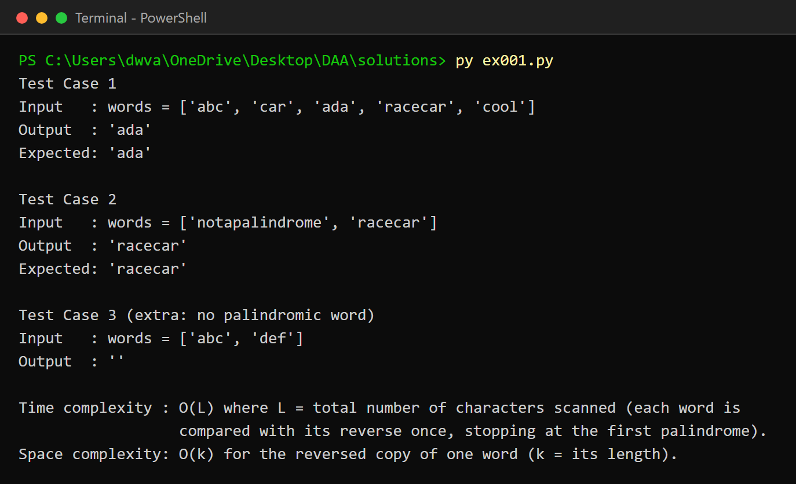

---

<a id="exercise-2"></a>
## Exercise 2 - Count elements of each array that also exist in the other array

**Program** (`solutions/ex002.py`)

```python
# Exercise 2 - Count elements of each array that also exist in the other array


def count_common_indices(nums1, nums2):
    """Return [answer1, answer2].

    answer1 = number of indices i with nums1[i] present in nums2
    answer2 = number of indices i with nums2[i] present in nums1
    Sets give O(1) average membership tests, so the total cost is O(n + m).
    """
    set1, set2 = set(nums1), set(nums2)
    answer1 = sum(1 for value in nums1 if value in set2)
    answer2 = sum(1 for value in nums2 if value in set1)
    return [answer1, answer2]


if __name__ == "__main__":
    tests = [
        ([2, 3, 2], [1, 2], [2, 1]),
        ([4, 3, 2, 3, 1], [2, 2, 5, 2, 3, 6], [3, 4]),
    ]
    for number, (nums1, nums2, expected) in enumerate(tests, start=1):
        result = count_common_indices(nums1, nums2)
        print(f"Test Case {number}")
        print(f"Input   : nums1 = {nums1}, nums2 = {nums2}")
        print(f"Output  : {result}")
        if result == expected:
            print(f"Expected: {expected}")
        else:
            print(f"Note    : document lists {expected}; correct value is {result}")
        print()
    print("Time complexity : O(n + m)  (build two sets, then one pass over each array)")
    print("Space complexity: O(n + m)  (the two sets)")
```

**Output**

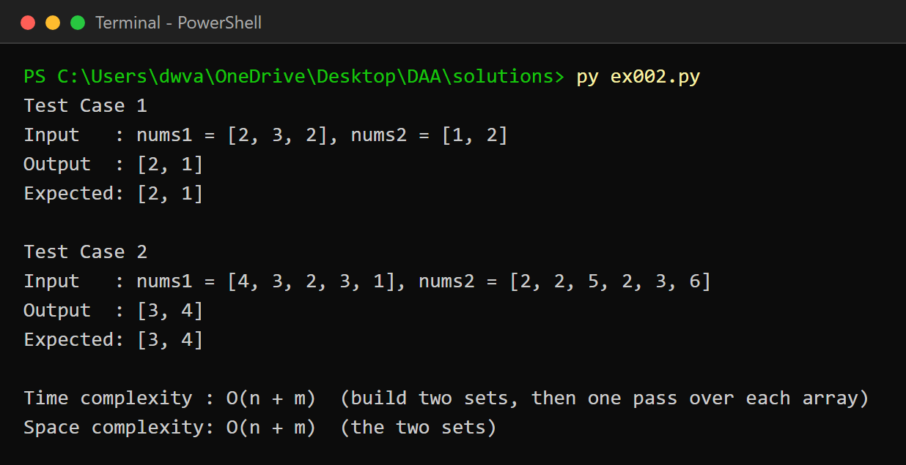

---

<a id="exercise-3"></a>
## Exercise 3 - Sum of squares of distinct counts of all subarrays

**Program** (`solutions/ex003.py`)

```python
# Exercise 3 - Sum of squares of distinct counts of all subarrays


def sum_of_squared_distinct_counts(nums, verbose=False):
    """For every start index i, extend the subarray to the right while
    maintaining a set of the values seen; add (distinct count)^2 each time."""
    total = 0
    for start in range(len(nums)):
        seen = set()
        for end in range(start, len(nums)):
            seen.add(nums[end])
            distinct = len(seen)
            total += distinct * distinct
            if verbose:
                print(f"   {nums[start:end + 1]}: {distinct} distinct value(s)")
    return total


if __name__ == "__main__":
    tests = [([1, 2, 1], 15), ([1, 1], 3)]
    for number, (nums, expected) in enumerate(tests, start=1):
        print(f"Test Case {number}")
        print(f"Input   : nums = {nums}")
        print("Subarrays:")
        result = sum_of_squared_distinct_counts(nums, verbose=True)
        print(f"Output  : {result}")
        if result == expected:
            print(f"Expected: {expected}")
        else:
            print(f"Note    : document lists {expected}; correct value is {result}")
        print()
    print("Time complexity : O(n^2) - n(n+1)/2 subarrays, each updated in O(1) on average")
    print("Space complexity: O(n)   - the set of distinct values of the current subarray")
```

**Output**

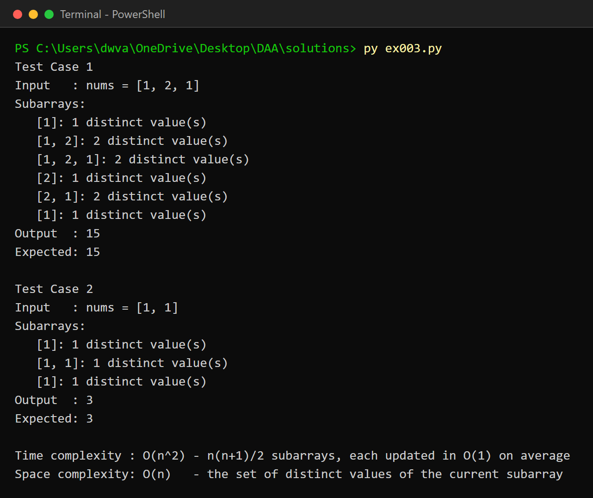

---

<a id="exercise-4"></a>
## Exercise 4 - Count pairs (i, j), i < j, with nums[i] == nums[j] and (i * j) % k == 0

**Program** (`solutions/ex004.py`)

```python
# Exercise 4 - Count pairs (i, j), i < j, with nums[i] == nums[j] and (i * j) % k == 0
from collections import defaultdict
from itertools import combinations


def count_equal_pairs_divisible(nums, k, show=False):
    """Group indices by value, then test every pair of indices inside a group."""
    positions = defaultdict(list)
    for index, value in enumerate(nums):
        positions[value].append(index)
    count = 0
    for value, indices in positions.items():
        for i, j in combinations(indices, 2):   # i < j because indices are increasing
            if (i * j) % k == 0:
                count += 1
                if show:
                    print(f"   nums[{i}] == nums[{j}] == {value}, {i} * {j} = {i * j} divisible by {k}")
    return count


if __name__ == "__main__":
    tests = [([3, 1, 2, 2, 2, 1, 3], 2, 4), ([1, 2, 3, 4], 1, 0)]
    for number, (nums, k, expected) in enumerate(tests, start=1):
        print(f"Test Case {number}")
        print(f"Input   : nums = {nums}, k = {k}")
        result = count_equal_pairs_divisible(nums, k, show=True)
        print(f"Output  : {result}")
        if result == expected:
            print(f"Expected: {expected}")
        else:
            print(f"Note    : document lists {expected}; correct value is {result}")
        print()
    print("Time complexity : O(n^2) worst case (all values equal -> n(n-1)/2 pairs checked)")
    print("Space complexity: O(n)   for the index lists")
```

**Output**

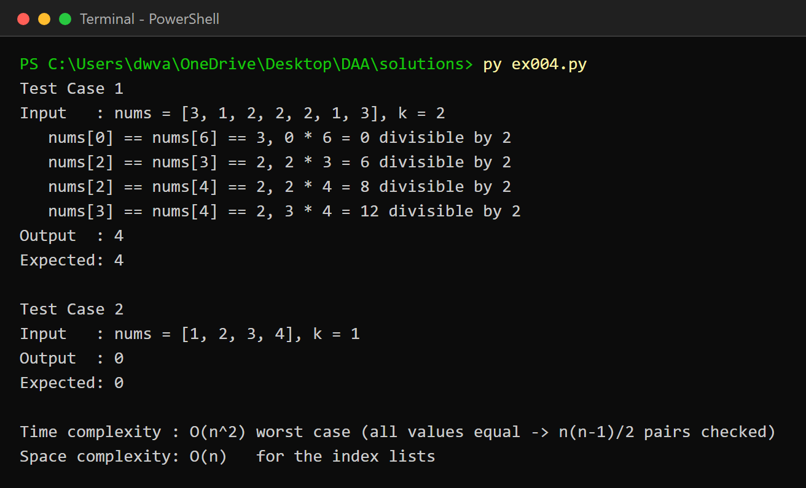

---

<a id="exercise-5"></a>
## Exercise 5 - Maximum element of an array with the least time complexity

**Program** (`solutions/ex005.py`)

```python
# Exercise 5 - Maximum element of an array with the least time complexity


def find_maximum(values):
    """Single linear scan: O(n) time, O(1) extra space.

    Any correct algorithm must look at every element at least once, so
    O(n) is optimal (sorting first would cost O(n log n))."""
    largest = values[0]
    for value in values[1:]:
        if value > largest:
            largest = value
    return largest


if __name__ == "__main__":
    # The document writes the arrays with braces {..}; they are Python lists here.
    tests = [
        ([1, 2, 3, 4, 5], 5),
        ([7, 7, 7, 7, 7], 7),
        ([-10, 2, 3, -4, 5], 5),
    ]
    for number, (values, expected) in enumerate(tests, start=1):
        result = find_maximum(values)
        print(f"Test Case {number}")
        print(f"Input   : {values}")
        print(f"Output  : {result}")
        if result == expected:
            print(f"Expected: {expected}")
        else:
            print(f"Note    : document lists {expected}; correct value is {result}")
        print()
    print("Time complexity : O(n)  - exactly n - 1 comparisons, which is the lower bound")
    print("Space complexity: O(1)  - only one variable (the running maximum) is kept")
```

**Output**

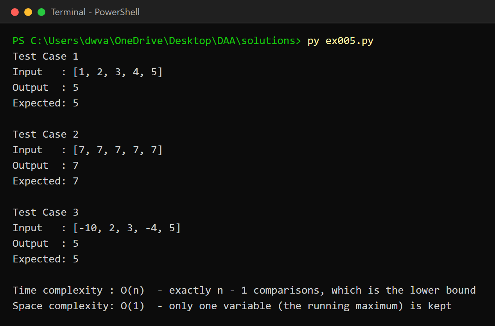

---

<a id="exercise-6"></a>
## Exercise 6 - Sort a list with an efficient sort (merge sort), then take the maximum

**Program** (`solutions/ex006.py`)

```python
# Exercise 6 - Sort a list with an efficient sort (merge sort), then take the maximum


def merge_sort(items):
    """Divide and conquer sort: O(n log n) time in every case, O(n) extra space."""
    if len(items) <= 1:
        return list(items)
    middle = len(items) // 2
    left, right = merge_sort(items[:middle]), merge_sort(items[middle:])
    merged, i, j = [], 0, 0
    while i < len(left) and j < len(right):
        if left[i] <= right[j]:
            merged.append(left[i])
            i += 1
        else:
            merged.append(right[j])
            j += 1
    return merged + left[i:] + right[j:]


def max_after_sorting(numbers):
    """Sort the list, then the maximum is simply the last element."""
    if not numbers:
        return None, []
    ordered = merge_sort(numbers)
    return ordered[-1], ordered


if __name__ == "__main__":
    tests = [
        ("Empty List", [], None),
        ("Single Element List", [5], 5),
        ("All Elements are the Same", [3, 3, 3, 3, 3], 3),
    ]
    for number, (title, numbers, expected) in enumerate(tests, start=1):
        maximum, ordered = max_after_sorting(numbers)
        print(f"Test Case {number}: {title}")
        print(f"Input   : {numbers}")
        print(f"Sorted  : {ordered}")
        if maximum is None:
            print("Output  : None (the list is empty, so there is no maximum)")
        else:
            print(f"Output  : {maximum}")
        if maximum == expected:
            print(f"Expected: {expected}")
        else:
            print(f"Note    : document lists {expected}; correct value is {maximum}")
        print()
    # One extra, more interesting case
    maximum, ordered = max_after_sorting([8, -2, 15, 4, 15, 0])
    print("Test Case 4 (extra)")
    print(f"Input   : [8, -2, 15, 4, 15, 0]")
    print(f"Sorted  : {ordered}")
    print(f"Output  : {maximum}")
    print()
    print("Time complexity : O(n log n) for the merge sort + O(1) to read the last element")
    print("Space complexity: O(n) for the temporary lists used while merging")
```

**Output**

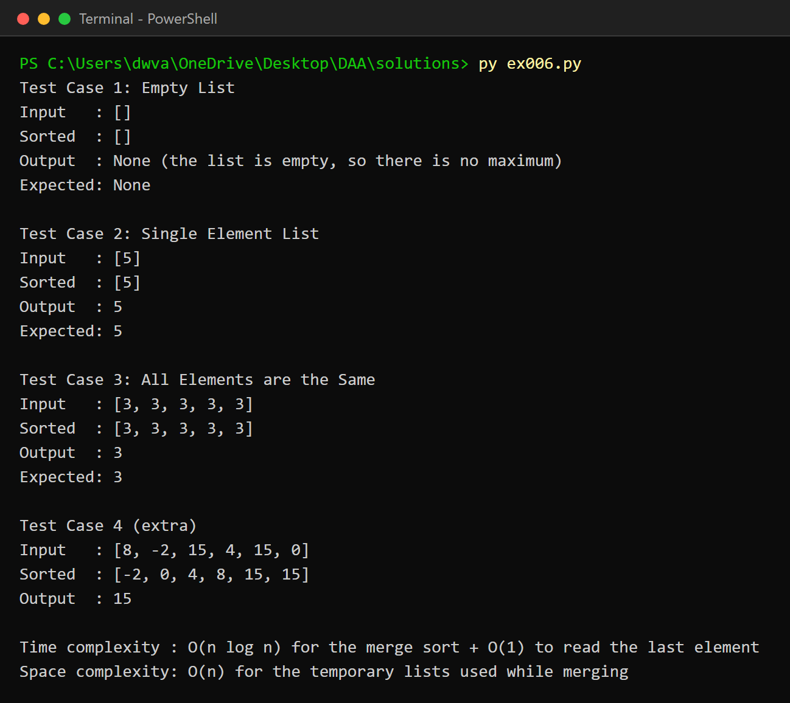

---

<a id="exercise-7"></a>
## Exercise 7 - New list containing only the unique elements of a list

**Program** (`solutions/ex007.py`)

```python
# Exercise 7 - New list containing only the unique elements of a list


def unique_elements(numbers):
    """Keep the first occurrence of every value (original order preserved).

    A set remembers the values already seen, so each element is handled in
    O(1) average time -> O(n) time overall."""
    seen = set()
    unique = []
    for value in numbers:
        if value not in seen:
            seen.add(value)
            unique.append(value)
    return unique


if __name__ == "__main__":
    tests = [
        ("Some Duplicate Elements", [3, 7, 3, 5, 2, 5, 9, 2], [3, 7, 5, 2, 9]),
        ("Negative and Positive Numbers", [-1, 2, -1, 3, 2, -2], [-1, 2, 3, -2]),
        ("List with Large Numbers", [1000000, 999999, 1000000], [1000000, 999999]),
    ]
    for number, (title, numbers, expected) in enumerate(tests, start=1):
        result = unique_elements(numbers)
        print(f"Test Case {number}: {title}")
        print(f"Input   : {numbers}")
        print(f"Output  : {result}")
        if result == expected:
            print(f"Expected: {expected}")
        else:
            print(f"Note    : document lists {expected}; correct value is {result}")
        print()
    print("Time complexity : O(n) on average (one pass, O(1) set lookups)")
    print("Space complexity: O(n) - the 'seen' set plus the result list can each hold up to n")
    print("                  values (worst case: all elements distinct), i.e. O(n) extra space.")
```

**Output**

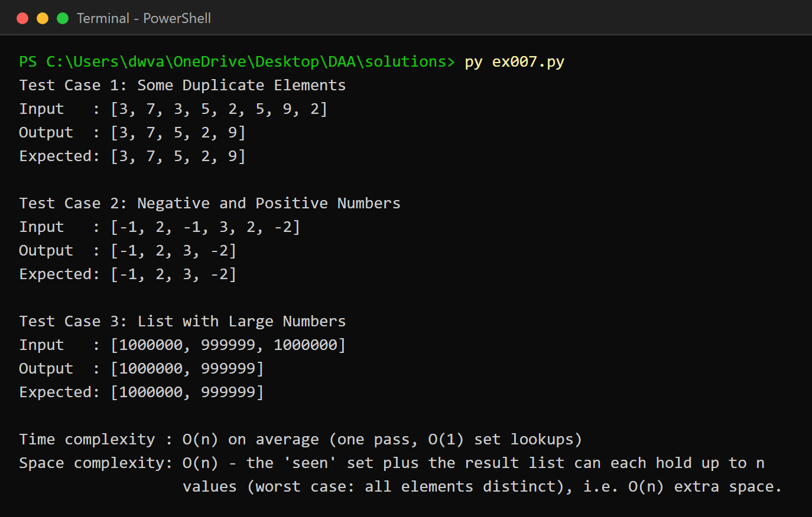

---

<a id="exercise-8"></a>
## Exercise 8 - Bubble sort with Big-O analysis

**Program** (`solutions/ex008.py`)

```python
# Exercise 8 - Bubble sort with Big-O analysis


def bubble_sort(values):
    """Repeatedly swap adjacent out-of-order items; the largest value
    'bubbles' to the end of the unsorted part after every pass.
    Returns (sorted_list, comparisons, swaps)."""
    items = list(values)
    n = len(items)
    comparisons = swaps = 0
    for pass_no in range(n - 1):
        for j in range(n - 1 - pass_no):
            comparisons += 1
            if items[j] > items[j + 1]:
                items[j], items[j + 1] = items[j + 1], items[j]
                swaps += 1
    return items, comparisons, swaps


if __name__ == "__main__":
    tests = [
        ("Random array", [64, 34, 25, 12, 22, 11, 90]),
        ("Reverse sorted (worst case)", [5, 4, 3, 2, 1]),
        ("Already sorted", [1, 2, 3, 4, 5]),
    ]
    for number, (title, values) in enumerate(tests, start=1):
        result, comparisons, swaps = bubble_sort(values)
        n = len(values)
        print(f"Test Case {number}: {title}")
        print(f"Input   : {values}")
        print(f"Output  : {result}")
        print(f"Work    : {comparisons} comparisons (n(n-1)/2 = {n * (n - 1) // 2}), {swaps} swaps")
        print()
    print("Time complexity analysis (n = number of elements)")
    print("  Comparisons : (n-1) + (n-2) + ... + 1 = n(n-1)/2 in every case (no early exit)")
    print("  Worst case  : O(n^2)  (reverse sorted: every comparison also swaps)")
    print("  Average case: O(n^2)")
    print("  Best case   : O(n^2) for this basic version (O(n) only with an early-exit flag)")
    print("  Space       : O(1) extra - sorting is done in place; the sort is stable")
```

**Output**

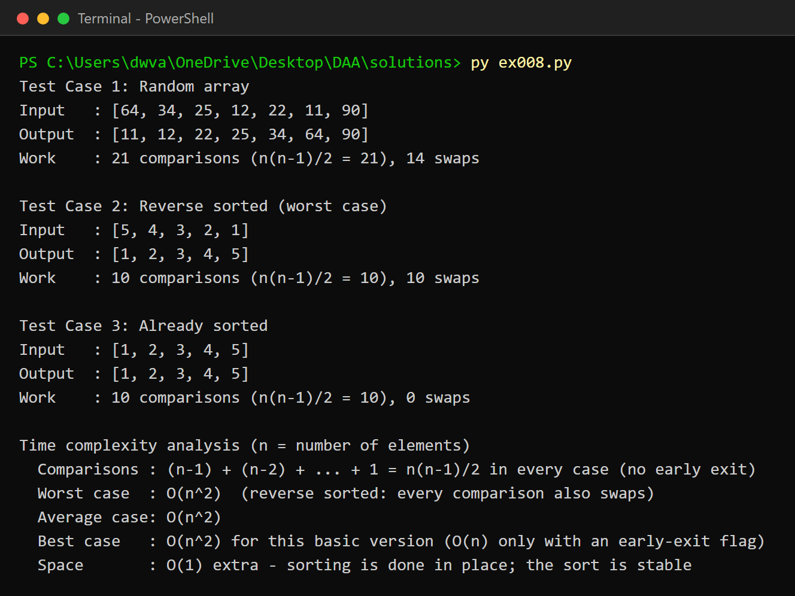

---

<a id="exercise-9"></a>
## Exercise 9 - Binary search for a key (with Big-O analysis)

**Program** (`solutions/ex009.py`)

```python
# Exercise 9 - Binary search for a key (with Big-O analysis)
#
# Binary search only works on SORTED data, but the array in the document,
# X = {3, 4, 6, -9, 10, 8, 9, 30}, is not sorted.  So the array is first
# sorted (keeping each value's original 1-based position), then searched.


def binary_search(sorted_pairs, key):
    """sorted_pairs: list of (value, original_position) ordered by value.
    Returns (index_in_sorted_list or -1, number_of_comparisons)."""
    low, high, steps = 0, len(sorted_pairs) - 1, 0
    while low <= high:
        mid = (low + high) // 2
        steps += 1
        if sorted_pairs[mid][0] == key:
            return mid, steps
        if sorted_pairs[mid][0] < key:
            low = mid + 1
        else:
            high = mid - 1
    return -1, steps


if __name__ == "__main__":
    X = [3, 4, 6, -9, 10, 8, 9, 30]
    pairs = sorted((value, pos) for pos, value in enumerate(X, start=1))
    tests = [(10, "Element 10 is found at position 5"), (100, "Element 100 is not found")]
    for number, (key, expected) in enumerate(tests, start=1):
        index, steps = binary_search(pairs, key)
        print(f"Test Case {number}")
        print(f"Input   : X = {X}, KEY = {key}")
        print(f"Sorted  : {[value for value, _ in pairs]}")
        if index == -1:
            result = f"Element {key} is not found"
            sorted_note = ""
        else:
            result = f"Element {key} is found at position {pairs[index][1]}"
            sorted_note = f" (in the sorted array: position {index + 1})"
        print(f"Output  : {result}   [{steps} comparisons]{sorted_note}")
        if result == expected:
            print(f"Expected: {expected}")
        else:
            print(f"Note    : document lists '{expected}'; correct value is '{result}'")
        print()
    print("Note    : the document's array is not sorted. The position reported above is the 1-based")
    print("          position in the ORIGINAL array X (matches the document); binary search itself")
    print("          runs on the sorted copy, where the same element sits at a different position.")
    print("Time complexity : O(log n) for the search (the range halves every step);")
    print("                  best case O(1). The sort needed for unsorted input costs O(n log n).")
    print("Space complexity: O(1) for the iterative search.")
```

**Output**

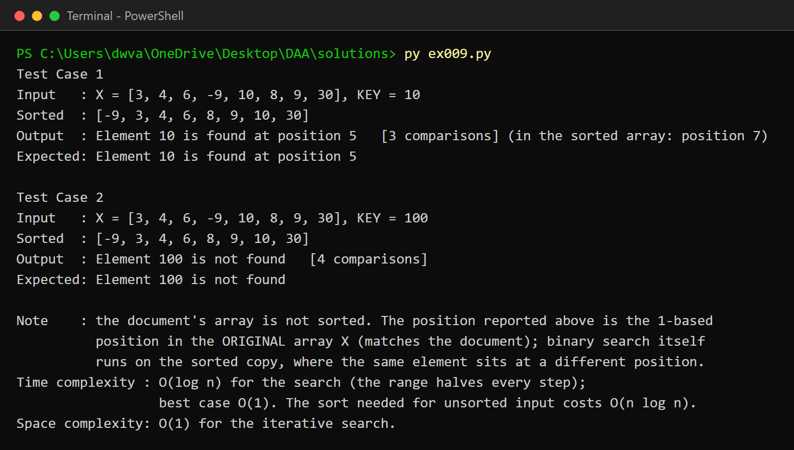

---

<a id="exercise-10"></a>
## Exercise 10 - Sort an array in O(n log n) time with the smallest space: heap sort

**Program** (`solutions/ex010.py`)

```python
# Exercise 10 - Sort an array in O(n log n) time with the smallest space: heap sort
# No built-in sort function is used.  Heap sort is in place -> O(1) extra space
# (merge sort would need O(n) extra space, quick sort O(log n) stack, O(n) worst).


def sift_down(items, root, size):
    """Restore the max-heap property for the subtree rooted at `root`."""
    while True:
        largest = root
        left, right = 2 * root + 1, 2 * root + 2
        if left < size and items[left] > items[largest]:
            largest = left
        if right < size and items[right] > items[largest]:
            largest = right
        if largest == root:
            return
        items[root], items[largest] = items[largest], items[root]
        root = largest


def heap_sort(items):
    """Sort in place in ascending order and return the same list."""
    size = len(items)
    for root in range(size // 2 - 1, -1, -1):      # build a max-heap: O(n)
        sift_down(items, root, size)
    for end in range(size - 1, 0, -1):             # n-1 extractions: O(n log n)
        items[0], items[end] = items[end], items[0]
        sift_down(items, 0, end)
    return items


if __name__ == "__main__":
    tests = [
        [5, 2, 3, 1],
        [5, 1, 1, 2, 0, 0],
        [-4, 0, 7, -4, 10, 3, -1],
        [],
        [9],
    ]
    for number, nums in enumerate(tests, start=1):
        print(f"Test Case {number}")
        print(f"Input   : nums = {nums}")
        print(f"Output  : {heap_sort(list(nums))}")
        print()
    print("Time complexity : O(n log n) in best, average and worst case")
    print("                  (heap build O(n) + n extractions of O(log n) each)")
    print("Space complexity: O(1) auxiliary - the array is rearranged in place (sift_down is iterative)")
```

**Output**

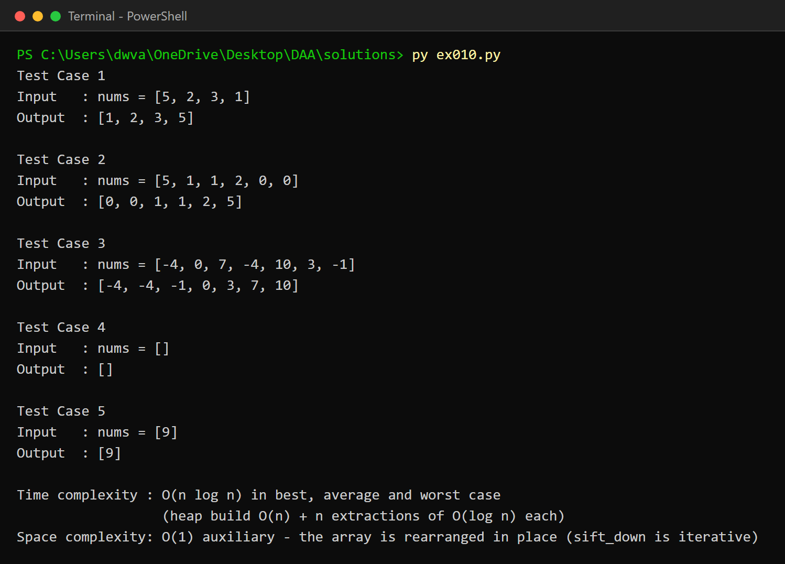

---

<a id="exercise-11"></a>
## Exercise 11 - Number of ways a ball can move out of an m x n grid boundary

**Program** (`solutions/ex011.py`)

```python
# Exercise 11 - Number of ways a ball can move out of an m x n grid boundary
# DP over steps: ways[r][c] = number of paths that are on cell (r, c) after t moves.
# Interpretation: the document says "exactly N steps", but its expected outputs
# (6 and 12) count paths that leave the grid at ANY move <= N (the classic
# "Out of Boundary Paths" problem).  Both counts are printed.

MOVES = [(1, 0), (-1, 0), (0, 1), (0, -1)]


def out_of_boundary_paths(m, n, N, i, j):
    """Return (paths leaving within N moves, paths leaving exactly on move N)."""
    ways = [[0] * n for _ in range(m)]
    ways[i][j] = 1
    total_out = last_step_out = 0
    for _step in range(N):
        nxt = [[0] * n for _ in range(m)]
        last_step_out = 0
        for r in range(m):
            for c in range(n):
                if ways[r][c] == 0:
                    continue
                for dr, dc in MOVES:
                    nr, nc = r + dr, c + dc
                    if 0 <= nr < m and 0 <= nc < n:
                        nxt[nr][nc] += ways[r][c]       # still inside the grid
                    else:
                        last_step_out += ways[r][c]     # ball leaves the grid
        total_out += last_step_out
        ways = nxt
    return total_out, last_step_out


if __name__ == "__main__":
    tests = [((2, 2, 2, 0, 0), 6), ((1, 3, 3, 0, 1), 12)]
    for number, (args, expected) in enumerate(tests, start=1):
        m, n, N, i, j = args
        within, exact = out_of_boundary_paths(*args)
        print(f"Test Case {number}")
        print(f"Input   : m={m}, n={n}, N={N}, i={i}, j={j}")
        print(f"Output  : {within}   (ways to leave the grid in at most {N} moves)")
        if within == expected:
            print(f"Expected: {expected}")
        else:
            print(f"Note    : document lists {expected}; correct value is {within}")
        print(f"Extra   : {exact} of them leave exactly on move {N}")
        print()
    print("Note    : 'exactly N steps' in the statement only matches the expected outputs if the ball")
    print("          may leave at any move up to N; counting only exits on move N gives the Extra values.")
    print("Time complexity : O(N * m * n * 4) = O(N * m * n);  Space complexity: O(m * n)")
```

**Output**

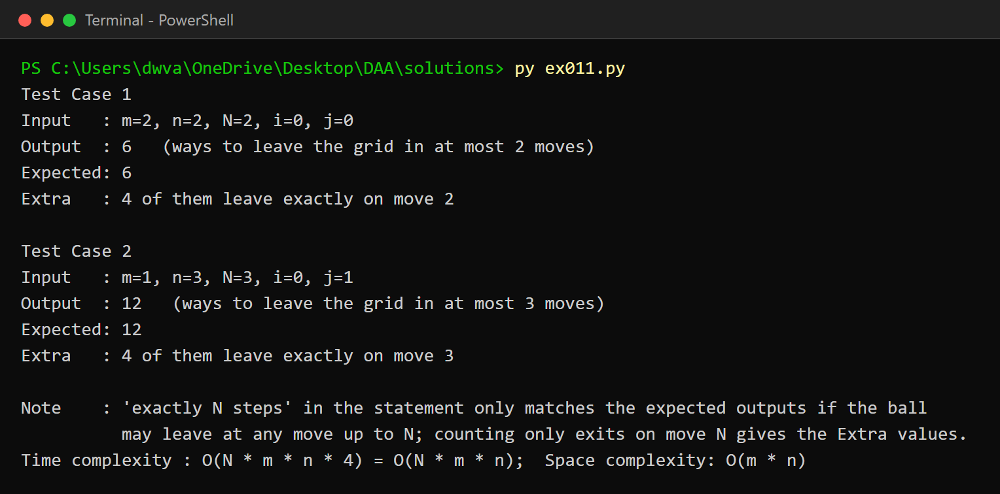

---

<a id="exercise-12"></a>
## Exercise 12 - House Robber II (houses arranged in a circle)

**Program** (`solutions/ex012.py`)

```python
# Exercise 12 - House Robber II (houses arranged in a circle)
# Circle trick: house 0 and house n-1 are neighbours, so they can never both be robbed.
# Best = max( best on houses 0..n-2 , best on houses 1..n-1 ), each a normal linear problem.


def rob_line(nums, lo, hi):
    """Best loot and chosen indices on the straight street nums[lo..hi]."""
    best = {lo - 1: (0, []), lo - 2: (0, [])}      # best[k] = (money, houses) using houses <= k
    for k in range(lo, hi + 1):
        skip = best[k - 1]
        take = (best[k - 2][0] + nums[k], best[k - 2][1] + [k])
        best[k] = take if take[0] > skip[0] else skip
    return best[hi]


def rob_circle(nums):
    if len(nums) == 1:
        return nums[0], [0]
    without_last = rob_line(nums, 0, len(nums) - 2)
    without_first = rob_line(nums, 1, len(nums) - 1)
    return max(without_last, without_first, key=lambda result: result[0])


if __name__ == "__main__":
    tests = [([2, 3, 2], 3), ([1, 2, 3, 1], 4)]
    for number, (nums, expected) in enumerate(tests, start=1):
        money, houses = rob_circle(nums)
        print(f"Test Case {number}")
        print(f"Input   : nums = {nums}")
        print(f"Output  : The maximum money you can rob without alerting the police is {money}")
        print(f"          (robbing house indices {houses} counting from 0, values "
              f"{[nums[h] for h in houses]})")
        if money == expected:
            print(f"Expected: {expected}")
        else:
            print(f"Note    : document lists {expected}; correct value is {money}")
        print()
    print("Note    : the document names the houses inconsistently (0-based 'house 1' in example 1,")
    print("          1-based 'house 1 and house 3' in example 2); the money amounts are correct.")
    print("Time complexity : O(n) (two linear passes);  Space complexity: O(n) here (O(1) possible)")
```

**Output**

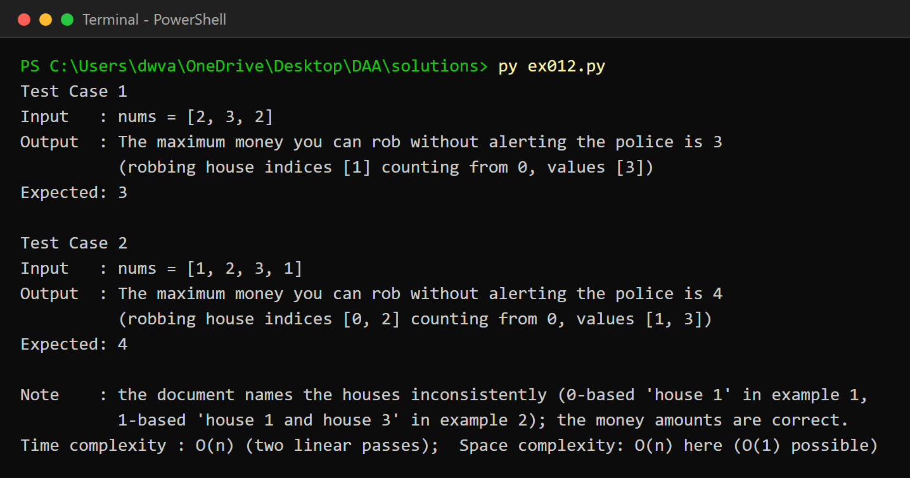

---

<a id="exercise-13"></a>
## Exercise 13 - Climbing stairs: distinct ways to climb n steps taking 1 or 2 steps at a time

**Program** (`solutions/ex013.py`)

```python
# Exercise 13 - Climbing stairs: distinct ways to climb n steps taking 1 or 2 steps at a time
# ways(n) = ways(n-1) + ways(n-2): the last move was either a 1-step or a 2-step.


def count_ways(n):
    """Bottom-up DP keeping only the last two values: O(n) time, O(1) space."""
    previous, current = 1, 1              # ways(0) = 1, ways(1) = 1
    for _ in range(2, n + 1):
        previous, current = current, previous + current
    return current


def list_ways(n):
    """Enumerate every distinct sequence of 1s and 2s that sums to n (for illustration)."""
    if n == 0:
        return [[]]
    ways = [[1] + rest for rest in list_ways(n - 1)]
    if n >= 2:
        ways += [[2] + rest for rest in list_ways(n - 2)]
    return ways


if __name__ == "__main__":
    tests = [(4, 5), (3, 3)]
    for number, (n, expected) in enumerate(tests, start=1):
        result = count_ways(n)
        print(f"Test Case {number}")
        print(f"Input   : n = {n}")
        print(f"Output  : {result}")
        if result == expected:
            print(f"Expected: {expected}")
        else:
            print(f"Note    : document lists {expected}; correct value is {result}")
        print("Ways    :")
        for way in list_ways(n):
            print("   " + " + ".join(map(str, way)))
        print()
    print("Table   : n    = " + "  ".join(f"{n:2d}" for n in range(0, 11)))
    print("          ways = " + "  ".join(f"{count_ways(n):2d}" for n in range(0, 11)) + "  (Fibonacci numbers)")
    print("Time complexity : O(n);  Space complexity: O(1)")
```

**Output**

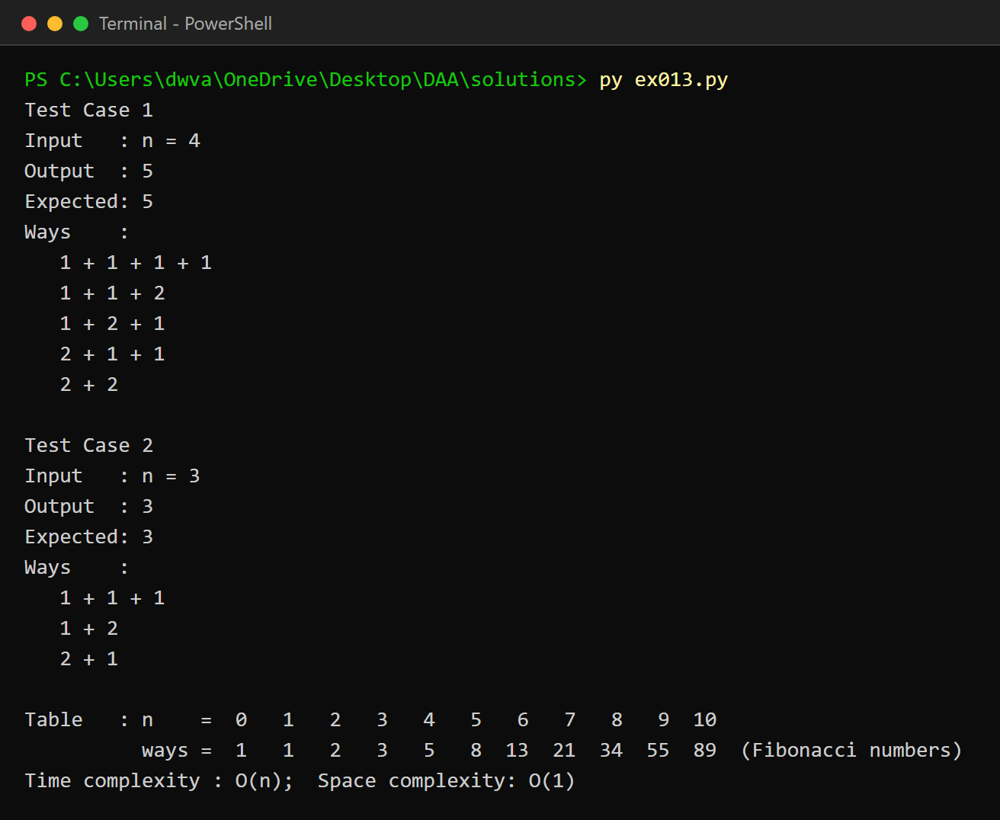

---

<a id="exercise-14"></a>
## Exercise 14 - Unique Paths in an m x n grid (dynamic programming)

**Program** (`solutions/ex014.py`)

```python
# Exercise 14 - Unique Paths in an m x n grid (dynamic programming)
from math import comb


def unique_paths(m, n):
    """Number of down/right paths from top-left to bottom-right of an m x n grid."""
    row = [1] * n                    # first row: only one way to reach each cell
    for _ in range(1, m):            # process the remaining rows one by one
        for c in range(1, n):
            row[c] += row[c - 1]     # ways(cell) = ways(from above) + ways(from left)
    return row[-1]


if __name__ == "__main__":
    tests = [(7, 3, 28), (3, 2, 3)]
    for no, (m, n, expected) in enumerate(tests, 1):
        result = unique_paths(m, n)
        print(f"Test Case {no}")
        print(f"Input   : m = {m}, n = {n}")
        print(f"Output  : {result}")
        print(f"Expected: {expected}")
        # independent check: choose which (m-1) of the (m+n-2) moves go down
        print(f"Check   : C({m + n - 2}, {m - 1}) = {comb(m + n - 2, m - 1)}")
    print()
    print("Time complexity : O(m * n) - every cell of the grid is computed once")
    print("Space complexity: O(n) - only one row of the DP table is kept")
```

**Output**

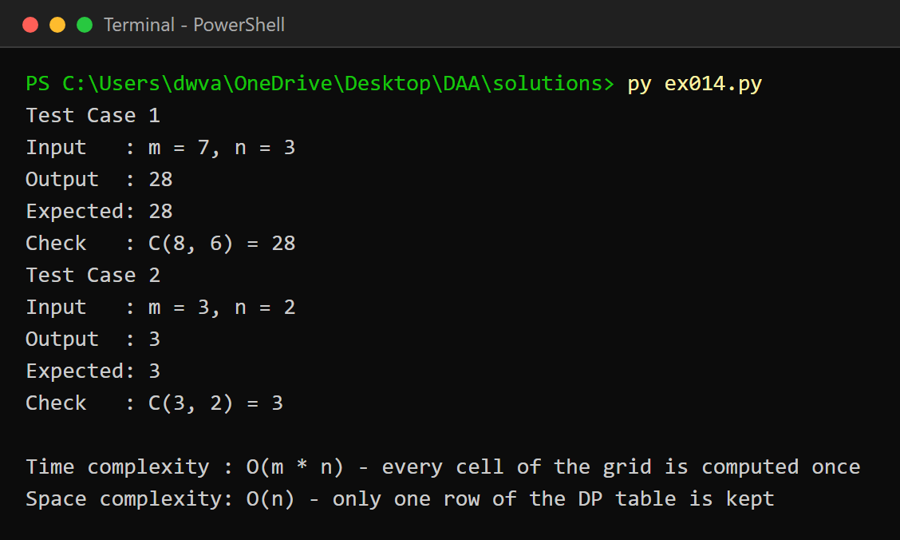

---

<a id="exercise-15"></a>
## Exercise 15 - Positions of Large Groups

**Program** (`solutions/ex015.py`)

```python
# Exercise 15 - Positions of Large Groups


def large_groups(s):
    """Return [start, end] of every run of 3 or more equal characters."""
    result = []
    start = 0                                    # start index of the current group
    for i in range(1, len(s) + 1):
        if i == len(s) or s[i] != s[start]:      # the current group ends at i - 1
            if i - start >= 3:
                result.append([start, i - 1])
            start = i
    return result


if __name__ == "__main__":
    tests = [
        ("abbxxxxzzy", [[3, 6]]),
        ("abc", []),
        ("abbxxxxzyy", [[3, 6]]),      # the example string used in the problem statement
    ]
    for no, (s, expected) in enumerate(tests, 1):
        print(f"Test Case {no}")
        print(f'Input   : s = "{s}"')
        print(f"Output  : {large_groups(s)}")
        print(f"Expected: {expected}")
    print()
    print("Time complexity : O(n) - the string is scanned once")
    print("Space complexity: O(1) extra (apart from the returned list)")
```

**Output**

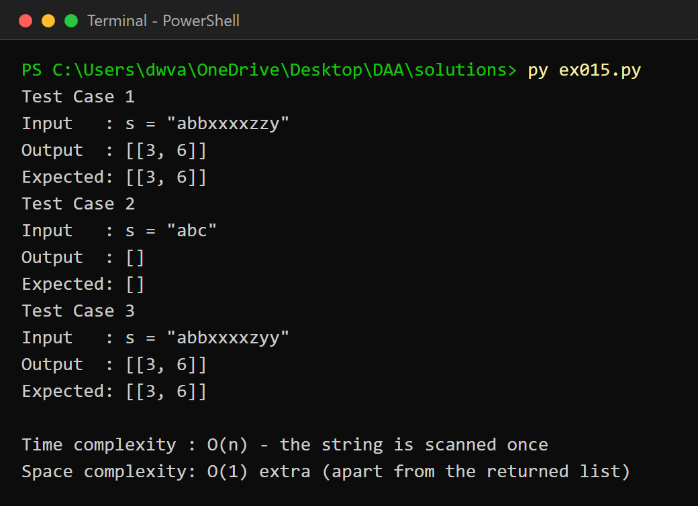

---

<a id="exercise-16"></a>
## Exercise 16 - Conway's Game of Life (next generation)

**Program** (`solutions/ex016.py`)

```python
# Exercise 16 - Conway's Game of Life (next generation)


def next_generation(board):
    """Apply the four Life rules to every cell simultaneously; return the new board."""
    rows, cols = len(board), len(board[0])

    def live_neighbours(r, c):
        count = 0
        for dr in (-1, 0, 1):
            for dc in (-1, 0, 1):
                nr, nc = r + dr, c + dc
                if (dr or dc) and 0 <= nr < rows and 0 <= nc < cols:
                    count += board[nr][nc]
        return count

    new_board = [[0] * cols for _ in range(rows)]     # old board stays untouched
    for r in range(rows):
        for c in range(cols):
            n = live_neighbours(r, c)
            if board[r][c] == 1:
                new_board[r][c] = 1 if n in (2, 3) else 0    # under/over-population
            else:
                new_board[r][c] = 1 if n == 3 else 0         # reproduction
    return new_board


if __name__ == "__main__":
    tests = [
        ([[0, 1, 0], [0, 0, 1], [1, 1, 1], [0, 0, 0]], [[0, 0, 0], [1, 0, 1], [0, 1, 1], [0, 1, 0]]),
        ([[1, 1], [1, 0]], [[1, 1], [1, 1]]),
    ]
    for no, (board, expected) in enumerate(tests, 1):
        result = next_generation(board)
        print(f"Test Case {no}")
        print(f"Input   : board = {board}")
        print(f"Output  : {result}")
        print(f"Expected: {expected}")
        print(f"Match   : {result == expected}")
    print()
    print("Time complexity : O(m * n) - each cell looks at its 8 neighbours (constant work)")
    print("Space complexity: O(m * n) for the new board")
```

**Output**

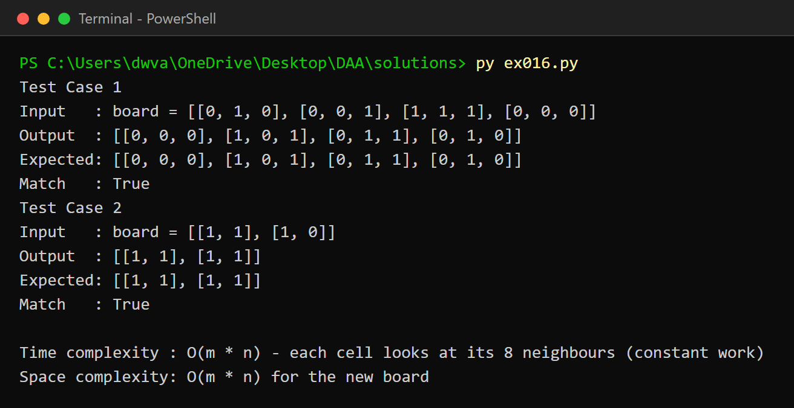

---

<a id="exercise-17"></a>
## Exercise 17 - Champagne Tower (row-by-row simulation)

**Program** (`solutions/ex017.py`)

```python
# Exercise 17 - Champagne Tower (row-by-row simulation)


def tower_row(poured, row_index):
    """How full (0..1) each glass of the given row is after pouring `poured` cups."""
    row = [float(poured)]                         # liquid reaching each glass of row 0
    for _ in range(row_index):
        below = [0.0] * (len(row) + 1)
        for i, amount in enumerate(row):
            overflow = max(amount - 1.0, 0.0) / 2     # excess splits equally left / right
            below[i] += overflow
            below[i + 1] += overflow
        row = below
    return [min(1.0, x) for x in row]             # a glass holds at most one cup


def champagne_tower(poured, query_row, query_glass):
    return tower_row(poured, query_row)[query_glass]


if __name__ == "__main__":
    tests = [(1, 1, 1, "0.00000"), (2, 1, 1, "0.50000")]
    for no, (poured, row, glass, expected) in enumerate(tests, 1):
        result = champagne_tower(poured, row, glass)
        print(f"Test Case {no}")
        print(f"Input   : poured = {poured}, query_row = {row}, query_glass = {glass}")
        print(f"Output  : {result:.5f}")
        print(f"Expected: {expected}")
    # the 4-cup picture described in the question: third row = 1/4, 1/2, 1/4
    third_row = [f"{x:.5f}" for x in tower_row(4, 2)]
    print("Test Case 3 (picture from the question)")
    print("Input   : poured = 4, whole row 2")
    print(f"Output  : {third_row}")
    print("Expected: ['0.25000', '0.50000', '0.25000']")
    print()
    print("Time complexity : O(R^2) for R rows (R <= 100) - every glass is visited once")
    print("Space complexity: O(R) - only the current row is stored")
```

**Output**

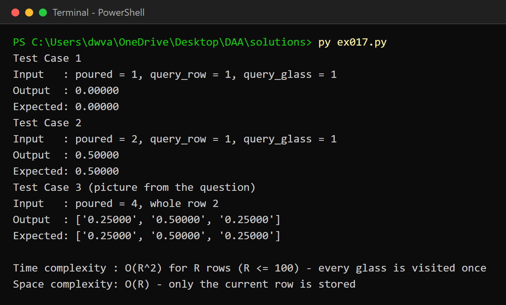

---

