# Topic 2 - Brute Force

[← Back to index](README.md)

- [Exercise 18 - Selection Sort (with step-by-step trace and analysis)](#exercise-18)
- [Exercise 19 - Optimised Bubble Sort (stops early when a pass makes no swap)](#exercise-19)
- [Exercise 20 - Insertion Sort with duplicate elements (stability check)](#exercise-20)
- [Exercise 21 - Kth Missing Positive Number (binary search)](#exercise-21)
- [Exercise 22 - Find Peak Element in O(log n) (binary search)](#exercise-22)
- [Exercise 23 - Find the Index of the First Occurrence in a String](#exercise-23)
- [Exercise 24 - String Matching in an Array (words that are substrings of other words)](#exercise-24)
- [Exercise 25 - Closest Pair of Points (brute force)](#exercise-25)
- [Exercise 26 - Closest pair (brute force) and brute-force Convex Hull](#exercise-26)
- [Exercise 27 - Convex hull of 2D points (brute force)](#exercise-27)
- [Exercise 28 - Travelling Salesman Problem (exhaustive search)](#exercise-28)
- [Exercise 29 - Assignment problem (exhaustive search)](#exercise-29)
- [Exercise 30 - 0-1 Knapsack problem (exhaustive search)](#exercise-30)

---

<a id="exercise-18"></a>
## Exercise 18 - Selection Sort (with step-by-step trace and analysis)

**Program** (`solutions/ex018.py`)

```python
# Exercise 18 - Selection Sort (with step-by-step trace and analysis)


def selection_sort(arr, trace=False):
    """Sort a copy of arr in ascending order; return (sorted_list, comparisons)."""
    a = list(arr)
    comparisons = 0
    for i in range(len(a) - 1):               # a[:i] is the sorted region
        smallest = i
        for j in range(i + 1, len(a)):        # scan the unsorted region a[i:]
            comparisons += 1
            if a[j] < a[smallest]:
                smallest = j
        a[i], a[smallest] = a[smallest], a[i]     # move the minimum to the boundary
        if trace:
            print(f"  Pass {i + 1}: min = {a[i]} (found at index {smallest}) -> {a}")
    return a, comparisons


if __name__ == "__main__":
    print("How it works: the array is split into a sorted region (left, empty at first) and an")
    print("unsorted region. Each pass selects the smallest element of the unsorted region, swaps it")
    print("with the leftmost unsorted element, and moves the boundary one place to the right.")
    print("Simple: only one loop idea (find min, swap). Inefficient: it always makes n(n-1)/2")
    print("comparisons, even for an already sorted list, so the time is O(n^2) (best = worst).")
    print()
    tests = [
        ("Empty list", [], []),
        ("One element", [1], [1]),
        ("All identical", [7, 7, 7, 7], [7, 7, 7, 7]),
        ("Negative numbers", [-5, -1, -3, -2, -4], [-5, -4, -3, -2, -1]),
        ("Random array", [5, 2, 9, 1, 5, 6], [1, 2, 5, 5, 6, 9]),
        ("Reverse sorted", [10, 8, 6, 4, 2], [2, 4, 6, 8, 10]),
        ("Already sorted", [1, 2, 3, 4, 5], [1, 2, 3, 4, 5]),
    ]
    for no, (name, data, expected) in enumerate(tests, 1):
        print(f"Test Case {no} ({name})")
        print(f"Input   : {data}")
        if name == "Random array":
            print("Steps   :")
        result, comps = selection_sort(data, trace=(name == "Random array"))
        print(f"Output  : {result}   (comparisons = {comps})")
        print(f"Expected: {expected}")
    print()
    print("Time: O(n^2) comparisons, at most n-1 swaps | Space: O(1) in-place | Not stable")
```

**Output**

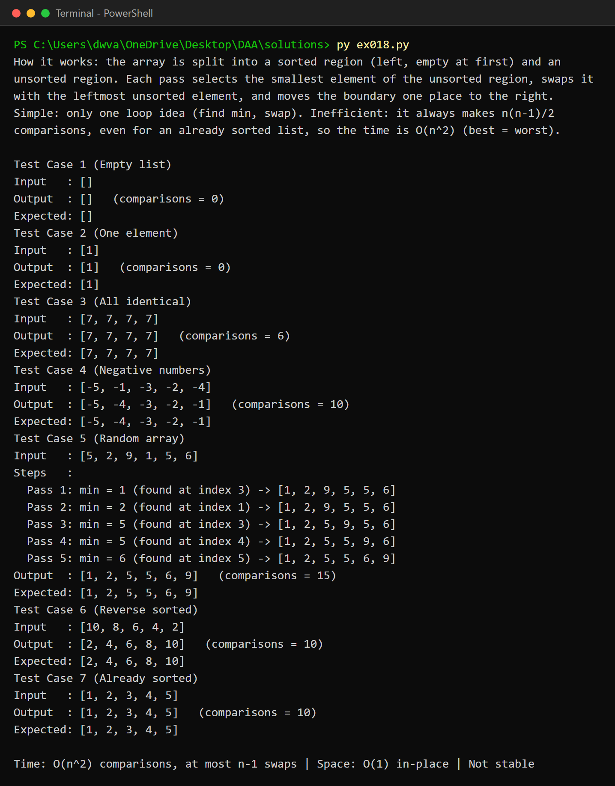

---

<a id="exercise-19"></a>
## Exercise 19 - Optimised Bubble Sort (stops early when a pass makes no swap)

**Program** (`solutions/ex019.py`)

```python
# Exercise 19 - Optimised Bubble Sort (stops early when a pass makes no swap)


def bubble_sort_optimised(arr):
    """Return (sorted copy, number of passes made). Exits as soon as the list is sorted."""
    a = list(arr)
    n = len(a)
    passes = 0
    for i in range(n - 1):
        passes += 1
        swapped = False
        for j in range(n - 1 - i):            # the last i items are already in place
            if a[j] > a[j + 1]:
                a[j], a[j + 1] = a[j + 1], a[j]
                swapped = True
        if not swapped:                       # no swap in a full pass => already sorted
            break
    return a, passes


if __name__ == "__main__":
    tests = [
        ([64, 25, 12, 22, 11], [11, 12, 22, 25, 64], ""),
        ([29, 10, 14, 37, 13], [10, 13, 14, 29, 37], ""),
        ([3, 5, 2, 1, 4], [1, 2, 3, 4, 5], ""),
        ([1, 2, 3, 4, 5], [1, 2, 3, 4, 5], " (already sorted list)"),
        ([5, 4, 3, 2, 1], [1, 2, 3, 4, 5], " (reverse sorted list)"),
    ]
    for no, (data, expected, label) in enumerate(tests, 1):
        result, passes = bubble_sort_optimised(data)
        print(f"Test Case {no}{label}")
        print(f"Input   : {data}")
        print(f"Output  : {result}")
        print(f"Expected: {expected}")
        print(f"Passes  : {passes} (plain bubble sort always makes {len(data) - 1})")
    print()
    print("Best case (already sorted): O(n) - one pass, no swap, stop.")
    print("Worst / average case: O(n^2). Space: O(1).")
```

**Output**

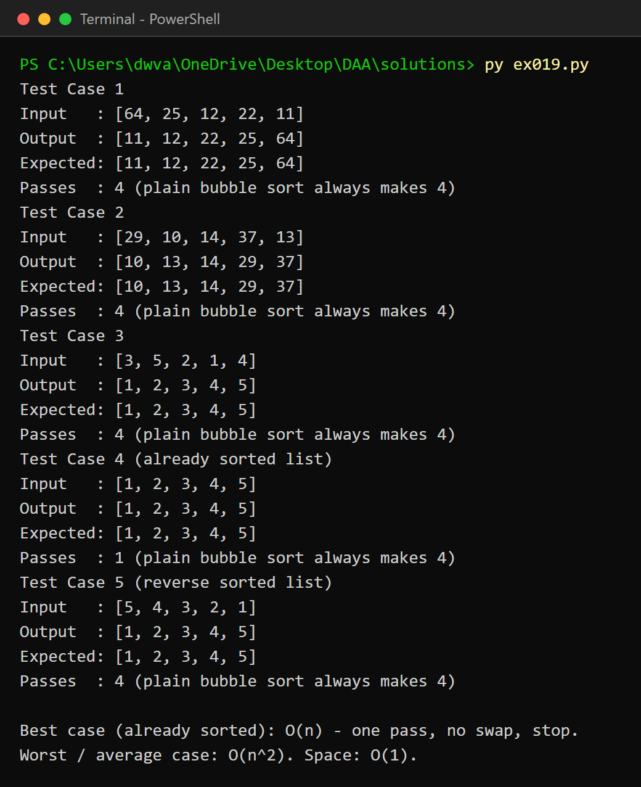

---

<a id="exercise-20"></a>
## Exercise 20 - Insertion Sort with duplicate elements (stability check)

**Program** (`solutions/ex020.py`)

```python
# Exercise 20 - Insertion Sort with duplicate elements (stability check)


def insertion_sort(values):
    """Sort values; return (sorted values, original indices in output order, shifts).

    Each value is tagged with its original index so that we can show whether equal
    values keep their relative order. We shift only while left_item > key (strict),
    so an equal element is never jumped over -> the sort is stable.
    """
    items = list(enumerate(values))                  # (original_index, value)
    shifts = 0
    for i in range(1, len(items)):
        key = items[i]
        j = i - 1
        while j >= 0 and items[j][1] > key[1]:       # strict '>' keeps duplicates in order
            items[j + 1] = items[j]
            shifts += 1
            j -= 1
        items[j + 1] = key
    return [v for _, v in items], [idx for idx, _ in items], shifts


def duplicate_positions(sorted_values, index_order):
    """Original indices of every duplicated value, in the order they appear in the output."""
    groups = {}
    for v, idx in zip(sorted_values, index_order):
        groups.setdefault(v, []).append(idx)
    return {v: g for v, g in groups.items() if len(g) > 1}


if __name__ == "__main__":
    tests = [
        ("Array with duplicates", [3, 1, 4, 1, 5, 9, 2, 6, 5, 3], [1, 1, 2, 3, 3, 4, 5, 5, 6, 9]),
        ("All identical elements", [5, 5, 5, 5, 5], [5, 5, 5, 5, 5]),
        ("Mixed duplicates", [2, 3, 1, 3, 2, 1, 1, 3], [1, 1, 1, 2, 2, 3, 3, 3]),
    ]
    for no, (name, data, expected) in enumerate(tests, 1):
        result, order, shifts = insertion_sort(data)
        groups = duplicate_positions(result, order)
        stable = all(g == sorted(g) for g in groups.values())
        print(f"Test Case {no} ({name})")
        print(f"Input   : {data}")
        print(f"Output  : {result}")
        print(f"Expected: {expected}")
        print(f"Shifts  : {shifts}")
        print(f"Original indices of duplicates, in output order: {groups}")
        print(f"Stable  : {stable} (equal values keep their original left-to-right order)")
    print()
    print("Duplicates are handled by the strict '>' test: equal elements stop the shifting, so they")
    print("stay in original order (stable) and an all-equal list needs 0 shifts (O(n) best case).")
    print("Time: O(n^2) worst/average, O(n) best | Space: O(1) in-place.")
```

**Output**

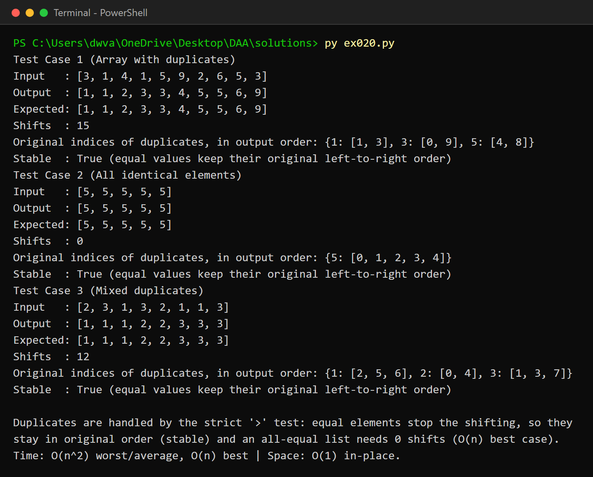

---

<a id="exercise-21"></a>
## Exercise 21 - Kth Missing Positive Number (binary search)

**Program** (`solutions/ex021.py`)

```python
# Exercise 21 - Kth Missing Positive Number (binary search)


def kth_missing_positive(arr, k):
    """arr is strictly increasing. arr[i] - (i + 1) = how many positives are missing
    before arr[i]. Binary-search the first index whose missing-count reaches k."""
    lo, hi = 0, len(arr)
    while lo < hi:
        mid = (lo + hi) // 2
        if arr[mid] - (mid + 1) < k:      # fewer than k missing up to arr[mid]: go right
            lo = mid + 1
        else:
            hi = mid
    return lo + k                          # lo array elements lie below the answer


def missing_list(arr, count):
    """First `count` missing positives (simple scan, only used to display the explanation)."""
    present, out, x = set(arr), [], 1
    while len(out) < count:
        if x not in present:
            out.append(x)
        x += 1
    return out


if __name__ == "__main__":
    tests = [([2, 3, 4, 7, 11], 5, 9), ([1, 2, 3, 4], 2, 6)]
    for no, (arr, k, expected) in enumerate(tests, 1):
        result = kth_missing_positive(arr, k)
        print(f"Test Case {no}")
        print(f"Input   : arr = {arr}, k = {k}")
        print(f"Output  : {result}")
        print(f"Expected: {expected}")
        listed = missing_list(arr, k)
        print(f"Missing positives (first {k}): {listed} -> the last one is {listed[-1]}")
    print()
    print("Time complexity : O(log n) - binary search on arr[i] - (i + 1)")
    print("Space complexity: O(1)")
```

**Output**

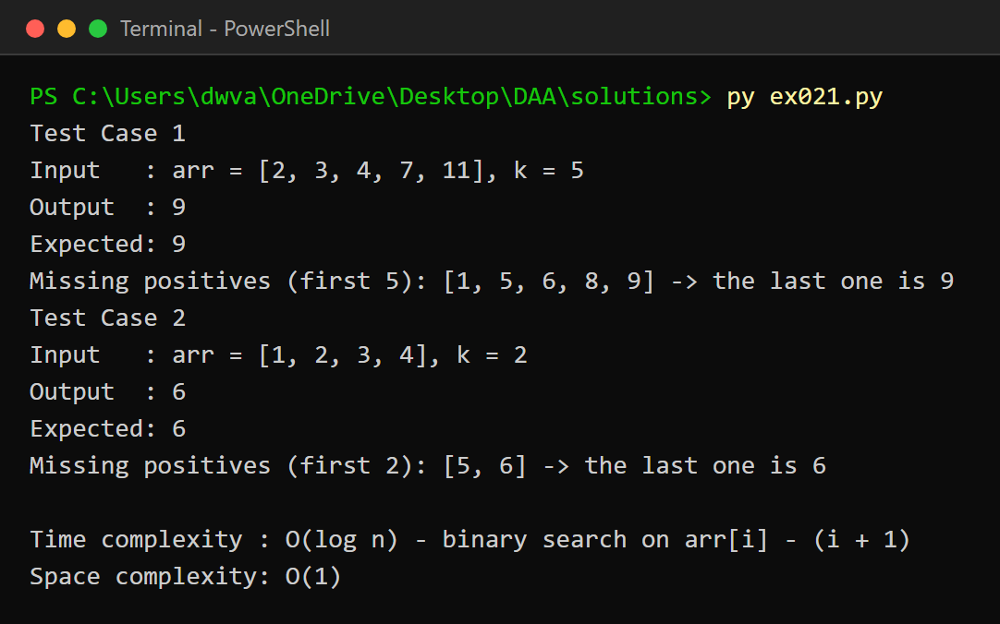

---

<a id="exercise-22"></a>
## Exercise 22 - Find Peak Element in O(log n) (binary search)

**Program** (`solutions/ex022.py`)

```python
# Exercise 22 - Find Peak Element in O(log n) (binary search)


def find_peak_element(nums):
    """Return the index of any peak (nums[-1] = nums[n] = -infinity)."""
    lo, hi = 0, len(nums) - 1
    while lo < hi:
        mid = (lo + hi) // 2
        if nums[mid] < nums[mid + 1]:     # rising slope: a peak lies to the right
            lo = mid + 1
        else:                             # falling slope: a peak is at mid or to the left
            hi = mid
    return lo


def is_peak(nums, i):
    left = nums[i - 1] if i > 0 else float("-inf")
    right = nums[i + 1] if i < len(nums) - 1 else float("-inf")
    return nums[i] > left and nums[i] > right


if __name__ == "__main__":
    tests = [
        ([1, 2, 3, 1], "2"),
        ([1, 2, 1, 3, 5, 6, 4], "5 (index 1 is also a valid answer)"),
    ]
    for no, (nums, expected) in enumerate(tests, 1):
        idx = find_peak_element(nums)
        print(f"Test Case {no}")
        print(f"Input   : nums = {nums}")
        print(f"Output  : {idx}")
        print(f"Expected: {expected}")
        print(f"Check   : nums[{idx}] = {nums[idx]} is a strict peak -> {is_peak(nums, idx)}")
    print()
    print("Time complexity : O(log n) - the search range is halved every step")
    print("Space complexity: O(1)")
```

**Output**

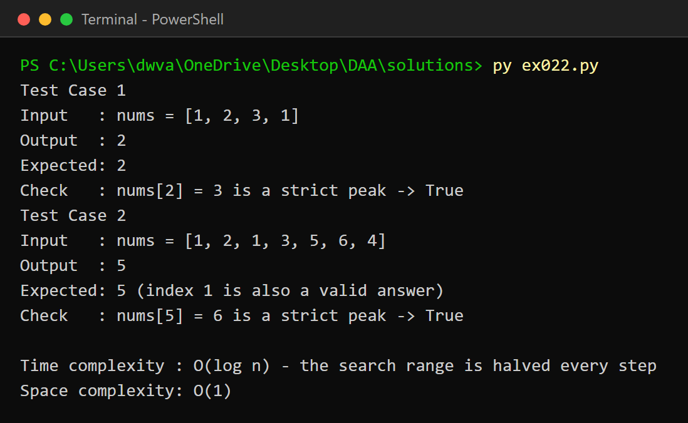

---

<a id="exercise-23"></a>
## Exercise 23 - Find the Index of the First Occurrence in a String

**Program** (`solutions/ex023.py`)

```python
# Exercise 23 - Find the Index of the First Occurrence in a String


def str_str(haystack, needle):
    """Index of the first occurrence of needle in haystack, or -1 (sliding window)."""
    n, m = len(haystack), len(needle)
    if m == 0:
        return 0
    for start in range(n - m + 1):                 # every possible starting position
        k = 0
        while k < m and haystack[start + k] == needle[k]:
            k += 1                                 # extend the match character by character
        if k == m:
            return start
    return -1


if __name__ == "__main__":
    tests = [("sadbutsad", "sad", 0), ("leetcode", "leeto", -1)]
    for no, (haystack, needle, expected) in enumerate(tests, 1):
        result = str_str(haystack, needle)
        print(f"Test Case {no}")
        print(f'Input   : haystack = "{haystack}", needle = "{needle}"')
        print(f"Output  : {result}")
        print(f"Expected: {expected}")
        all_pos = [i for i in range(len(haystack)) if haystack.startswith(needle, i)]
        print(f"All occurrences (for reference): {all_pos}")
    print()
    print("Time complexity : O(n * m) worst case (n = len(haystack), m = len(needle))")
    print("Space complexity: O(1)  (KMP would improve the time to O(n + m))")
```

**Output**

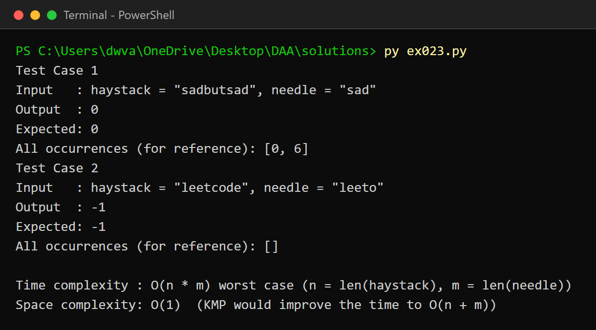

---

<a id="exercise-24"></a>
## Exercise 24 - String Matching in an Array (words that are substrings of other words)

**Program** (`solutions/ex024.py`)

```python
# Exercise 24 - String Matching in an Array (words that are substrings of other words)


def string_matching(words):
    """Return every word that is a substring of some other word in the list."""
    result = []
    for i, word in enumerate(words):
        for j, other in enumerate(words):
            if i != j and word in other:       # word occurs inside a different word
                result.append(word)
                break                          # one host word is enough
    return result


if __name__ == "__main__":
    tests = [
        (["mass", "as", "hero", "superhero"], ["as", "hero"]),
        (["leetcode", "et", "code"], ["et", "code"]),
        (["blue", "green", "bu"], []),
    ]
    for no, (words, expected) in enumerate(tests, 1):
        result = string_matching(words)
        print(f"Test Case {no}")
        print(f"Input   : words = {words}")
        print(f"Output  : {result}")
        print(f"Expected: {expected}  (any order is accepted)")
        print(f"Match   : {sorted(result) == sorted(expected)}")
    print()
    print("Time complexity : O(n^2 * L) for n words of length up to L (n^2 pairs, substring test)")
    print("Space complexity: O(1) extra (apart from the result list)")
```

**Output**

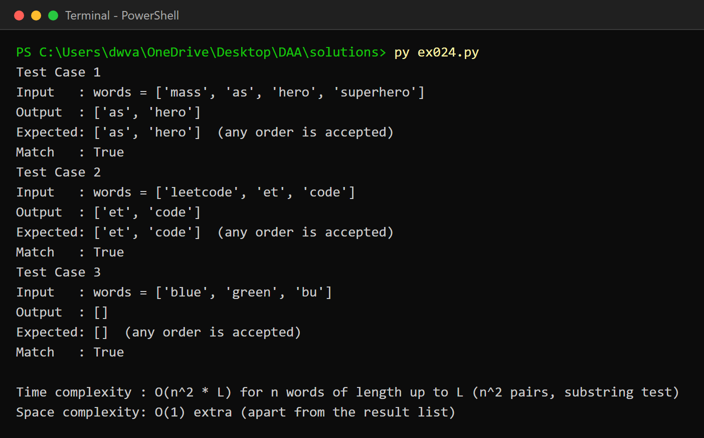

---

<a id="exercise-25"></a>
## Exercise 25 - Closest Pair of Points (brute force)

**Program** (`solutions/ex025.py`)

```python
# Exercise 25 - Closest Pair of Points (brute force)
from math import sqrt


def euclidean(p, q):
    return sqrt((p[0] - q[0]) ** 2 + (p[1] - q[1]) ** 2)


def closest_pair_brute_force(points):
    """Check every pair (i < j) and keep the pair with the smallest distance."""
    best_pair, best_dist = None, float("inf")
    for i in range(len(points)):
        for j in range(i + 1, len(points)):
            d = euclidean(points[i], points[j])
            if d < best_dist:
                best_pair, best_dist = (points[i], points[j]), d
    return best_pair, best_dist


if __name__ == "__main__":
    points = [(1, 2), (4, 5), (7, 8), (3, 1)]
    pair, dist = closest_pair_brute_force(points)
    print("Test Case 1")
    print(f"Input   : Points = {points}")
    print(f"Output  : Closest pair: {pair[0]} - {pair[1]}   Minimum distance: {dist}")
    print("Expected: Closest pair: (1, 2) - (3, 1)")
    # The document's distance is wrong: (1,2)-(3,1) has dx = 2, dy = 1, so d = sqrt(5), not sqrt(2).
    print("Note    : document lists 1.4142135623730951 (sqrt 2); correct is 2.23606797749979 (sqrt 5: dx=2, dy=1)")
    print()
    print("All pair distances (to verify the answer):")
    for i in range(len(points)):
        for j in range(i + 1, len(points)):
            print(f"  {points[i]} - {points[j]} = {euclidean(points[i], points[j]):.4f}")
    print()
    print("Time complexity : O(n^2) - n(n-1)/2 pair distances are computed")
    print("Space complexity: O(1) extra")
```

**Output**

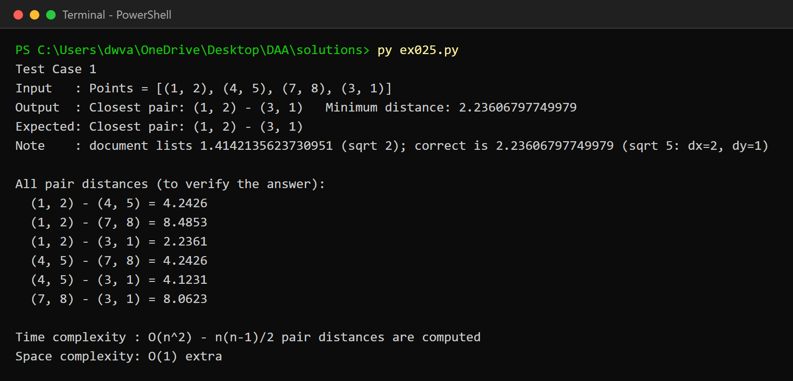

---

<a id="exercise-26"></a>
## Exercise 26 - Closest pair (brute force) and brute-force Convex Hull

**Program** (`solutions/ex026.py`)

```python
# Exercise 26 - Closest pair (brute force) and brute-force Convex Hull
from itertools import combinations
from math import dist, sqrt

P = [(10, 0), (11, 5), (5, 3), (9, 3.5), (15, 3), (12.5, 7), (6, 6.5), (7.5, 4.5)]
NAME = {p: f"P{i + 1}" for i, p in enumerate(P)}


def euclidean(p, q):
    return sqrt((p[0] - q[0]) ** 2 + (p[1] - q[1]) ** 2)


def closest_pair(points):
    """Brute force: try all n(n-1)/2 pairs and keep the nearest."""
    return min(((p, q, euclidean(p, q)) for p, q in combinations(points, 2)), key=lambda t: t[2])


def cross(a, b, c):                      # > 0 if c is to the left of the directed line a -> b
    return (b[0] - a[0]) * (c[1] - a[1]) - (b[1] - a[1]) * (c[0] - a[0])


def inside_segment(a, b, p):             # p is on line ab: does it lie between a and b?
    return min(a[0], b[0]) <= p[0] <= max(a[0], b[0]) and min(a[1], b[1]) <= p[1] <= max(a[1], b[1])


def hull_edges(pts, handle_collinear=True):
    """Directed edge a -> b is on the hull if every other point is on its left.
    Collinear points (cross = 0) are tolerated only if they lie inside segment ab."""
    edges = {}
    for a in pts:
        for b in pts:
            if a != b and all(
                cross(a, b, c) > 0 or (handle_collinear and cross(a, b, c) == 0 and inside_segment(a, b, c))
                for c in pts if c not in (a, b)
            ):
                edges[a] = b
    return edges


def convex_hull(pts):
    """Hull vertices in counter-clockwise order, starting from the lowest point."""
    edges = hull_edges(pts)
    hull = [min(edges, key=lambda p: (p[1], p[0]))]
    while edges[hull[-1]] != hull[0]:
        hull.append(edges[hull[-1]])
    return hull


if __name__ == "__main__":
    print("Part A - closest pair, brute force (points P1..P8)")
    p, q, d = closest_pair(P)
    reference = min(dist(a, b) for a, b in combinations(P, 2))
    print(f"Output  : {NAME[p]} {p} - {NAME[q]} {q}, distance = {d}")
    print(f"Verified: equals min(math.dist over all pairs) -> {abs(d - reference) < 1e-12}")
    print("Time complexity: O(n^2) - n(n-1)/2 distance computations, O(1) extra space")
    print()
    print("Part B - brute-force convex hull (O(n^3): n^2 candidate edges x n side tests)")
    hull = convex_hull(P)
    print(f"Points  : {', '.join(f'{NAME[x]}{x}' for x in P)}")
    print(f"Output  : {', '.join(NAME[x] for x in hull)}   (counter-clockwise from the lowest point)")
    print(f"Interior: {', '.join(NAME[x] for x in P if x not in hull)}")
    # P4 (9, 3.5) lies strictly inside the polygon P1-P5-P6-P7-P3, so it cannot be a hull vertex.
    print("Note    : document lists P3, P4, P6, P5, P7, P1; correct hull is P1, P5, P6, P7, P3 (P4 is interior)")
    print()
    print("Part C - several points on the same line")
    S = [(0, 0), (2, 0), (4, 0), (4, 4), (0, 4), (2, 2)]
    plain, fixed = hull_edges(S, False), hull_edges(S, True)
    print(f"Points  : {S}   ((2, 0) lies on the bottom edge)")
    print(f"Without the fix: {len(plain)} of 4 hull edges found - the bottom edge is lost (cross = 0)")
    print(f"With the fix   : {len(fixed)} of 4 hull edges, hull = {convex_hull(S)}")
    print("Modification: a cross product of 0 is not a failure. Accept the pair (a, b) if all the")
    print("collinear points lie inside segment ab (a, b are then the extreme points); the middle")
    print("collinear points are boundary points but not vertices. Pairs that leave a collinear point")
    print("outside the segment are rejected, so the same edge is never reported twice.")
```

**Output**

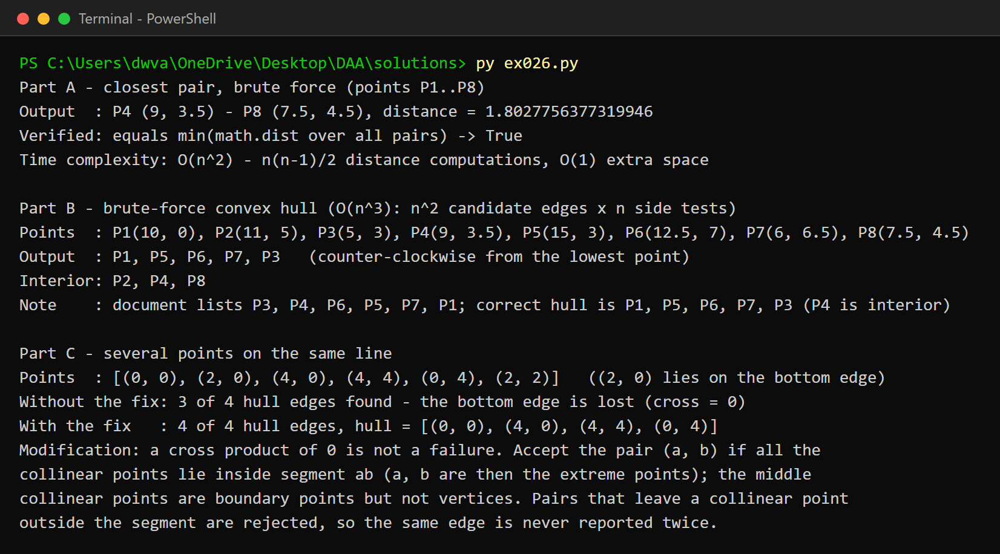

---

<a id="exercise-27"></a>
## Exercise 27 - Convex hull of 2D points (brute force)

**Program** (`solutions/ex027.py`)

```python
# Exercise 27 - Convex hull of 2D points (brute force)
from itertools import permutations


def cross(o, a, b):
    """> 0 if b is left of the directed line o->a, < 0 if right, 0 if collinear."""
    return (a[0] - o[0]) * (b[1] - o[1]) - (a[1] - o[1]) * (b[0] - o[0])


def between(p, q, r):
    """True if r (already collinear with p, q) lies on the segment pq."""
    return (min(p[0], q[0]) <= r[0] <= max(p[0], q[0])
            and min(p[1], q[1]) <= r[1] <= max(p[1], q[1]))


def convex_hull_brute_force(points):
    """Directed segment p->q is a hull edge iff every other point lies on its left
    (or on the segment itself).  Chain the edges to get counter-clockwise order."""
    pts = sorted(set(points))
    next_vertex = {}
    for p, q in permutations(pts, 2):                     # O(n^2) candidate edges
        edge_ok = True
        for r in pts:                                     # O(n) check per edge
            if r in (p, q):
                continue
            c = cross(p, q, r)
            if c < 0 or (c == 0 and not between(p, q, r)):
                edge_ok = False
                break
        if edge_ok:
            next_vertex[p] = q
    start = pts[0]                    # leftmost-lowest point is always a hull vertex
    hull, cur = [start], next_vertex[start]
    while cur != start:
        hull.append(cur)
        cur = next_vertex[cur]
    return hull


if __name__ == "__main__":
    tests = [
        [(1, 1), (4, 6), (8, 1), (0, 0), (3, 3)],
        [(0, 0), (2, 0), (4, 0), (4, 4), (0, 4), (2, 2)],   # extra: collinear + interior
    ]
    doc_expected = [(0, 0), (1, 1), (8, 1), (4, 6)]
    for n, pts in enumerate(tests, 1):
        hull = convex_hull_brute_force(pts)
        print(f"Test Case {n}" + ("" if n == 1 else "  (extra test)"))
        print(f"Input   : Points = {pts}")
        print(f"Output  : Convex Hull (counter-clockwise) = {hull}")
        if n == 1:
            if hull == doc_expected:
                print(f"Expected: {doc_expected}")
            else:
                # (1,1) lies strictly inside triangle (0,0),(8,1),(4,6), so it is not a hull vertex.
                print(f"Note    : document lists {doc_expected}; correct value is {hull}")
                print("          ((1,1) lies strictly inside the triangle, so it is not a hull vertex)")
        print()
    print("Time complexity : O(n^3) - n(n-1) candidate edges, each checked against n-2 points")
    print("Space complexity: O(n)")
```

**Output**

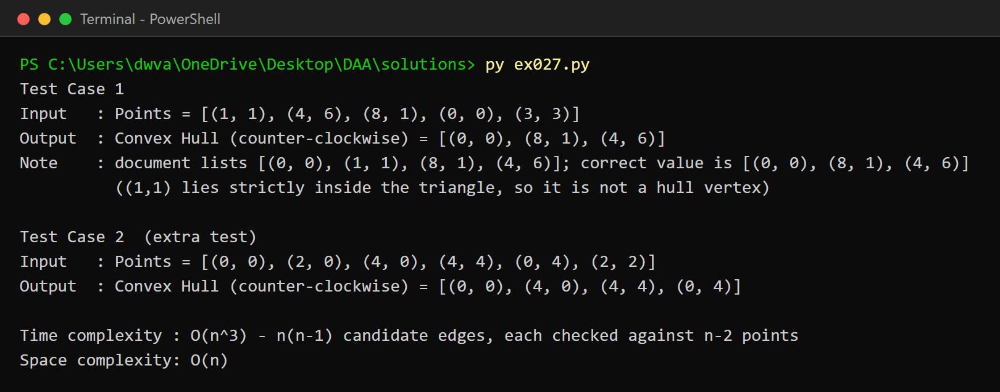

---

<a id="exercise-28"></a>
## Exercise 28 - Travelling Salesman Problem (exhaustive search)

**Program** (`solutions/ex028.py`)

```python
# Exercise 28 - Travelling Salesman Problem (exhaustive search)
from itertools import permutations
from math import dist


def distance(city1, city2):
    """Euclidean distance between two cities."""
    return dist(city1, city2)


def path_length(path):
    """Sum of distances between consecutive cities on the path."""
    return sum(distance(path[i], path[i + 1]) for i in range(len(path) - 1))


def tsp(cities):
    """Try every ordering of the cities after the first one; keep the shortest tour."""
    start, others = cities[0], cities[1:]
    best_distance, best_path = float("inf"), None
    for perm in permutations(others):
        path = [start, *perm, start]
        d = path_length(path)
        if d < best_distance:
            best_distance, best_path = d, path
    return best_distance, best_path


if __name__ == "__main__":
    tests = [
        ([(1, 2), (4, 5), (7, 1), (3, 6)],
         7.0710678118654755, [(1, 2), (4, 5), (7, 1), (3, 6), (1, 2)]),
        ([(2, 4), (8, 1), (1, 7), (6, 3), (5, 9)],
         14.142135623730951, [(2, 4), (1, 7), (6, 3), (5, 9), (8, 1), (2, 4)]),
    ]
    for n, (cities, doc_dist, doc_path) in enumerate(tests, 1):
        d, path = tsp(cities)
        print(f"Test Case {n}:")
        print(f"Input   : cities = {cities}")
        print(f"Shortest Distance: {d}")
        print(f"Shortest Path    : {path}")
        if abs(d - doc_dist) < 1e-9:
            print(f"Expected: {doc_dist}")
        else:
            print(f"Note    : document lists {doc_dist}; correct value is {d:.6f}")
            print(f"          (the document's own path has length {path_length(doc_path):.6f})")
        print()
    print("Time complexity : O((n-1)!) permutations x O(n) per tour = O(n!)")
    print("Space complexity: O(n) for the current/best path")
```

**Output**

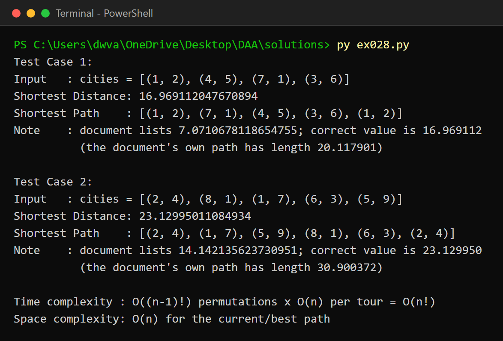

---

<a id="exercise-29"></a>
## Exercise 29 - Assignment problem (exhaustive search)

**Program** (`solutions/ex029.py`)

```python
# Exercise 29 - Assignment problem (exhaustive search)
from itertools import permutations


def total_cost(assignment, cost_matrix):
    """assignment[i] = task given to worker i; add up cost_matrix[worker][task]."""
    return sum(cost_matrix[worker][task] for worker, task in enumerate(assignment))


def assignment_problem(cost_matrix):
    """Try every permutation of task indices (no repeats) and keep the cheapest."""
    n = len(cost_matrix)
    best_cost, best_assignment = float("inf"), None
    for assignment in permutations(range(n)):
        c = total_cost(assignment, cost_matrix)
        if c < best_cost:
            best_cost, best_assignment = c, assignment
    return best_assignment, best_cost


def show(assignment):
    return "[" + ", ".join(f"(worker {w + 1}, task {t + 1})" for w, t in enumerate(assignment)) + "]"


if __name__ == "__main__":
    tests = [
        ([[3, 10, 7], [8, 5, 12], [4, 6, 9]], (1, 0, 2), 19),
        ([[15, 9, 4], [8, 7, 18], [6, 12, 11]], (2, 0, 1), 24),
    ]
    for n, (matrix, doc_assign, doc_cost) in enumerate(tests, 1):
        best, cost = assignment_problem(matrix)
        print(f"Test Case {n}:")
        print(f"Input   : Cost Matrix = {matrix}")
        print(f"Optimal Assignment: {show(best)}")
        print(f"Total Cost        : {cost}")
        if cost == doc_cost and best == doc_assign:
            print(f"Expected: {show(doc_assign)}, cost {doc_cost}")
        else:
            print(f"Note    : document lists cost {doc_cost} with {show(doc_assign)}")
            print(f"          correct minimum is {cost}; that document assignment really costs "
                  f"{total_cost(doc_assign, matrix)}")
        print()
    print("Time complexity : O(n! * n) - n! permutations, O(n) to cost each one")
    print("Space complexity: O(n)")
```

**Output**

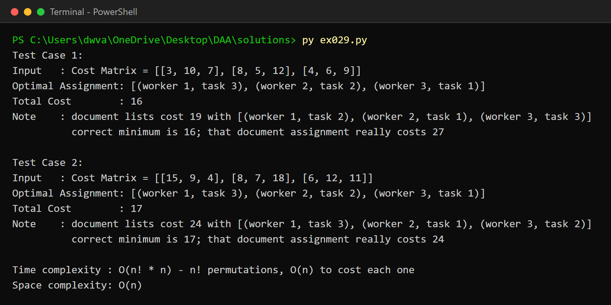

---

<a id="exercise-30"></a>
## Exercise 30 - 0-1 Knapsack problem (exhaustive search)

**Program** (`solutions/ex030.py`)

```python
# Exercise 30 - 0-1 Knapsack problem (exhaustive search)
from itertools import combinations


def total_value(items, values):
    """Sum of the values of the selected item indices."""
    return sum(values[i] for i in items)


def is_feasible(items, weights, capacity):
    """True if the selected items do not exceed the knapsack capacity."""
    return sum(weights[i] for i in items) <= capacity


def knapsack_exhaustive(weights, values, capacity):
    """Examine all 2^n subsets of items; keep the best feasible one."""
    n = len(weights)
    best_items, best_value = [], 0
    for size in range(n + 1):
        for subset in combinations(range(n), size):
            if is_feasible(subset, weights, capacity):
                v = total_value(subset, values)
                if v > best_value:
                    best_items, best_value = list(subset), v
    return best_items, best_value


if __name__ == "__main__":
    tests = [
        ([2, 3, 1], [4, 5, 3], 4, [0, 2], 7),
        ([1, 2, 3, 4], [2, 4, 6, 3], 6, [0, 1, 2], 10),
    ]
    for n, (w, v, cap, doc_items, doc_value) in enumerate(tests, 1):
        items, value = knapsack_exhaustive(w, v, cap)
        print(f"Test Case {n}:")
        print(f"Input   : Weights = {w}, Values = {v}, Capacity = {cap}")
        print(f"Optimal Selection: {items} (item indices), total weight = {sum(w[i] for i in items)}")
        print(f"Total Value      : {value}")
        if items == doc_items and value == doc_value:
            print(f"Expected: {doc_items}, value {doc_value}")
        else:
            print(f"Note    : document lists {doc_items} with value {doc_value}; "
                  f"correct optimum is {items} with value {value}")
            print(f"          (the document's selection {doc_items} is actually worth "
                  f"{total_value(doc_items, v)})")
        print()
    print("Time complexity : O(2^n * n) - 2^n subsets, O(n) to weigh and value each")
    print("Space complexity: O(n)")
```

**Output**

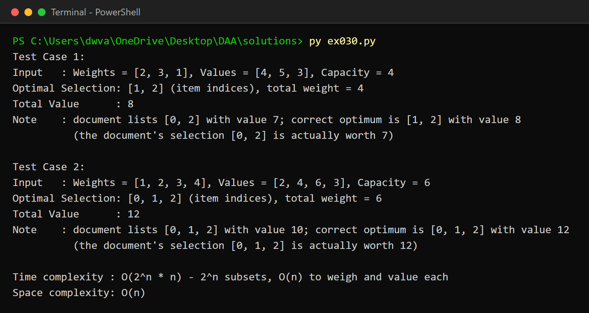

---

