# Topic 3 - Divide and Conquer

[← Back to index](README.md)

- [Exercise 31 - Maximum and minimum of an array (single linear scan)](#exercise-31)
- [Exercise 32 - Maximum and minimum of an array (divide and conquer)](#exercise-32)
- [Exercise 33 - Merge Sort](#exercise-33)
- [Exercise 34 - Merge Sort with a count of comparisons](#exercise-34)
- [Exercise 35 - Quick Sort (first element as pivot) with partition trace](#exercise-35)
- [Exercise 36 - Quick Sort (middle element as pivot) with partition trace](#exercise-36)
- [Exercise 37 - Binary Search with a count of comparisons](#exercise-37)
- [Exercise 38 - Binary Search: mid-point steps, and what happens on unsorted input](#exercise-38)
- [Exercise 39 - K closest points to the origin](#exercise-39)
- [Exercise 40 - 4Sum II: count tuples (i, j, k, l) with A[i] + B[j] + C[k] + D[l] == 0](#exercise-40)
- [Exercise 41 - Median of Medians: k-th smallest element in worst-case O(n)](#exercise-41)
- [Exercise 42 - median_of_medians(arr, k): k-th smallest element (iterative version)](#exercise-42)
- [Exercise 43 - Meet in the Middle: subset whose sum is closest to a target](#exercise-43)
- [Exercise 44 - Meet in the Middle: does any subset sum exactly to E?](#exercise-44)
- [Exercise 45 - Strassen's matrix multiplication for 2x2 matrices (7 multiplications instead of 8)](#exercise-45)
- [Exercise 46 - Karatsuba multiplication of two integers](#exercise-46)

---

<a id="exercise-31"></a>
## Exercise 31 - Maximum and minimum of an array (single linear scan)

**Program** (`solutions/ex031.py`)

```python
# Exercise 31 - Maximum and minimum of an array (single linear scan)


def find_min_max(a):
    """Scan once keeping a running minimum and maximum. Returns (min, max, comparisons)."""
    lo = hi = a[0]
    comparisons = 0
    for x in a[1:]:
        comparisons += 1              # compare x with the current minimum
        if x < lo:
            lo = x
        else:
            comparisons += 1          # x is not a new minimum, so compare with the maximum
            if x > hi:
                hi = x
    return lo, hi, comparisons


if __name__ == "__main__":
    tests = [
        ([5, 7, 3, 4, 9, 12, 6, 2], (2, 12)),
        ([1, 3, 5, 7, 9, 11, 13, 15, 17], (1, 17)),
        ([22, 34, 35, 36, 43, 67, 12, 13, 15, 17], (12, 67)),
    ]
    for n, (arr, (exp_min, exp_max)) in enumerate(tests, 1):
        lo, hi, comps = find_min_max(arr)
        print(f"Test Case {n}")
        print(f"Input   : N = {len(arr)}, a[] = {arr}")
        print(f"Output  : Min = {lo}, Max = {hi}   (comparisons made: {comps})")
        print(f"Expected: Min = {exp_min}, Max = {exp_max}   -> {'match' if (lo, hi) == (exp_min, exp_max) else 'MISMATCH'}")
        print()
    print("Time complexity : O(n) - at most 2(n-1) comparisons; Space complexity: O(1)")
```

**Output**

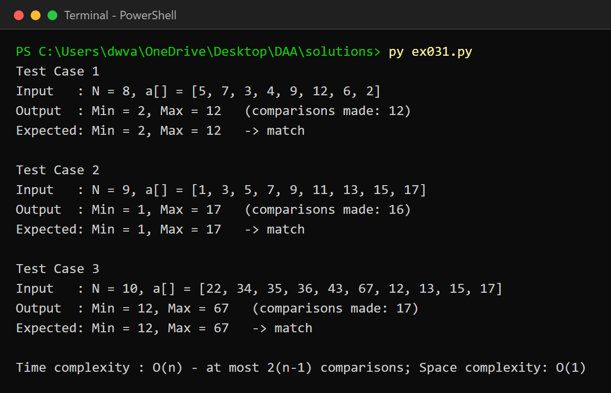

---

<a id="exercise-32"></a>
## Exercise 32 - Maximum and minimum of an array (divide and conquer)

**Program** (`solutions/ex032.py`)

```python
# Exercise 32 - Maximum and minimum of an array (divide and conquer)


def min_max_divide_conquer(a, lo, hi, counter):
    """Split the array in halves, solve each half, then combine with 2 comparisons.
    counter[0] counts element comparisons."""
    if lo == hi:                                    # one element: it is both min and max
        return a[lo], a[lo]
    if hi == lo + 1:                                # two elements: one comparison
        counter[0] += 1
        return (a[lo], a[hi]) if a[lo] < a[hi] else (a[hi], a[lo])
    mid = (lo + hi) // 2
    lmin, lmax = min_max_divide_conquer(a, lo, mid, counter)
    rmin, rmax = min_max_divide_conquer(a, mid + 1, hi, counter)
    counter[0] += 2                                 # compare the mins, compare the maxes
    return (lmin if lmin < rmin else rmin), (lmax if lmax > rmax else rmax)


if __name__ == "__main__":
    tests = [
        ([2, 4, 6, 8, 10, 12, 14, 18], (2, 18)),
        ([11, 13, 15, 17, 19, 21, 23, 35, 37], (11, 37)),
        ([22, 34, 35, 36, 43, 67, 12, 13, 15, 17], (12, 67)),
    ]
    for n, (arr, expected) in enumerate(tests, 1):
        counter = [0]
        lo, hi = min_max_divide_conquer(arr, 0, len(arr) - 1, counter)
        print(f"Test Case {n}")
        print(f"Input   : N = {len(arr)}, a[] = {arr}  (sorted: {arr == sorted(arr)})")
        print(f"Output  : Min = {lo}, Max = {hi}   (comparisons made: {counter[0]}, "
              f"naive scan needs up to {2 * (len(arr) - 1)})")
        print(f"Expected: Min = {expected[0]}, Max = {expected[1]}   -> "
              f"{'match' if (lo, hi) == expected else 'MISMATCH'}")
        print()
    print("Recurrence      : T(n) = 2T(n/2) + 2, T(2) = 1  ->  about 3n/2 - 2 comparisons")
    print("Time complexity : O(n); Space complexity: O(log n) recursion stack")
    print("Remark          : for an already sorted array min = a[0], max = a[n-1] in O(1);")
    print("                  the divide & conquer version also works for unsorted input (test 3).")
```

**Output**

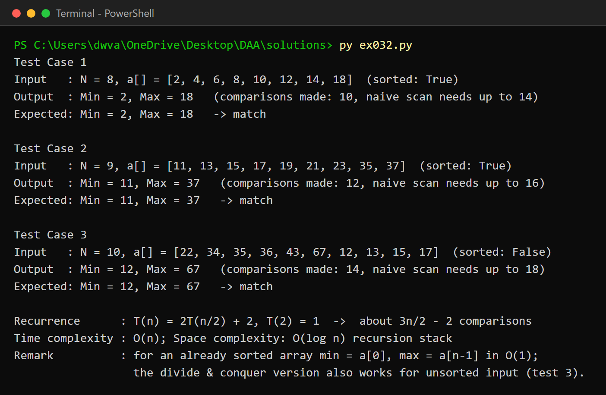

---

<a id="exercise-33"></a>
## Exercise 33 - Merge Sort

**Program** (`solutions/ex033.py`)

```python
# Exercise 33 - Merge Sort


def merge(left, right):
    """Merge two sorted lists into one sorted list."""
    result, i, j = [], 0, 0
    while i < len(left) and j < len(right):
        if left[i] <= right[j]:
            result.append(left[i])
            i += 1
        else:
            result.append(right[j])
            j += 1
    return result + left[i:] + right[j:]


def merge_sort(a):
    """Divide into halves, sort each recursively, then merge."""
    if len(a) <= 1:
        return a
    mid = len(a) // 2
    return merge(merge_sort(a[:mid]), merge_sort(a[mid:]))


if __name__ == "__main__":
    tests = [
        [31, 23, 35, 27, 11, 21, 15, 28],
        [22, 34, 25, 36, 43, 67, 52, 13, 65, 17],
    ]
    expected = [
        [11, 15, 21, 23, 27, 28, 31, 35],
        [13, 17, 22, 25, 34, 36, 43, 52, 65, 67],
    ]
    for n, (arr, exp) in enumerate(zip(tests, expected), 1):
        result = merge_sort(arr)
        print(f"Test Case {n}")
        print(f"Input   : N = {len(arr)}, a[] = {arr}")
        print(f"Output  : {','.join(map(str, result))}")
        print(f"Expected: {','.join(map(str, exp))}   -> {'match' if result == exp else 'MISMATCH'}")
        print()
    print("Time complexity : O(n log n) in best, average and worst case (T(n) = 2T(n/2) + O(n))")
    print("Space complexity: O(n) for the temporary merged lists")
```

**Output**

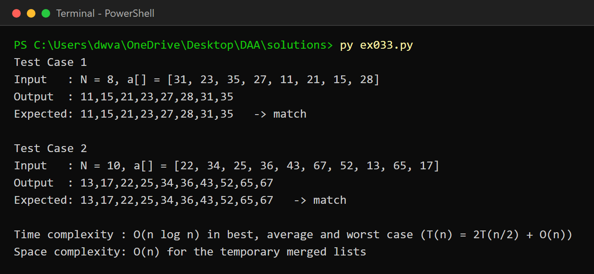

---

<a id="exercise-34"></a>
## Exercise 34 - Merge Sort with a count of comparisons

**Program** (`solutions/ex034.py`)

```python
# Exercise 34 - Merge Sort with a count of comparisons


def merge(left, right, counter):
    """Merge two sorted lists; counter[0] counts every element-to-element comparison."""
    result, i, j = [], 0, 0
    while i < len(left) and j < len(right):
        counter[0] += 1
        if left[i] <= right[j]:
            result.append(left[i])
            i += 1
        else:
            result.append(right[j])
            j += 1
    return result + left[i:] + right[j:]


def merge_sort(a, counter):
    if len(a) <= 1:
        return a
    mid = len(a) // 2
    return merge(merge_sort(a[:mid], counter), merge_sort(a[mid:], counter), counter)


if __name__ == "__main__":
    tests = [
        ([12, 4, 78, 23, 45, 67, 89, 1], [1, 4, 12, 23, 45, 67, 78, 89]),
        ([38, 27, 43, 3, 9, 82, 10], [3, 9, 10, 27, 38, 43, 82]),
    ]
    for n, (arr, expected) in enumerate(tests, 1):
        counter = [0]
        result = merge_sort(arr, counter)
        print(f"Test Case {n}")
        print(f"Input   : N = {len(arr)}, a[] = {arr}")
        print(f"Output  : {','.join(map(str, result))}")
        print(f"Expected: {','.join(map(str, expected))}   -> {'match' if result == expected else 'MISMATCH'}")
        print(f"Number of comparisons: {counter[0]}")
        print()
    print("For n a power of 2 the count lies between (n/2)*log2(n) (best) and n*log2(n) - n + 1 (worst),")
    print("so merge sort always needs Theta(n log n) comparisons.")
```

**Output**

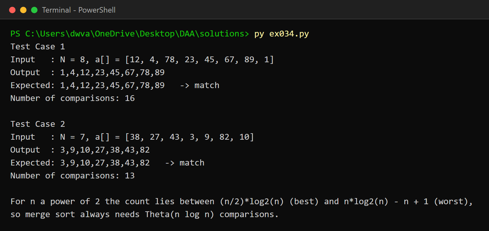

---

<a id="exercise-35"></a>
## Exercise 35 - Quick Sort (first element as pivot) with partition trace

**Program** (`solutions/ex035.py`)

```python
# Exercise 35 - Quick Sort (first element as pivot) with partition trace


def partition_first_pivot(a, lo, hi):
    """Pivot = a[lo]. i scans right for an element > pivot, j scans left for one <= pivot;
    swap them, repeat, finally put the pivot at position j. Returns j."""
    pivot, i, j = a[lo], lo + 1, hi
    while True:
        while i <= j and a[i] <= pivot:
            i += 1
        while i <= j and a[j] > pivot:
            j -= 1
        if i > j:
            break
        a[i], a[j] = a[j], a[i]
    a[lo], a[j] = a[j], a[lo]
    return j


def quick_sort(a, lo, hi, depth=0):
    if lo >= hi:
        return
    pivot = a[lo]
    p = partition_first_pivot(a, lo, hi)
    print(f"{'  ' * depth}QS[{lo}..{hi}] pivot={pivot:<3} placed at index {p} -> {a}")
    quick_sort(a, lo, p - 1, depth + 1)       # left part: elements <= pivot
    quick_sort(a, p + 1, hi, depth + 1)       # right part: elements > pivot


if __name__ == "__main__":
    tests = [
        [10, 16, 8, 12, 15, 6, 3, 9, 5],
        [12, 4, 78, 23, 45, 67, 89, 1],
        [38, 27, 43, 3, 9, 82, 10],
    ]
    for n, arr in enumerate(tests, 1):
        a = arr[:]
        print(f"Test Case {n}")
        print(f"Input   : N = {len(a)}, a[] = {a}")
        print("Array after each partition (indented = deeper recursive call):")
        quick_sort(a, 0, len(a) - 1)
        print(f"Output  : {','.join(map(str, a))}")
        print(f"Expected: {','.join(map(str, sorted(arr)))}   -> {'match' if a == sorted(arr) else 'MISMATCH'}")
        print()
    print("Time complexity : average/best O(n log n), worst case O(n^2) (already sorted input)")
    print("Space complexity: O(log n) average recursion stack (in-place partitioning)")
```

**Output**

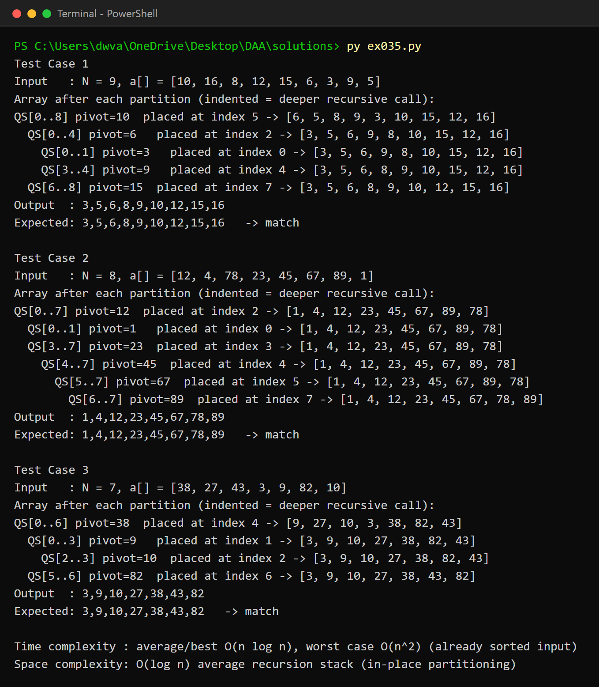

---

<a id="exercise-36"></a>
## Exercise 36 - Quick Sort (middle element as pivot) with partition trace

**Program** (`solutions/ex036.py`)

```python
# Exercise 36 - Quick Sort (middle element as pivot) with partition trace


def partition_middle_pivot(a, lo, hi):
    """Move the middle element to the front, then partition around it.
    Returns the final index of the pivot."""
    mid = (lo + hi) // 2
    a[lo], a[mid] = a[mid], a[lo]
    pivot, i, j = a[lo], lo + 1, hi
    while True:
        while i <= j and a[i] <= pivot:
            i += 1
        while i <= j and a[j] > pivot:
            j -= 1
        if i > j:
            break
        a[i], a[j] = a[j], a[i]
    a[lo], a[j] = a[j], a[lo]
    return j


def quick_sort(a, lo, hi, depth=0):
    if lo >= hi:
        return
    pivot = a[(lo + hi) // 2]
    p = partition_middle_pivot(a, lo, hi)
    print(f"{'  ' * depth}QS[{lo}..{hi}] pivot={pivot:<3} placed at index {p} -> {a}")
    quick_sort(a, lo, p - 1, depth + 1)       # left part: elements <= pivot
    quick_sort(a, p + 1, hi, depth + 1)       # right part: elements > pivot


if __name__ == "__main__":
    tests = [
        [19, 72, 35, 46, 58, 91, 22, 31],
        [31, 23, 35, 27, 11, 21, 15, 28],
        [22, 34, 25, 36, 43, 67, 52, 13, 65, 17],
    ]
    for n, arr in enumerate(tests, 1):
        a = arr[:]
        print(f"Test Case {n}")
        print(f"Input   : N = {len(a)}, a[] = {a}")
        print("Array after each partition (indented = deeper recursive call):")
        quick_sort(a, 0, len(a) - 1)
        print(f"Output  : {','.join(map(str, a))}")
        print(f"Expected: {','.join(map(str, sorted(arr)))}   -> {'match' if a == sorted(arr) else 'MISMATCH'}")
        print()
    print("Time complexity : average/best O(n log n); worst case O(n^2) but a middle pivot avoids it")
    print("                  for sorted / reverse-sorted input. Space complexity: O(log n) stack")
```

**Output**

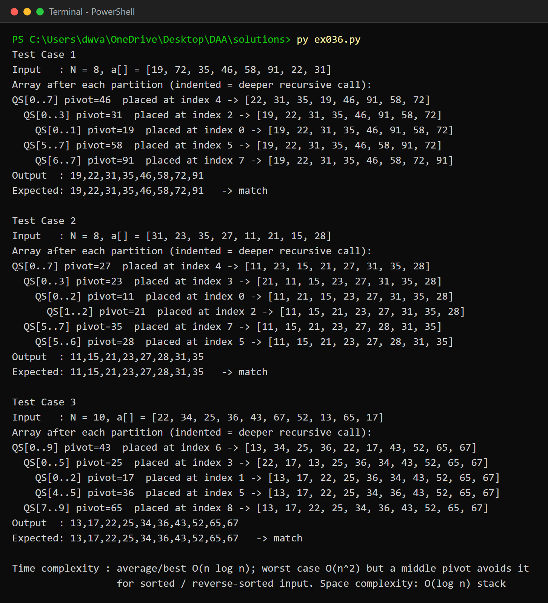

---

<a id="exercise-37"></a>
## Exercise 37 - Binary Search with a count of comparisons

**Program** (`solutions/ex037.py`)

```python
# Exercise 37 - Binary Search with a count of comparisons


def binary_search(a, key):
    """Iterative binary search on a sorted list.
    Returns (index or -1, comparisons); one key-vs-a[mid] comparison is counted per probe."""
    low, high, comparisons = 0, len(a) - 1, 0
    while low <= high:
        mid = (low + high) // 2
        comparisons += 1
        if a[mid] == key:
            return mid, comparisons
        if a[mid] < key:
            low = mid + 1
        else:
            high = mid - 1
    return -1, comparisons


if __name__ == "__main__":
    tests = [
        ([5, 10, 15, 20, 25, 30, 35, 40, 45], 20, 4),
        ([10, 20, 30, 40, 50, 60], 50, 5),
        ([21, 32, 40, 54, 65, 76, 87], 32, 2),
    ]
    for n, (arr, key, expected_pos) in enumerate(tests, 1):
        index, comps = binary_search(arr, key)
        print(f"Test Case {n}")
        print(f"Input   : N = {len(arr)}, a[] = {arr}, search key = {key}")
        print(f"Output  : index (0-based) = {index}, position (1-based) = {index + 1}")
        print(f"Expected: {expected_pos} (the document counts positions from 1)   -> "
              f"{'match' if index + 1 == expected_pos else 'MISMATCH'}")
        print(f"Number of comparisons: {comps}")
        print()
    print("Time complexity : O(log n) - the search range halves each step (worst case ~ log2(n)+1 comparisons)")
    print("Space complexity: O(1) for the iterative version")
```

**Output**

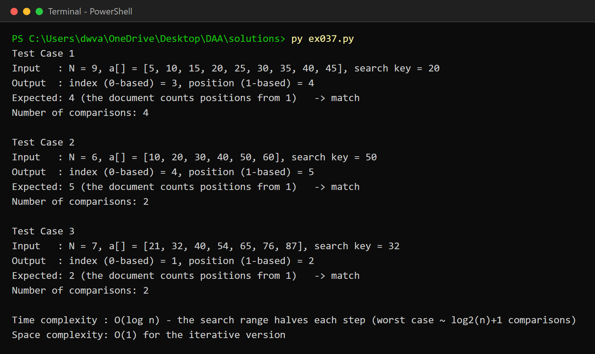

---

<a id="exercise-38"></a>
## Exercise 38 - Binary Search: mid-point steps, and what happens on unsorted input

**Program** (`solutions/ex038.py`)

```python
# Exercise 38 - Binary Search: mid-point steps, and what happens on unsorted input


def binary_search_steps(a, key):
    """Binary search that prints every mid-point calculation. Returns the 0-based index or -1."""
    low, high, step = 0, len(a) - 1, 0
    while low <= high:
        step += 1
        mid = (low + high) // 2
        line = f"  Step {step}: low={low} high={high} mid=({low}+{high})//2={mid} a[{mid}]={a[mid]}"
        if a[mid] == key:
            print(line + f" == {key} -> found")
            return mid
        if a[mid] < key:
            print(line + f" < {key} -> go right, low={mid + 1}")
            low = mid + 1
        else:
            print(line + f" > {key} -> go left, high={mid - 1}")
            high = mid - 1
    print(f"  Stop: low={low} > high={high} -> not found")
    return -1


if __name__ == "__main__":
    tests = [
        ([3, 9, 14, 19, 25, 31, 42, 47, 53], 31, 6),
        ([13, 19, 24, 29, 35, 41, 42], 42, 7),
        ([20, 40, 60, 80, 100, 120], 60, 3),
    ]
    for n, (arr, key, expected_pos) in enumerate(tests, 1):
        print(f"Test Case {n}")
        print(f"Input   : N = {len(arr)}, a[] = {arr}, search key = {key}")
        index = binary_search_steps(arr, key)
        print(f"Output  : index (0-based) = {index}, position (1-based) = {index + 1}")
        print(f"Expected: {expected_pos} (positions counted from 1)   -> "
              f"{'match' if index + 1 == expected_pos else 'MISMATCH'}")
        print()
    # What if the array is NOT sorted?  Same numbers, shuffled (fixed order, deterministic).
    shuffled = [25, 9, 47, 3, 53, 14, 31, 42, 19]
    print(f"Unsorted demo: a[] = {shuffled}, search key = 31  (31 IS present at index {shuffled.index(31)})")
    result = binary_search_steps(shuffled, 31)
    print(f"  Binary search result: {result}  -> wrong, it reports 'not found' for an element that exists")
    print("Impact on correctness : each step discards half the array assuming a[mid] < key means the key")
    print("  is on the right; without sorting that assumption fails, so the key can be thrown away")
    print("  (false 'not found'); the answer cannot be trusted.")
    print("Impact on performance : it still takes O(log n) steps but gives a wrong answer. To be correct on")
    print("  unsorted data use linear search O(n), or sort first O(n log n) and then search O(log n).")
```

**Output**

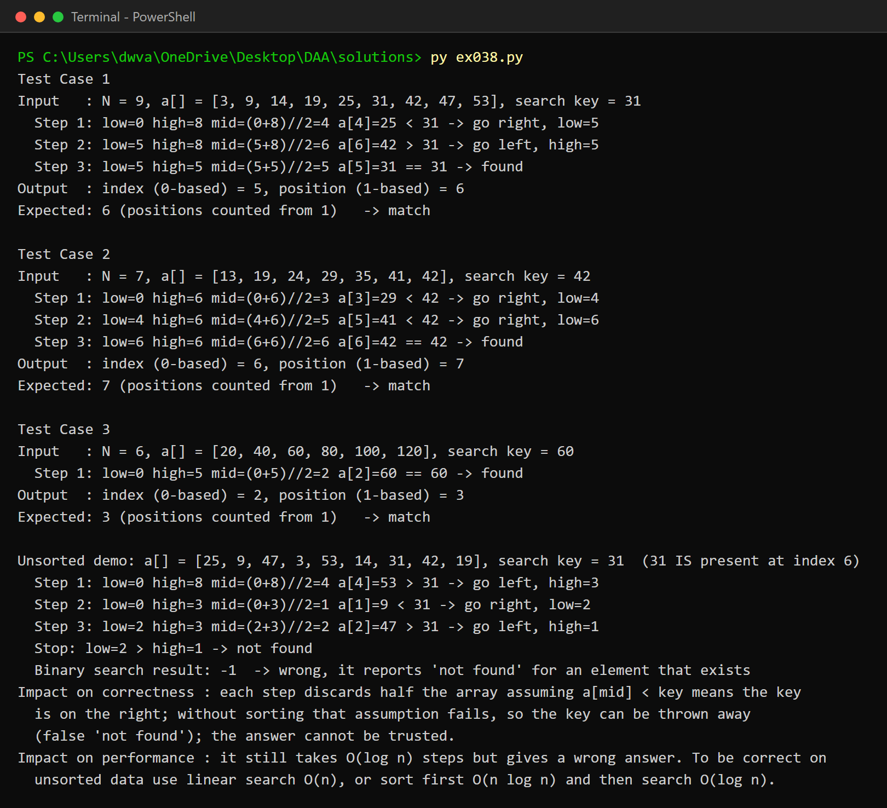

---

<a id="exercise-39"></a>
## Exercise 39 - K closest points to the origin

**Program** (`solutions/ex039.py`)

```python
# Exercise 39 - K closest points to the origin
import heapq


def k_closest(points, k):
    """Keep a max-heap of size k holding the k smallest squared distances seen so far.
    Squared distance is enough for comparing (no square root needed)."""
    heap = []                                        # entries: (-squared_distance, point)
    for x, y in points:
        d = x * x + y * y
        if len(heap) < k:
            heapq.heappush(heap, (-d, [x, y]))
        elif d < -heap[0][0]:                        # closer than the farthest kept point
            heapq.heapreplace(heap, (-d, [x, y]))
    return [p for _, p in sorted(heap, reverse=True)]    # nearest first


if __name__ == "__main__":
    tests = [
        ([[1, 3], [-2, 2], [5, 8], [0, 1]], 2, [[-2, 2], [0, 1]]),
        ([[1, 3], [-2, 2]], 1, [[-2, 2]]),
        ([[3, 3], [5, -1], [-2, 4]], 2, [[3, 3], [-2, 4]]),
    ]
    for n, (points, k, expected) in enumerate(tests, 1):
        result = k_closest(points, k)
        same = sorted(result) == sorted(expected)
        print(f"Test Case {n}")
        print(f"Input   : points = {points}, k = {k}")
        print("Squared distances: " + ", ".join(f"{p}->{p[0] ** 2 + p[1] ** 2}" for p in points))
        print(f"Output  : {result}   (nearest first)")
        print(f"Expected: {expected}   -> {'same points (order does not matter)' if same else 'MISMATCH'}")
        print()
    print("Time complexity : O(n log k) - each of the n points costs one O(log k) heap operation")
    print("Space complexity: O(k) for the heap")
```

**Output**

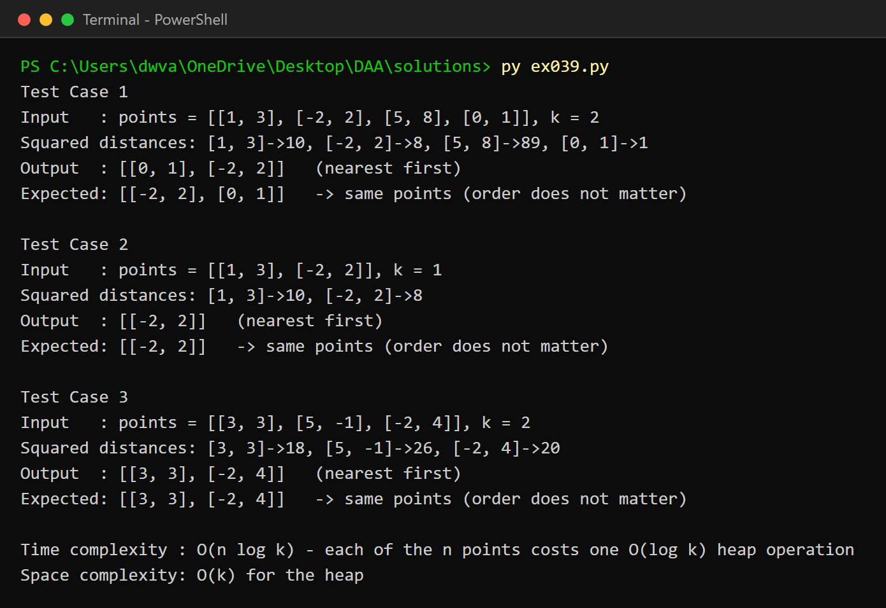

---

<a id="exercise-40"></a>
## Exercise 40 - 4Sum II: count tuples (i, j, k, l) with A[i] + B[j] + C[k] + D[l] == 0

**Program** (`solutions/ex040.py`)

```python
# Exercise 40 - 4Sum II: count tuples (i, j, k, l) with A[i] + B[j] + C[k] + D[l] == 0
from collections import defaultdict


def four_sum_zero_tuples(A, B, C, D):
    """Meet in the middle: hash every pair (i, j) by A[i]+B[j], then look up -(C[k]+D[l])."""
    pair_sums = defaultdict(list)
    for i, a in enumerate(A):
        for j, b in enumerate(B):
            pair_sums[a + b].append((i, j))
    tuples = []
    for k, c in enumerate(C):
        for l, d in enumerate(D):
            for i, j in pair_sums.get(-(c + d), []):
                tuples.append((i, j, k, l))
    return tuples


def run_case(number, A, B, C, D, expected):
    tuples = four_sum_zero_tuples(A, B, C, D)
    print(f"Test Case {number}")
    print(f"Input   : A = {A}, B = {B}, C = {C}, D = {D}")
    print(f"Output  : {len(tuples)}")
    print(f"Expected: {expected}")
    for i, j, k, l in tuples:
        print(f"  tuple ({i}, {j}, {k}, {l}): {A[i]} + {B[j]} + {C[k]} + {D[l]} = "
              f"{A[i] + B[j] + C[k] + D[l]}")
    print()


if __name__ == "__main__":
    run_case(1, [1, 2], [-2, -1], [-1, 2], [0, 2], 2)
    run_case(2, [0], [0], [0], [0], 1)
    print("Complexity: O(n^2) time and O(n^2) space (instead of O(n^4) for four nested loops).")
```

**Output**

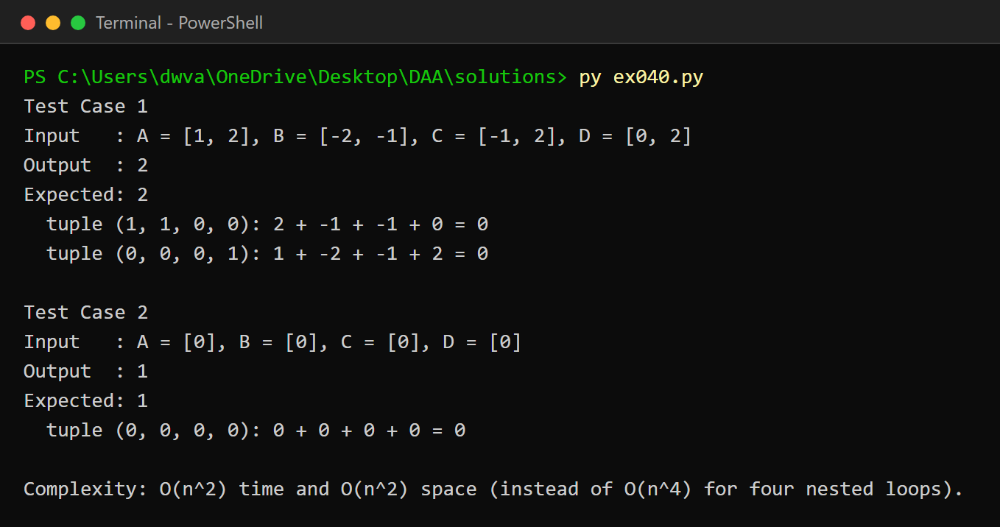

---

<a id="exercise-41"></a>
## Exercise 41 - Median of Medians: k-th smallest element in worst-case O(n)

**Program** (`solutions/ex041.py`)

```python
# Exercise 41 - Median of Medians: k-th smallest element in worst-case O(n)


def insertion_sort(items):
    """Sort a tiny list (at most 5 elements) - constant work per group."""
    items = list(items)
    for i in range(1, len(items)):
        key, j = items[i], i - 1
        while j >= 0 and items[j] > key:
            items[j + 1] = items[j]
            j -= 1
        items[j + 1] = key
    return items


def select(a, i):
    """Return the i-th smallest (0-based) element of list a."""
    if len(a) <= 5:
        return insertion_sort(a)[i]
    # 1) split into groups of 5 and take the median of each group
    medians = [insertion_sort(a[g:g + 5])[len(a[g:g + 5]) // 2] for g in range(0, len(a), 5)]
    # 2) the pivot is the median of those medians (found recursively)
    pivot = select(medians, (len(medians) - 1) // 2)
    # 3) partition around the pivot and recurse into one side only
    low = [x for x in a if x < pivot]
    equal = [x for x in a if x == pivot]
    high = [x for x in a if x > pivot]
    if i < len(low):
        return select(low, i)
    if i < len(low) + len(equal):
        return pivot
    return select(high, i - len(low) - len(equal))


def kth_smallest(arr, k):
    """k is 1-based (k = 1 is the minimum)."""
    return select(list(arr), k - 1)


if __name__ == "__main__":
    cases = [([12, 3, 5, 7, 19], 2, 5),
             ([12, 3, 5, 7, 4, 19, 26], 3, 5),
             ([1, 2, 3, 4, 5, 6, 7, 8, 9, 10], 6, 6)]
    for n, (arr, k, expected) in enumerate(cases, 1):
        print(f"Test Case {n}")
        print(f"Input   : arr = {arr}, k = {k}")
        print(f"Output  : {kth_smallest(arr, k)}")
        print(f"Expected: {expected}")
        print()
    print("Why worst-case O(n): the median of medians is larger than at least 30% and smaller than")
    print("at least 30% of the elements, so T(n) <= T(n/5) + T(7n/10) + O(n) = O(n).")
```

**Output**

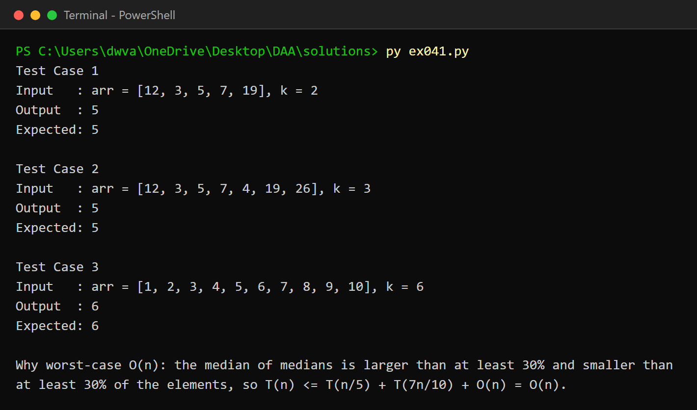

---

<a id="exercise-42"></a>
## Exercise 42 - median_of_medians(arr, k): k-th smallest element (iterative version)

**Program** (`solutions/ex042.py`)

```python
# Exercise 42 - median_of_medians(arr, k): k-th smallest element (iterative version)


def median_of_five(group):
    """Median of a list of at most 5 numbers (selection of the middle by counting)."""
    for x in group:
        smaller = sum(1 for y in group if y < x)
        equal = sum(1 for y in group if y == x)
        if smaller <= (len(group) - 1) // 2 < smaller + equal:
            return x


def choose_pivot(arr):
    """Pivot = median of the medians of the groups of 5 (recursive call on the medians)."""
    if len(arr) <= 5:
        return median_of_five(arr)
    medians = [median_of_five(arr[i:i + 5]) for i in range(0, len(arr), 5)]
    return median_of_medians(medians, (len(medians) + 1) // 2)


def median_of_medians(arr, k):
    """Return the k-th smallest element (k is 1-based) of an unsorted array."""
    arr = list(arr)
    while True:
        if len(arr) == 1:
            return arr[0]
        pivot = choose_pivot(arr)
        low = [x for x in arr if x < pivot]
        equal = [x for x in arr if x == pivot]
        if k <= len(low):                       # answer lies among the smaller elements
            arr = low
        elif k <= len(low) + len(equal):        # the pivot itself is the answer
            return pivot
        else:                                   # answer lies among the larger elements
            k -= len(low) + len(equal)
            arr = [x for x in arr if x > pivot]


if __name__ == "__main__":
    cases = [([1, 2, 3, 4, 5, 6, 7, 8, 9, 10], 6),
             ([23, 17, 31, 44, 55, 21, 20, 18, 19, 27], 5)]
    for n, (arr, k) in enumerate(cases, 1):
        result = median_of_medians(arr, k)
        print(f"Test Case {n}")
        print(f"Input   : arr = {arr}, k = {k}")
        print(f"Output  : {result}")
        print(f"Check   : sorted(arr) = {sorted(arr)} -> element number {k} is {sorted(arr)[k - 1]}")
        print()
    print("Time: O(n) worst case (pivot always discards >= 30% of the elements). Extra space: O(n).")
```

**Output**

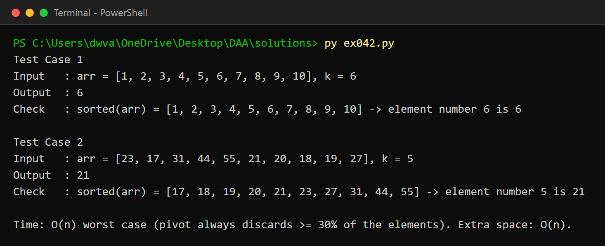

---

<a id="exercise-43"></a>
## Exercise 43 - Meet in the Middle: subset whose sum is closest to a target

**Program** (`solutions/ex043.py`)

```python
# Exercise 43 - Meet in the Middle: subset whose sum is closest to a target
from bisect import bisect_left


def all_subset_sums(items):
    """List of (sum, subset) for every subset of items (2^len(items) entries)."""
    result = [(0, [])]
    for x in items:
        result += [(s + x, sub + [x]) for s, sub in result]
    return result


def closest_subset_sum(nums, target):
    """Split the array in two halves, enumerate each half, then combine with binary search."""
    mid = len(nums) // 2
    left = all_subset_sums(nums[:mid])
    right = sorted(all_subset_sums(nums[mid:]), key=lambda p: p[0])
    right_sums = [s for s, _ in right]
    best = {}                                    # candidate total -> subset achieving it
    for s, sub in left:
        i = bisect_left(right_sums, target - s)  # right sum just >= target - s
        for j in (i - 1, i):                     # check it and its predecessor
            if 0 <= j < len(right):
                best.setdefault(s + right_sums[j], sub + right[j][1])
    gap = min(abs(total - target) for total in best)
    ties = sorted(t for t in best if abs(t - target) == gap)
    return ties[0], best[ties[0]], ties


if __name__ == "__main__":
    cases = [([45, 34, 4, 12, 5, 2], 42), ([1, 3, 2, 7, 4, 6], 10)]
    for n, (nums, target) in enumerate(cases, 1):
        total, subset, ties = closest_subset_sum(nums, target)
        print(f"Test Case {'ab'[n - 1]})")
        print(f"Input   : Set = {nums}, target = {target}")
        print(f"Output  : closest sum = {total}, subset = {subset}, difference = {abs(total - target)}")
        if len(ties) > 1:
            print(f"Note    : sums {ties} are equally close to {target}; the smaller one is reported")
        print()
    print("Time: O(n * 2^(n/2)) (two halves of 2^(n/2) sums, sort + binary search); space: O(2^(n/2)).")
    print("Brute force over all subsets would need O(2^n).")
```

**Output**

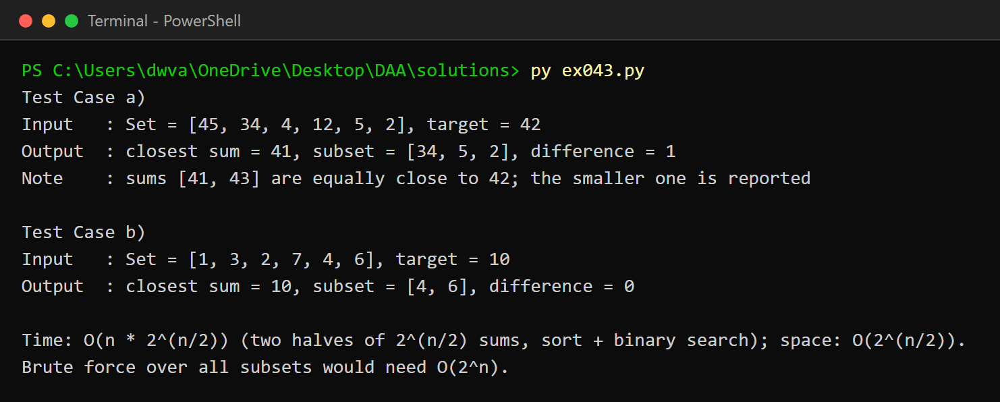

---

<a id="exercise-44"></a>
## Exercise 44 - Meet in the Middle: does any subset sum exactly to E?

**Program** (`solutions/ex044.py`)

```python
# Exercise 44 - Meet in the Middle: does any subset sum exactly to E?


def subset_sums_with_subsets(items):
    """Dictionary {sum: one subset that gives it} for all subsets of items."""
    sums = {0: []}
    for x in items:
        for s, sub in list(sums.items()):
            sums.setdefault(s + x, sub + [x])
    return sums


def subset_with_exact_sum(nums, exact):
    """Return (True, subset) or (False, None) using meet in the middle."""
    mid = len(nums) // 2
    left = subset_sums_with_subsets(nums[:mid])
    right = subset_sums_with_subsets(nums[mid:])
    for s, sub in left.items():
        if exact - s in right:               # O(1) hash lookup for the complementary half
            return True, sub + right[exact - s]
    return False, None


if __name__ == "__main__":
    cases = [("a", [1, 3, 9, 2, 7, 12], 15), ("b", [3, 34, 4, 12, 5, 2], 15)]
    for label, nums, exact in cases:
        found, subset = subset_with_exact_sum(nums, exact)
        print(f"Test Case {label})")
        print(f"Input   : E = {nums}, exact sum = {exact}")
        print(f"Output  : {found}")
        if found:
            print(f"Subset  : {subset} -> sum = {sum(subset)}")
        print()
    # A case with answer False, to show the other branch of the algorithm
    found, _ = subset_with_exact_sum([3, 34, 4, 12, 5, 2], 100)
    print(f"Extra   : E = [3, 34, 4, 12, 5, 2], exact sum = 100 -> {found}")
    print()
    print("Time: O(n * 2^(n/2)) worst case, space: O(2^(n/2)); naive subset enumeration is O(2^n).")
```

**Output**

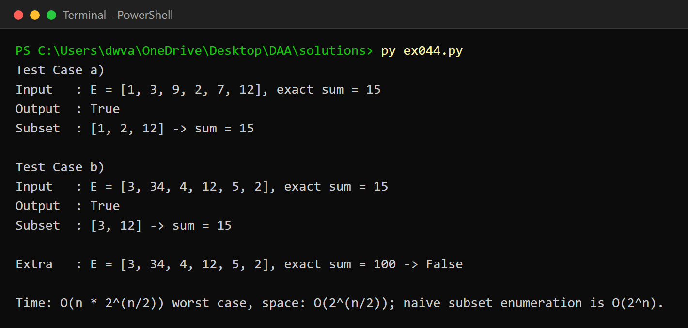

---

<a id="exercise-45"></a>
## Exercise 45 - Strassen's matrix multiplication for 2x2 matrices (7 multiplications instead of 8)

**Program** (`solutions/ex045.py`)

```python
# Exercise 45 - Strassen's matrix multiplication for 2x2 matrices (7 multiplications instead of 8)


def strassen_2x2(A, B):
    """Return (C, [M1..M7]) where C = A x B computed with Strassen's seven products."""
    (a, b), (c, d) = A
    (e, f), (g, h) = B
    m1 = (a + d) * (e + h)
    m2 = (c + d) * e
    m3 = a * (f - h)
    m4 = d * (g - e)
    m5 = (a + b) * h
    m6 = (c - a) * (e + f)
    m7 = (b - d) * (g + h)
    C = [[m1 + m4 - m5 + m7, m3 + m5],
         [m2 + m4, m1 - m2 + m3 + m6]]
    return C, [m1, m2, m3, m4, m5, m6, m7]


def naive_2x2(A, B):
    """Ordinary 8-multiplication product, used only to verify Strassen."""
    return [[sum(A[i][k] * B[k][j] for k in range(2)) for j in range(2)] for i in range(2)]


def run_case(title, A, B, expected=None):
    C, m = strassen_2x2(A, B)
    print(title)
    print(f"Input   : A = {A}, B = {B}")
    print("Strassen: " + ", ".join(f"M{i + 1}={v}" for i, v in enumerate(m)))
    print(f"Output  : C = {C}")
    print(f"Check   : ordinary multiplication gives {naive_2x2(A, B)} -> match = {C == naive_2x2(A, B)}")
    if expected is not None:
        if C == expected:
            print(f"Expected: {expected}")
        else:
            print(f"Note    : document lists {expected}")
            print(f"          correct value is {C} (e.g. C[0][0] = 1*6 + 7*4 = {C[0][0]}, not {expected[0][0]})")
    print()


if __name__ == "__main__":
    run_case("Given matrices (problem statement)", [[1, 7], [3, 5]], [[1, 3], [7, 5]])
    run_case("Test Case 1", [[1, 7], [3, 5]], [[6, 8], [4, 2]], [[18, 14], [62, 66]])
    print("Formulas: C11 = M1+M4-M5+M7, C12 = M3+M5, C21 = M2+M4, C22 = M1-M2+M3+M6")
    print("Complexity: T(n) = 7T(n/2) + O(n^2) = O(n^log2(7)) ~ O(n^2.81) vs O(n^3) for the ordinary method.")
```

**Output**

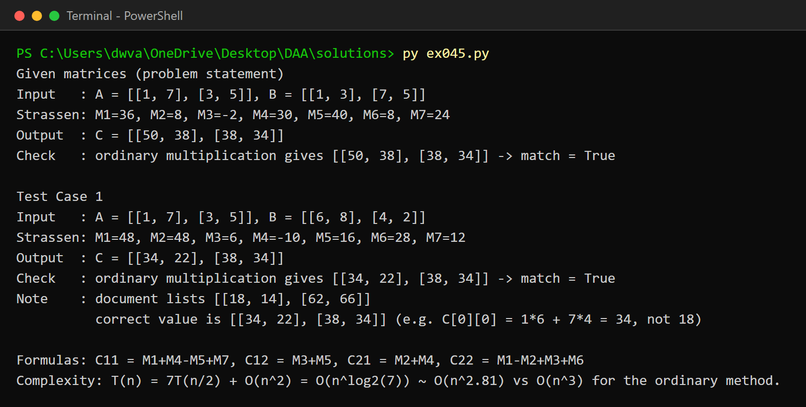

---

<a id="exercise-46"></a>
## Exercise 46 - Karatsuba multiplication of two integers

**Program** (`solutions/ex046.py`)

```python
# Exercise 46 - Karatsuba multiplication of two integers


def karatsuba(x, y, depth=0, trace=False):
    """Multiply x and y with three recursive multiplications instead of four."""
    if x < 10 or y < 10:
        return x * y
    half = max(len(str(x)), len(str(y))) // 2
    p = 10 ** half
    a, b = divmod(x, p)                      # x = a*p + b
    c, d = divmod(y, p)                      # y = c*p + d
    z2 = karatsuba(a, c, depth + 1, trace)           # a*c
    z0 = karatsuba(b, d, depth + 1, trace)           # b*d
    z3 = karatsuba(a + b, c + d, depth + 1, trace)   # (a+b)*(c+d)
    z1 = z3 - z2 - z0                                 # a*d + b*c
    result = z2 * p * p + z1 * p + z0
    if trace and depth == 0:
        print(f"Step 1  : split with p = 10^{half}: a={a}, b={b}, c={c}, d={d}")
        print(f"Step 2  : z2 = a*c = {z2}, z0 = b*d = {z0}, (a+b)*(c+d) = {z3}")
        print(f"Step 3  : z1 = {z3} - {z2} - {z0} = {z1}")
        print(f"Step 4  : z = z2*10^{2 * half} + z1*10^{half} + z0 = {z2 * p * p} + {z1 * p} + {z0}")
    return result


if __name__ == "__main__":
    x, y = 1234, 5678
    print("Test Case 1")
    print(f"Input   : x = {x}, y = {y}")
    z = karatsuba(x, y, trace=True)
    print(f"Output  : z = {x} x {y} = {z}")
    print(f"Check   : built-in multiplication gives {x * y} -> match = {z == x * y}")
    claimed = 7016652
    if z != claimed:
        print(f"Note    : document lists {claimed}; correct value is {z} (the document has a typo)")
    print()
    print("Complexity: T(n) = 3T(n/2) + O(n) = O(n^log2(3)) ~ O(n^1.585) versus O(n^2) for schoolbook.")
```

**Output**

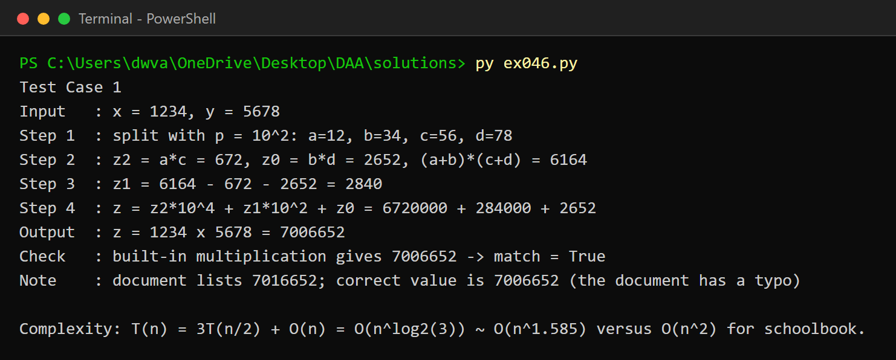

---

