# Topic 4 - Dynamic Programming

[← Back to index](README.md)

- [Exercise 47 - Dice Throw Problem (dynamic programming)](#exercise-47)
- [Exercise 48 - Assembly Line Scheduling (two lines, dynamic programming)](#exercise-48)
- [Exercise 49 - Scheduling on three assembly lines with transfer times and dependencies](#exercise-49)
- [Exercise 50 - Minimum path distance (Travelling Salesperson tour) from a distance matrix](#exercise-50)
- [Exercise 51 - Travelling Salesperson with 4 cities, then a fifth city E is added (brute force)](#exercise-51)
- [Exercise 52 - Longest palindromic substring (expand around each centre, O(n^2))](#exercise-52)
- [Exercise 53 - Longest substring without repeating characters (sliding window)](#exercise-53)
- [Exercise 54 - Word Break (dynamic programming)](#exercise-54)
- [Exercise 55 - Word Break: can the string be segmented? (backtracking with memoization)](#exercise-55)
- [Exercise 56 - Text Justification (greedy line packing)](#exercise-56)
- [Exercise 57 - Prefix and Suffix Search (WordFilter using a trie)](#exercise-57)
- [Exercise 58 - Floyd-Warshall all-pairs shortest paths on a city network](#exercise-58)
- [Exercise 59 - Floyd-Warshall on a 6-router network, with a link failure (B-D)](#exercise-59)
- [Exercise 60 - Floyd-Warshall: all-pairs shortest paths, neighbour counts and directed test cases](#exercise-60)
- [Exercise 61 - Optimal Binary Search Tree (bottom-up dynamic programming)](#exercise-61)
- [Exercise 62 - Optimal Binary Search Tree (top-down recursion with memoization)](#exercise-62)
- [Exercise 63 - Cat and Mouse (game on a graph, solved by retrograde analysis / topological sort)](#exercise-63)
- [Exercise 64 - Path with Maximum Probability (Dijkstra with a max-heap)](#exercise-64)
- [Exercise 65 - Unique Paths in an m x n grid (dynamic programming)](#exercise-65)
- [Exercise 66 - Number of Good Pairs](#exercise-66)
- [Exercise 67 - City With the Smallest Number of Neighbours at a Threshold Distance](#exercise-67)
- [Exercise 68 - Network Delay Time (Dijkstra)](#exercise-68)

---

<a id="exercise-47"></a>
## Exercise 47 - Dice Throw Problem (dynamic programming)

**Program** (`solutions/ex047.py`)

```python
# Exercise 47 - Dice Throw Problem (dynamic programming)


def count_dice_ways(num_sides, num_dice, target):
    """ways[d][s] = number of ways to get sum s with d dice of num_sides faces."""
    ways = [[0] * (target + 1) for _ in range(num_dice + 1)]
    ways[0][0] = 1                                   # zero dice give sum 0 in exactly one way
    for d in range(1, num_dice + 1):
        for s in range(1, target + 1):
            # the last die shows face f (1..num_sides), the other d-1 dice make s-f
            ways[d][s] = sum(ways[d - 1][s - f] for f in range(1, min(num_sides, s) + 1))
    return ways


def run_case(number, title, num_sides, num_dice, target, document_value):
    ways = count_dice_ways(num_sides, num_dice, target)
    result = ways[num_dice][target]
    print(f"Test Case {number}: {title}")
    print(f"Input   : sides = {num_sides}, dice = {num_dice}, target = {target}")
    print(f"Output  : Number of ways to reach sum {target}: {result}")
    print(f"Table   : ways to reach each sum 0..{target} with {num_dice} dice = {ways[num_dice]}")
    if result == document_value:
        print(f"Expected: {document_value}")
    else:
        print(f"Note    : document lists {document_value}; correct value is {result} "
              f"(sum {target} with {num_dice} dice of {num_sides} sides, total outcomes {num_sides ** num_dice})")
    print()


if __name__ == "__main__":
    run_case(1, "Simple case", 6, 2, 7, 6)
    run_case(2, "More complex case", 4, 3, 10, 27)
    print("Time: O(num_dice * target * num_sides), space: O(num_dice * target).")
```

**Output**

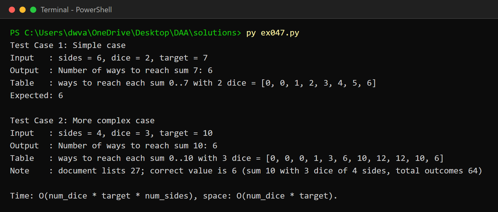

---

<a id="exercise-48"></a>
## Exercise 48 - Assembly Line Scheduling (two lines, dynamic programming)

**Program** (`solutions/ex048.py`)

```python
# Exercise 48 - Assembly Line Scheduling (two lines, dynamic programming)
# The exercise gives no numbers, so two standard textbook instances are used as test cases.
# t1[i] = transfer time line 1 -> line 2 after station i, t2[i] = line 2 -> line 1 after station i.


def assembly_line_schedule(a1, a2, t1, t2, e1, e2, x1, x2):
    """Return (minimum total time, list of line numbers used at each station)."""
    n = len(a1)
    f1, f2 = [e1 + a1[0]], [e2 + a2[0]]          # best time to finish station i on line 1 / line 2
    from1, from2 = [0], [0]                      # line used at station i-1 (for path rebuilding)
    for i in range(1, n):
        stay1, switch1 = f1[i - 1] + a1[i], f2[i - 1] + t2[i - 1] + a1[i]
        stay2, switch2 = f2[i - 1] + a2[i], f1[i - 1] + t1[i - 1] + a2[i]
        f1.append(min(stay1, switch1))
        from1.append(1 if stay1 <= switch1 else 2)
        f2.append(min(stay2, switch2))
        from2.append(2 if stay2 <= switch2 else 1)
    end1, end2 = f1[-1] + x1, f2[-1] + x2
    line, best = (1, end1) if end1 <= end2 else (2, end2)
    path = [line]
    for i in range(n - 1, 0, -1):                # walk back through the choices
        line = from1[i] if line == 1 else from2[i]
        path.append(line)
    return best, path[::-1], f1, f2


def run_case(number, a1, a2, t1, t2, e1, e2, x1, x2, expected):
    best, path, f1, f2 = assembly_line_schedule(a1, a2, t1, t2, e1, e2, x1, x2)
    print(f"Test Case {number}")
    print(f"Input   : n = {len(a1)}, a1 = {a1}, a2 = {a2}")
    print(f"          t1 = {t1}, t2 = {t2}, e1 = {e1}, e2 = {e2}, x1 = {x1}, x2 = {x2}")
    print(f"DP      : f1 = {f1}")
    print(f"          f2 = {f2}")
    print(f"Output  : minimum time = {best}")
    print(f"Path    : line used at stations 1..n = {path}")
    print(f"Expected: {expected}")
    print()


if __name__ == "__main__":
    run_case(1, [7, 9, 3, 4, 8, 4], [8, 5, 6, 4, 5, 7], [2, 3, 1, 3, 4], [2, 1, 2, 2, 1],
             2, 4, 3, 2, 38)
    run_case(2, [4, 5, 3, 2], [2, 10, 1, 4], [7, 4, 5], [9, 2, 8], 10, 12, 18, 7, 35)
    print("Time: O(n) (each station needs two comparisons), space: O(n) (O(1) without the path).")
```

**Output**

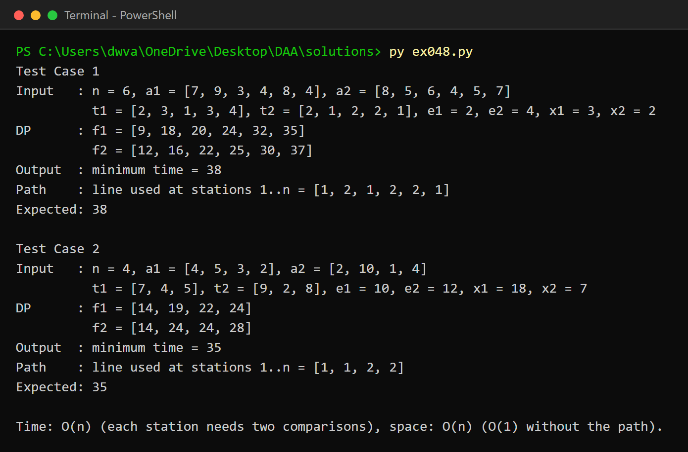

---

<a id="exercise-49"></a>
## Exercise 49 - Scheduling on three assembly lines with transfer times and dependencies

**Program** (`solutions/ex049.py`)

```python
# Exercise 49 - Scheduling on three assembly lines with transfer times and dependencies
# Assumption: the dependency chain (0->1->2) means station j can only start after station j-1 has
# finished, so the stations are processed in order; no entry/exit times are given (taken as 0).


def schedule_three_lines(station_times, transfer, dependencies):
    """Dynamic programming over (station, line). Returns (min total time, line per station, table)."""
    lines, n = len(station_times), len(station_times[0])
    for before, after in dependencies:           # the dependencies must form the chain 0->1->...->n-1
        assert after == before + 1, "only sequential dependencies are supported"
    finish = [[station_times[l][0] for l in range(lines)]]      # finish[j][l]
    came_from = [[None] * lines]
    for j in range(1, n):
        row, back = [], []
        for l in range(lines):
            # previous station on line p, then move from p to l (transfer[p][l] is 0 when p == l)
            cost, prev = min((finish[j - 1][p] + transfer[p][l], p) for p in range(lines))
            row.append(cost + station_times[l][j])
            back.append(prev)
        finish.append(row)
        came_from.append(back)
    total, line = min((finish[-1][l], l) for l in range(lines))
    path = [line]
    for j in range(n - 1, 0, -1):
        line = came_from[j][line]
        path.append(line)
    return total, path[::-1], finish


if __name__ == "__main__":
    times = [[5, 9, 3], [6, 8, 4], [7, 6, 5]]
    transfer = [[0, 2, 3], [2, 0, 4], [3, 4, 0]]
    deps = [(0, 1), (1, 2)]
    total, path, finish = schedule_three_lines(times, transfer, deps)
    print("Test Case 1")
    print("Input   : stations = 3")
    for l, row in enumerate(times, 1):
        print(f"          Line {l}: {row}")
    print(f"          transfer times = {transfer}, dependencies = {deps}")
    print("DP table (earliest finish time of each station on each line):")
    for l in range(3):
        print(f"          Line {l + 1}: {[finish[j][l] for j in range(3)]}")
    print(f"Output  : minimum total production time = {total}")
    print("Schedule: " + " -> ".join(f"Station {j + 1} on Line {l + 1}" for j, l in enumerate(path)))
    spent = sum(times[l][j] for j, l in enumerate(path))
    moves = sum(transfer[path[j]][path[j + 1]] for j in range(2))
    print(f"Check   : processing {spent} + transfers {moves} = {spent + moves}")
    print()
    print("Time: O(n * k^2) for n stations and k lines (here 3*3*3), space: O(n * k).")
```

**Output**

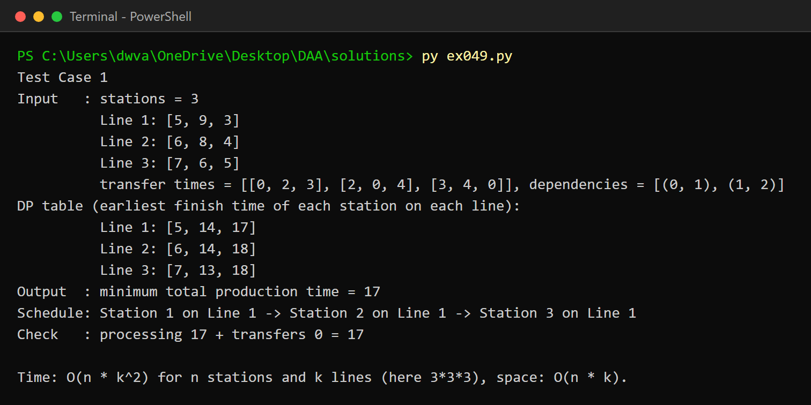

---

<a id="exercise-50"></a>
## Exercise 50 - Minimum path distance (Travelling Salesperson tour) from a distance matrix

**Program** (`solutions/ex050.py`)

```python
# Exercise 50 - Minimum path distance (Travelling Salesperson tour) from a distance matrix
# The question asks for a C program; there is no C compiler here, so it is written in Python.
# Method: Held-Karp dynamic programming over subsets (bitmask), O(n^2 * 2^n).

INF = float("inf")


def tsp_held_karp(dist):
    """Return (minimum tour length, tour as a list of city indices starting and ending at 0)."""
    n = len(dist)
    dp = [[INF] * n for _ in range(1 << n)]       # dp[mask][j]: shortest path 0 -> ... -> j over mask
    parent = [[-1] * n for _ in range(1 << n)]
    dp[1][0] = 0
    for mask in range(1 << n):
        for j in range(n):
            if dp[mask][j] == INF:
                continue
            for k in range(n):
                if mask >> k & 1:
                    continue
                new_mask, cost = mask | 1 << k, dp[mask][j] + dist[j][k]
                if cost < dp[new_mask][k]:
                    dp[new_mask][k], parent[new_mask][k] = cost, j
    full = (1 << n) - 1
    best, last = min((dp[full][j] + dist[j][0], j) for j in range(1, n))
    tour, mask = [], full
    while last != -1:                             # rebuild the tour backwards
        tour.append(last)
        mask, last = mask ^ (1 << last), parent[mask][last]
    return best, tour[::-1] + [0]


def run_case(number, matrix, document_value):
    best, tour = tsp_held_karp(matrix)
    print(f"Test Case {number}")
    for row in matrix:
        print("          " + str(row))
    print(f"Output  : {best}")
    print(f"Tour    : {' -> '.join(map(str, tour))}")
    if best == document_value:
        print(f"Expected: {document_value}")
    else:
        print(f"Note    : document lists {document_value}; correct value is {best}")
    print()


if __name__ == "__main__":
    run_case(1, [[0, 10, 15, 20], [10, 0, 35, 25], [15, 35, 0, 30], [20, 25, 30, 0]], 80)
    run_case(2, [[0, 10, 10, 10], [10, 0, 10, 10], [10, 10, 0, 10], [10, 10, 10, 0]], 40)
    run_case(3, [[0, 1, 2, 3], [1, 0, 4, 5], [2, 4, 0, 6], [3, 5, 6, 0]], 12)
    print("Case 3: every one of the 3 possible tours (0-1-2-3, 0-1-3-2, 0-2-1-3) costs 14, so 12 is impossible.")
    print("Time: O(n^2 * 2^n), space: O(n * 2^n)  (brute force would be O((n-1)!)).")
```

**Output**

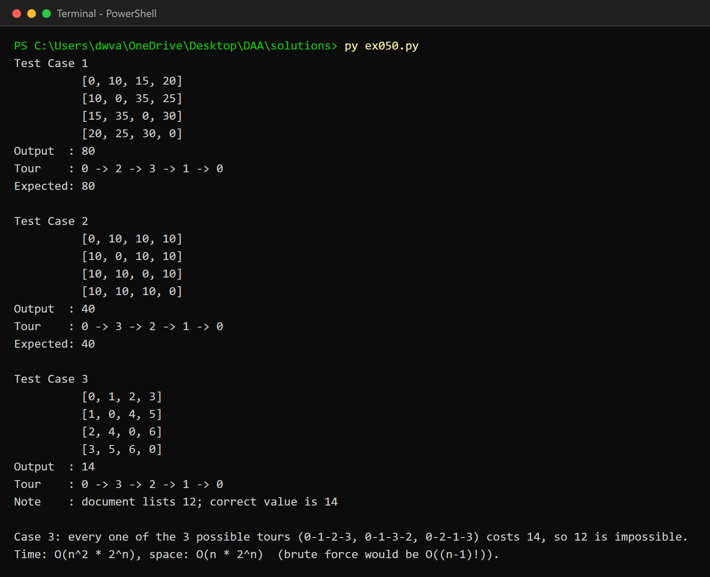

---

<a id="exercise-51"></a>
## Exercise 51 - Travelling Salesperson with 4 cities, then a fifth city E is added (brute force)

**Program** (`solutions/ex051.py`)

```python
# Exercise 51 - Travelling Salesperson with 4 cities, then a fifth city E is added (brute force)
from itertools import permutations


def build_matrix(edges):
    """Symmetric distance lookup dist[(x, y)] from the 'X-Y: d' list."""
    dist = {}
    for (x, y), d in edges.items():
        dist[(x, y)] = dist[(y, x)] = d
    return dist


def all_tours(cities, dist):
    """Every distinct tour starting at the first city (a route and its reverse count once)."""
    start, rest = cities[0], cities[1:]
    tours = []
    for perm in permutations(rest):
        if perm[0] > perm[-1]:                    # skip the mirror image of an already seen tour
            continue
        route = (start,) + perm + (start,)
        length = sum(dist[(route[i], route[i + 1])] for i in range(len(route) - 1))
        tours.append((length, route))
    return sorted(tours)


def report(title, cities, dist):
    tours = all_tours(cities, dist)
    print(f"{title}: {len(tours)} distinct tours")
    for length, route in tours:
        print(f"   {' -> '.join(route)} = {length}")
    best = tours[0][0]
    winners = [" -> ".join(r) for d, r in tours if d == best]
    print(f"   Shortest route(s): {winners} with total distance {best}")
    return best


if __name__ == "__main__":
    four = {("A", "B"): 10, ("A", "C"): 15, ("A", "D"): 20, ("B", "C"): 35, ("B", "D"): 25, ("C", "D"): 30}
    five = dict(four)
    five.update({("A", "E"): 25, ("B", "E"): 30, ("C", "E"): 20, ("D", "E"): 15})
    print("Test Case 1: symmetric distances")
    print("Input   : A-B 10, A-C 15, A-D 20, A-E 25, B-C 35, B-D 25, B-E 30, C-D 30, C-E 20, D-E 15")
    print()
    before = report("Before adding E (cities A, B, C, D)", "ABCD", build_matrix(four))
    print()
    after = report("After adding E (cities A, B, C, D, E)", "ABCDE", build_matrix(five))
    print()
    print(f"Output  : shortest route for 5 cities has distance {after} (was {before} with 4 cities)")
    example = sum(build_matrix(five)[p] for p in zip("ABDECA", "BDECA"))
    print(f"Note    : the document's example route A -> B -> D -> E -> C -> A costs {example}"
          f" ({'the shortest' if example == after else 'not the shortest'})")
    print("Cost of adding a city: (n-1)!/2 tours grows from 3 to 12 (factor n-1 = 4), O(n!) overall.")
```

**Output**

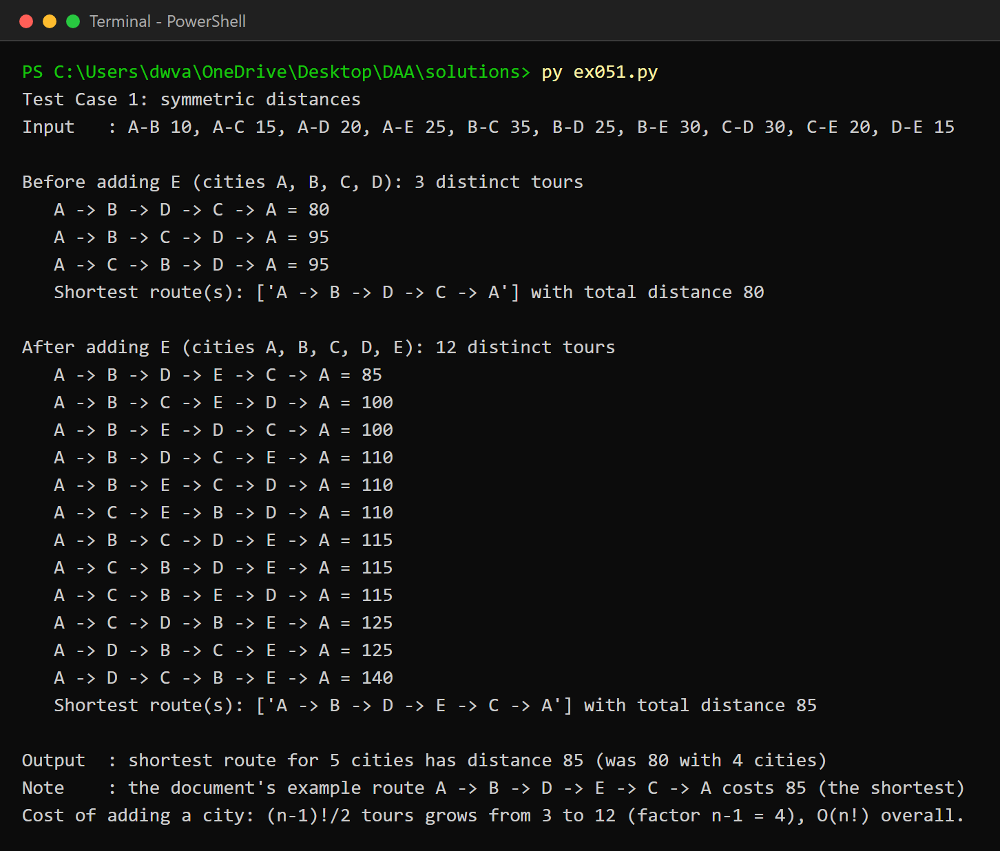

---

<a id="exercise-52"></a>
## Exercise 52 - Longest palindromic substring (expand around each centre, O(n^2))

**Program** (`solutions/ex052.py`)

```python
# Exercise 52 - Longest palindromic substring (expand around each centre, O(n^2))


def expand(s, left, right):
    """Grow outwards while the ends match; return the palindrome found."""
    while left >= 0 and right < len(s) and s[left] == s[right]:
        left -= 1
        right += 1
    return s[left + 1:right]


def longest_palindromic_substring(s):
    """Return (first longest palindrome, list of all longest palindromes)."""
    longest = []
    for centre in range(len(s)):
        for pal in (expand(s, centre, centre),         # odd length, e.g. "aba"
                    expand(s, centre, centre + 1)):    # even length, e.g. "bb"
            if not longest or len(pal) > len(longest[0]):
                longest = [pal]
            elif len(pal) == len(longest[0]) and pal not in longest:
                longest.append(pal)
    return longest[0], longest


if __name__ == "__main__":
    cases = [("babad", '"bab" ("aba" is also valid)'), ("cbbd", '"bb"')]
    for n, (s, expected) in enumerate(cases, 1):
        assert 1 <= len(s) <= 1000 and s.isalnum()    # constraints from the question
        answer, every = longest_palindromic_substring(s)
        print(f"Example {n}")
        print(f'Input   : s = "{s}"')
        print(f'Output  : "{answer}"')
        print(f"Valid   : all longest palindromes = {every}")
        print(f"Expected: {expected}")
        print()
    print("Time: O(n^2) (2n-1 centres, each expands at most n/2 steps); space: O(1) besides the answer.")
```

**Output**

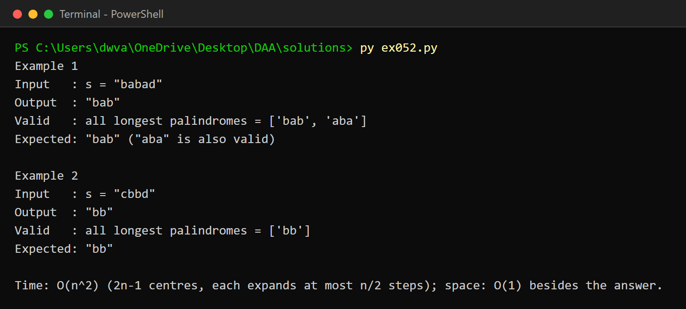

---

<a id="exercise-53"></a>
## Exercise 53 - Longest substring without repeating characters (sliding window)

**Program** (`solutions/ex053.py`)

```python
# Exercise 53 - Longest substring without repeating characters (sliding window)

def longest_unique_substring(s):
    """Sliding window: remember the last index of every character.
    When a character repeats inside the window, move the left edge past it."""
    last_seen = {}            # char -> most recent index
    left = 0                  # left edge of the current window
    best_len, best_start = 0, 0
    for right, ch in enumerate(s):
        if ch in last_seen and last_seen[ch] >= left:
            left = last_seen[ch] + 1          # shrink window past the duplicate
        last_seen[ch] = right
        if right - left + 1 > best_len:       # window s[left..right] is unique
            best_len, best_start = right - left + 1, left
    return best_len, s[best_start:best_start + best_len]


if __name__ == "__main__":
    tests = [("abcabcbb", 3), ("bbbbb", 1), ("pwwkew", 3), ("", 0)]
    for no, (s, expected) in enumerate(tests, 1):
        length, sub = longest_unique_substring(s)
        print(f"Test Case {no}" + ("   (extra: empty-string edge case)" if s == "" else ""))
        print(f"Input   : s = {s!r}")
        print(f"Output  : {length}")
        print(f"Expected: {expected}")
        print(f"Longest substring: {sub!r}")
        print()
    print("Time complexity : O(n)  - every character is visited once by the right pointer")
    print("Space complexity: O(min(n, k)) - hash map of at most k distinct characters")
```

**Output**

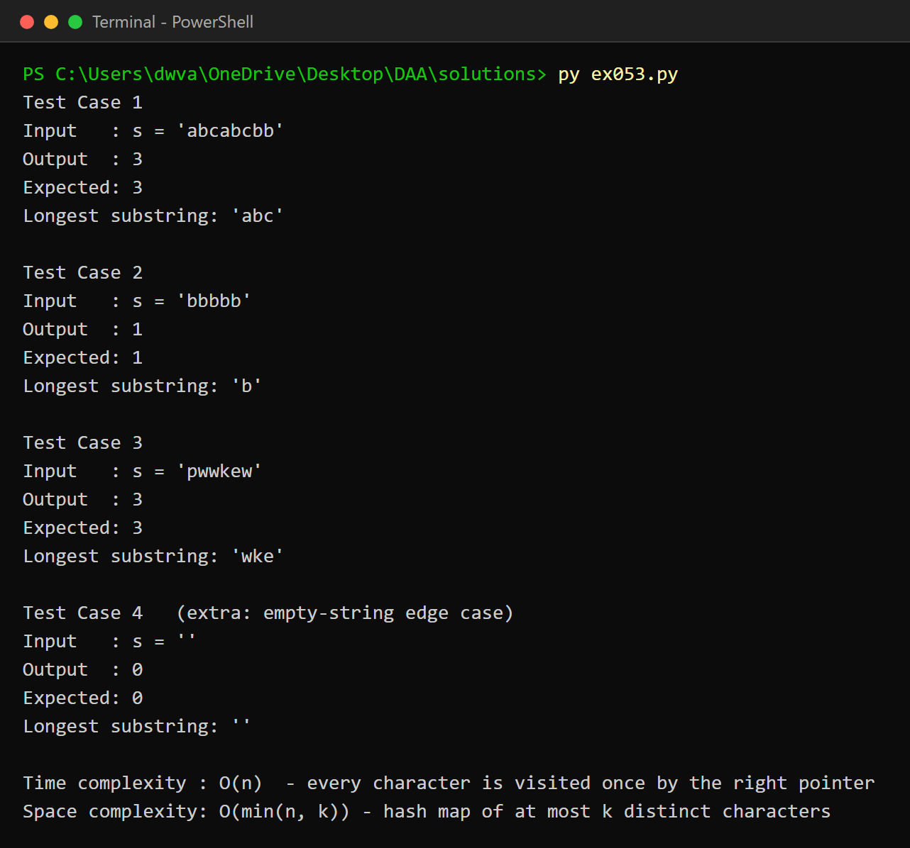

---

<a id="exercise-54"></a>
## Exercise 54 - Word Break (dynamic programming)

**Program** (`solutions/ex054.py`)

```python
# Exercise 54 - Word Break (dynamic programming)

def word_break(s, word_dict):
    """dp[i] is True when the prefix s[:i] can be split into dictionary words.
    prev[i] remembers where the last word of such a split starts."""
    words = set(word_dict)
    max_len = max(map(len, words))
    dp = [False] * (len(s) + 1)
    prev = [-1] * (len(s) + 1)
    dp[0] = True                                   # empty prefix is always valid
    for i in range(1, len(s) + 1):
        for j in range(max(0, i - max_len), i):    # last word is s[j:i]
            if dp[j] and s[j:i] in words:
                dp[i], prev[i] = True, j
                break
    if not dp[len(s)]:
        return False, None
    parts, i = [], len(s)
    while i > 0:                                   # walk back to rebuild one split
        parts.append(s[prev[i]:i])
        i = prev[i]
    return True, " ".join(reversed(parts))


if __name__ == "__main__":
    tests = [
        ("leetcode", ["leet", "code"], True),
        ("applepenapple", ["apple", "pen"], True),
        ("catsandog", ["cats", "dog", "sand", "and", "cat"], False),
    ]
    for no, (s, word_dict, expected) in enumerate(tests, 1):
        ok, split = word_break(s, word_dict)
        print(f"Test Case {no}")
        print(f"Input   : s = {s!r}, wordDict = {word_dict}")
        print(f"Output  : {str(ok).lower()}")
        print(f"Expected: {str(expected).lower()}")
        print(f"Segmentation: {split!r}" if ok else "Segmentation: none possible")
        print()
    print("Time complexity : O(n * L^2) for n = len(s), L = longest dictionary word")
    print("Space complexity: O(n + total size of dictionary)")
```

**Output**

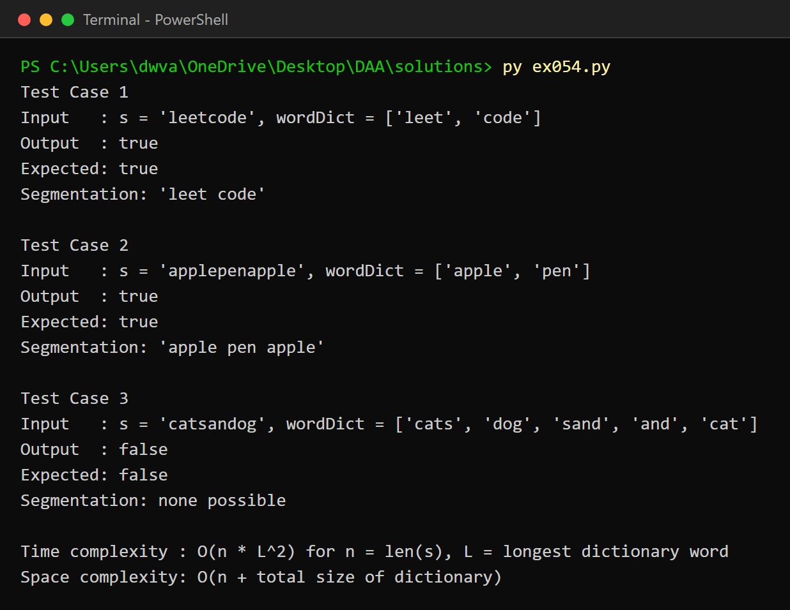

---

<a id="exercise-55"></a>
## Exercise 55 - Word Break: can the string be segmented? (backtracking with memoization)

**Program** (`solutions/ex055.py`)

```python
# Exercise 55 - Word Break: can the string be segmented? (backtracking with memoization)
from functools import lru_cache

WORD_LIST = ["i", "like", "sam", "sung", "samsung", "mobile", "ice",
             "cream", "icecream", "man", "go", "mango"]
DICTIONARY = set(WORD_LIST)


def all_segmentations(text):
    """Return every way to split text into dictionary words (as lists of words)."""
    @lru_cache(maxsize=None)
    def solve(start):
        if start == len(text):
            return [[]]                              # one way to split the empty rest
        result = []
        for end in range(start + 1, len(text) + 1):  # try every first word text[start:end]
            word = text[start:end]
            if word in DICTIONARY:
                for rest in solve(end):
                    result.append([word] + rest)
        return result
    return solve(0)


if __name__ == "__main__":
    print("Dictionary: { " + ", ".join(WORD_LIST) + " }")
    print()
    tests = [("ilike", "Yes"), ("ilikesamsung", "Yes"),
             ("ilikesamsungx", "No")]           # last one is an extra negative case
    for no, (text, expected) in enumerate(tests, 1):
        splits = all_segmentations(text)
        answer = "Yes" if splits else "No"
        print(f"Test Case {no}" + ("   (extra)" if no == 3 else ""))
        print(f"Input   : {text}")
        print(f"Output  : {answer}")
        print(f"Expected: {expected}")
        for sp in splits:
            print(f"   can be segmented as \"{' '.join(sp)}\"")
        print()
    print("Time complexity : O(n^2) substring checks to decide Yes/No; listing every segmentation")
    print("                  can cost more, since a string may have exponentially many")
    print("Space complexity: O(n) recursion depth plus the memo table")
```

**Output**

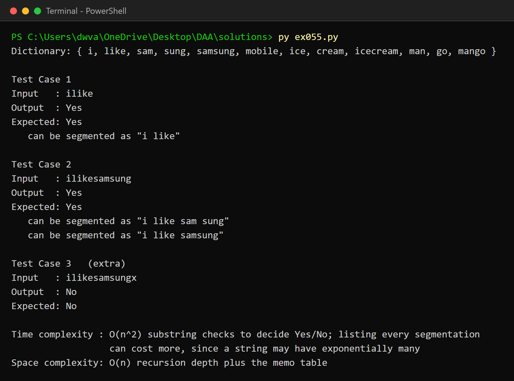

---

<a id="exercise-56"></a>
## Exercise 56 - Text Justification (greedy line packing)

**Program** (`solutions/ex056.py`)

```python
# Exercise 56 - Text Justification (greedy line packing)

def full_justify(words, max_width):
    lines, i = [], 0
    while i < len(words):
        # Greedy: pack as many words as fit (one space minimum between words)
        j, length = i, len(words[i])
        while j + 1 < len(words) and length + 1 + len(words[j + 1]) <= max_width:
            j += 1
            length += 1 + len(words[j])
        line_words = words[i:j + 1]
        if j == len(words) - 1 or len(line_words) == 1:
            # last line, or a line with one word: left-justify and pad on the right
            line = " ".join(line_words).ljust(max_width)
        else:
            spaces = max_width - sum(len(w) for w in line_words)
            gaps = len(line_words) - 1
            each, extra = divmod(spaces, gaps)      # leftmost `extra` gaps get one more
            line = ""
            for k, w in enumerate(line_words[:-1]):
                line += w + " " * (each + (1 if k < extra else 0))
            line += line_words[-1]
        lines.append(line)
        i = j + 1
    return lines


if __name__ == "__main__":
    tests = [
        (["This", "is", "an", "example", "of", "text", "justification."], 16,
         ["This    is    an", "example  of text", "justification.  "]),
        (["What", "must", "be", "acknowledgment", "shall", "be"], 16,
         ["What   must   be", "acknowledgment  ", "shall be        "]),
    ]
    for no, (words, width, expected) in enumerate(tests, 1):
        result = full_justify(words, width)
        print(f"Test Case {no}")
        print(f"Input   : words = {words}, maxWidth = {width}")
        print("Output  :")
        for line in result:
            print(f'   "{line}"   (length {len(line)})')
        print(f"Expected: {expected}")
        print(f"Matches the expected output: {result == expected}")
        print()
    print("Time complexity : O(total characters)  - each word is placed exactly once")
    print("Space complexity: O(total characters)  - for the output lines")
```

**Output**

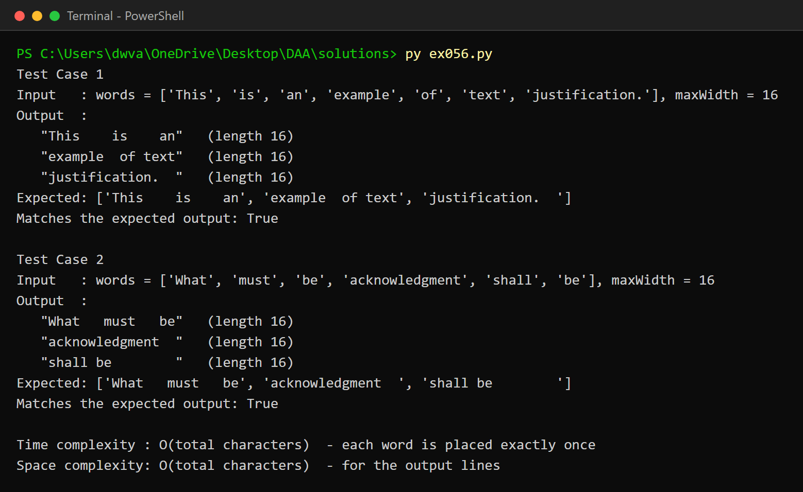

---

<a id="exercise-57"></a>
## Exercise 57 - Prefix and Suffix Search (WordFilter using a trie)

**Program** (`solutions/ex057.py`)

```python
# Exercise 57 - Prefix and Suffix Search (WordFilter using a trie)

class WordFilter:
    """Every word is inserted once for each of its suffixes in the form
    '<suffix>{<word>' (the '{' separator is not a lowercase letter).
    A query for (pref, suff) is then the single trie path '<suff>{<pref>'.
    Words are inserted in index order, so each node keeps the LARGEST index."""

    def __init__(self, words):
        self.root = {}
        for index, word in enumerate(words):
            for i in range(len(word) + 1):
                node = self.root
                for ch in word[i:] + "{" + word:
                    node = node.setdefault(ch, {})
                    node["#"] = index            # later words overwrite earlier ones

    def f(self, pref, suff):
        node = self.root
        for ch in suff + "{" + pref:
            if ch not in node:
                return -1
            node = node[ch]
        return node["#"]


def run(operations, arguments):
    """Replay a LeetCode-style call list: ['WordFilter', 'f', ...] with its arguments."""
    outputs, obj = [], None
    for op, args in zip(operations, arguments):
        if op == "WordFilter":
            obj = WordFilter(*args)
            outputs.append("null")
        else:
            outputs.append(str(obj.f(*args)))
    return "[" + ", ".join(outputs) + "]"


if __name__ == "__main__":
    tests = [
        (["WordFilter", "f"], [[["apple"]], ["a", "e"]], "[null, 0]"),
        # extra case: several words, largest index wins, and a miss
        (["WordFilter", "f", "f", "f", "f"],
         [[["apple", "apply", "ample"]], ["a", "e"], ["app", "y"], ["ap", "e"], ["b", "e"]],
         None),
    ]
    for no, (ops, args, expected) in enumerate(tests, 1):
        print(f"Test Case {no}" + ("   (extra)" if expected is None else ""))
        print(f"Input   : {ops}")
        print(f"          {args}")
        print(f"Output  : {run(ops, args)}")
        if expected:
            print(f"Expected: {expected}")
        print()
    print("Time complexity : build O(N * L^2) for N words of length <= L; each query O(|pref| + |suff|)")
    print("Space complexity: O(N * L^2) trie nodes")
```

**Output**

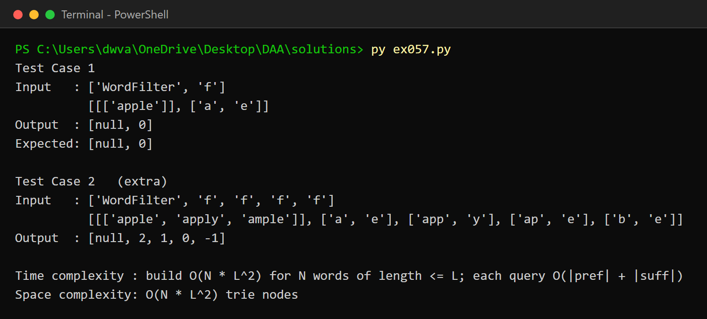

---

<a id="exercise-58"></a>
## Exercise 58 - Floyd-Warshall all-pairs shortest paths on a city network

**Program** (`solutions/ex058.py`)

```python
# Exercise 58 - Floyd-Warshall all-pairs shortest paths on a city network
INF = float("inf")


def build_matrix(n, edges, directed):
    """Initial distance matrix and 'next hop' matrix (for path reconstruction)."""
    dist = [[0 if i == j else INF for j in range(n)] for i in range(n)]
    nxt = [[i if i == j else None for j in range(n)] for i in range(n)]
    for a, b, w in edges:
        dist[a][b], nxt[a][b] = w, b
        if not directed:
            dist[b][a], nxt[b][a] = w, a
    return dist, nxt


def floyd_warshall(dist, nxt):
    """Try every city k as an intermediate stop for every pair (i, j)."""
    n = len(dist)
    dist, nxt = [r[:] for r in dist], [r[:] for r in nxt]
    for k in range(n):
        for i in range(n):
            for j in range(n):
                if dist[i][k] + dist[k][j] < dist[i][j]:
                    dist[i][j] = dist[i][k] + dist[k][j]
                    nxt[i][j] = nxt[i][k]
    return dist, nxt


def get_path(nxt, u, v):
    if nxt[u][v] is None:
        return None
    path = [u]
    while u != v and len(path) <= len(nxt):      # length cap guards against negative cycles
        u = nxt[u][v]
        path.append(u)
    return path


def show(before, after, names):
    cell = lambda x: f"{'INF' if x == INF else x:>5}"
    head = "".join(f"{x:>5}" for x in names)
    print(f"     {'BEFORE Floyd-Warshall':<{len(head)}}  |  AFTER Floyd-Warshall")
    print(f"     {head}  |  {head}")
    for i, name in enumerate(names):
        print(f"{name:>4} {''.join(map(cell, before[i]))}  |  {''.join(map(cell, after[i]))}")


def quietest_city(dist, threshold):
    """City with the fewest cities within the threshold (ties -> greatest number)."""
    n = len(dist)
    near = [[j for j in range(n) if j != i and dist[i][j] <= threshold] for i in range(n)]
    best = min(range(n), key=lambda i: (len(near[i]), -i))
    return best, near


if __name__ == "__main__":
    # ---- Test Case 1: n = 4, undirected, distanceThreshold = 4 ----
    edges = [[0, 1, 3], [1, 2, 1], [1, 3, 4], [2, 3, 1]]
    print("Test Case 1\nInput   : n = 4, edges = [[0,1,3],[1,2,1],[1,3,4],[2,3,1]], distanceThreshold = 4")
    before, nxt = build_matrix(4, edges, directed=False)
    after, nxt = floyd_warshall(before, nxt)
    show(before, after, list(range(4)))
    city, near = quietest_city(after, 4)
    for i, lst in enumerate(near):
        print(f"City {i} -> [{', '.join('City ' + str(j) for j in lst)}]")
    print(f"Output  : {city}")
    print("Expected: 3")
    p = get_path(nxt, 0, 3)
    print(f"Shortest path City 0 to City 3: {' -> '.join(map(str, p))}  (distance {after[0][3]})")

    # ---- Test Case 2 (a): 4 cities, one-way roads, some negative weights ----
    print("\nTest Case 2 (a)\nInput   : 1->2:3  1->3:8  1->4:-4  2->4:1  2->3:4  3->1:2  4->3:-5  4->2:6")
    roads = [(1, 2, 3), (1, 3, 8), (1, 4, -4), (2, 4, 1), (2, 3, 4), (3, 1, 2), (4, 3, -5), (4, 2, 6)]
    before, nxt = build_matrix(4, [(a - 1, b - 1, w) for a, b, w in roads], directed=True)
    after, nxt = floyd_warshall(before, nxt)
    show(before, after, ["1", "2", "3", "4"])
    print(f"Output  : City 1 to City 3 = {after[0][2]}")
    print("Expected: City 1 to City 3 = -9")
    print("Path    : " + " -> ".join(f"City {c + 1}" for c in get_path(nxt, 0, 2)))
    print("Note    : the document's graph has a negative cycle 1->4->3->1 (-4-5+2 = -7), visible as the")
    print("          negative diagonal above; shortest walks are then unbounded, but -9 is the best")
    print("          simple path 1->4->3 and equals Floyd's value for the pair (1,3).")
```

**Output**

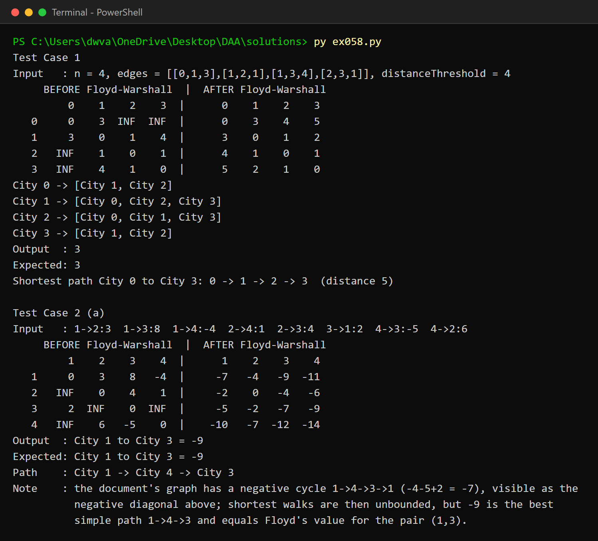

---

<a id="exercise-59"></a>
## Exercise 59 - Floyd-Warshall on a 6-router network, with a link failure (B-D)

**Program** (`solutions/ex059.py`)

```python
# Exercise 59 - Floyd-Warshall on a 6-router network, with a link failure (B-D)
INF = float("inf")
ROUTERS = "ABCDEF"
LINKS = [("A", "B", 1), ("A", "C", 5), ("B", "C", 2), ("B", "D", 1),
         ("C", "E", 3), ("D", "E", 1), ("D", "F", 6), ("E", "F", 2)]   # undirected links


def initial_tables(links):
    n = len(ROUTERS)
    dist = [[0 if i == j else INF for j in range(n)] for i in range(n)]
    nxt = [[i if i == j else None for j in range(n)] for i in range(n)]
    for a, b, w in links:
        i, j = ROUTERS.index(a), ROUTERS.index(b)
        dist[i][j] = dist[j][i] = w
        nxt[i][j], nxt[j][i] = j, i
    return dist, nxt


def floyd_warshall(dist, nxt):
    n = len(dist)
    dist, nxt = [r[:] for r in dist], [r[:] for r in nxt]
    for k in range(n):                       # allow router k as an intermediate hop
        for i in range(n):
            for j in range(n):
                if dist[i][k] + dist[k][j] < dist[i][j]:
                    dist[i][j] = dist[i][k] + dist[k][j]
                    nxt[i][j] = nxt[i][k]
    return dist, nxt


def route(nxt, src, dst):
    u, v = ROUTERS.index(src), ROUTERS.index(dst)
    if nxt[u][v] is None:
        return None
    path = [u]
    while u != v:
        u = nxt[u][v]
        path.append(u)
    return " -> ".join(ROUTERS[i] for i in path)


def show(left, right, left_title, right_title):
    cell = lambda x: f"{'INF' if x == INF else x:>4}"
    head = "".join(f"{c:>4}" for c in ROUTERS)
    print(f"   {left_title:<{len(head)}}  |  {right_title}")
    print(f"   {head}  |  {head}")
    for i, name in enumerate(ROUTERS):
        print(f" {name} {''.join(map(cell, left[i]))}  |  {''.join(map(cell, right[i]))}")


if __name__ == "__main__":
    print("Input   : links A-B:1 A-C:5 B-C:2 B-D:1 C-E:3 D-E:1 D-F:6 E-F:2 (bidirectional)")
    print()
    # ---- normal network ----
    direct, nxt0 = initial_tables(LINKS)
    full, nxt1 = floyd_warshall(direct, nxt0)
    print("1) Before the failure")
    show(direct, full, "Initial routing table", "After Floyd-Warshall")
    i, j = ROUTERS.index("A"), ROUTERS.index("F")
    print(f"Output  : Router A to Router F = {full[i][j]}   via {route(nxt1, 'A', 'F')}")
    print("Expected: Router A to Router F = 5")

    # ---- link B-D fails: remove it and recompute ----
    print("\n2) Link B-D fails")
    broken_links = [l for l in LINKS if {l[0], l[1]} != {"B", "D"}]
    direct2, nxt2 = initial_tables(broken_links)
    full2, nxt3 = floyd_warshall(direct2, nxt2)
    show(direct2, full2, "Table without link B-D", "After Floyd-Warshall")
    print(f"Router A to Router F after failure = {full2[i][j]}   via {route(nxt3, 'A', 'F')}")
    print()
    print(f"Summary : A to F  before = {full[i][j]} ({route(nxt1, 'A', 'F')}),"
          f"  after = {full2[i][j]} ({route(nxt3, 'A', 'F')})")
    changed = [(a, b) for x, a in enumerate(ROUTERS) for y, b in enumerate(ROUTERS)
               if x < y and full[x][y] != full2[x][y]]
    print("Router pairs whose distance changed:", ", ".join(a + b for a, b in changed))
```

**Output**

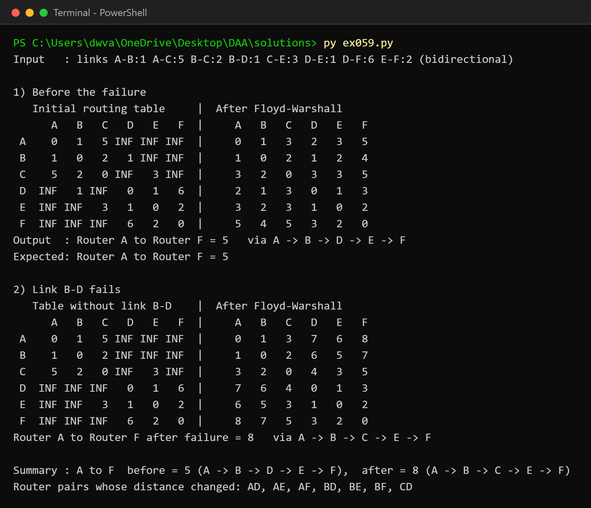

---

<a id="exercise-60"></a>
## Exercise 60 - Floyd-Warshall: all-pairs shortest paths, neighbour counts and directed test cases

**Program** (`solutions/ex060.py`)

```python
# Exercise 60 - Floyd-Warshall: all-pairs shortest paths, neighbour counts and directed test cases
INF = float("inf")


def initial_tables(n, edges, directed):
    dist = [[0 if i == j else INF for j in range(n)] for i in range(n)]
    nxt = [[i if i == j else None for j in range(n)] for i in range(n)]
    for a, b, w in edges:
        dist[a][b], nxt[a][b] = w, b
        if not directed:
            dist[b][a], nxt[b][a] = w, a
    return dist, nxt


def floyd_warshall(dist, nxt):
    n = len(dist)
    dist, nxt = [r[:] for r in dist], [r[:] for r in nxt]
    for k in range(n):                       # k = allowed intermediate city
        for i in range(n):
            for j in range(n):
                if dist[i][k] + dist[k][j] < dist[i][j]:
                    dist[i][j] = dist[i][k] + dist[k][j]
                    nxt[i][j] = nxt[i][k]
    return dist, nxt


def get_path(nxt, names, u, v):
    if nxt[u][v] is None:
        return "no path"
    path = [u]
    while u != v:
        u = nxt[u][v]
        path.append(u)
    return " -> ".join(str(names[x]) for x in path)


def show(before, after, names):
    cell = lambda x: f"{'INF' if x == INF else x:>4}"
    head = "".join(f"{x:>4}" for x in names)
    print(f"     {'BEFORE Floyd-Warshall':<{len(head)}}  |  AFTER Floyd-Warshall")
    print(f"     {head}  |  {head}")
    for i, name in enumerate(names):
        print(f"{name:>4} {''.join(map(cell, before[i]))}  |  {''.join(map(cell, after[i]))}")


def named_directed_test(title, roads, src, dst, expected):
    """roads: list of 'XY w' strings meaning a one-way road X -> Y of length w."""
    names = sorted({c for r in roads for c in r[:2]})
    idx = {c: i for i, c in enumerate(names)}
    edges = [(idx[r[0]], idx[r[1]], int(r[3:])) for r in roads]
    before, nxt = initial_tables(len(names), edges, directed=True)
    after, nxt = floyd_warshall(before, nxt)
    print(f"\n{title}\nInput   : " + "  ".join(f"{r[0]}->{r[1]}:{r[3:]}" for r in roads))
    show(before, after, names)
    print(f"Output  : {src} to {dst} = {after[idx[src]][idx[dst]]}")
    print(f"Expected: {src} to {dst} = {expected}")
    print(f"Shortest path {src} to {dst}: {get_path(nxt, names, idx[src], idx[dst])}")


if __name__ == "__main__":
    # ---- Test Case 1: n = 5, undirected, distanceThreshold = 2 ----
    n, threshold = 5, 2
    edges = [[0, 1, 2], [0, 4, 8], [1, 2, 3], [1, 4, 2], [2, 3, 1], [3, 4, 1]]
    print("Test Case 1")
    print(f"Input   : n = 5, edges = {str(edges).replace(' ', '')}, distanceThreshold = 2")
    before, nxt = initial_tables(n, edges, directed=False)
    after, nxt = floyd_warshall(before, nxt)
    show(before, after, list(range(n)))
    near = [[j for j in range(n) if j != i and after[i][j] <= threshold] for i in range(n)]
    for i, lst in enumerate(near):
        print(f"City {i} -> [{', '.join('City ' + str(j) for j in lst)}]")
    best = min(range(n), key=lambda i: (len(near[i]), -i))   # fewest neighbours, ties -> larger id
    print(f"Output  : {best}")
    print("Expected: 0")
    print(f"Shortest path City 0 to City 3: {get_path(nxt, list(range(n)), 0, 3)}  (distance {after[0][3]})")

    named_directed_test("Test Case 2 (a)  shortest path from C to A",
                        ["BA 2", "AC 3", "CD 1", "DA 6", "CB 7"], "C", "A", 7)
    named_directed_test("Test Case 3 (b)  shortest path from E to C",
                        ["CA 2", "AB 4", "BC 1", "BE 6", "EA 1", "AD 5", "DE 2", "ED 4", "DC 1", "CD 3"],
                        "E", "C", 5)
```

**Output**

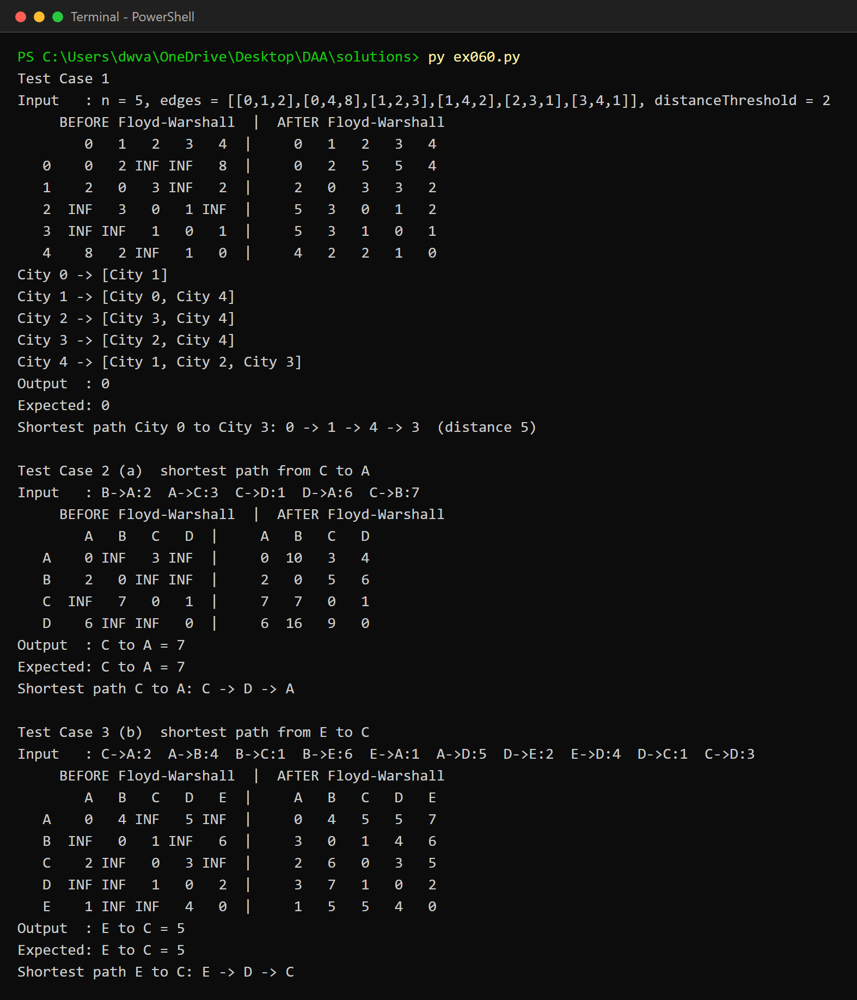

---

<a id="exercise-61"></a>
## Exercise 61 - Optimal Binary Search Tree (bottom-up dynamic programming)

**Program** (`solutions/ex061.py`)

```python
# Exercise 61 - Optimal Binary Search Tree (bottom-up dynamic programming)
from fractions import Fraction


def optimal_bst(freq):
    """cost[i][j] = minimum cost of a BST on keys i..j (1-based), root[i][j] = its root.
    cost[i][j] = min over r in i..j of cost[i][r-1] + cost[r+1][j] + sum(freq[i..j])."""
    n = len(freq)
    pre = [0]
    for f in freq:
        pre.append(pre[-1] + f)                          # prefix sums of the frequencies
    cost = [[Fraction(0)] * (n + 1) for _ in range(n + 2)]
    root = [[0] * (n + 1) for _ in range(n + 2)]
    for length in range(1, n + 1):                       # chain length = number of keys
        for i in range(1, n - length + 2):
            j = i + length - 1
            weight = pre[j] - pre[i - 1]
            cost[i][j], root[i][j] = min(
                (cost[i][r - 1] + cost[r + 1][j] + weight, r) for r in range(i, j + 1))
    return cost, root


def show_tree(keys, root, i, j, label="root", indent=0):
    if i > j:
        return
    r = root[i][j]
    print("    " * indent + f"{label}: {keys[r - 1]}")
    show_tree(keys, root, i, r - 1, "left ", indent + 1)
    show_tree(keys, root, r + 1, j, "right", indent + 1)


def fmt(x):
    return str(x.numerator) if x.denominator == 1 else f"{float(x):g}"


def run(title, keys, freq, expected=None):
    freq = [Fraction(str(f)) for f in freq]
    cost, root = optimal_bst(freq)
    n = len(keys)
    print(title)
    print(f"Input   : N = {n}, Keys = {keys}, Frequencies = [{', '.join(fmt(f) for f in freq)}]")
    print(f"Output  : {fmt(cost[1][n])}")
    if expected is not None:
        print(f"Expected: {expected}")
    return cost, root


if __name__ == "__main__":
    keys = ["A", "B", "C", "D"]
    cost, root = run("Test Case 1", keys, [0.1, 0.2, 0.4, 0.3], "1.7")
    n = len(keys)
    print("\nCost table C[i][j]   (row i = 1..n+1, column j = 0..n)")
    print("      " + "".join(f"{j:>6}" for j in range(n + 1)))
    for i in range(1, n + 2):
        cells = [f"{float(cost[i][j]):.1f}" if j >= i - 1 else "" for j in range(n + 1)]
        print(f"{i:>5} " + "".join(f"{c:>6}" for c in cells))
    print("\nRoot table R[i][j]   (row i = 1..n, column j = 1..n)")
    print("      " + "".join(f"{j:>6}" for j in range(1, n + 1)))
    for i in range(1, n + 1):
        cells = [str(root[i][j]) if j >= i else "" for j in range(1, n + 1)]
        print(f"{i:>5} " + "".join(f"{c:>6}" for c in cells))
    print(f"\nResulting OBST (root = key {keys[root[1][n] - 1]}, minimum cost = {fmt(cost[1][n])}):")
    show_tree(keys, root, 1, n)

    print()
    run("Test Case 2 (a)", [10, 12], [34, 50], "118")
    print()
    run("Test Case 3 (b)", [10, 12, 20], [34, 8, 50], "142")
    print("\nTime complexity : O(n^3) - O(n^2) table entries, each minimised over up to n roots")
    print("Space complexity: O(n^2) for the cost and root tables")
```

**Output**

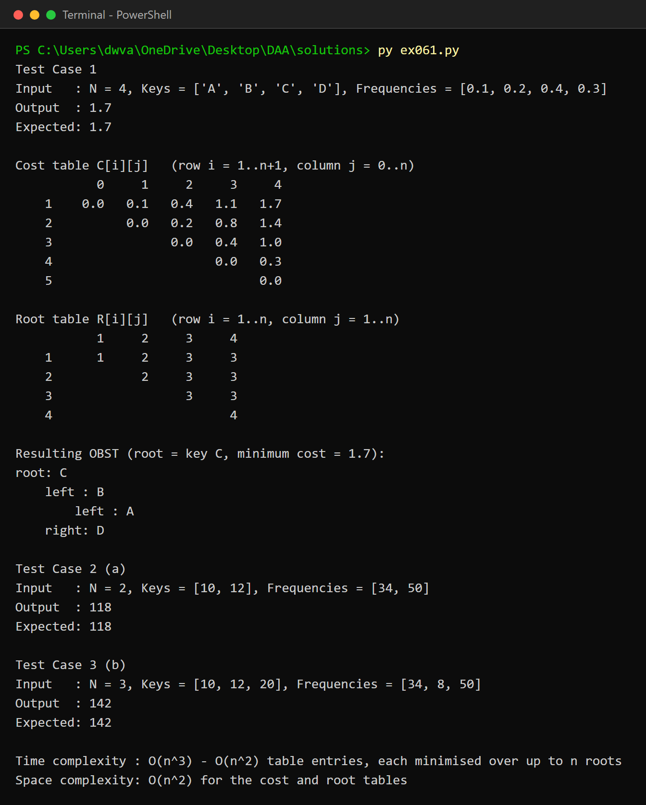

---

<a id="exercise-62"></a>
## Exercise 62 - Optimal Binary Search Tree (top-down recursion with memoization)

**Program** (`solutions/ex062.py`)

```python
# Exercise 62 - Optimal Binary Search Tree (top-down recursion with memoization)
from fractions import Fraction
from functools import lru_cache


def optimal_bst(freq):
    """Return (cost, root) dictionaries indexed by (i, j) = keys i..j, 0-based inclusive."""
    n = len(freq)
    pre = [0]
    for f in freq:
        pre.append(pre[-1] + f)
    root = {}

    @lru_cache(maxsize=None)
    def best_cost(i, j):
        if i > j:
            return 0                                   # empty subtree costs nothing
        # try every key r as root: left part + right part (+ one extra level for all keys)
        total, r = min((best_cost(i, r - 1) + best_cost(r + 1, j), r) for r in range(i, j + 1))
        root[(i, j)] = r
        return total + pre[j + 1] - pre[i]

    cost = {(i, j): best_cost(i, j) for i in range(n) for j in range(i, n)}
    return cost, root


def print_tree(keys, root, i, j, prefix="", last=True, top=True):
    if i > j:
        return
    r = root[(i, j)]
    print(keys[r] if top else prefix + ("`-- " if last else "|-- ") + str(keys[r]))
    kids = [(i, r - 1), (r + 1, j)]
    kids = [k for k in kids if k[0] <= k[1]]
    for idx, (a, b) in enumerate(kids):
        print_tree(keys, root, a, b, prefix + ("" if top else ("    " if last else "|   ")),
                   idx == len(kids) - 1, False)


def nested(keys, root, i, j):
    """One-line tree: key(left, right), '-' marks an empty subtree, a leaf is just its key."""
    if i > j:
        return "-"
    r = root[(i, j)]
    if i == j:
        return str(keys[r])
    return f"{keys[r]}({nested(keys, root, i, r - 1)}, {nested(keys, root, r + 1, j)})"


def show_matrices(cost, root, n):
    print("Cost matrix (row i = first key, column j = last key, 0-based)")
    print("   " + "".join(f"{j:>5}" for j in range(n)))
    for i in range(n):
        print(f"{i:>2} " + "".join(f"{cost[(i, j)] if j >= i else '':>5}" for j in range(n)))
    print("Root matrix (entry = index of the root key of keys i..j)")
    print("   " + "".join(f"{j:>5}" for j in range(n)))
    for i in range(n):
        print(f"{i:>2} " + "".join(f"{root[(i, j)] if j >= i else '':>5}" for j in range(n)))


if __name__ == "__main__":
    keys, freq = [10, 12, 16, 21], [4, 2, 6, 3]
    cost, root = optimal_bst(freq)
    print(f"Test Case 1\nInput   : N = 4, Keys = {keys}, Frequencies = {freq}")
    print("Probabilities p = freq/%d = %s" % (sum(freq), [str(Fraction(f, sum(freq))) for f in freq]))
    print(f"Output  : {cost[(0, 3)]}")
    print("Expected: 26")
    show_matrices(cost, root, 4)
    print(f"Optimal BST (root = {keys[root[(0, 3)]]}):")
    print_tree(keys, root, 0, 3)
    print(f"Cost = {cost[(0, 3)]} (frequency-weighted); expected search cost = "
          f"{cost[(0, 3)]}/{sum(freq)} = {cost[(0, 3)] / sum(freq):.4f} comparisons")

    for name, ks, fs, expected in [("a", [10, 12], [34, 50], 118), ("b", [10, 12, 20], [34, 8, 50], 142)]:
        c, r = optimal_bst(fs)
        print(f"\nTest Case {2 if name == 'a' else 3} ({name})\nInput   : keys = {ks}, freq = {fs}")
        print(f"Output  : {c[(0, len(ks) - 1)]}\nExpected: {expected}")
        print(f"Tree    : {nested(ks, r, 0, len(ks) - 1)}")
    print("\nTime complexity : O(n^3);  Space complexity: O(n^2)")
```

**Output**

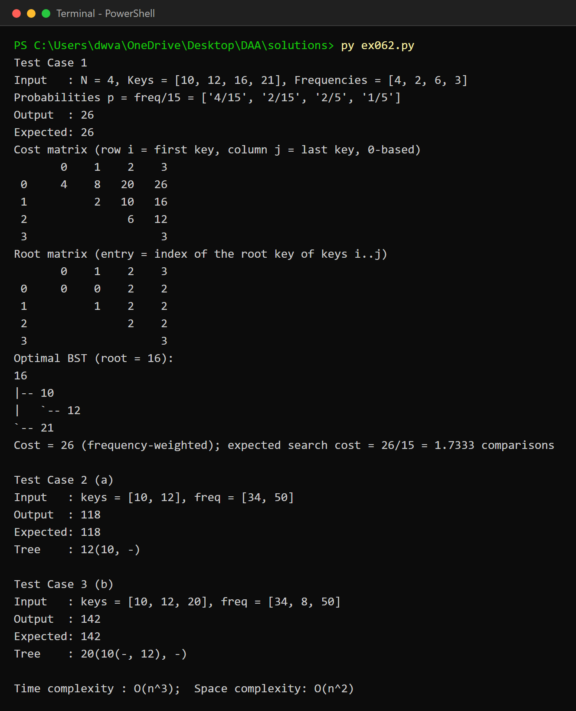

---

<a id="exercise-63"></a>
## Exercise 63 - Cat and Mouse (game on a graph, solved by retrograde analysis / topological sort)

**Program** (`solutions/ex063.py`)

```python
# Exercise 63 - Cat and Mouse (game on a graph, solved by retrograde analysis / topological sort)
from collections import deque

DRAW, MOUSE, CAT = 0, 1, 2          # game results; also used as "whose turn" markers


def cat_mouse_game(graph):
    """State = (mouse node, cat node, player to move).  Start from the states whose result is
    known (mouse in hole -> mouse wins, cat on mouse -> cat wins) and propagate the result
    backwards.  States that never get a result are draws (they can repeat forever)."""
    n = len(graph)
    result = [[[DRAW] * 3 for _ in range(n)] for _ in range(n)]
    degree = [[[0] * 3 for _ in range(n)] for _ in range(n)]     # moves not yet proven losing
    for m in range(n):
        for c in range(1, n):
            degree[m][c][MOUSE] = len(graph[m])
            degree[m][c][CAT] = len(graph[c]) - (0 in graph[c])  # cat may not enter the hole
    queue = deque()
    for c in range(1, n):
        for turn in (MOUSE, CAT):
            result[0][c][turn] = MOUSE                           # mouse is in the hole
            queue.append((0, c, turn))
            result[c][c][turn] = CAT                             # cat caught the mouse
            queue.append((c, c, turn))

    def previous_states(m, c, turn):
        if turn == CAT:                       # the mouse has just moved
            return [(pm, c, MOUSE) for pm in graph[m]]
        return [(m, pc, CAT) for pc in graph[c] if pc != 0]      # the cat has just moved

    while queue:
        m, c, turn = queue.popleft()
        winner = result[m][c][turn]
        for pm, pc, pturn in previous_states(m, c, turn):
            if result[pm][pc][pturn] != DRAW:
                continue
            if pturn == winner:                   # mover can step into a winning state
                result[pm][pc][pturn] = winner
                queue.append((pm, pc, pturn))
            else:                                 # this move is bad; if all moves are bad, mover loses
                degree[pm][pc][pturn] -= 1
                if degree[pm][pc][pturn] == 0:
                    result[pm][pc][pturn] = winner
                    queue.append((pm, pc, pturn))
    return result[1][2][MOUSE]                    # mouse at 1, cat at 2, mouse moves first


if __name__ == "__main__":
    meaning = {0: "draw", 1: "mouse wins", 2: "cat wins"}
    tests = [([[2, 5], [3], [0, 4, 5], [1, 4, 5], [2, 3], [0, 2, 3]], 0),
             ([[1, 3], [0], [3], [0, 2]], 1)]
    for no, (graph, expected) in enumerate(tests, 1):
        answer = cat_mouse_game(graph)
        print(f"Test Case {no}")
        print(f"Input   : graph = {graph}")
        print(f"Output  : {answer}   ({meaning[answer]})")
        print(f"Expected: {expected}")
        print()
    print("Time complexity : O(n^3) - n*n*2 states, each state has up to n predecessor edges")
    print("Space complexity: O(n^2) for the result / degree tables")
```

**Output**

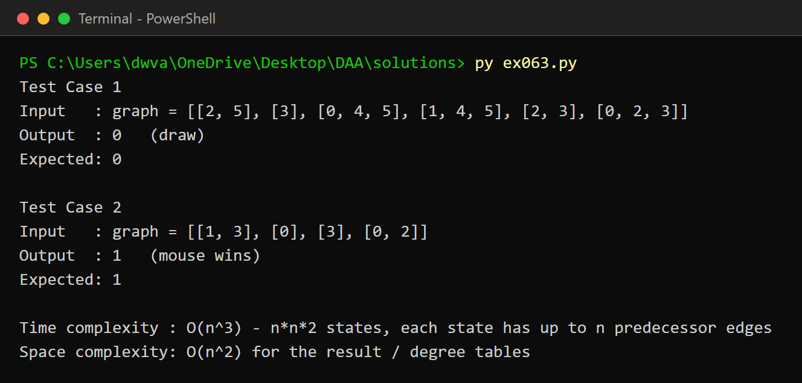

---

<a id="exercise-64"></a>
## Exercise 64 - Path with Maximum Probability (Dijkstra with a max-heap)

**Program** (`solutions/ex064.py`)

```python
# Exercise 64 - Path with Maximum Probability (Dijkstra with a max-heap)
import heapq


def max_probability_path(n, edges, succ_prob, start, end):
    """Dijkstra where the 'distance' is a product of probabilities (all <= 1), so extending a
    path never increases it and the greedy choice stays correct.  heapq is a min-heap, so
    probabilities are stored negated."""
    adj = [[] for _ in range(n)]
    for (a, b), p in zip(edges, succ_prob):
        adj[a].append((b, p))
        adj[b].append((a, p))
    best = [0.0] * n
    best[start] = 1.0
    parent = {start: None}
    heap = [(-1.0, start)]
    while heap:
        neg_p, node = heapq.heappop(heap)
        if node == end:
            break
        if -neg_p < best[node]:
            continue                                  # stale heap entry
        for nxt, p in adj[node]:
            if best[node] * p > best[nxt]:
                best[nxt] = best[node] * p
                parent[nxt] = node
                heapq.heappush(heap, (-best[nxt], nxt))
    if best[end] == 0.0:
        return 0.0, []
    path, node = [], end
    while node is not None:                           # rebuild the path from parents
        path.append(node)
        node = parent[node]
    return best[end], path[::-1]


if __name__ == "__main__":
    tests = [
        (3, [[0, 1], [1, 2], [0, 2]], [0.5, 0.5, 0.2], 0, 2, "0.25000"),
        (3, [[0, 1], [1, 2], [0, 2]], [0.5, 0.5, 0.3], 0, 2, "0.30000"),
        (3, [[0, 1]], [0.5], 0, 2, "0.00000"),         # extra: no path from start to end
    ]
    for no, (n, edges, probs, s, e, expected) in enumerate(tests, 1):
        prob, path = max_probability_path(n, edges, probs, s, e)
        print(f"Test Case {no}" + ("   (extra: unreachable end node)" if no == 3 else ""))
        print(f"Input   : n = {n}, edges = {edges}, succProb = {probs}, start = {s}, end = {e}")
        print(f"Output  : {prob:.5f}")
        print(f"Expected: {expected}")
        print("Best path: " + (" -> ".join(map(str, path)) if path else "none (probability 0)"))
        print()
    print("Time complexity : O((V + E) log V) with a binary heap")
    print("Space complexity: O(V + E)")
```

**Output**

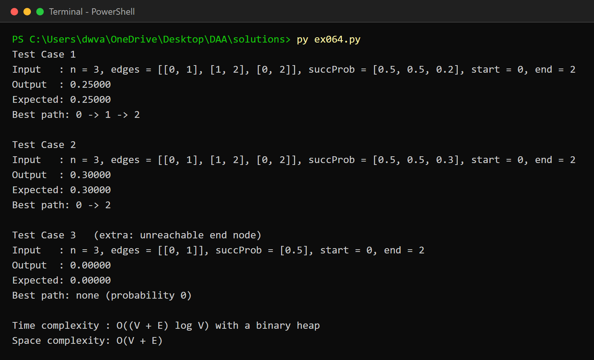

---

<a id="exercise-65"></a>
## Exercise 65 - Unique Paths in an m x n grid (dynamic programming)

**Program** (`solutions/ex065.py`)

```python
# Exercise 65 - Unique Paths in an m x n grid (dynamic programming)
from math import comb


def unique_paths(m, n):
    """paths[j] = number of ways to reach column j of the current row.
    A cell is reached from above or from the left, so paths[j] += paths[j-1]."""
    paths = [1] * n                          # first row: only one way to reach each cell
    for _ in range(1, m):
        for j in range(1, n):
            paths[j] += paths[j - 1]         # (from above, already in paths[j]) + (from left)
    return paths[-1]


def list_paths(m, n, r=0, c=0, so_far=""):
    """Enumerate the actual routes (R = right, D = down) - only used for tiny grids."""
    if r == m - 1 and c == n - 1:
        return [so_far]
    routes = []
    if c + 1 < n:
        routes += list_paths(m, n, r, c + 1, so_far + "R")
    if r + 1 < m:
        routes += list_paths(m, n, r + 1, c, so_far + "D")
    return routes


if __name__ == "__main__":
    names = {"R": "Right", "D": "Down"}
    for no, (m, n, expected) in enumerate([(3, 7, 28), (3, 2, 3)], 1):
        answer = unique_paths(m, n)
        print(f"Test Case {no}")
        print(f"Input   : m = {m}, n = {n}")
        print(f"Output  : {answer}")
        print(f"Expected: {expected}")
        print(f"Check   : C(m+n-2, m-1) = C({m + n - 2}, {m - 1}) = {comb(m + n - 2, m - 1)}")
        if m * n <= 12:                      # list the routes for the small grid
            for k, route in enumerate(list_paths(m, n), 1):
                print(f"   {k}. " + " -> ".join(names[ch] for ch in route))
        print()
    print("Time complexity : O(m * n)    Space complexity: O(n)  (one row of the DP table)")
```

**Output**

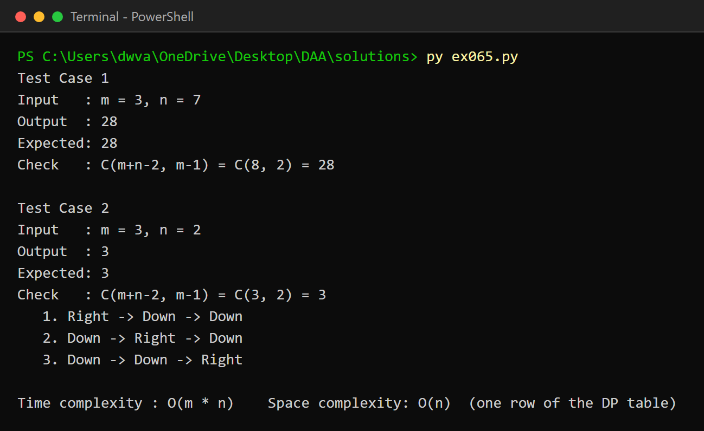

---

<a id="exercise-66"></a>
## Exercise 66 - Number of Good Pairs

**Program** (`solutions/ex066.py`)

```python
# Exercise 66 - Number of Good Pairs
from collections import Counter


def good_pairs_brute_force(nums):
    """O(n^2): list every pair (i, j), i < j, with nums[i] == nums[j]."""
    return [(i, j) for i in range(len(nums))
            for j in range(i + 1, len(nums)) if nums[i] == nums[j]]


def count_good_pairs(nums):
    """O(n): a value occurring c times contributes c*(c-1)/2 good pairs."""
    return sum(c * (c - 1) // 2 for c in Counter(nums).values())


if __name__ == "__main__":
    tests = [([1, 2, 3, 1, 1, 3], 4), ([1, 1, 1, 1], 6)]
    for no, (nums, expected) in enumerate(tests, 1):
        pairs = good_pairs_brute_force(nums)
        print(f"Test Case {no}")
        print(f"Input   : nums = {nums}")
        print(f"Output  : {count_good_pairs(nums)}")
        print(f"Expected: {expected}")
        print(f"Pairs   : {pairs} (0-indexed, brute force count = {len(pairs)})")
        print()
    print("Time complexity : O(n) with a frequency table (O(n^2) for brute force)")
    print("Space complexity: O(k) for k distinct values")
```

**Output**

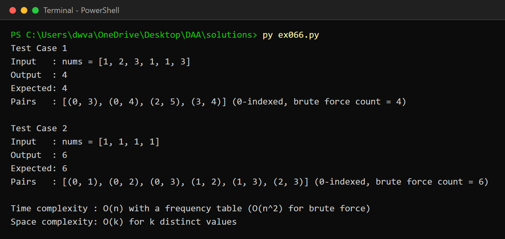

---

<a id="exercise-67"></a>
## Exercise 67 - City With the Smallest Number of Neighbours at a Threshold Distance

**Program** (`solutions/ex067.py`)

```python
# Exercise 67 - City With the Smallest Number of Neighbours at a Threshold Distance
INF = float("inf")


def floyd_warshall(n, edges):
    """All-pairs shortest distances for an undirected weighted graph."""
    dist = [[0 if i == j else INF for j in range(n)] for i in range(n)]
    for u, v, w in edges:
        dist[u][v] = dist[v][u] = min(dist[u][v], w)
    for k in range(n):
        for i in range(n):
            for j in range(n):
                if dist[i][k] + dist[k][j] < dist[i][j]:
                    dist[i][j] = dist[i][k] + dist[k][j]
    return dist


def find_city(n, edges, threshold):
    dist = floyd_warshall(n, edges)
    reach = {c: [d for d in range(n) if d != c and dist[c][d] <= threshold]
             for c in range(n)}
    # fewest reachable cities; ties -> greatest city number
    best = min(range(n), key=lambda c: (len(reach[c]), -c))
    return best, reach


if __name__ == "__main__":
    tests = [
        (4, [[0, 1, 3], [1, 2, 1], [1, 3, 4], [2, 3, 1]], 4, 3),
        (5, [[0, 1, 2], [0, 4, 8], [1, 2, 3], [1, 4, 2], [2, 3, 1], [3, 4, 1]], 2, 0),
    ]
    for no, (n, edges, threshold, expected) in enumerate(tests, 1):
        city, reach = find_city(n, edges, threshold)
        print(f"Test Case {no}")
        print(f"Input   : n = {n}, distanceThreshold = {threshold}")
        print(f"          edges = {edges}")
        for c in range(n):
            print(f"  City {c} -> {['City %d' % d for d in reach[c]]}")
        print(f"Output  : {city}")
        print(f"Expected: {expected}")
        print()
    print("Method: Floyd-Warshall all-pairs shortest paths, O(n^3) time, O(n^2) space")
```

**Output**

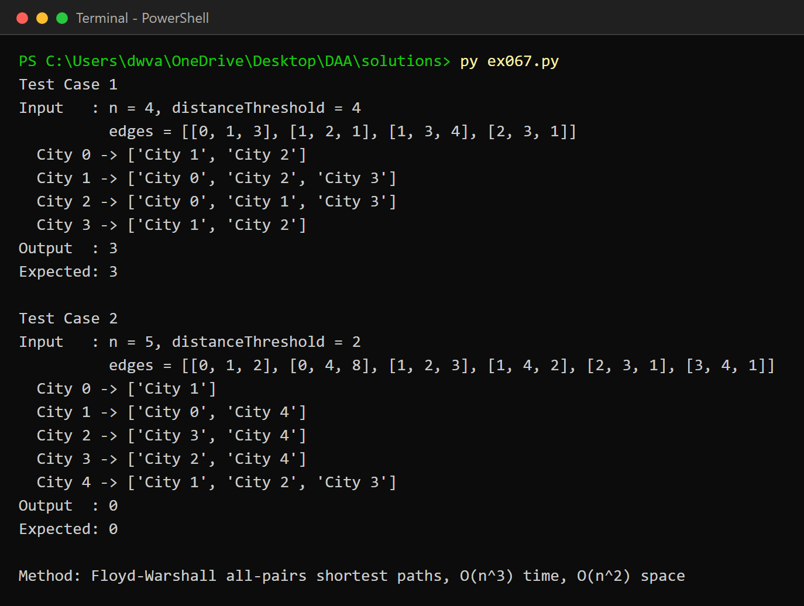

---

<a id="exercise-68"></a>
## Exercise 68 - Network Delay Time (Dijkstra)

**Program** (`solutions/ex068.py`)

```python
# Exercise 68 - Network Delay Time (Dijkstra)
import heapq


def network_delay_time(times, n, k):
    """Minimum time for a signal from k to reach all n nodes, or -1."""
    graph = {u: [] for u in range(1, n + 1)}
    for u, v, w in times:
        graph[u].append((v, w))
    dist = {}                      # finalised shortest times
    heap = [(0, k)]                # (time, node)
    while heap:
        d, u = heapq.heappop(heap)
        if u in dist:
            continue
        dist[u] = d
        for v, w in graph[u]:
            if v not in dist:
                heapq.heappush(heap, (d + w, v))
    return (max(dist.values()), dist) if len(dist) == n else (-1, dist)


if __name__ == "__main__":
    tests = [
        ([[2, 1, 1], [2, 3, 1], [3, 4, 1]], 4, 2, 2),
        ([[1, 2, 1]], 2, 1, 1),
        ([[1, 2, 1]], 2, 2, -1),
    ]
    for no, (times, n, k, expected) in enumerate(tests, 1):
        answer, dist = network_delay_time(times, n, k)
        print(f"Test Case {no}")
        print(f"Input   : times = {times}, n = {n}, k = {k}")
        print(f"Arrival : {dict(sorted(dist.items()))}")
        print(f"Output  : {answer}")
        print(f"Expected: {expected}")
        print()
    print("Time complexity : O(E log V) with a binary heap; Space: O(V + E)")
```

**Output**

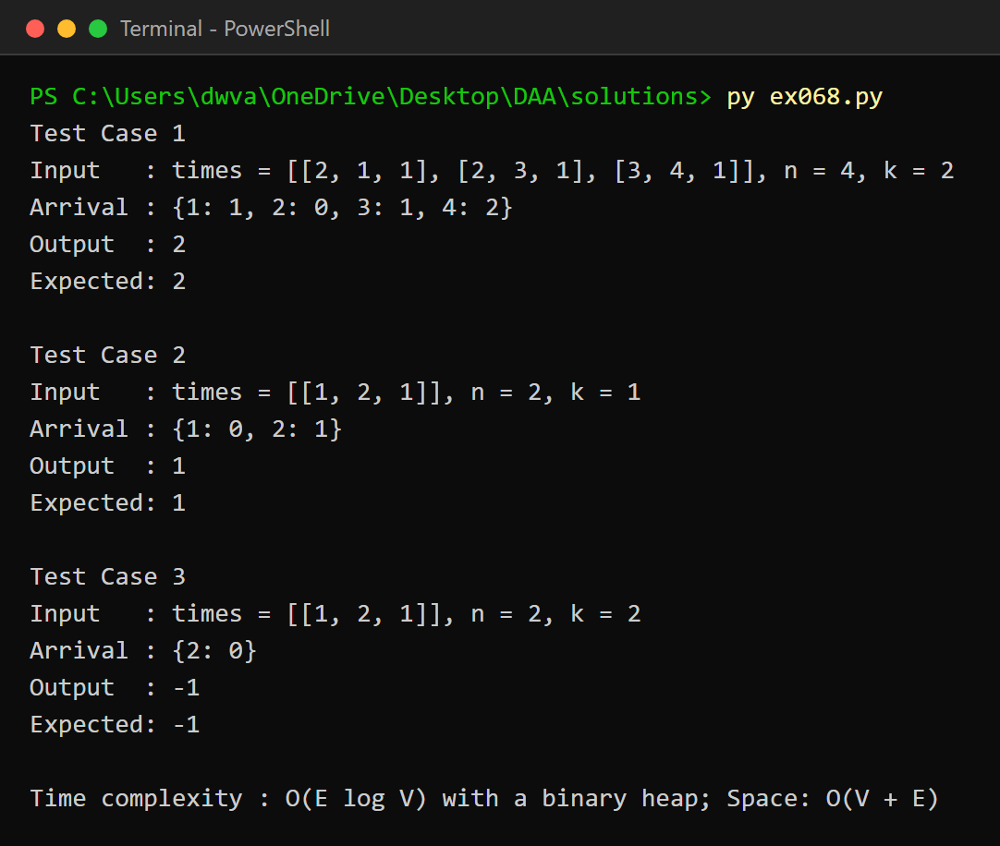

---

