# Topic 5 - Greedy

[← Back to index](README.md)

- [Exercise 69 - Maximum Coins You Can Get (greedy)](#exercise-69)
- [Exercise 70 - Patching Coins so Every Value in [1, target] is Obtainable (greedy)](#exercise-70)
- [Exercise 71 - Minimum Possible Maximum Working Time (backtracking + pruning)](#exercise-71)
- [Exercise 72 - Maximum Profit in Job Scheduling (DP + binary search)](#exercise-72)
- [Exercise 73 - Dijkstra's Algorithm on an Adjacency Matrix](#exercise-73)
- [Exercise 74 - Dijkstra's Algorithm on an Edge List (source -> target)](#exercise-74)
- [Exercise 75 - Huffman Tree and Huffman Codes](#exercise-75)
- [Exercise 76 - Decode a Huffman Encoded String](#exercise-76)
- [Exercise 77 - Maximum Weight Loadable into a Container (greedy, heaviest first)](#exercise-77)
- [Exercise 78 - Minimum Number of Containers (greedy, fill the current container first)](#exercise-78)
- [Exercise 79 - Kruskal's Algorithm (Minimum Spanning Tree)](#exercise-79)
- [Exercise 80 - Is the given MST unique? (and find another MST if not)](#exercise-80)

---

<a id="exercise-69"></a>
## Exercise 69 - Maximum Coins You Can Get (greedy)

**Program** (`solutions/ex069.py`)

```python
# Exercise 69 - Maximum Coins You Can Get (greedy)


def max_coins(piles):
    """Sort; in each step Alice takes the largest, I take the second largest of
    the three chosen piles, Bob takes the smallest.  Greedy: always give Bob the
    smallest remaining pile and pair the two largest remaining piles."""
    piles = sorted(piles)
    lo, hi = 0, len(piles) - 1
    total, triplets = 0, []
    while lo < hi:
        alice, me, bob = piles[hi], piles[hi - 1], piles[lo]
        triplets.append((bob, me, alice))
        total += me
        hi -= 2
        lo += 1
    return total, triplets


if __name__ == "__main__":
    tests = [([2, 4, 1, 2, 7, 8], 9), ([2, 4, 5], 4)]
    for no, (piles, expected) in enumerate(tests, 1):
        total, triplets = max_coins(piles)
        print(f"Test Case {no}")
        print(f"Input   : piles = {piles}")
        print(f"Triplets: {triplets}  (Bob, me, Alice)")
        print(f"My coins: {[t[1] for t in triplets]}")
        print(f"Output  : {total}")
        print(f"Expected: {expected}")
        print()
    print("Time complexity : O(n log n) for sorting; Space: O(n)")
```

**Output**

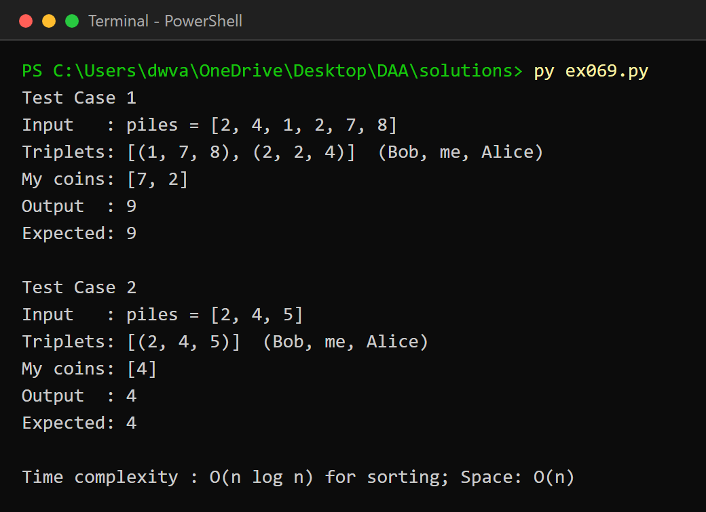

---

<a id="exercise-70"></a>
## Exercise 70 - Patching Coins so Every Value in [1, target] is Obtainable (greedy)

**Program** (`solutions/ex070.py`)

```python
# Exercise 70 - Patching Coins so Every Value in [1, target] is Obtainable (greedy)


def patch_coins(coins, target):
    """Keep `miss` = smallest value in [1, target] that cannot yet be formed.
    If the next coin <= miss it extends the reachable range to miss + coin - 1,
    otherwise add a coin of value `miss` (doubles the reachable range)."""
    coins = sorted(coins)
    miss, i, added = 1, 0, []
    while miss <= target:
        if i < len(coins) and coins[i] <= miss:
            miss += coins[i]
            i += 1
        else:
            added.append(miss)
            miss *= 2
    return added


def all_obtainable(coins, target):
    """Verify by building every subset sum with a bitmask."""
    reach = 1
    for c in coins:
        reach |= reach << c
    return all(reach >> x & 1 for x in range(1, target + 1))


if __name__ == "__main__":
    tests = [([1, 4, 10], 19, 2), ([1, 4, 10, 5, 7, 19], 19, 1)]
    for no, (coins, target, expected) in enumerate(tests, 1):
        added = patch_coins(coins, target)
        final = sorted(coins + added)
        print(f"Test Case {no}")
        print(f"Input   : coins = {coins}, target = {target}")
        print(f"Added   : {added}  -> array {final}")
        print(f"Check   : all of 1..{target} obtainable = {all_obtainable(final, target)}")
        print(f"Output  : {len(added)}")
        print(f"Expected: {expected}")
        print()
    print("Time complexity : O(m log m + log target) (m = len(coins)); Space: O(m)")
```

**Output**

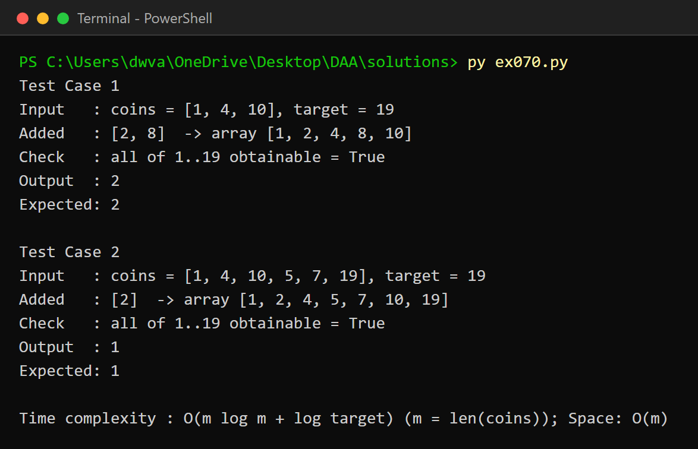

---

<a id="exercise-71"></a>
## Exercise 71 - Minimum Possible Maximum Working Time (backtracking + pruning)

**Program** (`solutions/ex071.py`)

```python
# Exercise 71 - Minimum Possible Maximum Working Time (backtracking + pruning)


def min_max_working_time(jobs, k):
    jobs = sorted(jobs, reverse=True)        # place big jobs first -> prunes early
    load = [0] * k                           # current working time of each worker
    best = [sum(jobs) + 1]                   # smallest maximum found so far
    assign = [[] for _ in range(k)]
    best_assign = [None]

    def place(i):
        if i == len(jobs):
            best[0] = max(load)
            best_assign[0] = [list(a) for a in assign]
            return
        tried = set()
        for w in range(k):
            # skip equal loads (symmetric) and anything that cannot beat `best`
            if load[w] in tried or load[w] + jobs[i] >= best[0]:
                continue
            tried.add(load[w])
            load[w] += jobs[i]
            assign[w].append(jobs[i])
            place(i + 1)
            assign[w].pop()
            load[w] -= jobs[i]

    place(0)
    return best[0], best_assign[0]


if __name__ == "__main__":
    tests = [([3, 2, 3], 3, 3), ([1, 2, 4, 7, 8], 2, 11)]
    for no, (jobs, k, expected) in enumerate(tests, 1):
        answer, assign = min_max_working_time(jobs, k)
        print(f"Test Case {no}")
        print(f"Input   : jobs = {jobs}, k = {k}")
        for w, a in enumerate(assign, 1):
            print(f"  Worker {w}: {sorted(a)} (working time = {sum(a)})")
        print(f"Output  : {answer}")
        print(f"Expected: {expected}")
        print()
    print("Method: backtracking over workers for every job, O(k^n) worst case, pruned")
```

**Output**

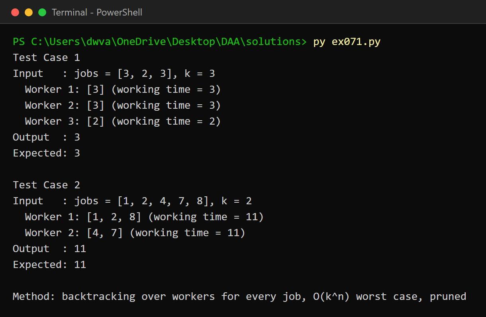

---

<a id="exercise-72"></a>
## Exercise 72 - Maximum Profit in Job Scheduling (DP + binary search)

**Program** (`solutions/ex072.py`)

```python
# Exercise 72 - Maximum Profit in Job Scheduling (DP + binary search)
from bisect import bisect_right


def max_profit(start, end, profit):
    jobs = sorted(zip(start, end, profit), key=lambda j: j[1])   # by end time
    ends = [j[1] for j in jobs]
    dp = [0] * (len(jobs) + 1)          # dp[i] = best profit using first i jobs
    prev = [0] * (len(jobs) + 1)        # prev[i] = # of jobs ending <= start of job i
    for i, (s, e, p) in enumerate(jobs, 1):
        prev[i] = bisect_right(ends, s, 0, i - 1)    # a job ending at s may precede
        dp[i] = max(dp[i - 1], dp[prev[i]] + p)      # skip job i  or  take job i
    chosen, i = [], len(jobs)           # walk back to recover the chosen jobs
    while i > 0:
        if dp[i] != dp[i - 1]:
            chosen.append(jobs[i - 1])
            i = prev[i]
        else:
            i -= 1
    return dp[-1], chosen[::-1]


if __name__ == "__main__":
    tests = [
        ([1, 2, 3, 3], [3, 4, 5, 6], [50, 10, 40, 70], 120),
        ([1, 2, 3, 4, 6], [3, 5, 10, 6, 9], [20, 20, 100, 70, 60], 150),
    ]
    for no, (s, e, p, expected) in enumerate(tests, 1):
        best, chosen = max_profit(s, e, p)
        print(f"Test Case {no}")
        print(f"Input   : startTime = {s}, endTime = {e}, profit = {p}")
        for js, je, jp in chosen:
            print(f"  job [{js}-{je}] profit {jp}")
        print(f"Output  : {best} = " + " + ".join(str(j[2]) for j in chosen))
        print(f"Expected: {expected}")
        print()
    print("Time complexity : O(n log n) (sort + binary search per job); Space: O(n)")
```

**Output**

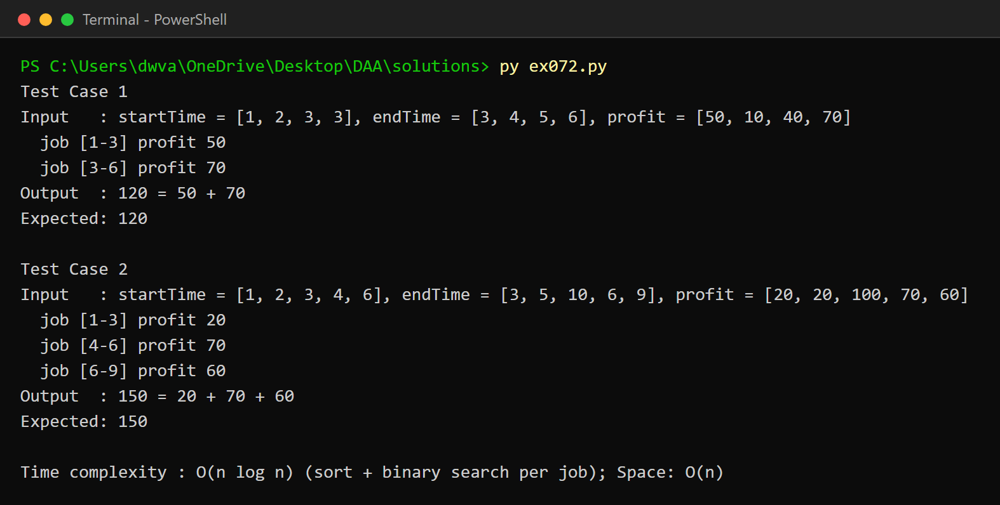

---

<a id="exercise-73"></a>
## Exercise 73 - Dijkstra's Algorithm on an Adjacency Matrix

**Program** (`solutions/ex073.py`)

```python
# Exercise 73 - Dijkstra's Algorithm on an Adjacency Matrix
INF = float("inf")


def dijkstra_matrix(graph, source):
    """Shortest distance from source to every vertex; O(V^2) with a matrix."""
    n = len(graph)
    dist = [INF] * n
    dist[source] = 0
    done = [False] * n
    for _ in range(n):
        # pick the closest vertex not finalised yet
        u = min((v for v in range(n) if not done[v]), key=lambda v: dist[v])
        if dist[u] == INF:
            break                      # remaining vertices are unreachable
        done[u] = True
        for v in range(n):             # relax every edge u -> v
            if graph[u][v] != INF and dist[u] + graph[u][v] < dist[v]:
                dist[v] = dist[u] + graph[u][v]
    return dist


if __name__ == "__main__":
    tests = [
        ([[0, 10, 3, INF, INF], [INF, 0, 1, 2, INF], [INF, 4, 0, 8, 2],
          [INF, INF, INF, 0, 7], [INF, INF, INF, 9, 0]], 0, [0, 7, 3, 9, 5]),
        ([[0, 5, INF, 10], [INF, 0, 3, INF], [INF, INF, 0, 1], [INF, INF, INF, 0]],
         0, [0, 5, 8, 9]),
    ]
    for no, (graph, source, expected) in enumerate(tests, 1):
        print(f"Test Case {no}")
        print(f"Input   : n = {len(graph)}, source = {source}, graph =")
        for row in graph:
            print("   ", " ".join(f"{'Inf' if x == INF else x:>4}" for x in row))
        result = dijkstra_matrix(graph, source)
        print(f"Output  : {result}")
        print(f"Expected: {expected}")
        print()
    print("Time complexity : O(V^2) for the matrix version; Space: O(V)")
```

**Output**

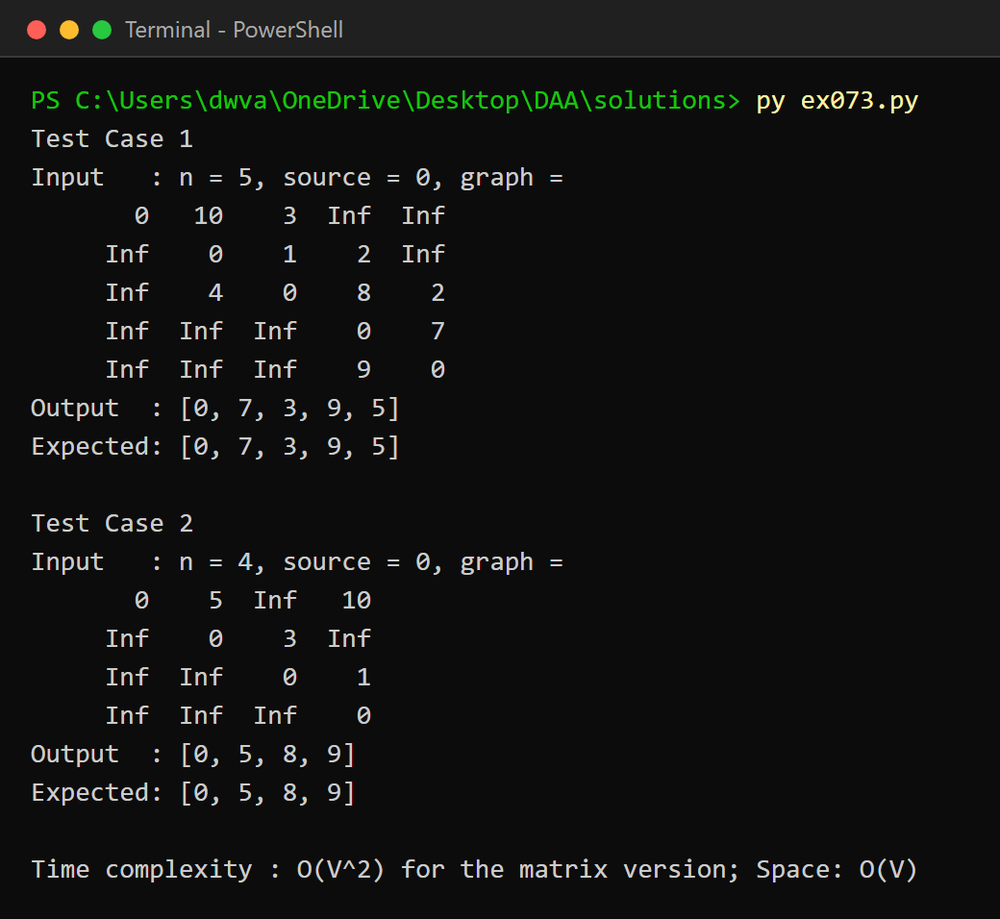

---

<a id="exercise-74"></a>
## Exercise 74 - Dijkstra's Algorithm on an Edge List (source -> target)

**Program** (`solutions/ex074.py`)

```python
# Exercise 74 - Dijkstra's Algorithm on an Edge List (source -> target)
# The statement says each tuple (u, v, w) is an edge FROM u TO v, so edges are
# treated as directed.  The 'undirected' reading is also shown for comparison.
import heapq


def dijkstra_path(n, edges, source, target, directed=True):
    graph = [[] for _ in range(n)]
    for u, v, w in edges:
        graph[u].append((v, w))
        if not directed:
            graph[v].append((u, w))
    dist = [float("inf")] * n
    parent = [None] * n
    dist[source] = 0
    heap = [(0, source)]
    while heap:
        d, u = heapq.heappop(heap)
        if d > dist[u]:
            continue                       # stale heap entry
        for v, w in graph[u]:
            if d + w < dist[v]:
                dist[v], parent[v] = d + w, u
                heapq.heappush(heap, (dist[v], v))
    path, node = [], target
    while node is not None and dist[target] != float("inf"):
        path.append(node)
        node = parent[node]
    return dist[target], path[::-1]


if __name__ == "__main__":
    tests = [
        (6, [(0, 1, 7), (0, 2, 9), (0, 5, 14), (1, 2, 10), (1, 3, 15), (2, 3, 11),
             (2, 5, 2), (3, 4, 6), (4, 5, 9)], 0, 4, 20),
        (5, [(0, 1, 10), (0, 4, 3), (1, 2, 2), (1, 4, 4), (2, 3, 9), (3, 2, 7),
             (4, 1, 1), (4, 2, 8), (4, 3, 2)], 0, 3, 8),
    ]
    for no, (n, edges, source, target, doc) in enumerate(tests, 1):
        print(f"Test Case {no}")
        print(f"Input   : n = {n}, source = {source}, target = {target}")
        print(f"          edges = {edges[:5]}")
        print(f"                  {edges[5:]}")
        dist, path = dijkstra_path(n, edges, source, target)
        udist, upath = dijkstra_path(n, edges, source, target, directed=False)
        print(f"Output  : {dist}   path = {path}   (directed edges, as stated)")
        print(f"Undirected reading: {udist}   path = {upath}")
        if dist == doc:
            print(f"Expected: {doc}")
        else:
            print(f"Note    : document lists {doc}; correct value is {dist} for directed edges"
                  + (f" ({udist} only if edges are undirected)" if udist == doc
                     else f" ({udist} even if undirected)"))
        print()
    print("Time complexity : O((V + E) log V) with a binary heap; Space: O(V + E)")
```

**Output**

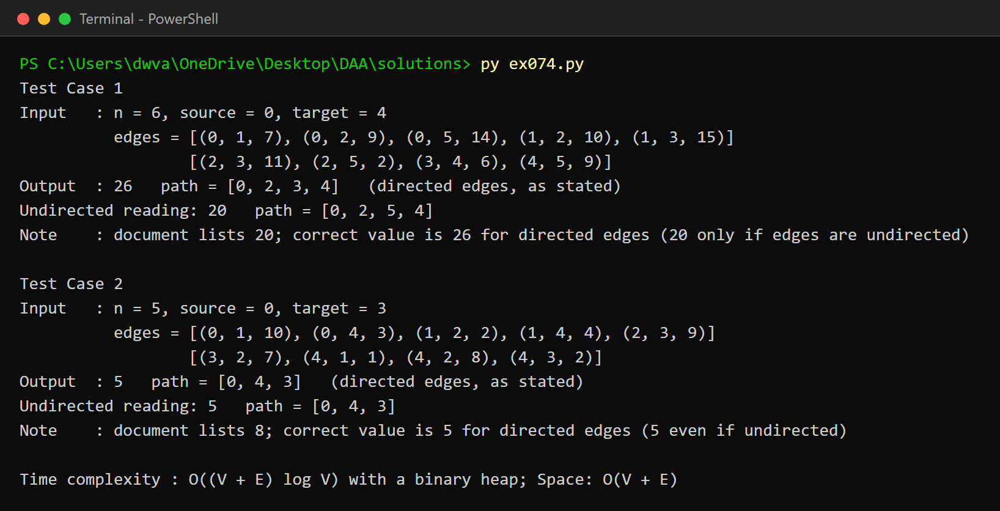

---

<a id="exercise-75"></a>
## Exercise 75 - Huffman Tree and Huffman Codes

**Program** (`solutions/ex075.py`)

```python
# Exercise 75 - Huffman Tree and Huffman Codes
import heapq


def build_huffman_tree(chars, freqs):
    """Repeatedly merge the two least frequent nodes (greedy).
    A leaf is a character (str); an internal node is a (left, right) tuple."""
    heap = [(f, i, c) for i, (c, f) in enumerate(zip(chars, freqs))]
    heapq.heapify(heap)                    # (frequency, tie-breaker, node)
    tie = len(heap)
    while len(heap) > 1:
        f1, _, left = heapq.heappop(heap)
        f2, _, right = heapq.heappop(heap)
        heapq.heappush(heap, (f1 + f2, tie, (left, right)))
        tie += 1
    return heap[0][2]


def huffman_codes(node, prefix="", codes=None):
    """Walk the tree: left edge = '0', right edge = '1'."""
    codes = {} if codes is None else codes
    if isinstance(node, str):
        codes[node] = prefix or "0"        # a lone character still needs one bit
    else:
        huffman_codes(node[0], prefix + "0", codes)
        huffman_codes(node[1], prefix + "1", codes)
    return codes


def encoded_length(codes, chars, freqs):
    return sum(f * len(codes[c]) for c, f in zip(chars, freqs))


if __name__ == "__main__":
    tests = [
        (['a', 'b', 'c', 'd'], [5, 9, 12, 13],
         [('a', '110'), ('b', '10'), ('c', '0'), ('d', '111')]),
        (['f', 'e', 'd', 'c', 'b', 'a'], [5, 9, 12, 13, 16, 45],
         [('a', '0'), ('b', '101'), ('c', '100'), ('d', '111'), ('e', '1101'), ('f', '1100')]),
    ]
    for no, (chars, freqs, doc) in enumerate(tests, 1):
        codes = huffman_codes(build_huffman_tree(chars, freqs))
        result = sorted(codes.items())
        cost = encoded_length(codes, chars, freqs)
        doc_cost = encoded_length(dict(doc), chars, freqs)
        print(f"Test Case {no}")
        print(f"Input   : n = {len(chars)}, characters = {chars}, frequencies = {freqs}")
        print(f"Output  : {result}")
        print(f"Cost    : sum(freq x code length) = {cost} bits")
        if result == doc:
            print(f"Expected: {doc}")
        else:
            print(f"Document: {doc}")
            if doc_cost == cost:
                print(f"Note    : document's codes differ in bits only (same lengths, cost {cost}); "
                      "Huffman codes are not unique")
            else:
                print(f"Note    : document lists non-optimal codes (cost {doc_cost} bits); "
                      f"correct Huffman cost is {cost} bits")
        print()
    print("Time complexity : O(n log n) using a min-heap; Space: O(n)")
```

**Output**

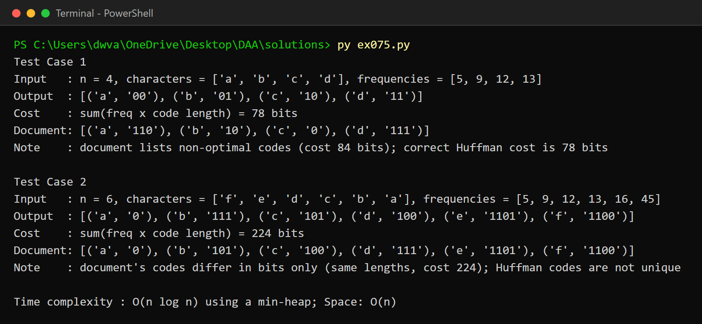

---

<a id="exercise-76"></a>
## Exercise 76 - Decode a Huffman Encoded String

**Program** (`solutions/ex076.py`)

```python
# Exercise 76 - Decode a Huffman Encoded String
import heapq


def build_huffman_tree(chars, freqs):
    """Greedy Huffman construction. Leaf = character, internal node = (left, right)."""
    heap = [(f, i, c) for i, (c, f) in enumerate(zip(chars, freqs))]
    heapq.heapify(heap)
    tie = len(heap)
    while len(heap) > 1:
        f1, _, left = heapq.heappop(heap)
        f2, _, right = heapq.heappop(heap)
        heapq.heappush(heap, (f1 + f2, tie, (left, right)))
        tie += 1
    return heap[0][2]


def code_table(node, prefix="", table=None):
    table = {} if table is None else table
    if isinstance(node, str):
        table[node] = prefix or "0"
    else:
        code_table(node[0], prefix + "0", table)
        code_table(node[1], prefix + "1", table)
    return table


def decode(root, bits):
    """Walk from the root: '0' -> left, '1' -> right; a leaf emits its character
    and the walk restarts at the root.  Returns (text, unused trailing bits)."""
    text, node, pending = [], root, ""
    for b in bits:
        node = node[0] if b == "0" else node[1]
        pending += b
        if isinstance(node, str):
            text.append(node)
            node, pending = root, ""
    return "".join(text), pending


if __name__ == "__main__":
    tests = [
        (['a', 'b', 'c', 'd'], [5, 9, 12, 13], '1101100111110', "abacd"),
        (['f', 'e', 'd', 'c', 'b', 'a'], [5, 9, 12, 13, 16, 45],
         '110011011100101111001011', "fcbade"),
    ]
    for no, (chars, freqs, bits, doc) in enumerate(tests, 1):
        tree = build_huffman_tree(chars, freqs)
        codes = code_table(tree)
        text, rest = decode(tree, bits)
        print(f"Test Case {no}")
        print(f"Input   : n = {len(chars)}, characters = {chars}, frequencies = {freqs}")
        print(f"          encoded_string = '{bits}'")
        print(f"Codes   : {dict(sorted(codes.items()))}")
        print(f"Output  : \"{text}\"" + (f"  (trailing bits '{rest}' are not a complete code)"
                                        if rest else ""))
        right = "".join(codes[c] for c in doc)       # correct encoding of the document's answer
        back, _ = decode(tree, right)
        print(f"Check   : encode(\"{doc}\") = '{right}' -> decode gives \"{back}\"")
        if (text, rest) == (doc, ""):
            print(f"Expected: \"{doc}\"")
        else:
            print(f"Note    : document lists \"{doc}\"; given string is not an encoding of it "
                  f"(correct: '{right}')")
        print()
    print("Time complexity : O(n log n) to build the tree, O(L) to decode L bits")
```

**Output**

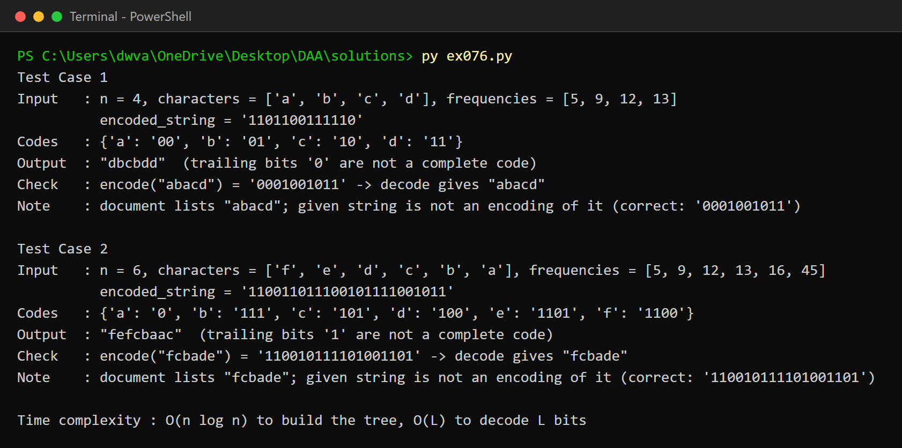

---

<a id="exercise-77"></a>
## Exercise 77 - Maximum Weight Loadable into a Container (greedy, heaviest first)

**Program** (`solutions/ex077.py`)

```python
# Exercise 77 - Maximum Weight Loadable into a Container (greedy, heaviest first)
# Interpretation: go through the items from heaviest to lightest and load an item
# whenever it still fits; an item that does not fit is skipped (not the end of the loop).


def greedy_max_load(weights, capacity):
    load, taken = 0, []
    for w in sorted(weights, reverse=True):
        if load + w <= capacity:
            load += w
            taken.append(w)
    return load, taken


def best_possible_load(weights, capacity):
    """Reference: exact subset-sum by bitmask, to see whether greedy was optimal."""
    reach = 1
    for w in weights:
        reach |= reach << w
    return max(x for x in range(capacity + 1) if reach >> x & 1)


if __name__ == "__main__":
    tests = [([10, 20, 30, 40, 50], 60, 50), ([5, 10, 15, 20, 25, 30], 50, 50)]
    for no, (weights, cap, doc) in enumerate(tests, 1):
        load, taken = greedy_max_load(weights, cap)
        print(f"Test Case {no}")
        print(f"Input   : n = {len(weights)}, weights = {weights}, max_capacity = {cap}")
        print(f"Loaded  : {taken} (heaviest first)")
        print(f"Output  : {load}")
        if load == doc:
            print(f"Expected: {doc}")
        else:
            print(f"Note    : document lists {doc}; correct value is {load} "
                  f"({' + '.join(map(str, taken))} fits exactly within {cap})")
        best = best_possible_load(weights, cap)
        print(f"Optimal : {best} (subset-sum check; greedy "
              f"{'matches' if best == load else 'is not optimal here'})")
        print()
    print("Time complexity : O(n log n) for sorting; Space: O(n)")
```

**Output**

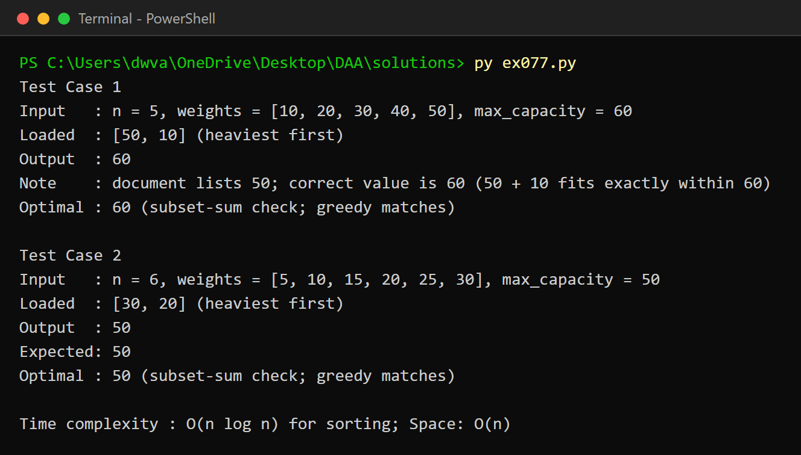

---

<a id="exercise-78"></a>
## Exercise 78 - Minimum Number of Containers (greedy, fill the current container first)

**Program** (`solutions/ex078.py`)

```python
# Exercise 78 - Minimum Number of Containers (greedy, fill the current container first)
# The stated greedy rule = "next fit": keep loading items (in the given order) into the
# current container; when the next item does not fit, close it and open a new one.


def containers_next_fit(weights, capacity):
    containers, current, used = [], [], 0
    for w in weights:
        if used + w > capacity:            # current container is as full as it gets
            containers.append(current)
            current, used = [], 0
        current.append(w)
        used += w
    if current:
        containers.append(current)
    return containers


def containers_first_fit_decreasing(weights, capacity):
    """For comparison: heaviest item first, into the first container with room."""
    bins = []
    for w in sorted(weights, reverse=True):
        for b in bins:
            if sum(b) + w <= capacity:
                b.append(w)
                break
        else:
            bins.append([w])
    return bins


if __name__ == "__main__":
    tests = [([5, 10, 15, 20, 25, 30, 35], 50, 4),
             ([10, 20, 30, 40, 50, 60, 70, 80], 100, 6)]
    for no, (weights, cap, doc) in enumerate(tests, 1):
        boxes = containers_next_fit(weights, cap)
        better = containers_first_fit_decreasing(weights, cap)
        print(f"Test Case {no}")
        print(f"Input   : n = {len(weights)}, weights = {weights}, max_capacity = {cap}")
        for i, b in enumerate(boxes, 1):
            print(f"  Container {i}: {b} (load {sum(b)})")
        print(f"Output  : {len(boxes)}")
        if len(boxes) == doc:
            print(f"Expected: {doc}")
        else:
            print(f"Note    : document lists {doc}; correct value is {len(boxes)} "
                  f"for the stated greedy rule")
        print(f"Compare : first-fit decreasing needs {len(better)}; "
              f"lower bound ceil(sum/cap) = {-(-sum(weights) // cap)}")
        print()
    print("Time complexity : O(n) for the stated greedy; Space: O(n)")
```

**Output**

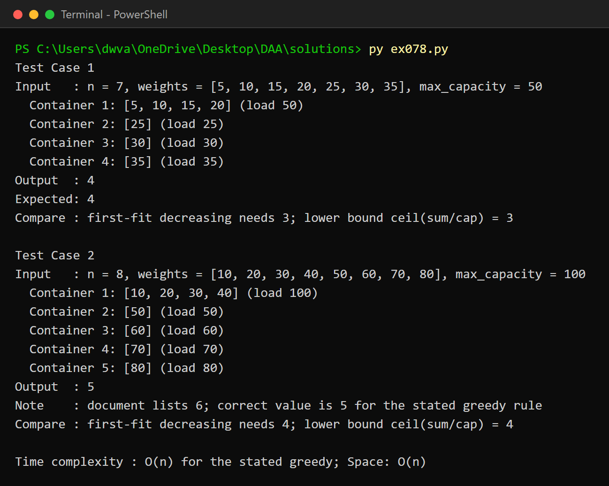

---

<a id="exercise-79"></a>
## Exercise 79 - Kruskal's Algorithm (Minimum Spanning Tree)

**Program** (`solutions/ex079.py`)

```python
# Exercise 79 - Kruskal's Algorithm (Minimum Spanning Tree)

class DisjointSet:
    """Union-Find with path compression and union by rank."""
    def __init__(self, n):
        self.parent = list(range(n))
        self.rank = [0] * n

    def find(self, x):
        while self.parent[x] != x:
            self.parent[x] = self.parent[self.parent[x]]   # path halving
            x = self.parent[x]
        return x

    def union(self, a, b):
        ra, rb = self.find(a), self.find(b)
        if ra == rb:
            return False                                    # same component -> cycle
        if self.rank[ra] < self.rank[rb]:
            ra, rb = rb, ra
        self.parent[rb] = ra
        if self.rank[ra] == self.rank[rb]:
            self.rank[ra] += 1
        return True


def kruskal(n, edges):
    """Return (list of MST edges in the order chosen, total weight)."""
    ds = DisjointSet(n)
    mst, total = [], 0
    for u, v, w in sorted(edges, key=lambda e: e[2]):       # greedy: lightest edge first
        if ds.union(u, v):                                  # accept only if no cycle forms
            mst.append((u, v, w))
            total += w
            if len(mst) == n - 1:
                break
    return mst, total


def run_test(number, n, edges, expected_edges, expected_weight):
    mst, total = kruskal(n, edges)
    print(f"Test Case {number}")
    print(f"Input   : n = {n}, m = {len(edges)}")
    print(f"          edges = {edges}")
    print(f"Sorted  : {sorted(edges, key=lambda e: e[2])}")
    print(f"Output  : Edges in MST: {mst}")
    print(f"          Total weight of MST: {total}")
    if mst == expected_edges and total == expected_weight:
        print(f"Expected: Edges in MST: {expected_edges}, Total weight of MST: {expected_weight}")
    else:
        print(f"Note    : document lists {expected_edges} / {expected_weight}; "
              f"correct value is {mst} / {total}")
    print()


if __name__ == "__main__":
    run_test(1, 4, [(0, 1, 10), (0, 2, 6), (0, 3, 5), (1, 3, 15), (2, 3, 4)],
             [(2, 3, 4), (0, 3, 5), (0, 1, 10)], 19)
    run_test(2, 5, [(0, 1, 2), (0, 3, 6), (1, 2, 3), (1, 3, 8), (1, 4, 5), (2, 4, 7), (3, 4, 9)],
             [(0, 1, 2), (1, 2, 3), (1, 4, 5), (0, 3, 6)], 16)
    print("Complexity: sorting O(E log E) + union-find O(E * alpha(V)) = O(E log E); space O(V + E).")
```

**Output**

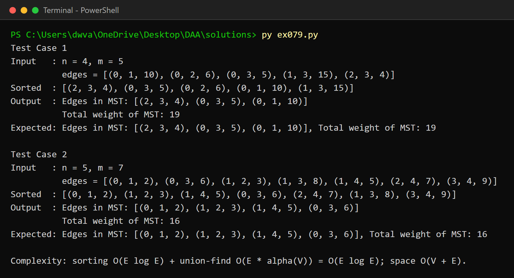

---

<a id="exercise-80"></a>
## Exercise 80 - Is the given MST unique? (and find another MST if not)

**Program** (`solutions/ex080.py`)

```python
# Exercise 80 - Is the given MST unique? (and find another MST if not)
# Idea: for a valid MST T, T is the ONLY MST iff every non-tree edge (u, v, w) is strictly heavier
# than every tree edge on the T-path u..v.  If some tree edge on that path has weight == w,
# swapping the two edges gives a different spanning tree of the same (minimum) weight.

def key(e):
    return (min(e[0], e[1]), max(e[0], e[1]), e[2])          # undirected edge identity


def kruskal_weight(n, edges):
    parent = list(range(n))
    def find(x):
        while parent[x] != x:
            parent[x] = parent[parent[x]]
            x = parent[x]
        return x
    total = 0
    for u, v, w in sorted(edges, key=lambda e: e[2]):
        ru, rv = find(u), find(v)
        if ru != rv:
            parent[ru] = rv
            total += w
    return total


def tree_path(n, tree, src, dst):
    """Edges of the unique path src -> dst inside the tree (DFS)."""
    adj = {i: [] for i in range(n)}
    for e in tree:
        adj[e[0]].append((e[1], e))
        adj[e[1]].append((e[0], e))
    stack, seen = [(src, [])], {src}
    while stack:
        node, path = stack.pop()
        if node == dst:
            return path
        for nxt, e in adj[node]:
            if nxt not in seen:
                seen.add(nxt)
                stack.append((nxt, path + [e]))
    return None                                              # not connected


def check_mst_uniqueness(n, edges, given):
    """Return (is_valid_mst, is_unique, another_mst_or_None)."""
    graph_keys = {key(e) for e in edges}
    if len(given) != n - 1 or any(key(e) not in graph_keys for e in given):
        return False, False, None
    if sum(e[2] for e in given) != kruskal_weight(n, edges):
        return False, False, None                            # not minimum weight
    if any(tree_path(n, given, 0, v) is None for v in range(n)):
        return False, False, None                            # not spanning
    tree_keys = {key(e) for e in given}
    for u, v, w in edges:
        if key((u, v, w)) in tree_keys:
            continue
        path = tree_path(n, given, u, v)
        for old in path:
            if old[2] == w:                                  # tie -> swap gives another MST
                return True, False, [(u, v, w) if e == old else e for e in given]
    return True, True, None


def run_test(number, n, edges, given, exp_unique, exp_other=None):
    valid, unique, other = check_mst_uniqueness(n, edges, given)
    print(f"Test Case {number}")
    print(f"Input   : n = {n}, m = {len(edges)}")
    print(f"          edges = {edges}")
    print(f"          given_mst = {given}")
    print(f"Output  : Given tree is a valid MST? {valid}")
    print(f"          Is the given MST unique? {unique}")
    if other:
        print(f"          Another possible MST: {other}")
        print(f"          Total weight of MST: {sum(e[2] for e in other)}")
    if unique == exp_unique and other == exp_other:          # compare with the document
        print(f"Expected: Is the given MST unique? {exp_unique}")
        if exp_other:
            print(f"          Another possible MST: {exp_other}")
    else:
        print(f"Note    : document lists unique={exp_unique}, another={exp_other}; "
              f"correct value is unique={unique}, another={other}")
    print()


if __name__ == "__main__":
    run_test(1, 4, [(0, 1, 10), (0, 2, 6), (0, 3, 5), (1, 3, 15), (2, 3, 4)],
             [(2, 3, 4), (0, 3, 5), (0, 1, 10)], True)
    run_test(2, 5, [(0, 1, 1), (0, 2, 1), (1, 3, 2), (2, 3, 2), (3, 4, 3), (4, 2, 3)],
             [(0, 1, 1), (0, 2, 1), (1, 3, 2), (3, 4, 3)], False,
             [(0, 1, 1), (0, 2, 1), (2, 3, 2), (3, 4, 3)])
```

**Output**

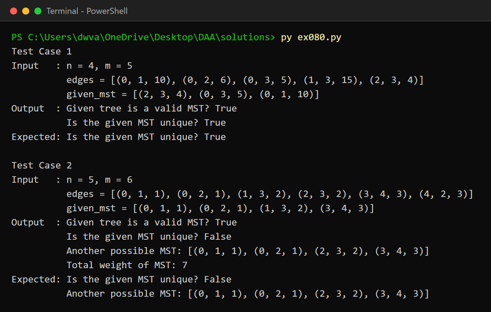

---

