# Topic 6 - Backtracking

[← Back to index](README.md)

- [Exercise 81 - Visualizing N-Queens solutions (N = 4, 5, 8)](#exercise-81)
- [Exercise 82 - Generalized N-Queens (rectangular board, obstacles, restricted squares)](#exercise-82)
- [Exercise 83 - Sudoku Solver (backtracking with row / column / box sets)](#exercise-83)
- [Exercise 84 - Sudoku Solver (bitmask constraints + "most constrained cell first" heuristic)](#exercise-84)
- [Exercise 85 - Target Sum (count sign assignments that reach the target)](#exercise-85)
- [Exercise 86 - Sum of Subarray Minimums (monotonic stack, O(n))](#exercise-86)
- [Exercise 87 - Combination Sum (each candidate may be reused any number of times)](#exercise-87)
- [Exercise 88 - Combination Sum II (each candidate used at most once, no duplicate combinations)](#exercise-88)
- [Exercise 89 - Permutations (distinct integers, backtracking)](#exercise-89)
- [Exercise 90 - Permutations II (input may contain duplicates, unique permutations only)](#exercise-90)
- [Exercise 91 - Graph coloring (minimum colors) and the You/Alice/Bob map-coloring game](#exercise-91)
- [Exercise 92 - Hamiltonian cycle in an undirected graph (backtracking)](#exercise-92)
- [Exercise 93 - Hamiltonian cycle using bitmask dynamic programming (Held-Karp style)](#exercise-93)
- [Exercise 94 - Generate all subsets of a set in lexicographical order, and handle duplicates](#exercise-94)
- [Exercise 95 - Subset generation: subsets containing a given element, and the full power set](#exercise-95)
- [Exercise 96 - Word Subsets (universal strings)](#exercise-96)

---

<a id="exercise-81"></a>
## Exercise 81 - Visualizing N-Queens solutions (N = 4, 5, 8)

**Program** (`solutions/ex081.py`)

```python
# Exercise 81 - Visualizing N-Queens solutions (N = 4, 5, 8)

def solve_all(n):
    """Backtracking: one queen per row. Returns (all solutions, nodes visited)."""
    sols, nodes = [], [0]
    cols, d1, d2 = set(), set(), set()
    placed = []

    def place(row):
        if row == n:
            sols.append(placed[:])
            return
        for c in range(n):
            if c in cols or (row - c) in d1 or (row + c) in d2:
                continue                                   # column or diagonal attacked
            nodes[0] += 1
            cols.add(c); d1.add(row - c); d2.add(row + c); placed.append(c)
            place(row + 1)
            cols.remove(c); d1.remove(row - c); d2.remove(row + c); placed.pop()

    place(0)
    return sols, nodes[0]


def board_rows(sol):
    """Text rows of the board: Q = queen, . = empty."""
    n = len(sol)
    return [" ".join("Q" if sol[r] == c else "." for c in range(n)) for r in range(n)]


def show_side_by_side(sol_a, sol_b):
    for a, b in zip(board_rows(sol_a), board_rows(sol_b)):
        print("    " + a + "      " + b)


if __name__ == "__main__":
    print("Why visualize? A picture of the board shows at a glance that no two Q share a row,")
    print("column or diagonal, exposes symmetric/mirrored solutions, and helps debugging: a wrong")
    print("diagonal test shows up as two queens lined up diagonally. Counting nodes visited also")
    print("shows how fast the search grows with N (complexity insight).")
    stats = []
    for label, n, picks in (("a", 4, (0, 1)), ("b", 5, (0, 1)), ("c", 8, (0, 1))):
        sols, nodes = solve_all(n)
        stats.append((n, len(sols), nodes))
        print(f"\n{label}. Visualization for {n}-Queens")
        print(f"Input   : N = {n}")
        print(f"Output  : {len(sols)} solutions found; showing solution #{picks[0] + 1} (left)"
              f" and #{picks[1] + 1} (right)")
        print(f"          columns (0-based, per row): {sols[picks[0]]}  and  {sols[picks[1]]}")
        show_side_by_side(sols[picks[0]], sols[picks[1]])
    print("\nN   solutions   placements tried by backtracking")
    for n, count, nodes in stats:
        print(f"{n}   {count:<9}   {nodes}")
    print("Explanation: each 'Q' is a queen and '.' an empty square; for N = 4 the two solutions are")
    print("mirror images of each other, which a picture makes obvious.")
```

**Output**

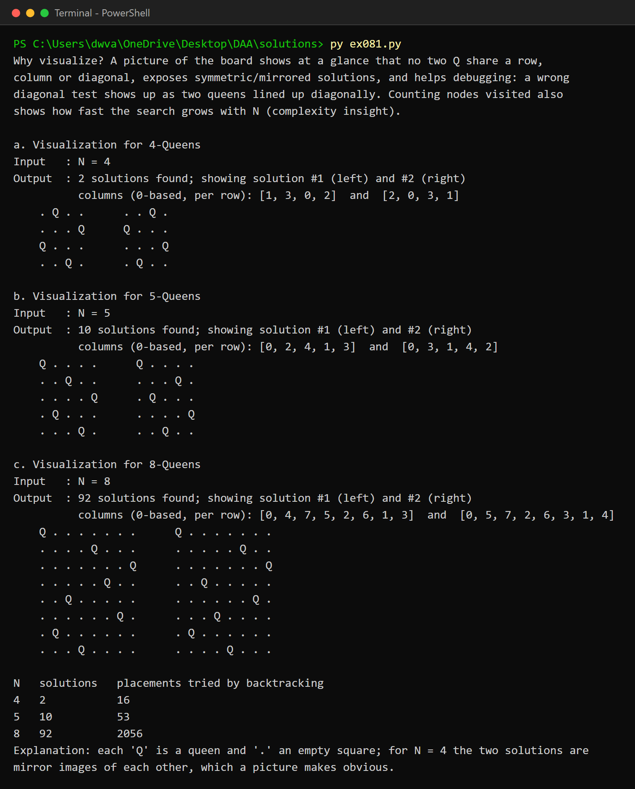

---

<a id="exercise-82"></a>
## Exercise 82 - Generalized N-Queens (rectangular board, obstacles, restricted squares)

**Program** (`solutions/ex082.py`)

```python
# Exercise 82 - Generalized N-Queens (rectangular board, obstacles, restricted squares)
# Interpretation: rows/columns are 1-based (row, col); an obstacle / restricted square is a cell
# where NO queen may be placed (it does not block lines of attack). One queen per row (rows <= cols).

def placements(rows, cols, blocked=frozenset()):
    """Backtracking generator yielding every valid list of 1-based columns (one per row)."""
    sol, used_cols, diag1, diag2 = [], set(), set(), set()

    def place(r):
        if r > rows:
            yield sol[:]
            return
        for c in range(1, cols + 1):
            if (r, c) in blocked or c in used_cols or (r - c) in diag1 or (r + c) in diag2:
                continue                                   # blocked cell or attacked square
            sol.append(c); used_cols.add(c); diag1.add(r - c); diag2.add(r + c)
            yield from place(r + 1)
            sol.pop(); used_cols.remove(c); diag1.remove(r - c); diag2.remove(r + c)

    yield from place(1)


def why_invalid(sol, rows, cols, blocked):
    """None if the placement is valid, otherwise the reason it is not."""
    for i, c in enumerate(sol, 1):
        if not 1 <= c <= cols:
            return f"column {c} is outside the board"
        if (i, c) in blocked:
            return f"queen at ({i}, {c}) is on a forbidden square"
    for i in range(len(sol)):
        for j in range(i + 1, len(sol)):
            if sol[i] == sol[j]:
                return f"queens in rows {i + 1} and {j + 1} share a column"
            if abs(sol[i] - sol[j]) == j - i:
                return f"queens in rows {i + 1} and {j + 1} share a diagonal"
    return None if len(sol) == rows else "wrong number of queens"


def draw(sol, cols, blocked):
    for r, qc in enumerate(sol, 1):
        print("    " + " ".join("Q" if c == qc else "X" if (r, c) in blocked else "."
                                for c in range(1, cols + 1)))


def run_case(title, rows, cols, blocked, note, sample):
    all_solutions = list(placements(rows, cols, blocked))
    sol = all_solutions[0]
    print(title)
    print(f"Input   : {rows} rows x {cols} columns, forbidden squares (row, col) = {sorted(blocked)}")
    print(f"Output  : Possible solution {sol}   ({len(all_solutions)} solutions in total)")
    draw(sol, cols, blocked)
    reason = why_invalid(sample, rows, cols, blocked)
    if sample == sol:
        print(f"Expected: {sample}")
    elif reason is None:
        print(f"Note    : document lists {sample}, which is also valid (any valid answer is accepted)")
    else:
        print(f"Note    : document lists {sample}; it is invalid")
        print(f"          ({reason}); a correct value is {sol}")
    print(f"Explanation: {note}\n")


if __name__ == "__main__":
    print("Generalization: the attack rule (same column or |dr| == |dc|) is unchanged; only the search")
    print("space changes. On a rows x cols board at most min(rows, cols) queens fit, so we place one")
    print("queen per row of the shorter side; forbidden squares are skipped when trying columns.\n")
    run_case("a. 8x10 board", 8, 10, frozenset(),
             "place 8 queens on an 8x10 board, columns 1..10 are available to every row.",
             [1, 3, 5, 7, 9, 2, 4, 6])
    run_case("b. 5x5 board with obstacles at (2, 2) and (4, 4)", 5, 5, frozenset({(2, 2), (4, 4)}),
             "squares with obstacles are skipped, the rest of the search is unchanged.",
             [1, 3, 5, 2, 4])
    run_case("c. 6x6 board, first queen may not use columns 2 and 4", 6, 6, frozenset({(1, 2), (1, 4)}),
             "squares (1, 2) and (1, 4) are restricted, so the first queen must use another column.",
             [1, 3, 5, 2, 4, 6])
    print("Complexity: worst case O(cols^rows); pruning by columns/diagonals/forbidden squares keeps it small.")
```

**Output**

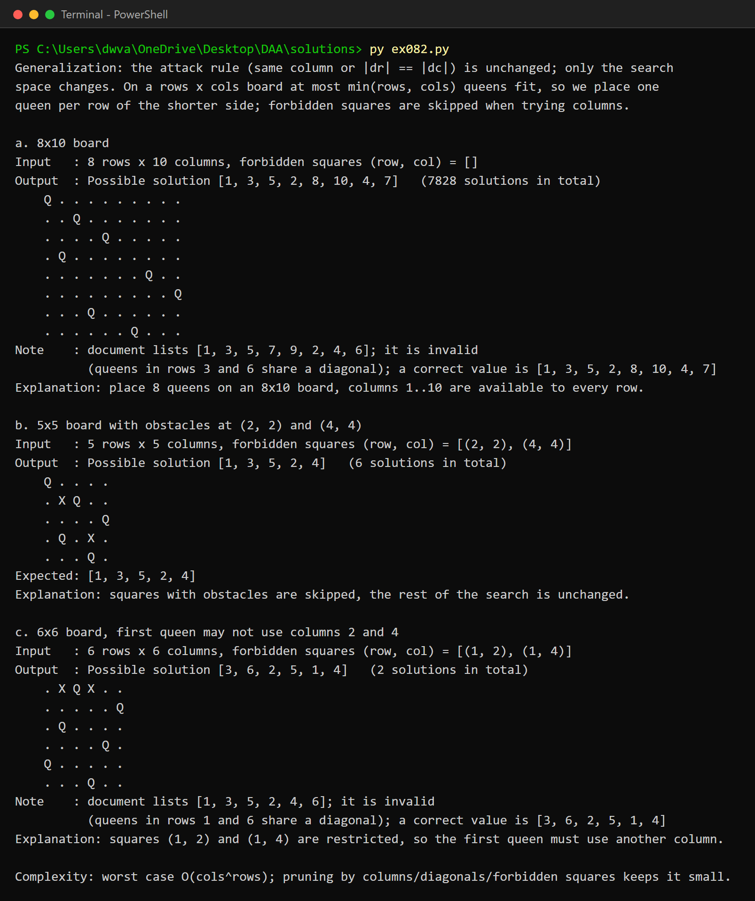

---

<a id="exercise-83"></a>
## Exercise 83 - Sudoku Solver (backtracking with row / column / box sets)

**Program** (`solutions/ex083.py`)

```python
# Exercise 83 - Sudoku Solver (backtracking with row / column / box sets)

PUZZLE = ["53..7....", "6..195...", ".98....6.", "8...6...3", "4..8.3..1",
          "7...2...6", ".6....28.", "...419..5", "....8..79"]
EXPECTED = ["534678912", "672195348", "198342567", "859761423", "426853791",
            "713924856", "961537284", "287419635", "345286179"]


def solve_sudoku(board):
    """Fill the '.' cells of a 9x9 list-of-lists board in place; return True if solvable."""
    rows = [set() for _ in range(9)]
    cols = [set() for _ in range(9)]
    boxes = [set() for _ in range(9)]
    empty = []
    for r in range(9):
        for c in range(9):
            if board[r][c] == ".":
                empty.append((r, c))
            else:
                rows[r].add(board[r][c]); cols[c].add(board[r][c]); boxes[r // 3 * 3 + c // 3].add(board[r][c])

    def fill(k):
        if k == len(empty):
            return True                                    # every empty cell is filled
        r, c = empty[k]
        b = r // 3 * 3 + c // 3
        for d in "123456789":
            if d in rows[r] or d in cols[c] or d in boxes[b]:
                continue                                   # digit already used in row/col/box
            board[r][c] = d
            rows[r].add(d); cols[c].add(d); boxes[b].add(d)
            if fill(k + 1):
                return True
            board[r][c] = "."                              # undo (backtrack)
            rows[r].remove(d); cols[c].remove(d); boxes[b].remove(d)
        return False

    return fill(0)


def print_board(rows):
    for r, row in enumerate(rows):
        if r in (3, 6):
            print("  ------+-------+------")
        print("  " + " | ".join(" ".join(row[i:i + 3]) for i in (0, 3, 6)))


if __name__ == "__main__":
    board = [list(row) for row in PUZZLE]
    print("Example 1")
    print("Input   : board =")
    print_board(PUZZLE)
    solved = solve_sudoku(board)
    result = ["".join(row) for row in board]
    print(f"Output  : solved = {solved}")
    print_board(result)
    if result == EXPECTED:
        print("Expected: matches the solution given in the document (all 9 rows identical)")
    else:
        print("Note    : result differs from the document's solution")
    valid = all(sorted(r) == list("123456789") for r in result) and \
        all(sorted(result[r][c] for r in range(9)) == list("123456789") for c in range(9))
    print(f"Check   : every row and column contains digits 1-9 exactly once -> {valid}")
```

**Output**

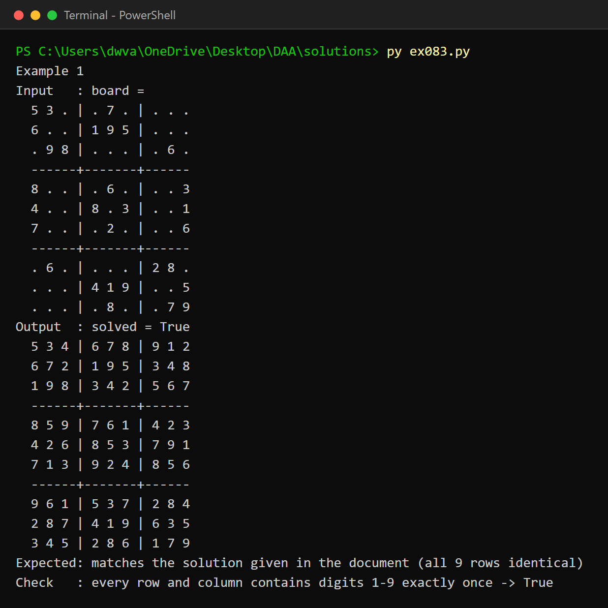

---

<a id="exercise-84"></a>
## Exercise 84 - Sudoku Solver (bitmask constraints + "most constrained cell first" heuristic)

**Program** (`solutions/ex084.py`)

```python
# Exercise 84 - Sudoku Solver (bitmask constraints + "most constrained cell first" heuristic)
# Different approach from Exercise 83: instead of filling cells left-to-right, always pick the empty
# cell with the fewest candidate digits (MRV), using integer bitmasks for row / column / box.

BOARD = [["5", "3", ".", ".", "7", ".", ".", ".", "."],
         ["6", ".", ".", "1", "9", "5", ".", ".", "."],
         [".", "9", "8", ".", ".", ".", ".", "6", "."],
         ["8", ".", ".", ".", "6", ".", ".", ".", "3"],
         ["4", ".", ".", "8", ".", "3", ".", ".", "1"],
         ["7", ".", ".", ".", "2", ".", ".", ".", "6"],
         [".", "6", ".", ".", ".", ".", "2", "8", "."],
         [".", ".", ".", "4", "1", "9", ".", ".", "5"],
         [".", ".", ".", ".", "8", ".", ".", "7", "9"]]
EXPECTED = [["5", "3", "4", "6", "7", "8", "9", "1", "2"], ["6", "7", "2", "1", "9", "5", "3", "4", "8"],
            ["1", "9", "8", "3", "4", "2", "5", "6", "7"], ["8", "5", "9", "7", "6", "1", "4", "2", "3"],
            ["4", "2", "6", "8", "5", "3", "7", "9", "1"], ["7", "1", "3", "9", "2", "4", "8", "5", "6"],
            ["9", "6", "1", "5", "3", "7", "2", "8", "4"], ["2", "8", "7", "4", "1", "9", "6", "3", "5"],
            ["3", "4", "5", "2", "8", "6", "1", "7", "9"]]


def solve_sudoku(board):
    """Solve in place with bitmask backtracking; returns (solved?, number of recursive calls)."""
    used = [0] * 27                                        # rows 0-8, columns 9-17, boxes 18-26
    empty = set()
    for r in range(9):
        for c in range(9):
            if board[r][c] == ".":
                empty.add((r, c))
            else:
                bit = 1 << int(board[r][c])
                used[r] |= bit; used[9 + c] |= bit; used[18 + r // 3 * 3 + c // 3] |= bit
    calls = [0]

    def candidates(r, c):
        return [d for d in range(1, 10)
                if not (used[r] | used[9 + c] | used[18 + r // 3 * 3 + c // 3]) >> d & 1]

    def search():
        calls[0] += 1
        if not empty:
            return True
        r, c = min(empty, key=lambda cell: len(candidates(*cell)))   # fewest options first
        empty.remove((r, c))
        for d in candidates(r, c):
            bit = 1 << d
            board[r][c] = str(d)
            used[r] |= bit; used[9 + c] |= bit; used[18 + r // 3 * 3 + c // 3] |= bit
            if search():
                return True
            used[r] ^= bit; used[9 + c] ^= bit; used[18 + r // 3 * 3 + c // 3] ^= bit
        board[r][c] = "."
        empty.add((r, c))
        return False

    return search(), calls[0]


if __name__ == "__main__":
    board = [row[:] for row in BOARD]
    print("Example 1")
    print("Input   : board =")
    for row in BOARD:
        print("  ", row)
    solved, calls = solve_sudoku(board)
    print(f"Output  : solved = {solved}  ({calls} recursive calls)")
    for row in board:
        print("  ", row)
    if board == EXPECTED:
        print("Expected: matches the solution given in the document (all 9 rows identical)")
    else:
        print("Note    : result differs from the document's solution")
```

**Output**

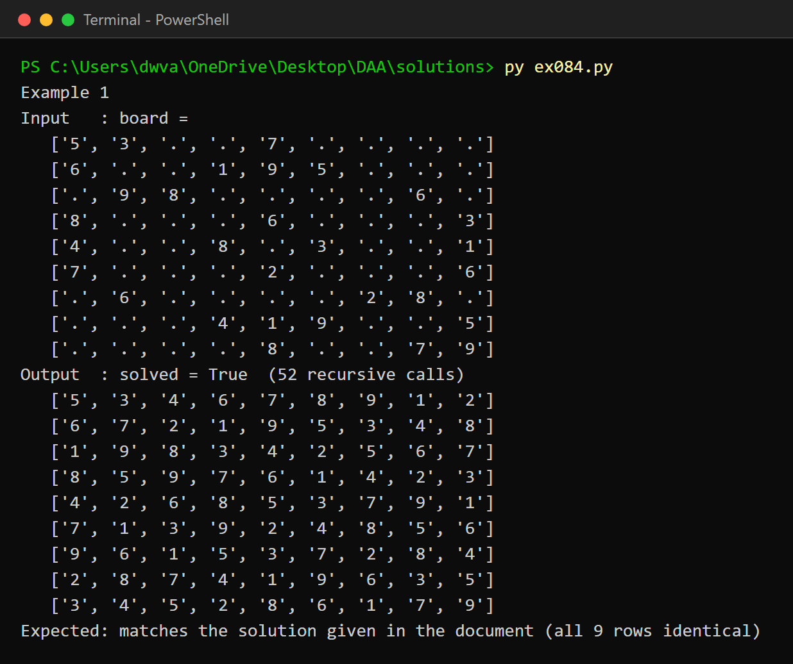

---

<a id="exercise-85"></a>
## Exercise 85 - Target Sum (count sign assignments that reach the target)

**Program** (`solutions/ex085.py`)

```python
# Exercise 85 - Target Sum (count sign assignments that reach the target)
from collections import defaultdict
from itertools import product


def count_expressions(nums, target):
    """DP over reachable sums: ways[s] = number of sign choices so far that give sum s."""
    ways = {0: 1}
    for x in nums:
        nxt = defaultdict(int)
        for s, cnt in ways.items():
            nxt[s + x] += cnt                              # put '+' before x
            nxt[s - x] += cnt                              # put '-' before x
        ways = nxt
    return ways.get(target, 0)


def format_expression(signs, nums):
    parts = []
    for i, (s, x) in enumerate(zip(signs, nums)):
        sign = "+" if s > 0 else "-"
        parts.append(sign + str(x) if i == 0 else f"{sign} {x}")
    return " ".join(parts)


def list_expressions(nums, target):
    """Brute force (2^n sign patterns) - only used to display the expressions."""
    return [f"{format_expression(signs, nums)} = {target}"
            for signs in product((-1, 1), repeat=len(nums))
            if sum(s * x for s, x in zip(signs, nums)) == target]


def run_test(number, nums, target, expected):
    count = count_expressions(nums, target)
    print(f"Example {number}")
    print(f"Input   : nums = {nums}, target = {target}")
    print(f"Output  : {count}")
    if count == expected:
        print(f"Expected: {expected}")
    else:
        print(f"Note    : document lists {expected}; correct value is {count}")
    expressions = list_expressions(nums, target)
    print(f"Explanation: There are {len(expressions)} way(s) to assign symbols to make the sum of nums be target {target}.")
    for e in expressions:
        print("  " + e)
    print()


if __name__ == "__main__":
    run_test(1, [1, 1, 1, 1, 1], 3, 5)
    run_test(2, [1], 1, 1)
    print("Complexity: DP is O(n * S) time where S = sum(nums) (number of distinct reachable sums).")
```

**Output**

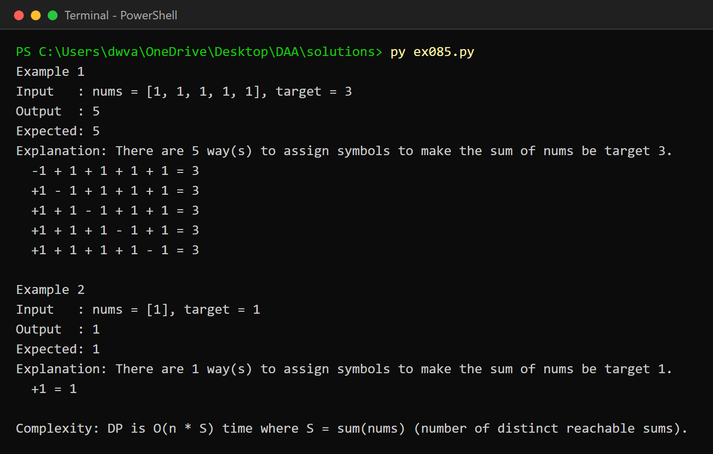

---

<a id="exercise-86"></a>
## Exercise 86 - Sum of Subarray Minimums (monotonic stack, O(n))

**Program** (`solutions/ex086.py`)

```python
# Exercise 86 - Sum of Subarray Minimums (monotonic stack, O(n))
MOD = 10 ** 9 + 7


def sum_subarray_mins(arr):
    """arr[i] is the minimum of left[i] * right[i] subarrays, where
    left[i]  = distance to the previous strictly smaller element,
    right[i] = distance to the next smaller-or-equal element (asymmetric to avoid double counting).
    Returns (answer mod 10^9+7, left, right)."""
    n = len(arr)
    left, right = [0] * n, [0] * n
    stack = []                                             # indices holding increasing values
    for i in range(n):
        while stack and arr[stack[-1]] >= arr[i]:
            stack.pop()
        left[i] = i - (stack[-1] if stack else -1)
        stack.append(i)
    stack = []
    for i in range(n - 1, -1, -1):
        while stack and arr[stack[-1]] > arr[i]:
            stack.pop()
        right[i] = (stack[-1] if stack else n) - i
        stack.append(i)
    total = sum(a * l * r for a, l, r in zip(arr, left, right)) % MOD
    return total, left, right


def run_test(number, arr, expected):
    total, left, right = sum_subarray_mins(arr)
    print(f"Example {number}")
    print(f"Input   : arr = {arr}")
    print(f"Output  : {total}")
    if total == expected:
        print(f"Expected: {expected}")
    else:
        print(f"Note    : document lists {expected}; correct value is {total}")
    print("Explanation: each element is the minimum of (left x right) subarrays")
    for a, l, r in zip(arr, left, right):
        print(f"   {a:>3} -> {l} x {r} = {l * r} subarrays, contributes {a * l * r}")
    print()


if __name__ == "__main__":
    run_test(1, [3, 1, 2, 4], 17)
    run_test(2, [11, 81, 94, 43, 3], 444)
    print("Complexity: every index is pushed/popped once -> O(n) time, O(n) space; answer taken mod 10^9 + 7.")
```

**Output**

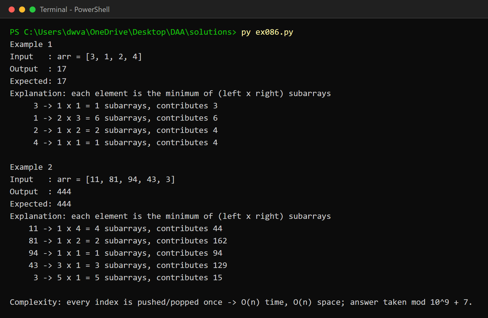

---

<a id="exercise-87"></a>
## Exercise 87 - Combination Sum (each candidate may be reused any number of times)

**Program** (`solutions/ex087.py`)

```python
# Exercise 87 - Combination Sum (each candidate may be reused any number of times)

def combination_sum(candidates, target):
    """Backtracking over sorted candidates; 'start' keeps combinations in non-decreasing order,
    so every combination is generated exactly once (no duplicates)."""
    candidates = sorted(candidates)
    result, current = [], []

    def search(start, remaining):
        if remaining == 0:
            result.append(current[:])
            return
        for i in range(start, len(candidates)):
            c = candidates[i]
            if c > remaining:
                break                                      # sorted -> all later ones are too big
            current.append(c)
            search(i, remaining - c)                       # i (not i+1): same number may be reused
            current.pop()

    search(0, target)
    return result


def run_test(number, candidates, target, expected):
    result = combination_sum(candidates, target)
    print(f"Example {number}")
    print(f"Input   : candidates = {candidates}, target = {target}")
    print(f"Output  : {result}")
    if sorted(result) == sorted(expected):
        print(f"Expected: {expected}")
    else:
        print(f"Note    : document lists {expected}; correct value is {result}")
    print(f"Explanation: {len(result)} unique combinations sum to {target}.")
    print()


if __name__ == "__main__":
    run_test(1, [2, 3, 6, 7], 7, [[2, 2, 3], [7]])
    run_test(2, [2, 3, 5], 8, [[2, 2, 2, 2], [2, 3, 3], [3, 5]])
    print("Complexity: worst case O(2^(target/min(candidates))) time, recursion depth <= target/min(candidates).")
```

**Output**

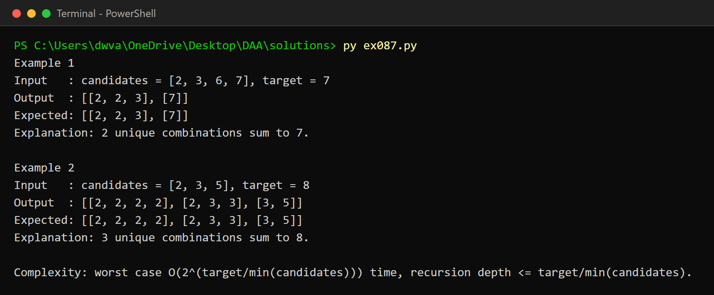

---

<a id="exercise-88"></a>
## Exercise 88 - Combination Sum II (each candidate used at most once, no duplicate combinations)

**Program** (`solutions/ex088.py`)

```python
# Exercise 88 - Combination Sum II (each candidate used at most once, no duplicate combinations)

def combination_sum_2(candidates, target):
    """Sort, then backtrack. Skipping equal values at the same recursion level removes duplicates."""
    candidates = sorted(candidates)
    result, current = [], []

    def search(start, remaining):
        if remaining == 0:
            result.append(current[:])
            return
        for i in range(start, len(candidates)):
            if i > start and candidates[i] == candidates[i - 1]:
                continue                                   # same value already tried at this level
            if candidates[i] > remaining:
                break                                      # sorted -> nothing further can fit
            current.append(candidates[i])
            search(i + 1, remaining - candidates[i])       # i + 1: each element used only once
            current.pop()

    search(0, target)
    return result


def run_test(number, candidates, target, expected):
    result = combination_sum_2(candidates, target)
    print(f"Example {number}")
    print(f"Input   : candidates = {candidates}, target = {target}")
    print(f"Output  : {result}")
    if result == expected:
        print(f"Expected: {expected}")
    else:
        print(f"Note    : document lists {expected}; correct value is {result}")
    print(f"Explanation: {len(result)} unique combinations (each number used at most once) sum to {target}.")
    print()


if __name__ == "__main__":
    run_test(1, [10, 1, 2, 7, 6, 1, 5], 8, [[1, 1, 6], [1, 2, 5], [1, 7], [2, 6]])
    run_test(2, [2, 5, 2, 1, 2], 5, [[1, 2, 2], [5]])
    print("Complexity: O(2^n) time in the worst case (n = number of candidates), O(n) recursion depth.")
```

**Output**

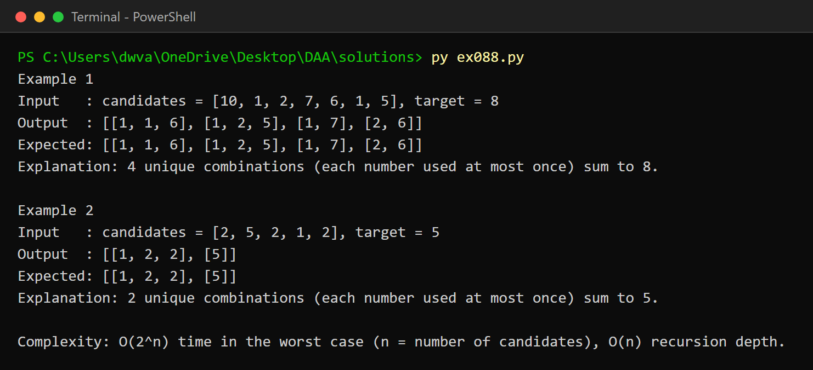

---

<a id="exercise-89"></a>
## Exercise 89 - Permutations (distinct integers, backtracking)

**Program** (`solutions/ex089.py`)

```python
# Exercise 89 - Permutations (distinct integers, backtracking)

def permutations(nums):
    """Build each permutation position by position, marking numbers already used."""
    result, current = [], []
    used = [False] * len(nums)

    def build():
        if len(current) == len(nums):
            result.append(current[:])
            return
        for i, x in enumerate(nums):
            if used[i]:
                continue
            used[i] = True
            current.append(x)
            build()
            current.pop()                                  # backtrack
            used[i] = False

    build()
    return result


def run_test(number, nums, expected):
    result = permutations(nums)
    print(f"Example {number}")
    print(f"Input   : nums = {nums}")
    print(f"Output  : {result}")
    if result == expected:
        print(f"Expected: {expected}")
    else:
        print(f"Note    : document lists {expected}; correct value is {result}")
    print(f"Explanation: {len(result)} permutation(s), {len(nums)}! = {len(result)}.")
    print()


if __name__ == "__main__":
    run_test(1, [1, 2, 3], [[1, 2, 3], [1, 3, 2], [2, 1, 3], [2, 3, 1], [3, 1, 2], [3, 2, 1]])
    run_test(2, [0, 1], [[0, 1], [1, 0]])
    run_test(3, [1], [[1]])
    print("Complexity: n! permutations, each copied in O(n) -> O(n * n!) time, O(n) extra space for recursion.")
```

**Output**

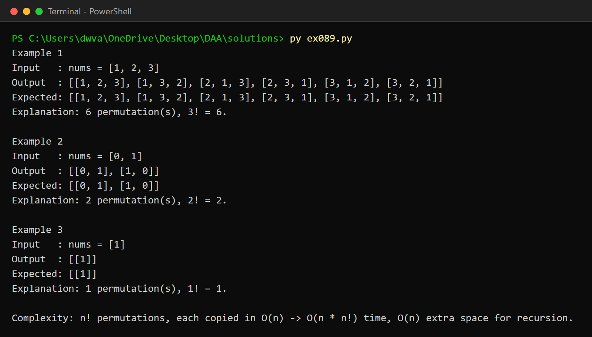

---

<a id="exercise-90"></a>
## Exercise 90 - Permutations II (input may contain duplicates, unique permutations only)

**Program** (`solutions/ex090.py`)

```python
# Exercise 90 - Permutations II (input may contain duplicates, unique permutations only)
from collections import Counter


def unique_permutations(nums):
    """Backtrack over a multiset (value -> remaining count). Choosing each distinct VALUE once per
    position (instead of each index) never generates the same permutation twice."""
    counts = Counter(nums)
    result, current = [], []

    def build():
        if len(current) == len(nums):
            result.append(current[:])
            return
        for value in sorted(counts):
            if counts[value] == 0:
                continue
            counts[value] -= 1
            current.append(value)
            build()
            current.pop()                                  # backtrack
            counts[value] += 1

    build()
    return result


def run_test(number, nums, expected):
    result = unique_permutations(nums)
    print(f"Example {number}")
    print(f"Input   : nums = {nums}")
    print(f"Output  : {result}")
    if sorted(result) == sorted(expected):
        print(f"Expected: {expected}")
    else:
        print(f"Note    : document lists {expected}; correct value is {result}")
    print(f"Explanation: {len(result)} unique permutations.")
    print()


if __name__ == "__main__":
    run_test(1, [1, 1, 2], [[1, 1, 2], [1, 2, 1], [2, 1, 1]])
    run_test(2, [1, 2, 3], [[1, 2, 3], [1, 3, 2], [2, 1, 3], [2, 3, 1], [3, 1, 2], [3, 2, 1]])
    print("Complexity: at most n! / (c1! c2! ...) permutations, each built in O(n) -> O(n * n!) worst case.")
```

**Output**

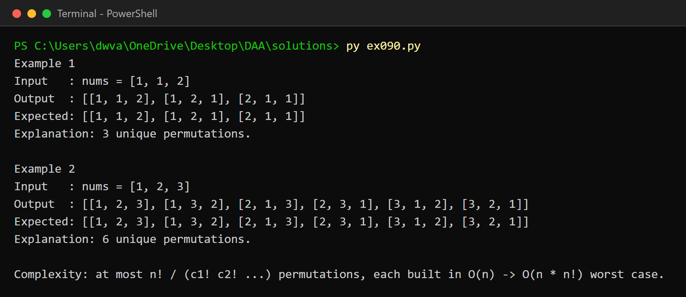

---

<a id="exercise-91"></a>
## Exercise 91 - Graph coloring (minimum colors) and the You/Alice/Bob map-coloring game

**Program** (`solutions/ex091.py`)

```python
# Exercise 91 - Graph coloring (minimum colors) and the You/Alice/Bob map-coloring game
def build_adjacency(n, edges):
    adj = [set() for _ in range(n)]
    for u, v in edges:
        adj[u].add(v)
        adj[v].add(u)
    return adj


def is_safe(v, color, colors, adj):
    return all(colors[u] != color for u in adj[v])


def color_graph(v, n, k, adj, colors):
    """Backtracking: colour vertices v..n-1 using at most k colours."""
    if v == n:
        return True
    for c in range(k):
        if is_safe(v, c, colors, adj):
            colors[v] = c
            if color_graph(v + 1, n, k, adj, colors):
                return True
            colors[v] = -1
    return False


def minimum_colors(n, adj):
    """Try k = 1, 2, 3, ... and return the first k that works (the chromatic number)."""
    for k in range(1, n + 1):
        colors = [-1] * n
        if color_graph(0, n, k, adj, colors):
            return k, colors


def max_regions_you_color(n, adj, k):
    """Turns go You, Alice, Bob, You, ... Each turn colours one uncoloured region with a legal
    colour (no neighbour already has it). Search all move sequences that colour every region
    and return the largest number of regions colored by You."""
    best = -1

    def play(colors, turn, mine):
        nonlocal best
        if -1 not in colors:
            best = max(best, mine)
            return
        for v in range(n):
            if colors[v] == -1:
                for c in range(k):
                    if is_safe(v, c, colors, adj):
                        colors[v] = c
                        play(colors, turn + 1, mine + (turn % 3 == 0))
                        colors[v] = -1

    play([-1] * n, 0, 0)
    return best


if __name__ == "__main__":
    n, k = 4, 3
    edges = [(0, 1), (1, 2), (2, 3), (3, 0), (0, 2)]
    adj = build_adjacency(n, edges)
    print("Test Case 1")
    print(f"Input   : n = {n}, edges = {edges}, colors k = {k}")
    chi, colors = minimum_colors(n, adj)
    print(f"Minimum colors needed (backtracking): {chi}")
    print(f"Coloring (vertex: color): {dict(enumerate(colors))}")
    print(f"Number of colors k = {k} is {'enough' if k >= chi else 'NOT enough'} for a proper coloring")
    mine = max_regions_you_color(n, adj, k)
    print(f"Output  : Maximum number of regions you can color: {mine}")
    print("Expected: Maximum number of regions you can color: 2")
    print(f"Check   : turns alternate You/Alice/Bob, so with {n} regions you color turns 1 and 4 = {mine}")
```

**Output**

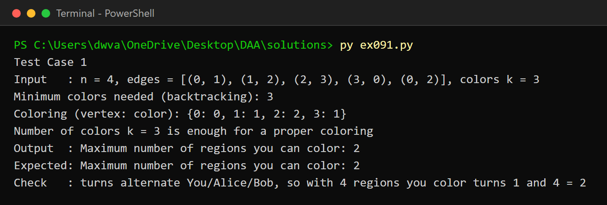

---

<a id="exercise-92"></a>
## Exercise 92 - Hamiltonian cycle in an undirected graph (backtracking)

**Program** (`solutions/ex092.py`)

```python
# Exercise 92 - Hamiltonian cycle in an undirected graph (backtracking)
def build_adjacency(n, edges):
    adj = [[] for _ in range(n)]
    for u, v in edges:
        adj[u].append(v)
        adj[v].append(u)
    return adj


def hamiltonian_cycle(n, edges):
    """Return a Hamiltonian cycle as a vertex list (start repeated at the end), or None."""
    adj = build_adjacency(n, edges)
    path = [0]

    def extend():
        if len(path) == n:
            return 0 in adj[path[-1]]          # last vertex must connect back to the start
        for v in adj[path[-1]]:
            if v not in path:
                path.append(v)
                if extend():
                    return True
                path.pop()                      # backtrack
        return False

    return path + [0] if extend() else None


def is_valid_cycle(n, edges, cycle):
    edge_set = {frozenset(e) for e in edges}
    steps = list(zip(cycle, cycle[1:]))
    missing = [s for s in steps if frozenset(s) not in edge_set]
    return sorted(cycle[:-1]) == list(range(n)) and cycle[0] == cycle[-1] and not missing, missing


if __name__ == "__main__":
    n = 5
    edges = [(0, 1), (1, 2), (2, 3), (3, 0), (0, 2), (2, 4), (4, 0)]
    print("Test Case 1")
    print(f"Input   : n = {n}, edges = {edges}")
    cycle = hamiltonian_cycle(n, edges)
    print(f"Output  : Hamiltonian Cycle Exists: {cycle is not None}")
    if cycle:
        print("Cycle   :", " -> ".join(map(str, cycle)))
    adj = build_adjacency(n, edges)
    print("Degrees :", {v: len(adj[v]) for v in range(n)})
    print("Reason  : vertices 1, 3, 4 each have only the neighbours {0, 2}; a cycle would need both of")
    print("          their edges, giving vertex 0 three cycle edges instead of two -> impossible.")
    doc_cycle = [0, 1, 2, 4, 3, 0]
    ok, missing = is_valid_cycle(n, edges, doc_cycle)
    print(f"Check   : document's cycle {doc_cycle} valid? {ok}; edges not in graph: {missing}")
    print("Note    : document lists True (cycle 0->1->2->4->3->0); correct value is False (no edge (4,3))")
    print("Time    : O(n!) worst case for backtracking; Hamiltonian Cycle is NP-complete")
```

**Output**

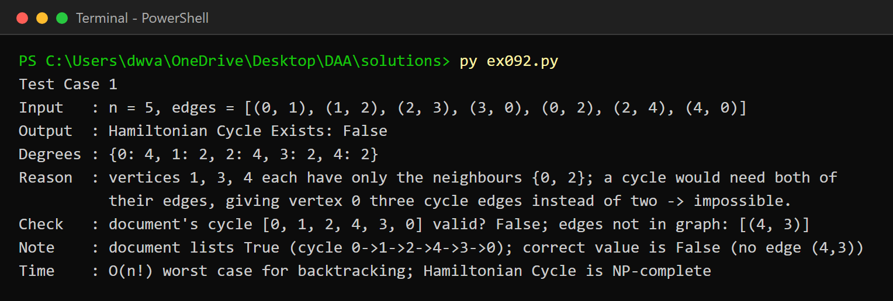

---

<a id="exercise-93"></a>
## Exercise 93 - Hamiltonian cycle using bitmask dynamic programming (Held-Karp style)

**Program** (`solutions/ex093.py`)

```python
# Exercise 93 - Hamiltonian cycle using bitmask dynamic programming (Held-Karp style)
def hamiltonian_cycle_dp(n, edges):
    """reach[(mask, last)] = previous vertex, for every path that starts at 0, visits exactly the
    vertices in `mask` and ends at `last`. A full mask whose last vertex touches 0 is a cycle."""
    adj = [[False] * n for _ in range(n)]
    for u, v in edges:
        adj[u][v] = adj[v][u] = True
    full = (1 << n) - 1
    reach = {(1, 0): None}
    for mask in range(1, full + 1):
        if not mask & 1:
            continue                                    # every path starts at vertex 0
        for last in range(n):
            if (mask, last) not in reach:
                continue
            for nxt in range(n):
                if adj[last][nxt] and not (mask >> nxt) & 1:
                    reach.setdefault((mask | 1 << nxt, nxt), last)
    for last in range(1, n):
        if (full, last) in reach and adj[last][0]:
            path, mask, cur = [], full, last
            while cur is not None:                      # walk the parents back to vertex 0
                path.append(cur)
                prev = reach[(mask, cur)]
                mask ^= 1 << cur
                cur = prev
            return path[::-1] + [0]
    return None


if __name__ == "__main__":
    n = 4
    edges = [(0, 1), (1, 2), (2, 3), (3, 0), (0, 2)]
    print("Test Case 1")
    print(f"Input   : n = {n}, edges = {edges}")
    cycle = hamiltonian_cycle_dp(n, edges)
    print(f"Output  : Hamiltonian Cycle Exists: {cycle is not None}", end="")
    print(f" (Example cycle: {' -> '.join(map(str, cycle))})" if cycle else "")
    print("Expected: Hamiltonian Cycle Exists: True (Example cycle: 0 -> 1 -> 2 -> 3 -> 0; any valid cycle is fine)")
    steps = {frozenset(p) for p in zip(cycle, cycle[1:])}
    print(f"Check   : every step of the cycle is a graph edge: {steps <= {frozenset(e) for e in edges}}")
    print("\nTest Case 2 (extra check: a star graph has no cycle)")
    star = [(0, 1), (0, 2), (0, 3)]
    print(f"Input   : n = {n}, edges = {star}")
    print(f"Output  : Hamiltonian Cycle Exists: {hamiltonian_cycle_dp(n, star) is not None}")
    print("\nComplexity: O(2^n * n^2) time, O(2^n * n) space (better than the O(n!) of plain backtracking)")
```

**Output**

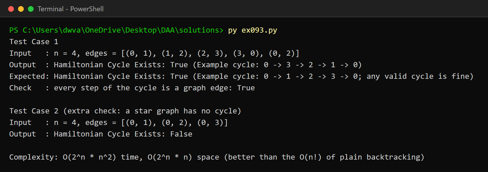

---

<a id="exercise-94"></a>
## Exercise 94 - Generate all subsets of a set in lexicographical order, and handle duplicates

**Program** (`solutions/ex094.py`)

```python
# Exercise 94 - Generate all subsets of a set in lexicographical order, and handle duplicates
def subsets_in_order(S, skip_duplicates=True):
    """Backtracking. For each size r = 0..n build the r-element subsets in lexicographic order
    (the order shown in the question). With skip_duplicates the input is sorted and a value is
    never reused at the same position, so equal elements do not create repeated subsets."""
    S = sorted(S)
    result = []

    def build(start, current, size):
        if len(current) == size:
            result.append(current[:])
            return
        for i in range(start, len(S)):
            if skip_duplicates and i > start and S[i] == S[i - 1]:
                continue                      # this value was already tried at this position
            current.append(S[i])
            build(i + 1, current, size)
            current.pop()

    for size in range(len(S) + 1):
        build(0, [], size)
    return result


def subsets_dictionary_order(S):
    """Same subsets in strict dictionary order (pre-order walk of the subset tree)."""
    S, result = sorted(S), []

    def walk(start, current):
        result.append(current[:])
        for i in range(start, len(S)):
            if i > start and S[i] == S[i - 1]:
                continue
            walk(i + 1, current + [S[i]])

    walk(0, [])
    return result


if __name__ == "__main__":
    A = [1, 2, 3]
    expected = [[], [1], [2], [3], [1, 2], [1, 3], [2, 3], [1, 2, 3]]
    print("Test Case 1")
    print(f"Input   : A = {A}")
    out = subsets_in_order(A)
    print(f"Output  : Subsets: {out}")
    print(f"Expected: Subsets: {expected}")
    print(f"Match   : {out == expected}   (count = {len(out)} = 2^{len(A)})")
    print(f"Note    : strict dictionary order would be {subsets_dictionary_order(A)}")
    print("\nTest Case 2 (duplicates)")
    B = [1, 2, 2]
    print(f"Input   : A = {B}")
    print(f"Naive (no duplicate check)  : {subsets_in_order(B, skip_duplicates=False)}")
    print(f"With duplicate check        : {subsets_in_order(B)}")
    print("Handling of duplicates: a naive generator treats the two 2's as different elements and repeats")
    print("  [2] and [1, 2]. This code sorts S and skips an element equal to the previous one at the same")
    print("  position, so every distinct subset appears exactly once (6 subsets instead of 8).")
    print("Complexity: O(n * 2^n) time, because there are 2^n subsets of length up to n.")
```

**Output**

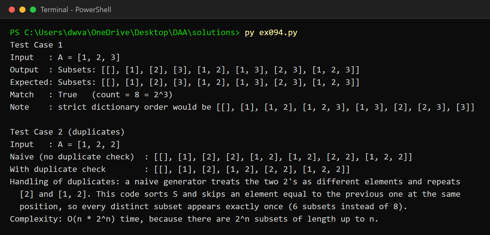

---

<a id="exercise-95"></a>
## Exercise 95 - Subset generation: subsets containing a given element, and the full power set

**Program** (`solutions/ex095.py`)

```python
# Exercise 95 - Subset generation: subsets containing a given element, and the full power set
from itertools import combinations


def subsets_containing(elements, x):
    """Choose any subset of the other elements and add x (kept in sorted position)."""
    others = [e for e in elements if e != x]
    result = []
    for size in range(len(others) + 1):
        for combo in combinations(others, size):
            result.append(sorted(combo + (x,)))
    return result


def power_set(nums):
    """Cascading method: every element doubles the list by appending itself to all earlier subsets."""
    subsets = [[]]
    for n in nums:
        subsets += [s + [n] for s in subsets]
    return subsets


if __name__ == "__main__":
    E, x = [2, 3, 4, 5], 3
    expected = [[3], [2, 3], [3, 4], [3, 5], [2, 3, 4], [2, 3, 5], [3, 4, 5], [2, 3, 4, 5]]
    print("Test Case 1 - subsets that contain x")
    print(f"Input   : E = {E}, x = {x}")
    out = subsets_containing(E, x)
    print(f"Output  : {out}")
    print(f"Expected: {expected}")
    print(f"Match   : {out == expected}   (count = {len(out)} = 2^{len(E) - 1})")

    print("\nTest Case 2 - power set")
    nums = [1, 2, 3]
    expected = [[], [1], [2], [1, 2], [3], [1, 3], [2, 3], [1, 2, 3]]
    print(f"Input   : nums = {nums}")
    out = power_set(nums)
    print(f"Output  : {out}")
    print(f"Expected: {expected}")
    print(f"Match   : {out == expected}")

    print("\nTest Case 3 - power set")
    nums = [0]
    out = power_set(nums)
    print(f"Input   : nums = {nums}")
    print(f"Output  : {out}")
    print(f"Expected: [[], [0]]")
    print(f"Match   : {out == [[], [0]]}")
    print("\nComplexity: O(n * 2^n) time and output size; subsets with x are the power set of n-1 other elements.")
```

**Output**

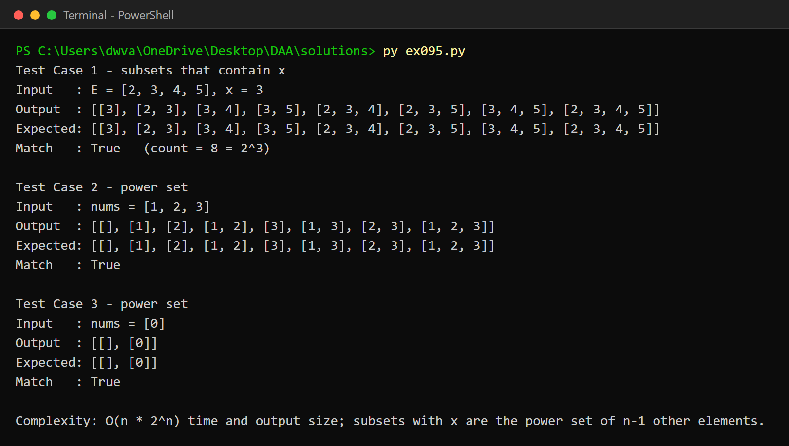

---

<a id="exercise-96"></a>
## Exercise 96 - Word Subsets (universal strings)

**Program** (`solutions/ex096.py`)

```python
# Exercise 96 - Word Subsets (universal strings)
from collections import Counter


def required_counts(words2):
    """For every letter keep the largest multiplicity demanded by any word of words2.
    A word is universal iff it has at least that many copies of each letter."""
    need = Counter()
    for b in words2:
        for letter, count in Counter(b).items():
            need[letter] = max(need[letter], count)
    return need


def universal_words(words1, words2):
    need = required_counts(words2)
    result = []
    for a in words1:
        have = Counter(a)
        if all(have[letter] >= count for letter, count in need.items()):
            result.append(a)
    return result


if __name__ == "__main__":
    shop = ["amazon", "apple", "facebook", "google", "leetcode"]
    tests = [
        (shop, ["e", "o"], ["facebook", "google", "leetcode"]),
        (shop, ["l", "e"], ["apple", "google", "leetcode"]),
        (["warrior", "world"], ["wrr"], ["warrior"]),       # multiplicity example from the question text
    ]
    for number, (words1, words2, expected) in enumerate(tests, 1):
        print(f"Test Case {number}")
        print(f"Input   : words1 = {words1}, words2 = {words2}")
        out = universal_words(words1, words2)
        print(f"Output  : {out}")
        print(f"Expected: {expected}   Match: {out == expected}")
        print()
    print("Merged requirement for words2 = ['wrr', 'e'] :", dict(required_counts(["wrr", "e"])))
    print("Complexity: O(total letters in words1 + words2); the requirement table has at most 26 entries.")
```

**Output**

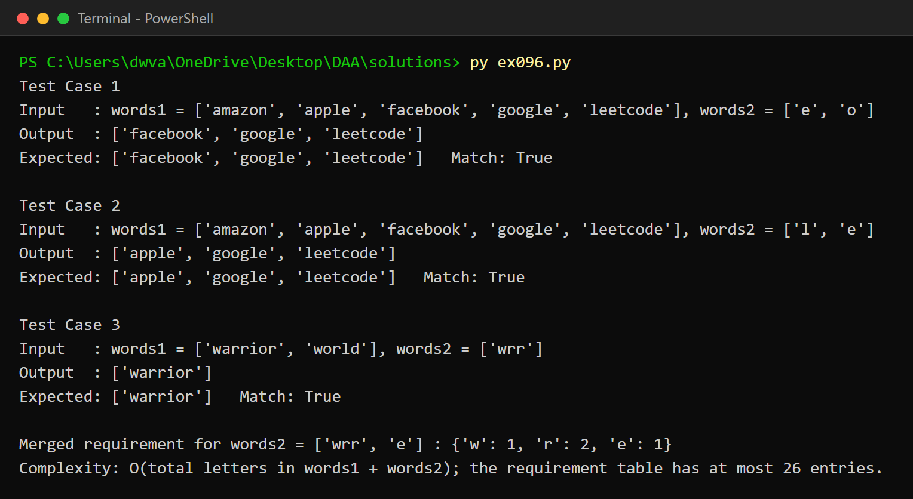

---

