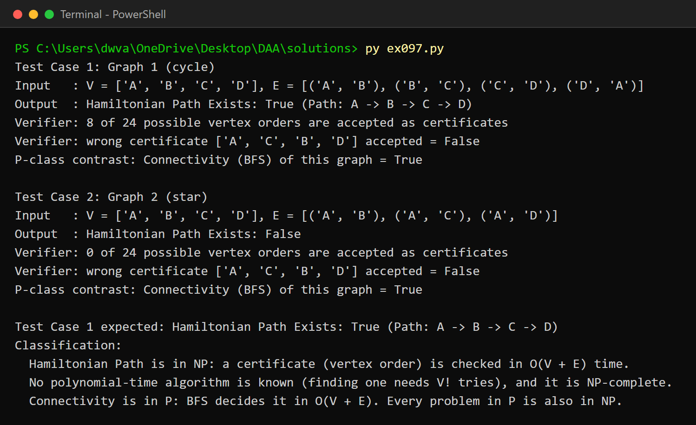
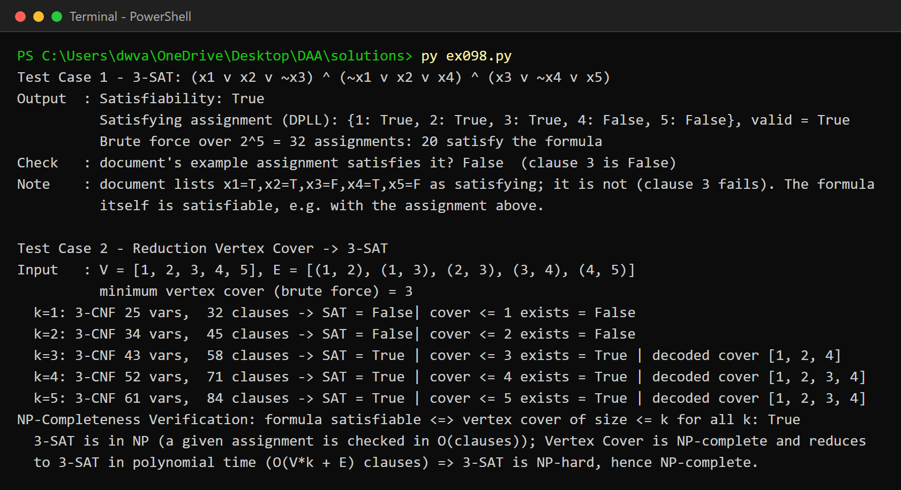
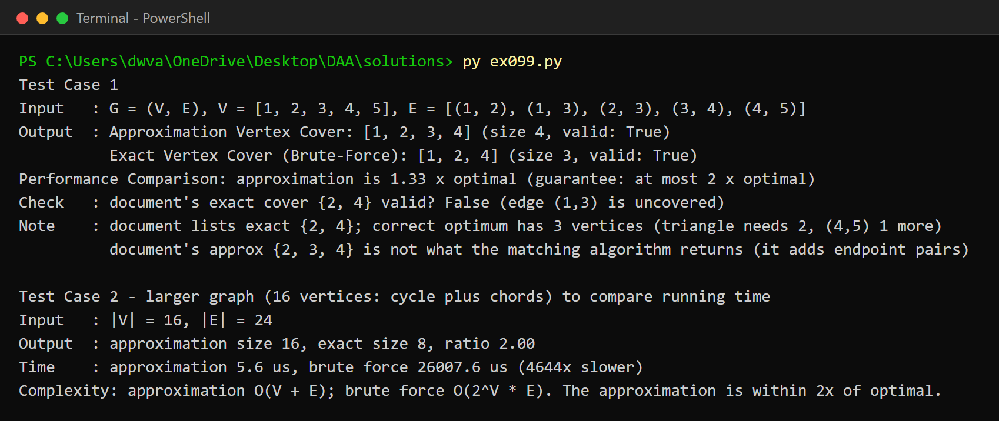
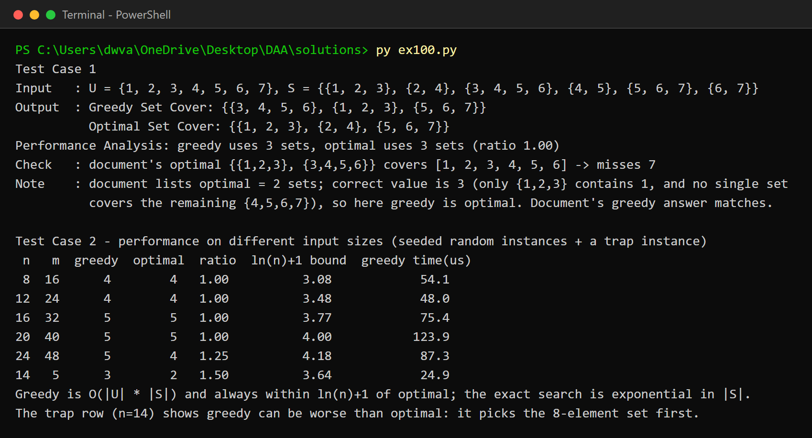
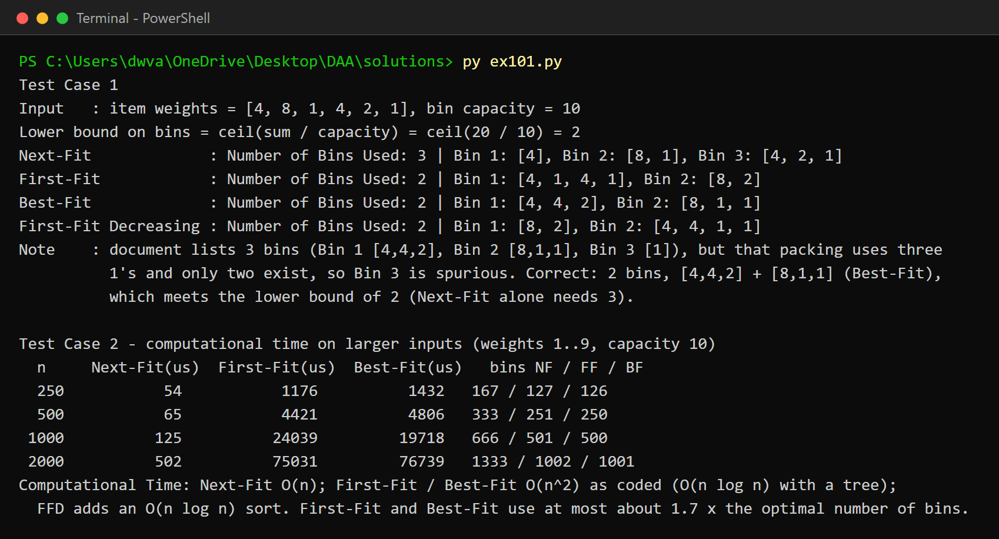
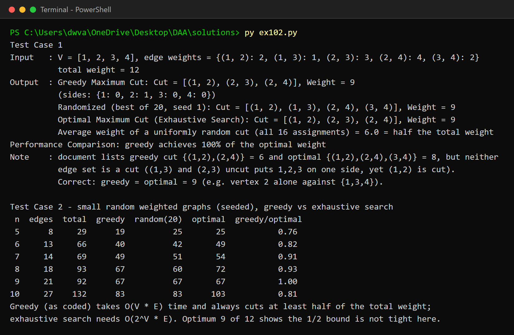

# Topic 7 - Tractability and Approximation Algorithms

[← Back to index](README.md)

- [Exercise 97 - Classes P and NP: Hamiltonian Path (NP verifier) vs Connectivity (P algorithm)](#exercise-97)
- [Exercise 98 - 3-SAT solver and NP-completeness proof by reduction Vertex Cover -> 3-SAT](#exercise-98)
- [Exercise 99 - 2-approximation for Vertex Cover compared with the exact brute-force solution](#exercise-99)
- [Exercise 100 - Greedy approximation for Set Cover, compared with the optimal solution](#exercise-100)
- [Exercise 101 - Bin Packing heuristics: Next-Fit, First-Fit, Best-Fit, First-Fit Decreasing](#exercise-101)
- [Exercise 102 - Maximum Cut: greedy and randomized approximation vs exhaustive search](#exercise-102)

---

<a id="exercise-97"></a>
## Exercise 97 - Classes P and NP: Hamiltonian Path (NP verifier) vs Connectivity (P algorithm)

**Program** (`solutions/ex097.py`)

```python
# Exercise 97 - Classes P and NP: Hamiltonian Path (NP verifier) vs Connectivity (P algorithm)
from collections import deque
from itertools import permutations


def verify_hamiltonian_path(vertices, edges, certificate):
    """NP verifier, polynomial time O(V + E): is `certificate` a path visiting every vertex once?"""
    if sorted(certificate) != sorted(vertices):
        return False
    edge_set = {frozenset(e) for e in edges}
    return all(frozenset(step) in edge_set for step in zip(certificate, certificate[1:]))


def find_hamiltonian_path(vertices, edges):
    """Deterministic search for a certificate: tries all V! orders (exponential). A non-deterministic
    machine would simply 'guess' the right order and then run the verifier above."""
    for order in permutations(vertices):
        if verify_hamiltonian_path(vertices, edges, list(order)):
            return list(order)
    return None


def is_connected(vertices, edges):
    """A problem that is in P: BFS decides connectivity in O(V + E) with no guessing."""
    adj = {v: [] for v in vertices}
    for u, v in edges:
        adj[u].append(v)
        adj[v].append(u)
    seen, queue = {vertices[0]}, deque([vertices[0]])
    while queue:
        for w in adj[queue.popleft()]:
            if w not in seen:
                seen.add(w)
                queue.append(w)
    return len(seen) == len(vertices)


if __name__ == "__main__":
    V = ["A", "B", "C", "D"]
    cases = [
        ("Graph 1 (cycle)", [("A", "B"), ("B", "C"), ("C", "D"), ("D", "A")]),
        ("Graph 2 (star)", [("A", "B"), ("A", "C"), ("A", "D")]),
    ]
    for number, (name, E) in enumerate(cases, 1):
        print(f"Test Case {number}: {name}")
        print(f"Input   : V = {V}, E = {E}")
        path = find_hamiltonian_path(V, E)
        print(f"Output  : Hamiltonian Path Exists: {path is not None}", end="")
        print(f" (Path: {' -> '.join(path)})" if path else "")
        accepted = sum(verify_hamiltonian_path(V, E, list(p)) for p in permutations(V))
        print(f"Verifier: {accepted} of 24 possible vertex orders are accepted as certificates")
        bad = ["A", "C", "B", "D"]
        print(f"Verifier: wrong certificate {bad} accepted = {verify_hamiltonian_path(V, E, bad)}")
        print(f"P-class contrast: Connectivity (BFS) of this graph = {is_connected(V, E)}")
        print()
    print("Test Case 1 expected: Hamiltonian Path Exists: True (Path: A -> B -> C -> D)")
    print("Classification:")
    print("  Hamiltonian Path is in NP: a certificate (vertex order) is checked in O(V + E) time.")
    print("  No polynomial-time algorithm is known (finding one needs V! tries), and it is NP-complete.")
    print("  Connectivity is in P: BFS decides it in O(V + E). Every problem in P is also in NP.")
```

**Output**



---

<a id="exercise-98"></a>
## Exercise 98 - 3-SAT solver and NP-completeness proof by reduction Vertex Cover -> 3-SAT

**Program** (`solutions/ex098.py`)

```python
# Exercise 98 - 3-SAT solver and NP-completeness proof by reduction Vertex Cover -> 3-SAT
from itertools import product, combinations


def satisfied(clauses, model):            # literal +i means x_i, -i means NOT x_i
    return all(any(model.get(abs(l), False) == (l > 0) for l in c) for c in clauses)


def assign_literal(clauses, lit):
    """Make `lit` true: drop satisfied clauses, shrink the others; None if a clause becomes empty."""
    out = []
    for c in clauses:
        if lit in c:
            continue
        rest = [l for l in c if l != -lit]
        if not rest:
            return None
        out.append(rest)
    return out


def dpll(clauses, model=None):
    """DPLL SAT solver (unit propagation + branching). Returns a model dict or None."""
    model = dict(model or {})
    while True:
        unit = next((c[0] for c in clauses if len(c) == 1), None)
        if unit is None:
            break
        clauses = assign_literal(clauses, unit)
        if clauses is None:
            return None
        model[abs(unit)] = unit > 0
    if not clauses:
        return model
    lit = clauses[0][0]
    for choice in (lit, -lit):
        reduced = assign_literal(clauses, choice)
        if reduced is not None:
            found = dpll(reduced, {**model, abs(choice): choice > 0})
            if found is not None:
                return found
    return None


def vertex_cover_to_3sat(vertices, edges, k):
    """Variable x_v = 'v is in the cover'. Edge (u,v) -> (x_u OR x_v). 'At most k true' is encoded by a
    sequential counter (Sinz) with auxiliary variables; short clauses are padded to exactly 3 literals."""
    n = len(vertices)
    x = {i + 1: i + 1 for i in range(n)}
    var = {v: i + 1 for i, v in enumerate(vertices)}
    s = {(i, j): n + (i - 1) * k + j for i in range(1, n) for j in range(1, k + 1)}
    cl = [[var[u], var[v]] for u, v in edges]
    cl += [[-x[1], s[1, 1]]] + [[-s[1, j]] for j in range(2, k + 1)]
    for i in range(2, n):
        cl += [[-x[i], s[i, 1]], [-s[i - 1, 1], s[i, 1]], [-x[i], -s[i - 1, k]]]
        for j in range(2, k + 1):
            cl += [[-x[i], -s[i - 1, j - 1], s[i, j]], [-s[i - 1, j], s[i, j]]]
    cl.append([-x[n], -s[n - 1, k]])
    nxt, out = n + (n - 1) * k + 1, []
    for c in cl:                                  # pad with fresh variables y: (c v y) and (c v NOT y)
        if len(c) == 3:
            out.append(c)
        elif len(c) == 2:
            out += [c + [nxt], c + [-nxt]]
            nxt += 1
        else:
            out += [c + [a, b] for a in (nxt, -nxt) for b in (nxt + 1, -(nxt + 1))]
            nxt += 2
    return out, var, nxt - 1


def min_vertex_cover_size(vertices, edges):
    for size in range(len(vertices) + 1):
        if any(all(u in c or v in c for u, v in edges) for c in map(set, combinations(vertices, size))):
            return size


if __name__ == "__main__":
    formula = [[1, 2, -3], [-1, 2, 4], [3, -4, 5]]
    print("Test Case 1 - 3-SAT: (x1 v x2 v ~x3) ^ (~x1 v x2 v x4) ^ (x3 v ~x4 v x5)")
    sols = [dict(zip(range(1, 6), bits)) for bits in product([False, True], repeat=5)]
    sols = [m for m in sols if satisfied(formula, m)]
    model = dpll(formula)
    full = {i: model.get(i, False) for i in range(1, 6)}
    print(f"Output  : Satisfiability: {model is not None}")
    print(f"          Satisfying assignment (DPLL): {full}, valid = {satisfied(formula, full)}")
    print(f"          Brute force over 2^5 = 32 assignments: {len(sols)} satisfy the formula")
    doc = {1: True, 2: True, 3: False, 4: True, 5: False}
    print(f"Check   : document's example assignment satisfies it? {satisfied(formula, doc)}  (clause 3 is False)")
    print("Note    : document lists x1=T,x2=T,x3=F,x4=T,x5=F as satisfying; it is not (clause 3 fails). The formula")
    print("          itself is satisfiable, e.g. with the assignment above.")
    print("\nTest Case 2 - Reduction Vertex Cover -> 3-SAT")
    V, E = [1, 2, 3, 4, 5], [(1, 2), (1, 3), (2, 3), (3, 4), (4, 5)]
    print(f"Input   : V = {V}, E = {E}")
    print(f"          minimum vertex cover (brute force) = {min_vertex_cover_size(V, E)}")
    agree = True
    for k in range(1, 6):
        cnf, var, nvars = vertex_cover_to_3sat(V, E, k)
        m = dpll(cnf)
        cover = {v for v in V if m and m.get(var[v], False)}
        has_cover = min_vertex_cover_size(V, E) <= k
        decoded_ok = not m or (len(cover) <= k and all(u in cover or v in cover for u, v in E))
        agree &= ((m is not None) == has_cover) and decoded_ok
        print(f"  k={k}: 3-CNF {nvars:2d} vars, {len(cnf):3d} clauses -> SAT = {str(m is not None):5}"
              f"| cover <= {k} exists = {str(has_cover):5}" + (f"| decoded cover {sorted(cover)}" if m else ""))
    print(f"NP-Completeness Verification: formula satisfiable <=> vertex cover of size <= k for all k: {agree}")
    print("  3-SAT is in NP (a given assignment is checked in O(clauses)); Vertex Cover is NP-complete and reduces")
    print("  to 3-SAT in polynomial time (O(V*k + E) clauses) => 3-SAT is NP-hard, hence NP-complete.")
```

**Output**



---

<a id="exercise-99"></a>
## Exercise 99 - 2-approximation for Vertex Cover compared with the exact brute-force solution

**Program** (`solutions/ex099.py`)

```python
# Exercise 99 - 2-approximation for Vertex Cover compared with the exact brute-force solution
from itertools import combinations
from time import perf_counter


def is_vertex_cover(cover, edges):
    return all(u in cover or v in cover for u, v in edges)


def approx_vertex_cover(edges):
    """Take both endpoints of every edge that is still uncovered (a maximal matching).
    The cover has 2 * |matching| vertices and the optimum needs >= |matching|, so ratio <= 2."""
    cover = set()
    for u, v in edges:
        if u not in cover and v not in cover:
            cover |= {u, v}
    return cover


def exact_vertex_cover(vertices, edges):
    """Brute force: test subsets by increasing size; the first cover found is minimum."""
    for size in range(len(vertices) + 1):
        for subset in combinations(vertices, size):
            if is_vertex_cover(set(subset), edges):
                return set(subset)


def compare(vertices, edges):
    t0 = perf_counter()
    approx = approx_vertex_cover(edges)
    t1 = perf_counter()
    exact = exact_vertex_cover(vertices, edges)
    t2 = perf_counter()
    return approx, exact, (t1 - t0) * 1e6, (t2 - t1) * 1e6


if __name__ == "__main__":
    V = [1, 2, 3, 4, 5]
    E = [(1, 2), (1, 3), (2, 3), (3, 4), (4, 5)]
    print("Test Case 1")
    print(f"Input   : G = (V, E), V = {V}, E = {E}")
    approx, exact, ta, te = compare(V, E)
    print(f"Output  : Approximation Vertex Cover: {sorted(approx)} (size {len(approx)}, valid: {is_vertex_cover(approx, E)})")
    print(f"          Exact Vertex Cover (Brute-Force): {sorted(exact)} (size {len(exact)}, valid: {is_vertex_cover(exact, E)})")
    ratio = len(approx) / len(exact)
    print(f"Performance Comparison: approximation is {ratio:.2f} x optimal (guarantee: at most 2 x optimal)")
    print(f"Check   : document's exact cover {{2, 4}} valid? {is_vertex_cover({2, 4}, E)} (edge (1,3) is uncovered)")
    print("Note    : document lists exact {2, 4}; correct optimum has 3 vertices (triangle needs 2, (4,5) 1 more)")
    print("          document's approx {2, 3, 4} is not what the matching algorithm returns (it adds endpoint pairs)")

    print("\nTest Case 2 - larger graph (16 vertices: cycle plus chords) to compare running time")
    V2 = list(range(16))
    E2 = [(i, (i + 1) % 16) for i in range(16)] + [(i, (i + 5) % 16) for i in range(0, 16, 2)]
    approx, exact, ta, te = compare(V2, E2)
    print(f"Input   : |V| = {len(V2)}, |E| = {len(E2)}")
    print(f"Output  : approximation size {len(approx)}, exact size {len(exact)}, ratio {len(approx) / len(exact):.2f}")
    print(f"Time    : approximation {ta:.1f} us, brute force {te:.1f} us ({te / ta:.0f}x slower)")
    print("Complexity: approximation O(V + E); brute force O(2^V * E). The approximation is within 2x of optimal.")
```

**Output**



---

<a id="exercise-100"></a>
## Exercise 100 - Greedy approximation for Set Cover, compared with the optimal solution

**Program** (`solutions/ex100.py`)

```python
# Exercise 100 - Greedy approximation for Set Cover, compared with the optimal solution
import random
from itertools import combinations
from math import log
from time import perf_counter


def greedy_set_cover(universe, sets):
    """Repeatedly pick the set that covers the most still-uncovered elements (ties: first in list)."""
    uncovered, chosen = set(universe), []
    while uncovered:
        best = max(sets, key=lambda s: len(uncovered & s))
        if not uncovered & best:
            return None                                    # universe cannot be covered
        chosen.append(best)
        uncovered -= best
    return chosen


def optimal_set_cover(universe, sets):
    """Exhaustive search over combinations of increasing size; the first one that covers is optimal."""
    target = set(universe)
    for size in range(1, len(sets) + 1):
        for combo in combinations(sets, size):
            if set().union(*combo) >= target:
                return list(combo)


def random_instance(n, m, seed):
    rng = random.Random(seed)
    sets = [set(rng.sample(range(1, n + 1), rng.randint(2, max(3, n // 3)))) for _ in range(m)]
    for e in range(1, n + 1):
        if not any(e in s for s in sets):
            sets[rng.randrange(m)].add(e)
    return sets


def show(family):
    return "{" + ", ".join("{" + ", ".join(map(str, sorted(s))) + "}" for s in family) + "}"


if __name__ == "__main__":
    U = set(range(1, 8))
    S = [{1, 2, 3}, {2, 4}, {3, 4, 5, 6}, {4, 5}, {5, 6, 7}, {6, 7}]
    print("Test Case 1")
    print(f"Input   : U = {show([U])[1:-1]}, S = {show(S)}")
    greedy, optimal = greedy_set_cover(U, S), optimal_set_cover(U, S)
    print(f"Output  : Greedy Set Cover: {show(greedy)}")
    print(f"          Optimal Set Cover: {show(optimal)}")
    print(f"Performance Analysis: greedy uses {len(greedy)} sets, optimal uses {len(optimal)} sets "
          f"(ratio {len(greedy) / len(optimal):.2f})")
    print(f"Check   : document's optimal {{{{1,2,3}}, {{3,4,5,6}}}} covers {sorted(set.union({1,2,3},{3,4,5,6}))} -> misses 7")
    print("Note    : document lists optimal = 2 sets; correct value is 3 (only {1,2,3} contains 1, and no single set")
    print("          covers the remaining {4,5,6,7}), so here greedy is optimal. Document's greedy answer matches.")

    print("\nTest Case 2 - performance on different input sizes (seeded random instances + a trap instance)")
    print(" n   m  greedy  optimal  ratio  ln(n)+1 bound  greedy time(us)")
    trap_u = set(range(1, 15))
    trap = [set(range(1, 8)), set(range(8, 15)), {1, 2, 3, 4, 8, 9, 10, 11}, {5, 6, 12, 13}, {7, 14}]
    cases = [(n, 2 * n, random_instance(n, 2 * n, n)) for n in (8, 12, 16, 20, 24)] + [(14, 5, trap)]
    for n, m, fam in cases:
        universe = trap_u if fam is trap else set(range(1, n + 1))
        t0 = perf_counter()
        g = greedy_set_cover(universe, fam)
        elapsed = (perf_counter() - t0) * 1e6
        o = optimal_set_cover(universe, fam)
        print(f"{n:2d} {m:3d} {len(g):6d} {len(o):8d} {len(g) / len(o):6.2f} {log(n) + 1:13.2f} {elapsed:15.1f}")
    print("Greedy is O(|U| * |S|) and always within ln(n)+1 of optimal; the exact search is exponential in |S|.")
    print("The trap row (n=14) shows greedy can be worse than optimal: it picks the 8-element set first.")
```

**Output**



---

<a id="exercise-101"></a>
## Exercise 101 - Bin Packing heuristics: Next-Fit, First-Fit, Best-Fit, First-Fit Decreasing

**Program** (`solutions/ex101.py`)

```python
# Exercise 101 - Bin Packing heuristics: Next-Fit, First-Fit, Best-Fit, First-Fit Decreasing
from math import ceil
from time import perf_counter


def next_fit(items, cap):
    """Keep only the last bin open. O(n)."""
    bins = [[items[0]]]
    for w in items[1:]:
        if sum(bins[-1]) + w <= cap:
            bins[-1].append(w)
        else:
            bins.append([w])
    return bins


def first_fit(items, cap):
    """Put each item into the first bin it fits in. O(n * bins) = O(n^2) worst case."""
    bins = []
    for w in items:
        for b in bins:
            if sum(b) + w <= cap:
                b.append(w)
                break
        else:
            bins.append([w])
    return bins


def best_fit(items, cap):
    """Put each item into the fullest bin that still has room. O(n^2) worst case."""
    bins = []
    for w in items:
        fits = [b for b in bins if sum(b) + w <= cap]
        if fits:
            max(fits, key=sum).append(w)
        else:
            bins.append([w])
    return bins


def first_fit_decreasing(items, cap):
    return first_fit(sorted(items, reverse=True), cap)


def average_time_us(func, items, cap, repeats=2000):
    t0 = perf_counter()
    for _ in range(repeats):
        func(items, cap)
    return (perf_counter() - t0) / repeats * 1e6


if __name__ == "__main__":
    items, cap = [4, 8, 1, 4, 2, 1], 10
    algorithms = [("Next-Fit", next_fit), ("First-Fit", first_fit), ("Best-Fit", best_fit),
                  ("First-Fit Decreasing", first_fit_decreasing)]
    print("Test Case 1")
    print(f"Input   : item weights = {items}, bin capacity = {cap}")
    print(f"Lower bound on bins = ceil(sum / capacity) = ceil({sum(items)} / {cap}) = {ceil(sum(items) / cap)}")
    for name, func in algorithms:
        bins = func(items, cap)
        packing = ", ".join(f"Bin {i}: {b}" for i, b in enumerate(bins, 1))
        print(f"{name:21s}: Number of Bins Used: {len(bins)} | {packing}")
        assert sorted(sum(bins, [])) == sorted(items)       # every item packed exactly once
    print("Note    : document lists 3 bins (Bin 1 [4,4,2], Bin 2 [8,1,1], Bin 3 [1]), but that packing uses three")
    print("          1's and only two exist, so Bin 3 is spurious. Correct: 2 bins, [4,4,2] + [8,1,1] (Best-Fit),")
    print("          which meets the lower bound of 2 (Next-Fit alone needs 3).")
    print("\nTest Case 2 - computational time on larger inputs (weights 1..9, capacity 10)")
    print("  n     Next-Fit(us)  First-Fit(us)  Best-Fit(us)   bins NF / FF / BF")
    for n in (250, 500, 1000, 2000):
        big = [(i * 7) % 9 + 1 for i in range(n)]
        times = [average_time_us(f, big, cap, 3) for _, f in algorithms[:3]]
        counts = [len(f(big, cap)) for _, f in algorithms[:3]]
        print(f"{n:5d} {times[0]:12.0f} {times[1]:14.0f} {times[2]:13.0f}   {counts[0]} / {counts[1]} / {counts[2]}")
    print("Computational Time: Next-Fit O(n); First-Fit / Best-Fit O(n^2) as coded (O(n log n) with a tree);")
    print("  FFD adds an O(n log n) sort. First-Fit and Best-Fit use at most about 1.7 x the optimal number of bins.")
```

**Output**



---

<a id="exercise-102"></a>
## Exercise 102 - Maximum Cut: greedy and randomized approximation vs exhaustive search

**Program** (`solutions/ex102.py`)

```python
# Exercise 102 - Maximum Cut: greedy and randomized approximation vs exhaustive search
import random
from itertools import product


def cut_weight(side, weights):
    return sum(w for (u, v), w in weights.items() if side[u] != side[v])


def greedy_max_cut(vertices, weights):
    """Place vertices one by one on the side that cuts more edge weight towards already placed vertices."""
    side = {vertices[0]: 0}
    for v in vertices[1:]:
        to_side = [0, 0]                         # weight of edges from v to placed vertices on side 0 / 1
        for (a, b), w in weights.items():
            other = b if a == v else a if b == v else None
            if other in side:
                to_side[side[other]] += w
        side[v] = 0 if to_side[1] >= to_side[0] else 1      # join the side opposite the heavier neighbours
    return side


def randomized_max_cut(vertices, weights, trials, seed):
    rng = random.Random(seed)
    sides = ({v: rng.randint(0, 1) for v in vertices} for _ in range(trials))
    return max(sides, key=lambda s: cut_weight(s, weights))


def exhaustive_max_cut(vertices, weights):
    best = None
    for bits in product([0, 1], repeat=len(vertices) - 1):    # first vertex fixed on side 0 (symmetry)
        side = dict(zip(vertices, (0,) + bits))
        if best is None or cut_weight(side, weights) > cut_weight(best, weights):
            best = side
    return best


def cut_edges(side, weights):
    return sorted(e for e in weights if side[e[0]] != side[e[1]])


if __name__ == "__main__":
    V = [1, 2, 3, 4]
    W = {(1, 2): 2, (1, 3): 1, (2, 3): 3, (2, 4): 4, (3, 4): 2}
    print("Test Case 1")
    print(f"Input   : V = {V}, edge weights = {W}")
    print(f"          total weight = {sum(W.values())}")
    g, o = greedy_max_cut(V, W), exhaustive_max_cut(V, W)
    r = randomized_max_cut(V, W, 20, 1)
    print(f"Output  : Greedy Maximum Cut: Cut = {cut_edges(g, W)}, Weight = {cut_weight(g, W)}")
    print(f"          (sides: {g})")
    print(f"          Randomized (best of 20, seed 1): Cut = {cut_edges(r, W)}, Weight = {cut_weight(r, W)}")
    print(f"          Optimal Maximum Cut (Exhaustive Search): Cut = {cut_edges(o, W)}, Weight = {cut_weight(o, W)}")
    avg = sum(cut_weight(dict(zip(V, b)), W) for b in product([0, 1], repeat=4)) / 16
    print(f"          Average weight of a uniformly random cut (all 16 assignments) = {avg} = half the total weight")
    print(f"Performance Comparison: greedy achieves {100 * cut_weight(g, W) / cut_weight(o, W):.0f}% of the optimal weight")
    print("Note    : document lists greedy cut {(1,2),(2,4)} = 6 and optimal {(1,2),(2,4),(3,4)} = 8, but neither")
    print("          edge set is a cut ((1,3) and (2,3) uncut puts 1,2,3 on one side, yet (1,2) is cut).")
    print("          Correct: greedy = optimal = 9 (e.g. vertex 2 alone against {1,3,4}).")
    print("\nTest Case 2 - small random weighted graphs (seeded), greedy vs exhaustive search")
    print(" n  edges  total  greedy  random(20)  optimal  greedy/optimal")
    rng = random.Random(7)
    for n in (5, 6, 7, 8, 9, 10):
        verts = list(range(1, n + 1))
        weights = {(a, b): rng.randint(1, 9) for a in verts for b in verts if a < b and rng.random() < 0.6}
        gw = cut_weight(greedy_max_cut(verts, weights), weights)
        rw = cut_weight(randomized_max_cut(verts, weights, 20, n), weights)
        ow = cut_weight(exhaustive_max_cut(verts, weights), weights)
        print(f"{n:2d} {len(weights):6d} {sum(weights.values()):6d} {gw:7d} {rw:11d} {ow:8d} {gw / ow:14.2f}")
    print("Greedy (as coded) takes O(V * E) time and always cuts at least half of the total weight;")
    print("exhaustive search needs O(2^V * E). Optimum 9 of 12 shows the 1/2 bound is not tight here.")
```

**Output**



---

